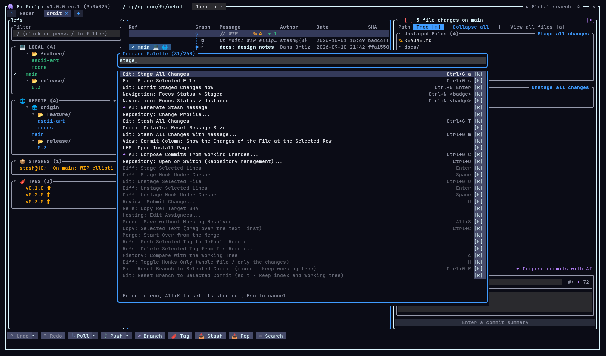

[English](README.md) · [Čeština](README.cs.md) · [Deutsch](README.de.md) · [Español](README.es.md) · [Français](README.fr.md) · [Italiano](README.it.md) · [日本語](README.ja.md) · [한국어](README.ko.md) · [Nederlands](README.nl.md) · [Polski](README.pl.md) · [Português (Brasil)](README.pt-BR.md) · [Português (Portugal)](README.pt-PT.md) · [Русский](README.ru.md) · **Svenska** · [Türkçe](README.tr.md) · [Українська](README.uk.md) · [简体中文](README.zh-CN.md)

# GitPoulpi

<p align="center"></p>

**En Git-klient för terminalen som känns som ett skrivbordsprogram.** GitPoulpi
ger dig en fullständig commit-graf som du kan klicka i, dra i och högerklicka
på, en tangentbordsstyrd kommandopalett som når varje funktion, integration med kodvärdar (GitHub, GitLab, Gitea, Forgejo, Azure DevOps, Bitbucket, Gerrit; i molnet eller egna installationer) och ärendehanterare (Jira, Trello, Linear, YouTrack, Redmine eller en mapp med Markdown-anteckningar), och samma operationer som en skriptbar CLI och en MCP-server, så att en
AI-agent kan styra det precis som du. GitPoulpi är inspirerat av GitKraken och
omskrivet från grunden i Rust: nativa binärer, lätta på disk och i minne, inget Electron, inget konto, ingen telemetri. Det körs i din favoritterminal ([vilken?](docs/user/sv/terminals.md)), för en del av oss bor där.


- **Mus och tangentbord, lika fullt ut.** Klicka, dubbelklicka, högerklicka och
  dra och släpp refs på commits, eller tryck `Ctrl+P` och skriv vad du vill.
  Varje musgest har en tangentbordsmotsvarighet, och varje kommando finns i
  paletten.
- **En riktig commit-graf.** Grenar, merges, tags, stashes och arbetskopian i en
  enda rullande Log, ritad som pixlar i terminaler som klarar det och som tecken
  överallt annars. Många mörka och ljusa färgteman, författaravatarer, sökning.
- **Stagea exakt.** Stagea, unstagea eller förkasta en fil, en mapp, en hunk
  eller en enda rad direkt från diffen. Inline eller sida vid sida, med minikarta.
- **Redigera historiken tryggt.** Skriv om (reword) eller ändra (amend) valfri
  commit (meddelande, författare, datum), gör interaktiv rebase med en
  granskningsvy, skriv om många commits på en gång med förhandsgranskning och en
  enda ångring, cherry-picka flera commits, fast-forward, skapa worktrees och
  patchar.
- **Värdtjänster och ärendehantering inbyggt.** Bläddra bland, checka ut och skapa pull och merge requests (GitHub, GitLab, Gitea, Forgejo, Azure DevOps, Bitbucket) och granska Gerrit-changes. Bläddra bland och skapa ärenden, work items och kort (även Jira, Trello, Linear, YouTrack, Redmine och lokala Markdown-anteckningar), om du vill på en Kanban-tavla. Klona från ditt konto och hantera SSH-nycklar.
- **CLI och MCP för agenter.** `gitpoulpi <command> --json` täcker allt
  gränssnittet gör, och `gitpoulpi-mcp` serverar det som MCP-verktyg. En
  bakgrundsdaemon per repository håller varje frontend levande och synkad.
- **Valfri AI, aldrig ett krav.** Av som standard och inget konto behövs: ta med
  din egen API-nyckel eller en lokal agent-CLI som `claude -p`. Generera
  commit-meddelanden, förklara ändringar, skriv pull request-beskrivningar,
  dela upp dina arbetsändringar i flera commits och ta fram utkast till
  regler för historikomskrivning.
- **Git LFS, submoduler, worktrees, patchar, blame och filhistorik,
  bilddiffar, en inbyggd redigerare.**

## Skärmbilder

| | |
|---|---|
|  **Commit-grafen**, här i temat Material med radfärgning. |  **Diffen**, med stage och förkasta per hunk eller per rad. |
|  **Kommandopaletten** (`Ctrl+P`) når varje kommando. |  **Commit-composern** låter dig granska AI-föreslagna commits innan något committas. |
|  **Högerklicka** på vad som helst för dess åtgärder. |  **Inställningar**, med sökning, inklusive den valfria AI-sidan. |

Fler bilder, med förklaringar, finns i [användardokumentationen](docs/user/sv/README.md).

## Installera

Du behöver en `git` i systemet; `git-lfs` är valfritt.

- **Med ett installationsprogram:** en `...-setup.exe` för Windows eller `install.sh` för Linux och macOS (per användare, utan root), bifogad varje utgåva. Ett bygge som installerats från ett utgåvearkiv kan också uppdatera sig självt från versionsmärket i statusraden.
- **Från ett releasearkiv:** packa upp det och följ `INSTALL.txt` i det.
- **Från källkod:**

  ```
  git clone https://github.com/Poulpi-Lab/GitPoulpi.git
  cd GitPoulpi
  cargo build --release
  ```

  Binärerna hamnar i `target/release/`: `gitpoulpi` (CLI, och gränssnittet när
  det körs utan underkommando), `gitpoulpi-tui` och `gitpoulpi-mcp`.
- **Bygg ditt eget releasearkiv:** `cargo run -p xtask -- dist` skapar
  `target/dist/gitpoulpi-<version>-<target>.zip` (Windows) eller `.tar.gz`, med
  en `.sha256`-fil.
- **Mindre binär med bara det du behöver:** `./build-custom.sh` (Windows:
  `build-custom`) frågar vilka språk, integrationer och funktioner (AI, MCP,
  LFS, worktrees, submoduler, nedladdning av avatarer) som ska byggas; se
  [docs/user/sv/custom-builds.md](docs/user/sv/custom-builds.md).

Alla detaljer, valfria verktyg och anteckningar per OS:
[docs/user/sv/installation.md](docs/user/sv/installation.md).

## Snabbstart

```
cd path/to/your/repository
gitpoulpi-tui          # or just: gitpoulpi
```

- `?` öppnar hjälpen med varje tangent och gest, `Ctrl+P` kommandopaletten,
  `Ctrl+,` Inställningar, `q` avslutar.
- Klicka på en commit för att se dess ändringar; klicka på översta raden i Log
  (arbetsändringarna) för att stagea filer och committa.
- I en terminal som klarar det (kitty, Ghostty, WezTerm, iTerm2 (och även Windows Terminal och foot, via sixel)) ritas grafen
  som pixlar. I andra (en vanlig Windows-konsol, tmux) faller den
  automatiskt tillbaka på tecken.

Steg-för-steg-versionen finns i [Komma igång](docs/user/sv/getting-started.md),
och [rundturen i gränssnittet](docs/user/sv/interface-tour.md) namnger varje
område på skärmen.

```
gitpoulpi --json status            # the CLI, scriptable
gitpoulpi --json log --limit 20
claude mcp add gitpoulpi -- gitpoulpi-mcp   # give an AI agent the same tools
```

AI är valfritt och av som standard: slå på GitPoulpis egen AI under
*Inställningar > AI* ([AI-hjälp](docs/user/sv/ai.md)); låt en extern agent styra
GitPoulpi med [MCP och agenter](docs/user/sv/mcp-and-agents.md) (behörigheter,
varje verktyg) och agentskillen
[`skills/gitpoulpi/SKILL.md`](skills/gitpoulpi/SKILL.md).

## Dokumentation

Den kompletta användardokumentationen börjar på **[docs/user/sv/README.md](docs/user/sv/README.md)**:

| | |
|---|---|
| [Komma igång](docs/user/sv/getting-started.md) | Installera, öppna ett repository, gör en första commit |
| [Rundtur i gränssnittet](docs/user/sv/interface-tour.md) | Varje område i fönstret, med namn |
| [Arbeta med Log](docs/user/sv/log-and-history.md) | Graf, refs, grenar, tags, stashes, rebase, cherry-pick |
| [Stage och commit](docs/user/sv/staging-and-committing.md) | Status, diff, hunkar och rader, composern, redigeraren |
| [Inställningar](docs/user/sv/settings.md) | Varje Inställningar-sida och alternativ |
| [AI-hjälp](docs/user/sv/ai.md) | Konfigurera den inbyggda AI:n, varje AI-åtgärd, integritet |
| [Värdtjänster och ärendehantering](docs/user/sv/hosting-integration.md) | GitHub, GitLab, Gitea, Forgejo, Azure DevOps, Bitbucket, Gerrit, Jira, Trello, Linear, YouTrack, Redmine: tokens, länka ett repository, pull och merge requests |
| [CLI](docs/user/sv/cli-reference.md) och [MCP](docs/user/sv/mcp-and-agents.md) | Skripta det, eller låt en agent styra det (behörigheter, varje verktyg) |
| [Kortkommandon](docs/user/sv/keybindings.md) (och varje palettkommando), [mus](docs/user/sv/mouse-and-gestures.md), [konfiguration](docs/user/sv/config-reference.md), [LFS](docs/user/sv/lfs.md), [ångra](docs/user/sv/undo-redo.md), [felsökning](docs/user/sv/troubleshooting.md) | Referens och hjälp |

Utvecklare: [CLAUDE.md](CLAUDE.md) och `docs/architecture/overview.md` beskriver
crates och designen; [CHANGELOG.md](CHANGELOG.md) listar vad som ingår i varje
release.

## Licens

[MIT](LICENSE).

## Tack och tredjepartslicenser

GitPoulpi bygger på bibliotek med öppen källkod och använder färgvärden från publicerade teman. Deras licenser och tack, temaförfattarna inräknade, finns i [THIRD-PARTY-LICENSES.txt](THIRD-PARTY-LICENSES.txt). Filen levereras med varje version; fönstret Om GitPoulpi och `gitpoulpi licenses` visar den också.

## Varumärken

GitKraken är ett varumärke som tillhör respektive ägare. GitPoulpi är ett oberoende projekt och är inte knutet till, godkänt av eller sponsrat av ägaren; namnet nämns endast för att beskriva kompatibilitet och inspiration.
