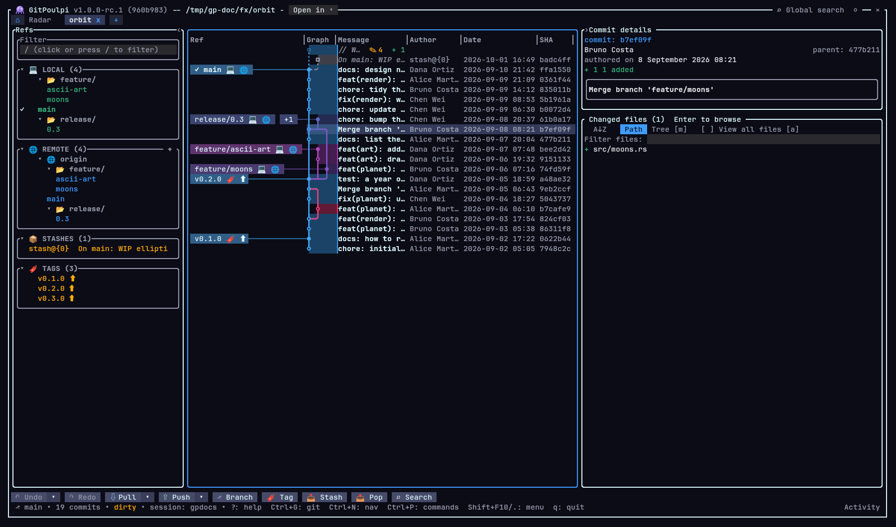

[English](../../README.md) · [Čeština](README.cs.md) · [Deutsch](README.de.md) · [Español](README.es.md) · [Français](README.fr.md) · **Italiano** · [日本語](README.ja.md) · [한국어](README.ko.md) · [Nederlands](README.nl.md) · [Polski](README.pl.md) · [Português (Brasil)](README.pt-BR.md) · [Português (Portugal)](README.pt-PT.md) · [Русский](README.ru.md) · [Svenska](README.sv.md) · [Türkçe](README.tr.md) · [Українська](README.uk.md) · [简体中文](README.zh-CN.md)

# GitPoulpi

<p align="center"></p>

**Un client Git per il terminale che si usa come un’app desktop.** GitPoulpi
offre un grafo dei commit completo su cui puoi cliccare, trascinare e usare il
clic destro, una palette dei comandi pensata per la tastiera che raggiunge ogni
funzione, l’integrazione con servizi di hosting del codice (GitHub, GitLab, Gitea, Forgejo, Azure DevOps, Bitbucket, Gerrit, in cloud o self-hosted) e con issue tracker (Jira, Trello, Linear, YouTrack, Redmine o una cartella di note Markdown), e le stesse operazioni come CLI scriptabile e come
server MCP, così un agente IA può pilotarlo esattamente come fai tu. GitPoulpi
è ispirato a GitKraken e riscritto da zero in Rust: binari nativi, leggeri su disco e in memoria, senza Electron, nessun account, nessuna telemetria. Funziona nel tuo terminale preferito ([quale?](../../docs/user/it/terminals.md)), perché alcuni di noi ci vivono dentro.


- **Mouse e tastiera, alla pari.** Clic, doppio clic, clic destro e
  trascinamento dei ref sui commit; oppure premi `Ctrl+P` e scrivi quello che vuoi.
  Ogni gesto del mouse ha un gemello da tastiera e ogni comando è nella palette.
- **Un vero grafo dei commit.** Branch, merge, tag, stash e la copia di lavoro
  in un unico Log scorrevole, disegnato a pixel nei terminali che lo supportano
  e a caratteri ovunque altrove. Molti temi di colore scuri e chiari, avatar
  degli autori, ricerca.
- **Stage preciso.** Metti in stage, togli dallo stage o scarta un file, una
  cartella, un hunk o una singola riga direttamente dal diff. In linea o
  affiancato, con una minimappa.
- **Modifica la cronologia in sicurezza.** Riformula o modifica qualsiasi
  commit (messaggio, autore, date), fai un rebase interattivo con una schermata
  di revisione, riscrivi molti commit in una volta con un’anteprima e un solo
  annullamento, fai il cherry-pick di più commit e il fast-forward, crea
  worktree e patch.
- **Hosting e issue tracker integrati.** Sfoglia, fai il checkout e crea pull e merge request (GitHub, GitLab, Gitea, Forgejo, Azure DevOps, Bitbucket) e rivedi le modifiche di Gerrit. Sfoglia e crea issue, work item e card (anche Jira, Trello, Linear, YouTrack, Redmine e note Markdown locali), se vuoi su una bacheca Kanban. Clona dal tuo account e gestisci le chiavi SSH.
- **CLI e MCP per gli agenti.** `gitpoulpi <comando> --json` copre tutto
  ciò che fa la UI, e `gitpoulpi-mcp` lo espone come strumenti MCP. Un demone
  in background per repository mantiene ogni frontend aggiornato e sincronizzato.
- **IA facoltativa, mai obbligatoria.** Disattivata per impostazione predefinita
  e senza account: porta la tua chiave API o una CLI di agente locale come
  `claude -p`. Genera messaggi di commit, spiega le modifiche, scrivi le
  descrizioni delle pull request, dividi le modifiche in corso in più commit e
  prepara le regole di una riscrittura della cronologia.
- **Git LFS, sottomoduli, worktree, patch, blame e cronologia dei file, diff
  di immagini, un editor integrato.**

## Schermate

| | |
|---|---|
|  **Il grafo dei commit**, qui con la tavolozza di corsie Material e la tinta delle righe. |  **Il diff**, con stage e scarto per hunk o per riga. |
|  **La palette dei comandi** (`Ctrl+P`) raggiunge ogni comando. |  **Il compositore di commit** fa rivedere i commit proposti dall’IA prima di crearli. |
|  **Clic destro** su qualsiasi elemento per le sue azioni. |  **Impostazioni**, con ricerca, inclusa la pagina IA facoltativa. |

Altre immagini, con spiegazioni, sono nella [documentazione utente](../../docs/user/it/README.md).

## Installazione

Serve un `git` di sistema; `git-lfs` è facoltativo.

### Linux e macOS (`install.sh`)

```
curl -fsSL https://github.com/Poulpi-Lab/GitPoulpi/releases/latest/download/install.sh | sh
```

### Homebrew (macOS, Linux)

```
brew install Poulpi-Lab/gitpoulpi/gitpoulpi
```

### apt (Debian, Ubuntu)

```
sudo install -d /etc/apt/keyrings
curl -fsSL https://poulpi-lab.github.io/apt-gitpoulpi/gitpoulpi-archive-keyring.gpg | sudo tee /etc/apt/keyrings/gitpoulpi.gpg >/dev/null
sudo curl -fsSL -o /etc/apt/sources.list.d/gitpoulpi.sources https://poulpi-lab.github.io/apt-gitpoulpi/gitpoulpi.sources
sudo apt update && sudo apt install gitpoulpi
```

### Scoop (Windows)

```
scoop bucket add gitpoulpi https://github.com/Poulpi-Lab/scoop-gitpoulpi
scoop install gitpoulpi
```

### Installer per Windows

Scarica `gitpoulpi-<version>-x86_64-pc-windows-msvc-setup.exe` dall'[ultima release](https://github.com/Poulpi-Lab/GitPoulpi/releases/latest) ed
eseguilo. Per gli amministratori, l'MSI:

```
msiexec /i gitpoulpi-<version>-x86_64-pc-windows-msvc.msi /qn
```

### Docker

```
docker pull poulpilab/gitpoulpi
```

Vedi [Esecuzione in Docker](../user/it/docker.md).

### cargo

```
cargo binstall gitpoulpi-cli          # prebuilt
cargo install --locked gitpoulpi-cli  # compiles
```

### Archivio di release

Scaricalo dall'[ultima release](https://github.com/Poulpi-Lab/GitPoulpi/releases/latest),
decomprimilo e segui `INSTALL.txt` al suo interno.

### Dai sorgenti

```
git clone https://github.com/Poulpi-Lab/GitPoulpi.git
cd GitPoulpi
cargo build --release
```

Il tuo archivio di release, una build personalizzata più piccola e le note per sistema operativo:
[docs/user/it/installation.md](../user/it/installation.md) e
[docs/user/it/custom-builds.md](../user/it/custom-builds.md).

## Avvio rapido

```
cd path/to/your/repository
gitpoulpi
```

- `?` apre l’aiuto con ogni tasto e gesto, `Ctrl+P` la palette dei comandi,
  `Ctrl+,` le Impostazioni, `q` esce.
- Clicca un commit per vederne le modifiche; clicca la riga in cima al Log (le
  modifiche in corso) per mettere in stage i file e fare il commit.
- In un terminale che lo supporta (kitty, Ghostty, WezTerm, iTerm2 (e anche Windows Terminal e foot, tramite sixel)) il grafo è
  disegnato a pixel. Negli altri (una normale console Windows, tmux)
  passa automaticamente ai caratteri.

La versione passo per passo è in [Per iniziare](../../docs/user/it/getting-started.md),
e [il tour dell’interfaccia](../../docs/user/it/interface-tour.md) dà un nome a ogni
area dello schermo.

```
gitpoulpi --json status            # the CLI, scriptable
gitpoulpi --json log --limit 20
claude mcp add gitpoulpi -- gitpoulpi-mcp   # give an AI agent the same tools
```

L’IA è facoltativa e disattivata per impostazione predefinita: attiva l’IA di
GitPoulpi in *Impostazioni > IA* ([Assistenza IA](../../docs/user/it/ai.md)); lascia
che un agente esterno piloti GitPoulpi con
[MCP e agenti](../../docs/user/it/mcp-and-agents.md) (permessi, ogni strumento) e con
la skill per agenti [`skills/gitpoulpi/SKILL.md`](../../skills/gitpoulpi/SKILL.md).

## Documentazione

La documentazione utente completa parte da **[docs/user/it/README.md](../../docs/user/it/README.md)**:

| | |
|---|---|
| [Per iniziare](../../docs/user/it/getting-started.md) | Installa, apri un repository, fai il primo commit |
| [Tour dell’interfaccia](../../docs/user/it/interface-tour.md) | Ogni area della finestra, con il suo nome |
| [Lavorare con il Log](../../docs/user/it/log-and-history.md) | Grafo, ref, branch, tag, stash, rebase, cherry-pick |
| [Stage e commit](../../docs/user/it/staging-and-committing.md) | Stato, diff, hunk e righe, il compositore, l’editor |
| [Impostazioni](../../docs/user/it/settings.md) | Ogni pagina e opzione delle Impostazioni |
| [Assistenza IA](../../docs/user/it/ai.md) | Configura l’IA integrata, ogni azione IA, privacy |
| [Integrazioni di hosting e issue tracker](../../docs/user/it/hosting-integration.md) | GitHub, GitLab, Gitea, Forgejo, Azure DevOps, Bitbucket, Gerrit, Jira, Trello, Linear, YouTrack, Redmine: token, collegare un repository, pull e merge request |
| [CLI](../../docs/user/it/cli-reference.md) e [MCP](../../docs/user/it/mcp-and-agents.md) | Automatizzalo, o lascia che lo piloti un agente (permessi, ogni strumento) |
| [Scorciatoie da tastiera](../../docs/user/it/keybindings.md) (e ogni comando della palette), [mouse](../../docs/user/it/mouse-and-gestures.md), [configurazione](../../docs/user/it/config-reference.md), [LFS](../../docs/user/it/lfs.md), [annulla](../../docs/user/it/undo-redo.md), [risoluzione dei problemi](../../docs/user/it/troubleshooting.md) | Riferimento e aiuto |

Per gli sviluppatori: [CLAUDE.md](../../CLAUDE.md) e `docs/architecture/overview.md`
descrivono i crate e il design; [CHANGELOG.md](../../CHANGELOG.md) elenca cosa c’è in
ogni release.

## Licenza

[MIT](../../LICENSE).

## Crediti e licenze di terze parti

GitPoulpi si basa su librerie open source e usa valori di colore di temi pubblicati. Le loro licenze e i crediti, compresi gli autori dei temi, sono in [THIRD-PARTY-LICENSES.txt](../../THIRD-PARTY-LICENSES.txt). Il file è incluso in ogni versione; lo mostrano anche la finestra Informazioni e `gitpoulpi licenses`.

## Marchi

GitKraken è un marchio del rispettivo proprietario. GitPoulpi è un progetto indipendente, non affiliato, né approvato o sponsorizzato da esso; il nome è citato solo per descrivere compatibilità e ispirazione.
