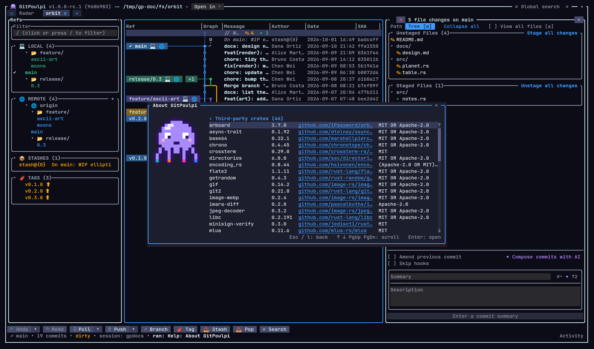
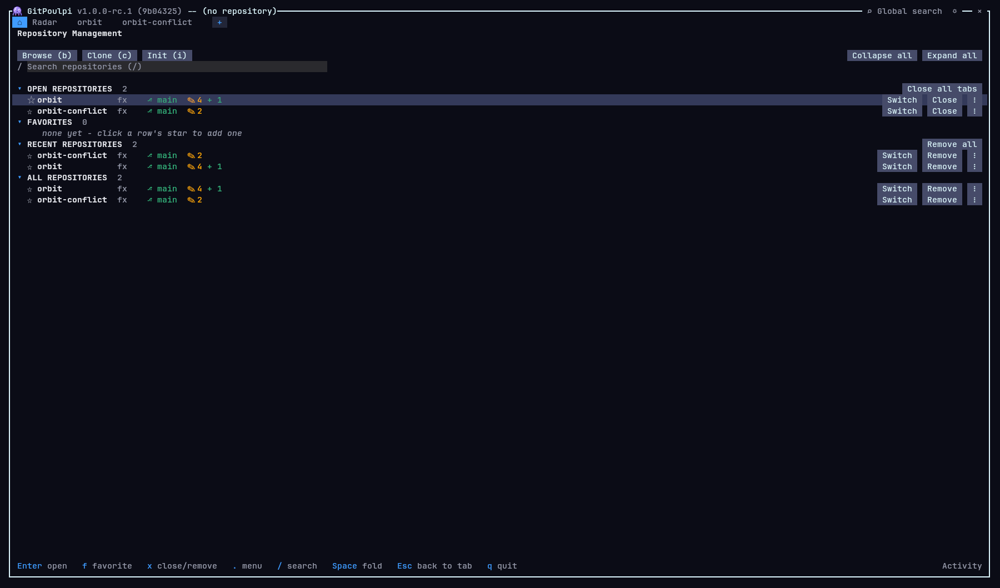

[English](../interface-tour.md) · **Čeština** · [Deutsch](../de/interface-tour.md) · [Español](../es/interface-tour.md) · [Français](../fr/interface-tour.md) · [Italiano](../it/interface-tour.md) · [日本語](../ja/interface-tour.md) · [한국어](../ko/interface-tour.md) · [Nederlands](../nl/interface-tour.md) · [Polski](../pl/interface-tour.md) · [Português (Brasil)](../pt-BR/interface-tour.md) · [Português (Portugal)](../pt-PT/interface-tour.md) · [Русский](../ru/interface-tour.md) · [Svenska](../sv/interface-tour.md) · [Türkçe](../tr/interface-tour.md) · [Українська](../uk/interface-tour.md) · [简体中文](../zh-CN/interface-tour.md)

# Prohlídka rozhraní

Tato stránka pojmenovává každou oblast okna GitPoulpi, shora dolů. Ostatní
stránky používají stejné názvy. Obrázky ukazují malý ukázkový repozitář
s vymyšlenými autory.

## Rámec

### Záhlaví okna

Horní okraj okna zobrazuje
`🐙 GitPoulpi vX.Y.Z -- <cesta repozitáře>` (název relace je ve stavovém řádku, ve výchozím stavu dole).

- **🐙** otevře okno **O aplikaci GitPoulpi**: verze, funkce sestavení, licence, odkazy a crates třetích stran. Na terminálu, který kreslí obrázky, je chobotnice pixelové logo v barvě vašeho loga (jinde zůstává emoji). Paleta: `Nápověda: O aplikaci GitPoulpi`; klávesy: `Ctrl+N`, pak `A`. V okně O aplikaci sledují zorničky chobotnice ukazatel myši. Kliknutím na logo (nebo stiskem `Space`) ho roztočíte do další barvy. Pravým tlačítkem na logo (nebo stiskem `c`) otevřete seznam barev. GitPoulpi uloží vaši volbu do `ui.logo_color`. Odkazy se otevřou kliknutím nebo svou přístupovou klávesou (`s` zdrojový kód, `d` dokumentace, `i` licence) a `l` vypíše crates třetích stran s jejich verzemi a licencemi (posouvatelný seznam; `Esc` nebo `l` vrátí zpět, stejně jako klik na jeho nadpis). Každý crate v seznamu má odkaz na svou stránku (repozitář, jinak stránku na crates.io): klikněte na řádek, nebo ho vyberte pomocí `↑` `↓` a stiskněte `Enter`, a otevře se v prohlížeči. `t` (nebo příkaz palety `Help: Licenses and Credits`) otevře licenční oznámení a poděkování ke všemu, co je v programu zabudováno, jako posouvatelný text (`Up` / `Down`, `PgUp` / `PgDn`, `Home` / `End`; zpět `Esc` nebo `t`). Ve skriptu vypíše stejný text `gitpoulpi licenses`.
- **Verze** (`v1.0.0`, nebo `vX.Y.Z k dispozici`, existuje-li novější vydání)
  je mezi názvem a cestou: kliknutí otevře panel aktualizací, když existuje
  novější vydání, jinak kartu **Poznámky k vydání**. Viz [Aktualizace](updates.md).
- **Otevřít v ▾** hned za cestou otevře složku karty v terminálu, editoru,
  multiplexeru nebo správci souborů (`Alt+O`). Viz [Otevřít v](open-in.md).
- **⌕ Globální hledání** (lupa se svým popiskem), těsně vlevo od ozubeného kola, otevře [globální hledání](search.md) (`Ctrl+Alt+F`). Když je záhlaví příliš úzké, ustoupí jako první: nejdřív zmizí popisek (lupa zůstane), potom celé tlačítko.
- **Ozubené kolo** (`⚙`), těsně vlevo od **×**, otevře **Nastavení** (`Ctrl+,`).
- **×** na pravém konci ukončí aplikaci, stejně jako `q`.

### Stavový řádek

Stavový řádek je ve výchozím stavu posledním řádkem okna (**Nastavení > Vzhled > Umístění stavového řádku** ho přesune nahoru, nad karty repozitářů). Ukazuje aktuální větev, načtené commity
(`500 / 48213 commitů`, dokud zbývá načíst starší historii, s `...` místo celkového počtu, zatímco se počítá;
jen `2500 commitů`, když je načtena celá historie), `dirty` nebo `clean`, název relace, štítek `částečný`
v částečném (sparse) checkoutu a nejužitečnější klávesy: `?` nápověda, `Ctrl+G` akce
gitu, `Ctrl+N` navigace, `Ctrl+P` příkazy, `Shift+F10` nabídka, `q` konec.
V úzkém okně se nejméně užitečné klávesy vynechají. Stavový řádek zobrazuje také
stavové zprávy a průběh operací. Zobrazené klávesy jsou vždy ty, které právě
platí, včetně těch, které jste změnili (viz
[Nastavení](settings.md#klávesnice-a-myš)). Způsob zjištění celkového počtu je nastavení
(**Celkem commitů zjišťovat pomocí**, viz [Nastavení](settings.md#log-a-graf)).

Na jeho pravém konci tlačítko **Aktivita** otevře Protokol aktivity: kartu Operace gitu
(operace s dobou trvání, zprávy a chyby), kartu Aplikace (protokol aplikace s polem úrovně
a tlačítkem **Vymazat protokol**) a pole Rozsah, které obě zúží na tento repozitář, pracovní
prostor nebo všechny repozitáře. Číslo na tlačítku počítá chyby, na které jste se ještě
nepodívali. Vlevo od něj ukazuje indikátor úloh běžící úlohu na pozadí s `[x]` pro její
zrušení. Karta **Domů** má stejný stavový řádek s tlačítkem Aktivita vpravo dole (otevře se
na volbě Všechny repozitáře). Když operace selže, stavový řádek ukáže důvod červeně
v jakémkoli zobrazení a kliknutí na něj (nebo `Protokol aktivity: Otevřít poslední chybu`) otevře záznam v Protokolu aktivity s podrobnostmi, Kopírovat a navrženým dalším krokem. Obojí popisuje
[Když něco selže](troubleshooting.md#když-něco-selže).

### Překryvné vrstvy

Paleta příkazů, nápověda, kontextové nabídky, dialogy, vyskakovací okna
a Nastavení se otevírají nad oknem. Každé má vpravo nahoře na rámu `✕`;
zavřete je klávesou `Esc` nebo kliknutím na `✕` a kliknutí mimo zavře dialog,
vyskakovací okno nebo panel (viz [Zavírání oken a dialogů](mouse-and-gestures.md#zavírání-oken-a-dialogů)).

## Řádek karet

Karta **Domů** (ikona domku) je na levém konci, za ní
[čip pracovního prostoru](workspaces.md) (jakmile nějaký pracovní prostor máte), připnutá karta
**Radar** (zavírá se jako každá karta; viz [Radar](radar.md)) a karta
**Pracovní prostory**, jakmile jste ji otevřeli (`Alt+J`; zavírá se jako každá karta). Potom
následuje jedna karta pro každý otevřený repozitář. Křížek `x`, který zavírá kartu, se zobrazuje
jen na aktivní kartě a na kartě pod ukazatelem. Řádek karet nese jen karty
(tlačítko [globálního hledání](search.md) je v záhlaví okna).

**Nastavení > Vzhled > Umístění lišty karet** přesune tento řádek na konec okna (pod stavový řádek) nebo z něj udělá sloupec u levého okraje: jedna karta na řádek, nejdřív Domů, pak čip pracovního prostoru, Radar, karta Pracovní prostory, karty (dlouhý název končí `…`) a `+`. Když je karet víc než řádků, řádek `…` ukáže, kolik jich je skryto nahoře (`▲`) a dole (`▼`), a otevře seznam karet; kolečko sloupec posouvá. Vedle panelu nástrojů jako sloupce zůstávají karty nejvíc vně. Okno užší než 80 sloupců drží karty nahoře. Kliknutí, křížek zavření, prostřední tlačítko, nabídka pravého tlačítka, přetažení pro změnu pořadí i klávesnice fungují na každé pozici stejně.

- **+** hned za poslední kartou otevře malou nabídku: **Nová karta** (`Alt+T`,
  paleta **Karta: Nová karta**) a, dokud jsou jejich karty zavřené, **Radar** a
  **Pracovní prostory** (`Alt+J`), které tyto karty otevřou; **Karta: Nová...**
  v paletě otevře tutéž nabídku. **Nová karta** je zobrazení Domů s připraveným polem hledání, takže psaní
  hned filtruje vaše repozitáře. Vyberte jeden (nebo Procházet, Klonovat, Init) a
  jeho karta se objeví na konci lišty; repozitář, který už je otevřený, se jen
  přepne. `Esc` v prázdném hledání, `Ctrl+W`, její `x` nebo prostřední tlačítko
  Novou kartu zavře a vrátí na kartu, na které jste byli. Do relace se nikdy
  neukládá.

  
- Kliknutím pravým tlačítkem na kartu, nebo klávesou `Ctrl+T`, otevřete
  nabídku karty: **Nová karta**, **Zavřít kartu**, **Zavřít ostatní karty...**, **Zavřít karty
  vpravo...**, **Přidat do oblíbených** (nebo **Odebrat z oblíbených**),
  **Přidat do pracovního prostoru** (nebo **Odebrat z pracovního prostoru**, když
  máte pracovní prostory), **Kopírovat cestu**, **Otevřít v ›**, **Klíč SSH...**
  a **Částečný checkout...**.
- `Ctrl+PageUp` a `Ctrl+PageDown` přepínají karty. `Ctrl+W` zavře aktuální
  kartu. Zavře ji i prostřední tlačítko na kartě (se stejnou otázkou).
- `t` (nebo `Ctrl+N t`) otevře výběr karty, prohledávatelný seznam otevřených
  karet.
- **Změna pořadí karet:** stiskněte kartu repozitáře a táhněte ji do strany (duch
  karty sleduje ukazatel a pruh ukazuje, kam dopadne; `Esc` zruší), nebo táhněte
  řádek výběru karty, stiskněte `Alt+Up` / `Alt+Down` na zvýrazněném řádku
  výběru, nebo spusťte z palety **Karta: Přesunout doleva** / **Karta: Přesunout
  doprava**. Pořadí se ukládá s relací. Prosté kliknutí bez pohybu kartu pouze
  vybere. Domek, čip pracovního prostoru a `+` se nikdy nepřesouvají.
- **Konec a cd sem** se zobrazí vpravo od karet, když jste GitPoulpi spustili
  přes shellový obal `gp` a karta není složka, ve které jste začínali. Viz
  [Sledování složky karty](following-the-tab-folder.md).
- **Čip pracovního prostoru** hned za domkem (barevná tečka a název, nebo
  „Žádný pracovní prostor“) přepíná [pracovní prostor](workspaces.md): klikněte
  na něj nebo stiskněte `Alt+W`. Objeví se, až nějaký pracovní prostor máte.

Když je zapnuto **Pamatovat si karty** (výchozí stav), vaše karty se obnoví
při dalším spuštění. Worktree se otevře na vlastní kartě. Tato karta se zavře,
když je worktree odstraněn.

Karta worktree se umístí hned za kartu svého repozitáře a odtažená karta worktree se k ní vrátí (**Seskupovat karty worktree** v Nastavení > Obecné, ve výchozím stavu zapnuto).

### Domů

Karta Domů je správce repozitářů. Má čtyři sekce: **OTEVŘENÉ REPOZITÁŘE**,
**OBLÍBENÉ**, **NEDÁVNÉ REPOZITÁŘE** a **VŠECHNY REPOZITÁŘE**. Každý řádek
zobrazuje větev, počty commitů napřed a pozadu a počet změn. Každý řádek má
hvězdičku (oblíbené), **Otevřít** nebo **Přepnout**, **Zavřít** nebo
**Odebrat** a nabídku `⋮`.

Nahoře: **Procházet**, **Klonovat**, **Init**, vyhledávací pole, **Sbalit vše**
a **Rozbalit vše**. Složka, která už neexistuje, z *Nedávných* a *Všech*
zmizí sama. Chybějící oblíbená položka zůstane s tlačítkem **Odebrat**.
**Odebrat** nikdy nic nesmaže na disku.

Klávesy: `Enter` otevřít, `f` oblíbené, `x` zavřít nebo odebrat, `.` nabídka,
`/` hledání, `Space` sbalit sekci, `Esc` zpět na vaši kartu.
`Ctrl+N` zobrazí odznak u vyhledávacího pole, každé sekce a každého tlačítka: stiskněte znak odznaku a prvek se zaměří nebo stiskne (viz [Odznaky](keybindings.md#odznaky)).

Jedno vyhledávací pole filtruje všechno pod ním, včetně Oblíbených: repozitář zůstane, pokud jeho název, větev nebo cesta obsahuje zadaný text. Pracovní prostory mají vlastní kartu a nejsou stránkou karty Domů: otevřete ji z nabídky u `+`, klávesou `Alt+J` nebo z palety příkazů a zavřete ji jejím `x`: viz [Pracovní prostory](workspaces.md).

**Klonovat** vypisuje pro každý připojený profil (GitHub, GitLab, Gitea, Forgejo, Azure DevOps, Bitbucket, Gerrit) repozitáře, ke kterým máte přístup, po jedné sekci na vlastníka: nejdřív vaše vlastní, pak po jedné na organizaci nebo skupinu (abecedně), každá pod nadpisem. Zámek označuje soukromý repozitář. Pole hledání filtruje všechny sekce; sekce bez shody zmizí. `Up` a `Down` přeskakují nadpisy a `Home`, `End`, `PgUp` a `PgDn` fungují v seznamu.

## Panel nástrojů

Ve výchozím stavu je to řádek pod panely a nad stavovým řádkem. **Nastavení > Vzhled > Umístění panelu nástrojů** ho dá nahoru (pod karty), dolů nebo do sloupce vlevo či vpravo od panelů (okno užší než 80 sloupců kreslí sloupec jako řádek dole). Tlačítka leží na začátku řádku nebo sloupce; **Nastavení > Vzhled > Zarovnání tlačítek panelu nástrojů** je vystředí nebo posune na konec. Každé tlačítko má vlastní barvu ikony, kterou určuje motiv (viz [Motivy](themes.md)). Když se nevejdou všechna, nejméně důležitá tlačítka se přesunou za `⋯`. Ve sloupci zabírá každé tlačítko řádek, jeho `▾` je na konci řádku a nabídka se otevře vedle sloupce; nabídka spodního panelu nástrojů se otevře nahoru.

| Tlačítko | Co dělá |
|---|---|
| **Zpět**, **Znovu** | Vezmou zpět nebo obnoví poslední operaci (`Ctrl+Z`, `Ctrl+Y`). Skryté, když je Zpět vypnuto. Viz [Zpět a znovu](undo-redo.md). |
| **Pull** `▾` | Provede pull podle nastavení **Nastavení > Git a kódování > Tlačítko Pull**. Seznam `▾` obsahuje **Fetch všech**, **Pull (fast-forward, pokud lze)**, **Pull (jen fast-forward)** a **Pull (rebase)**. Položka seznamu se provede jednou a tlačítko nemění. |
| **Push** `▾` | Provede push právě přepnuté větve. Seznam `▾` provede push jednou do remote, který zvolíte. |
| **Větev** | Vytvoří větev na právě přepnutém commitu. |
| **Tag** | Vytvoří tag na právě přepnutém commitu. |
| **Stash**, **Pop** | Odloží všechny změny. Vrátí poslední stash. |
| **LFS** `▾` | Akce Git LFS: fetch, checkout, pull, push, prune (`Ctrl+G l`). Skryté, když je Git LFS vypnut. Viz [Git LFS](lfs.md). |
| **Flow** `▾` | Nabídka workflow větvení (zahájit, dokončit, synchronizovat, povýšit; `Ctrl+G Shift+W`). Jen v repozitáři, který má workflow. Viz [Workflow větvení](branching-workflows.md). |
| **Hledat** | Otevře nad Logem lištu hledání commitů (`f`). |

Na konci (vpravo v řádku, dole ve sloupci) se, když je repozitář propojen s hostingem, zobrazí **čip** s pull requestem právě přepnuté větve (například `GH #12` nebo `GL !53`), nebo tlumené `+ PR`. **Nastavení > Vzhled > Připnout tlačítko pull request na konec** (ve výchozím stavu zapnuto) ho tam drží; vypnuto, plyne s ostatními tlačítky a řídí se jejich zarovnáním. Viz [Hostingové služby a issue trackery](hosting-integration.md). Ve sloupci zabírá výběr profilu poslední řádek.

Na pravém konci, když máte dva nebo více [profilů](settings.md#profily),
**výběr profilu** určuje identitu pro commity v tomto repozitáři. První
řádek, *Výchozí*, se řídí položkou **Nastavení > Profily**. Po výběru profilu
se GitPoulpi zeptá, zda má jeho jméno a e-mail zapsat i do konfigurace gitu
repozitáře (`user.name`, `user.email`). **Zapsat do konfigurace gitu** je
zapíše. `Esc` ponechá výběr jen v GitPoulpi. Paleta:
`Repozitář: Změnit profil...`.

Každé tlačítko má příkaz v paletě a klávesovou zkratku.

## Bannery

Pruh nad Logem vás upozorní, když je repozitář ve zvláštním stavu. Nabízí
tlačítka pro další postup. Každé tlačítko je také příkaz v paletě.

| Banner | Tlačítka |
|---|---|
| Merge, cherry-pick nebo revert se zastavil na konfliktech | **Vyřešit konflikty…**, **Commit** nebo **Pokračovat**, **Přerušit** |
| Probíhající rebase | **Vyřešit konflikty…**, **Pokračovat**, **Přeskočit**, **Přerušit** |
| **Aplikace patchů (git am)** | **Vyřešit konflikty…**, **Pokračovat**, **Přeskočit**, **Přerušit** |
| Zbylý `index.lock` blokuje každou změnu | **Odstranit index.lock** (nejdřív se zeptá) |
| Auto-stash nebyl vrácen zpět | **Pop teď**, **Zobrazit stash**, **Začít znovu**, **Drop** (nabídka závisí na stavu) |

Viz [Řešení konfliktů merge](merge-conflicts.md) a
[Řešení potíží](troubleshooting.md).

## Postranní panel Refs (vlevo)

Strom všeho, co pojmenovává commit. Každá sekce má v názvu počet, šipku pro
sbalení a vlastní pozici posuvu. Tažením ohraničení mezi dvěma sekcemi změníte
jejich velikost.

- Pole **Filtr** nahoře (`/`): filtruje všechny sekce podle názvu.
- **LOKÁLNÍ**: vaše větve ve složkách podle `/` (`feature/`, `fix/`). Zatržítko
  označuje přepnutou větev. Složky můžete v Nastavení vypnout.
- **REMOTE**: každý remote s jeho větvemi pod ním.
- **WORKTREES**: propojené worktree, pokud nějaké jsou. Dvojitým kliknutím
  otevřete worktree na vlastní kartě.
- **STASHES**: vaše stashe. Kliknutím pravým tlačítkem zobrazíte **Pop**,
  **Apply** a **Drop**.
- **TAGS**: vaše tagy, ve složkách dělených podle `/` jako větve (`releases/`, `backups/`). Šipka znamená, že tag je i na remote.
- **PULL REQUESTY** a **ISSUES**: po připojení účtu hostingu a propojení
  repozitáře.
- **SUBMODULY**: submoduly a jejich stav, pokud nějaké jsou. Viz
  [Submoduly](submodules.md).

**Zobrazení a skrytí sekce:** klikněte pravým tlačítkem na záhlaví sekce nebo na prázdnou část panelu a objeví se seznam sekcí (poslední viditelná zůstane). Volba se uchovává pro každý repozitář a i po restartu; viz [Sekce levého panelu](mouse-and-gestures.md#sekce-levého-panelu).

Najetím na řádek zobrazíte jeho tlačítka: skrýt nebo zobrazit ref v Logu
a **Solo** (zobrazit jen commity dané ref). Dvojitým kliknutím na lokální větev
nebo tag ji přepnete. Kliknutím pravým tlačítkem na řádek otevřete jeho
nabídku. Šipka `‹` v záhlaví panelu sbalí postranní panel (`Ctrl+N h`).

Oba boční panely (postranní panel Refs, `Ctrl+N h`, a pravý panel, `Ctrl+N l`)
patří Logu: když jeden z nich při otevřeném diffu, zobrazení Soubor nebo editoru
zobrazíte či sbalíte, platí to jen pro to zobrazení. Diff nebo zobrazení Soubor také
samo sbalí postranní panel Refs, aby měl obsah víc místa. Po návratu do Logu jsou
oba panely takové, jak jste je tam nechali, a právě tento stav se uloží pro příští
spuštění.

## Log (uprostřed)

Jeden řádek na commit, nejnovější nahoře. Kliknutím pravým tlačítkem na
záhlaví zobrazíte nebo skryjete sloupce. Tažením ohraničení mezi dvěma
záhlavími změníte šířku sloupce. Tažením záhlaví sloupec přesunete.

Panel nemá titulek: říkají to záhlaví sloupců. Tagy se kreslí tam, kde jsou, nikdy jako zástupné. U commitu bez refu ukáže najetý řádek vybledlou pilulku s názvem větve, do které patří; pokud byla ta větev smazána, přeškrtnutá pilulka ukáže název přečtený ze slučovacího commitu, který ji sloučil (vypíná se volbou **Zobrazit zástupnou větev u najetého commitu** v Nastavení > Log a graf).

| Sloupec | Zobrazuje |
|---|---|
| **Ref** | Barevné pilulky větví a tagů na commitu: ikona notebooku pro lokální, zeměkoule pro remote, ikona tagu pro tagy, `+N`, když tam míří další refs. |
| **Graf** | Dráhy větví, merge a místa odbočení. V kitty, Ghostty, WezTerm a iTerm2 (a také Windows Terminal a foot přes sixel) se kreslí jako obrázky, v ostatních terminálech jako znaky. Barvy drah pocházejí z motivu nebo z palety, kterou zvolíte (viz [Motivy](themes.md)). Při nejmenší šířce (jedna tečka commitu) je sloupec kompaktní: všechny commity na jedné dráze, bez čar větví a merge. |
| **Zpráva** | Souhrn commitu. |
| **Autor** | Autor, volitelně s avatarem. |
| **Datum** | Datum autora ve zvoleném formátu. |
| **Změny** | Volitelně: změněné soubory a řádky `+přidáno -odebráno`. |
| **SHA** | Krátký hash. |

Zvláštní řádky:

- **Řádek pracovních změn** (řádek WIP) nahoře: přerušovaný kruh, `// WIP`
  nebo vaše rozepsaná zpráva a počty změněných a přidaných souborů. Kliknutím
  na něj provedete stage a commit v pravém panelu.
- **Řádky stashů**: malý čtverec na dráze vedle commitu, na kterém stash
  vznikl.
- Při hledání jsou řádky, které neodpovídají, ztlumené.

Najetím na buňku zobrazíte nápovědu s celým textem. Kliknutím pravým tlačítkem
na řádek otevřete [nabídku commitu](log-and-history.md#nabídka-commitu).

## Pravý panel

Pravý panel sleduje výběr v Logu.

**Pracovní změny** (vybraný je řádek WIP):

- Název jako `4 změněné soubory na main`. Při merge s konflikty přidá počet
  souborů v konfliktu. Červené `[✖]` vlevo zahodí všechny změny (nejdřív se
  zeptá). Když je AI zapnuté, `[✦]` vpravo změny vysvětlí.
- **Cesta** nebo **Strom** (plochý seznam nebo složky, `m`), **Sbalit vše**
  a **Zobrazit všechny soubory** (`a`).
- **Soubory unstaged** a **Soubory staged**, každé s počtem a tlačítkem
  **Stage všechny změny** nebo **Unstage všechny změny**. Najetím na řádek
  zobrazíte tlačítko **Stage soubor** nebo **Unstage soubor**.
- **Formulář commitu** dole: **Amend předchozího commitu**, **Sestavit commity
  pomocí AI** (když je AI zapnuté), **Souhrn** s počítadlem znaků
  a tlačítkem `✦`, **Popis** a tlačítko **Commit změn v N souborech**.

**Detaily commitu** (vybraný je commit), shora dolů: úplný hash, autor
s avatarem a datem, hash rodiče a počty změn, pak zpráva (souhrn a popis; tažením
jejího dolního okraje změníte velikost). Podokno **Změněné soubory** pod ní začíná
vlastními ovládacími prvky: přepínač řazení, **Cesta** / **Strom**, **Zobrazit všechny
soubory** a pole **Filtr souborů**, pevně nad seznamem, který se jako jediný posouvá.
Kliknutím na soubor otevřete jeho diff. V nízkém okně ustoupí nejdřív zpráva (až na
jeden řádek), pak seznam. Zobrazení pracovních změn má řádek **Cesta** / **Strom** /
**Zobrazit všechny soubory** nahoře u seznamů souborů, nad seznamy Unstaged a Staged.

Každý seznam souborů má nabídky pro soubory, složky a prázdnou část a více souborů lze vybrat najednou (**Ctrl+klik**, **Shift+klik**); viz [Stagování a commitování](staging-and-committing.md).

## Střední panel při otevřeném souboru

Kliknutím na změněný soubor se jeho zobrazení objeví místo Logu. `Esc` vrátí
Log. Nahoře je řada tlačítek:

| Tlačítko | Co dělá |
|---|---|
| **Soubor**, **Diff**, **Blame** | Zvolí, co panel pro soubor ukazuje. |
| **Historie │ Vše** | Vybere seznam [sloupce commitů](#sloupec-commitů) vedle pohledu a sloupec zobrazí. |
| **Upravit** | Otevře vestavěný editor na kopii v pracovním stromu. |
| `↑` `↓` | Předchozí nebo další hunk. |
| **Sjednocené**, **Vedle sebe** | Jeden sloupec, nebo vedle sebe. |
| **Hunky** | Jen změněné hunky, nebo celý soubor. |
| **WS** | Zobrazí nebo skryje změny jen v bílých znacích. |
| **Zalom.** | Zalomí dlouhé řádky. |
| **Mapa** | Minimapa celého souboru vedle posuvníku. |
| **Kódování** | Kódování, ve kterém se soubor čte (první je **Auto**). |

V diffu pracovního stromu má každý hunk tlačítka **Stage hunk** a **Zahodit
hunk**. Klávesou `v` vyberete řádky a pak provedete stage nebo zahodíte jen
tyto řádky.

Obě zobrazení jsou popsána v [Blame](log-and-history.md#blame) a [Historie souboru](log-and-history.md#historie-souboru).

Vestavěný **editor** má barevné zvýraznění syntaxe, čísla řádků, zpět, hledání
a stavový řádek s řádkem, sloupcem, koncem řádků, odsazením a jazykem.

Obrázek se zobrazí jako obrázek: před a po v diffu, nebo samotný soubor
v pohledu Soubor. Viz [Obrázky](image-view.md).

Binární soubor, který není obrázek (PDF, dokument, archiv), zobrazí tlačítko **Otevřít v**, když systém zná aplikace pro jeho typ: viz [Otevřít v](open-in.md).

## Sloupec commitů

Vlevo od souboru commitu, otevřeného jako diff, v zobrazení Soubor nebo v Blame, může stát jeden sloupec (nikdy vedle vestavěného editoru, který upravuje pracovní kopii: sloupec zmizí, když se editor otevře, a vrátí se, když se zavře zpět na diff). Má tři stavy:

- **Historie**: commity tohoto jednoho souboru, každý na dvou řádcích ([Historie souboru](log-and-history.md#historie-souboru)). Pravá strana ukazuje verzi souboru ve vybraném commitu.
- **Vše**: kompaktní seznam commitů z Logu s jeho grafem, popsaný níže.
- **Skrytý**: tenký proužek `›` vlevo od pohledu sloupec vrátí (jeho tooltip uvádí klávesu).

Lišta tlačítek pohledu se vždy táhne přes celou šířku nad sloupcem, takže se žádné tlačítko nepohne, když se sloupec otevře, zavře nebo změní seznam. Přepínač **`Historie │ Vše`** na ní (dva segmenty jednoho ovládacího prvku, vždy stejně široké) vybírá seznam: kliknutí na segment ukáže jeho seznam a sloupec otevře, pokud byl skrytý; kliknutí na už vybraný segment, když je sloupec zobrazený, sloupec skryje. Segment seznamu na obrazovce je zvýrazněný; dokud je sloupec skrytý, je podtržený ten, se kterým se vrátí, a seznam zůstane zachován. Jeho tooltip uvádí kliknutí, opětovné kliknutí na vybraný segment a `Alt+C`. Historie souboru se otevře i z míst, odkud se otevírala vždy (nabídky souboru, `Historie souboru: ...` v paletě).

- **Zobrazit nebo skrýt**: `Alt+C` (v paletě `Zobrazení: Přepnout sloupec commitů`), kliknutí na vybraný segment přepínače, ✕ na sloupci nebo proužek `›`. V paletě vyberou stav `Zobrazení: Sloupec commitů: skrýt`, `...: historie souboru` a `...: všechny commity`. Volba se i se svým seznamem pamatuje spolu s ostatními nastaveními sloupce. Bez volby o seznamu Vše rozhoduje šířka terminálu: zobrazí se od šířky 140 sloupců. Sloupec se nekreslí, když by pohledu vedle zbylo méně než 30 sloupců, a graf Vše se nekreslí pro diff pracovního stromu ani porovnání (historie souboru ano: nepotřebuje commit).
- **Šířka**: přetáhněte jeho pravý okraj (zvýrazněný okraj sleduje ukazatel), nebo použijte `Zobrazení: Rozšířit sloupec commitů` a `Zobrazení: Zúžit sloupec commitů`. Může zabrat až 70 % středního sloupce (zbytek zůstává pohledu, který nikdy nemá méně než 30 sloupců). Pamatuje se spolu s ostatními velikostmi.
- **Výběr commitu**: klikněte na něj, nebo dejte sloupci klávesnici (`Ctrl+N` a jeho štítek, nebo `Zobrazení: Přejít na sloupec commitů`) a používejte `Nahoru` / `Dolů`, `PageUp` / `PageDown`, `Home` / `End`. `Enter` nebo `Doprava` pokračuje na seznam souborů commitu, `Esc` vrátí klávesnici pohledu. Pravý panel výběr sleduje: podrobnosti commitu a jeho změněné soubory, abyste mohli otevřít jiný jeho soubor.
- **Co dělá pohled**: otevřený soubor zůstane otevřený. Pokud ho vybraný commit změnil, pohled ukáže jeho diff v tom commitu. Jinak ukáže soubor, jak tehdy vypadal, s textem „beze změny v tomto commitu“ v názvu. Pokud commit takový soubor nemá, pohled to řekne a zůstane použitelný. Blame zůstane Blame, ve stavu vybraného commitu.

Seznam Vše stojí pod záhlavím (názvy sloupců samotného Logu). Jeden commit na řádek: dráhy grafu, název (zpráva), křestní jméno autora a krátké datum a, pokud to zapnete, štítky větví a tagů. Je to seznam samotného Logu, se stejnými commity ve stejném pořadí, a starší dočítá při posouvání. Dráhy se kreslí jako ve sloupci Graf Logu: na terminálu, který zobrazuje obrázky (viz [Výběr terminálu](terminals.md)), jako spojené dráhy s kulatými značkami a, mají-li **Avatary autorů** hodnotu **graf**, s obrázky autorů v kroužcích; jinde jako znaky. Ve výchozím stavu zabírají dráhy tolik místa, kolik potřebují, a název si vždy ponechá několik slov: v úzkém sloupci ustoupí nejdřív autor a pak datum, teprve potom se dráhy oříznou. Zmenšená na nejmenší šířku, jednu tečku commitu, je část Graf kompaktní jako v Logu: všechny commity na jedné dráze bez čar větví a merge. Část oříznutá panelem (řádek posunutý do stran nebo část Graf širší než místo) si ponechá obrázky a avatary, oříznuté na okraji. Kolečko posouvá seznam pod ukazatelem.

- **Najetí a nabídka**: když ukazatel spočine na řádku, ukáže se tooltip Logu pro část pod ukazatelem (celá zpráva na názvu, jméno a e-mail autora, úplné datum). Pravé tlačítko na řádku (nebo klávesa nabídky, `Shift+F10`, když má sloupec klávesnici; v paletě `Zobrazení: Sloupec commitů: nabídka vybraného řádku`) otevře jeho nabídku: *Zobrazit v Logu*, diff souboru v tom commitu, soubor, jak v tom commitu vypadal, blame souboru v tom commitu, pak nabídku samotného Logu pro ten commit (kopírování, cherry-pick, větev a pod čarou řádky, které něco přepisují, třeba revert). Každý ze čtyř prvních řádků má i položku v paletě (`Zobrazení: Sloupec commitů: zobrazit ...`). V seznamu Historie souboru mají řádky vlastní nabídku Historie souboru a stejné tooltipy.
- **Velikost částí a posun do stran**: tažením hranice v záhlaví nastavíte šířku části vlevo od ní: drah, zprávy, autora, data, refs, změn nebo SHA. Poslední část má hranici také: buňku hned za ní (vlastní okraj sloupce, když řádek vyplní místo), rozsvěcovanou stejně, která nastavuje šířku této poslední části. Stejně jako v Logu (`ui.column_resize`) je hranicí ve výchozím stavu oddělovací buňka mezi dvěma částmi, kde končí podbarvení řádku Grafu (podbarvení jí prochází, takže mezi ní a další částí neleží žádná prostá buňka): v záhlaví v ní leží značka a dokud je na ní ukazatel nebo ji táhnete, kreslí se podél sloupce tenká čára, přičemž tažení z kteréhokoli bodu čáry mění šířku; s `header` je to první písmeno dalšího názvu, které se rozsvítí, když je na něm ukazatel (žádná čára se nekreslí, táhnout se dá jen ze záhlaví). Dokud nic nenastavíte, zpráva dostane, co ostatní nechají; první tažení zafixuje každou část na šířce, kterou má, včetně zprávy, takže změna jedné části posune části za ní a žádnou jinou šířku nezmění. Část, které jste nastavili šířku, se drží a nikdy neustoupí kvůli místu: když je pak řádek širší než sloupec, posouvá se do stran pomocí Shift+kolečka, vodorovného kolečka nebo `Shift+Left` / `Shift+Right`, když má sloupec klávesnici, a posuvník na jeho spodním okraji ukazuje, kde jste. Z klávesnice: `Tab` vybere část (mezi zobrazenými), `]` ji rozšíří, `[` zúží, `0` vrátí všechny části na automatickou šířku (paleta má `Zobrazení: Sloupec commitů: vybrat další část`, `... rozšířit část`, `... zúžit část`, `... obnovit šířky částí`, `... posunout doleva` a `... posunout doprava`). Šířky se pamatují. Dokud jsou dráhy oříznuté posunem, kreslí se jako znaky i na terminálu, který zobrazuje obrázky.
- **Výběr částí**: pravé tlačítko na záhlaví otevře nabídku s políčkem pro každou část, tedy pro každý sloupec, který nabízí Log: Ref, Graf, Zpráva, Autor, Datum, Změny a SHA. Zpráva je zobrazena vždy. **Ref**, **Změny** a **SHA** jsou ve výchozím stavu vypnuté; zobrazený nese Ref štítky větví a tagů commitu, Změny jeho soubory a řádky `+přidáno -odebráno` a SHA jeho krátký hash, vše jako vlastní sloupce Logu. Změny a SHA stejně jako Ref nikdy neustoupí kvůli místu: řádek se místo toho posouvá do stran. Z klávesnice otevře stejnou nabídku `Zobrazení: Sloupec commitů: vybrat sloupce` (šipky a `Enter` vyberou řádek) a `Zobrazení: Sloupec commitů: přepnout Ref`, `... přepnout Graf`, `... přepnout Autor`, `... přepnout Datum`, `... přepnout Změny` a `... přepnout SHA` část přepnou hned. Zobrazené části, jejich pořadí a jejich šířky patří jen tomuto sloupci: ukládají se do `config.toml` (`ui.commit_column_columns_visible`, `ui.commit_column_columns_order`, `ui.commit_column_columns_widths`) a nikdy nemění sloupce samotného Logu, ani naopak.
- **Přesun částí**: přetažením názvu v záhlaví přes jiný přesunete část na jeho místo, jako v Logu (řádek sleduje ukazatel; s `ui.column_resize = "header"` je první písmeno názvu hranice pro změnu šířky, takže stiskněte zbytek názvu). Jakákoli část může kamkoli, i dráhy a štítky Ref. Z klávesnice `Tab` vybere část a `<` / `>` ji přesunou o jedno místo doleva nebo doprava mezi zobrazenými (paleta má `Zobrazení: Sloupec commitů: přesunout část doleva` a `... přesunout část doprava`). Pořadí se pamatuje.

  

Gesta myši jsou vypsána i v části [Myš a gesta](mouse-and-gestures.md#sloupec-commitů-seznam-vše).

## Velikosti se pamatují

GitPoulpi si pamatuje každou velikost, kterou natáhnete, napříč přepínáním
karet i restarty. Velikosti jsou stejné pro všechny repozitáře. Týká se to
dělicích čar mezi postranním panelem Refs, Logem a pravým panelem, výšky
každé sekce Refs, bloku zprávy commitu, šířek sloupců Logu, panelů editoru
merge a dělicí čáry výběru složky. Velikosti se ukládají jako části okna, takže
rozvržení vytvořené na širokém terminálu sedí i na úzkém.

Všechny velikosti obnovíte příkazem z palety `Navigace: Obnovit rozvržení`.
Některé velikosti mají i vlastní obnovení: `Navigace: Obnovit velikosti sekcí Refs`,
`Detaily commitu: Obnovit velikost zprávy` a v editoru merge dvojité kliknutí
na dělicí čáru nebo `Alt+0`.

## Překryvné vrstvy a zvláštní obrazovky

- **Paleta příkazů** (`Ctrl+P`): pole filtru nad všemi příkazy. Každý řádek
  ukazuje svou zkratku. Příkaz, který teď nelze spustit, je zašedlý a důvod
  se zobrazí dole. Příkazy mají předponu skupiny, například `Git:`, `Refs:`,
  `Navigace:`, `Diff:`, `Změny:`, `Commit:`, `Zobrazení:`, `Repozitář:`,
  `Karta:`, `LFS:`, `Pull requesty:`, `Issues:` nebo `AI:`. Zadáním předpony
  zobrazíte její skupinu.
- **Výběry**: některé příkazy palety otevřou druhý seznam, například
  `Aplikace: Změnit motiv...`, `Aplikace: Změnit jazyk...` a
  `Aplikace: Změnit barevný motiv grafu...`. Okno ukazuje každou volbu živě,
  když se seznamem pohybujete. `Enter` ji ponechá. `Esc` vrátí původní volbu.
  Seznam motivů má filtry **Vše**, **Tmavé**, **Světlé** a **Barevné**. Viz
  [Motivy](themes.md).
- **Nápověda** (`?`): karty. **Klávesy** vypisuje každou klávesu a gesto; ostatní karty (Start, Log, Změny, Refs, Hosting, Nastavení, AI a CLI) jsou krátké průvodce akcemi s tím, jak se k nim dostat. Kartu přepnete pomocí `Tab` / `Shift+Tab`, `Left` / `Right`, `Alt+1`..`Alt+8` nebo kliknutím. Psaním filtrujete aktuální kartu. `Ctrl+D` nebo klik na odkaz dole otevře stránku dokumentace karty, na které jste.

  

  
- **Lišta hledání** (`f`): vpravo nahoře v Logu. Zobrazuje `n z N` shod.
- **Kontextové nabídky**: kliknutí pravým tlačítkem, nebo `.` na vybraném
  řádku. Řádek s `›` otevře podnabídku.
- **Dialogy**: potvrzení, název větve nebo tagu, Clone, Init, vytvoření pull
  requestu, volby po odmítnutém push a další. `Enter` potvrdí, `Esc` zruší.
- **Interaktivní rebase** a **commit composer** nahradí Log obrazovkou
  s kontrolou. Viz
  [Práce s Logem](log-and-history.md#interaktivní-rebase) a
  [Stagování a commitování](staging-and-committing.md#commit-composer-rozdělte-změny-do-commitů).

  

- **Nastavení** (`Ctrl+,` nebo ozubené kolo): vlevo seznam stránek, vpravo
  volby dané stránky. Viz [Nastavení](settings.md).

  

- **Vyskakovací okna** pro dlouhé odpovědi, například okno **Vysvětlení změn**
  od AI (`↑` `↓` posun, `c` kopírovat, `Esc` zavřít).

  

Všechny seznamy ve vyskakovacích oknech fungují stejně. Viz
[Klávesové zkratky](keybindings.md) a [Myš a gesta](mouse-and-gestures.md).

## Pojmy používané v této dokumentaci

| Pojem | Význam |
|---|---|
| Panel | Jeden ze tří sloupců: postranní panel Refs, Log (nebo otevřený soubor), pravý panel. |
| Pilulka | Štítek větve nebo tagu ve sloupci Ref. |
| Řádek WIP | Řádek pracovních změn nahoře v Logu. |
| Hunk | Jeden blok změněných řádků v diffu. |
| Composer | Formulář commitu a kontrola od AI, která rozdělí změny do commitů. |
| Sekvence | Klávesa následovaná další klávesou, například `Ctrl+G` a pak `s`. |
| Předpona | `Ctrl+G` (akce gitu) nebo `Ctrl+N` (navigace). |
| Odznak | Písmeno, které `Ctrl+N` zobrazí vedle ovládacího prvku. Jeho stiskem na tento prvek přejdete. |
