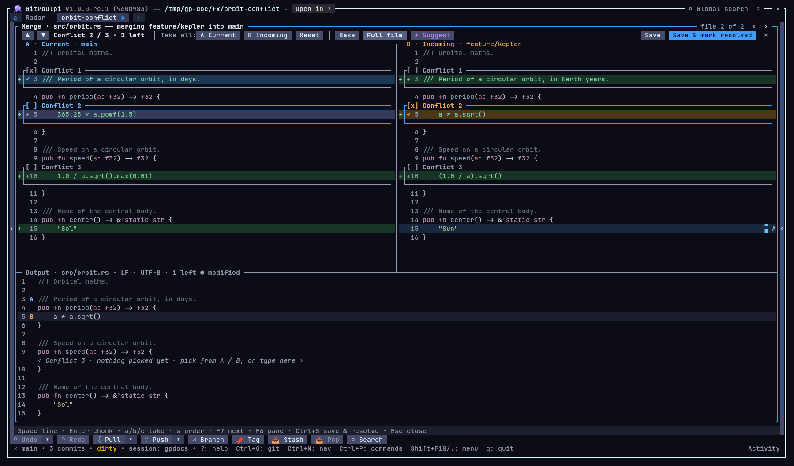

[English](../merge-conflicts.md) · **Čeština** · [Deutsch](../de/merge-conflicts.md) · [Español](../es/merge-conflicts.md) · [Français](../fr/merge-conflicts.md) · [Italiano](../it/merge-conflicts.md) · [日本語](../ja/merge-conflicts.md) · [한국어](../ko/merge-conflicts.md) · [Nederlands](../nl/merge-conflicts.md) · [Polski](../pl/merge-conflicts.md) · [Português (Brasil)](../pt-BR/merge-conflicts.md) · [Português (Portugal)](../pt-PT/merge-conflicts.md) · [Русский](../ru/merge-conflicts.md) · [Svenska](../sv/merge-conflicts.md) · [Türkçe](../tr/merge-conflicts.md) · [Українська](../uk/merge-conflicts.md) · [简体中文](../zh-CN/merge-conflicts.md)

# Řešení konfliktů merge

Když merge, cherry-pick, revert nebo rebase zastaví na konfliktech, Log ukáže
banner (*Probíhá merge · feature do main · 2 soubory v konfliktu*) a soubory
v konfliktu se v panelu Stav zobrazí s červeným `!`. Otevřete jeden v **editoru
merge**: A (aktuální strana) a B (příchozí strana) vedle sebe, pod nimi
**Výstup**, soubor, který píšete. Tato stránka je zkrácená verze; úplný seznam
kláves je v [Klávesových zkratkách](keybindings.md).

## Otevření

- Enter nebo dvojklik na řádku `!` v panelu Stav; jeho nabídka po kliknutí
  pravým tlačítkem začíná položkou **Otevřít v editoru merge**.
- Tlačítko **Vyřešit konflikty…** na banneru (otevře první soubor v konfliktu).
- Zobrazení Diff souboru v konfliktu: tlačítko **Editor merge** (`Shift+E`).
- Paleta: **Konflikty: Otevřít editor merge**.

Nic se neotevře samo: zastavená operace jen ukáže banner a řádky `!`.

Editor zabere celou šířku okna: postranní panel Refs a pravý
panel jsou po dobu jeho otevření skryté a po zavření se vrátí (`F9` je mezitím
zobrazí nebo skryje). A a B jsou vedle sebe vždy, když je editor široký alespoň
`merge.side_by_side_min_width` sloupců (výchozí 100, Nastavení > Diff a editor;
`0` znamená vždy); při menší šířce vidíte vždy jednu stranu za záložkami. Dlouhé
řádky se posouvají do stran, A a B společně (`Shift+←` / `Shift+→`, Shift+kolečko
nebo boční kolečko), nikdy se nezalamují.

## Výběr

Každý konflikt je orámovaný blok v A i v B se zaškrtávacím políčkem v záhlaví
a znakem `+` / `✓` před každým řádkem.

| Chcete... | Klávesa | Myš |
|---|---|---|
| vzít řádek pod kurzorem (strana s fokusem) | `Space` | klik na řádek |
| vzít celý blok strany s fokusem | `Enter` | klik na `[ ]` v jeho záhlaví |
| vzít jen A / jen B pro tento konflikt | `a` / `b` | pravé tlačítko na bloku |
| vzít obojí, A pak B / B pak A | `c` / `Shift+C` | pravé tlačítko na bloku |
| nevzít nic | `x` | pravé tlačítko na bloku |
| prohodit pořadí dvou vybraných stran | `s` | klik na odznak `1st` / `2nd` |
| vzít celé A / celé B (každý konflikt) | `Shift+A` / `Shift+B` | panel nástrojů |
| zrušit výběr tohoto konfliktu (zpět na nevyřešený) | `u` v A / B, `Alt+U` kdekoli | pravé tlačítko na bloku, **Zrušit výběr** |
| obnovit celý soubor na původní konflikty (zeptá se, pokud jste psali do Výstupu; `Ctrl+Z` to vrátí) | `Shift+U` v A / B, `Alt+R` kdekoli | **Obnovit** vedle Vzít vše |
| další / předchozí konflikt | `F7` / `Shift+F7`, `Alt+Down` / `Alt+Up` (`n` / `Shift+N` v A / B) | `▼` / `▲`, nebo klik na značku na posuvníku |
| počet opakuje pohyb | `3j`, `2k`, `2n`, `3N` (v A / B) | |
| další / předchozí soubor v konfliktu | `Alt+PageDown` / `Alt+PageUp` | `›` / `‹` v záhlaví |
| zobrazit nebo skrýt panel Základ (společný předek) | `Alt+D` (`d` v A / B) | `Základ` |
| zobrazit celý soubor v A a B (**Celý soubor**) | `Alt+F` (`f` v A / B) | `Celý soubor` |
| dát A nebo B větší šířku / zpět na stejné šířky | `Alt+Right` / `Alt+Left`, `Alt+0` | táhnout dělič; dvojklik na něj |
| posouvat A / B / Základ do stran | `Shift+←` / `Shift+→` (`Shift+H` / `Shift+L`) | Shift+kolečko, boční kolečko |
| zobrazit nebo skrýt panely Refs a Stav | `F9` | |
| fokus na A, B, Výstup | `F6` / `Shift+F6` | klik |
| skočit na panel u konfliktu, na kterém jste | `Alt+1` A, `Alt+2` B, `Alt+3` Výstup, `Alt+4` Základ; nebo `Ctrl+N` a pak `1` / `2` / `3` | |
| přejít na sousední panel (A, Základ, B, Výstup), stejný konflikt | `h` / `l` nebo `←` / `→` v A / B | |
| střídat výšku Výstupu | `z` | táhnout jeho titulek |
| zpět / znovu (výběry a psaní, jeden zásobník) | `Ctrl+Z` / `Ctrl+Y` | |
| zapsat soubor, ponechat ho v konfliktu | `Alt+S` | **Uložit** |
| zapsat soubor a označit ho jako vyřešený | `Ctrl+S` | **Uložit a označit jako vyřešené** |
| zavřít | `Esc` | `✕` |

Každý posuvník (A / B / Základ i Výstup) nese jednu značku na konflikt:
oranžovou, dokud potřebuje volbu, zelenou po vyřízení, modrou u aktuálního.
Kliknutí na značku na tento konflikt skočí (značka pod jezdcem posuvníku je už
na obrazovce, takže tam kliknutí jezdec táhne).

**Celý soubor** ukáže celý soubor v A a B se všemi rozdíly obarvenými, nejen konflikty:

Výstup je skutečný editor: klikněte do něj a pište, vybírejte, vyjímejte a vkládejte,
hledejte pomocí `Ctrl+F`. Výběr u konfliktu, který jste upravili ručně, vaši úpravu
nahradí (`Ctrl+Z` ji vrátí). Uložení s konfliktem, u kterého nic není vybráno, nebo
s řádkem, který stále vypadá jako značka konfliktu, se nejdřív zeptá.

### ✦ Navrhnout řešení (AI)

Se zapnutým AI (Nastavení > AI; viz [Asistence AI](ai.md)) má panel nástrojů
tlačítko **✦ Navrhnout**, nabídka konfliktu po kliknutí pravým tlačítkem má
*✦ Navrhnout řešení (AI)* a totéž dělají `Alt+I` a paleta (`AI: Navrhnout
řešení konfliktu merge`). Pracuje jen s aktuálním konfliktem a spustí se jen na
vaši žádost. Odpověď nahradí část Výstupu pro tento konflikt jako jednu úpravu,
označenou jako upravenou (`✎`), takže `Ctrl+Z` vrátí konflikt, jaký byl. Nikdy se
za vás neuloží ani nepřidá do indexu. Během běhu řádek nápovědy ukazuje uplynulý
čas; `Esc` ho zruší a selhání se zobrazí také tam. Při vypnutém AI žádný z těchto
ovládacích prvků neexistuje.

Po **Uložit a označit jako vyřešené** je soubor staged a vrátí se seznam souborů
v konfliktu; další soubor otevřete sami. `Ctrl+Z` (nebo
tlačítko Zpět) poslední „označení jako vyřešené“ vrátí. Když nezůstane žádný
soubor, banner nabídne **Commit merge** (nebo **Pokračovat** u cherry-picku,
revertu či rebase) a **Přerušit merge**, které se nejdřív zeptá: vrátí HEAD,
index a pracovní strom do původního stavu.

Merge, jehož výsledek se rovná HEAD (všude jste vzali naši stranu), nemá nic
staged ani žádný změněný soubor, a přesto ho lze dokončit: **Commit merge**
otevře výzvu k commitu se zprávou merge a commit má oba rodiče. Stejně tak je
tlačítko Commit v composeru povoleno bez čehokoli staged, dokud je merge
zastaven.

Prázdný cherry-pick nebo revert (změna je už použita) nelze commitnout:
git to odmítne a **Pokračovat** to řekne a odkáže na **Přeskočit**.
**Přeskočit** (tlačítko banneru, položka palety *Git: Přeskočit cherry-pick nebo
revert*, CLI `conflicts skip`) se nejdřív zeptá, pak operaci ukončí, aniž by se
pro ni cokoli zaznamenalo; HEAD, index a pracovní strom jsou zpět na HEAD.
Přeskočení nelze vrátit zpět (neztratí se nic, čeho jste se nevzdali záměrně);
merge nemá co přeskočit.

## Konflikty, které nejsou text

Binární soubor, ukazatel Git LFS, soubor nad 8 MiB, soubor smazaný na jedné
straně, pozůstatek přejmenování, symbolický odkaz, změna režimu nebo submodul nemá
řádky, ze kterých by šlo vybírat. Editor ukáže **kartu** s tím, co drží každá
strana, a jedním tlačítkem pro každou volbu; volba soubor okamžitě vyřeší a přidá
do indexu.

| Karta | Volby |
|---|---|
| Binární soubor, ukazatel LFS, příliš velký | **Ponechat A** (`a`), **Vzít B** (`b`), **Vzít Základ** (`o`, pokud existuje), **Otevřít v nástroji merge** (`m`) |
| Smazáno na jedné straně, změněno na druhé | **Ponechat soubor** (`k`), **Přijmout smazání** (`Shift+D`) |
| Pozůstatek přejmenování (cesta existuje jen na jedné straně) | **Ponechat soubor** (`k`), **Smazat soubor** (`Shift+D`) |
| Symbolický odkaz, submodul, režim souboru | **Ponechat A**, **Vzít B**, **Vzít Základ** |

Když je soubor obrázek (PNG, JPEG, GIF, WebP, BMP, ICO), políčka ukážou také
obrázky A, B a Základ, přizpůsobené a jen pro čtení, v dostatečně širokém okně;
viz [Obrázky](image-view.md#v-editoru-merge).

`Esc` zavře kartu bez volby. Externí nástroj merge je
`general.external_merge_tool` v Nastavení > Diff a editor (`{base}`, `{local}` = A,
`{remote}` = B, `{merged}`; prázdné znamená `git mergetool`); soubor se přidá do
indexu, když nástroj skončí úspěšně.

## Prevence konfliktů

GitPoulpi vám může říct, že dojde ke konfliktu, *ještě než* mergujete. Když by větev, na které jste, měla konflikt s větví,
ze které vznikla (její **základem**), objeví se na horním okraji Logu pruh: **Konflikt s origin/main ve 2 souborech**
s tlačítkem **Zobrazit soubory**. Zabere nejbližší volný řádek okraje za pruhy probíhajících operací, takže když se
nějaký zobrazuje, může čekat na místo. Nic se nemerguje: daemon provede merge obou commitů v paměti
(libgit2, nebo `git merge-tree --write-tree` s gitem 2.38 či novějším; starší git funkci vypne jedním řádkem
v protokolu), takže vaše soubory, index a refy zůstanou nedotčené.

- **Základem** je cílová větev pull requestu této větve, pokud ji GitPoulpi už zná (mezipaměť, kterou drží sekce
  Pull requests; žádné volání sítě se kvůli tomu nedělá), jinak ta větev ze vzorů **Základní větve**
  (Nastavení > Prevence konfliktů), která má od rozvětvení nejméně commitů. Při shodě rozhoduje větev, jejíž
  špička je nejblíže rozvětvení, pak vzdálená sledovací větev před lokální, pak název. Samotná větev a její
  vlastní vzdálená kopie nejsou nikdy základem.
- **Okno** (kliknutí na pruh, nebo **Konflikty: Zobrazit předpokládané konflikty** v paletě, které funguje z
  klávesnice) vypíše soubory a nabízí **Otevřít náhled merge** a **Rebase na základní větev**. Jsou to řádky
  nabídky samotné základní větve (*Merge <základ> do <větev>*, *Rebase <větev> na <základ>*) spuštěné za vás:
  zapisují se do historie vrácení, takže je `Ctrl+Z` vezme zpět, a merge, který konflikt opravdu má, se zastaví
  v editoru merge jako každý jiný. Left a Right přecházejí mezi tlačítky, Enter jedno stiskne, Esc zavře.
- **Kdy běží**: na pozadí, asi 2 sekundy poté, co se repozitář uklidní (commit, checkout, fetch, který posunul
  větev, rebase), jednou pro každou dvojici `(HEAD, základ)`. Pruh zmizí, jakmile se HEAD pohne, a vrátí se,
  nebo ne, s novou odpovědí. Odpojený HEAD se nekontroluje.
- **Seznamy základních větví**: odkud se berou Základní větve repozitáře, se volí na jeho stránce **Prevence
  konfliktů**. **Výchozí** sleduje globální výchozí (vestavěné `**`, každá větev, dokud v Nastavení > Obecné > Prevence
  konfliktů nevyberete jiný seznam); **Seznam: <název>** sleduje jeden z vašich pojmenovaných seznamů; **Vlastní
  seznam** je seznam jen tohoto repozitáře. Seznamy jsou sdílené: upravte jeden a každý repozitář, který ho sleduje,
  použije změnu při další kontrole, bez restartu. **Uložit jako seznam...** změní vlastní vzory repozitáře na
  pojmenovaný seznam, **Obnovit výchozí** zahodí volbu repozitáře. Smazání seznamu, který repozitář sleduje, způsobí,
  že použije výchozí.
- **Vypnutí**: **Zapnout proaktivní detekci konfliktů** v Nastavení > Prevence konfliktů, nebo pro jeden repozitář na jeho stránce
  **Prevence konfliktů**. Ze skriptu vypíše `gitpoulpi conflicts check` stejnou odpověď jako JSON ([Referenční
  příručka CLI](cli-reference.md)).

## Agenti

Agent vám může konflikt ukázat (`gitpoulpi ui show conflict <path> [--conflict
N]`: editor se na něm otevře, nic se nevybere) nebo **navrhnout** řešení
(`gitpoulpi ui propose resolution <path> --pick 1=a,2=ba` nebo `--content-file F`,
vyžaduje *Nechat AI agenty navrhovat změny k mému potvrzení*). Návrh otevře
editor s již vybranými volbami (nebo celým textem) ve Výstupu a fialovým bannerem
*Navrhl claude-code*. Zkontrolujte ho, upravte, co chcete, a stiskněte
**Ctrl+S**: teprve to cokoli zapíše nebo přidá do indexu. Zavření editoru návrh
odmítne. Viz [MCP a agenti](mcp-and-agents.md).

Ze skriptu jsou tytéž operace `gitpoulpi conflicts list | show | resolve |
unresolve | state | abort` ([Referenční příručka CLI](cli-reference.md)); `conflicts check` je předpoví před merge.
