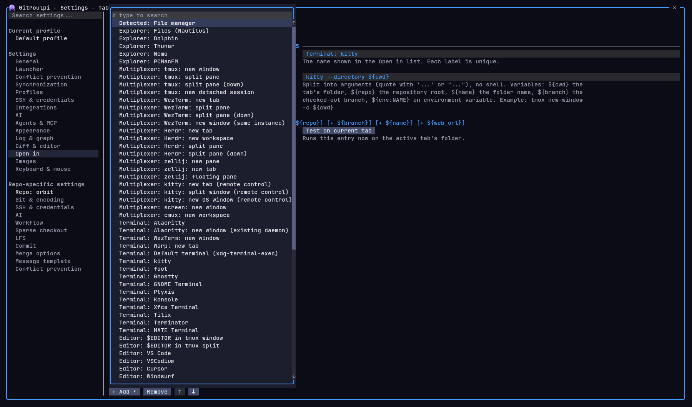

[English](../open-in.md) · **Čeština** · [Deutsch](../de/open-in.md) · [Español](../es/open-in.md) · [Français](../fr/open-in.md) · [Italiano](../it/open-in.md) · [日本語](../ja/open-in.md) · [한국어](../ko/open-in.md) · [Nederlands](../nl/open-in.md) · [Polski](../pl/open-in.md) · [Português (Brasil)](../pt-BR/open-in.md) · [Português (Portugal)](../pt-PT/open-in.md) · [Русский](../ru/open-in.md) · [Svenska](../sv/open-in.md) · [Türkçe](../tr/open-in.md) · [Українська](../uk/open-in.md) · [简体中文](../zh-CN/open-in.md)

# Otevřít v

Tlačítko **Otevřít v ▾** v záhlaví okna, vedle cesty repozitáře, otevře složku
aktivní karty jinde: ve vašem terminálu, na nové kartě nebo v panelu
multiplexeru, v editoru, ve správci souborů. Co je v seznamu, určujete vy.
Nic není napevno: každá položka je popisek a příkaz.

## Použití

- **Klikněte na Otevřít v ▾**: rozbalí se seznam. Kliknutím na položku ji
  spustíte. Výchozí položka je označena `•`; poslední řádek, **Nastavit…**,
  otevře [Nastavení](settings.md#otevřít-v) na stránce Otevřít v.

  

- **Klávesnice**: `Alt+O` otevře stejný seznam (`Up`/`Down`, `Enter`, `Esc`;
  při více než sedmi položkách můžete psát pro vyhledávání). `Ctrl+Alt+O`
  okamžitě spustí výchozí položku. Paleta (`Ctrl+P`): `Karta: Otevřít v…` a
  `Karta: Otevřít ve výchozí položce`. Příkazy palety fungují i tehdy, když
  v záhlaví okna není pro tlačítko místo. Obě klávesy lze přemapovat; viz
  [Klávesové zkratky](keybindings.md).
- **Klikněte pravým tlačítkem na kartu repozitáře**: nabídka karty má podnabídku
  **Otevřít v** se stejnými položkami.
- Seznam začíná u položky, kterou jste v této relaci použili naposledy.
- Stavový řádek okamžitě řekne „otevírání v ...“. Pokud program do zhruba
  1,5 sekundy selže (například tmux bez serveru nebo špatný přepínač), na
  stavovém řádku se objeví první řádek jeho chybového výstupu. Program, který
  není nainstalován, je pojmenován okamžitě.

Dokud neuložíte vlastní seznam, výchozí položka se vybírá podle zjištěného
prostředí: uvnitř herdr „Herdr: new tab“; na Omarchy nové okno kitty (kitty je jeho terminál); jinak správce souborů.

Tlačítko se zobrazuje na každé kartě repozitáře, včetně složky, ve které byl
GitPoulpi spuštěn, a v režimu `ui.tab_dir_follow = "auto"`. V režimu `auto` se
výchozí položka také sama spustí při otevření nové karty (ne u karet
obnovených při startu). Viz [Sledování složky aktivní karty](following-the-tab-folder.md).

## Jak vypadá položka

V `config.toml` jedna tabulka `[[ui.open_in]]` na položku:

```toml
[ui]
open_in_default = "Herdr: new tab"   # a label; empty means the first entry

[[ui.open_in]]
label = "Herdr: new tab"
command = "herdr tab create --workspace ${env:HERDR_WORKSPACE_ID} --cwd ${cwd} --focus"

[[ui.open_in]]
label = "VS Code"
command = "code ${cwd}"
```

Ručně to píšete jen zřídka: upravuje to stránka Nastavení. Každý klíč je v
[referenční příručce konfigurace](config-reference.md).

### Příkazy a proměnné

Příkaz se nejdřív rozdělí na argumenty (mezery, `'...'` a `"..."` seskupují
slova), pak se v každém argumentu nahradí proměnné. Složka s mezerou v názvu
proto zůstane jedním argumentem. **Žádný shell se nepoužívá**, pokud ho váš
příkaz sám nespustí.

| Proměnná | Nahradí se |
|---|---|
| `${cwd}` | Složkou karty. |
| `${repo}` | Kořenem repozitáře (u karty worktree se liší od `${cwd}`). |
| `${name}` | Základním názvem složky. |
| `${branch}` | Přepnutou větví; při odpojeném HEAD prázdné. |
| `${web_url}` | Webovou stránkou remote origin, je-li to GitHub nebo GitLab; jinak prázdné. |
| `${env:NAME}` | Proměnnou prostředí `NAME`; je-li nenastavená, prázdné. |

Starý `{repo}` stále funguje a znamená `${cwd}`. Jakékoli jiné `${...}` je chyba,
která proměnnou pojmenuje.

Program se spouští se složkou karty jako pracovním adresářem a dostane tři
proměnné prostředí, užitečné pro úryvek shellu:

| Proměnná | Hodnota |
|---|---|
| `GITPOULPI_CWD` | Složka karty. |
| `GITPOULPI_REPO` | Kořen repozitáře. |
| `GITPOULPI_BRANCH` | Větev, nebo prázdné. |

```toml
[[ui.open_in]]
label = "Terminal here, then status"
command = "sh -c 'cd \"$GITPOULPI_CWD\" && git status; exec $SHELL'"
```

Ve Windows se program hledá přes `PATH` a `PATHEXT`, takže `code` a `cursor`
(soubory `.cmd`) fungují a neproblikne žádné okno konzole.

## Předvolby

Nastavení > Otevřít v > **Přidat předvolbu** vypíše hotové položky jen pro váš
operační systém (předvolby pro Windows se na Linuxu nikdy nezobrazí a podobně),
podle kategorií: řádek začíná kategorií, `Průzkumník: ...`, `Multiplexer: ...`,
`Terminál: ...`, `Editor: ...`, `Nástroj Git: ...`, `AI agent: ...`, `Web: ...`.
Nahoře jsou **Zjištěno**, položky vypočteného výchozího seznamu. Uvnitř každé
kategorie jsou první předvolby, které můžete použít hned (běžíte uvnitř daného
multiplexeru nebo terminálu a program je na `PATH`), pak nainstalované, pak
ostatní. Psaním do comboboxu hledáte, například `lazygit` nebo `Nástroj Git:`.
**Vyzkoušet na aktuální kartě** položku vyzkouší, než se na ni
spolehnete.



Předvolby „spustit nástroj v panelu“ (`lazygit in Herdr tab`, `yazi in tmux
window`, `Claude Code in Herdr split`...) se nabízejí, jen když jsou nainstalovány
hostitel (herdr, tmux, zellij, WezTerm, kitty, `xdg-terminal-exec`, Windows
Terminal) i nástroj. `$EDITOR in ...` spustí editor pojmenovaný vaší proměnnou
`EDITOR` (není-li nastavena, v herdr `vi`) v herdr nebo tmux.

Předvolby nástrojů pro herdr vytvoří kartu nebo rozdělení a pak do jejího shellu
napíšou příkaz, takže nástroj začne ve složce a panel zůstane otevřený po jeho
skončení. Předvolby `AI agent` používají `herdr agent start`, takže herdr sleduje
stav agenta.

| Kategorie | Předvolby (`V` = ověřeno spuštěním nebo podle nainstalované nápovědy) |
|---|---|
| Průzkumník | Windows `explorer.exe` (V), macOS Finder (V), Linux `xdg-open` (V), Nautilus, Dolphin, Thunar, Nemo, PCManFM; yazi, superfile, nnn, lf, ranger v panelu/na kartě/v terminálu |
| Multiplexer | herdr tab, workspace, split right/down (V); tmux window, split right/down, detached session (V); zellij pane, tab, floating; WezTerm tab, split, new window; kitty tab, split window, OS window (V: přepínače z nápovědy; vyžaduje `allow_remote_control`); screen; cmux; psmux |
| Terminál | `xdg-terminal-exec` (V), kitty (V), foot (V), Alacritty (+ `alacritty msg`), WezTerm, Ghostty (Linux, macOS), GNOME Terminal, Ptyxis, Konsole, Xfce Terminal, Tilix, Terminator, MATE Terminal, iTerm2, Terminal.app, Warp; Windows: Windows Terminal (okno, karta, rozdělení a karta pro každý z PowerShell 7, Windows PowerShell, Command Prompt, WSL), okna PowerShell 7 / Windows PowerShell / Command Prompt / WSL, Git Bash |
| Editor | VS Code (V), VSCodium, Cursor, Windsurf, Zed, Sublime Text, Emacs, IntelliJ IDEA, RustRover, PyCharm, WebStorm, CLion, GoLand, Rider, PhpStorm, Android Studio, Visual Studio (Windows); Neovim, Vim, Helix, `$EDITOR` v panelu/na kartě/v terminálu |
| Nástroj Git | gitk, `git gui`, gitg, Sublime Merge, GitKraken, GitHub Desktop; lazygit, tig, gitui v panelu/na kartě/v terminálu (varianty pro herdr, tmux, kitty a `xdg-terminal-exec` V) |
| AI agent | Claude Code, Codex, Gemini CLI, opencode na kartě/v rozdělení herdr (V, s Claude), v tmux, zellij, WezTerm, kitty, novém terminálu |
| Web | `Repository page on the web` (`${web_url}`), `gh repo view --web` (V), `glab repo view --web` |

WSL ve Windows: `wsl.exe --cd ${cwd}` přijímá cestu Windows beze změny a karta
`wsl.exe` ve Windows Terminal začíná ve složce, kterou WSL mapuje pod `/mnt/`.

Průzkumník, Windows Terminal, PowerShell, `cmd`, WSL, Warp, psmux, Visual Studio
a Zed (Zed je jen pro Unix) se objeví jen tam, kde existují; tmux, zellij, cmux,
screen, vzdálené ovládání kitty a předvolby herdr řízené přes `sh` jsou jen pro
Unix; herdr (prosté předvolby), WezTerm, Alacritty, VS Code, Cursor a IDE od
JetBrains se nabízejí všude.

### Proměnná `${web_url}`

Webová stránka remote `origin` repozitáře, je-li to projekt GitHub nebo GitLab
(github.com, gitlab.com nebo self-managed hostitel, který má položku v
`[[integrations]]`); jinak prázdná, a položka, která ji používá, se pak zastaví
se zprávou místo otevření prázdné adresy. Je volitelná: žádná předvolba ji
nepotřebuje kromě `Repository page on the web`.

## Stránka Nastavení

Nastavení > **Otevřít v** upravuje seznam. Položky jsou
[seznam](settings.md#seznamy) vlevo (výchozí položka je označena `★`), pole
vybrané položky jsou vpravo; seznam spravují `+ Přidat`, `Duplikovat`, `Odebrat`,
`↑` / `↓` a tažení řádku.

| Řádek | Co dělá |
|---|---|
| **Výchozí položka** | Položka, kterou spouští **Otevřít ve výchozí položce**. V seznamu Otevřít v je označena `•`. |
| **Popisek** | Název zobrazený v seznamu. Jedinečný, neprázdný. |
| **Příkaz** | Příkaz s čipy proměnných (`${cwd}`, `${repo}`, `${branch}`, `${name}`, `${web_url}`) k vložení. |
| **Vyzkoušet na aktuální kartě** | Spustí položku hned pro složku aktivní karty. |
| **+ Přidat ▾** | Připojí hotovou položku (zjištěné první), nebo **Vlastní**, prázdnou položku, jejíž Příkaz se upravuje jako další. |
| **Obnovit zjištěné výchozí hodnoty** | Nahradí seznam tím, co je zjištěno na tomto počítači, a vymaže výchozí položku. |

Úpravy se ukládají průběžně. První úprava zapíše celé pole `[[ui.open_in]]` do
`config.toml`; do té doby je seznam vypočítaný (viz [Starší klíče](#starší-klíče)) a soubor
nemá klíč `open_in`. Najde ji i vyhledávání v Nastavení.

## Binární soubory: Otevřít v

Binární soubor (PDF, dokument Wordu, tabulka, archiv...) nemá text, který by šel zobrazit v zobrazení Diff nebo v zobrazení Soubor. Pokud operační systém zná aplikaci pro jeho typ, zobrazí se vedle obvyklého oznámení tlačítko **Otevřít v**. Jeho seznam obsahuje nejprve aplikaci, kterou systém tento typ otevírá (označenou tečkou), a pak všechny ostatní aplikace, které k němu systém registruje (vlastní seznam systému *Otevřít pomocí*). V Linuxu je to typ MIME podle názvu souboru, `mimeapps.list` pro výchozí aplikaci a soubory `.desktop` pro ostatní; ve Windows registr (volba uživatele a programy registrované pro příponu); v macOS jen výchozí aplikace.

`o` spustí výchozí aplikaci a `Shift+O` otevře seznam. Obojí je v paletě příkazů (*Soubor: Otevřít ve výchozí aplikaci*, *Soubor: Otevřít pomocí…*) a **Otevřít pomocí…** je v kontextové nabídce souboru v panelu Stav a v seznamu souborů commitu. Hledání běží na pozadí, jednou pro každou příponu: během něj zobrazení říká „hledání aplikací...“. Typ, pro který systém nezná žádnou aplikaci, a prostý text si ponechají obyčejné oznámení a tlačítko nemají.


Soubor z pracovního stromu se aplikaci předá tak, jak je. Verze z commitu (nebo z indexu) se zapíše do **dočasné kopie jen pro čtení** s oznámením ve stavovém řádku, aby aplikace nemohla změnit repozitář. Ani jedno repozitář nemění: žádný záznam v žurnálu, Zpět zůstává beze změny.

Seznam nabídky se otevře vedle nabídky, v úrovni řádku **Otevřít pomocí...**, jako podnabídka (vlevo, když vpravo není místo), myší i z klávesnice. Seznam editorů obrázků (**Upravit v...**) otevřený z nabídky souboru dělá totéž.

### Soubory Git LFS

Karta objektu Git LFS (viz [Git LFS](lfs.md)) nese pod textem tytéž dvě akce: **Otevřít výchozím programem** a **Otevřít v**, se stejnými klávesami (`o`, `Shift+O`) i řádky palety. Otevřou skutečný soubor, nikdy ukazatel: soubor z pracovního stromu tak, jak je, nebo dočasnou kopii objektu z lokálního úložiště LFS jen pro čtení u verze z commitu či z indexu. Objekt, který ještě není stažen, nemá na kartě žádná tlačítka a stavový řádek říká, že obsah ještě není stažen. Totéž odmítnutí platí pro soubor v pracovním stromu, který stále drží jen ukazatel: **Otevřít výchozím programem**, **Otevřít v** a **Upravit v**, z karty nebo z kterékoli nabídky souboru, řeknou, že obsah není stažen, místo aby otevřely text ukazatele (stáhněte ho řádky pull nebo checkout na panelu nástrojů LFS a zkuste to znovu). Otevírání je jen pro čtení: žádný záznam v žurnálu, není co vracet.

### Prohlížeče ve Windows

Chrome a Edge registrují `--single-argument %1`, takže vše za přepínačem čtou jako jednu adresu, včetně uvozovek. GitPoulpi předá cestu takovému programu doslovně a bez uvozovek, jako Windows, takže se soubor s mezerami v cestě otevře, místo aby selhal s `http://"c/...`. Každý jiný program dostane cestu jako jeden běžný argument.

## Starší klíče

Staré klíče `ui.terminal_launch` a `ui.terminal_launch_command` se čtou jen
tehdy, když `ui.open_in` chybí. Vypočtený seznam je pak:

1. vaše stará volba terminálu, pokud není `auto` (`custom` se změní na
   „Terminal (custom)“ s `{repo}` přepsaným na `${cwd}`; id předvolby se změní na
   tuto předvolbu). Hodnota `auto` se změní na první položku, „Default terminal“.
2. správce souborů operačního systému,
3. multiplexery a terminály zjištěné z prostředí,
4. editory nalezené na `PATH`.

Když seznam uložíte z Nastavení, `ui.open_in` seznam nahradí a staré klíče se
ignorují. Příkazy palety **Karta: Otevřít v terminálu** a **Karta: Otevřít ve
správci souborů** tento seznam nepoužívají.

## Řešení potíží

- *„program X was not found“*: program není na `PATH`, kterou GitPoulpi vidí.
  Spusťte GitPoulpi z shellu, který ho má, nebo napište úplnou cestu.
- *Položka tmux/zellij/herdr selže okamžitě*: komunikují s běžícím serverem, takže
  fungují, jen když GitPoulpi běží uvnitř něj.
- *Položka karty kitty selže*: vyžaduje `allow_remote_control` v `kitty.conf`.
- *Průzkumník Windows*: `explorer.exe` skončí s kódem 1 i při úspěchu; GitPoulpi to
  bere jako úspěch.
