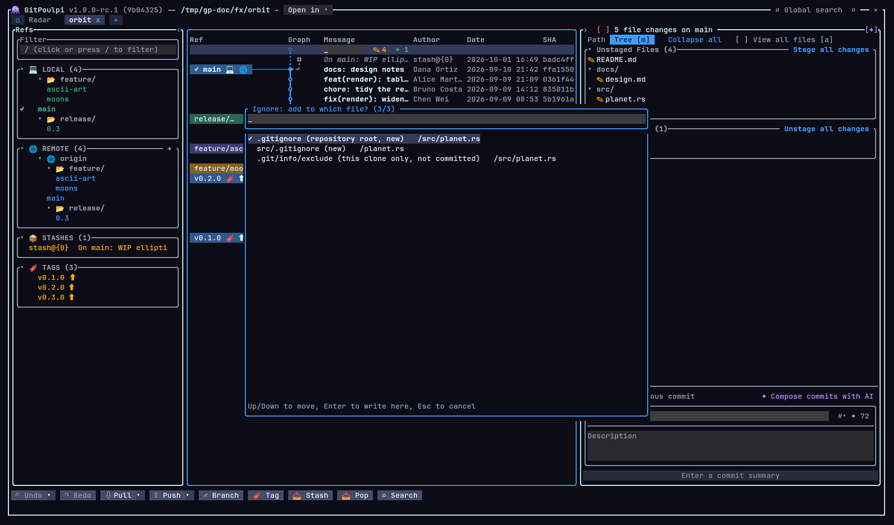
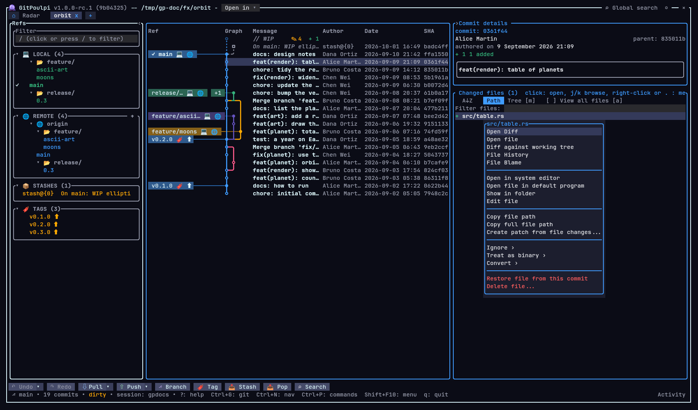
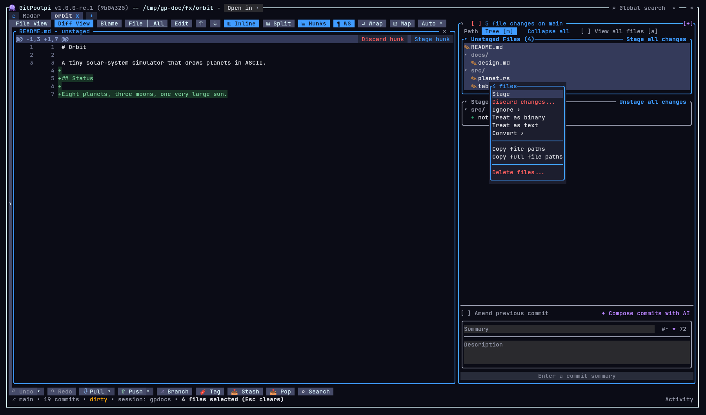

[English](../staging-and-committing.md) · **Čeština** · [Deutsch](../de/staging-and-committing.md) · [Español](../es/staging-and-committing.md) · [Français](../fr/staging-and-committing.md) · [Italiano](../it/staging-and-committing.md) · [日本語](../ja/staging-and-committing.md) · [한국어](../ko/staging-and-committing.md) · [Nederlands](../nl/staging-and-committing.md) · [Polski](../pl/staging-and-committing.md) · [Português (Brasil)](../pt-BR/staging-and-committing.md) · [Português (Portugal)](../pt-PT/staging-and-committing.md) · [Русский](../ru/staging-and-committing.md) · [Svenska](../sv/staging-and-committing.md) · [Türkçe](../tr/staging-and-committing.md) · [Українська](../uk/staging-and-committing.md) · [简体中文](../zh-CN/staging-and-committing.md)

# Stagování a commitování

Jak zjistit, co jste změnili, vybrat přesně to, co půjde do commitu, napsat
commit a prohlížet soubory podrobněji (blame, historie, vestavěný editor).
Pojmy jako *řádek WIP* a *hunk* jsou vysvětleny v
[prohlídce rozhraní](interface-tour.md).

## Pracovní změny

Necommitnutá práce je **první řádek Logu** (přerušovaný kruh, `// WIP`,
s čítači `✎ n` upravených a `+ n` přidaných). Vyberte ho a pravý panel ukáže
pracovní změny:


- **Soubory unstaged**: upravené, přidané (untracked) a smazané soubory, které
  ještě nejsou v dalším commitu.
- **Soubory staged**: co bude obsahovat další commit.
- **Cesta** nebo **Strom** (`m`) zobrazí soubory jako plochý seznam nebo ve
  složkách. **Sbalit vše** (`z`) sbalí složky. **Zobrazit všechny soubory**
  (`a`) ukáže celý strom místo jen změněných souborů. Pravým tlačítkem na prázdné místo seznamu
  získáte **Rozbalit vše** / **Sbalit vše**, na řádku složky **Rozbalit všechny podsložky** /
  **Sbalit všechny podsložky**; klávesy `=`, `-`, `*`, `_` (viz
  [Myš a gesta](mouse-and-gestures.md)).
- Název říká, kolik souborů se na které větvi změnilo.

### Stage, unstage, zahození

| Chcete | Postup |
|---|---|
| Stage souboru | Najeďte na jeho řádek a klikněte na **Stage soubor**, nebo ho vyberte a stiskněte `Ctrl+Space`, nebo `Ctrl+G s` |
| Stage složky | **Stage složku** na řádku složky |
| Stage všeho | **Stage všechny změny** v názvu sekce, nebo `Ctrl+G a` |
| Unstage | Stejná tlačítka a klávesy v sekci Staged (`Ctrl+G u`) |
| Zahození změn souboru | Klikněte pravým tlačítkem na soubor > **Zahodit změny...** (nejdřív se zeptá; `Ctrl+Z` změny vrátí) |

### Citlivé soubory

Stage souboru, složky nebo všeho nejprve zkontroluje, co by přidal. Soubor, jehož
název odpovídá `[privacy] sensitive_patterns` (`.env` a `.env.*` kromě souborů
`.example`, `.sample` a `.template`, `*.pem`, `*.key`, soukromé klíče SSH,
`*.p12`, `*.pfx`, `*.jks`, `*.keystore`, `*.crt`, `*.cer`, `*.der`, `*.kdbx`), nebo
jehož text obsahuje tajnou hodnotu, kterou skener pozná, se nepřidá. Otázka **Citlivé
soubory** vypíše každý soubor s důvodem (vzor, nebo druh tajné hodnoty
s maskovaným náhledem, nikdy hodnota) a nabídne **1. Stage přesto** nebo **2. Zrušit a nic nepřidávat**.
Žádná odpověď není zvýrazněna, dokud nestisknete šipku nebo číslici,
takže náhodné Enter neodpoví nic; `Esc`, zavírací křížek a klik mimo ruší.
Je to stejná otázka z klávesnice, tlačítka, nabídky, palety nebo
přetažení, protože všechny posílají stejný požadavek. Zrušení nepřidá nic,
ani běžné soubory téhož stage.

Textové soubory do 1 MiB každý a 32 MiB celkem se čtou; větší soubory a binární
soubory se posuzují jen podle názvu. `[privacy] staging_guard = false` kontrolu vypne.
Stage jednoho hunku nebo některých řádků se nekontroluje: na tom souboru už pracujete.

Kliknutím pravým tlačítkem na soubor otevřete jeho nabídku: stage nebo
unstage, zahodit, kopírovat cestu, historie souboru a blame, otevřít ve
vašem externím editoru, diff nástroji nebo správci souborů (nastavuje se v
[Nastavení > Diff a editor](settings.md#diff-a-editor)) a další.

## Ignorování souborů a jejich považování za binární nebo textové

Klikněte pravým tlačítkem na soubor > **Ignorovat** pro ignorování souboru nebo jeho přípony, případně na řádek složky > **Ignorovat všechny soubory ve složce**. GitPoulpi se nejprve zeptá, do kterého souboru pravidlo patří: `.gitignore` v kořeni repozitáře (výchozí), `.gitignore` každé složky až po složku souboru, nebo `.git/info/exclude` (jen tento klon, nikdy nezaznamenáno). Soubory, které ještě neexistují, jsou označeny jako *nový* a po potvrzení se vytvoří. Řádek se zapisuje relativně k vybranému souboru: `src/a/b.txt` se v `src/.gitignore` stane `/a/b.txt`. Pohybujte se šipkami, psaním zúžíte seznam, `Enter` zapíše, `Esc` zruší. `Ctrl+Z` vrátí zpět zápis do `.gitignore`; `.git/info/exclude` je mimo pracovní strom a vrátit se nedá.



Klikněte pravým tlačítkem na soubor > **Považovat za binární** (nebo **Považovat za textový**, pokud ho git už jako binární bere) zapíše pravidlo `.gitattributes`: `binary` nebo `text diff`. Vyberte samotný soubor nebo všechny soubory s jeho příponou, pak `.gitattributes`, do kterého zapsat, stejným seznamem jako výše (a `.git/info/attributes` jen pro tento klon). Pravidlo již zapsané pro stejný vzor se nahradí, nikdy si neprotiřečí. Diff souboru se hned aktualizuje a stavový řádek říká, co se kam zapsalo (a upozorní, když jiné pravidlo stále převažuje). Řádek složky má **Považovat soubory ve složce za** > **Binární** nebo **Textové**. Totéž je v paletě příkazů (**Změny: Považovat vybraný soubor za binární...**) a na příkazové řádce (`gitpoulpi treat binary|text <cesty>`). Zobrazení Soubor se pravidlem také řídí: soubor, který označíte jako text, zobrazí své řádky, i když obsahuje bajt NUL, a soubor, který git bere jako binární, zobrazí upozornění na binární soubor.

## Nabídky, výběr více souborů a převod v seznamech souborů

Seznamy souborů v pravém panelu (Unstaged, Staged, změněné soubory commitu a **Zobrazit všechny soubory**) mají stejné nabídky a gesta. Klikněte pravým tlačítkem na soubor, řádek složky nebo prázdnou část seznamu, nebo stiskněte `.` (`Shift+F10`, klávesu Menu) na řádku s fokusem, nebo spusťte **Soubory: otevřít nabídku řádku nebo výběru** z palety.

- **Soubor commitu** (a soubor v **Zobrazit všechny soubory**): **Otevřít diff**, **Otevřít soubor**, **Historie souboru**, **Blame souboru**, otevřít v editoru, ve výchozím programu nebo v **Otevřít pomocí…**, **Zobrazit ve složce**, **Upravit soubor**, **Kopírovat cestu souboru**, **Kopírovat úplnou cestu k souboru**, **Ignorovat**, **Považovat za binární** nebo **Považovat za textový**, **Převést**, **Obnovit soubor z tohoto commitu** (nejdřív se zeptá; stejně jako `git checkout <commit> -- <soubor>` soubor také přidá do stage a `Ctrl+Z` vrátí předchozí soubor) a **Smazat soubor...**. Řádek týkající se pracovní kopie je zašedlý i s důvodem, když soubor není v pracovním adresáři. **Diff oproti pracovnímu adresáři** otevře diff verze z commitu proti souboru na disku. **Vytvořit patch ze změn souboru...** zapíše patch změny tohoto souboru v commitu (mají ho i výběr a řádek složky; v **Zobrazit všechny soubory** u rozpracovaných změn vytvoří patch změn souboru v pracovním stromu).
- **Řádek složky**: **Otevřít složku**, **Kopírovat cestu souboru**, **Ignorovat všechny soubory ve složce**, **Považovat soubory ve složce za**, **Převést**, **Vytvořit soubor v této složce**.
- **Prázdná část seznamu**: **Vytvořit soubor** a **Otevřít složku repozitáře**. Seznam Unstaged přidává **Stage všechny změny** a **Zahodit všechny změny...**, seznam Staged **Unstage všechny změny**.



### Výběr více souborů

Gesta jsou stejná jako v Logu. **Ctrl+klik** přidá řádek do výběru nebo ho odebere. **Shift+klik** (**Alt+klik** v terminálech, které si Shift+klik ponechávají) vybere rozsah od kotvy. Obyčejný klik začne znovu a otevře diff jako dřív. `Esc` výběr zruší. Z klávesnice `Space` nebo `Insert` přepne aktuální řádek v každém seznamu (v Unstaged a Staged `Ctrl+Space` přidá do stage výběr, nebo aktuální řádek) a `Shift+Nahoru` / `Shift+Dolů` rozšíří rozsah. Řádek složky vybere všechny soubory pod ní, sbalenou či ne. Vybrané řádky jsou zvýrazněné a stavový řádek je počítá. `Ctrl+A` vybere všechny řádky aktivního seznamu.

Klikněte pravým tlačítkem na vybraný řádek (nebo stiskněte `.`) pro nabídku celého výběru s titulkem **N souborů**: stage nebo unstage, zahodit, ignorovat, brát jako binární nebo textový, převést, kopírovat cesty, obnovit z commitu, smazat. Stage, unstage a obnovení jsou vždy jedna akce; zahození a smazání se nejdřív zeptají a uvedou počet souborů. Pravý klik na řádek mimo výběr začne výběr znovu s tímto řádkem.



### Převod kódování, konců řádků a odsazení

**Převést** je v nabídce souboru, složky nebo výběru. `gitpoulpi convert` dělá totéž z příkazové řádky.

- **Kódování**: UTF-8, UTF-8 BOM, UTF-16 LE a BE, Windows-1252, ISO-8859-1, ISO-8859-15, Windows-1250, Windows-1251, KOI8-R, Shift_JIS, EUC-JP, GBK, Big5, EUC-KR.
- **Konce řádků**: LF, CRLF nebo CR.
- **Odsazení**: úvodní prázdné znaky jako mezery nebo tabulátory, se šířkou tabulátoru.

Soubory v pracovním adresáři se přepisují na pozadí stejnými funkcemi jako stavový řádek editoru. Soubor, který není platné UTF-8 a nemá značku pořadí bajtů, se čte jako Windows-1252, stejně jako v editoru. Binární soubory, chybějící soubory a soubory, které cílové kódování nedokáže vyjádřit, se přeskočí a ohlásí (*Převedeno 12 souborů, přeskočeno 3 (3 binárních)*), nikdy se nepoškodí; soubor, který nelze zapsat, vyvolá oznámení o selhání. Celá dávka je jeden záznam v žurnálu zpět: jedno `Ctrl+Z` vrátí všechny soubory. Soubor otevřený v editoru převod blokuje, dokud se nezavře.

## Čtení diffu

Klikněte na název souboru (nebo na něm stiskněte `d`) a jeho diff nahradí Log
uprostřed. `Esc` nebo `q` vrátí Log.


Lišta nad ním přepíná zobrazení:

- **Sjednocené** ukazuje sjednocený diff; **Vedle sebe** dává před a po vedle sebe
  (`m` přepíná rozvržení).
- **Hunky** (`Shift+H`) ukáže jen změněné hunky s řádkem kontextu. Vypnutím
  uvidíte celý soubor.
- **WS** (`s`) skryje změny, které se liší jen v bílých znacích.
- **Zalom.** (`w`) zalomí dlouhé řádky místo jejich oříznutí.
- **Mapa** (`Shift+M`) ukáže minimapu celého souboru vedle posuvníku.
  Kliknutím skočíte. Další výskyty vybraného slova jsou podbarvené a označené
  na posuvníku.
- `n` a `p` (nebo šipky na liště) skáčou mezi hunky.
- **Auto** (poslední tlačítko, `Shift+C`) je kódování, ve kterém se soubor čte. Klikněte na něj
  (nebo stiskněte `Shift+C`, nebo spusťte z palety *Diff: Vybrat kódování...*) a vyberte ze seznamu:
  nejdřív **Automatická detekce**, potom UTF-8, UTF-8 BOM, UTF-16 LE a BE, Windows-1252, ISO-8859-1,
  ISO-8859-15, Windows-1250, Windows-1251, KOI8-R, Shift_JIS, EUC-JP, GBK, Big5 a EUC-KR (seznam lze
  hledat psaním). Obě strany souboru se znovu přečtou, jako přesné bajty, v tomto kódování, takže
  soubor v Latin-1 ukáže své diakritické znaky a soubor v UTF-16 (který git považuje za binární)
  ukáže své řádky. Volba se pamatuje pro cestu souboru, dokud aplikaci neukončíte, v tomto zobrazení
  i v [kontrole](review.md). Dokud je kódování vybráno, hunky jsou vlastní tohoto zobrazení, takže
  stagování a zahazování je vypnuté (pro opětovné stagování vyberte **Automatickou detekci**).
  Pomalé čtení po chvíli napíše do titulku *čtení jako ...*.


Text můžete vybírat myší (tažením nebo dvojklikem na slovo) a kopírovat ho
klávesou `y` nebo `Ctrl+C`; kopíruje se jen text souboru, nikdy čísla řádků ani
značky `+` a `-`.

### Stage hunku nebo jednoho řádku

V diffu pracovního stromu má každé záhlaví hunku tlačítka **Stage hunk** a
**Zahodit hunk** (na straně Staged **Unstage hunk**).

- `Space` provede stage hunku pod kurzorem.
- Pro stage několika řádků stiskněte `v` (začátek výběru), pohybujte se
  klávesami `j`/`k` a stiskněte `Enter`. Počítají se jen *změněné* řádky.
- `x` zahodí hunk a `Shift+X` vybrané řádky. Obojí se nejdřív zeptá a
  `Ctrl+Z` změny vrátí.
- Kliknutím pravým tlačítkem (nebo `.`) na hunk otevřete jeho nabídku: stage,
  unstage, zahodit, historie souboru, blame, kopírovat.

Diff commitu je jen pro čtení. Změněný obrázek se zobrazí jako obrázek; viz
[Obrázky](image-view.md).

## Psaní commitu

Formulář commitu je dole v pravém panelu a jeho **Souhrn** je zároveň polem
na řádku pracovních změn v Logu: psaní do jednoho se zobrazí i v druhém.


- **Souhrn** (počítadlo ukazuje, kolik z 72 znaků zbývá) a **Popis**. `Enter`
  v souhrnu přejde do popisu, `Enter` tam přidá řádek.
- **Commit změn v N souborech** (zelené tlačítko) nebo `Ctrl+Enter` commitne změny
  v indexu. Pokud nic není staged, tlačítko to řekne a nic neudělá.
- **Amend předchozího commitu** (`Shift+A`) sloučí změny v indexu a novou
  zprávu do posledního commitu. Commit, který už byl odeslán, pak bude
  vyžadovat force push (with lease).
- **Přeskočit hooky** (`Shift+H`, nebo **Commit: Přepnout Přeskočit hooky** v paletě) commituje
  bez spuštění hooků `pre-commit` a `commit-msg` repozitáře. Platí pro jeden commit;
  **Nastavení > Nastavení repozitáře > Commit** ho nastaví jako ve výchozím stavu zaškrtnuté. Zobrazuje se,
  když je na řádku místo.
- `Ctrl+G c` nebo `c` v panelu Stav přesune kurzor do formuláře. `Esc` ho
  opustí.
- `Ctrl+G Enter` (**Git: Hned commitnout změny ze stage** v paletě) je tlačítko
  commitu odkudkoli: commitne změny ze stage se zprávou z formuláře, s ohledem na
  **Amend předchozího commitu** a **Přeskočit hooky**, a nepřesune fokus. Když ve
  stage nic není nebo chybí souhrn, řekne to a místo toho dá kurzor do souhrnu.
  Dokud AI ještě píše zprávu, necommitne nic a řekne to ve stavovém řádku (`Esc`
  požadavek na AI zruší). `Ctrl+Z` commit vrátí jako každý jiný.
- Pro každý repozitář lze v [Nastavení](settings.md#nastavení-repozitáře-commit) zapnout **push po každém
  commitu**, začínat formulář **šablonou commitu** (a odstraňovat z jeho zprávy
  komentáře `#`) a nechat merge dělat **squash**: formulář se pak
  otevře se zprávou squash od gitu.
- S připojenou integrací hostingu vloží `Alt+R` ve formuláři odkaz na issue;
  viz [Hostingové služby a issue trackery](hosting-integration.md).

Když je [AI](ai.md) zapnuté, tlačítko **`✦`** vpravo od souhrnu napíše zprávu
ze změn v indexu (`Ctrl+G i`) a **Sestavit commity pomocí AI** rozdělí vaši
práci do několika commitů, viz níže. Text se vloží do formuláře, abyste ho
upravili; nic se necommituje, dokud nestisknete tlačítko commitu.

## Commit composer: rozdělte změny do commitů

*(Vyžaduje zapnuté AI: viz [Asistence AI](ai.md).)* Stiskněte **Sestavit
commity pomocí AI** (nebo `Ctrl+G C`, nebo klikněte pravým tlačítkem na řádek
pracovních změn). Model navrhne několik commitů, každý s jeho soubory; každý
změněný soubor je přesně v jednom commitu a neplatný plán se modelu jednou
vrátí. Návrh se otevře jako kontrola, ve které se zatím nic necommitovalo:


| Chcete | Postup |
|---|---|
| Rozbalit nebo sbalit commit | `Left` / `Right`, nebo klik na šipku; `*` přepíná všechny |
| Posunout commit nahoru nebo dolů | `▲` `▼` na jeho řádku, nebo `Alt+Up` / `Alt+Down` (`K` / `J`) |
| Přesunout soubor do jiného commitu | Přetáhněte ho na commit (ze seznamu nebo ze seznamu pracovních změn vpravo); nebo `m` na souboru a vyberte commit z rozbalovací nabídky; nebo `Alt+Up` / `Alt+Down` na souboru |
| Dát soubor do vlastního commitu | `n` na souboru, nebo tlačítko `+ vlastní commit` |
| Změnit zprávu commitu | Tužka, `e`, `Enter` nebo dvojklik: upravte zprávu, `Enter` ji ponechá, `Esc` zahodí |
| Vynechat commit | `drop` (`d` nebo `Delete`); jeho soubory zůstanou necommitnuté. `obnovit` ho vrátí |
| Začít znovu | **Obnovit** (`r`) vrátí plán modelu |
| Vytvořit je | **Vytvořit N commitů** (`Ctrl+S`, `Ctrl+Enter` nebo `a`) |
| Odejít | **Zrušit** nebo `Esc`: nic se neprovede |

Vytvoření commitů nejprve odebere vše z indexu, pak pro každý commit přidá do
indexu jeho soubory a commitne, takže se váš pracovní strom nikdy nedotkne.
Pokud krok selže, zastaví se a oznámí, kolik commitů vzniklo. Do indexu se
přidávají celé soubory: soubor, který byl v indexu jen zčásti, se commitne
celý. Který profil a které instrukce composer používá, zvolíte v *Nastavení >
AI*; viz [Asistence AI](ai.md#composer-commitů).

## Zobrazení Soubor, Blame a Historie souboru

Lišta zobrazení má **Soubor** (obsah souboru), **Diff**, **Blame** a přepínač
`Historie │ Vše` [sloupce commitů](interface-tour.md#sloupec-commitů) (jeho seznam `Historie` je
Historie souboru); tytéž jsou v nabídce souboru po kliknutí pravým tlačítkem. Ukazují
soubor tak, jak byl v commitu, ze kterého jste přišli, nebo necommitnutý
(`@ WIP`), když jste ho otevřeli z pracovních změn.

- **Blame** a **Historie souboru** jsou plnohodnotná zobrazení: viz [Blame](log-and-history.md#blame) a [Historie souboru](log-and-history.md#historie-souboru) v části *Práce s Logem*. `Enter` na hunku blame nebo na řádku historie přejde na tento commit v Logu.
- `y` nebo `Ctrl+C` zkopíruje vybraný text (v Blame jen kód).
- `Shift+G` skočí na poslední řádek. `q` zobrazení zavře.

## Vestavěný editor

**Upravit** (`e`) otevře *kopii souboru v pracovním adresáři* v malém editoru
přes střední panel: barvy syntaxe, čísla řádků, zpět a znovu, hledání a stavový
řádek (pozice, konec řádků, odsazení, jazyk). Vždy upravuje pracovní kopii,
i když jste ho otevřeli z diffu starého commitu.


| Klávesa | Akce |
|---|---|
| `Ctrl+S` | Uložit (soubor se zapíše do dočasného souboru a přejmenuje, takže nikdy není napůl zapsaný; konce řádků, BOM a závěrečný nový řádek se zachovají) |
| `Ctrl+Z`, `Ctrl+Y` | Zpět, znovu |
| `Ctrl+F`, `F3` | Hledat, hledat další |
| `Tab`, `Shift+Tab` | Odsadit, zrušit odsazení (podle vlastního stylu souboru) |
| `Ctrl+A`, `Ctrl+C`, `Ctrl+X`, `Ctrl+V` | Vybrat vše, kopírovat, vyjmout, vložit |
| `Esc` | Zavřít. S neuloženými změnami se zeptá: **Uložit** (`s`), **Zahodit** (`d`) nebo **Zrušit** (`c`) |

Binární soubory se odmítnou. Velikost
tabulátoru, konce řádků, zvýraznění syntaxe, čísla řádků a zalamování řádků
jsou v *Nastavení > Diff a editor*; viz [Nastavení](settings.md#diff-a-editor).

Když je zaškrtnuto **Sledovat výběr** (políčko na liště editoru, také *Editor: Přepnout sledování výběru* v paletě a *Nastavení > Diff a editor*), výběr jiného souboru v pravém panelu při otevřeném editoru otevře v editoru pracovní kopii tohoto souboru, místo jeho diffu nebo zobrazení Soubor. Při neuložených změnách se nejdřív zeptá: **Uložit**, **Zahodit** nebo **Zrušit**; Zrušit vás ponechá na aktuálním souboru. Soubor, který nelze upravovat (binární, příliš velký, smazaný), se otevře v obvyklém zobrazení a stavový řádek řekne proč. Zavřením editoru se dostanete na zobrazení vybraného souboru. Ve výchozím stavu zaškrtnuto. Platí to pro pracovní změny: výběr souboru z commitu nebo porovnání během úprav editor opustí (nejdřív se zeptá, zda uložit) a ukáže diff toho souboru v daném commitu; vrátí se s ním i sloupec commitů, který editor nemá.

Stavový řádek vpravo ukazuje **kódování**, **konce řádků** a **odsazení** souboru, potom pozici kurzoru
a syntaxi. První tři jsou tlačítka: každé otevře rozbalovací nabídku (šipky nebo kolečko, psaním filtrujte,
`Enter` vybere, `Esc` zavře). Paleta (`Ctrl+P`) otevře stejné nabídky: *Editor: Změnit kódování*, *Editor: Znovu otevřít s kódováním*, *Editor: Převést na kódování*, *Editor: Převést konce řádků*, *Editor: Změnit odsazení*.


- **Kódování.** Soubor se otevře v kódování, které sám oznamuje (BOM: UTF-8 nebo UTF-16), jinak jako UTF-8,
  jinak jako Windows-1252, a řádek říká, které to je. **Znovu otevřít s kódováním** přečte bajty souboru znovu
  s jiným kódováním (při neuložených změnách se nejdřív zeptá): použijte, když se detekce spletla.
  **Převést na kódování** ponechá text a změní kódování, ve kterém se soubor ukládá (UTF-8, UTF-8 BOM,
  UTF-16 LE a BE, Windows-1252, ISO-8859-1 a -15, Windows-1250, Windows-1251, KOI8-R, Shift_JIS, EUC-JP, GBK,
  Big5, EUC-KR). Dokud neuložíte, nic se nezapíše, a Zpět to vrátí. Pokud text obsahuje znaky, které cílové
  kódování nepojme, stavový řádek řekne kolik jich je a kde je první, a nic se nepřevede; uložení odmítne
  stejně, nikdy nezapíše `?`.
- **Konce řádků.** Ukazuje `LF`, `CRLF`, `CR` nebo `Smíšené`, když soubor používá několik. Nabídka převede všechny
  konce řádků souboru na LF, CRLF nebo CR jedním krokem zpět. Nové řádky, které napíšete, použijí konec řádku
  souboru. Vaše volba má přednost před nastavením *Konce řádků*.
- **Odsazení.** Ukazuje `Mezery: 4` nebo `Tabulátory: 4`. Nabídka určí, co vkládá `Tab` a automatické odsazení
  (mezery nebo tabulátory), velikost (1 až 8: krok odsazení a šířka tabulátoru v tomto souboru) a převede
  úvodní bílé znaky každého řádku na mezery nebo tabulátory, jedním krokem zpět.

## Stash, patche a Git LFS

- **Stash** a **Pop** jsou na panelu nástrojů; viz
  [Práce s Logem](log-and-history.md#větve-tagy-a-postranní-panel-refs).
- **Vytvořit patch** a **Použít patch** jsou v nabídkách commitů a refs; CLI má
  `gitpoulpi patch`.
- Velké soubory uložené přes Git LFS se zobrazují jako malé soubory s
  ukazatelem, dokud nestáhnete jejich obsah; viz [Git LFS](lfs.md).

## Z příkazové řádky

Vše na této stránce lze skriptovat:

```
gitpoulpi --json status
gitpoulpi stage --file src/lib.rs
gitpoulpi stage --all --allow-sensitive   # after the refusal below
gitpoulpi --json diff
gitpoulpi commit -m "feat: add the helper"
gitpoulpi discard --file src/lib.rs --hunk 1
```

`gitpoulpi stage` odmítne citlivý soubor stejným způsobem: nic se nepřidá, kód
ukončení je 2 a `--json` vypíše `{error: "sensitive_files", files: [{path, reason}]}`
(pravidlo a maskovaný náhled, nikdy hodnota). `--allow-sensitive` je opakování. Agent
MCP je odmítnut stejnou odpovědí a nemůže předat `allow_sensitive`, pokud není
`[mcp] allow_sensitive_staging = true`: má se zeptat vás.

Viz [Referenční příručka CLI](cli-reference.md).
