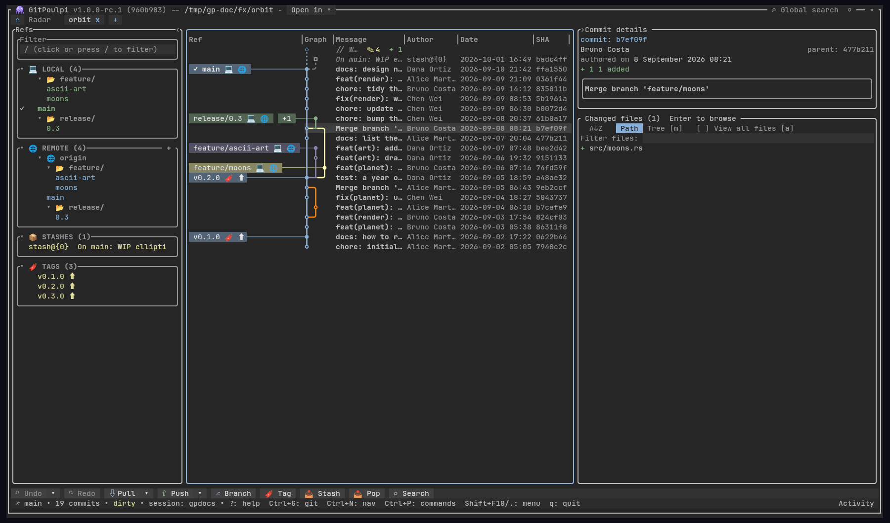
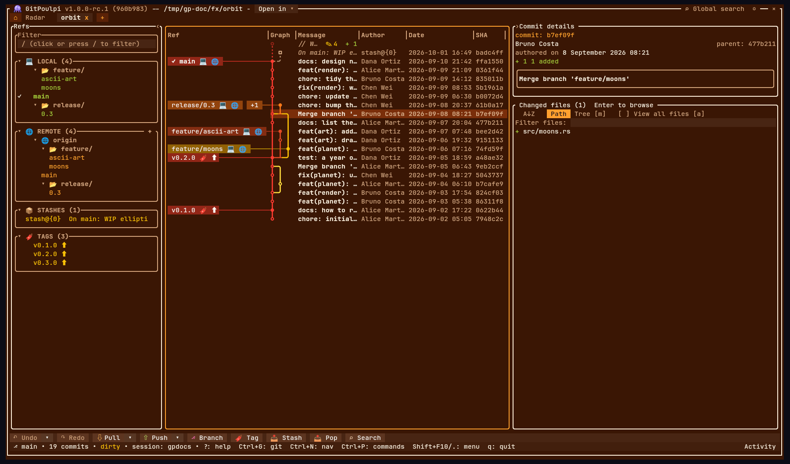
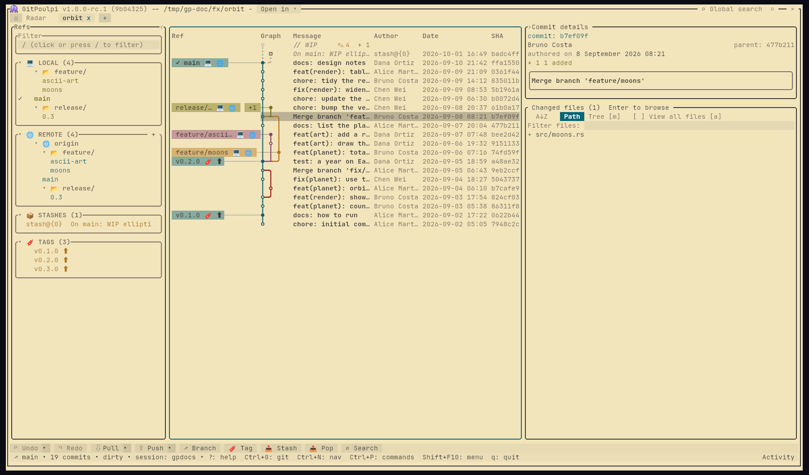
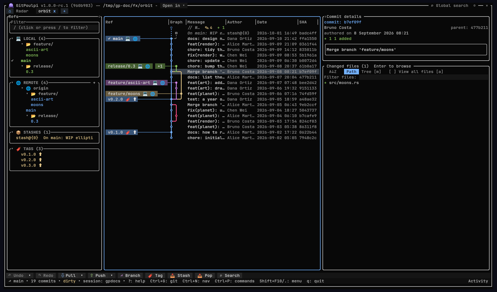
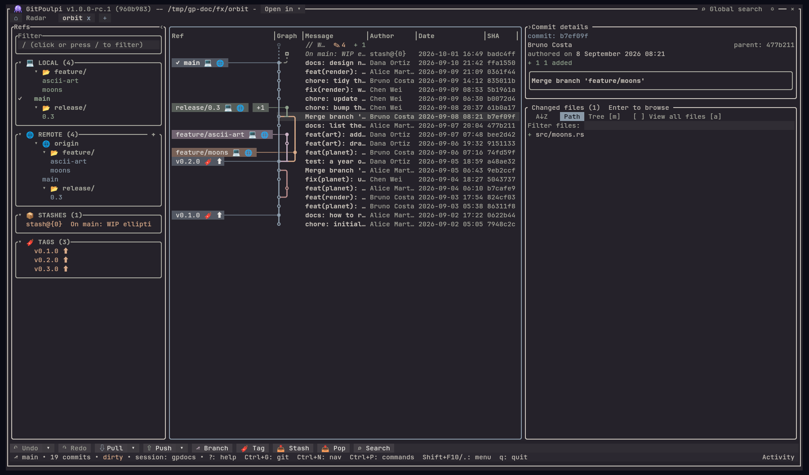
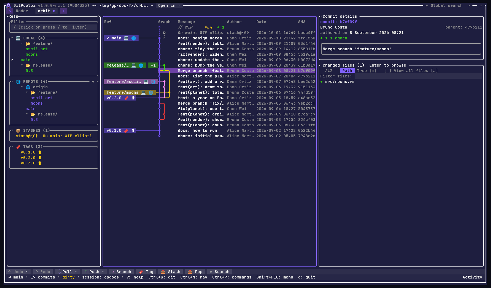
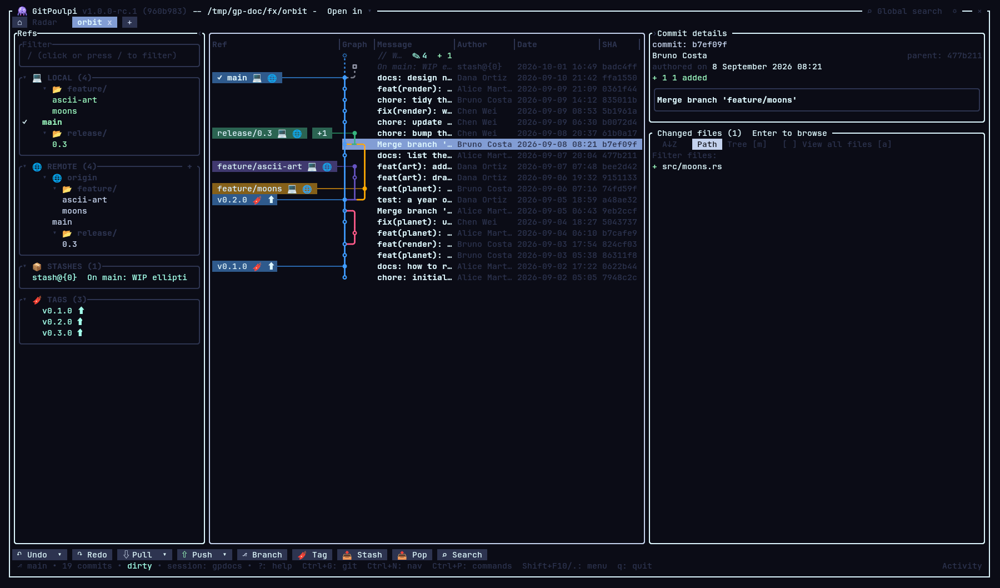
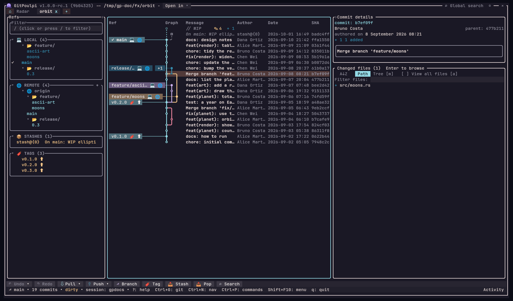
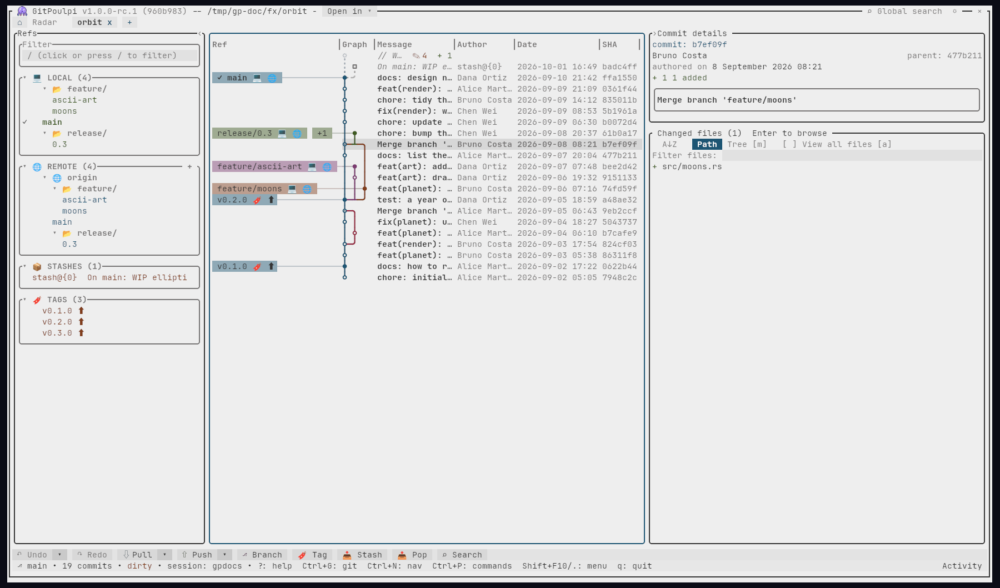

[English](../themes.md) · **Čeština** · [Deutsch](../de/themes.md) · [Español](../es/themes.md) · [Français](../fr/themes.md) · [Italiano](../it/themes.md) · [日本語](../ja/themes.md) · [한국어](../ko/themes.md) · [Nederlands](../nl/themes.md) · [Polski](../pl/themes.md) · [Português (Brasil)](../pt-BR/themes.md) · [Português (Portugal)](../pt-PT/themes.md) · [Русский](../ru/themes.md) · [Svenska](../sv/themes.md) · [Türkçe](../tr/themes.md) · [Українська](../uk/themes.md) · [简体中文](../zh-CN/themes.md)

# Motivy

Motiv určuje každou barvu, kterou GitPoulpi vykresluje: text, panely, výběr,
tlačítka, zobrazení diff a merge, editor, ikony panelu nástrojů a barvy drah
grafu Logu. Motivy přepnete v **Nastavení > Vzhled > Motiv**, nebo příkazem
`gitpoulpi config set ui.theme <slug>`. Chcete-li vidět, jak který vypadá, přejděte do [galerie](#galerie).

## Vestavěné předvolby

`gitpoulpi theme list` vypíše ty, které jsou ve vašem sestavení, v pořadí, v
jakém je ukazuje rozbalovací seznam v Nastavení: nejdřív **GitPoulpi Dark**
(`dark`, vykreslený přes vlastní pozadí vašeho terminálu) a **GitPoulpi Light**
(`light`), poté každá další předvolba abecedně podle popisku. `ui.theme =
"system"` (výchozí) sleduje váš terminál: Light na světlém pozadí terminálu,
jinak Dark (viz „Detekce systému“ níže); starší `default` je totéž co `system`.
Seznam palet drah používá stejné pořadí.

| Slug | Popisek | Zdroj barev |
|---|---|---|
| `system` (výchozí) | Systém | není paleta: GitPoulpi Light na světlém pozadí terminálu, jinak GitPoulpi Dark |
| `dark` | GitPoulpi Dark | původní motiv GitPoulpi, vykreslený přes vlastní pozadí vašeho terminálu |
| `light` | GitPoulpi Light | původní motiv GitPoulpi |
| `catppuccin-latte` / `catppuccin-frappe` / `catppuccin-macchiato` / `catppuccin-mocha` | Catppuccin Latte / Frappé / Macchiato / Mocha | [github.com/catppuccin/palette](https://github.com/catppuccin/palette) |
| `cyberpunk` | Cyberpunk | [iTerm2-Color-Schemes](https://github.com/mbadolato/iTerm2-Color-Schemes) „Cyberpunk“ |
| `dracula` | Dracula | [draculatheme.com/contribute](https://draculatheme.com/contribute) |
| `everforest-dark` | Everforest Dark | [github.com/sainnhe/everforest/blob/master/palette.md](https://github.com/sainnhe/everforest/blob/master/palette.md) |
| `fire` / `fire-light` | Fire / Fire Light | původní motivy GitPoulpi: Fire jsou žhavé uhlíky na pozadí vypálené oranžové s plamenně oranžovou; Fire Light je jeho světlé dvojče na skutečně oranžovém pozadí |
| `github-dark` / `github-light` | GitHub Dark / GitHub Light | motivy Primer od GitHubu, [github.com/primer/github-vscode-theme](https://github.com/primer/github-vscode-theme) s @primer/primitives (`canvas.default`, `canvas.inset` jako postranní panel, `fg.*`, `accent.fg`); žádná hodnota není upravena |
| `gruvbox-dark` / `gruvbox-light` | Gruvbox Dark / Light | [github.com/morhetz/gruvbox#palette](https://github.com/morhetz/gruvbox#palette) |
| `kanagawa` / `kanagawa-lotus` | Kanagawa (wave) / Kanagawa Lotus | [github.com/rebelot/kanagawa.nvim](https://github.com/rebelot/kanagawa.nvim) |
| `matrix` | Matrix | [iTerm2-Color-Schemes](https://github.com/mbadolato/iTerm2-Color-Schemes) „Matrix“ (ve schématu není červená: `danger` je `#ff5555`) |
| `monokai` | Monokai | původní paleta Monokai ([monokai.nl](https://monokai.nl/)) |
| `nord` | Nord | [www.nordtheme.com](https://www.nordtheme.com) |
| `one-dark` / `one-light` | One Dark / One Light | Atom One Dark / One Light ([One Dark](https://github.com/atom/one-dark-syntax), [One Light](https://github.com/atom/one-light-syntax)) |
| `rose-pine` / `rose-pine-moon` / `rose-pine-dawn` | Rosé Pine / Moon / Dawn | [rosepinetheme.com/palette](https://rosepinetheme.com/palette/) |
| `solarized-dark` / `solarized-light` | Solarized Dark / Light | Solarized od Ethana Schoonovera ([ethanschoonover.com/solarized](https://ethanschoonover.com/solarized/)) |
| `sunset` | Sunset | původní motiv GitPoulpi: indigový soumrak s korálovou a zlatou |
| `terminal` | Terminal (16 colors) | používá jen vlastních 16 barev vašeho terminálu |
| `tokyo-night` / `tokyo-night-day` | Tokyo Night (night) / Tokyo Night Day | [github.com/folke/tokyonight.nvim](https://github.com/folke/tokyonight.nvim) (popředí Day je ztmaveno, aby splnilo pravidla kontrastu) |
| `vesper` | Vesper | [github.com/raunofreiberg/vesper](https://github.com/raunofreiberg/vesper) (v paletě není modrá ani fialová: akcent je broskvový) |
| `vscode-dark` / `vscode-light` | VS Code Dark / VS Code Light | výchozí Dark Modern / Light Modern z VS Code, [github.com/microsoft/vscode/tree/main/extensions/theme-defaults/themes](https://github.com/microsoft/vscode/tree/main/extensions/theme-defaults/themes) (`dark_modern.json`, `light_modern.json`, plus výchozí barvy VS Code pro výběr v seznamu a akcenty ANSI/grafů; šedá muted u Light je `616161`) |

### Importováno z terminalcolors.com

Importováno z terminálových palet z terminalcolors.com; každé schéma patří svým autorům. 90 předvoleb je sestaveno z pozadí, popředí, výběru a 16 barev ANSI dané palety (accent = modrá, success = zelená, warning = žlutá, danger = červená, AI = purpurová, muted = jasná černá) jedním odvozením společným pro všechny; barva, která neprojde pravidly kontrastu GitPoulpi, se zesvětlí nebo ztmaví, dokud je nesplní. Tabulku generuje `scripts/gen-terminalcolors.py` do `crates/gitpoulpi-config/src/theme/terminalcolors_data.rs`. Slugy mají tvar `<rodina>-<varianta>` (`default` se vynechá); popisky jsou v rozbalovacím seznamu seřazeny abecedně jako ostatní.

| Rodina | Slugy |
|---|---|
| [Apprentice](https://terminalcolors.com/themes/apprentice/) | `apprentice` |
| [Ayu](https://terminalcolors.com/themes/ayu/) | `ayu-dark`, `ayu-light`, `ayu-mirage` |
| [Cobalt2](https://terminalcolors.com/themes/cobalt2/) | `cobalt2` |
| [Deus](https://terminalcolors.com/themes/deus/) | `deus` |
| [Dracula](https://terminalcolors.com/themes/dracula/) | `dracula-soft` |
| [Everforest](https://terminalcolors.com/themes/everforest/) | `everforest-light` |
| [GitHub](https://terminalcolors.com/themes/github/) | `github-dark-colorblind`, `github-dark-dimmed`, `github-dark-high-contrast`, `github-dark-legacy`, `github-light-colorblind`, `github-light-high-contrast`, `github-light-legacy` |
| [Gotham](https://terminalcolors.com/themes/gotham/) | `gotham` |
| [Gruvbox](https://terminalcolors.com/themes/gruvbox/) | `gruvbox-dark-hard-contrast`, `gruvbox-dark-soft-contrast`, `gruvbox-light-hard-contrast`, `gruvbox-light-soft-contrast` |
| [Iceberg](https://terminalcolors.com/themes/iceberg/) | `iceberg-dark`, `iceberg-light` |
| [Jellybeans](https://terminalcolors.com/themes/jellybeans/) | `jellybeans` |
| [Kanagawa](https://terminalcolors.com/themes/kanagawa/) | `kanagawa-dragon` |
| [Lucario](https://terminalcolors.com/themes/lucario/) | `lucario` |
| [Miasma](https://terminalcolors.com/themes/miasma/) | `miasma` |
| [Moonfly](https://terminalcolors.com/themes/moonfly/) | `moonfly` |
| [Night](https://terminalcolors.com/themes/night-owl/) | `night-owl-dark`, `night-owl-light` |
| [Nightfly](https://terminalcolors.com/themes/nightfly/) | `nightfly` |
| [Nightfox](https://terminalcolors.com/themes/nightfox/) | `nightfox`, `nightfox-carbonfox`, `nightfox-dawnfox`, `nightfox-dayfox`, `nightfox-duskfox`, `nightfox-nordfox`, `nightfox-terafox` |
| [Noctis](https://terminalcolors.com/themes/noctis/) | `noctis`, `noctis-azureus`, `noctis-bordo`, `noctis-hibernus`, `noctis-lilac`, `noctis-lux`, `noctis-minimus`, `noctis-obscuro`, `noctis-sereno`, `noctis-uva`, `noctis-viola` |
| [Nordic](https://terminalcolors.com/themes/nordic/) | `nordic` |
| [One](https://terminalcolors.com/themes/one-half/) | `one-half-dark`, `one-half-light` |
| [Panda](https://terminalcolors.com/themes/panda/) | `panda` |
| [Posterpole](https://terminalcolors.com/themes/posterpole/) | `posterpole`, `posterpole-gray` |
| [Seoul256](https://terminalcolors.com/themes/seoul256/) | `seoul256-dark`, `seoul256-light` |
| [Shades](https://terminalcolors.com/themes/shades-of-purple/) | `shades-of-purple`, `shades-of-purple-super-dark` |
| [Sonokai](https://terminalcolors.com/themes/sonokai/) | `sonokai`, `sonokai-andromeda`, `sonokai-atlantis`, `sonokai-espresso`, `sonokai-maia`, `sonokai-shusia` |
| [Srcery](https://terminalcolors.com/themes/srcery/) | `srcery` |
| [Tender](https://terminalcolors.com/themes/tender/) | `tender` |
| [Tokyo](https://terminalcolors.com/themes/tokyo-night/) | `tokyo-night-moon`, `tokyo-night-storm` |
| [Tomorrow](https://terminalcolors.com/themes/tomorrow/) | `tomorrow`, `tomorrow-night`, `tomorrow-night-blue`, `tomorrow-night-bright`, `tomorrow-night-eighties` |
| [Zenbones](https://terminalcolors.com/themes/zenbones/) | `zenbones-duckbones`, `zenbones-forestbones-dark`, `zenbones-forestbones-light`, `zenbones-kanagawabones`, `zenbones-neobones-dark`, `zenbones-neobones-light`, `zenbones-nordbones`, `zenbones-rosebones-dark`, `zenbones-rosebones-light`, `zenbones-seoulbones-dark`, `zenbones-seoulbones-light`, `zenbones-tokyobones-dark`, `zenbones-tokyobones-light`, `zenbones-vimbones`, `zenbones-zenburned`, `zenbones-zenwritten-dark`, `zenbones-zenwritten-light` |

`ui.side_bg` je pozadí panelu Refs a pravého panelu (detail commitu, rozpracované změny, seznamy souborů), tak jako GitHub a VS Code vykreslují své postranní panely. Nastavují jej Catppuccin (jeho `mantle`), GitHub a VS Code; u každé další předvolby je `default`, což znamená totéž co `ui.bg`. Soubor motivu může nastavit `side_bg` v `[ui]` (vypíše jej `gitpoulpi theme export`).

Další tři role v `[ui]` barví rámeček aplikace, jako to dělají GitHub a VS Code:

| Role | Kde se vykresluje |
|---|---|
| `ui.toolbar_bg` | Řádek panelu nástrojů a **vybraná karta repozitáře**, takže karta vypadá jako připojená k panelu nástrojů. Čipy tlačítek panelu nástrojů si ponechávají vlastní `chrome.toolbar_bg`. |
| `ui.statusbar_bg` | Stavový řádek (dole, pokud `ui.statusbar_position` neříká nahoře). |
| `ui.statusbar_fg` | Text stavového řádku. Text, který by na tomto podkladu nebyl čitelný, se přebarví touto barvou; text varování a chyb, který čitelný je, si barvu ponechá. |

Předvolby je nastavují tak, aby odpovídaly své aplikaci: VS Code Dark a Light modrý (`#007acc`) stavový řádek s bílým textem a šedé odstíny záhlaví okna VS Code pro panel nástrojů; GitHub odstíny svého záhlaví. Každá další předvolba (včetně importovaných terminálových palet) odvozuje panel nástrojů o krok od `bg` a stavový řádek o něco dál od něj, s `text` na něm, a pravidla kontrastu udržují text čitelný. `dark` (GitPoulpi Dark) a `terminal` používají vlastní pozadí terminálu, takže všechny tři jsou tam `default`: nic se nevykresluje a vybraná karta si ponechává barvu výběru. Soubor motivu, který je vynechá, zdědí hodnoty své základny; `default` znamená bez zbarvení (stavový řádek pak sleduje `side_bg`).

Kde je komentář nebo šedá muted ve schématu příliš nevýrazná na čtení, zesvětlí se, dokud nesplní pravidla kontrastu GitPoulpi; odstíny panelů a výběru, které schéma nemá, se odvodí z jeho pozadí.

### Galerie

Každý vestavěný motiv, na stejném repozitáři s vybraným merge commitem (`scripts/docs-screenshots.sh` je pořídí znovu).

| **GitPoulpi Dark** (`dark`) | **GitPoulpi Light** (`light`) | **Apprentice** (`apprentice`) |
|---|---|---|
|  |  |  |
| **Ayu Dark** (`ayu-dark`) | **Ayu Light** (`ayu-light`) | **Ayu Mirage** (`ayu-mirage`) |
|  |  |  |
| **Catppuccin Frappé** (`catppuccin-frappe`) | **Catppuccin Latte** (`catppuccin-latte`) | **Catppuccin Macchiato** (`catppuccin-macchiato`) |
|  |  |  |
| **Catppuccin Mocha** (`catppuccin-mocha`) | **Cobalt2** (`cobalt2`) | **Cyberpunk** (`cyberpunk`) |
|  |  |  |
| **Deus** (`deus`) | **Dracula** (`dracula`) | **Dracula Soft** (`dracula-soft`) |
|  |  |  |
| **Everforest Dark** (`everforest-dark`) | **Everforest Light** (`everforest-light`) | **Fire** (`fire`) |
|  |  |  |
| **Fire Light** (`fire-light`) | **GitHub Dark** (`github-dark`) | **GitHub Dark Colorblind** (`github-dark-colorblind`) |
|  |  |  |
| **GitHub Dark Dimmed** (`github-dark-dimmed`) | **GitHub Dark High Contrast** (`github-dark-high-contrast`) | **GitHub Dark Legacy** (`github-dark-legacy`) |
|  |  |  |
| **GitHub Light** (`github-light`) | **GitHub Light Colorblind** (`github-light-colorblind`) | **GitHub Light High Contrast** (`github-light-high-contrast`) |
|  |  |  |
| **GitHub Light Legacy** (`github-light-legacy`) | **Gotham** (`gotham`) | **Gruvbox Dark** (`gruvbox-dark`) |
|  |  |  |
| **Gruvbox Dark Hard Contrast** (`gruvbox-dark-hard-contrast`) | **Gruvbox Dark Soft Contrast** (`gruvbox-dark-soft-contrast`) | **Gruvbox Light** (`gruvbox-light`) |
|  |  |  |
| **Gruvbox Light Hard Contrast** (`gruvbox-light-hard-contrast`) | **Gruvbox Light Soft Contrast** (`gruvbox-light-soft-contrast`) | **Iceberg Dark** (`iceberg-dark`) |
|  |  |  |
| **Iceberg Light** (`iceberg-light`) | **Jellybeans** (`jellybeans`) | **Kanagawa** (`kanagawa`) |
|  |  |  |
| **Kanagawa Dragon** (`kanagawa-dragon`) | **Kanagawa Lotus** (`kanagawa-lotus`) | **Lucario** (`lucario`) |
|  |  |  |
| **Matrix** (`matrix`) | **Miasma** (`miasma`) | **Monokai** (`monokai`) |
|  |  |  |
| **Moonfly** (`moonfly`) | **Night Owl Dark** (`night-owl-dark`) | **Night Owl Light** (`night-owl-light`) |
|  |  |  |
| **Nightfly** (`nightfly`) | **Nightfox** (`nightfox`) | **Nightfox Carbonfox** (`nightfox-carbonfox`) |
|  |  |  |
| **Nightfox Dawnfox** (`nightfox-dawnfox`) | **Nightfox Dayfox** (`nightfox-dayfox`) | **Nightfox Duskfox** (`nightfox-duskfox`) |
|  |  |  |
| **Nightfox Nordfox** (`nightfox-nordfox`) | **Nightfox Terafox** (`nightfox-terafox`) | **Noctis** (`noctis`) |
|  |  |  |
| **Noctis Azureus** (`noctis-azureus`) | **Noctis Bordo** (`noctis-bordo`) | **Noctis Hibernus** (`noctis-hibernus`) |
|  |  |  |
| **Noctis Lilac** (`noctis-lilac`) | **Noctis Lux** (`noctis-lux`) | **Noctis Minimus** (`noctis-minimus`) |
|  |  |  |
| **Noctis Obscuro** (`noctis-obscuro`) | **Noctis Sereno** (`noctis-sereno`) | **Noctis Uva** (`noctis-uva`) |
|  |  |  |
| **Noctis Viola** (`noctis-viola`) | **Nord** (`nord`) | **Nordic** (`nordic`) |
|  |  |  |
| **One Dark** (`one-dark`) | **One Half Dark** (`one-half-dark`) | **One Half Light** (`one-half-light`) |
|  |  |  |
| **One Light** (`one-light`) | **Panda** (`panda`) | **Posterpole** (`posterpole`) |
|  |  |  |
| **Posterpole Gray** (`posterpole-gray`) | **Rosé Pine** (`rose-pine`) | **Rosé Pine Dawn** (`rose-pine-dawn`) |
|  |  |  |
| **Rosé Pine Moon** (`rose-pine-moon`) | **Seoul256 Dark** (`seoul256-dark`) | **Seoul256 Light** (`seoul256-light`) |
|  |  |  |
| **Shades of Purple** (`shades-of-purple`) | **Shades of Purple Super Dark** (`shades-of-purple-super-dark`) | **Solarized Dark** (`solarized-dark`) |
|  |  |  |
| **Solarized Light** (`solarized-light`) | **Sonokai** (`sonokai`) | **Sonokai Andromeda** (`sonokai-andromeda`) |
|  |  |  |
| **Sonokai Atlantis** (`sonokai-atlantis`) | **Sonokai Espresso** (`sonokai-espresso`) | **Sonokai Maia** (`sonokai-maia`) |
|  |  |  |
| **Sonokai Shusia** (`sonokai-shusia`) | **Srcery** (`srcery`) | **Sunset** (`sunset`) |
|  |  |  |
| **Tender** (`tender`) | **Terminal (16 colors)** (`terminal`) | **Tokyo Night** (`tokyo-night`) |
|  |  |  |
| **Tokyo Night Day** (`tokyo-night-day`) | **Tokyo Night Moon** (`tokyo-night-moon`) | **Tokyo Night Storm** (`tokyo-night-storm`) |
|  |  |  |
| **Tomorrow** (`tomorrow`) | **Tomorrow Night** (`tomorrow-night`) | **Tomorrow Night Blue** (`tomorrow-night-blue`) |
|  |  |  |
| **Tomorrow Night Bright** (`tomorrow-night-bright`) | **Tomorrow Night Eighties** (`tomorrow-night-eighties`) | **Vesper** (`vesper`) |
|  |  |  |
| **VS Code Dark** (`vscode-dark`) | **VS Code Light** (`vscode-light`) | **Zenbones Duckbones** (`zenbones-duckbones`) |
|  |  |  |
| **Zenbones Forestbones Dark** (`zenbones-forestbones-dark`) | **Zenbones Forestbones Light** (`zenbones-forestbones-light`) | **Zenbones Kanagawabones** (`zenbones-kanagawabones`) |
|  |  |  |
| **Zenbones Neobones Dark** (`zenbones-neobones-dark`) | **Zenbones Neobones Light** (`zenbones-neobones-light`) | **Zenbones Nordbones** (`zenbones-nordbones`) |
|  |  |  |
| **Zenbones Rosebones Dark** (`zenbones-rosebones-dark`) | **Zenbones Rosebones Light** (`zenbones-rosebones-light`) | **Zenbones Seoulbones Dark** (`zenbones-seoulbones-dark`) |
|  |  |  |
| **Zenbones Seoulbones Light** (`zenbones-seoulbones-light`) | **Zenbones Tokyobones Dark** (`zenbones-tokyobones-dark`) | **Zenbones Tokyobones Light** (`zenbones-tokyobones-light`) |
|  |  |  |
| **Zenbones Vimbones** (`zenbones-vimbones`) | **Zenbones Zenburned** (`zenbones-zenburned`) | **Zenbones Zenwritten Dark** (`zenbones-zenwritten-dark`) |
|  |  |  |
| **Zenbones Zenwritten Light** (`zenbones-zenwritten-light`) |
|  |

## Libovolný motiv s libovolnou paletou drah

Každý motiv přináší vlastní barvy drah pro graf Logu, ale libovolný motiv můžete kombinovat s libovolnou paletou: **Nastavení > Vzhled > Barevný motiv grafu** nabízí **Podle motivu** (výchozí) plus každou paletu drah každého motivu (GitPoulpi Dark, GitPoulpi Light, poté Material, Serie, ... a `graph_palette` vašich vlastních souborů motivů, uvedené za předvolbami pod názvem motivu). Vlastní motiv se objeví při dalším otevření seznamu (soubory se tehdy čtou znovu) a jeho výběr uloží název jeho souboru do `ui.graph_color_theme` (u hlavní instalace v `[ui]`, u ostatních do vlastního záznamu `[installation.settings.<id>]`, stejně jako motiv). Soubor motivu bez `graph_palette` má barvy drah svého `base` (výchozí předvolba, když žádný neuvádí), stejné dědění jako každá jiná barva souboru. Vlastní motiv pojmenovaný jako vestavěná paleta drah (například `gruvbox`) tuto paletu v seznamu nahradí. Pokud nakonfigurovaný název už neexistuje (soubor byl smazán nebo přejmenován), graf použije barvy drah aktivního motivu a Nastavení ukazuje název označený *nenalezeno*, dokud nevyberete jiný. 

V `config.toml`:

```toml
[ui]
theme = "nord"
graph_color_theme = "material"   # or "theme" to follow the theme
```

`ui.input_color` je stejný druh přepsání pro textová pole: výchozí `theme` sleduje barvy polí z motivu; `gray`, `blue`, `slate`, `dark` a `custom` vynutí pozadí (jsou to tmavé barvy, takže u světlého motivu zvolte `theme`).

## Vlastní motivy

Dejte soubor `.toml` do složky `themes/` v konfiguračním adresáři (`gitpoulpi config path` vypíše jeho rodiče; složka je `${config}/themes/`). Název souboru bez `.toml` je slug motivu, což je to, co přijímá `ui.theme`. Soubor nesmí znovu použít slug předvolby (přeskočí se s varováním).

Začněte od úplného souboru:

```
gitpoulpi theme export nord > "$(dirname "$(gitpoulpi config path)")/themes/mine.toml"
```

Poté si ponechte jen to, co měníte. Soubor je sada **částečných přepsání** nad `base` (předvolbou, nebo jiným uživatelským motivem; řetězy mají nejvýše 4 úrovně a cykly se odmítají; bez `base` se myslí `dark`):

```toml
name = "My Nord"            # the label in the combo; default = file name
base = "nord"
light = false               # inherited when absent
syntax = "base16-ocean.dark"
graph_palette = ["#88c0d0", "#a3be8c"]

[ui]
bg = "#2e3440"              # "default" | "#rrggbb" | "ansi:N"
accent = "#88c0d0"
toolbar_bg = "#3b4252"      # toolbar row and selected tab
statusbar_bg = "#5e81ac"    # status bar
statusbar_fg = "#eceff4"

[diff]
add_bg = "#2f3b2f"
```

### Změněná slova v diffu (`diff.add_emph_bg`, `diff.del_emph_bg`)

Silnější pozadí, která zobrazení Diff vykresluje na slovech, jež se liší uvnitř změněného
řádku, přes `diff.add_bg` (přidané řádky) a `diff.del_bg` (odebrané řádky); text si ponechává
`diff.add_fg` a `diff.del_fg`. Každá předvolba nastavuje obě. Soubor motivu, který nastaví
`diff.add_bg` nebo `diff.del_bg`, ale ne odpovídající zvýraznění, dostane zvýraznění odvozené
z něj (30 % cesty k barvě textu té strany), takže vlastní pozadí nikdy nekončí se zvýrazněním
základního motivu. Hodnota `default` (předvolba Terminal), nebo terminál, jehož barevná hloubka
by obě pozadí vykreslila stejně, označí slova tučně a podtržením. Viz
[Změněná slova v diffu](interface-tour.md#změněná-slova-v-diffu).

Barvy jsou `"#rrggbb"`, `"ansi:N"` (položka N palety terminálu) nebo `"default"` (vlastní barva terminálu). Skupiny a klíče jsou ty z `gitpoulpi theme export <slug>`. Nic není fatální: neznámý klíč nebo špatná barva se ignorují, neznámý `base` se vrátí na `dark` a `gitpoulpi theme list` hlásí každý problém pod `warnings` (aplikace je jednou ukáže ve stavovém řádku).

Soubory se znovu čtou při otevření seznamu Motiv a při zavření Nastavení. Běžící okno si navíc všimne přepsání `config.toml` (například `gitpoulpi config set ui.theme ...` z shellu) i souboru aktivního motivu a nové barvy použije přibližně do jedné sekundy, bez restartu.

### `ui.border_focused`

Rámeček panelu, který má fokus klávesnice: Log, postranní panel Refs, panely Soubory staged a Soubory unstaged, detail commitu, panely historie, revize a přepisu, rámečky diffu, souborů a editoru. Vykresluje jen okraje; text, popisky a ikony (popisek „commit :“, ikona Domů, tlačítka karet) nadále používají `ui.accent`. Motiv tak může aktivní panel orámovat barvou, která by jako text byla nečitelná, například jasně žlutou na světlém motivu. Když ji motiv nenastaví, řídí se `ui.accent` (i v uživatelském souboru: soubor, který změní jen `accent`, dá tento akcent i rámečkům s fokusem), takže každý vestavěný motiv vypadá jako dřív. Dialogy a vyskakovací okna si ponechávají rámeček v barvě akcentu.

```toml
[ui]
accent = "#1f5fbf"
border_focused = "#ffd700"
```

## Detekce systému

S `ui.theme = "system"` se GitPoulpi **jednou, při startu** zeptá terminálu na barvu pozadí (dotaz OSC 11, na který odpovídají kitty, WezTerm, Alacritty, foot, iTerm2, Windows Terminal, tmux a většina dalších) a zvolí Light pro světlé pozadí, jinak Dark. Čekání trvá nejvýše asi 100 ms a terminál, který dotaz nezná, nic nestojí: odpověď se vždy přečte před spuštěním rozhraní, takže se nic nevypisuje a žádné klávesy se nepohltí. Bez odpovědi (a vždy ve Windows, který dotaz neposílá) se přečte `COLORFGBG` a pak se přejde na Dark. Terminál, jehož pozadí se mění za běhu GitPoulpi, se nesleduje; restartujte jej, nebo zvolte Light či Dark výslovně.

## Barevná hloubka

Motivy jsou truecolor (`#rrggbb`). `ui.color_depth` (Nastavení > Vzhled > Barevná hloubka, platí okamžitě) určuje, jak se to dostane do terminálu:

| Hodnota | Účinek |
|---|---|
| `auto` (výchozí) | Truecolor, kromě míst, kde je známo, že nefunguje: Apple Terminal (`TERM_PROGRAM=Apple_Terminal`) používá 256 barev, konzole Linuxu (`TERM=linux`) 16 a terminál `*-256color`, který nenastavuje `COLORTERM` (a není to WezTerm, kitty ani Windows Terminal), 256. `COLORTERM=truecolor` vždy znamená truecolor. |
| `truecolor` | Vždy 24bitová barva. |
| `256` | Každá barva RGB se stane nejbližší položkou xterm-256. |
| `16` | Nejbližší z 16 barev ANSI; přesný odstín určuje vlastní paleta terminálu. |

Použijte `256` nebo `16`, pokud motiv přes ssh nebo ve starém multiplexeru ukazuje špatné barvy. Předvolba Terminal nic z toho nepotřebuje. Truecolor nic nestojí; mapovací průchod běží přes obrazovku jednou za snímek, jen když je aktivní.

Motiv je pro každou instalaci zvlášť: několik instalací GitPoulpi sdílejících jednu konfiguraci si drží každá svůj, takže výběr v jedné instalaci nikdy nepřebarví ostatní.

## Živý náhled

V Nastavení > Vzhled uvádí seznam Motiv **Systém (podle terminálu)**, předvolby a poté vaše vlastní soubory motivů. Přesun zvýraznění použije daný motiv okamžitě, takže se celá obrazovka Nastavení pod vámi překreslí; **Enter** jej ponechá (uloží se), **Esc** nebo klik mimo obnoví předchozí a nic neuloží. Položka palety **Aplikace: Motiv...** (`Ctrl+P`) otevře Nastavení na tomto řádku.

### Změna motivu z palety

**Aplikace: Změnit motiv...** (`Ctrl+P`, nebo `Ctrl+N t`; klávesa jde přemapovat jako `nav_prefix.change_theme`) otevře seznam týchž motivů bez cesty přes Nastavení: **Systém (podle terminálu)**, předvolby a poté vaše vlastní soubory motivů, každý se čtyřmi malými barevnými čipy. Aktuální motiv je zaškrtnutý. Psaním seznam zúžíte; přesun zvýraznění zobrazí náhled motivu okamžitě, **Enter** jej použije a uloží `ui.theme` do `config.toml`, **Esc** (nebo klik mimo seznam) vrátí předchozí motiv a nic neuloží.

Pod polem filtru zužuje seznam segmentovaný předfiltr: **Vše**, **Tmavé**, **Světlé** a **Barevné**, plus **Vlastní**, když máte vlastní soubory motivů (klik na segment, `Tab` / `Shift+Tab`, nebo `Alt+1`..`Alt+5`). Tmavé a Světlé se určují podle jasu `ui.bg` motivu; **Barevné** ponechá motivy, jejichž pozadí je zřetelně zabarvené (modré, fialové, žluté, zelené...), a vynechá bílé, téměř bílé, černé a téměř černé šedé, takže Solarized Dark, Dracula nebo Nord jsou barevné, zatímco GitHub Dark a One Light ne. Barevný motiv se zobrazí i pod Tmavé nebo Světlé. **Systém** a průhledné motivy (bez vlastního pozadí) se objeví jen pod Vše. **Vlastní** ponechá jen soubory motivů z vaší složky `themes/` (vlastní motiv je pro tato tlačítka stále Tmavý, Světlý nebo Barevný); tlačítko se nevykreslí a klávesami není dosažitelné, dokud tato složka žádný motiv neobsahuje. Předfiltr se kombinuje s tím, co píšete. Výběr barevného motivu grafu a jazyka zobrazuje náhled stejně: dráhy Logu a celé rozhraní se mění, jak se zvýraznění pohybuje.


Pod seznamem ukazuje pás barevných čipů motiv, který platí (pozadí, text, muted, accent, výběr, danger, diff přidáno, diff odebráno, poté prvních šest barev drah) a sleduje náhled. Seznam **Barevný motiv grafu** na stránce **Vzhled** ukazuje vedle každé palety několik barev drah a volby se použijí při zavření Nastavení.

Motiv s vlastním pozadím (Light a ostatní vykreslené předvolby) vyplní celé okno, včetně Nastavení a zobrazení na celou stránku, a text bez vlastní barvy dostane barvu textu motivu; Dark a Terminal ponechávají barvy vašeho terminálu beze změny.

## Z příkazového řádku

| Příkaz | Výstup |
|---|---|
| `gitpoulpi theme list` | JSON `{themes: [{slug, label, source, light, lane_palette}], warnings}`; `source` je `preset` nebo `user`. |
| `gitpoulpi theme export <slug>` | Úplný soubor motivu jako TOML na stdout (JSON: `{slug, toml}`); naparsuje se zpět na stejný motiv. |
| `gitpoulpi config set ui.theme <slug>` | Ověřeno vůči předvolbám a vaší složce `themes/`; neznámý název je chyba s výpisem platných. `system` a `default` se přijímají. |
| `gitpoulpi config set ui.graph_color_theme <name>` | `theme` (sledovat motiv) nebo libovolný název palety drah; neznámý název vypíše platné. |

Server MCP nabízí `theme_list` a `theme_export` jako nástroje jen pro čtení.
