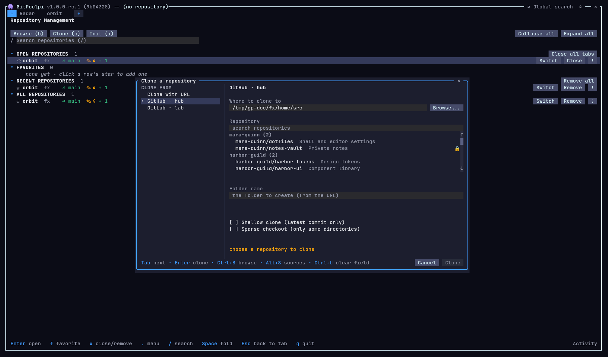

[English](../hosting-integration.md) · [Čeština](../cs/hosting-integration.md) · **Deutsch** · [Español](../es/hosting-integration.md) · [Français](../fr/hosting-integration.md) · [Italiano](../it/hosting-integration.md) · [日本語](../ja/hosting-integration.md) · [한국어](../ko/hosting-integration.md) · [Nederlands](../nl/hosting-integration.md) · [Polski](../pl/hosting-integration.md) · [Português (Brasil)](../pt-BR/hosting-integration.md) · [Português (Portugal)](../pt-PT/hosting-integration.md) · [Русский](../ru/hosting-integration.md) · [Svenska](../sv/hosting-integration.md) · [Türkçe](../tr/hosting-integration.md) · [Українська](../uk/hosting-integration.md) · [简体中文](../zh-CN/hosting-integration.md)

# Hosting- und Issue-Tracker-Integrationen

GitPoulpi verbindet sich mit diesen Produkten:

- **Hosting** (Pull Requests, Issues, Klonen aus Ihrem Konto, SSH-Schlüssel):
  GitHub, GitHub Enterprise, GitLab, selbst gehostetes GitLab, Azure DevOps,
  Azure DevOps Server, Bitbucket, Bitbucket Data Center, Gitea und Forgejo
  (einschließlich Codeberg). **Gerrit Code Review** ist Hosting nur fürs Review: Seine Changes sind die
  Pull Requests, Issues hat es nicht.
- **Issue-Tracker** (nur Issues): Jira Cloud, Jira Data Center, Trello,
  Linear, YouTrack (Cloud und Server) und Redmine.
- **Lokale Markdown-Notizen** (nur Issues, kein Token, kein Netzwerk): ein Ordner mit Markdown-Notizen, zum Beispiel ein Ordner eines Obsidian-Vaults, siehe [Lokale Issues und Obsidian](local-issues.md).

Jede Integration nutzt ein **persönliches Token**. Es gibt kein GitPoulpi-Konto und
keine OAuth-Anmeldung. Integrationen sind optional und **pro Repository freiwillig**:
Nichts wird abgerufen, bis Sie ein Repository verknüpfen. Ihr Token wird in Ihrem
Credential-Helper gespeichert, nie in der `config.toml`. Einfache `git`-Vorgänge
(Fetch, Pull, Push) brauchen keine Integration: Sie nutzen die Zugangsdaten, die Ihr
`git` schon hat.

## 1. Ein Token beim Host erstellen

Das Verbindungsformular hat einen Link *Token auf <Host> erzeugen*. Er öffnet die
Token-Seite des Hosts mit bereits ausgewählten passenden Berechtigungen. Um es von
Hand zu tun:

| Host | Wo | Berechtigungen |
|---|---|---|
| GitHub, GitHub Enterprise | Settings > Developer settings > Personal access tokens (classic) > Generate new token | `repo` (Repositories, Pull Requests, Issues), `read:user` (wer Sie sind), `admin:public_key` (nur zum Hinzufügen oder Entfernen von SSH-Schlüsseln) |
| GitLab, selbst gehostetes GitLab | User settings > Access tokens > Add new token | `api`, `read_user` |
| Azure DevOps | User settings > Personal access tokens, auf `dev.azure.com/<organization>/_usersSettings/tokens` | `Code (Read & write)`, `Work Items (Read & write)`. Erstellen Sie das Token **für diese Organisation**, nicht für „All accessible organizations“: Globale Tokens funktionieren ab dem 2026-12-01 nicht mehr. |
| Azure DevOps Server | Dieselbe Seite auf Ihrem Server (`https://<server>/<collection>/_usersSettings/tokens`) | Dieselben zwei Berechtigungen |
| Bitbucket | `id.atlassian.com/manage-profile/security/api-tokens` > Create API token with scopes | `read:user:bitbucket`, `read:workspace:bitbucket`, `read:repository:bitbucket`, `write:repository:bitbucket`, `read:pullrequest:bitbucket`, `write:pullrequest:bitbucket`. Für SSH-Schlüssel zusätzlich `read:ssh-key:bitbucket`, `write:ssh-key:bitbucket`, `delete:ssh-key:bitbucket`. |
| Bitbucket Data Center | Profilbild > Manage account > HTTP access tokens | `Repository (Read & write)`, `Projects (Read)` |
| Gitea, Forgejo (Codeberg) | Settings > Applications > Generate New Token, auf `<host>/user/settings/applications` | `user` lesen; `repository`, `issue` und `user` lesen und schreiben (Letzteres für SSH-Schlüssel). Gitea zeigt Berechtigungen nachträglich nicht an, GitPoulpi kann also nicht vor einer fehlenden warnen: Ein abgelehnter Aufruf sagt es. |
| Linear | Settings > Account > Security & access > Personal API keys > New API key (`linear.app/settings/account/security`) | Read, write, create issues. Der Schlüssel handelt als Sie. |
| YouTrack (Cloud und Server) | Ihr Profil > Account Security > New token, auf `<host>/users/me?tab=account-security` | Der Scope `YouTrack`. Ein dauerhaftes Token handelt als Sie. |
| Gerrit | Settings > HTTP Credentials > Generate new token (neuere Server; ältere: Generate new password), auf `<host>/settings/#HTTPCredentials` | Keine. Das Token ist das **HTTP-Passwort** und handelt als Sie; der Benutzername kommt daneben. |
| Redmine | My account > API access key > Show, auf `<host>/my/account`. Der Administrator muss **Administration > Settings > API > Enable REST web service** eingeschaltet haben. | Keine. Der Schlüssel handelt als Sie. |
| Jira Cloud | `id.atlassian.com/manage-profile/security/api-tokens` > Create API token (die klassische Art, ohne Berechtigungen) | Keine. Das Token handelt als Sie. |
| Jira Data Center | Profile > Personal Access Tokens | Keine. Das Token handelt als Sie. |
| Trello | Zuerst ein **API-Schlüssel** von `trello.com/apps/admin` (ein Power-Up anlegen, dann einen API-Schlüssel erzeugen). Dann ein **Token** von `trello.com/1/authorize?...&key=<Ihr Schlüssel>`. | `read`, `write` |

Geben Sie dem Token einen Namen wie „GitPoulpi“ und ein Ablaufdatum. Kopieren Sie das
Token: Der Host zeigt es nur einmal.

## 2. Es verbinden

1. Drücken Sie `Ctrl+,` und wählen Sie **Integrationen**.
2. Wählen Sie links das Produkt. Die Produkte stehen in zwei Gruppen: **Hosting** und
   **Issue-Tracker**.
3. Drücken Sie **Verbinden**. Um ein zweites Konto desselben Produkts hinzuzufügen,
   nutzen Sie **+ Profil hinzufügen**.

   

4. Füllen Sie das Formular aus und fügen Sie das Token ein. Das Token wird beim Tippen
   im Klartext angezeigt, vergewissern Sie sich also, dass niemand zusieht. Das Formular
   listet die Berechtigungen auf, die es braucht.

   

5. Drücken Sie **Verbinden**. GitPoulpi prüft das Token im Hintergrund beim Host. Die
   Seite zeigt dann eine Karte mit Ihrem Namen und Login, *Verbunden* in Grün und den
   Abschnitt für SSH-Schlüssel. Ein Token ohne eine der gewünschten Berechtigungen
   verbindet sich trotzdem, und die fehlenden Berechtigungen werden rot aufgelistet.

Auf der Karte: **Bearbeiten** öffnet das Formular erneut. **Trennen** löscht das Token
und behält das Profil. **Entfernen** löscht beides, nach einer Bestätigung.

Tastatur auf der Seite Integrationen: `Tab` / `Shift+Tab` wechseln zwischen der
Produktliste, der Profilleiste und dem Formular. `a` fügt ein Profil hinzu, `e`
bearbeitet es, `d` oder `Delete` entfernt es, `o` öffnet die Token-Seite, `Esc` geht
einen Schritt zurück.

### Was jedes Formular verlangt

Der Link *Token erzeugen* funktioniert erst, nachdem Sie den Host oder die Organisation
ausgefüllt haben.

- **GitHub, GitLab:** nur das Token. **GitHub Enterprise** und **selbst gehostetes
  GitLab** fragen zusätzlich nach der **Host-Domain** (`gitlab.example.com`; https, sofern Sie nicht `http://`
  eingeben). Ein Name ohne Punkt (ein Docker-Dienst oder ein Rechner im LAN) braucht
  einen Port oder `http://`: `gitea:3000`, `http://nas`. Ein selbst gehosteter Server kann einfaches http nutzen, etwa ein lokaler
  Container unter `http://localhost:8080`. Ein über einfaches http gesendetes Token wird unverschlüsselt
  übertragen, nutzen Sie http daher nur in einem lokalen oder vertrauenswürdigen Netz.
- **Azure DevOps:** die **Organisation**, der Name in `dev.azure.com/<organization>`.
  Eine Adresse `https://<org>.visualstudio.com` wird ebenfalls akzeptiert. Zwei
  Organisationen brauchen zwei Profile. Ein Repository nutzt das Profil der
  Organisation, die sein Remote nennt. **Azure DevOps Server** fragt nach der
  **Collection-URL**, zum Beispiel `tfs.corp/tfs/DefaultCollection`. GitPoulpi nutzt für
  Azure DevOps nicht den Credential-Helper des Systems: Git Credential Manager speichert
  dort ein Anmelde-Token, kein persönliches Zugriffstoken.
- **Bitbucket:** Ihre **E-Mail des Atlassian-Kontos** und ein API-Token. Ist die E-Mail
  leer, wird das Token als Bearer-Token gesendet: Nutzen Sie das für ein
  Zugriffstoken eines Workspaces oder Repositorys. GitPoulpi findet Ihre Workspaces über
  das Token. **Bitbucket Data Center:** die **Server-URL** und ein HTTP-Zugriffstoken.
- **Gitea, Forgejo:** die **Host-Domain** und das Token. **Forgejo** startet auf
  `https://codeberg.org`: Ersetzen Sie es bei einem selbst gehosteten Server. Gitea hat
  keinen öffentlichen Standard. Eine Adresse `http://localhost:3000` funktioniert für einen
  lokalen Server. Beide Arten teilen einen Client (Forgejo ist ein Gitea-Fork mit derselben
  `/api/v1`); das Token wird als `Authorization: token <Token>` gesendet. Der
  Credential-Helper des Systems wird für sie nicht genutzt.
- **Jira Cloud:** die **Website-URL** (`acme.atlassian.net`), Ihre **E-Mail des
  Atlassian-Kontos** und ein klassisches API-Token. Jira-Tokens mit Berechtigungsumfang
  (Scopes) werden nicht unterstützt. **Jira Data Center:** die **Server-URL** und ein
  persönliches Zugriffstoken.
- **Trello:** der **API-Schlüssel** und das **Token**. Der API-Schlüssel ist öffentlich
  und wird daher in der `config.toml` aufbewahrt (als `account`). Das Token ist geheim
  und geht an den Credential-Helper. Das Formular hat zwei Links: *API-Schlüssel bei Trello holen* und,
  nachdem Sie den Schlüssel getippt haben, *Token erzeugen*. Schlüssel und Token werden
  in einem Header gesendet, nie in einer URL.
- **Linear:** nur der **API-Schlüssel**: Linear hat einen öffentlichen Host, es gibt
  also keine Adresse einzutippen. Der Schlüssel wird unverändert im Header `Authorization`
  gesendet (Linear nimmt für persönliche Schlüssel kein `Bearer`). Damit die `ENG-12`-Referenzen
  von Commit-Nachrichten die richtige Seite öffnen, speichern Sie die Profil-URL mit Ihrem
  Workspace (`https://linear.app/acme`, auf der CLI: `--url`); die Issue-Zeilen
  selbst tragen immer die genaue Adresse.
- **YouTrack:** die **Website-URL** (`acme.youtrack.cloud` für Cloud, sonst Ihr eigener
  Server, mit seinem Kontextpfad, falls er einen hat, zum Beispiel
  `host/youtrack`) und ein dauerhaftes Token, gesendet als `Authorization: Bearer`. Derselbe
  Client bedient Cloud und Server (`<url>/api`).
- **Gerrit:** die **Server-URL** (mit ihrem Kontextpfad, falls vorhanden), Ihr **Benutzername** und das
  HTTP-Passwort als Token. Sie reisen als HTTP-Basic-Authentifizierung; GitPoulpi spricht die REST-API unter `/a/` des
  Servers und ignoriert die Zeile `)]}'`, mit der jede Antwort beginnt. Der Benutzername ist nicht geheim und wird in der
  `config.toml` aufbewahrt (als `account`), das Passwort geht an den Credential-Helper. Ein Repository wird unter PULL REQUESTS mit einem Gerrit-
  *Projekt* verknüpft (seine Changes werden dort gelistet); Gerrit hat keine Issues, und ein Change entsteht
  durch einen Push (siehe *Zum Review senden* unter [Prüfen](review.md#gerrit)).
- **Redmine:** die **Website-URL** Ihres Redmine (mit seinem Unterpfad, falls vorhanden,
  zum Beispiel `host/redmine`) und Ihr API-Schlüssel, gesendet als `X-Redmine-API-Key`. Antwortet
  Redmine mit 403 oder einer HTML-Seite, ist der REST-Webdienst aus (fragen Sie den
  Administrator oder schalten Sie ihn unter **Administration > Settings > API** ein).

Jira, Trello, Linear, YouTrack und Redmine sind nur Issue-Tracker: keine Pull Requests, keine zu klonenden
Repositories und keine SSH-Schlüssel. Bitbucket hat keine Issues (Atlassian hat
Bitbucket Issues eingestellt). Verknüpfen Sie stattdessen den Abschnitt ISSUES eines
Bitbucket-Repositorys mit einem Jira-Projekt.

## 3. Wo das Token gespeichert wird

Das Token wird im **Credential-Helper** Ihres Systems gespeichert (Git Credential
Manager unter Windows, libsecret oder `pass` unter Linux, Keychain unter macOS). Es
nutzt einen privaten Eintrag, der sich nicht mit den Zugangsdaten eines echten Hosts
verwechseln lässt. Es wird nie in die `config.toml` geschrieben und nie ausgegeben.

Ist kein Credential-Helper konfiguriert oder lehnt er das Token ab, behält GitPoulpi das
Token **nur für diese Sitzung im Speicher** und sagt Ihnen das. Verbinden Sie sich nach
einem Neustart erneut.

GitPoulpi sucht das Token eines Profils in dieser Reihenfolge:

1. Die Umgebungsvariable `GITPOULPI_TOKEN_<PROFIL-ID>`. Nutzen Sie sie, um ein Token zu
   übergeben, ohne es zu speichern, zum Beispiel in CI.
2. Das für das Profil gespeicherte Token (`token_ref`).
3. Nur für GitHub- und GitLab-Profile: der Credential-Helper des Systems für den Host,
   wenn kein anderes aktiviertes Profil denselben Host nutzt.

Jedes Profil ist ein Eintrag `[[integrations]]` in der `config.toml`. Siehe die
[Konfigurationsreferenz](config-reference.md#integrations-hosting-und-issue-tracker).

## Die Sicherheitsprüfung

Ein gespeichertes Token ist nur so sicher wie die Adresse, an die es gesendet wird. GitPoulpi merkt sich daher für jede Integration, womit sie verbunden war, und hält an, wenn sich das ändert:

- **Die Adresse.** Bei der ersten Verwendung (oder beim Verbinden) einer Integration wird ihre Adresse in `trust.toml` festgehalten, im privaten Datenordner, der nur dem Benutzer gehört (`<data>/private/`), nicht in `config.toml`: Das Bearbeiten der Konfiguration kann das Vertrauen nie erweitern. Ist die Adresse in der Konfiguration nicht mehr die festgehaltene, wird nichts an sie gesendet und das Token nicht einmal gelesen. Schreibweisen derselben Adresse (`HTTPS://Git.Example.com:443/`) sind dieselbe Adresse; ein ähnlich aussehender Host nicht.
- **Das Konto.** Nachdem Sie ein Token verbunden haben, und dann etwa einmal täglich (und einmal je Lauf bei einem Token aus `GITPOULPI_TOKEN_*` oder dem Credential-Helper), fragt GitPoulpi den Host, wem das Token gehört, und vergleicht die Konto-**ID**, nicht den Login. Ein Token, das jetzt jemand anderem gehört, wird angehalten.
- **Das Zertifikat.** Server, deren Zertifikat nicht zu einer bekannten Zertifizierungsstelle führt (eine private CA, ein selbstsignierter Server), werden nur für genau den Schlüssel akzeptiert, den Sie akzeptiert haben, und der TLS-Handshake beweist weiterhin, dass der Server diesen Schlüssel besitzt. Bei strengem Pinning muss der Schlüssel auch dann passen, wenn das Zertifikat zu einer öffentlichen Wurzel führt; der Preis ist, dass jede Schlüsselrotation erneut fragt, weshalb es optional ist. Die öffentlichen Hosts (github.com, gitlab.com, codeberg.org, bitbucket.org, dev.azure.com, `*.atlassian.net`, ...) führen keinen Zertifikateintrag.
- **Einfaches http.** Eine `http://`-Adresse außerhalb des Loopbacks wird abgelehnt, außer Sie haben sie für diese Integration erlaubt.

Jede Anfrage wird außerdem an die eigene Adresse der Integration gebunden (und bei einem öffentlichen Host an dessen API-Host wie `api.github.com`): Eine Anfrage anderswohin wird abgelehnt, bevor sie gesendet wird, und eine Weiterleitung an eine andere Adresse wird nicht verfolgt.

**Vor dieser Prüfung verbundene Integrationen** erhalten ihren Eintrag stillschweigend aus der Konfiguration, wie sie war, bei der ersten Verwendung nach dem Upgrade: Sie behalten das heutige Vertrauensniveau, und nichts fragt.

### Von der Kommandozeile

Ein angehaltener Befehl endet mit Exit-Code 2 und gibt aus, was sich geändert hat (siehe die [CLI-Referenz](cli-reference.md)). `gitpoulpi hosting integrations trust <id>` zeigt, was vertraut wird; `--accept-origin <url>`, `--accept-account <id>`, `--accept-certificate <sha256>`, `--strict-tls on|off` und `--allow-insecure-http on|off` akzeptieren je eine Sache und nennen den genauen Wert. Geben Sie nach dem Akzeptieren einer neuen Adresse das Token erneut ein. Das Trennen (`hosting logout`) oder Entfernen einer Integration löscht ihr Token, ihren Vertrauenseintrag und alles, was von ihr zwischengespeichert wurde (die gespeicherten Repository-Listen des Klon-Dialogs, die Radar-Kontolisten und die Remote-Review-Entwürfe ihres Hosts).

Ein Agent (MCP) kann nichts akzeptieren: Ihm wird gesagt, dass die Sicherheitsprüfung Sie braucht.

### In der Terminal-Oberfläche

Eine angehaltene Anfrage öffnet den Dialog **Sicherheitsprüfung der Integration** über dem, was Sie gerade tun. Er sagt, was sich geändert hat (die alte und die neue Adresse, das alte und das neue Konto mit ihren IDs, oder das alte und das neue Zertifikat als kleine Tabelle mit dem SHA-256-Fingerabdruck in Vierergruppen, Inhaber, Aussteller und Gültigkeit) und dass das Token nicht gesendet wurde. Die Antworten sind nummeriert:

1. **Trennen** löscht das gespeicherte Token, den Vertrauenseintrag und alles, was von der Integration zwischengespeichert wurde.
2. Der neuen Adresse, dem neuen Konto oder dem neuen Zertifikat **vertrauen** (bei einer unverschlüsselten Adresse: **Einfaches http erlauben**).
3. **Abbrechen** ändert nichts.

Keine Antwort ist hervorgehoben, bis Sie eine Pfeiltaste oder eine Ziffer drücken, ein versehentliches Enter akzeptiert also nichts. Esc und das Schließen-Kreuz brechen ab; ein Klick außerhalb des Dialogs bewirkt nichts. Ein langer Text scrollt mit dem Mausrad, Bild auf/Bild ab oder der Bildlaufleiste. Mehrere Prüfungen werden eingereiht (eine je Integration und Art der Änderung) und nacheinander gestellt. Eine abgebrochene Prüfung erscheint nicht erneut, solange sie unverändert ist; **Integrationen: Sicherheitsprüfung ansehen** in der Befehlspalette holt sie zurück.

Nachdem Sie einer neuen **Adresse** vertraut haben, öffnet sich das Formular der Integration mit fokussiertem Token-Feld und dem Hinweis „Das Token erneut einzugeben wird empfohlen“: Das gespeicherte Token wurde nie dorthin gesendet. Im Formular wird eine absichtlich geänderte Adresse zusammen mit einem dafür eingegebenen Token akzeptiert; ohne Token verlangt das Formular eines.

Das Formular hat außerdem zwei Schalter. **Striktes Zertifikat-Pinning** (für eine https-Adresse) heftet den Zertifikatschlüssel an, den der Server beim Verbinden vorlegt. **Einfaches http erlauben (nicht verschlüsselt)** wird nur für eine `http://`-Adresse angeboten, die nicht dieser Rechner ist, mit einer roten Warnung, dass das Token im Klartext übertragen wird. Die verbundene Karte zeigt den angehefteten Fingerabdruck.

### Was das Token darf und bis wann

Das Verbinden fragt den Host auch, was das Token kann. GitHub (klassische Tokens), GitLab und Bitbucket (wenn es die Scopes sendet) melden ihre Scopes: Die Karte zeigt eine gelbe Zeile „Dieses Token hat mehr Rechte, als GitPoulpi braucht“ mit den Scopes über das hinaus, was GitPoulpi nutzt, die sensiblen (wie `delete_repo`, `admin:org`, `sudo`) in Rot, mit dem Rat, ein fein abgestuftes Token mit Ablaufdatum zu bevorzugen. Ein klassisches GitHub-Token (`ghp_...`) bekommt diesen Rat auch dann, wenn seine Scopes genau passen. Bei einem fein abgestuften GitHub-Token lassen sich die Berechtigungen nicht abfragen, daher wird nur sein Ablauf angezeigt. Die Karte zeigt das Ablaufdatum, wenn der Host es nennt. Ein Token ohne Ablauf zeigt keine Erinnerung, und die anderen Produkte melden keine Scopes und lösen keine Warnung aus. Dieselben Felder stehen im JSON von `hosting integrations login` und `test` (`excess_scopes`, `token_flavor`, `recommend_fine_grained`, `expires_at`). Sie werden beim Verbinden gelesen, die Karte zeigt sie also für die Sitzung, die verbunden hat.

## 4. Ein Repository verknüpfen

Das Verknüpfen ist ausdrücklich und pro Repository. Ist ein Profil verbunden, zeigt die
Refs-Seitenleiste nach TAGS einen Abschnitt **PULL REQUESTS** und einen Abschnitt
**ISSUES**. Jeder Abschnitt hat zwei Dropdownlisten: den Anbieter und das Projekt.

- Die Anbieter-Dropdownliste **schlägt** die Konten **vor**, die zu den Remotes des
  Repositorys passen (`origin` zuerst), als Zeilen wie `owner/name · origin · GitHub`.
  Eine Wahl setzt Anbieter und Projekt.
- Nichts wird automatisch verknüpft. Jira, Trello, Linear, YouTrack und Redmine werden nie vorgeschlagen, weil
  kein Remote sie nennt: Wählen Sie sie selbst.
- **Keiner (dieses Repository trennen)** oben in der Dropdownliste trennt den
  Abschnitt. Nichts verknüpft ihn danach von selbst wieder.
- Die Verknüpfung wird in der Datei `.gitpoulpi/repo-state.toml` des Repositorys
  gespeichert.

Die beiden Abschnitte werden **getrennt** verknüpft. Zum Beispiel können Pull Requests
von Azure DevOps und Issues von Jira kommen.

| Anbieter | Projekt für PULL REQUESTS | Projekt für ISSUES |
|---|---|---|
| GitHub, GitLab | `owner/name`, `group/sub/proj` | dasselbe |
| Azure DevOps | `Project/Repo` (die Organisation kommt aus dem Profil) | `Project` (Work Items) |
| Gitea, Forgejo | `owner/name` | dasselbe |
| Bitbucket | `workspace/slug` (Data Center: `PROJ/slug`) | keines: Jira verknüpfen |
| Jira | keines | der Projektschlüssel, zum Beispiel `ABC` |
| Trello | keines | ein Board |
| Linear | keines | ein Team-Schlüssel, zum Beispiel `ENG` (die Teams werden gelistet) |
| YouTrack | keines | ein Projektkürzel, zum Beispiel `ABC` |
| Gerrit | der Gerrit-Projektname, zum Beispiel `team/tool` | keines |
| Redmine | keines | eine Projektkennung, zum Beispiel `bench` (der letzte Teil der Adresse des Projekts) |

Die Projektliste für ISSUES ist durchsuchbar. Sie können auch ein Projekt eintippen, das
die Liste nicht zeigt.

**Zusätzliche Abfrage.** Eine Issue-Quelle hat unter der Projekt-Dropdownliste eine
optionale Filterzeile. Sie wird mit dem Projekt kombiniert (UND):

- Jira: ein **JQL**-Fragment (`component = UI AND labels = backend`).
- Azure DevOps: eine **WIQL**-Bedingung (`[System.AssignedTo] = @Me`).
- YouTrack: eine **YouTrack-Abfrage** (`#Unresolved Type: Bug`, `tag: ui or tag: ux`).
  Sie wird in Klammern gesetzt, sodass ein `or` das Projekt nicht erweitern kann. Ein eigenes
  `sort by:` ersetzt das Standard-`sort by: updated desc`.
- Redmine: keine (die Zustands- und „Mir zugewiesen“-Filter des Abschnitts genügen).
- Linear: keine (die Zustands- und „Mir zugewiesen“-Filter des Abschnitts
  genügen).
- Trello: eine Dropdownliste, in der Sie die anzuzeigenden **Listen** ankreuzen. Ohne
  Häkchen werden alle offenen Listen gezeigt.
- GitHub und GitLab ignorieren sie.

`Enter` behält eine getippte Abfrage, `Esc` verwirft sie. Palette:
*Issues: Abfrage / Listen bearbeiten...*.

Von der CLI: `gitpoulpi hosting link pulls --id <profile>` (oder `issues`), `--clear`
zum Trennen, `--filter` für die zusätzliche Abfrage. Siehe die
[CLI-Referenz](cli-reference.md#befehle).

### Von einem verbundenen Konto klonen

Ein verbundenes Profil (GitHub, GitLab, Gitea, Forgejo, Azure DevOps, Bitbucket, Gerrit) ist auch eine Quelle im Dialog **Klonen** (die Schaltfläche **Klonen** im Home-Tab, oder dort `c`). Jedes Profil steht unter **Per URL klonen** als eigene Quelle (`GitHub · name`, `GitLab · name`); GitHub und GitLab werden nie vermischt. Wählen Sie eines aus, und seine Repositories werden geladen, nach Eigentümer gruppiert: zuerst Ihr eigenes Konto, dann ein Abschnitt pro Organisation oder Gruppe (`quarry/tools` für eine GitLab-Untergruppe), jeweils unter einer Überschrift mit der Anzahl. Ein Schloss kennzeichnet ein privates Repository.



Das Suchfeld filtert über alle Abschnitte hinweg (Name, vollständiger Pfad und Beschreibung); ein Abschnitt ohne Treffer verschwindet. `Enter` auf einer Zeile füllt den Klon mit der HTTPS-URL dieses Repositorys und einem Ordnernamen.


Die Liste eines Profils, das Sie schon einmal geöffnet haben, erscheint sofort aus einer gespeicherten Kopie, während der Host erneut gefragt wird (*wird aktualisiert...* neben der Beschriftung); sobald die Antwort eintrifft, erscheinen neue Repositories und verschwundene fallen weg, und das markierte und das gewählte Repository bleiben, wo sie sind. Schlägt die Aktualisierung fehl, bleibt die gespeicherte Liste mit einem Hinweis stehen, und der Grund steht im Aktivitätsprotokoll.

Lehnt der Host das Token ab, zeigt der Dialog anstelle der Liste *Repositories konnten nicht aufgelistet werden* mit dem Grund (und die gespeicherte Kopie wird gelöscht); die anderen Quellen funktionieren weiter.

## 5. Pull Requests und Issues in der Seitenleiste

### PULL REQUESTS

Der Abschnitt hat eine Kopfzeile mit der Zahl und einem `+` (einen Pull Request
erstellen), den Dropdownlisten für Anbieter und Projekt, einem Suchfeld und einer
Zustands-Dropdownliste (*Offen*, *Gemergt / geschlossen*, *Alle*). Dann folgen vier
Gruppen, jede mit ihrer Zahl:

- **Meine Pull Requests**: Sie sind der Autor.
- **Mir zugewiesen**.
- **Wartet auf mein Review**: Sie sind angeforderter Reviewer.
- **Alle Pull Requests**: anfangs eingeklappt.

Das Suchfeld filtert jede Gruppe (Titel, Nummer, Autor, Branch). Jede Änderung der
Zustands-Dropdownliste fragt den Host erneut.

Eine Zeile beginnt mit einem Zustandssymbol: `●` offen (grün), `○` Entwurf, `◆` gemergt
(lila), `✕` geschlossen (rot). Der Request des ausgecheckten Branches ist fett. Zeilen
lauten `#12  Titel` (GitHub, Bitbucket) oder `!53  Titel` (GitLab, Azure DevOps).

### ISSUES

Der Abschnittstitel nennt den Anbieter: `GITHUB ISSUES`, `JIRA ISSUES` und so weiter. Er
lautet `... WORK ITEMS` bei Azure DevOps und `... CARDS` bei Trello. Unter den
Dropdownlisten: ein Suchfeld, die Zustands-Dropdownliste (*Offen*, *Mir zugewiesen*,
*Geschlossen*, *Alle*) und die Issues. Eine Jira-Zeile lautet `ABC-12  Titel`, mit
abgedunkeltem Typ und Status, wenn die Seitenleiste breit genug ist.

### Aktionen auf einer Zeile

- `Enter` oder ein Doppelklick öffnet die Zeile: einen Pull Request im [Review](review.md) (GitHub, GitLab, Gitea, Forgejo, Gerrit), ein Issue und einen Request bei Azure DevOps oder Bitbucket als [Unterhaltung](#5c-unterhaltungen) im Fenster, alles andere in Ihrem Browser. **Im Browser öffnen** im Zeilenmenü öffnet immer den Browser.
- `Enter` oder ein Doppelklick öffnet die Zeile in Ihrem Browser.
- Rechtsklick oder `.` öffnet das Zeilenmenü:
  - **Unterhaltung öffnen** (Issues und Requests, die keine Review-Ansicht haben), **Im Browser öffnen**, **URL kopieren**, **Nummer kopieren**.
  - **Im Browser öffnen**, **URL kopieren**, **Nummer kopieren**.
  - Für einen Pull Request: **Auf <Anbieter> bearbeiten**, **Quell-Branch auschecken**,
    **Commits des Quell-Branches ansehen**. Bei einem Request aus einem Fork lautet der
    Checkout **Pull Request auschecken (Fork)**, und **Commits des Quell-Branches ansehen** ist ausgegraut.
  - Für ein Issue: **Branch aus Issue erstellen**. Es öffnet die Eingabe für einen neuen
    Branch mit einem Namen wie `12-fix-the-thing` (oder `ABC-123-fix-the-thing` bei
    Jira).
  - Bei GitHub, GitLab, Gitea und Forgejo hat eine Pull-Request-Zeile außerdem **Review...**
    (auch **Enter** auf der Zeile): das Review in GitPoulpi, siehe
    [Einen Pull Request prüfen](review.md).
  - Bei GitHub, GitLab, Gitea und Forgejo haben beide Zeilen außerdem **Zugewiesene bearbeiten...**,
    **Labels bearbeiten...** und **Meilenstein festlegen...** (und **Reviewer bearbeiten...** bei
    einem Pull Request): siehe
    [Zugewiesene, Reviewer, Labels und Meilenstein](#zugewiesene-reviewer-labels-und-meilenstein).
- **Auf <Anbieter> bearbeiten** hat drei weitere Zugänge: den Stift `✎` am rechten Ende
  einer überfahrenen oder ausgewählten Pull-Request-Zeile, `e` auf der ausgewählten Zeile
  und den Palettenbefehl *Integrationen: Verknüpften Pull Request auf dem Host bearbeiten* (für den
  Request des ausgecheckten Branches).
- Ist der Quell-Branch noch nicht im Repository, sagt GitPoulpi das. Fetchen Sie zuerst
  (`Ctrl+G f`).

**Checkout eines Pull Requests.** GitPoulpi holt den Request in einen lokalen Branch
`pr/<n>` (`mr/<n>` bei GitLab), der ihm folgt, und wechselt darauf. Bei GitHub, GitLab, Gitea und Forgejo
funktioniert das auch für Forks (GitPoulpi holt die besondere Head-Ref des Hosts). Azure
DevOps und Bitbucket holen den Quell-Branch des Requests. Ein Request aus einem Fork wird
dort abgelehnt: Fügen Sie den Fork als Remote hinzu und checken Sie seinen Branch selbst
aus. Rückgängig kehrt zum vorherigen Branch zurück. CLI: `gitpoulpi hosting checkout-pr <n>`.

**Einen Pull Request von der Kommandozeile prüfen (und durch einen Agenten).** Bei GitHub
(auch Enterprise), GitLab (auch selbst gehostet), Gitea und Forgejo lässt sich ein Request
lesen und prüfen, ohne GitPoulpi zu verlassen: `hosting review show <n>` (Dateien,
Merge-Status, Checks), `hosting review threads <n>` (Review-Threads und
Unterhaltung), `hosting review comment`, `hosting review reply`, `hosting review resolve`
und `hosting review submit <n> --event approve|request-changes|comment
--comment Pfad:Zeile[:Seite]:Text`. Der Diff kommt aus Ihrem Repository, nicht vom
Host: `hosting review fetch <n>` holt den Head des Requests nach
`refs/gitpoulpi/pr/<n>` und seinen Zielbranch nach `refs/gitpoulpi/pr/<n>-base`
(beides sind keine Branches, nichts wird ausgecheckt). Die Zeilennummern sind die dieses
Diffs: `new` ist die Zeile im Head, `old` die an der Merge-Basis. GitLab
hat keinen Review-Status „Änderungen anfordern“: Er wird dort abgelehnt, ohne dass etwas gesendet wird.
Gitea und Forgejo nehmen einen Kommentar nur zu einer Zeile (keine Bereiche); ein Thread sind die
Kommentare zu einer Zeile einer Datei. Gitea kann einen Thread auflösen, Forgejo 11 nicht
(der Host hat dafür keinen Endpunkt: Der Aufruf sagt es). Eine Antwort auf einen Server
ohne den Antwort-Endpunkt wird als Ein-Kommentar-Review an derselben Zeile gesendet.
Gitea lehnt es ab, den eigenen Request zu genehmigen oder abzulehnen.
Ohne Klon: Fügen Sie `--project owner/name` (GitLab: `group/project`) zu `review show`, `threads`,
`comment`, `reply`, `resolve`, `submit` und `suggest` hinzu, um ein Projekt zu prüfen, das nicht das aktuelle Repository ist;
`hosting review diff <n> --project P` liest den Diff (Hunks pro Datei) über die API des Hosts, und
`hosting file <path> --project P [--ref R]` liest eine Datei in einer Revision (GitHub, GitLab, Gitea, Forgejo und Gerrit; bei Gerrit wird der Diff eines
Patch Sets Datei für Datei gelesen, und die Datei kommt vom Branch oder, bei einer Commit-ID, vom Commit). Eine Datei, die der Host
nicht im Diff zeigt (zu groß), ist als `omitted` markiert.
Die MCP-Tools sind dieselben Befehle (`hosting_review_show`, `hosting_review_submit`, `hosting_review_diff`,
`hosting_file`...).

### Zugewiesene, Reviewer, Labels und Meilenstein

Bei GitHub (auch Enterprise), GitLab (auch selbst gehostet), Gitea und
Forgejo können Sie ändern, wem ein Pull Request oder Issue zugewiesen ist, wer ihn prüft, seine Labels
und seinen Meilenstein, ohne GitPoulpi zu verlassen. Andere Anbieter zeigen nichts davon.

- **Zeilenmenü**: **Zugewiesene bearbeiten...**, **Reviewer bearbeiten...** (nur Pull
  Requests), **Labels bearbeiten...**, **Meilenstein festlegen...**.
- **Palette**: *Hosting: Zugewiesene bearbeiten...*, *Hosting: Reviewer bearbeiten...*,
  *Hosting: Labels bearbeiten...*, *Hosting: Meilenstein festlegen...* listen jeweils zuerst die
  Requests und Issues der Seitenleiste zur Auswahl. Im
  [Radar](radar.md) wirken dieselben vier auf die ausgewählte Zeile.
- Die Auswahlliste öffnet sich sofort und lädt die Personen oder Labels des Projekts (und was
  das Element jetzt hat) vom Host. Nach etwa 150 ms erscheint eine Spinner-Zeile.
  Zum Filtern tippen (unscharfer Treffer), `Auf` / `Ab` bewegen, `Leertaste` setzt oder
  entfernt das Häkchen, `Enter` übernimmt, `Esc` bricht ab, `Tab` erreicht die Schaltflächen. Ein Klick
  auf eine Zeile setzt das Häkchen, und das Mausrad scrollt. Personen zeigen eine Initialen-Plakette,
  Labels ihre Farbe.
- Der Meilenstein ist eine Dropdownliste (mit **Kein Meilenstein**, um ihn zu entfernen).
- Nach **Übernehmen** wird der Host aktualisiert, und die Listen und das Radar zeigen die
  Änderung nach ihrer nächsten Aktualisierung, die sofort beginnt.

Die Formulare zum Erstellen (Pull Request, Issue) haben dieselben Auswahlen als Reihe von
Schaltflächen: `Zugewiesene: keine`, `Reviewer: keine`, `Labels: keine`,
`Meilenstein: keine`. Bei GitHub, GitLab, Gitea und Forgejo ersetzt die Schaltfläche Labels das getippte
Labels-Feld des Issue-Formulars. Nimmt ein Host den neuen Pull Request an, lehnt aber
einige seiner Labels oder Personen ab, sagt es die Statuszeile.

CLI: `gitpoulpi hosting members|labels|milestones`, `hosting pr-edit <n>`,
`hosting issue edit <n>` und `--assignee`, `--reviewer`, `--label`,
`--milestone` bei `hosting pr` und `hosting issue create`; siehe die
[CLI-Referenz](cli-reference.md).

### Tasten in den Abschnitten

| Taste | Aktion |
|---|---|
| `Enter` / Doppelklick | die Unterhaltung in GitPoulpi öffnen, wo der Host eine hat (ein Pull Request bei GitHub, GitLab, Gitea oder Gerrit öffnet das Review), sonst den Browser |
| `o` | die Zeile im Browser öffnen |
| `Enter` / Doppelklick | die Zeile im Browser öffnen |
| `.` / Rechtsklick | Zeilenmenü |
| `e` | den ausgewählten Pull Request beim Host bearbeiten |
| `n` | neuer Pull Request (PULL REQUESTS) oder neues Issue (ISSUES) |
| `v` | die Zustands-Dropdownliste öffnen |
| `r` | aktualisieren |
| `Enter` / `Space` auf einer Kopfzeile | den Abschnitt ein- oder ausklappen |

### Neu verbinden und offline

Fehlt das Token, wird es abgelehnt oder hat es eine Berechtigung nicht, lautet die erste
Zeile des Abschnitts `Erneut verbinden (Token abgelehnt)`. Klicken Sie darauf oder drücken Sie
`Enter`, um das Profil in Einstellungen > Integrationen zu öffnen.

Ist der Host nicht erreichbar, bleiben die letzten Listen auf dem Bildschirm, und die
Kopfzeile zeigt ihr Alter (`· 5m alt`). Die letzte Antwort wird außerdem auf dem Datenträger
zwischengespeichert (`.gitpoulpi/hosting-cache.json`), sodass die Listen erscheinen, bevor
das Netz antwortet.

## 5b. Das Issue-Board

Die Schaltfläche **Board** in der Kopfzeile von ISSUES (Palette: **Issues: Board öffnen**) zeigt die Issues der verknüpften Quelle als Kanban-
Board über dem Fenster. Die Spalten hängen von der Quelle ab:

| Quelle | Spalten | Eine Karte verschieben |
|---|---|---|
| Lokale Markdown-Notizen | die Status (`statuses` des Profils, dann jeder andere in Gebrauch) | schreibt den `status` der Notiz um |
| GitHub, GitLab, Gitea, Forgejo | **Offen**, dann die von Ihnen gewählten Labels, dann **Geschlossen** | tauscht das Status-Label; nach **Geschlossen** schließt es das Issue, in eine Spalte zurück öffnet es es wieder |
| Trello | die offenen Listen des Boards, von links nach rechts | verschiebt die Karte in die Liste |
| Redmine | die Issue-Status | ändert den Status des Issues (Redmines Workflow-Regeln gelten) |
| Jira (Cloud und Data Center) | die Status des Projekts, zuerst To-do, zuletzt erledigt | führt den Workflow-Übergang aus, der zur Spalte führt (`GET`, dann `POST .../transitions`); gibt es keinen solchen Übergang, springt die Karte zurück und die Statuszeile sagt `no transition from X to Y` |
| Azure DevOps (Services und Server) | die Zustände der Work-Item-Typen des Projekts, nach Zustandskategorie | setzt `System.State`; ein Work Item, dessen Typ den Zustand der Spalte nicht hat, springt mit der Begründung zurück (`a Bug has no state Done`) |

Bei einem GitHub- oder GitLab-Projekt fragt **Spalten** (oder `c`, oder **Board: Spalten-Labels festlegen...**) nach den Labels, die die
Spalten bilden, der Reihe nach, zum Beispiel `status::todo, status::doing, status::review`. Es schlägt die Labels des Projekts vor, die
wie Status aussehen. Die Wahl wird für das Repository gespeichert. Ohne Labels ist das Board Offen / Geschlossen. Eine Karte zu verschieben
berührt nur die aufgeführten Status-Labels: Ihre anderen Labels bleiben. Ein Host-Board listet die offenen Issues und die 60 zuletzt
geschlossenen.

Ein Jira-Übergang, der Pflichtfelder verlangt (etwa eine Lösung), wird von Jira abgelehnt, und die Karte springt mit Jiras
eigener Meldung zurück: Erledigen Sie diesen auf der Website.

Dasselbe Board steht Skripten und Agenten zur Verfügung: `gitpoulpi hosting board` gibt die Spalten mit ihren Karten aus
und `gitpoulpi hosting board move <card> <column>` verschiebt eine (siehe [die CLI-Referenz](cli-reference.md)).

Eine Karte zeigt die Nummer, den Titel, die Zugewiesenen als Initialen, die Labels und den Meilenstein. Ziehen Sie sie in eine andere Spalte,
oder `Shift+Links` / `Shift+Rechts`, oder **Board: Karte verschieben nach...** (`m`). Sie bewegt sich sofort; nach etwa 150 ms zeigt ein Spinner,
dass der Host noch arbeitet, und lehnt der Host ab, springt die Karte zurück, und die Statuszeile sagt, warum. `Enter` öffnet
das Issue beim Host (bei lokalen Issues die Notiz); `e` bearbeitet Zugewiesene, Labels und Meilenstein; `n` beginnt ein neues Issue in
der ausgewählten Spalte; `a`, `l`, `M` und `/` filtern nach Zugewiesenen, Label, Meilenstein und Text, `x` setzt die Filter zurück; `r`
liest den Host erneut. Das Board liest erneut, wenn sich die Listen der Seitenleiste aktualisieren. Das Radar hat kein Board.

## 5c. Unterhaltungen

Eine **Unterhaltung** ist alles, was zu einem Issue, Work Item, einer Karte, einer Änderung oder einem Pull-/Merge-Request gesagt wurde: die Beschreibung, die Kommentare, die Reviews, die Threads am Code und die Ereignisse (Labels, Zuweisungen, Statusänderungen, Pushes). GitPoulpi liest sie vom Host, zeigt sie formatiert und lässt Sie antworten, ohne das Fenster zu verlassen.

### Eine öffnen

| Von | Wie |
|---|---|
| Eine ISSUES-Zeile | `Enter` oder ein Doppelklick; **Unterhaltung öffnen** im Zeilenmenü; die Palette *Hosting: Issue-Unterhaltung öffnen...* (eine Liste der Issues auf dem Bildschirm). **Im Browser öffnen** im Zeilenmenü bleibt beim Browser. |
| Eine PULL-REQUESTS-Zeile bei Azure DevOps oder Bitbucket | `Enter` oder **Unterhaltung öffnen**. Bei GitHub, GitLab, Gitea, Forgejo und Gerrit öffnet die Zeile das [Review](review.md), dessen Übersichtsseite die Unterhaltung des Requests ist. |
| Eine Karte des [Issue-Boards](#5b-das-issue-board) | `Enter` oder ein Doppelklick. |
| Das [Radar](radar.md) | `i` auf einer Issue- oder Request-Zeile, **Unterhaltung öffnen** im Zeilenmenü oder *Radar: Issue-Unterhaltung öffnen*. |
| Ein Verweis in einer anderen Unterhaltung | Anklicken (oder `l`, dann auswählen): `#7`, `!12`, `ABC-12` einer verknüpften Quelle öffnen sich in der App und kommen auf einen Zurück-Stapel. |
| Ein Agent | `gitpoulpi ui show issue <n> --view conversation` (auch `ui show pr`), siehe [die CLI-Referenz](cli-reference.md). |

**Repositories, die nicht geklont sind.** Eine Radar-Zeile eines Repositorys, von dem Sie keinen Klon haben, öffnet ebenfalls ihre Unterhaltung: Die Ansicht braucht nur das Integrationsprofil und das Projekt, daher zeigt das Radar sie über seinem eigenen Fenster, und `Esc` gibt das Radar zurück. Was einen Klon braucht, entfällt: Ein Commit-Verweis öffnet sich auf dem Host statt im Log, und *Die KI das Repository lesen lassen* ist mit seinem Grund ausgegraut (siehe [das KI-Kapitel](ai.md#schreibhilfe-auf-einem-host)). Ein Request eines geklonten Repositorys hat stattdessen sein Review (`e`), und **Unterhaltung öffnen** im Radar sagt, dass es dafür hier keine Unterhaltung zu lesen gibt; ein Issue eines geklonten Repositorys öffnet sie im Tab dieses Repositorys.

Ein Issue eines Hosts, der keine zu lesen hat (Bitbucket und Gerrit haben keine Issues), öffnet wie zuvor den Browser, und ein Build ohne das Feature `conversation` tut das überall ([eigene Builds](custom-builds.md)).

### Die Ansicht

Eine Ansicht im ganzen Fenster: die Kopfzeile (Status, wer es wann geöffnet hat, die Labels, die Zahl der Kommentare, **Ereignisse zeigen**, **Zurück**, **Neu laden**, **Im Browser öffnen**), die Zeile **Senden als**, die Zeitleiste und darunter das Kommentarfeld.

- Die Zeitleiste liest sich vom ältesten zum neuesten Eintrag und beginnt im neuesten Fenster (höchstens 300 Einträge). **Ältere laden** an ihrem Anfang (`m`, Palette *Unterhaltung: Ältere Einträge laden*) liest das Fenster davor, mit der Zahl der noch ausstehenden, wenn der Host sie nennt.
- Ein Kommentar zeigt seinen Autor, das Datum, ein Chip `bearbeitet`, ein Chip `Bot` bei Bots, `intern` bei privaten Notizen und die Schaltflächen **Antworten**, **Zitieren**, **Bearbeiten**, **Löschen** und **Links**, die der ausgewählte Eintrag erlaubt. Ein Thread am Code zeigt `Pfad:Zeile`, `gelöst` oder `ungelöst`, `veraltet` und seine Kommentare. Ein Review zeigt sein Urteil.
- Ereignisse sind je eine gedämpfte Zeile (*carol hat das Label lfs hinzugefügt*). **Ereignisse zeigen** (`v`) blendet sie aus; die Wahl wird je Repository gemerkt. Hosts ohne Ereignisverlauf (YouTrack, Work Items von Azure DevOps, lokale Notizen) haben dieses Kästchen nicht.
- Der Text wird als Markdown dargestellt: Überschriften, verschachtelte Listen und Aufgabenlisten, Zitate, Hinweisblöcke im GitHub-Stil, hervorgehobener Code, Tabellen, Links, Bilder als `[image: alt]`. Text, der im eigenen Markup des Hosts ankam, wird zuerst umgewandelt (siehe [Markup-Umwandlung](#markup-umwandlung)). Ein `mermaid`-Codeblock erhält eine Schaltfläche **Diagramm öffnen**, die den Quelltext des Diagramms in einer scrollbaren Ansicht zeigt (`Enter` kopiert ihn); die Palette hat *Unterhaltung: Diagramm des Eintrags öffnen*. Dafür braucht es einen Build mit `conversation` und `mermaid`.
- Die Ansicht liest alle 60 Sekunden und mit `F5` (**Neu laden**) erneut.

**Tasten.** Jede hat eine Schaltfläche, eine Menüzeile oder eine Palettenzeile (*Unterhaltung: ...*), und `Ctrl+N` versieht die Schaltflächen mit Kennzeichen.

| Taste | Aktion |
|---|---|
| `Up`, `Down`, `Ctrl+J`, `Ctrl+K`, `j`, `k` | Vorheriger / nächster Eintrag |
| `PageUp`, `PageDown`, `Home`, `End`, das Mausrad, die Bildlaufleiste | Scrollen |
| `Tab`, `Shift+Tab` | Zeitleiste, Kommentarfeld, dann die Schaltflächen der Kopfzeile |
| `r` | Antworten: in den Thread des ausgewählten Eintrags, oder mit zitiertem Text, wo der Host keine Threads hat |
| `Q` | Den ausgewählten Eintrag in einem neuen Kommentar zitieren |
| `c` | Neuer Kommentar |
| `e`, `d` | Einen eigenen Kommentar bearbeiten, löschen (vor dem Löschen kommt eine Rückfrage) |
| `l`, `Enter` | Die Links des Eintrags: `Enter` folgt dem einzigen oder öffnet das Menü der Links |
| `y`, `o` | Die Adresse des Eintrags kopieren, ihn im Browser öffnen |
| `n` | Nächster ungelesener Eintrag |
| `v`, `m`, `F5` | Ereignisse zeigen oder ausblenden, Ältere laden, Neu laden |
| `Alt+Left`, `Backspace` | Zurück entlang des Zurück-Stapels |
| `q`, `Esc` | Schließen (fragt zuerst, wenn das Feld Text enthält) |

### Schreiben

**Neuer Kommentar** (`c`, oder `Tab` zum Feld), **Antworten** (`r`), **Zitieren** (`Q`) und **Bearbeiten** (`e`) nutzen das eine Markdown-Textfeld: **Schreiben**, **Vorschau** und **Geteilt** (`Alt+P` tauscht Schreiben und Vorschau, `Alt+L` schaltet Geteilt ein und braucht ein Fenster mit 100 Spalten). `Ctrl+Enter` (auch `Ctrl+S` und `Alt+Enter`) oder **Senden** sendet, **Abbrechen** verwirft das Feld, und `Alt+E` öffnet **Mit KI schreiben**, wo KI an ist ([das KI-Kapitel](ai.md#schreibhilfe-auf-einem-host)). Die Vorschau wird vom selben Renderer wie die Zeitleiste dargestellt, mit denselben Verweisen. Nimmt der Host kein Markdown an, nennt die Fußzeile das Markup, in dem der Text gesendet wird (*Gesendet als Jira wiki markup*, *Gesendet als Textile*).

- Der Kommentar erscheint sofort in der Zeitleiste und nimmt seinen Platz ein, wenn der Host antwortet. Lehnt der Host ab, verschwindet der Eintrag, und das Feld öffnet sich wieder mit Ihrem Text und dem Grund.
- Ein Text, den Sie nicht gesendet haben, wird je Element gemerkt (`remote-conversations.toml` im Konfigurationsordner) und ist beim nächsten Öffnen dieses Felds wieder da; Senden oder Verwerfen entfernt ihn. Das Schließen eines Felds mit Text fragt zuerst.
- **Antworten** auf einen Thread (einen Review-Thread, eine GitLab-Diskussion, einen Linear-Kommentar, einen Bitbucket- oder Azure-DevOps-Thread) sendet in diesen Thread. Wo der Host nur eine flache Liste hat, beginnt **Antworten** einen neuen Kommentar mit dem ausgewählten Eintrag als Zitat (`> **Autor**`), genau wie **Zitieren**.
- **Interne Notiz** (Kästchen, `Alt+I`): Bei GitLab und Redmine ist der Kommentar nur für Projektmitglieder sichtbar. Es wird nur bei Hosts gezeigt, die solche Notizen haben, und nur bei einem neuen Kommentar.
- Das Senden ist eine nach außen wirkende Aktion: Nichts wird im Journal erfasst, und **nichts lässt sich aus GitPoulpi rückgängig machen**. Ohne Verbindung bleibt das Feld, **Senden** ist mit dem Grund ausgegraut, und die Kopfzeile sagt, dass die gespeicherte Kopie gezeigt wird.

**Wer bearbeiten oder löschen darf.** Nur Ihre eigenen Kommentare tragen **Bearbeiten** und **Löschen**. Das eigene Wort des Hosts kommt zuerst, wenn er eines gibt (`viewerCanUpdate` und `viewerCanDelete` bei GitHub, anderswo `can_edit`), dann Ihr Login gegen den Autor des Kommentars, ohne Beachtung der Groß- und Kleinschreibung verglichen; die Kommentare eines App-Bots müssen außerdem von einem Bot-Konto stammen. Solange der Login eines GitHub-App-Bots nicht bekannt ist, zählen nur Kommentare, die diese Installation gesendet hat (das Repository behält ihre IDs): Aus einem Namen wird nichts erraten. In einem Thread wirken **Bearbeiten** und **Löschen** auf den letzten Kommentar darin, der Ihrer ist. Ein Host, der nicht bearbeiten oder löschen kann (siehe [die Tabelle](#was-jeder-host-nicht-kann)), zeigt die Schaltflächen mit dem Grund ausgegraut.

### Senden als

Die Zeile unter der Kopfzeile sagt, als wer Ihre Nachrichten gesendet werden, und dieselbe Zeile steht in jedem Feld:

| Zeile | Bedeutung |
|---|---|
| *Senden als ann (persönliches Token)* | Das Token des Profils: Ihr eigener Login (`GET /user`). |
| *Senden als ci-bot (Token-Befehl des Repositorys)* | Der [Token-Befehl](#13d-als-github-app-bot-handeln) des Repositorys wird für die Hosting-API verwendet. |
| *Senden als my-app[bot] (GitHub-App-Bot)* | Ein Installations-Token. Der Name kommt aus **Senden als**, sonst vom Host. |
| *Senden als GitHub-App-Bot (sein Name ist noch unbekannt: „Senden als“ in den Einstellungen setzen)* | Kein Name eingestellt, noch keiner gelernt. |
| *Senden als ... (Projekt-Bot)* | Ein GitLab-Projekt- oder Gruppen-Zugriffstoken. |
| *Schreiben als kai (lokale Notiz)* | Ein Ordner mit Markdown-Notizen: das `local.me` des Profils, sonst der verbundene Benutzer. |
| *Ihr Sendename ist noch unbekannt. Setzen Sie „Senden als“ in den Einstellungen.* | Es ließ sich nichts lernen. |

**Senden als** ist ein Name: Für eine GitHub App ist es `my-app[bot]`. Stellen Sie ihn für jedes Repository unter **Einstellungen > Integrationen > Senden als** (`general.hosting_post_as`) ein, oder für ein Repository unter **Einstellungen > Repository-spezifische Einstellungen > SSH & Zugangsdaten > Hosting**, was ihn überschreibt. Bleibt er leer, fragt GitPoulpi GitHub (GraphQL `viewer { login }`, was ein Installations-Token beantworten kann oder nicht) und lernt den Namen andernfalls vom Autor des ersten Kommentars, den es sendet, und behält ihn beim Repository. Ein persönliches Token braucht ihn nie. Siehe [Als GitHub-App-Bot handeln](#13d-als-github-app-bot-handeln).

### Querverweise

Verweise in einer Unterhaltung sind unterstrichen und anklickbar. Die verknüpften ISSUES- und PULL-REQUESTS-Quellen des Repositorys werden zuerst abgeglichen, sodass `ABC-12` eines verknüpften Jira-Projekts sich auch in einem GitHub-Kommentar in der App öffnet; was die eigene Grammatik des Hosts hinzufügt, öffnet seine Seite nach der Rückfrage zum Link. Eine Commit-ID öffnet sich im Log, wenn das Repository geklont ist und die ID mindestens 7 Zeichen hat, sonst auf dem Host. Nichts in einem Code-Span, einem Codeblock, einem Markdown-Link, einer E-Mail-Adresse oder einer URL ist ein Verweis, und `C#1`, `UTF-8`, `SHA-256` und `ISO-8601` sind keine.

| Host | Erkannt |
|---|---|
| GitHub | `#7`, `GH-7`, `owner/repo#7`, `owner/repo@sha`, `@login`, Commit-IDs |
| GitLab | `#7`, `!7`, `group/project#7`, `group/project!7`, `project#7` (ein Schwesterprojekt), `@user`, `~label` und `%milestone` als Chips, Commit-IDs |
| Gitea, Forgejo | `#7`, `!7`, `owner/repo#7`, `owner/repo@sha`, `@user`, Commit-IDs |
| Azure DevOps | `#7`, `!7`, `AB#7`, `@user` |
| Bitbucket | `@user`, `{uuid}`-Erwähnungen, Commit-IDs |
| Gerrit | `Change-Id`-Werte (`I` und 40 Hex-Ziffern), Commit-IDs |
| Redmine | `#7`, `r123`-Revisionen, `commit:abc1234` |
| Jira, Linear, YouTrack | `ABC-12`, nur für ein Projekt oder Team einer verknüpften Quelle |
| Trello | Kartenadressen (`trello.com/c/...`) |
| Lokale Notizen | `[[note]]`, `[[note\|alias]]` und relative `.md`-Links zu einer anderen Notiz des Ordners |

`gitpoulpi hosting markdown --body T --id I` gibt aus, was die App aus einem Text macht, Verweise eingeschlossen.

### Markup-Umwandlung

Hosts, die kein Markdown sprechen, werden in beide Richtungen umgewandelt, sodass Sie überall Markdown lesen und schreiben. Was ein Umwandler nicht versteht, bleibt lesbarer Text.

- **Jira** (Cloud und Data Center) speichert Kommentare als Wiki-Markup über API v2. Was Sie lesen, wird in Markdown umgewandelt; was Sie schreiben, wird in Wiki-Markup umgewandelt, und die Fußzeile sagt *Gesendet als Jira wiki markup*.
- **Redmine** formatiert Text als Textile oder Markdown, was die API nicht sagt: Die Zeile **Textformat des Servers** des Profils (Einstellungen > Integrationen, `markup`, standardmäßig Textile) sagt es GitPoulpi. Textile wird zum Lesen in Markdown und zum Schreiben zurück in Textile umgewandelt.
- **Azure DevOps Server** liefert Kommentare von Work Items als HTML und nimmt sie als HTML an: Sie werden als daraus umgewandeltes Markdown gezeigt und als HTML geschrieben. Azure DevOps Services und Pull-Request-Threads nehmen Markdown.
- **Gerrit** ist reiner Text: Er wird nicht als Markdown dargestellt, und was Sie schreiben, wird wie getippt gesendet.
- Jeder Import entfernt zuerst Steuer- und Escape-Sequenzen, sodass ein Kommentar das Terminal nicht bewegen kann.

### Die gespeicherte Kopie, Ältere laden, ungelesen

- Jede Unterhaltung, die Sie öffnen, wird gespeichert (`<Statusordner>/conversations/<Integration>/<Projekt>/<Art>-<n>.json`, nur für den Benutzer, ohne Token, höchstens 2 MB je Datei, die 50 neuesten Dateien bleiben). Sie erscheint sofort, wenn das Element sich öffnet, und wird dahinter aktualisiert. Ist der Host nicht erreichbar, bleibt die gespeicherte Kopie unter *Offline: Kopie von vor 3 Min. wird gezeigt (Grund)* auf dem Bildschirm, und Senden ist ausgegraut.
- **Ungelesen:** Was Sie zuletzt gesehen haben, wird je Unterhaltung gemerkt (die letzten 200 bleiben). Neuere Einträge von anderen erhalten einen Akzentbalken und ein Chip `neu`, und `n` springt zum nächsten. Eine Unterhaltung, die Sie zum ersten Mal öffnen, hat nichts Neues.

### Was jeder Host nicht kann

Jedes `nein` unten ist eine echte Grenze: Das Bedienelement ist verborgen oder mit dem Grund ausgegraut, und die CLI antwortet mit einem Fehler, der den Host nennt, bevor etwas gesendet wird.

| Host | Elemente | Antwort in einem Thread | Eigene bearbeiten und löschen | Thread lösen | Ereignisse | Interne Notizen | Geschrieben als |
|---|---|---|---|---|---|---|---|
| GitHub | Issues, Pull Requests | Pull Requests | beides | Pull Requests | ja | nein | GitHub-Markdown |
| GitLab | Issues, Merge Requests | ja (Diskussionen) | beides | Merge Requests | ja | ja | GitLab-Markdown |
| Gitea | Issues, Pull Requests | Pull Requests | beides | Pull Requests | ja | nein | Markdown |
| Forgejo | Issues, Pull Requests | Pull Requests | beides | nein (der Host hat keinen Endpunkt) | ja | nein | Markdown |
| Azure DevOps | Work Items, Pull Requests | Pull Requests | beides | nein (Status gezeigt, nicht geändert) | nur Pull Requests | nein | Markdown (HTML bei Work Items auf dem Server) |
| Bitbucket (Cloud, Data Center) | nur Pull Requests | ja | beides | nein (gezeigt, nicht geändert) | ja | nein | Markdown |
| Gerrit | nur Änderungen | ja | nein (beides nicht bearbeit- oder löschbar) | ja | ja | nein | reiner Text |
| Jira | Issues | nein (flache Liste) | beides | nein | ja (Changelog) | nein (braucht eine Projektrolle) | Wiki-Markup |
| Linear | Issues | ja (Antworten auf einen Kommentar) | beides | nein | ja | nein | Markdown |
| YouTrack | Issues | nein | beides | nein | nein | nein | Markdown |
| Redmine | Issues | nein | nur bearbeiten (Redmine 5 und später), nie löschen | nein | ja (Journale) | ja (private Notizen) | Markdown oder Textile |
| Trello | Karten | nein | beides | nein | ja (Verschiebungen) | nein | Markdown |
| Lokale Notizen | Notizen | nein | die eigenen des lokalen Autors | nein | nein | nein | Markdown |

Außerdem: Kein Host lässt Sie aus der Unterhaltung heraus einen neuen Thread an einer Zeile beginnen (tun Sie das im Review), und Reaktionen werden nur bei GitHub gezeigt. Ein Text, der länger ist, als der Host annimmt, wird abgelehnt (GitHub 65.536 Zeichen, GitLab 1.000.000, Azure DevOps 150.000, Jira 32.767, Trello 16.384): Die CLI prüft zuerst, in der App wird die eigene Meldung des Hosts gezeigt, und Ihr Text bleibt erhalten. Eine lokale Notiz behält ihre Kommentare in einem letzten Abschnitt `## Comments` der Notizdatei selbst, je ein Eintrag `### Autor - Zeit`, sodass Obsidian und eine Shell sie ebenfalls sehen.

Auf der Kommandozeile sind dieselben Unterhaltungen `gitpoulpi hosting issue comments`, `issue comment`, `comment-edit` und `comment-delete` sowie `hosting review conversation` (siehe [die CLI-Referenz](cli-reference.md)); für Agenten sind es MCP-Tools gleichen Namens (siehe [MCP und Agenten](mcp-and-agents.md)).


## 6. Einen Pull Request erstellen

Öffnen Sie das Formular mit dem `+` in der Kopfzeile PULL REQUESTS, `n` im Abschnitt oder
dem Palettenbefehl *Pull Requests: Pull Request erstellen...*. Ein Branch-Menü hat auch
**Pull Request von <Branch> starten...**.

Das Formular hat:

- Einen Tab pro verbundenem Profil, das Pull Requests hat (`Left` / `Right` auf der
  Tab-Leiste).
- Kombinationsfelder **Quell-Repo** / **Branch** und **Ziel-Repo** / **Branch**. Lange Listen
  sind durchsuchbar. Sie können einen Branch oder ein Repository eintippen, das die
  Listen nicht zeigen.
- **Titel**, gefüllt mit dem Betreff des obersten Commits.
- **Beschreibung**, mehrzeilig (`Enter` fügt eine Zeile hinzu, `Tab` verlässt das Feld).
- Schaltflächen **Zugewiesene**, **Reviewer**, **Labels** und **Meilenstein** (GitHub,
  GitLab, Gitea und Forgejo), die die Auswahlliste öffnen.
- **Als Entwurf einreichen**.
- Bei eingeschalteter [KI](ai.md): **Titel und Beschreibung erzeugen**.

Das Formular öffnet sich mit dem Profil, Repository und den Branches des ausgecheckten
Branches (`feature -> main`). Ein anderes Quell-Repository erzeugt einen Request aus einem
Fork.

**Pull Request erstellen** (oder `Ctrl+S`) legt den Request beim Host an. Das Ergebnis
öffnet sich in Ihrem Browser, und die Statuszeile nennt es.

## 7. Ein Issue erstellen

Hat der Abschnitt ISSUES einen Anbieter **und** ein Projekt, hat seine Kopfzeile ein `+`
(*+ Neues Issue*). Außerdem: `n` im Abschnitt oder der Palettenbefehl *Hosting: Neues
Issue...*.

Das Formular hat **Titel** (Pflicht), **Beschreibung** (mehrzeilig) und **Labels**
(durch Kommas getrennt, zum Beispiel `bug, ui`; bei GitHub, GitLab, Gitea und Forgejo öffnen stattdessen die
Schaltflächen Labels, Zugewiesene und Meilenstein die Auswahlliste). Jira und Azure DevOps fügen eine
Dropdownliste **Typ** hinzu. Trello fügt eine Dropdownliste **Liste** hinzu. Linear und YouTrack
fügen eine Dropdownliste **Status** hinzu (der Workflow-Zustand oder der Wert `State`, in dem das Issue
beginnt). Redmine fügt eine Dropdownliste **Typ** mit den Trackern des Projekts hinzu (Bug, Feature,
Support...); es hat keine Labels, also keine Schaltfläche Labels, und ein auf der Kommandozeile
angegebenes Label wird abgelehnt. Das Formular füllt diese Dropdownlisten beim Öffnen vom Host.

**Issue erstellen** (oder `Ctrl+S`) legt es beim Host an. `Esc` oder **Abbrechen**
schließt das Formular. Lehnt der Host ab (Token abgelehnt, Berechtigung fehlt, unbekanntes
Projekt, unbekanntes Label), zeigt das Formular den Grund und behält, was Sie getippt
haben. Bei Erfolg nennt die Statuszeile das neue Issue, und der Abschnitt ISSUES wird
aktualisiert.

CLI: `gitpoulpi hosting issue create --title ... [--body ... | --body-file ...]
[--label ...] [--type ...] [--list ...]`.

## 8. Auf der eigenen Webseite des Hosts erstellen

Das Formular Neues Issue und das Formular Pull Request erstellen haben oben rechts eine
Schaltfläche **Auf <Anbieter> erstellen**. Die Taste ist `Alt+W`. Sie öffnet das
Webformular des Hosts in Ihrem Browser, ausgefüllt mit dem, was Sie bisher getippt haben.
Der Dialog bleibt offen. Sie braucht kein Token und macht keinen API-Aufruf, funktioniert
also auch nach einem API-Fehler.

- GitHub hat keinen URL-Parameter für *Entwurf*, daher wird das Entwurf-Kästchen nicht
  übernommen. GitLab erhält das Titelpräfix `Draft: `.
- GitLab nimmt Labels nur per ID, daher werden sie am Ende der Beschreibung als
  Schnellaktion `/label ~"x"` angehängt.
- Eine sehr lange Beschreibung wird gekürzt, damit die URL unter 6000 Zeichen bleibt,
  mit einem Hinweis `[...truncated: paste the rest]`.
- Bitbucket Data Center hat keine Adresse für ein Webformular, also auch keine
  Schaltfläche **Auf <Anbieter> erstellen**.

CLI: `gitpoulpi hosting issue create ... --web` und `gitpoulpi hosting pr --web` geben
dieselbe URL aus.

## 9. Der Chip der Symbolleiste

Am Ende der Symbolleiste (standardmäßig rechts) zeigt ein Chip den Request des ausgecheckten Branches:
`GH #12` (GitHub), `GL !53` (GitLab), `AZ !12` (Azure DevOps) oder `BB #12` (Bitbucket).
Seine Farbe zeigt den Zustand: grün offen, grau Entwurf, lila gemergt, rot geschlossen.

- Fahren Sie darüber für den Titel, den Zustand und `Quelle → Ziel`.
- Klicken Sie darauf oder drücken Sie `Ctrl+G g`, um den Request im Browser zu öffnen.
- Rechtsklick darauf für **Im Browser öffnen**, **URL kopieren**, **Aktualisieren** und
  **Profil wechseln**.

Ein gepushter Branch ohne Request zeigt einen blassen Chip `+ PR`. Klicken Sie darauf, um
einen Pull Request zu starten. Es gibt keinen Chip, wenn kein Profil passt, der Branch
nicht gepusht ist oder der Host nicht erreichbar war. In einem schmalen Fenster wird der
Chip ausgeblendet, um Platz für die Schaltflächen der Symbolleiste zu lassen.

## 10. Wann sich die Listen aktualisieren

Die Listen aktualisieren sich:

- wenn Sie ein Repository öffnen;
- wenn sich der ausgecheckte Branch ändert;
- nach einem Push oder einem Fetch;
- alle *Aktualisierung von Pull Requests und Issues (Minuten)*
  (`general.hosting_refresh_minutes`, Standard 5, `0` schaltet den Timer ab;
  Einstellungen > Integrationen);
- wenn Sie die Einstellungen schließen;
- wenn Sie `r` drücken, *Integrationen: Pull Requests und Issues aktualisieren* ausführen oder
  einen Filter ändern.

Anfragen blockieren nie das Fenster.

Hosts begrenzen, wie viele Aufrufe Sie machen dürfen. GitPoulpi sendet den `ETag` der
letzten Antwort zurück, sodass eine unveränderte Liste wenig kostet (bei GitHub nichts).
Meldet ein Host, dass nur noch wenige Aufrufe übrig sind, sagt die Statuszeile das. Sind
keine mehr übrig, fragt GitPoulpi diesen Host nicht mehr, bis die Grenze zurückgesetzt
wird, und die Listen bleiben, wie sie sind.

## 11. Terminologie

GitHub, Azure DevOps und Bitbucket sagen „Pull Request“. GitLab sagt „Merge Request“.
*Begriff für Review-Anfragen* (`ui.pr_terminology`, unter Einstellungen > Integrationen)
wählt das Wort für jede Beschriftung, jedes Menü, jeden Palettenbefehl und jede Meldung:

- **Auto (je nach Host)**: folgt dem verknüpften Anbieter des Repositorys („Pull
  Request“, solange nichts verknüpft ist).
- **Pull Request** oder **Merge Request**: immer dieses Wort.

Die Änderung gilt sofort. Die CLI und MCP sagen immer „pull/merge request“. Diese Seite
sagt „Pull Request“.

## 12. Referenzen in Commit-Nachrichten und Branch-Namen

Sind die Issues oder Pull Requests des Repositorys verknüpft, werden Referenzen in der
Commit-Nachricht der Commit-Details unterstrichen. Ein Klick öffnet die verknüpfte Seite.
Tastatur: der Palettenbefehl *Integrationen: Commit-Referenz öffnen (#Issue / !Request)...* (ein
Menü, wenn die Nachricht mehrere Referenzen hat). Ein Repository ohne Verknüpfung hat
keine Links.

Was als Referenz zählt, hängt vom Anbieter des Abschnitts ISSUES ab:

| ISSUES verknüpft mit | In einer Nachricht | In einem Branch-Namen |
|---|---|---|
| GitHub, GitLab, Gitea, Forgejo | `#123` | `123-fix-login` |
| Azure DevOps | `#123` und `AB#123` | `123-fix-login` |
| Jira | `ABC-123`, nur wenn `ABC` der Schlüssel des verknüpften Projekts ist. Text wie `UTF-8`, `SHA-256` oder `ISO-8601` ist nie ein Link. | `ABC-123` irgendwo im Namen (`feature/ABC-123-x`), in Großbuchstaben |
| Linear | `ENG-123`, nur wenn `ENG` der Schlüssel des verknüpften Teams ist (oder eines Teams der Teamliste des Profils). `UTF-8` ist nie ein Link. | Linears eigener `branchName`, wenn Sie den Branch aus einem Issue erstellen; `ENG-123` irgendwo im Namen wird zurückgelesen |
| YouTrack | `ABC-123`, nur wenn `ABC` das Kürzel des verknüpften Projekts ist (oder eines Projekts der Projektliste des Profils) | `ABC-123` irgendwo im Namen |
| Redmine | `#123`, nur wenn Redmine die verknüpfte ISSUES-Quelle ist (eine Pull-Request-Quelle behält ihr eigenes Zeichen) | `123-fix-login` |
| Trello | eine Adresse `https://trello.com/c/<shortLink>`; `#12` nur, wenn eine zwischengespeicherte Karte die Nummer 12 hat | `12-fix-login` |

| PULL REQUESTS verknüpft mit | In einer Nachricht |
|---|---|
| GitLab, Azure DevOps | `!45` |
| GitHub, Bitbucket, Gitea, Forgejo | `#45` |

Passen beide Listen auf `#N`, gewinnt das Issue. CLI:
`gitpoulpi hosting refs --message TEXT | --commit REV | --branch NAME`.

**In Unterhaltungen.** Der Text eines Issues oder Requests wird mit der Grammatik seines Hosts gelesen, die weiter ist als die Tabelle oben: `owner/repo#7`, `!7`, `GH-7`, `@login`, Commit-IDs und die anderen unter [Querverweise](#querverweise) genannten Formen. Die verknüpften Quellen des Repositorys werden zuerst abgeglichen, sodass ein Jira-Schlüssel in einem GitHub-Kommentar sein Issue weiterhin in der App öffnet. `gitpoulpi hosting markdown --body TEXT --id I` zeigt, was die App in einem Text findet.

### Eine Issue-Referenz einfügen

Im Commit-Composer öffnet die Schaltfläche `#▾` am rechten Ende der Zusammenfassung eine
filterbare Liste der verknüpften Issues. Das vom aktuellen Branch genannte Issue steht
zuerst, markiert mit *(vom Branch)*. `Enter` oder ein Klick fügt seine Referenz (`ABC-123`,
`#12`, `AB#12`) am Cursor ein. Tastatur: `Alt+R` im Composer. Palette: *Commit:
Issue-Referenz einfügen...*. Ohne verknüpfte Issue-Liste ist die Schaltfläche ausgegraut
und sagt *zuerst in der Seitenleiste eine Issue-Liste verknüpfen*. GitPoulpi fügt nie von
selbst eine Referenz hinzu.

## 13. SSH-Schlüssel

### SSH-Schlüssel pro Profil

Ein verbundenes Profil hat unter seiner Karte einen Abschnitt **SSH-Schlüssel**. Ohne
Schlüssel wählen Sie:

- **Standardschlüssel**: Ihr ssh-agent oder `~/.ssh`. Nichts ändert sich.
- **Neuen Schlüssel erzeugen**: ein optionaler Titel (Standard `GitPoulpi <Host> <Datum>`).
  Ist **Öffentlichen Schlüssel zu <Host> hinzufügen** angehakt, lädt GitPoulpi ihn hoch,
  falls der Host ihn nicht schon hat. Der Schlüssel wird ohne Passphrase nach
  `~/.ssh/gitpoulpi_<Profil-ID>_ed25519` und `.pub` geschrieben. Es ist kein `ssh-keygen`
  nötig. Eine vorhandene Datei wird nie überschrieben.
- **Eigener Schlüssel**: einen Pfad tippen oder eine Datei mit einem privaten Schlüssel
  **Durchsuchen**, dann **Diesen Schlüssel verwenden** drücken.

Ist ein Schlüssel angehängt, zeigt der Abschnitt `Titel (SHA256:...)` mit:

- **Entfernen**: den Schlüssel lösen und ihn beim Host löschen, wenn GitPoulpi ihn dort
  hinzugefügt hat.
- **Löschen**: dasselbe, und zusätzlich die Schlüsseldateien löschen, nach einer
  Bestätigung, die beide Pfade nennt.

### SSH-Schlüssel für ein Repository

Damit ein Repository einen bestimmten Schlüssel nutzt, öffnen Sie das Tab-Menü (`Ctrl+T` oder
Rechtsklick auf den Tab) und wählen **SSH & Zugangsdaten...**, oder führen Sie den Palettenbefehl
*Repository: SSH & Zugangsdaten...* aus, und wählen unter SSH **Schlüsseldatei** (oder
**Kontoschlüssel** für den Schlüssel eines Integrationsprofils). Die Wahl liegt im privaten Ordner
von GitPoulpi: Es wird nichts in das Repository oder in die Konfiguration von git geschrieben. Siehe
[Einstellungen](settings.md#repository-spezifisch-ssh--zugangsdaten).

Ein Repository, das noch ein eigenes `core.sshCommand` aus der früheren Festlegung „SSH-Schlüssel
für dieses Repository“ hat, zeigt es auf dieser Seite schreibgeschützt an, mit **In GitPoulpi
übernehmen**.

CLI und MCP: `gitpoulpi repo-auth` (die Wahl je Repository) und, für die Festlegung von
`core.sshCommand` selbst, `gitpoulpi ssh-command show | set --key <file> | clear`.

Der globale Schlüssel unter Einstellungen > SSH & Zugangsdaten (*Pfad des privaten
Schlüssels* oder *Schlüsselpaar erzeugen*) gilt für jedes Repository ohne eigene Wahl.
Die Schlüsseldatei oder Festlegung eines Repositorys gewinnt dagegen.

## 13b. Branch-Schutz, für ein Umschreiben des Verlaufs

Wenn Sie den Verlauf umschreiben ([die Werkbank](history-rewrite.md)), fragt GitPoulpi den Host,
welche Branches er schützt, damit sie standardmäßig vom Umschreiben ausgenommen werden. Gefragt
wird nur bei einem Repository, das Sie **verknüpft** haben (der Bereich Pull Requests oder Issues
der Seitenleiste, oder ein angeheftetes Profil), mit dem Token dieses Profils, und ein Token, das
den Schutz nicht lesen kann, ergibt einfach „unbekannt“: Nichts schlägt fehl. Was jeder Anbieter
antwortet und was das Token braucht:

| Host | Was gelesen wird | Das Token braucht |
|---|---|---|
| GitHub (und Enterprise Server) | das Flag `protected` der Branches und die aktiven Branch-Rulesets (`~DEFAULT_BRANCH`, `~ALL` und Muster `refs/heads/...`) | ein klassisches Token mit `repo` (`public_repo` für ein öffentliches) oder ein feingranulares Token mit Metadata (read). Ein Ruleset, das das Token nicht lesen kann, wird gemeldet, die klassischen Regeln zählen weiter |
| GitLab (gitlab.com und selbst gehostet) | `protected_branches` (Namen und Muster mit `*`) | `read_api` und eine Rolle, die die Repository-Einstellungen sehen darf |
| Azure DevOps (Services und Server) | die aktiven, blockierenden Branch-Richtlinien des Repositorys (Bereiche `Exact`, `Prefix` und `DefaultBranch`) | Code (read). Die Berechtigung „Force-Push“ ist eine Sicherheitseinstellung und wird nicht gelesen |
| Bitbucket Cloud | die Branch-Einschränkungen, die einen Push verhindern (`push`, `force`, `delete`) | `repository:admin`. Eine Einschränkung auf das Branching-Modell wird nicht aufgelöst |
| Bitbucket Data Center | die Branch-Berechtigungen, die einen Force-Push verhindern (`fast-forward-only`, `pull-request-only`, `read-only`) | Repository-Admin |

Die Einstellungsseite des Schutzes (und des Standard-Branches sowie des Löschens des
Repositorys) wird für GitHub, GitLab, Azure DevOps und Bitbucket aus der Remote-URL des
Repositorys gebildet, auch wenn es nicht verknüpft ist, und mit den drei Auswegen gezeigt, wenn
der Host einen Push ablehnt.

## 13c. Kontoweite Listen im Radar

Das Radar beobachtet normalerweise die Repositories, die Sie geklont haben. Ein Profil kann auch auflisten, was Sie auf dem
ganzen Host betrifft, geklont oder nicht, mit drei Schaltern in seiner Tabelle `[integrations.radar]` (alle standardmäßig aus; siehe die
[Konfigurationsreferenz](config-reference.md#integrationsradar-kontoweite-listen)):

- **review requests**: offene Requests, die um Ihr Review bitten;
- **open requests**: jeder offene Request Ihres eigenen Namespace und jeder Organisation oder
  Gruppe, in der Sie Mitglied sind, oder der Namespaces, die Sie nennen. Nie der ganze Host;
  die **Namespaces** des Profils (einer pro Zeile in Einstellungen > Integrationen > Radar, auf Wunsch
  als reguläre Ausdrücke) begrenzen alle drei Listen: Eine Zeile passt auf den vollständigen Pfad eines
  Repositorys, wenn sie ihm gleicht oder ein Pfadpräfix an einem `/` ist (`ptm` behält `ptm/produits/x`,
  nicht `ptmx/y`); sie wird auf die vom Host gelieferten Zeilen angewendet, zusätzlich serverseitig,
  wo die Suche des Hosts es erlaubt (GitHubs Qualifizierer `user:` / `repo:`);
- **assigned issues**: offene Issues, die Ihnen zugewiesen sind.

GitHub, GitLab (auch selbst gehostet), Gitea, Forgejo, Azure DevOps (Services
und Server), Bitbucket Data Center und Gerrit antworten. Wie jeder gefragt wird:

| Host | Requests | Issues |
|---|---|---|
| Azure DevOps | aktive Pull Requests der ganzen Organisation (`searchCriteria.reviewerId` für die, die auf Sie warten; ein Request, für den Sie schon gestimmt haben, bleibt draußen); lehnt der Server die Route auf Organisationsebene ab, werden die ersten 20 Projekte einzeln gefragt. `namespaces` sind Projektnamen | Ihnen zugewiesene Work Items, die nicht Done, Closed oder Removed sind |
| Bitbucket Data Center | Ihr Dashboard: Rolle `REVIEWER` noch nicht genehmigt für Review-Anfragen, `AUTHOR` und `PARTICIPANT` für offene Requests; `namespaces` sind Projektschlüssel | keine (Data Center hat keinen Issue-Tracker; ein Hinweis sagt das) |
| Gerrit | `is:open reviewer:self -owner:self -is:ignored`; offene Requests sind `is:open projects:<prefix>` pro Namespace (ein Projektpfad-Präfix) oder Ihre eigenen und geprüften Changes, wenn keiner genannt ist; ein Change in Arbeit (WIP) ist ein Entwurf | keine |

Bitbucket Cloud hat keine kontoweiten Zeilen: Es bietet keinen Endpunkt, der
Requests über Repositories hinweg auflistet, und jedes Repository einzeln zu fragen wären zu viele
Aufrufe. Seine geklonten Repositories behalten ihre eigenen Listen, und `gitpoulpi hosting
radar --id <bitbucket>` sagt das. Hat Gerrit mehr Changes, als es zurückgibt, wird
die Liste mit einem Hinweis als gekürzt markiert.

Entwürfe bleiben draußen, es sei denn, Sie behalten sie. Jede Liste ist begrenzt: 300 Zeilen pro Art, mit einem
Hinweis, wie viele weitere es gab, und bei GitHub einige wenige Suchaufrufe pro
Runde, weil seine Such-API nur 30 pro Minute erlaubt. Ein Namespace, den der Token
nicht lesen kann, wird zu einem Hinweis, und die anderen laden weiter; ein abgelehnter Token oder ein
Ratenlimit lässt nur dieses Profil scheitern. Antworten werden fünf Minuten wiederverwendet
(`radar-account.json` im Konfigurationsordner).

In Einstellungen > Integrationen hat ein verbundenes Code-Host-Profil unter seinem SSH-Schlüssel einen Block **Radar**:
ein Kästchen pro Liste (*Anfragen, die auf meine Prüfung warten*,
*Jede offene Anfrage*, *Entwürfe einbeziehen*, *Mir zugewiesene Issues*, Letzteres
fehlt bei Hosts ohne Issues), ein Feld *Namespaces* (ein Eintrag pro Zeile: ein Name, der auf diese Gruppe oder diesen Besitzer und
alles darunter passt, oder ein regulärer Ausdruck pro Zeile, wenn *Reguläre Ausdrücke* angehakt ist; leer
heißt Ihr eigener und jeder, in dem Sie Mitglied sind) und die Wahl *Anfrage eines nicht geklonten
Repositorys*: *Nachfragen*, *Klonen* oder *Über die API prüfen*.
Alles wird gespeichert, sobald Sie es ändern. Hosts ohne kontoweite Abfrage (Bitbucket
Cloud) zeigen stattdessen eine Zeile, die das sagt. Die Befehlspalette erreicht den Block
mit *Einstellungen: Radar-Optionen eines Profils...*, und die Einstellungssuche findet jedes
Steuerelement über sein Label.

Von der Kommandozeile: `gitpoulpi hosting integrations radar <id> --review-requests on`
schaltet eine Liste ein, `gitpoulpi hosting radar --json` gibt die Listen aus (und
`--refresh` überspringt den Cache). KI-Agenten haben dieselben zwei Befehle über MCP
(`hosting_radar`, `hosting_integrations_radar`).

## 13d. Als GitHub-App-Bot handeln

Ein Projekt, das den Namen einer Person nicht zeigen darf, kann alles beim Host über eine **GitHub App** tun: Jeder Kommentar, jedes Review, jedes Schließen oder Wiederöffnen und jede Label-Änderung erscheint dann als `<app-slug>[bot]`. Das funktioniert für ein Repository nach dem anderen und lässt Ihre anderen Repositories bei Ihrem eigenen Token.

1. Erstellen Sie eine GitHub App für die Organisation mit den Berechtigungen **Issues** und **Pull requests** auf *Read & write* (und *Contents: read*, damit Pull Requests aufgelistet und geprüft werden können), und installieren Sie sie im Repository.
2. Schreiben Sie ein kleines Skript, das ein **Installations-Token** auf seiner Standardausgabe ausgibt (der private Schlüssel der App signiert ein kurzlebiges JWT, das gegen ein Token getauscht wird, das eine Stunde gültig ist). GitPoulpi sieht den Schlüssel nie.
3. Wählen Sie in **Einstellungen > Repository-spezifische Einstellungen > SSH & Zugangsdaten** unter HTTPS **Token-Befehl**, geben Sie das Skript als **Befehl** und den Host (`github.com`) unter **Hosts** ein und kreuzen Sie **Für die Hosting-API verwenden (Issues, Pull Requests)** an. Speichern Sie und bestätigen Sie den Befehl (ein Mensch bestätigt ihn immer, mit seinem SHA-256). Von der Kommandozeile: `gitpoulpi repo-auth set --https token-command --hosts github.com --use-for-hosting --yes --command ./app-token.sh`.

Was sich für dieses Repository ändert:

- Seine Issue- und Pull-Request-Aufrufe (Auflisten, Erstellen, Kommentieren, Prüfen, Mergen, Schließen, Labels) nutzen das Token des Befehls, mit demselben Limit von 30 Sekunden, Cache im Speicher und derselben Schwärzung wie die eigene Anmeldung von git. Antwortet der Host mit 401, weil das Token abgelaufen ist, wird der Befehl einmal erneut gefragt. Kann der Befehl nicht laufen, wird der Aufruf abgelehnt: Ihr persönliches Token ist nie die Rückfalloption.
- Es gibt kein „ich“: Ein Installations-Token kann nicht fragen, wer es ist. Die Abschnittsüberschrift nennt das Profil mit **(App-Bot)**, und die auf „ich“ gebauten Filter (*Mir zugewiesen*, *Meine*, *Wartet auf mein Review*) haben nichts zu finden. Nichts wird als Fehler gezeigt.
- **Senden als.** Jede Nachricht, die GitPoulpi sendet, wird mit dem Namen gezeigt, unter dem sie gesendet wird (*Senden als my-app[bot] (GitHub-App-Bot)* unter der Kopfzeile einer [Unterhaltung](#senden-als) und in ihrem Kommentarfeld; `posted_as` in der CLI-Antwort). Bei einem persönlichen Token ist das Ihr Login (`GET /user`). Bei einem App-Token ist es der Name **Senden als**, zum Beispiel `my-app[bot]`: Stellen Sie ihn für jedes Repository unter **Einstellungen > Integrationen** ein (`general.hosting_post_as`, auch `gitpoulpi config set general.hosting_post_as my-app[bot]`) oder für ein Repository unter **Einstellungen > Repository-spezifische Einstellungen > SSH & Zugangsdaten > Hosting**, was gewinnt. Bleibt er leer, fragt GitPoulpi GitHub (GraphQL `viewer { login }`) und lernt den Namen sonst vom Autor des ersten Kommentars, den es sendet, und behält ihn beim Repository. Dieser Name ist auch, wie Ihre eigenen Kommentare erkannt werden, sodass Bearbeiten und Löschen nur bei ihnen angeboten werden (die Kommentare einer App müssen außerdem von einem Bot-Konto stammen); bis er bekannt ist, lassen sich nur die Kommentare ändern, die diese Installation gesendet hat.
- Eine App kann nicht zugewiesen werden. Kombinieren Sie die Einrichtung mit der unten beschriebenen gesperrten Zuweisung.
- Das An- oder Ausschalten von **Für die Hosting-API verwenden** braucht einen Menschen, wie ein neuer Befehl.

Nur GitHub-Profile nutzen das Token des Repositorys auf diese Weise; andere Hosts behalten das eigene Token des Profils. (Ein GitLab-Projekt- oder Gruppen-Zugriffstoken ist ebenfalls ein Bot: Es ist das Token des Profils, wird als *Projekt-Bot* gezeigt, und nichts muss eingestellt werden.)

### Die Zuweisung in einem Repository sperren

**Einstellungen > Repository-spezifische Einstellungen > SSH & Zugangsdaten** hat eine Zeile **Zuweisung** (standardmäßig **Erlaubt**, oder **Gesperrt**; sofort gespeichert). Gesperrt ist das Zuweisen in den Issues und Pull Requests dieses Repositorys unmöglich, wer auch fragt:

- Die Auswahl der Zugewiesenen entfällt in den Formularen für neue Issues und neue Pull Requests (mit einem Hinweis, warum), die Palettenzeile *Hosting: Zugewiesene bearbeiten...* ist mit dem Grund ausgegraut, und das Zeilenmenü sagt es, statt sie zu öffnen;
- jeder Client lehnt eine Zuweisung ab, bevor etwas gesendet wird, auch Zugewiesene, die beim Erstellen eines Issues oder Pull Requests übergeben werden: Die CLI antwortet `{"refused": {"reason": "assignment_blocked", ...}}` mit Exit-Code 2, und ein Agent über MCP erhält dieselbe Ablehnung;
- bereits vorhandene Zugewiesene bleiben sichtbar (nur lesend).

`gitpoulpi hosting assignment` zeigt die Einstellung, `--block` schaltet sie ein und `--allow` wieder aus; nur ein Mensch kann wieder erlauben (der MCP-Server nicht).


## 14. Von der Kommandozeile

```
echo $TOKEN | gitpoulpi hosting login --id my-gitlab --token-stdin
gitpoulpi hosting integrations list --json
gitpoulpi hosting prs --mine --json
gitpoulpi hosting edit-url --branch my-branch --open
gitpoulpi hosting open pr 12 --browser
gitpoulpi hosting pr-edit 12 --add-reviewer ann --add-label bug --milestone v1.0
gitpoulpi hosting radar --what review --json
gitpoulpi hosting assignment --block
```

Siehe die [CLI-Referenz](cli-reference.md#befehle) für jeden Befehl. Ein Token wird nie als
Argument akzeptiert, und der MCP-Server bietet `hosting login` nicht an, sodass ein Token
nie durch einen Agenten läuft. `hosting login` gibt `stored: "os"` aus, wenn der
Credential-Speicher des Betriebssystems das Token hält, oder `stored: "session"` mit
`store_error`, wenn der Speicher es abgelehnt hat und das Token nur für diese Sitzung im
Arbeitsspeicher liegt.

## Fehlerbehebung

| Symptom | Abhilfe |
|---|---|
| *Verbinden* schlägt mit einem Authentifizierungsfehler fehl | Das Token ist falsch, abgelaufen oder widerrufen. Erstellen Sie ein neues. |
| Eine Berechtigung ist rot aufgelistet | Das Token hat sie nicht. Die Verbindung funktioniert, aber diese Funktion nicht. Fügen Sie die Berechtigung beim Host hinzu, dann **Bearbeiten** und das neue Token einfügen. |
| Die Seitenleiste hat keinen Abschnitt PULL REQUESTS | Kein aktiviertes Profil ist verbunden. Verbinden Sie eines und verknüpfen Sie dann das Repository in der Dropdownliste des Abschnitts. |
| Eine Zeile *Erneut verbinden* in einer Liste | Das Token ging verloren (ein Neustart ohne Credential-Helper) oder es ist abgelaufen. Klicken Sie auf die Zeile, um das Profil zu öffnen. |
| Eine selbst gehostete Instanz scheitert | Prüfen Sie, dass die **Host-Domain** keinen Pfad hat und dass Ihr Rechner dem Zertifikat der Instanz vertraut. |

## Bekannte Grenzen

- **Pull Requests aus Forks:** Azure DevOps und Bitbucket können einen Request aus einem
  Fork nicht auschecken (siehe [Aktionen auf einer Zeile](#aktionen-auf-einer-zeile)). Azure
  DevOps kann keinen Pull Request aus einem Fork erstellen.
- **Trello** zeigt höchstens die ersten 1000 Karten eines Boards. Nutzen Sie den
  Listenfilter zum Eingrenzen. **Jira**, **Linear** und **YouTrack** listen höchstens 500
  Issues pro Aktualisierung. Nutzen Sie ein JQL-Fragment oder eine YouTrack-Abfrage zum Eingrenzen.
- **Linear** nimmt einen Zugewiesenen pro Issue: Wählen Sie in der Auswahlliste mehrere, wird
  der erste gesendet. Sein „Meilenstein“ ist der **Cycle** des Teams (Projekt-Meilensteine
  werden nicht verwendet). Der von **YouTrack** ist das Feld `Fix versions`; eine
  Version hat keine Nummer, daher nummeriert die Auswahlliste die unveröffentlichten nach ihrer
  Position im Projekt. Keiner der Tracker hat Pull Requests.
- **Redmine** nimmt einen Zugewiesenen pro Issue (den ersten der Auswahlliste), hat keine Labels
  und listet höchstens 500 Issues pro Aktualisierung. Zugewiesene sind die Mitglieder des Projekts
  (Personen und Gruppen) und werden an ihrem Anzeigenamen unterschieden. Die Spalten des Kanban-Boards
  sind die Issue-Status, und eine Karte zu verschieben ändert den Status; die Standard-
  Workflow-Regeln von Redmine gelten (eine Rolle, die diesen Übergang nicht machen darf, bekommt die
  Ablehnung zurück, und die Karte springt zurück). „Resolved“ ist in Redmines
  Standarddaten kein geschlossener Status: Die Spalte Geschlossen sind die Status „Closed“ und „Rejected“.
- **Bitbucket Data Center** hat keine Browser-Links für neue Pull Requests, Branches oder
  Commits. Die Seiten der Pull Requests öffnen sich normal.
- **Azure DevOps** zeigt keine Autoren-Avatare. Die Filter „meine“ und „Review
  angefordert“ brauchen einen Endpunkt, der persönliche Zugriffstoken ablehnen kann. In
  diesem Fall verbindet sich das Profil ohne Benutzernamen, und diese beiden Filter sind
  nicht verfügbar. Ein ungültiges Token erhält statt eines Fehlers eine Anmeldeseite;
  GitPoulpi meldet es als abgelehntes Token.
- **Gitea und Forgejo:** Ein Entwurf ist ein Request, dessen Titel mit `WIP:` beginnt
  (der Server hat beim Erstellen kein Entwurfs-Flag). Ein Request listet als Reviewer
  alle, die ihn schon geprüft haben, und das Zurückziehen einer Review-Anfrage
  entfernt nur ausstehende. Pull Requests vom lokalen Branch eines Forks werden
  über `refs/pull/<n>/head` ausgecheckt, wie bei GitHub. Erwähnungen werden mit dem
  Filter `mentioned_by` des Servers gesucht. Der Server zeigt keine Token-Berechtigungen, eine
  fehlende wird also erst gefunden, wenn ein Aufruf abgelehnt wird.
- **Das Issue-Board** verschiebt Karten bei jeder Issue-Quelle. Bei Jira führt ein Verschieben den Workflow-Übergang aus, der zur Spalte
  führt; ein Übergang, der Felder verlangt (etwa eine Resolution), wird von Jira abgelehnt, und die Karte springt mit dessen Meldung
  zurück. Bei Azure DevOps springt ein Work-Item-Typ ohne den Zielstatus mit der Begründung zurück.
- **Bitbucket:** App-Passwörter gibt es nicht mehr; nutzen Sie ein API-Token. Repositories
  werden Workspace für Workspace aufgelistet.
- **Jira Cloud:** Nur klassische API-Tokens funktionieren (keine Tokens mit Berechtigungsumfang,
  kein OAuth). Ein neues Jira-Issue erhält eine Beschreibung als Klartext.
- Einen Pull Request, ein Work Item, ein Issue oder eine Karte zu erstellen geschieht beim
  Host und **lässt sich aus GitPoulpi nicht rückgängig machen**. Das Auschecken eines
  Requests lässt sich normal rückgängig machen.
- **Unterhaltungen:** Die neuesten 300 Einträge werden zuerst geladen (**Ältere laden** für den Rest); ein von GitPoulpi gesendeter Kommentar, eine Bearbeitung oder ein Löschen wirkt nach außen und lässt sich von dort nicht rückgängig machen; was jeder Host nicht kann, steht in [der Tabelle](#was-jeder-host-nicht-kann). Bei Gerrit lässt sich eine Nachricht oder ein Kommentar nicht bearbeiten oder löschen, und Gerrit-Text ist reiner Text.
