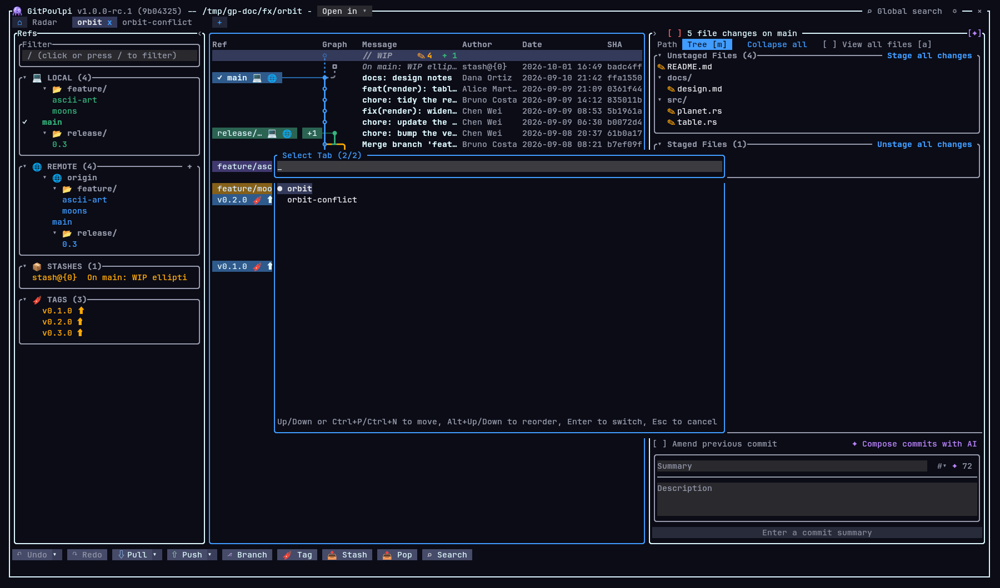
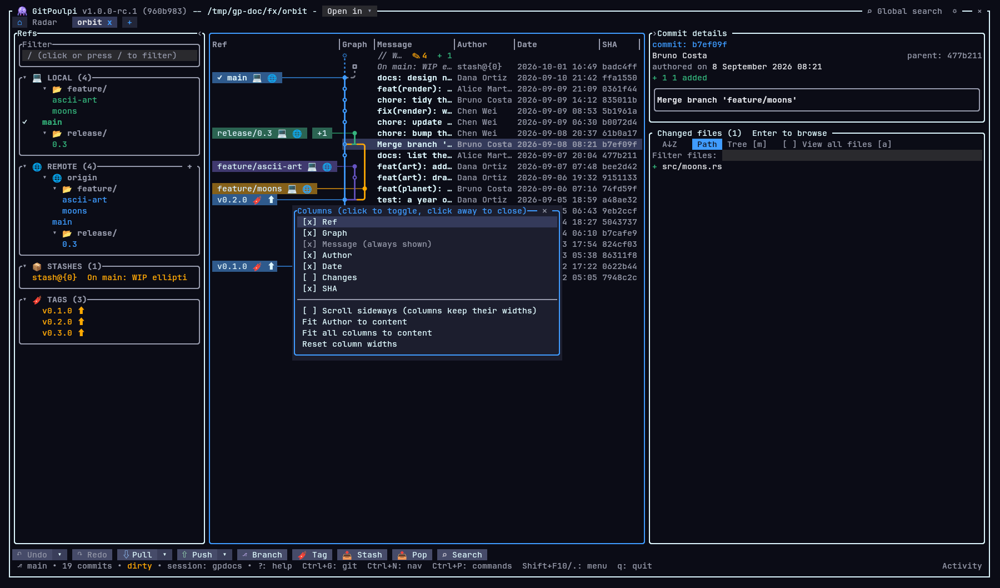

[English](../interface-tour.md) · [Čeština](../cs/interface-tour.md) · **Deutsch** · [Español](../es/interface-tour.md) · [Français](../fr/interface-tour.md) · [Italiano](../it/interface-tour.md) · [日本語](../ja/interface-tour.md) · [한국어](../ko/interface-tour.md) · [Nederlands](../nl/interface-tour.md) · [Polski](../pl/interface-tour.md) · [Português (Brasil)](../pt-BR/interface-tour.md) · [Português (Portugal)](../pt-PT/interface-tour.md) · [Русский](../ru/interface-tour.md) · [Svenska](../sv/interface-tour.md) · [Türkçe](../tr/interface-tour.md) · [Українська](../uk/interface-tour.md) · [简体中文](../zh-CN/interface-tour.md)

# Rundgang durch die Oberfläche

Diese Seite benennt jeden Bereich des GitPoulpi-Fensters, von oben nach unten.
Die anderen Seiten verwenden dieselben Namen. Die Bilder zeigen ein kleines
Demo-Repository mit erfundenen Autoren.

## Der Rahmen

### Titelleiste

Der obere Rand des Fensters lautet
 `GitPoulpi vX.Y.Z -- <Repository-Pfad>` (der Sitzungsname steht in der Statuszeile, standardmäßig unten).

- **** öffnet das Fenster **Über GitPoulpi**: Version, Build-Funktionen, Lizenz, Links, ein kurzer Hinweis, dass GitPoulpi ein unabhängiges Projekt ist, die Fremd-Crates sowie die Lizenzen und Danksagungen. Auf einem Terminal, das Bilder zeichnet, ist der Oktopus das Pixel-Logo in Ihrer Logo-Farbe (sonst bleibt es das Emoji). Palette: `Hilfe: Über GitPoulpi`; Tasten: `Ctrl+N`, dann `A`. Im Fenster „Über GitPoulpi“ folgen die Pupillen des Oktopus dem Mauszeiger. Klicken Sie auf das Logo (oder drücken Sie `Space`), um es zur nächsten Farbe zu drehen. Rechtsklick auf das Logo (oder `c`) zeigt die Farbliste. GitPoulpi speichert Ihre Wahl in `ui.logo_color`. Die Links öffnen sich per Klick oder mit ihrer Zugriffstaste (`s` Quellcode, `d` Dokumentation, `i` Lizenz), und `l` listet die Fremd-Crates mit Versionen und Lizenzen (eine scrollbare Liste; `Esc` oder `l` geht zurück, ebenso ein Klick auf seine Überschrift). Jede Crate der Liste trägt einen Link auf ihre Seite (ihr Repository, sonst ihre Seite auf crates.io): Klicken Sie auf die Zeile, oder wählen Sie sie mit `Up` / `Down` und drücken Sie `Enter`, um sie im Browser zu öffnen. `t` (oder der Palettenbefehl `Hilfe: Lizenzen und Danksagungen`) zeigt die Lizenzhinweise und Danksagungen für alles, was im Programm steckt, als scrollbaren Text (`Up` / `Down`, `PgUp` / `PgDn`, `Home` / `End`; zurück mit `Esc` oder `t`). In einem Skript gibt `gitpoulpi licenses` denselben Text aus.
- Die **Version** (`v1.0.0`; `vX.Y.Z verfügbar`, wenn es ein neueres Release gibt)
  steht zwischen Name und Pfad: Ein Klick öffnet das Update-Fenster, wenn es ein
  neueres Release gibt, sonst den Tab **Versionshinweise**. Siehe [Updates](updates.md).
- **Öffnen in ▾**, direkt hinter dem Pfad, öffnet den Ordner des Tabs in einem
  Terminal, einem Editor, einem Multiplexer oder im Dateimanager (`Alt+O`).
  Siehe [Öffnen in](open-in.md).
- **⌕ Globale Suche** (eine Lupe mit ihrer Beschriftung), direkt links neben dem Zahnrad, öffnet die [globale Suche](search.md) (`Ctrl+Alt+F`). Sie weicht als Erstes, wenn die Titelleiste zu schmal ist: zuerst verschwindet die Beschriftung (die Lupe bleibt), dann die Schaltfläche.
- Das **Zahnrad** (`⚙`), direkt links neben dem **×**, öffnet die **Einstellungen** (`Ctrl+,`).
- **×** am rechten Ende beendet, wie `q`.

### Statuszeile

Die Statuszeile ist standardmäßig die letzte Zeile des Fensters (**Einstellungen > Darstellung > Position der Statuszeile** setzt sie nach oben, über die Repository-Tabs). Sie zeigt den aktuellen Branch, die geladenen Commits
(`500 / 48213 Commits`, solange noch ältere Historie nachzuladen ist, mit `...` statt der
Gesamtzahl, während sie gezählt wird; nur `2500 Commits`, wenn die ganze Historie geladen ist),
`geändert` oder `sauber`, den Sitzungsnamen, in einem Sparse-Checkout ein Abzeichen `sparse`
und die nützlichsten Tasten: `?` Hilfe, `Ctrl+G` Git-Aktionen, `Ctrl+N` Navigation,
`Ctrl+P` Befehle, `Shift+F10` Menü, `q` beenden. In einem schmalen Fenster entfallen die am
wenigsten nützlichen Tasten. Die Statuszeile zeigt auch Statusmeldungen und Fortschritt. Die
gezeigten Tasten sind immer die gerade gültigen, einschließlich der von Ihnen geänderten (siehe
[Einstellungen](settings.md#tastatur--maus)). Wie die Gesamtzahl gezählt wird, ist eine
Einstellung (**Gesamtzahl der Commits zählen mit**, siehe
[Einstellungen](settings.md#verlauf--graph)).

An ihrem rechten Ende öffnet die Schaltfläche **Aktivität** das Aktivitätsprotokoll: ein Tab Git-Vorgänge (die Vorgänge mit ihrer Dauer, Meldungen und Fehler), ein Tab Anwendung (das Anwendungsprotokoll mit einem Stufenfeld und der Schaltfläche **Protokoll leeren**) und ein Feld Bereich, das beide auf dieses Repository, einen Workspace oder alle Repositories eingrenzt. Eine Zahl auf der Schaltfläche zählt die Fehler, die Sie noch nicht angesehen haben. Links daneben zeigt die Jobanzeige einen laufenden Hintergrundjob mit einem `[x]` zum Abbrechen (die Jobliste hat **Alle abbrechen**, und die Palette hat *Aufgaben: alles abbrechen, was sich abbrechen lässt*; ein Job, der sich nicht sicher stoppen lässt, nennt den Grund). Der **Home**-Tab hat dieselbe Statuszeile, mit der Schaltfläche **Aktivität** unten rechts (sie öffnet sich auf Alle Repositories). Schlägt ein Vorgang fehl, nennt die Statuszeile den Grund in Rot, egal wo Sie sind; ein Klick darauf (oder `Aktivitätsprotokoll: Letzten Fehler öffnen` in der Palette) öffnet den Aktivitätseintrag mit den Details, einem Kopieren für eine KI und dem vorgeschlagenen nächsten Schritt. Beides ist unter [Wenn etwas fehlschlägt](troubleshooting.md#wenn-etwas-fehlschlägt) beschrieben.

### Überlagerungen

Die Befehlspalette, die Hilfe, Kontextmenüs, Dialoge, Popups und die
Einstellungen öffnen sich über dem Fenster. Jedes hat oben rechts im Rahmen ein `✕`; `Esc` oder ein Klick auf `✕` schließt es, und ein Klick daneben schließt einen Dialog, ein Popup oder ein Panel (siehe [Fenster und Dialoge schließen](mouse-and-gestures.md#fenster-und-dialoge-schließen)).

### Wenn das Fenster klein ist

Nichts verschwindet stillschweigend, wenn das Fenster schmaler wird. Eine Schaltfläche verliert zuerst ihre lange Beschriftung
(mit `...` gekürzt), bricht dann in eine zweite Zeile um oder wandert hinter das Menü `⋯` ihrer Zeile; ihre Taste und ihr
Paletteneintrag funktionieren dabei weiter. Ein Dialog, der für das Fenster zu groß ist, zeichnet einen kleinen Rahmen mit seinem
Titel, dem `✕` und der Zeile **Fenster zu klein: bitte vergrößern** statt nichts; `Esc` und `✕` schließen ihn, und er kommt
vollständig zurück, sobald Sie das Fenster vergrößern.

## Tab-Leiste

Der **Home**-Tab (das Haus-Symbol) steht am linken Ende, gefolgt vom
[Workspace-Chip](workspaces.md) (sobald Sie einen Workspace haben), dem angehefteten
**Radar**-Tab (er schließt wie jeder andere Tab; siehe [das Radar](radar.md)) und dem Tab
**Workspaces**, sobald Sie ihn geöffnet haben (`Alt+J`; er schließt wie jeder andere Tab). Dann
folgt ein Tab pro geöffnetem Repository. Das `x`, das einen Tab schließt, erscheint nur auf dem
aktiven Tab und auf dem Tab unter dem Mauszeiger. Die Tab-Leiste trägt nur Tabs (die
Schaltfläche der [globalen Suche](search.md) steht in der Titelleiste).

Passen die Repository-Tabs nicht in die Zeile, scrollt sie, statt sie zu verkleinern: Die Tabs sitzen zwischen zwei Pfeiltasten, `‹` links und `›` rechts. Ein Pfeil ist abgedunkelt, wenn auf seiner Seite kein Tab verborgen ist. Klicken Sie auf einen Pfeil, um einen weiteren Tab auf dieser Seite zu zeigen (gedrückt halten scrollt weiter), oder nutzen Sie das Mausrad über der Zeile (nach oben oder links zeigt die früheren Tabs). Sobald der aktuelle Tab wechselt (Sie wechseln per Tastatur, über die Tab-Auswahl oder die Palette, öffnen oder schließen einen Tab oder ändern die Fenstergröße), scrollt die Zeile gerade so weit, dass er ganz zu sehen ist. Ist Platz dafür, öffnet eine `…`-Schaltfläche hinter dem rechten Pfeil die Tab-Auswahl. Ziehen Sie einen Tab auf einen Pfeil, scrollt die Zeile, solange Sie ihn dort halten, sodass Sie ihn hinter den sichtbaren Tabs ablegen können. `Ctrl+N` setzt ein Kennzeichen auf jeden aktiven Pfeil.

**Einstellungen > Darstellung > Position der Tab-Leiste** verlegt diese Zeile an den unteren Fensterrand (unter die Statuszeile) oder macht daraus eine Spalte am linken Rand: ein Tab pro Zeile, zuerst Home, dann der Workspace-Chip, das Radar, der Tab Workspaces, die Tabs (ein langer Name endet auf `…`) und das `+`. Gibt es mehr Tabs als Zeilen, zeigt eine `…`-Zeile, wie viele oben (`▲`) und unten (`▼`) verborgen sind, und öffnet die Tab-Liste; das Mausrad scrollt die Spalte. Neben einer Symbolleiste als Spalte bleiben die Tabs ganz außen. Ein Fenster unter 80 Spalten behält die Tabs oben. Klicks, das Schließkreuz, Mittelklick, das Rechtsklick-Menü, Ziehen zum Umordnen und die Tastatur funktionieren an jeder Position gleich.

- Das **+** direkt hinter dem letzten Tab öffnet ein kleines Menü: **Neuer Tab** (`Alt+T`,
  Palette **Tab: Neuer Tab**) und, solange ihre Tabs geschlossen sind, **Radar** und
  **Workspaces** (`Alt+J`), die diese Tabs öffnen; die Palette **Tab: Neu...** öffnet
  dasselbe Menü. Ein **Neuer Tab** ist die Home-Ansicht mit bereitem Suchfeld, sodass Tippen
  sofort Ihre Repositories filtert. Wählen Sie eines (oder Durchsuchen, Klonen,
  Init), und sein Tab erscheint am Ende der Leiste; ein bereits geöffnetes
  Repository wird nur gewechselt. `Esc` in der leeren Suche, `Ctrl+W`, sein `x` oder
  ein Mittelklick schließt den Neuen Tab und kehrt zum vorherigen Tab zurück. Er
  wird nie mit Ihrer Sitzung gespeichert.

  
- Rechtsklick auf einen Tab oder `Ctrl+T` öffnet das Tab-Menü: **Neuer Tab**, **Tab schließen**,
  **Andere Tabs schließen...**, **Tabs rechts schließen...**, **Zu Favoriten hinzufügen**
  (oder **Aus Favoriten entfernen**), **Zum Workspace hinzufügen** (oder **Aus dem
  Workspace entfernen**, wenn Sie Workspaces haben), **Pfad kopieren**, **Öffnen in ›**,
  **SSH & Zugangsdaten...** und **Sparse Checkout...**.
- `Ctrl+PageUp` und `Ctrl+PageDown` wechseln die Tabs. `Ctrl+W` schließt den
  aktuellen Tab. Ein Mittelklick auf einen Tab schließt ihn ebenfalls (mit derselben
  Rückfrage).
- `t` (oder `Ctrl+N Tab`) öffnet die Tab-Auswahl, eine durchsuchbare Liste der
  geöffneten Tabs.
- **Tabs umordnen:** Drücken Sie auf einen Repository-Tab und ziehen Sie ihn seitwärts (ein
  Schatten des Tabs folgt dem Zeiger, ein Balken zeigt, wo er landet; `Esc` bricht ab), oder
  ziehen Sie eine Zeile der Tab-Auswahl, drücken Sie `Alt+Up` / `Alt+Down` auf der
  markierten Zeile der Auswahl oder führen Sie **Tab: Nach links verschieben** /
  **Tab: Nach rechts verschieben** aus der Palette aus. Die Reihenfolge wird mit der Sitzung
  gespeichert. Ein einfacher Klick ohne Bewegung wählt den Tab weiterhin aus. Das Haus, der
  Workspace-Chip und das `+` bewegen sich nie.
- **Beenden & cd hierher** erscheint rechts von den Tabs, wenn Sie GitPoulpi über
  den Shell-Wrapper `gp` gestartet haben und der Tab nicht der Ordner ist, in dem
  Sie gestartet sind. Siehe [Dem Ordner des Tabs folgen](following-the-tab-folder.md).
- Der **Workspace-Chip** direkt hinter dem Haus (ein farbiger Punkt und ein Name oder
  „Kein Workspace“) wechselt den [Workspace](workspaces.md): Klicken Sie darauf oder
  drücken Sie `Alt+W`. Er erscheint, sobald Sie einen Workspace haben.

Mit eingeschaltetem **Tabs merken** (Standard) kommen Ihre Tabs beim nächsten
Start zurück. Ein Worktree öffnet sich in einem eigenen Tab. Dieser Tab schließt
sich, wenn der Worktree entfernt wird.

Der Tab eines Worktrees steht direkt hinter dem Tab seines Repositorys, und ein weggezogener Worktree-Tab springt dorthin zurück (**Worktree-Tabs gruppieren** unter Einstellungen > Allgemein, standardmäßig an).

### Home

Der Home-Tab ist die Repository-Verwaltung. Er hat vier Abschnitte:
**Geöffnete Repositories**, **Favoriten**, **Zuletzt verwendete Repositories** und
**Alle Repositories**. Jede Zeile zeigt den Branch, die Zahlen voraus und zurück
und die Zahl der Änderungen, dann den Pfad des Ordners, wenn Platz ist: mit `~` gekürzt
und bei wenig Platz in der Mitte abgeschnitten, er schiebt nie Namen, Besitzer oder Branch
hinaus. Jede Zeile hat einen Stern (Favorit), **Öffnen** oder
**Wechseln**, **Schließen** oder **Entfernen** und ein `⋮`-Menü.

Oben: **Durchsuchen**, **Klonen**, **Init**, ein Suchfeld, **Alle einklappen** und
**Alle ausklappen**. Ein Ordner, der nicht mehr existiert, verlässt *Zuletzt* und
*Alle* von selbst. Ein fehlender Favorit bleibt, mit einer Schaltfläche
**Entfernen**. **Entfernen** löscht nie etwas auf dem Datenträger.

Tasten: `Enter` öffnen, `f` Favorit, `x` schließen oder entfernen, `y` den Pfad kopieren, `o` im Standardwerkzeug öffnen (**Öffnen in** im `⋮`-Menü wählt ein anderes), `.` Menü, `/`
Suche, `Space` einen Abschnitt falten, `Esc` zurück zu Ihrem Tab.
`Ctrl+N` zeigt ein Badge am Suchfeld, an jedem Abschnitt und an jeder Schaltfläche: Drücken Sie das Zeichen eines Badges, um es zu fokussieren oder auszulösen (siehe [Badges](keybindings.md#badges)).

Ein einziges Suchfeld filtert alles darunter, auch die Favoriten: Ein Repository bleibt sichtbar, wenn sein Name, sein Branch oder sein Pfad den Text enthält. Die Workspaces haben einen eigenen Tab und sind keine Seite des Home-Tabs: Öffnen Sie ihn über das Menü des `+`, mit `Alt+J` oder über die Palette, und schließen Sie ihn mit seinem `x`: siehe [Workspaces](workspaces.md).

**Klonen** listet für jedes verbundene Profil (GitHub, GitLab, Gitea, Forgejo, Azure DevOps, Bitbucket, Gerrit) die Repositorys auf, auf die Sie Zugriff haben, ein Abschnitt pro Eigentümer: zuerst Ihre eigenen, dann je einer pro Organisation oder Gruppe (alphabetisch), jeder unter einer Überschrift. Ein Schloss kennzeichnet ein privates Repository. Das Suchfeld filtert alle Abschnitte; ein Abschnitt ohne Treffer verschwindet. `Up` und `Down` überspringen die Überschriften, und `Home`, `End`, `PgUp` und `PgDn` funktionieren in der Liste.

## Symbolleiste

Standardmäßig eine Zeile unter den Bereichen und über der Statuszeile. **Einstellungen > Darstellung > Position der Symbolleiste** setzt sie nach oben (unter die Tabs), nach unten oder als Spalte links oder rechts neben die Bereiche (ein Fenster unter 80 Spalten zeichnet die Spalte als Zeile unten). Die Schaltflächen sitzen am Anfang der Zeile oder Spalte; **Einstellungen > Darstellung > Ausrichtung der Schaltflächen der Symbolleiste** zentriert sie oder rückt sie ans Ende. Jede Schaltfläche hat ihre eigene Symbolfarbe, die das Design festlegt (siehe [Designs](themes.md)). Wenn nicht für alle Platz ist, wandern die unwichtigsten Schaltflächen hinter ein `⋯`. In einer Spalte belegt jede Schaltfläche eine Zeile, mit ihrem `▾` am Zeilenende, und ihr Menü öffnet sich neben der Spalte; das Menü einer unteren Symbolleiste öffnet sich nach oben.

| Schaltfläche | Was sie tut |
|---|---|
| **Rückg.**, **Wiederh.** | Nehmen den letzten Vorgang zurück oder stellen sie wieder her (`Ctrl+Z`, `Ctrl+Y`). Ausgeblendet, wenn Rückgängig ausgeschaltet ist. Siehe [Rückgängig und Wiederholen](undo-redo.md). |
| **Pull** `▾` | Führt einen Pull so aus, wie es **Einstellungen > Git & Kodierung > Pull-Schaltfläche** festlegt. Die `▾`-Liste enthält **Fetch All**, **Pull (Fast-Forward, wenn möglich)**, **Pull (nur Fast-Forward)** und **Pull (Rebase)**. Ein Listeneintrag läuft einmal und ändert die Schaltfläche nicht. |
| **Push** `▾` | Pusht den ausgecheckten Branch. Die `▾`-Liste pusht einmal zu dem Remote, das Sie wählen. |
| **Branch** | Legt einen Branch am ausgecheckten Commit an. |
| **Tag** | Legt einen Tag am ausgecheckten Commit an. |
| **Stash**, **Pop** | Legt alle Änderungen in einen Stash. Stellt den neuesten Stash wieder her (Pop). |
| **LFS** `▾` | Git-LFS-Aktionen: fetch, checkout, pull, push, prune (`Ctrl+G l`). Ausgeblendet, wenn Git LFS aus ist. Siehe [Git LFS](lfs.md). |
| **Flow** `▾` | Das Menü des Branching-Workflows (starten, abschließen, synchronisieren, befördern; `Ctrl+G Shift+W`). Nur in einem Repository mit Workflow. Siehe [Branching-Workflows](branching-workflows.md). |
| **Suchen** | Öffnet die Commit-Suchleiste über dem Log (`f`). |

Am Ende (rechts in einer Zeile, unten in einer Spalte) zeigt, wenn das Repository mit einem Hoster verknüpft ist, ein **Chip** den Pull Request des ausgecheckten Branches (zum Beispiel `GH #12` oder `GL !53`) oder ein blasses `+ PR`. **Einstellungen > Darstellung > Pull-Request-Schaltfläche ans Ende heften** (standardmäßig an) hält ihn dort; aus, fließt er mit den anderen Schaltflächen und folgt deren Ausrichtung. Siehe [Hosting und Issue-Tracker](hosting-integration.md). In einer Spalte belegt das Profil-Kombinationsfeld die letzte Zeile.

Am rechten Ende wählt, wenn Sie zwei oder mehr [Profile](settings.md#profile)
haben, das **Profil-Kombinationsfeld** die Commit-Identität für dieses
Repository. Die erste Zeile, *Standard*, folgt **Einstellungen > Profile**. Nach
der Wahl eines Profils fragt GitPoulpi, ob auch sein Name und seine E-Mail in die
Git-Konfiguration des Repositorys geschrieben werden sollen (`user.name`,
`user.email`). **In Git-Konfiguration schreiben** schreibt sie. `Esc` behält die
Wahl nur in GitPoulpi. Palette: `Repository: Profil wechseln...`.

Jede Schaltfläche hat einen Palettenbefehl und ein Tastenkürzel.

## Banner

Ein Streifen über dem Log meldet, wenn das Repository in einem besonderen Zustand
ist. Er hat Schaltflächen für den Weg nach vorn. Jede Schaltfläche ist auch ein
Palettenbefehl.

| Banner | Schaltflächen |
|---|---|
| Ein Merge, Cherry-Pick oder Revert, der bei Konflikten angehalten wurde | **Konflikte lösen...**, **Commit** oder **Fortsetzen**, **Abbrechen** |
| Ein laufender Rebase | **Konflikte lösen...**, **Fortsetzen**, **Überspringen**, **Abbrechen** |
| **Patches werden angewendet (git am)** | **Konflikte lösen**, **Fortsetzen**, **Überspringen**, **Abbrechen** |
| Eine übrig gebliebene `index.lock` blockiert jede Änderung | **index.lock entfernen** (fragt vorher nach) |
| Ein Auto-Stash wurde nicht zurückgespielt | **Jetzt poppen**, **Stash zeigen**, **Neu beginnen**, **Drop** (die Auswahl hängt vom Zustand ab) |

Siehe [Merge-Konflikte lösen](merge-conflicts.md) und
[Fehlerbehebung](troubleshooting.md).

## Refs-Seitenleiste (links)

Ein Baum von allem, was einen Commit benennt. Jeder Abschnitt hat eine Zahl im
Titel, einen Winkel zum Einklappen und eine eigene Scroll-Position. Ziehen Sie
den Rand zwischen zwei Abschnitten, um sie in der Größe zu ändern.

- **Filter**-Feld oben (`/`): filtert jeden Abschnitt nach Namen.
- **LOKAL**: Ihre Branches, in Ordnern, die an `/` getrennt sind (`feature/`,
  `fix/`). Ein Häkchen zeigt den ausgecheckten Branch. Die Ordner lassen sich in
  den Einstellungen abschalten.
- **REMOTE**: jedes Remote, mit seinen Branches darunter.
- **WORKTREES**: verknüpfte Worktrees, falls es welche gibt (oder wenn Sie den
  Abschnitt eingeblendet haben). Das **+** in der Überschrift erstellt einen;
  Doppelklick auf einen Worktree öffnet ihn in einem eigenen Tab, Rechtsklick
  bietet Öffnen in, Merge und Entfernen. Siehe [Worktrees](worktrees.md).
- **STASHES**: Ihre Stashes. Rechtsklick auf einen für **Pop**, **Anwenden** und
  **Drop**.
- **TAGS**: Ihre Tags, wie Branches in Ordnern an `/` (`releases/`, `backups/`). Ein Pfeil bedeutet, dass der Tag auch auf dem Remote liegt.
- **PULL REQUESTS** und **ISSUES**: nachdem Sie ein Hosting-Konto verbunden und das
  Repository verknüpft haben.
- **SUBMODULE**: die Submodule und ihr Zustand, falls es welche gibt. Siehe
  [Submodule](submodules.md).

**Abschnitte ein- oder ausblenden:** Rechtsklick auf eine Abschnittsüberschrift oder auf den leeren Teil des Bereichs öffnet eine Checkliste der Abschnitte (der letzte sichtbare bleibt). Die Wahl gilt pro Repository und bleibt über Neustarts erhalten; siehe [Abschnitte des linken Bereichs](mouse-and-gestures.md#abschnitte-der-linken-seitenleiste).

Fahren Sie über eine Zeile, um ihre Schaltflächen zu zeigen: die Ref im Log
ein- oder ausblenden, und **Solo** (nur die Commits dieser Ref zeigen).
Doppelklick auf einen lokalen Branch oder einen Tag checkt ihn aus. Rechtsklick auf
eine Zeile öffnet ihr Menü. Das `‹` im Titel der Seitenleiste klappt sie ein
(`Ctrl+N Shift+H`).

Die beiden seitlichen Bereiche (die Refs-Seitenleiste, `Ctrl+N Shift+H`, und der rechte Bereich, `Ctrl+N Shift+L`) gehören zum Log: Ein- oder Ausklappen, während ein Diff, eine Dateiansicht oder der Editor offen ist, gilt nur für diese Ansicht. Ein Diff oder eine Dateiansicht klappt die Refs-Seitenleiste außerdem von selbst ein, damit der Inhalt mehr Platz hat. Zurück im Log sind beide Bereiche so, wie Sie sie dort verlassen haben, und genau dieser Zustand wird für den nächsten Start gespeichert.

## Das Log (Mitte)

Eine Zeile pro Commit, der neueste zuerst. Rechtsklick auf die Kopfzeile blendet
Spalten ein oder aus. Ziehen Sie den Rand zwischen zwei Kopfzellen, um eine Spalte
in der Größe zu ändern. Ziehen Sie eine Kopfzelle, um die Spalte zu verschieben. Die Breiten gehören zum Repository: Sie werden mit ihm gespeichert
und kommen beim erneuten Öffnen zurück, und bei einem zum ersten Mal geöffneten Repository ist jede Spalte an das angepasst, was das Log zeigt
(*Alle Spalten an Inhalt anpassen* tut es erneut, *Spaltenbreiten zurücksetzen* geht zurück zu automatischen Breiten, die bleiben).

Der Bereich hat keinen Titel: die Spaltenköpfe sagen, was er ist. Bei einem Commit ohne Ref zeigt die überfahrene Zeile eine blasse Pille mit dem Namen des Branches, zu dem er gehört (abschaltbar mit **Platzhalter für Branch am überfahrenen Commit zeigen** unter Einstellungen > Verlauf & Graph).

| Spalte | Zeigt |
|---|---|
| **Ref** | Farbige Pillen für die Branches und Tags am Commit: ein Laptop-Symbol für lokal, ein Globus für remote, ein Etikett-Symbol für Tags, `+N`, wenn weitere Refs dorthin zeigen. Tags werden dort gezeichnet, wo sie sind, nie als Platzhalter. Bei einem Commit ohne Ref zeigt die überfahrene Zeile eine blasse Pille mit dem Namen des Branches, zu dem er gehört; wurde dieser Branch gelöscht, zeigt eine durchgestrichene Pille den Namen, der aus dem Merge-Commit gelesen wurde, der ihn zusammengeführt hat (abschaltbar mit **Platzhalter für Branch am überfahrenen Commit zeigen** unter Einstellungen > Verlauf & Graph). |
| **Graph** | Die Branch-Spuren, Merges und Abzweigungen. In kitty, Ghostty, WezTerm, Rio und iTerm2 (und Windows Terminal, foot und Tabby über Sixel) als Bild gezeichnet, in anderen Terminals als Zeichen. Die Spurfarben stammen aus dem Design oder einer von Ihnen gewählten Palette (siehe [Designs](themes.md)). In ihrer kleinsten Breite (ein Commit-Punkt) ist die Spalte kompakt: jeder Commit auf einer Spur, keine Branch- oder Merge-Linien. |
| **Nachricht** | Die Zusammenfassung des Commits. |
| **Autor** | Der Autor, mit einem optionalen Avatar. |
| **Datum** | Das Autorendatum, im von Ihnen gewählten Format. |
| **Änder.** | Optional: geänderte Dateien und `+hinzugefügt -entfernt` Zeilen. |
| **SHA** | Der kurze Hash. |

Besondere Zeilen:

- **Die Zeile der Änderungen** (WIP-Zeile) oben: ein gestrichelter Kreis, `// WIP`
  oder Ihre Nachrichtenvorlage und die Zahl der geänderten und hinzugefügten
  Dateien. Klicken Sie darauf, um im rechten Bereich zu stagen und zu committen.
- **Stash-Zeilen**: ein kleines Quadrat auf einer Spur, neben dem Commit, auf dem
  der Stash erstellt wurde.
- Bei einer Suche werden Zeilen, die nicht passen, abgedunkelt.

Fahren Sie über eine Zelle für einen Tooltip mit dem vollen Text. Rechtsklick auf
eine Zeile öffnet das [Commit-Menü](log-and-history.md#das-commit-menü).

## Der rechte Bereich

Der rechte Bereich folgt der Auswahl im Log.

**Änderungen** (die WIP-Zeile ist ausgewählt):

- Ein Titel wie `4 Dateiänderungen auf main`. Bei einem Merge im Konflikt kommt die
  Zahl der Dateien im Konflikt hinzu. Ein rotes `✗` links verwirft alle
  Änderungen (fragt vorher nach). Ist die KI an, erklärt ein `✦` rechts die
  Änderungen.
- **Pfad** oder **Baum** (eine flache Liste oder Ordner, `m`), **Alle einklappen**
  und **Alle Dateien ansehen** (`a`).
- **Unstaged Dateien** und **Staged Dateien**, jeweils mit einer Zahl und einer
  Schaltfläche **Alle Änderungen stagen** oder **Alle Änderungen unstagen**. Fahren
  Sie über eine Zeile für ihre Schaltfläche **Datei stagen** oder **Datei unstagen**.
- Das **Commit-Formular** unten: **Vorherigen Commit ändern**, **Commits mit KI
  zusammenstellen** (wenn die KI an ist), die **Zusammenfassung** mit einem
  Zeichenzähler und der Schaltfläche `✦`, die **Beschreibung** und die Schaltfläche
  **Änderungen an N Dateien committen**.

**Commit-Details** (ein Commit ist ausgewählt), von oben nach unten: der volle Hash, der
Autor mit Avatar und Datum, der Hash des Elternteils und die Zahl der Änderungen, dann die
Nachricht (Zusammenfassung und Beschreibung; ziehen Sie ihren unteren Rand, um sie in der Größe zu
ändern). Der Bereich **Geänderte Dateien** darunter beginnt mit seinen eigenen Bedienelementen:
dem Schalter für die Sortierung, **Pfad** / **Baum**, **Alle Dateien ansehen** und einem Feld
**Dateien filtern**, fest über der Liste, die als einziger Teil scrollt. Klicken Sie auf eine
Datei, um ihren Diff zu öffnen. In einem niedrigen Fenster gibt zuerst die Nachricht Platz ab (bis
auf eine Zeile), dann die Liste. Die Ansicht der Änderungen behält ihre Zeile **Pfad** / **Baum** /
**Alle Dateien ansehen** oben über den Dateilisten, über den Listen Unstaged und Staged.

**Links in einer Nachricht.** Eine in die Nachricht geschriebene Webadresse (`https://...` oder das Ziel eines Markdown-Links `[Text](https://...)`) ist unterstrichen, zeigt den Hand-Zeiger und fragt bei einem Klick mit der ganzen Adresse **Diesen Link öffnen?**, bevor irgendetwas geöffnet wird: Der Text einer Nachricht ist nicht vertrauenswürdig. **Öffnen** (`F`) startet den Browser, **Abbrechen** (`B`, `Esc`, das Kreuz) tut nichts. Angeboten werden nur `http`- und `https`-Adressen. Das Tastatur-Gegenstück ist der Palettenbefehl `Commit-Details: Link in Nachricht öffnen...`, der nach der ersten Adresse der Nachricht fragt und mit **Weiter** (`W`) durch die weiteren geht. Manche Terminals zeichnen selbst einen Unterstrich unter eine Adresse unter dem Zeiger und öffnen sie bei einem Klick mit Zusatztaste (oft Umschalt+Klick) von sich aus; das ist eine Funktion des Terminals, nicht von GitPoulpi.

Jede Dateiliste hat Menüs für Dateien, Ordner und den leeren Teil, und mehrere Dateien lassen sich gleichzeitig auswählen (**Ctrl+Klick**, **Shift+Klick**); siehe [Staging und Committen](staging-and-committing.md).

## Der mittlere Bereich, wenn eine Datei offen ist

Klicken Sie auf eine geänderte Datei, und ihre Ansicht ersetzt das Log. `Esc`
bringt das Log zurück. Oben läuft eine Schaltflächenleiste:

| Schaltfläche | Was sie tut |
|---|---|
| **Dateiansicht**, **Diff**, **Blame** | Wählen, was der Bereich für die Datei zeigt. |
| **Datei │ Alle** | Wählt die Liste der [Commit-Spalte](#die-commit-spalte) neben der Ansicht und zeigt die Spalte. |
| **Bearb.** | Öffnet den eingebauten Editor auf der Arbeitskopie. |
| `↑` `↓` | Vorheriger oder nächster Hunk. |
| **Inline**, **Split** | Eine Spalte oder nebeneinander. |
| **Hunks** | Nur die geänderten Hunks oder die ganze Datei. |
| **WS** | Änderungen nur an Leerraum zeigen oder verbergen. |
| **Umbr.** | Lange Zeilen umbrechen. |
| **Map** | Eine Minimap der ganzen Datei neben der Bildlaufleiste. |
| **Kodierung** | Die Kodierung, in der die Datei gelesen wird (zuerst **Auto**). |

In einem Diff des Arbeitsverzeichnisses hat jeder Hunk die Schaltflächen **Hunk
stagen** und **Hunk verwerfen**. Drücken Sie `v`, um Zeilen auszuwählen, und stagen
oder verwerfen Sie dann nur diese Zeilen.

Beide Ansichten sind unter [Blame](log-and-history.md#blame) und [Dateiverlauf](log-and-history.md#dateiverlauf) beschrieben.

Der eingebaute **Editor** hat Syntaxfarben, Zeilennummern, Rückgängig, Suchen und
eine Statuszeile mit Zeile, Spalte, Zeilenende, Einrückung und Sprache.

Eine Bilddatei wird als Bild gezeigt: vorher und nachher im Diff oder die Datei
selbst in der Dateiansicht. Siehe [Bilder](image-view.md).

Eine Binärdatei, die kein Bild ist (ein PDF, ein Dokument, ein Archiv), zeigt eine Schaltfläche **Öffnen in**, wenn das System Anwendungen für ihren Typ kennt: siehe [Öffnen in](open-in.md).

## Die Commit-Spalte

Eine Spalte kann links neben dem Datei-Diff, der Dateiansicht oder dem Blame eines Commits stehen (nie neben dem eingebauten Editor, der die Arbeitskopie bearbeitet: Die Spalte verschwindet, wenn der Editor sich öffnet, und ist wieder da, wenn er sich schließt und der Diff erscheint). Sie hat drei Zustände:

- **Datei**: die Commits genau dieser Datei, je zwei Zeilen (der [Dateiverlauf](log-and-history.md#dateiverlauf)). Die rechte Seite zeigt die Version der Datei beim gewählten Commit.
- **Alle**: eine kompakte Liste der Commits des Logs mit seinem Graphen, unten beschrieben.
- **Ausgeblendet**: Ein schmaler Streifen mit einem `›` links in der Ansicht bringt die Spalte zurück (sein Tooltip nennt die Taste).

Die Schaltflächenleiste der Ansicht reicht immer über die ganze Breite, auch über die Spalte, sodass sich keine Schaltfläche bewegt, wenn die Spalte auf- oder zugeht oder die Liste wechselt. Darauf wählt die Auswahl **`Datei │ Alle`** (zwei Segmente eines Bedienelements, immer gleich breit) die Liste: Ein Klick auf ein Segment zeigt diese Liste und öffnet die Spalte, falls sie ausgeblendet war; ein Klick auf das bereits gewählte Segment blendet die angezeigte Spalte aus. Das Segment der angezeigten Liste ist hervorgehoben; solange die Spalte ausgeblendet ist, ist das Segment unterstrichen, mit dem sie zurückkommt, und die Liste bleibt erhalten. Ihr Tooltip nennt den Klick, den erneuten Klick auf das gewählte Segment und `Alt+C`. Der Dateiverlauf lässt sich weiterhin dort öffnen, wo er sich schon immer öffnen ließ (Dateimenüs, `Dateiverlauf: ...` in der Palette).

- **Ein- oder ausblenden**: `Alt+C` (Palette `Ansicht: Commit-Spalte umschalten`), ein Klick auf das gewählte Segment der Auswahl, das ✕ an der Spalte oder der Streifen `›`. In der Palette wählen `Ansicht: Commit-Spalte: ausblenden`, `... : Dateiverlauf` und `... : alle Commits` einen Zustand. Die Wahl wird mit ihrer Liste zusammen mit den anderen Einstellungen der Spalte gemerkt. Ohne Wahl entscheidet die Breite des Terminals über die Liste Alle: Sie erscheint ab 140 Spalten Breite. Die Spalte wird nicht gezeichnet, wenn der Ansicht daneben weniger als 30 Spalten blieben, und der Graph der Liste Alle nicht bei einem Diff des Arbeitsverzeichnisses oder einem Vergleich (der Dateiverlauf schon: Er braucht keinen Commit).
- **Breite**: den rechten Rand ziehen (der hervorgehobene Rand folgt dem Zeiger) oder `Ansicht: Commit-Spalte verbreitern` und `Ansicht: Commit-Spalte verschmälern` benutzen. Sie kann bis zu 70 % der mittleren Spalte einnehmen (der Rest bleibt der Ansicht, die nie unter 30 Spalten fällt). Sie wird wie die anderen Größen gemerkt.
- **Einen Commit wählen**: anklicken, oder der Spalte die Tastatur geben (`Ctrl+N` und ihr Badge, oder `Ansicht: Commit-Spalte fokussieren`) und `Up` / `Down`, `PageUp` / `PageDown`, `Home` / `End` benutzen. `Enter` oder `Right` geht weiter zur Dateiliste des Commits, `Esc` gibt die Tastatur an die Ansicht zurück. Der rechte Bereich folgt der Wahl: Details des Commits und seine geänderten Dateien, damit Sie eine andere seiner Dateien öffnen können.
- **Was die Ansicht tut**: Die offene Datei bleibt offen. Hat der gewählte Commit sie geändert, zeigt die Ansicht ihren Diff in diesem Commit. Sonst zeigt sie die Datei, wie sie damals war, mit „unverändert in diesem Commit“ im Titel. Hat der Commit die Datei nicht, sagt die Ansicht das und bleibt benutzbar. Ein Blame bleibt ein Blame, Stand des gewählten Commits.

Die Liste Alle steht unter einer Kopfzeile (die Spaltennamen des Logs). Ein Commit pro Zeile: die Spuren des Graphen, der Titel (die Nachricht), der Vorname des Autors und ein kurzes Datum und, wenn Sie es einschalten, die Branch- und Tag-Labels. Es ist die Liste des Logs selbst, mit denselben Commits in derselben Reihenfolge, und sie lädt beim Scrollen ältere nach. Die Spuren werden wie in der Graph-Spalte des Logs gezeichnet: in einem Terminal, das Bilder anzeigt (siehe [Ein Terminal wählen](terminals.md)), als verbundene Spuren mit runden Markierungen und, wenn die Avatar-Einstellung auf Graph steht, mit den Bildern der Autoren in den Kreisen; sonst als Zeichen. Standardmäßig nehmen die Spuren den Platz, den sie brauchen, und der Titel behält immer ein paar Wörter: In einer schmalen Spalte weichen zuerst der Autor und dann das Datum, bevor die Spuren abgeschnitten werden. Auf ihre kleinste Breite, einen Commit-Punkt, verkleinert, ist der Teil Graph kompakt, wie im Log: jeder Commit auf einer Spur, ohne Branch- oder Merge-Linien. Ein Teil, den das Fenster abschneidet (die seitlich gescrollte Zeile oder ein Teil Graph, der breiter ist als der Platz), behält seine Bilder und Avatare, am Rand abgeschnitten. Das Mausrad scrollt die Liste unter dem Zeiger.

- **Tooltip und Menü**: Ruht der Zeiger auf einer Zeile, zeigt sie den Tooltip des Logs für den Teil unter dem Zeiger (die ganze Nachricht über dem Titel, Name und E-Mail des Autors, das volle Datum). Ein Rechtsklick auf eine Zeile (oder die Menütaste, `Shift+F10`, wenn die Spalte die Tastatur hat; `Ansicht: Commit-Spalte: Menü der gewählten Zeile` in der Palette) öffnet ihr Menü: *Im Log zeigen*, den Diff der Datei in diesem Commit, die Datei, wie sie in diesem Commit war, das Blame der Datei in diesem Commit, dann das Menü des Logs für diesen Commit (kopieren, Cherry-Pick, Branch und unter einem Strich die Zeilen, die etwas umschreiben, etwa Revert). Jede der vier ersten Zeilen hat auch einen Paletteneintrag (`Ansicht: Commit-Spalte: ... zeigen`). In der Liste Datei haben die Zeilen das Menü des Dateiverlaufs und dieselben Tooltips.
- **Teile einstellen und seitlich scrollen**: Ziehen Sie eine Grenze in der Kopfzeile, um den Teil links davon einzustellen: die Spuren, die Nachricht, den Autor, das Datum, die Refs, die Änderungen oder die SHA. Auch der letzte Teil hat eine Grenze: die Zelle direkt hinter ihm (der eigene Rand der Spalte, wenn die Zeile den Platz füllt), gleich hervorgehoben, die diesen letzten Teil einstellt. Wie im Log (`ui.column_resize`) ist die Grenze standardmäßig die Trennzelle zwischen zwei Teilen, in der die Zeilenfärbung des Graphen endet (die Färbung läuft durch sie hindurch, zwischen ihr und dem nächsten Teil liegt also keine einfache Zelle): In der Kopfzeile ruht darin eine Markierung, und eine dünne Linie wird die Spalte entlang gezeichnet, solange der Zeiger darauf steht oder sie zieht; ein Ziehen von jedem Punkt der Linie ändert die Größe. Mit `header` ist es der erste Buchstabe des nächsten Namens, der aufleuchtet, solange der Zeiger darauf steht (es wird keine Linie gezeichnet, die Kopfzeile ist die einzige Stelle zum Ziehen). Solange Sie nichts eingestellt haben, nimmt die Nachricht, was die anderen übrig lassen; das erste Ziehen fixiert jeden Teil auf seine aktuelle Breite, die Nachricht eingeschlossen, sodass das Einstellen eines Teils die folgenden Teile verschiebt und keine andere Breite ändert. Ein eingestellter Teil bleibt erhalten und gibt nie Platz ab: Ist die Zeile dann breiter als die Spalte, scrollt sie seitlich mit Shift+Mausrad, einem horizontalen Mausrad oder `Shift+Left` / `Shift+Right`, wenn die Spalte die Tastatur hat, und eine Bildlaufleiste am unteren Rand zeigt, wo Sie sind. Mit der Tastatur: `Tab` wählt den Teil (unter den angezeigten), `]` verbreitert ihn, `[` verschmälert ihn, `0` setzt alle Teile auf automatische Breite zurück (die Palette hat `Ansicht: Commit-Spalte: nächsten Teil wählen`, `... Teil verbreitern`, `... Teil verschmälern`, `... Teilbreiten zurücksetzen`, `... nach links scrollen` und `... nach rechts scrollen`). Die Breiten werden gemerkt. Solange die Spuren durch das Scrollen abgeschnitten sind, werden sie auch in einem Terminal, das Bilder anzeigt, als Zeichen gezeichnet.
- **Teile wählen**: Ein Rechtsklick auf die Kopfzeile öffnet ein Menü mit einem Kontrollkästchen pro Teil, jede Spalte des Logs: Ref, Graph, Nachricht, Autor, Datum, Änder. und SHA. Die Nachricht ist immer sichtbar. **Ref**, **Änder.** und **SHA** sind standardmäßig aus; eingeblendet trägt Ref die Branch- und Tag-Labels des Commits, Änder. seine Dateien und die Zeilen `+hinzugefügt -entfernt` und SHA seinen kurzen Hash, alles wie die eigenen Spalten des Logs. Wie Ref geben Änder. und SHA nie Platz ab: Stattdessen scrollt die Zeile seitlich. Mit der Tastatur öffnet `Ansicht: Commit-Spalte: Spalten wählen` dasselbe Menü (Pfeiltasten und `Enter` wählen eine Zeile), und `Ansicht: Commit-Spalte: Refs umschalten`, `... Graph umschalten`, `... Autor umschalten`, `... Datum umschalten`, `... Änder. umschalten` und `... SHA umschalten` schalten einen Teil sofort um. Die angezeigten Teile, ihre Reihenfolge und ihre Breiten gehören der Spalte allein: Sie werden in `config.toml` gespeichert (`ui.commit_column_columns_visible`, `ui.commit_column_columns_order`, `ui.commit_column_columns_widths`), getrennt von den Spalten des Logs, die sich nie mit ihnen ändern, und umgekehrt ebenso wenig.
- **Teile verschieben**: Ziehen Sie einen Namen der Kopfzeile über einen anderen, um den Teil dorthin zu verschieben, wie im Log (die Zeile folgt dem Zeiger; mit `ui.column_resize = "header"` ist der erste Buchstabe eines Namens die Grenze zum Einstellen, drücken Sie also auf den Rest des Namens). Jeder Teil kann überallhin, auch die Spuren und die Ref-Labels. Mit der Tastatur: `Tab` wählt den Teil, und `<` / `>` verschieben ihn unter den angezeigten um eine Stelle nach links oder rechts (die Palette hat `Ansicht: Commit-Spalte: Teil nach links verschieben` und `... Teil nach rechts verschieben`). Die Reihenfolge wird gemerkt.

  

Die Mausgesten stehen auch unter [Maus und Gesten](mouse-and-gestures.md#die-commit-spalte-liste-alle).

## Größen werden gemerkt

GitPoulpi behält jede Größe, die Sie ziehen, über Tab-Wechsel und Neustarts
hinweg. Die Größen sind für jedes Repository dieselben. Das umfasst die Teiler
zwischen der Refs-Seitenleiste, dem Log und dem rechten Bereich, die Höhe jedes
Refs-Abschnitts, den Block der Commit-Nachricht, die Spaltenbreiten des Logs, die
Bereiche des Merge-Editors und den Teiler der Ordnerauswahl. Die Größen werden als
Anteile des Fensters gespeichert, sodass ein Layout, das auf einem breiten Terminal
entstand, auch auf ein schmales passt.

Um alle Größen zurückzusetzen, führen Sie den Palettenbefehl `Navigation: Layout zurücksetzen` aus.
Manche Größen haben auch eine eigene Zurücksetzung:
`Navigation: Größen der Refs-Abschnitte zurücksetzen`,
`Commit-Details: Nachrichtengröße zurücksetzen` und im Merge-Editor ein Doppelklick
auf einen Teiler oder `Alt+0`.

## Überlagerungen und Sonderbildschirme

- **Befehlspalette** (`Ctrl+P`): ein Filterfeld über jedem Befehl. Jede Zeile zeigt
  ihr Tastenkürzel. Ein Befehl, der jetzt nicht laufen kann, ist ausgegraut, und
  der Grund steht unten. Befehle haben ein Gruppenpräfix wie `Git:`, `Refs:`,
  `Navigation:`, `Diff:`, `Änderungen:`, `Commit:`, `Ansicht:`, `Repository:`,
  `Tab:`, `LFS:`, `Pull Requests:`, `Issues:` oder `KI:`. Tippen Sie ein Präfix, um
  seine Gruppe zu sehen.
- **Auswahllisten**: Manche Palettenbefehle öffnen eine zweite Liste, zum Beispiel
  `App: Design wechseln...`, `App: Sprache wechseln...` und
  `App: Farbschema des Graphen wechseln...`. Das Fenster zeigt jede Wahl live,
  während Sie durch die Liste gehen. `Enter` behält sie. `Esc` stellt die alte Wahl
  wieder her. Die Designliste hat die Filter **Alle**, **Dunkel**, **Hell** und
  **Farbig**. Siehe [Designs](themes.md).
- **Hilfe** (`?`): Tabs. **Tasten** listet jede Taste und Geste; die anderen Tabs
  (Start, Log, Änderungen, Refs, Hosting, Setup, KI & CLI) sind kurze Anleitungen zu den
  Aktionen, jeweils mit dem Weg dorthin. Den Tab wechseln Sie mit `Tab` / `Shift+Tab`,
  `Left` / `Right`, `Alt+1`..`Alt+8` oder einem Klick. Tippen Sie, um den aktuellen Tab
  zu filtern. `Ctrl+D` oder ein Klick auf den Link unten öffnet die Dokumentationsseite
  des Tabs, auf dem Sie sich befinden.

  

  
- **Suchleiste** (`f`): oben rechts im Log. Sie zeigt `n von N` Treffer.
- **Kontextmenüs**: Rechtsklick oder `.` auf der ausgewählten Zeile. Eine Zeile mit
  `›` öffnet ein Untermenü.
- **Dialoge**: Bestätigungen, ein Branch- oder Tag-Name, Klonen, Init, Pull Request
  erstellen, die Auswahl nach einem abgelehnten Push und andere. `Enter` bestätigt,
  `Esc` bricht ab.
- **Interaktiver Rebase** und der **Commit-Composer** ersetzen das Log durch einen
  Prüfbildschirm. Siehe
  [Mit dem Log arbeiten](log-and-history.md#interaktiver-rebase) und
  [Staging und Committen](staging-and-committing.md#der-commit-composer-änderungen-auf-commits-verteilen).

  

- **Einstellungen** (`Ctrl+,` oder das Zahnrad): links eine Liste von Seiten und
  rechts die Optionen der Seite. Siehe [Einstellungen](settings.md).

  

- **Popups** für lange Antworten, etwa das KI-Popup **Änderungen erklären**
  (`↑` `↓` scrollen, `c` kopieren, `Esc` schließen).

  

Alle Listen in Popups funktionieren gleich. Siehe
[Tastenkürzel](keybindings.md) und [Maus und Gesten](mouse-and-gestures.md).

## In dieser Dokumentation verwendete Begriffe

| Begriff | Bedeutung |
|---|---|
| Bereich | Eine der drei Spalten: Refs-Seitenleiste, Log (oder die offene Datei), rechter Bereich. |
| Pille | Ein Branch- oder Tag-Etikett in der Spalte Ref. |
| WIP-Zeile | Die Zeile der Änderungen oben im Log. |
| Hunk | Ein Block geänderter Zeilen in einem Diff. |
| Composer | Das Commit-Formular und die KI-Prüfung, die Änderungen auf Commits verteilt. |
| Tastenfolge | Eine Taste, gefolgt von einer weiteren, etwa `Ctrl+G` dann `s`. |
| Präfix | `Ctrl+G` (Git-Aktionen) oder `Ctrl+N` (Navigation). |
| Badge | Der Buchstabe, den `Ctrl+N` neben einem Bedienelement zeigt. Drücken Sie ihn, um dieses Element zu fokussieren. |
