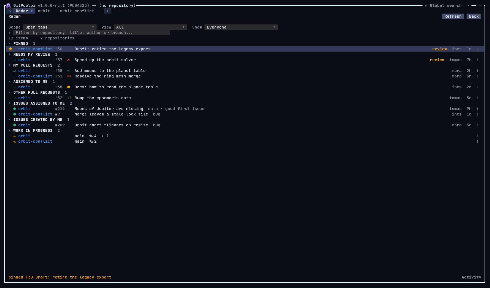

[English](../radar.md) · [Čeština](../cs/radar.md) · **Deutsch** · [Español](../es/radar.md) · [Français](../fr/radar.md) · [Italiano](../it/radar.md) · [日本語](../ja/radar.md) · [한국어](../ko/radar.md) · [Nederlands](../nl/radar.md) · [Polski](../pl/radar.md) · [Português (Brasil)](../pt-BR/radar.md) · [Português (Portugal)](../pt-PT/radar.md) · [Русский](../ru/radar.md) · [Svenska](../sv/radar.md) · [Türkçe](../tr/radar.md) · [Українська](../uk/radar.md) · [简体中文](../zh-CN/radar.md)

# Das Radar

Das Radar ist ein eigener Tab, direkt nach Home: eine einzige Liste dessen, was über **mehrere Repositories** hinweg
auf Sie wartet: die Pull (oder Merge) Requests, die Sie geschrieben haben, die, die
Ihr Review anfordern, die Issues, die Ihnen zugewiesen sind oder die Sie erstellt
haben, und die Repositories, in denen Sie laufende Arbeit zurückgelassen haben. Es ist
das Home-Fenster mit der Radar-Ansicht darüber, damit nichts darunter einen Klick oder
eine Taste stehlen kann.

Es braucht ein Code-Host-Profil (siehe [Hosting und
Issue-Tracker](hosting-integration.md)) und damit verknüpfte Repositories oder ein Profil mit
eingeschalteten kontoweiten Listen (siehe „Über den Umfang hinaus“ unten). Ein nicht
verknüpftes Repository wird nie abgefragt: Es zeigt stattdessen eine Zeile
„Verknüpfen...“ (siehe „Repositories mit etwas zu sagen“ unten).

**Review...** in einer Zeile eines Pull oder Merge Requests (oder `e`) öffnet das Repository mit dem Review der Anfrage in GitPoulpi
([Einen Pull Request prüfen](review.md)).

## Öffnen

- **`Alt+R`** (neu belegbar: `global.radar`), von überall.
- Die Palette: `Radar: Öffnen`.
- Der Tab **Radar**, direkt hinter Home in der Tab-Leiste.
- Die Zeile **Radar** im Menü des **`+`**, solange der Tab geschlossen ist.

Aus einem Repository-Tab bringt Sie das ins Home-Fenster mit geöffnetem Radar;
`Esc` oder **Zurück** führt zur Repository-Liste zurück, und das `⌂` tut dasselbe.

## Den Tab schließen oder das Radar ausschalten

Der Tab schließt wie ein Repository-Tab: mit seinem **x**, per Mittelklick, mit `Ctrl+W`, solange er angezeigt wird, oder
mit dem Paletteneintrag `Radar: Tab schließen`. Nur Home lässt sich nicht schließen. Ein geschlossener Tab bleibt für
diese Sitzung auch über Neustarts hinweg geschlossen, bis Sie das Radar wieder öffnen (`Alt+R`, `Radar: Öffnen`
oder das `+`-Menü); dann kommt er direkt hinter Home zurück. Das Schließen ändert keine Einstellung.

Wenn Sie es nie nutzen, schalten Sie es unter **Einstellungen > Allgemein > Radar aktivieren**
(`general.radar_enabled`, siehe die [Konfigurationsreferenz](config-reference.md)) aus. Ausgeschaltet sind der Tab,
seine Paletteneinträge und `Alt+R` weg, und GitPoulpi ruft dafür nichts ab. Es wirkt sofort, ohne Neustart.

## Was es abdeckt: der Umfang

Die Auswahl **Umfang** bestimmt, welche Repositories abgefragt werden:

- ein **Workspace**, mit Namen (seine Repositories, auch ohne offenen Tab);
- **Offene Tabs**: die Repositories, die als Tabs dieser Sitzung offen sind.
- **Standardordner zum Klonen** und **Standardordner zum Durchsuchen**: jedes Repository, das sich in dem Ordner
  befindet, der in den [Einstellungen](config-reference.md) gesetzt ist (`repos.clone_root`, `repos.browse_root`), ob es einen Tab hat oder nicht.

Es öffnet sich mit dem Umfang, den Sie hier zuletzt gewählt haben (gespeichert in `radar.toml`), solange er noch existiert; vor
Ihrer ersten Wahl oder wenn dieser Workspace gelöscht wurde, mit dem aktiven Workspace der Sitzung, sonst mit
den offenen Tabs. Die Wahl gilt nur für diese Ansicht: Sie ändert nicht den aktiven Workspace des Fensters. Haben zwei Repositories
denselben Ordnernamen, wird der übergeordnete Ordner dem Chip hinzugefügt, damit Sie
sie unterscheiden können.

### Die beiden Ordner-Umfänge

Ein Ordner-Umfang sucht Repositories **zwei Ebenen tief**: die Ordner direkt darin und die Ordner in
jenen, die selbst keine Repositories sind (`~/src/work/app`). Versteckte Ordner werden übersprungen, ein
Repository wird nie betreten, und es werden höchstens 200 Repositories aufgelistet. Die Suche läuft im
Hintergrund, nie in dem Thread, der zeichnet, und ihr Ergebnis bleibt bis zum Aktualisieren erhalten: Die
Schaltfläche Aktualisieren, `r`, `F5` (die Aktualisierungstaste des Fensters, umbelegbar) oder `Radar: Aktualisieren` durchsucht den Ordner erneut (ein
inzwischen geklontes Repository erscheint dann).

Hosting bleibt pro Repository freiwillig: Ein Repository des Ordners, das **nicht mit einem Host
verknüpft** ist, wird nie gefragt. Es liefert nur seine Zeile mit laufender Arbeit, hat unter
Repositories eine Zeile `nicht verknüpft` mit **Verknüpfen...** (sie öffnet den Bereich Pull Requests
dieses Repositorys, wo Sie Anbieter und Projekt wählen), und die Statuszeile zählt sie (`3 nicht
verknüpft (nur laufende Arbeit)`).

Ein Ordner, der nicht gesetzt ist, steht ausgegraut in der Liste (`Standardordner zum Durchsuchen (in
den Einstellungen festlegen)`); wer ihn wählt, öffnet seine Zeile in den Einstellungen (Einstellungen >
Allgemein) und lässt den Umfang, wie er war. Der Ordner zum Klonen gilt über seinen Standard je
Betriebssystem (den Ordner, auf dem der Klon-Dialog startet) als gesetzt, solange dieser Ordner existiert;
der Ordner zum Durchsuchen hat keinen Standard. Die Liste der Umfänge wird bei jedem Öffnen aus den
Einstellungen gelesen, eine dortige Änderung wirkt also sofort.

## Die Liste

| Gruppe | Was sie enthält |
|---|---|
| Angeheftet | Alles, was Sie angeheftet haben, egal welche Art, in der Reihenfolge des Anheftens |
| Wartet auf mein Review | Requests, die Ihr Review anfordern (und die Sie nicht geschrieben haben) |
| Meine Pull Requests | Die Requests, die Sie geschrieben haben; der Chip sagt `Entwurf` bei einem Entwurf |
| Mir zugewiesen | Requests, die Ihnen zugewiesen sind |
| Erwähnt mich | Offene Requests und Issues, die Sie erwähnen und nicht schon in einer Gruppe oben stehen (ein Issue, das Ihnen weder zugewiesen ist noch von Ihnen stammt, steht hier nur, wenn es Sie erwähnt) |
| Weitere Pull Requests | Die übrigen offenen Requests |
| Mir zugewiesene Issues | Offene Issues, die Ihnen zugewiesen sind |
| Von mir erstellte Issues | Offene Issues, die Sie erstellt haben |
| Laufende Arbeit | Repositories des Umfangs mit nicht committeten Änderungen oder nicht gepushten Commits |
| Zurückgestellt | Einträge, die Sie für eine Weile ausgeblendet haben; zugeklappt, bis Sie sie öffnen |
| Repositories | Repositories mit etwas zu sagen (offline, Token zu erneuern, nicht verknüpft) |

Die Wörter „Pull Request“ und „Merge Request“ folgen der üblichen
Terminologie-Einstellung und dem Host.

Jede Zeile zeigt die Art des Eintrags (`⇄` Request, `●` Issue, `✎` laufende Arbeit),
den Repository-Chip (in der Farbe des Workspace), die Nummer, den Titel, den Autor,
das Alter und, wo Platz ist, die Labels. Eine Zeile mit laufender Arbeit zeigt den
Branch und was darin wartet: `✎` geänderte Dateien, `+` neue Dateien, `↑` zu
pushende Commits, `↓` zu pullende Commits.

Die Zahlen stehen in jeder Überschrift. Innerhalb einer Gruppe kommt der zuletzt
aktualisierte Eintrag zuerst.

Die Statuszeile unter dem Filter zeigt einen Spinner, wenn die Hosts länger als einen
Moment zum Antworten brauchen. Die zwischengespeicherten Listen (derselbe Cache wie in
der Seitenleiste) erscheinen sofort und werden ersetzt, sobald die Antworten
eintreffen.

### Spalten

Der Repository-Chip, das `#` (Nummer und Häkchen), der Autor und das Alter sind **größenveränderbare Spalten**. Auf automatisch ist die Repository-Spalte so breit
wie der längste Name auf dem Bildschirm (bis zu 40 Zellen und höchstens ein Drittel des Fensters), sodass `owner/name`
und das `group/sub/project` einer Kontoliste in einem normalen Terminal nicht abgeschnitten werden. Der Titel
bekommt, was übrig bleibt. Ein Name, der nicht passt, endet mit einer Ellipse (`group/sub...`), und:

- **Ruhen Sie mit dem Zeiger** auf einem abgeschnittenen Repository, Titel, Autor oder einer Label-Liste, und ein Tooltip
  zeigt den ganzen Text. Wählen Sie die Zeile aus, und die Statuszeile unter dem Filter nennt ebenfalls das vollständige
  Projekt und den Titel, sodass es auch die Tastatur sieht.
- **Ziehen Sie den Trenner** (die Zelle direkt nach dem Repository-Namen, nach dem `#` oder kurz vor dem Autor oder dem Alter), um die Spalte zu
  dimensionieren; **Doppelklick** darauf passt die Spalte wieder an. Die Liste hat eine **Kopfzeile** (Repository, `#`,
  Titel, Autor, Alter), und die Trenner folgen wie im Log `ui.column_resize`: Mit `line` (dem
  Standard) ruht ein gedämpftes `│` im Trenner der Kopfzeile, und solange der Zeiger auf dem Trenner steht
  (in der Kopfzeile oder auf einer Zeile der Liste), die Spalte mit den Tasten gewählt ist oder Sie ziehen, wird eine dünne Akzentlinie
  über die ganze Liste gezeichnet; ein Ziehen von jedem Punkt daran ändert die Größe. Lassen Sie los, verschwindet die Linie, außer
  der Zeiger steht noch auf dem Trenner (dann geht sie mit dem Zeiger): Ein Ziehen mit der Maus lässt nie eine Spalte gewählt zurück. Mit `header` gibt es weder Markierung noch Linie: Die erste
  Zelle nach dem Trenner in der Kopfzeile leuchtet auf und ist die einzige Stelle zum Ziehen. Der Zeiger wird
  in Terminals, die es unterstützen, über einem Trenner zum Größenänderungszeiger. Der Status-Chip hat eine
  feste Breite, ebenso das Alter (das breiteste angezeigte Alter, bis Sie es einstellen; ein von einer schmalen Spalte abgeschnittenes Alter zeigt
  sein volles Datum in einem Tooltip), sodass der Autor in jeder Zeile in derselben Zelle beginnt.
- Oder nutzen Sie die Tasten: **`C`** wählt eine Spalte (nochmals oder `Tab` für die nächste), **`]`** verbreitert sie um
  zwei Zellen, **`[`** verschmälert sie, **`0`** setzt jede Spalte wieder auf automatisch, `Esc` verlässt den Modus. Die
  Palette hat dasselbe: `Radar: Spalte wählen`, `Radar: Spalte verbreitern`, `Radar: Spalte verschmälern`,
  `Radar: Spaltenbreiten zurücksetzen`.

Die Breiten stehen in `radar.toml` (`[columns]`, `repo`, `number`, `author` und `age`, in Zellen) und überstehen einen Neustart. Es sind
dieselben Gesten zum Ändern der Größe wie bei den Spalten des Logs.

### Checks und Konflikte

Eine Request-Zeile trägt nach ihrer Nummer zwei kleine Markierungen, wenn der Host etwas gesagt hat:

| Markierung | Bedeutung |
|---|---|
| `✓` | die Checks des Head-Commits sind bestanden |
| `✗` | ein Check ist fehlgeschlagen |
| `●` | Checks sind eingereiht oder laufen |
| `!` (daneben) | der Request hat Konflikte mit seinem Zielbranch |

Halten Sie den Zeiger auf die Markierungen, und ein Tooltip sagt es in Worten („Checks fehlgeschlagen“, „Konflikte mit main“);
wählen Sie die Zeile aus, und die Statuszeile unter dem Filter sagt dasselbe, sodass es auch die Tastatur sieht. Ein Request
ohne Markierung ist einer, zu dem der Host nichts gesagt hat (keine CI eingerichtet oder nicht gefragt).

- **GitLab** sendet den Pipeline-Status und das Konflikt-Flag mit der Liste der Merge Requests: Jede Zeile hat
  ihre Markierungen.
- **GitHub** nicht: Die Liste hat keins von beiden. GitPoulpi fragt sie pro Request ab (den Request selbst
  für seinen Merge-Status, den kombinierten Status des Head-Commits und seine Check-Runs: drei Aufrufe), für höchstens
  **15 offene Requests pro Repository**, Ihre zuerst. Lehnt GitHub einen dieser Aufrufe ab (ein Ratenlimit),
  bleiben die übrigen bis zur nächsten Aktualisierung ohne Markierung. Die Antworten werden mit dem Hosting-Cache gespeichert.

- **Gitea und Forgejo** werden wie GitHub gelesen: Die Liste trägt das Konfliktflag (`mergeable`), der
  Commit-Status wird pro Request abgefragt (höchstens 15 pro Repository, Ihre zuerst), und die Issues sind dieselben
  Gruppen. Erwähnungen nutzen die Suche des Servers (`mentioned_by`).

### Erwähnungen

**Erwähnt mich** und der Filter **Anzeigen: Erwähnt mich** nutzen, was der Host über Erwähnungen weiß. GitHub wird
über seine Suche befragt (`mentions:`), GitLab über Ihre To-do-Liste: Nur Erwähnungen, die dort noch **offen** sind,
zählen, ein als erledigt markiertes To-do verlässt die Gruppe also.

Geschlossene und gemergte Requests und geschlossene Issues werden nicht aufgelistet.

## Ansichten und Filter

Drei Auswahlfelder und ein Textfeld grenzen die Liste ein. Jede Wahl ist eine
Auswahl: Klicken Sie darauf oder nutzen Sie ihre Taste.

- **Ansicht** (`v`): Alle, Requests, Issues, WIP (laufende Arbeit), Zurückgestellt.
- **Anzeigen** (`f`): Alle, Meine (Requests, die Sie geschrieben, Issues, die Sie
  erstellt haben), Mir zugewiesen, Review angefragt, Erwähnt mich.
- **Umfang** (`w`): siehe oben.
- **Filtertext** (`/` oder `Ctrl+F`): Fuzzy-Treffer auf Repository, Nummer, Titel,
  Autor, Branch und Labels. `Enter` gibt die Tasten an die Liste zurück und behält
  den Text, `Esc` löscht ihn.

`Ctrl+N` zeigt ein Badge am Filter, an jeder Auswahlliste, an den Schaltflächen Aktualisieren und Zurück und an jeder Abschnittsüberschrift auf dem Bildschirm. Drücken Sie das Zeichen eines Badges: Der Filter erhält die Tastatur, eine Auswahlliste öffnet sich, eine Schaltfläche wird ausgelöst und eine Überschrift erhält die Auswahl (`Enter` oder `Space` klappt sie dann zu). `Esc` bricht ab. Siehe [Badges](keybindings.md#badges).

## Aktionen

Wählen Sie eine Zeile und nutzen Sie ihr Menü (Rechtsklick, das `⋮` am Zeilenende,
`.` oder `Menü`), eine Taste oder die Palette (`Radar: ...`). Zu jeder
Mausaktion gibt es eine Taste und einen Palettenzwilling.

| Aktion | Taste | Palette |
|---|---|---|
| Repository öffnen (sein Tab öffnet sich oder wird gewechselt) | `Enter` / Doppelklick | `Radar: Repository öffnen` |
| Review... (ein Request; bei einem Request ohne Klon fragt es, wie) | `e` | `Radar: Anfrage prüfen...` |
| Einen Request über die API des Hosts prüfen (kein Klon) | `a` in der Frage | `Radar: Über die API prüfen` |
| Das Repository klonen, dann den Request prüfen | `c` in der Frage | `Radar: Klonen und prüfen...` |
| Im Browser öffnen | `o` | `Radar: Im Browser öffnen` |
| Branch auschecken (ein Request) | `c` | `Radar: Branch auschecken` |
| Worktree erstellen... (ein Request) | `t` | `Radar: Worktree erstellen...` |
| Im Repository zeigen (seine Liste) | `s` | `Radar: Im Repository zeigen` |
| Arbeit am Issue beginnen... (ein Issue) | `n` | `Radar: Arbeit am Issue beginnen...` |
| Oben anheften oder Anheften aufheben | `p` / Klick auf das `★` | `Radar: Anheften / Anheften aufheben` |
| Zugewiesene... / Reviewer... / Labels bearbeiten..., Meilenstein festlegen... (GitHub, GitLab) | Zeilenmenü | `Radar: Zugewiesene bearbeiten...`, `Radar: Reviewer bearbeiten...`, `Radar: Labels bearbeiten...`, `Radar: Meilenstein festlegen...` |
| Zurückstellen... | `z` | `Radar: Zurückstellen...` |
| Nicht mehr zurückstellen | `u` | |
| Die Requests von Repositories ohne Klon zeigen oder ausblenden | `a` | `Radar: Nicht geklonte Anfragen zeigen` |
| Entwürfe der kontoweiten Zeilen zeigen oder ausblenden | `d` | `Radar: Entwürfe zeigen` |
| Die kontoweiten Review-Anfragen eines Hosts aktivieren | `T` / `Enter` auf seiner Hinweiszeile / **Aktivieren** | `Radar: Kontoweite Prüfanfragen aktivieren...` |
| Aktualisieren | `r`, `F5` | `Radar: Aktualisieren` |
| Das Zeilenmenü | `.` | `Radar: Zeilenmenü...` |
| Zurück zum Home-Tab | `Esc` | `Radar: Zurück zum Home-Tab` |

Aktionen, die das eigene Fenster des Repositorys brauchen (auschecken, Worktree,
zeigen, Arbeit beginnen, verknüpfen, die Auswahllisten für Metadaten), wechseln zuerst zu seinem Tab und laufen dort,
sobald es geladen ist:

- **Auschecken** nutzt das Auschecken der Seitenleiste: den Branch, wenn er lokal
  bekannt ist, sonst den Kopf des Requests, abgerufen in einen lokalen Branch (zum
  Beispiel der eines Forks).
- **Worktree erstellen...** öffnet den Dialog Worktree erstellen auf dem Branch des
  Requests.
- **Im Repository zeigen** wählt den Eintrag in der Liste PULL REQUESTS oder ISSUES
  aus.
- **Arbeit am Issue beginnen...** öffnet die Eingabe Neuer Branch mit einem aus
  dem Issue gebildeten Namen (`12-fix-the-thing`).

### Anheften und Zurückstellen

Ein **Anheften** hält einen Eintrag oben. Ein **Zurückstellen** blendet ihn für **1
Stunde**, **4 Stunden**, **Bis morgen** (8:00 Uhr am nächsten Morgen, Ihre Ortszeit, auch wenn es jetzt noch nicht 8:00 Uhr ist) oder **Bis zur Änderung** aus
(der Host meldet eine Aktualisierung des Eintrags oder, bei einer Zeile mit laufender
Arbeit, ihre Zähler ändern sich). Beides liegt in `radar.toml` in Ihrem
Konfigurationsordner, geschlüsselt nach Host, Repository, Art und Nummer, und wird von
jeder Sitzung auf dem Rechner gemeinsam genutzt.

### Repositories mit etwas zu sagen

Ein Repository mit einem Problem bekommt am Listenende eine eigene Zeile, und seine
zwischengespeicherten Einträge bleiben auf dem Bildschirm:

- **offline, 5m alt**: Der Host war nicht erreichbar;
- **Erneut verbinden**: Der Token fehlt oder wurde abgelehnt; die Schaltfläche öffnet
  Einstellungen > Integrationen;
- **in dieser Runde pausiert**: Der Host sagte, langsamer zu machen (oder lehnte den
  Token ab), also hat GitPoulpi ihn für die anderen Repositories dieser Runde nicht
  erneut gefragt;
- **nicht verknüpft, GitHub vorgeschlagen**: Das Remote des Repositorys passt zu einem
  Profil, aber Hosting ist pro Repository freiwillig, also wird nichts abgefragt, bis
  Sie es verknüpfen. **Verknüpfen...** führt Sie zum Abschnitt PULL REQUESTS des
  Repositorys, wo Sie den Anbieter und das Projekt wählen.

Höchstens vier Repositories werden gleichzeitig abgefragt, und nie auf dem Thread, der
den Bildschirm zeichnet.

## Über den Umfang hinaus: kontoweite Zeilen

Der Umfang deckt die Repositories ab, die Sie geklont haben. Ein Request, der in einem Repository auf Ihr Review wartet,
das Sie nie geklont haben, ist dort unsichtbar. **Kontoweite Zeilen** fragen den Host selbst, einmal pro Profil, und
treten der Liste bei, was auch immer der Umfang ist: Sie handeln von Ihnen, nicht von einem Ordner.

Sie sind **standardmäßig aus** (die Suche eines Hosts kostet API-Kontingent). Solange bei einem verbundenen Code-Host
keine seiner Listen an ist, zeigt die Listenspitze eine Zeile dafür:

`GitHub: Anfragen auflisten, die auf Ihre Prüfung warten, auch in nicht geklonten Repositories  [Aktivieren]`

Klicken Sie auf **Aktivieren**, drücken Sie `Enter` auf dieser Zeile, drücken Sie `T` oder führen Sie `Radar: Kontoweite
Prüfanfragen aktivieren...` aus: Es schreibt `integrations.radar.review_requests = true` für dieses Profil in `config.toml` und
fragt den Host sofort. Die anderen Listen (jeder offene Request Ihrer Namespaces, Ihnen zugewiesene Issues,
Entwürfe, Namespaces) werden mit `gitpoulpi hosting integrations radar` oder in den Einstellungen des Profils gesetzt; siehe
die [Konfigurationsreferenz](config-reference.md) und die [CLI-Referenz](cli-reference.md). GitHub, GitLab,
Gitea, Forgejo, Azure DevOps, Bitbucket Data Center und Gerrit antworten; Bitbucket Cloud hat keinen
kontoweiten Endpunkt, daher zeigen seine Requests nur die verknüpften Repositories des Umfangs.

Die **Namespaces** des Profils begrenzen alle seine Listen auf bestimmte Repositories (Einstellungen > Integrationen > Radar: ein Textbereich mit einem Eintrag pro Zeile und ein Kontrollkästchen **Reguläre Ausdrücke**). Eine Zeile passt auf den vollständigen Pfad eines Repositorys, wenn sie ihm entspricht oder ein Pfadpräfix ist, das an einem `/` endet: `ptm` behält `ptm/produits/x` und verwirft `ptmx/y` und `formation/y`. Ist das Kontrollkästchen an, ist jede Zeile ein regulärer Ausdruck, der gegen den vollständigen Pfad geprüft wird, so wie Sie ihn schreiben (`^ptm/(produits|infra)/`); eine ungültige Zeile wird unter dem Feld angezeigt und nicht gespeichert. Leer heißt keine Begrenzung.

Wie die Zeilen eingeordnet werden:

- Eine Zeile, die der Umfang schon listet (gleicher Host, Projekt, Art und Nummer), erscheint einmal: **die Zeile des
  Umfangs gewinnt**.
- Eine Zeile, deren Projekt Sie irgendwo geklont haben (zuletzt verwendete Repositories, Workspaces, die von den Ordner-Umfängen
  gefundenen Ordner; abgeglichen über die Remote-URL), trägt diesen Klon: **Enter**, Auschecken, Worktree und die
  anderen öffnen ihn wie jede Zeile.
- Jede andere Zeile ist **nicht geklont**: Der Repository-Chip ist abgedunkelt und zeigt das Projekt (`acme/app`), und
  die Statuszeile sagt `Nicht geklont`, wenn sie ausgewählt ist. **Im Browser öffnen** funktioniert, **Review** fragt, wie
  sie geprüft werden soll (unten), und Auschecken, Worktree, im Repository zeigen und Arbeit beginnen sagen
  `zuerst das Repository klonen`.

### Einen Request prüfen

**Review** (`e`) auf einem Request aus den eigenen Repositories des Umfangs öffnet den Tab dieses Repositorys mit dem Review
darin. Bei einem Request einer kontoweiten Zeile hängt der Weg davon ab, ob ein Klon bekannt ist, und von der Einstellung
**Anfrage eines nicht geklonten Repositorys** des Profils (Einstellungen > Integrationen, `review_mode`
in [der Konfigurationsreferenz](config-reference.md)):

| Einstellung | Ein Klon ist bekannt | Kein Klon ist bekannt |
|---|---|---|
| Nachfragen (Standard) | fragt: **Lokalen Klon öffnen** (`l`) oder **Über die API prüfen** (`a`) | fragt: **Klonen, dann prüfen** (`c`) oder **Über die API prüfen** (`a`) |
| Klonen | öffnet den Klon | öffnet den Dialog Klonen |
| Über die API prüfen | prüft über die API | prüft über die API |

Die Frage ist ein kleiner Dialog: Die Buchstaben wählen, **Enter** wählt die markierte Zeile, `Esc`, **Abbrechen**,
das `✕` und ein Klick außerhalb schließen ihn, und **Für GitHub merken** (`r`) schreibt die Einstellung des Profils, damit die
Frage nicht erneut gestellt wird (die Zeile in den Einstellungen ändert das zurück). `Ctrl+N` zeigt Badges an seinen Steuerelementen.

- **Über die API prüfen** öffnet das Review im Home-Fenster, über dem Radar, mit dem Code vom Host
  (siehe [Review ohne Klon](review.md#review-ohne-klon)). `Esc` oder das `✕` gibt das Radar zurück; die
  Zeilen *Review: ...* der Palette wirken darauf.
- **Klonen, dann prüfen** öffnet den Dialog Klonen auf dem verbundenen Konto, aus dem die Zeile stammt (dieselbe Liste der
  Repositories, nach Eigentümer gruppiert), mit dem ausgewählten Repository des Requests und dem ausgefüllten Standardordner
  zum Klonen; ändern Sie beides, dann klonen Sie, mit derselben Anmeldung wie bei jedem Klon von diesem Konto. Steht das
  Repository nicht in der Liste des Kontos (Sie sind kein Mitglied), bleibt die Liste offen, die Suche steht auf seinem Namen,
  und ein Hinweis sagt es; bei einem Host, der keine Repositories auflisten kann, öffnet sich der Dialog auf **Per URL
  klonen** mit ausgefüllter Adresse. Ist der Klon da, wird das neue Repository mit dem Host verknüpft
  (seine Quelle PULL REQUESTS und, wenn der Host Issues hat und keine gesetzt ist, seine Quelle ISSUES), sein Tab öffnet sich und
  das Review dieses Requests ist darin offen. Bricht man den Dialog ab oder schlägt ein Klon fehl, wird nichts verknüpft.
- Requests von Azure DevOps und Bitbucket haben kein Review in der App: **Review** öffnet die Seite des Requests im
  Browser und sagt das in der Statuszeile.

Die Palettenzeilen *Radar: Über die API prüfen* und *Radar: Klonen und prüfen...* überspringen die Frage.

Zwei Kästchen neben dem Filter (sie erscheinen, sobald eine kontoweite Liste abgefragt wird), gespeichert in
`radar.toml`:

| Kästchen | Taste | Standard | Wirkung |
|---|---|---|---|
| `[x] Nicht geklont` | `a` | an | Listet die Zeilen von Repositories ohne bekannten Klon. Aus bleiben nur Zeilen bekannter Klone. |
| `[ ] Entwürfe` | `d` | aus | Listet Entwurfs-Requests der kontoweiten Zeilen. Entwürfe aus den eigenen Repositories des Umfangs werden immer gelistet. |

Beide stehen bei den Badges von `Ctrl+N` und in der Palette (`Radar: Nicht geklonte Anfragen zeigen`, `Radar: Entwürfe zeigen`).

Die Antwort eines Profils wird **5 Minuten** in `radar-account.json` aufbewahrt: Öffnen Sie das Radar in dieser
Zeit erneut, zeigt es die Zeilen, ohne den Host zu fragen. **Aktualisieren** (`r` oder `F5`) fragt immer: jedes Repository und jede kontoweite Liste, wie alt die letzte Antwort auch ist. Ein Host, der sagte,
langsamer zu machen, oder den Token ablehnte, wird in derselben Runde nicht erneut gefragt. Höchstens 300 Zeilen bleiben pro Profil und Art
erhalten, und eine Zeile unter **Repositories** sagt, wie viele weitere es gab oder warum ein Profil nicht gelesen werden konnte
(**Erneut verbinden** öffnet Einstellungen > Integrationen).

## Grenzen

- Kontoweite Zeilen kommen aus GitHub-, GitLab- (auch selbst gehostet), Gitea-, Forgejo-, Azure-DevOps-,
  Bitbucket-Data-Center- und Gerrit-Profilen (nicht Bitbucket Cloud). Ihnen zugewiesene Issues kommen aus den ersten
  fünf; Bitbucket und Gerrit haben keine Issues.
- Die Listen pro Repository nutzen GitHub-, GitLab- (auch selbst gehostet), Gitea-, Forgejo-, Azure-DevOps-,
  Bitbucket- und Gerrit-Profile; Checks, Konflikte und Erwähnungen werden nur für die ersten vier gelesen.
- Erwähnungen bei GitLab kommen nur aus offenen To-dos; Checks bei GitHub, Gitea und Forgejo werden für 15 Requests pro Repository abgefragt.
