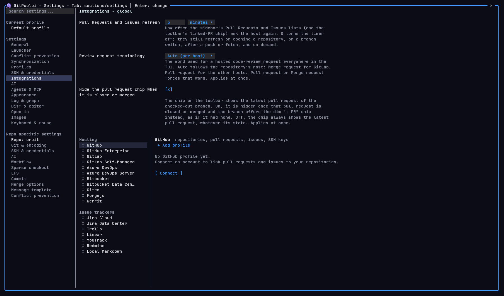

[English](../settings.md) · [Čeština](../cs/settings.md) · **Deutsch** · [Español](../es/settings.md) · [Français](../fr/settings.md) · [Italiano](../it/settings.md) · [日本語](../ja/settings.md) · [한국어](../ko/settings.md) · [Nederlands](../nl/settings.md) · [Polski](../pl/settings.md) · [Português (Brasil)](../pt-BR/settings.md) · [Português (Portugal)](../pt-PT/settings.md) · [Русский](../ru/settings.md) · [Svenska](../sv/settings.md) · [Türkçe](../tr/settings.md) · [Українська](../uk/settings.md) · [简体中文](../zh-CN/settings.md)

# Einstellungen

Öffnen Sie die Einstellungen mit `Ctrl+,`, `Ctrl+N` dann `,`, dem Zahnrad in der
Titelleiste (links neben dem `×`) oder `Ctrl+P` > *Einstellungen*. Der
Einstellungsbildschirm ersetzt das Fenster, solange er offen ist. Schließen Sie ihn mit
dem `✕` oben rechts, `Esc` oder `q`. Er fragt nur dann vorher, wenn beim Schließen
etwas verloren ginge (siehe [Einstellungen schließen](#einstellungen-schließen)).

Änderungen werden sofort in der `config.toml` gespeichert. Die
[Konfigurationsreferenz](config-reference.md) beschreibt jeden Schlüssel, seinen
Standardwert und seine Umgebungsvariable. Diese Seite beschreibt den
Einstellungsbildschirm.

## Den Einstellungsbildschirm benutzen

| Um | Tun Sie |
|---|---|
| Zwischen Seitenliste und Optionen zu wechseln | `Tab` / `Shift+Tab` oder klicken. |
| Sich zu bewegen | `j` / `k` oder die Pfeiltasten. |
| Eine Option zu ändern | `Enter` oder `Space`, oder klicken Sie auf ihren Wert. Siehe unten. |
| Zu schließen | Klicken Sie auf `✕` oder drücken Sie `Esc` oder `q`. Solange ein Feld, eine Dropdownliste oder eine Bestätigung offen ist, schließt `Esc` nur diese. |

Was `Enter` oder `Space` tut, hängt von der Zeile ab:

- Ein Kontrollkästchen schaltet um.
- Eine Dropdownliste öffnet sich. Die Pfeiltasten wählen, `Enter` übernimmt.
- Ein Text- oder Zahlenfeld beginnt die Bearbeitung. Die Pfeiltasten, `Home`,
  `End`, `Backspace` und `Delete` funktionieren, und ein Klick setzt den Cursor.
  `Enter`, `Tab`, `Up`, `Down` oder ein Klick woanders speichert den Wert. `Esc`
  bricht ab. Ein abgelehnter Wert bleibt rot im Feld, und die Statuszeile nennt den
  Grund.
- Eine Zeile mit Schaltflächen (**Erstellen**, **Entfernen**, **Testen** ...) zeigt nur
  die Schaltflächen, die gerade zutreffen. `Left` / `Right` wählen eine, `Enter`
  drückt sie, oder klicken Sie darauf. Eine Schaltfläche, die etwas löscht, fragt vorher
  nach.

Auf jeder Seite beginnen die Werte in einer Spalte, sodass die Bezeichnungen links und
die Felder rechts untereinander stehen. Ein Text oder eine Zahl ist ein getöntes Band,
eine Auswahl ein Band mit `▾` am Ende, ein Kontrollkästchen ist `[x]`. Eine lange
Bezeichnung wird umbrochen statt abgeschnitten, und in einem schmalen Fenster rutscht
der Wert unter seine Bezeichnung.

Eine ausgegraute Zeile sagt, warum sie inaktiv ist. Zum Beispiel ist **Stärke der
Zeilentönung** ausgegraut, solange **Hintergrund der Graph-Spuren**auf**Aus**
steht.

### Listen

Seiten, die mehrere Einträge derselben Art bearbeiten (Profile, KI, Workflow, Öffnen
in, Bilder), zeigen sie als **Liste links und die Felder des ausgewählten Eintrags
rechts**. In einem schmalen Fenster steht die Liste über den Feldern. Die Liste sieht
überall gleich aus:

- Das Zeichen einer Zeile zeigt ihren Zustand: `●` das aktive Profil, `★` der
  Standardeintrag, `⚠` ein Eintrag, der nicht fertig ist (ein Profil ohne E-Mail), mit
  dem Grund dort, wo sonst die Details stehen.
- Unter der Liste: **+ Hinzufügen**, **Duplizieren**, **Entfernen**, `↑` und `↓`. Eine
  Schaltfläche, die gerade nicht passt (`↑` auf der ersten Zeile), ist abgedunkelt.
  **+ Hinzufügen ▾** öffnet eine Dropdownliste, wenn die Seite Voreinstellungen oder
  Arten anbietet.
- **Entfernen** fragt vorher nach, außer bei einem Eintrag, den Sie gerade erst
  hinzugefügt und nicht bearbeitet haben.
- Ziehen Sie eine Zeile, um sie zu verschieben; ein Balken zeigt, wo sie landet, und
  `Esc` bricht das Ziehen ab. Ein Doppelklick wechselt in die Felder des Eintrags.

| Taste | Wirkung |
|---|---|
| `Up` / `Down`, `Home` / `End`, `PageUp` / `PageDown` | Einen Eintrag auswählen. |
| `Insert` | Einen Eintrag hinzufügen (öffnet die Dropdownliste, wenn es eine gibt). |
| `Ctrl+D` | Den Eintrag duplizieren. |
| `Delete` | Den Eintrag nach einer Bestätigung entfernen. |
| `Alt+Up` / `Alt+Down` | Den Eintrag nach oben oder unten verschieben. |
| `Enter` oder `Right` | Zu den Feldern des Eintrags wechseln. |
| `Left` | Zurück zur Seitenliste. |
| `Alt+Left` / `Alt+Right` | Zwischen dem Tab Allgemein und dem Listen-Tab wechseln (überall auf der Seite). |

Jede dieser Seiten hat unter ihrem Titel zwei **Unter-Tabs**, damit eine Einstellung der Seite nie mit einer Eigenschaft des gewählten Eintrags verwechselt wird: **Allgemein**, die Einstellungen der Seite selbst (das aktive Profil, der Standardeintrag, die Anweisungen, die jede KI-Aktion erhält, die Workflow-Vorlage ...), und ein nach den Einträgen benannter Tab (**Profile**, **Profile (Verbindungen)**, **Einträge**, **Editoren**, **Regeln**), der die Liste und die Felder des gewählten Eintrags enthält. Eine Seite öffnet auf **Allgemein**; die Einstellungen merken sich bis zum Beenden den Tab, auf dem Sie jede Seite verlassen haben, ebenso die Scrollposition und die ausgewählte Zeile jeder Seite (und jedes Tabs). Klicken Sie auf einen Tab oder drücken Sie `Alt+Left` / `Alt+Right`. Die Suche, die Einstellungszeilen der Befehlspalette und die Links, die „in den Einstellungen festlegen“ sagen, öffnen den Tab, auf dem die Einstellung liegt.
[Tastatur & Maus](#tastatur--maus) hat dieselben zwei Tabs (**Allgemein**, **Tastenbelegung**).

Die Tasten lassen sich unter **Tastatur & Maus** neu belegen (Kontext *preferences*,
siehe [Tastenkürzel](keybindings.md)).

### Mehrzeilige Editoren

Einstellungen mit mehreren Zeilen (etwa die Pfade des Sparse Checkouts, die Beschreibung der Nachrichtenvorlage, die Basis-Branches der Konfliktvorbeugung und die Workflow-Hooks) öffnen sich mit `Enter` oder einem Klick in einem kleinen Editor; `Ctrl+S` übernimmt den Text, `Esc` verwirft ihn. Die Maus funktioniert dort wie in jedem Textfeld:

- Ein Klick setzt den Cursor an die angeklickte Stelle.
- Ziehen markiert Text; das Mausrad scrollt.
- Ein Doppelklick markiert das Wort unter dem Zeiger.
- `Shift` + Klick erweitert die Markierung vom Cursor bis zum Zeiger.

Die Tastatur bietet dasselbe: `Shift` mit den Pfeiltasten markiert, `Ctrl` mit den Pfeiltasten springt wortweise, `Ctrl+A` markiert alles, `Ctrl+C` und `Ctrl+X` kopieren und schneiden aus.

### Einstellungen schließen

`✕`, `Esc` und `q` tun dasselbe. Die Einstellungen übernehmen jede Änderung sofort,
meist schließen sie also einfach. Sie fragen **Einstellungen schließen?** nur, wenn
etwas verloren ginge:

- die Seite **Workflow** hat ungespeicherte Änderungen;
- die Vorlage für Commit-Nachrichten hat ungespeicherte Änderungen;
- einem Profil fehlt die Autoren-E-Mail (die Commits, die es erzeugt, lassen sich
  Ihnen nicht zuordnen).

Das Fenster bietet **Dorthin** (öffnet diese Seite), **Verwerfen und schließen** oder
**Trotzdem schließen** sowie **Abbrechen**. Die kleinen Editoren innerhalb der
Einstellungen (ein Text mit KI-Anweisungen, ein Workflow-Hook, die Pfade des Sparse
Checkouts) haben ein eigenes `✕` und fragen **Änderungen verwerfen?** nur, wenn ihr Text
bearbeitet wurde.

### Popups über den Einstellungen

Die Titelzeile zeigt den Oktopus und den Namen der Anwendung, wie das Hauptfenster. Ein Klick auf
den Oktopus öffnet „Über GitPoulpi“.

Einige fensterweite Popups öffnen sich über den Einstellungen und geben sie so zurück, wie sie waren
(die Seite, die Scrollposition und nicht gespeicherte Änderungen an Workflow oder Vorlage bleiben):

- die Befehlspalette (`Ctrl+P`),
- die Designauswahl (`Ctrl+N y`, **App: Design ändern...**), die jedes Design gleich auf den
  Einstellungen selbst als Vorschau zeigt; `Esc` stellt das vorherige Design wieder her,
- die Auswahl von Sprache und Graphfarben (`Ctrl+N`, dann dieselben Buchstaben wie im Hauptfenster),
- die Suche im Workspace (`Ctrl+Alt+F`),
- „Über GitPoulpi“ (`Ctrl+N a`, der Oktopus oder **Hilfe: Über GitPoulpi**) und die Hilfe (`?`).

Jedes schließt mit `Esc`, mit seinem eigenen `✕` oder mit einem Klick daneben. Befehle, die auf das
wirken, was die Einstellungen verdecken (ein Tab, ein Branch, ein Diff...), stehen in der Palette,
sind aber ausgegraut mit „zuerst die Einstellungen schließen“, und die `Ctrl+N`-Kürzel dafür zeigen
diese Zeile am unteren Rand der Einstellungen: die Einstellungen schließen, dann den Befehl ausführen.

`Ctrl+N` zeigt ein Badge auf jedem Bedienelement der Seite: dem Suchfeld, der Seitenliste (ein Badge, auf der aktuellen Seite), den Unter-Tabs, der Liste und ihren Schaltflächen, jedem Feld auf dem Bildschirm und dem Schließen-Kreuz. Drücken Sie das Zeichen eines Badges, und es geschieht dasselbe wie bei einem Klick auf dieses Element: Ein Textfeld wird zum Bearbeiten geöffnet, ein Kontrollkästchen wird umgeschaltet, eine Dropdownliste öffnet sich, eine Schaltfläche wird ausgeführt. `Esc` bricht ab. Ein aus dem Sichtbereich gescrolltes Feld hat kein Badge. Solange Sie in ein Feld tippen oder eine Dropdownliste, ein Editor oder die Suche offen ist, gehört `Ctrl+N` diesem Element. Siehe [Badges](keybindings.md#badges).

### Das Suchfeld

Das Feld oben in der Seitenliste durchsucht Name und Beschreibung jeder Option auf
jeder Seite. Klicken Sie hinein oder drücken Sie `/` oder `Ctrl+F` und tippen Sie.
Eine Trefferliste klappt auf. Jeder Treffer zeigt die Option und ihre Seite. `Up` /
`Down` wählen, `Enter` springt zur Option, `Esc` schließt die Liste.

## Einstellungen über die Befehlspalette

Die meisten Einstellungen lassen sich ändern, ohne diesen Bildschirm zu öffnen: Geben Sie in der Befehlspalette (`Ctrl+P`) `Einstellungen:` (oder `Settings:`) ein. Die Zeilen werden aus den Feldern der Seiten erzeugt, eine neue Einstellung erscheint also an beiden Orten.

- Ein Kontrollkästchen heißt **Einstellungen: ... umschalten**. Es schaltet sofort um, und die Zeile zeigt `[x]` oder `[ ]`.
- Eine Auswahlliste heißt **Einstellungen: ...**. `Enter` beschränkt die Palette auf ihre Werte, der aktuelle ist als `aktuell` markiert; `Enter` auf einem Wert wählt ihn.
- Eine Zahl oder ein Text öffnet eine Eingabe mit dem aktuellen Wert. Ein Wert, den die Seite ablehnen würde (keine Zahl, außerhalb des Bereichs), wird genauso abgelehnt, und die Eingabe bleibt offen.
- Eine Einstellung, die ihre Seite braucht (eine Liste, eine Auswahl mit zur Laufzeit ermittelten Optionen), öffnet die Einstellungen dort.

Ein Wert wird in `config.toml` gespeichert und genau wie auf der Seite angewendet. Die englischen Wörter des Schlüssels (`remember tabs`) finden die Zeile in jeder Sprache.

## Die Seiten

Die Seitenliste hat zwei Gruppen:

- **Einstellungen**: globale Einstellungen.
- **Repository-spezifische Einstellungen**: Einstellungen für das Repository des
  aktiven Tabs. Sie erscheinen nur, solange ein Repository geöffnet ist.

### Allgemein

| Option | Was sie tut |
|---|---|
| **Sprache** | Die Sprache der Oberfläche: **Auto** (Ihre Systemsprache, sonst Englisch), English, Français, Español, Português (Brasil), Português (Portugal), Italiano, Deutsch, 简体中文, 日本語, 한국어, Русский, Українська, Polski, Čeština, Nederlands, Svenska, Türkçe. Sie gilt sofort, ohne Neustart. Die Monatsnamen und Daten des Logs folgen ihr. Die Umgebungsvariable `GITPOULPI_LANG` (zum Beispiel `GITPOULPI_LANG=fr`) überstimmt diese Wahl. Die Ausgabe von CLI und MCP bleibt Englisch. |
| **Git-Begriffe übersetzen** | Standardmäßig aus: Commit, Push, Pull, Stash, Tag und die übrigen Git-Begriffe bleiben in jeder Sprache Englisch. An: Das Git-Vokabular der Sprache wird verwendet (Französisch: *Tirer*, *Pousser*, *Remiser*, *Étiquette*). Gilt sofort. |
| **Englische Git-Wörter** | Nur für Japanisch, Koreanisch und Chinesisch: zeigt *stage*, *unstage*, *staged* als englische Wörter statt ihrer Umschrift. Ohne Wirkung, solange **Git-Begriffe übersetzen** an ist. |
| **Tabs merken** | Öffnet beim Start die Tabs der letzten Sitzung wieder. Aus: Ein Start in einem Repository öffnet nur dieses Repository, ein Start außerhalb beginnt auf Home ohne Repository-Tab. Braucht einen Neustart. |
| **Radar aktivieren** | Standardmäßig an (`general.radar_enabled`). Aus blendet den Radar-Tab, seine Palettenbefehle und `Alt+R` aus; im Hintergrund wird nichts dafür geladen. Wirkt sofort. Siehe [Radar](radar.md#den-tab-schließen-oder-das-radar-ausschalten). In einem Build ohne Radar nicht sichtbar. |
| **Start-Tab in einem Repository** | Der Tab, auf dem ein Start öffnet, wenn der Ordner, in dem er beginnt, in einem Repository liegt (`general.startup_tab_in_repo`): **Aktuelles Repository** (Standard, der Tab dieses Repositorys, bei Bedarf neu geöffnet), **Letzter Tab** (der beim letzten Beenden aktive Tab), **Home**, **Radar**. Ein mit `--repo` angegebenes Repository öffnet immer seinen eigenen Tab. **Letzter Tab** ist Home, wenn **Tabs merken** aus ist oder nichts gemerkt wurde; **Radar** ist Home, wenn das Radar aus ist oder im Build fehlt. Wird einmal beim Start gelesen; erfordert einen Neustart. |
| **Start-Tab außerhalb eines Repositorys** | Der Tab, auf dem ein Start öffnet, wenn der Ordner, in dem er beginnt, kein Repository ist (etwa ein Benutzerordner) (`general.startup_tab_outside_repo`): **Home** (Standard), **Letzter Tab**, **Radar**. **Letzter Tab** ist Home, wenn **Tabs merken** aus ist oder nichts gemerkt wurde; **Radar** ist Home, wenn das Radar aus ist oder im Build fehlt. Wird einmal beim Start gelesen; erfordert einen Neustart. |
| **Start-Tab über den Starter** | Der Tab, auf dem ein Start öffnet, wenn GitPoulpi über die Desktop- oder Startmenü-Verknüpfung gestartet wird, die es angelegt hat (sie übergibt `--launcher`), egal in welchem Ordner (`general.startup_tab_launcher`): **Letzter Tab** (Standard), **Home**, **Radar**. Hat Vorrang vor den beiden Einstellungen darüber. **Letzter Tab** ist Home, wenn **Tabs merken** aus ist oder nichts gemerkt wurde; **Radar** ist Home, wenn das Radar aus ist oder im Build fehlt. Verknüpfungen einer älteren Version erhalten den Schalter beim nächsten Start. Wird einmal beim Start gelesen; erfordert einen Neustart. Unter Windows wird auch eine an die Taskleiste angeheftete Kopie beim nächsten Start neu geschrieben, und ein Start ohne umgebende Shell (Doppelklick, die angeheftete exe selbst) gilt als Start über den Starter. |
| **Worktree-Tabs gruppieren** | Standardmäßig an (`general.group_worktree_tabs`). Die Tabs der verknüpften Worktrees eines Repositorys stehen direkt hinter dem Tab des Repositorys, und ein weggezogener Worktree-Tab springt dorthin zurück. Aus lässt Tabs, wo Sie sie hinlegen. Einschalten gruppiert die offenen Tabs neu. |
| **Standard-Klonordner** | Wo der Klon-Dialog beginnt. Leer: `%USERPROFILE%\source\repos` unter Windows, sonst `~/src`. |
| **Standardordner für Durchsuchen** | Wo Durchsuchen sich öffnet. Leer: der zuletzt verwendete Ordner, sonst Ihr Home-Ordner. |
| **Speicherort der Repository-Daten** | Wo GitPoulpi seine Daten je Repository ablegt (`session.per_repo_state_dir`): **In .git (Ordner gitpoulpi)** (Standard: In Ihrem Arbeitsverzeichnis erscheint nichts, alle Worktrees teilen sie), **Im Arbeitsverzeichnis (Ordner .gitpoulpi)** (ein Ordner `.gitpoulpi`; nötig, um eine gemeinsame `workflow.toml` einzuchecken) oder **In meinem Benutzerdatenordner (außerhalb des Repositorys)**. Ein von einer älteren Version hinterlassener Ordner `.gitpoulpi` wird beim ersten Bedarf an den neuen Ort verschoben und entfernt, sobald er leer ist; eine Datei, die Git verfolgt (eine eingecheckte `workflow.toml`), wird nie verschoben oder gelöscht und bleibt lesbar. |
| **Standard-Branch-Name** | Der erste Branch eines mit Init angelegten Repositorys. Leer: git entscheidet. Er benennt keinen bestehenden Branch um. |
| **Proaktive Konflikterkennung aktivieren** | Standardmäßig an (`general.conflict_detection`). Warnt im Log, wenn ein Merge des aktuellen Branches in den Branch, von dem er abzweigte, Konflikte verursachen würde, bevor Sie es versuchen. Ein Repository kann sie auf seiner Seite **Konfliktvermeidung** für sich ausschalten. Siehe [Merge-Konflikte lösen](merge-conflicts.md#konfliktvermeidung). Wirkt beim Schließen der Einstellungen. |
| **Protokollstufe**, **Protokolldateien aufbewahren**, **Maximale Größe einer Protokolldatei** | Das Anwendungsprotokoll hinter dem Aktivitätsprotokoll: die ausführlichste aufgezeichnete Stufe (`log.level`), wie lange Dateien aufbewahrt werden (eine ganze Zahl und eine Einheit, Tage, Wochen, Monate oder Jahre, in einer Zeile: ein Klick auf die Zahl erlaubt das Tippen, Auf und Ab ändern sie schrittweise, Tab wechselt zur Einheit und Enter öffnet deren Liste; höchstens 1 bis 10 Jahre, Standard 1 Woche, `log.retention_days` und `log.retention_unit`) und die Größe, bei der die Datei eines Tages rotiert wird (eine Zahl und MiB oder GiB, 1 MiB bis 1 GiB, `log.max_file_mb` und `log.max_file_unit`). |
| **Dauer der Vorgänge anzeigen**, **Erweiterte Protokollierung** | Der Tab Git-Vorgänge des Aktivitätsprotokolls: die Dauer jedes Vorgangs (`log.timings`, standardmäßig an) und auch die Hintergrundarbeit, Aktualisierung und Auto-Fetch (`log.extended`, standardmäßig aus). Siehe [Wenn etwas fehlschlägt](troubleshooting.md#das-aktivitätsprotokoll). |
| **Rückgängig aktiviert**, **Tiefe des Rückgängig-Verlaufs**, **Änderungen außerhalb von GitPoulpi aufzeichnen** | Die Gruppe **Rückgängig-Verlauf**. Schaltet Rückgängig ein oder aus und legt fest, wie viele Vorgänge es aufbewahrt (Standard 100, `0` bedeutet unbegrenzt). Rückgängig auszuschalten löscht den Rückgängig-Verlauf, nach einer Bestätigung. Die letzte Option erfasst außerdem, was eine Shell oder ein Agent an Branches, Tags, Stashes und HEAD tut. Siehe [Rückgängig und Wiederholen](undo-redo.md). |

#### Starter (Desktop-Integration)

Die Gruppe **Starter**, die letzte auf der Seite Allgemein, legt eine Verknüpfung an, die GitPoulpi
über den Starter des Betriebssystems startet, in dem Terminal Ihrer Wahl.

| Zeile | Was sie tut |
|---|---|
| **Terminal für Verknüpfungen** | `ui.launch_terminal`: **Automatisch**, **Systemstandard** oder eines der auf diesem Rechner gefundenen Terminals (dieselbe Erkennung wie bei **Öffnen in**). Automatisch: Windows Terminal unter Windows (sonst WezTerm, Alacritty, die einfache Konsole), `xdg-terminal-exec` unter Linux (Omarchy; sonst das erste gefundene Terminal), Terminal unter macOS, außer iTerm2, Ghostty, WezTerm oder kitty ist installiert. |
| **Per Doppelklick in diesem Terminal neu öffnen** | Nur Windows (`ui.relaunch_in_terminal`). Ein Doppelklick auf die exe öffnet die Standardkonsole, die Bilder schlecht darstellt: GitPoulpi öffnet sich im gewählten Terminal neu, und das erste Fenster schließt sich. Entfällt, wenn GitPoulpi aus einem Terminal gestartet wurde. |
| **Geöffnetes Fenster beim Klick anzeigen** | `ui.reuse_window` (standardmäßig an). Ein Klick auf eine GitPoulpi-Verknüpfung (`gitpoulpi launch`) zeigt das Fenster eines bereits geöffneten GitPoulpi, statt ein weiteres zu starten. Ein neues Terminal startet nur, wenn keines geöffnet ist, die Einstellung aus ist oder das Fenster nicht in den Vordergrund kommen kann. Das geht unter Windows, in WezTerm und unter Hyprland; auf anderen Linux-Desktops startet der Klick weiterhin ein neues Fenster. Unter macOS ohne Wirkung (das Dock übernimmt das bereits). Hold **Shift** while clicking (Windows) or use the **New Window** launcher action (Linux) to open another window on purpose; `gitpoulpi launch --new-window` does it from a script. |
| **Befehlsalias** | `ui.command_alias`: ein Dropdown mit **Keiner** und `gp`, oder tippen Sie einen beliebigen Namen (Buchstaben, Ziffern, `-`, `_`, `.`; keine Leerzeichen oder Pfadtrennzeichen). Die Schaltfläche **Erstellen** in der Zeile lässt diesen Namen GitPoulpi starten (sie wird zu **Entfernen**, sobald der Alias existiert, und entfernt jeden von GitPoulpi angelegten Alias). Eine Warnung unter der Zeile erscheint, wenn der Name in Ihrem PATH bereits etwas anderes ausführt, und unter Windows, wenn PowerShell einen eingebauten Alias dieses Namens hat (`gp` ist dort `Get-ItemProperty` und hat Vorrang vor jeder Datei). Ein Shell-Alias oder eine Shell-Funktion ist von hier aus nicht zu sehen: oh-my-zsh definiert `gp` selbst, und es hat Vorrang vor unserem. |
| **Alias neuer Tab** | `ui.command_alias_add`: ein zweiter Befehl, zum Beispiel `gpa`, der den aktuellen Ordner als neuen Tab im bereits laufenden GitPoulpi öffnet (`gitpoulpi --add`), statt ein weiteres zu starten; läuft keines, startet er GitPoulpi wie gewohnt, und bei mehreren fragt er, welchem beizutreten ist. Ein Dropdown mit **Keiner**, `gpa` und dem Aliasnamen mit angehängtem `a`, oder tippen Sie einen beliebigen Namen (dieselben Regeln wie oben). Die eine Schaltfläche **Erstellen** legt beide Befehle an, **Entfernen** entfernt jeden von GitPoulpi angelegten Befehl; jeder hat seine eigene Statuszeile. Unter Linux und macOS ist es ein zweizeiliges Skript, unter Windows eine `.cmd`. Siehe die [CLI-Referenz](cli-reference.md#einen-ordner-zum-offenen-fenster-hinzufügen). |
| **GitPoulpi zum PATH hinzufügen** | Setzt den Ordner, aus dem GitPoulpi läuft, und den Alias-Ordner für neue Terminals in Ihren PATH. Die Schaltfläche der Zeile heißt **Hinzufügen** oder **Entfernen**, und **Entfernen** nimmt genau das wieder heraus, was hinzugefügt wurde. Ordner, die schon im PATH stehen, bleiben unberührt (die Zeile sagt dann **bereits im PATH**). |
| **Linux: App-Starter** | Schreibt `~/.local/share/applications/gitpoulpi.desktop` (beachtet `XDG_DATA_HOME`) und das Symbol in `~/.local/share/icons/hicolor/256x256/apps`. Unter Omarchy ist der Eintrag derjenige, den `omarchy-tui-install` anlegt (`xdg-terminal-exec --app-id=TUI.tile -e <exe>`); für andere Terminals der passende Befehl (`kitty`, `wezterm start --`, `alacritty -e`, `ghostty -e`, `foot`, ...). |
| **Linux: Desktop** | Derselbe Eintrag in Ihrem Desktop-Ordner, falls Sie einen haben. |
| **Windows: Startmenü** | `GitPoulpi.lnk` in `%APPDATA%\Microsoft\Windows\Start Menu\Programs`. Eine an die Taskleiste angeheftete Kopie folgt Symbol- und Farbänderungen selbst; bleibt ihr Symbol einmal alt, lösen Sie sie und heften Sie sie erneut an (Rechtsklick auf den Startmenü-Eintrag, dann **An Taskleiste anheften**). |
| **Windows: Desktop** | `GitPoulpi.lnk` auf Ihrem Desktop. |
| **macOS: Ordner Programme** | `~/Applications/GitPoulpi.app`, ein kleines Bundle, das das Terminal mit GitPoulpi öffnet. |

Jede Zeile zeigt ihren Zustand: **nicht erstellt**, **erstellt**, **veraltet, wird aktualisiert...**
(die Exe wurde verschoben oder ein anderes Terminal ist gewählt; GitPoulpi schreibt sie innerhalb einer Sekunde selbst neu, Sie sehen das also selten) oder
**eine Datei, die nicht von GitPoulpi stammt, ist vorhanden** (eine Datei dieses Namens existiert und
wurde nicht von GitPoulpi angelegt: es rührt sie nie an). **Entfernen** löscht nur Dateien,
die GitPoulpi angelegt hat (sie tragen die Markierung `X-GitPoulpi=1`). Das Symbol ist der Oktopus in Ihrer
Logofarbe (Über GitPoulpi > Farbe); unter Linux hat jede Farbe ihren eigenen Symbolnamen, ein Starter, der Symbole zwischenspeichert, zeigt also die neue Farbe. Ist eine Verknüpfung einmal erstellt, bleibt sie von selbst aktuell: Ändern Sie die Farbe oder zieht das Terminal oder die Exe um, schreibt GitPoulpi die Verknüpfungen neu, die es angelegt hat (nie eine, die es nicht angelegt hat, und es legt nie eine neu an), beim Start und während es läuft. Es gibt keine Schaltfläche Aktualisieren; nur **Erstellen** (für eine Verknüpfung, die es noch nicht gibt) und **Entfernen**.

**Gruppierung in Taskleiste und Dock.** GitPoulpi läuft in einem Terminalfenster, daher zeigt die Taskleiste es normalerweise unter dem Symbol des Terminals, ohne „läuft“-Punkt unter dem angehefteten GitPoulpi-Symbol. Windows: Die Verknüpfungen tragen die AppUserModelID `GitPoulpi.GitPoulpi`, und ein von ihnen gestartetes GitPoulpi gibt seinem Terminalfenster dieselbe ID und sein Symbol (es findet das Fenster, indem es ihm kurz einen eindeutigen Titel gibt, und stellt den Titel danach wieder her), sodass das Fenster unter dem angehefteten GitPoulpi-Symbol erscheint. Ein Terminalfenster mit mehreren Tabs wird als Ganzes behandelt: Alle seine Tabs werden unter dem GitPoulpi-Symbol gruppiert, solange GitPoulpi darin läuft. Früher angelegte Verknüpfungen und Taskleisten-Anheftungen werden von derselben Synchronisierung neu geschrieben; zeigt eine Anheftung noch das Terminal-Symbol, lösen Sie sie und heften Sie sie erneut an. Linux: kitty, foot, Alacritty, WezTerm und Ghostty werden mit der Fensterklasse `gitpoulpi` gestartet, und der `.desktop`-Eintrag nennt sie (`StartupWMClass`), sodass ein Dock das Fenster unter dem Symbol des Starters gruppiert; andere Terminals behalten ihr eigenes Symbol. macOS: Nichts zu tun, das Dock gruppiert nach App.

##### Befehlsalias und PATH je nach System

| System | Alias | PATH |
|---|---|---|
| Linux, macOS | Ein symbolischer Link `~/.local/bin/<Name>` auf `gitpoulpi-tui`. Ein Link kann keine Markierung tragen, daher gilt er als unser, wenn sein Ziel eine Datei namens `gitpoulpi-tui` ist; eine normale Datei oder ein Link auf etwas anderes ist **nicht unser** und wird nie ersetzt oder entfernt. | Ein Block zwischen `# >>> GitPoulpi PATH (X-GitPoulpi=1) >>>` und `# <<< GitPoulpi PATH <<<` in `~/.bashrc` und `~/.zshrc` (je nachdem, welche existieren; ohne beide `~/.zshrc` unter macOS, sonst `~/.bashrc`) und `~/.config/fish/conf.d/gitpoulpi-path.fish`, wenn fish eingerichtet ist. Entfernen löscht den Block (oder die fish-Datei) und sonst nichts. |
| Windows | `%LOCALAPPDATA%\Programs\GitPoulpi\bin\<Name>.cmd`, eine Shim-Datei aus zwei Zeilen mit `REM X-GitPoulpi=1`. | Der Benutzer-PATH in `HKCU\Environment`, über PowerShell geschrieben, danach ein `WM_SETTINGCHANGE`-Broadcast, damit neue Programme ihn sehen. Der Wert `GitPoulpiPathAdded` hält fest, was hinzugefügt wurde, und Entfernen nimmt nur das heraus. |

Neue Terminals sehen die PATH-Änderung, bereits geöffnete nicht. Keine der beiden Aktionen wird im Rückgängig-Verlauf erfasst: Es gibt dafür kein Rückgängig, der Weg zurück ist **Entfernen**.

Die Palette hat dieselben Aktionen (**Starter: Verknüpfung erstellen**, **Starter:
Desktop-Verknüpfung erstellen**, **Starter: Verknüpfungen entfernen**, **Starter: Befehlsalias erstellen**,
**Starter: Befehlsalias entfernen**, **Starter: Zum PATH hinzufügen**, **Starter: Aus dem PATH entfernen**), und
Desktop-Verknüpfung erstellen**, **Starter: Verknüpfungen entfernen**), und
`gitpoulpi desktop shortcut status|install|remove [--where launcher|desktop|startmenu]`
erledigt es aus einem Skript.

Der Palettenbefehl **App: Sprache wechseln...** (`Ctrl+N g`) öffnet dieselbe
Sprachliste. Dort wird die hervorgehobene Sprache live in der Vorschau gezeigt;
`Enter` behält sie und `Esc` stellt die vorherige wieder her.

### Synchronisierung

Wie GitPoulpi ein Repository mit seinen Remotes abgleicht und was es währenddessen
mit Ihren lokalen Änderungen tut.

| Option | Was sie tut |
|---|---|
| **Intervall für Auto-Fetch** | Fetcht in diesem Abstand jedes Remote im Hintergrund, eine Zahl und eine Einheit (Minuten oder Stunden) in einer Zeile. Standard 5 Minuten, Höchstwert 60 Minuten (1 Stunde), `0` schaltet es ab. `general.auto_fetch_interval_minutes` bleibt in Minuten; `general.auto_fetch_interval_unit` hält nur fest, wie es angezeigt wird. Braucht einen Neustart. |
| **Fetch beim Öffnen eines Tabs** | Führt Fetch All im Hintergrund aus, wenn ein Repository-Tab geöffnet wird. Standardmäßig an. Ein Repository, das in den letzten 60 Sekunden gefetcht wurde, wird nicht erneut gefetcht. |
| **Auto-Prune** | Fetches entfernen auch Remote-Tracking-Branches, die auf dem Remote nicht mehr existieren. Standardmäßig aus. |
| **Auto-Prune Tags** | Fetches löschen auch lokale Tags, die auf dem Remote gelöscht wurden. Betroffen sind nur Tags, die auf dem Remote lagen: Ein Tag, den Sie nie gepusht haben, bleibt erhalten. Standardmäßig aus, wie bei Git. Benötigt Git 2.41 oder neuer. CLI: `gitpoulpi fetch --prune-tags`; Konfigurationsschlüssel `general.auto_prune_tags`. Siehe [Branches, Tags und die Refs-Seitenleiste](log-and-history.md#branches-tags-und-die-refs-seitenleiste). |
| **Submodule aktuell halten** | Aktualisiert nach einem Checkout oder Pull die Submodule auf die Commits, die das Repository festhält. Siehe [Submodule](submodules.md). |
| **„.orig“-Dateien nach dem Merge löschen** | Löscht nach einem abgeschlossenen Merge die Sicherungsdateien `*.orig`. Standardmäßig aus. |
| **Auto-Stash vor Checkout, Pull, Merge oder Rebase** | Was zu tun ist, wenn lokale Änderungen einer dieser Vorgänge blockiert: **fragen** (ein Dialog bietet an, die Änderungen zu stashen, den Vorgang auszuführen und den Stash zurückzuspielen), **immer** (ohne Nachfrage) oder **nie** (ablehnen). |
| **Unversionierte Dateien in den Auto-Stash aufnehmen** | Der automatische Stash nimmt auch unversionierte Dateien mit. |

Ebenfalls auf dieser Seite, unter **Updates**:

| Option | Was sie tut |
|---|---|
| **Nach Updates suchen** | Ein Dropdown (`updates.mode`): **Hinweisen** (Standard) prüft einmal täglich im Hintergrund und zeigt `vX.Y.Z verfügbar` in der Titelleiste; **Automatisch** lädt das Update zusätzlich im Hintergrund herunter, wenn GitPoulpi aus einem Release-Archiv installiert wurde (wann neu gestartet wird, entscheiden Sie weiterhin); **Aus** stellt nie eine Anfrage. Wirkt sofort. Siehe [Updates](installation.md#updates). |
| **Update-Kanal** | Ein Dropdown (`updates.channel`): **Stabil** (Standard) oder **Vorabversion** (auch Release Candidates). Wirkt sofort. |

Ebenfalls auf dieser Seite, unter **Verlauf umschreiben**, die Zeitlimits externer Skripte (siehe [Verlauf umschreiben](history-rewrite.md)):

| Option | Was sie tut |
|---|---|
| **Zeitlimit für Skriptantworten** | Wie lange ein externes Skript Zeit hat, einen Commit zu beantworten, eine Zahl und eine Einheit (Millisekunden oder Sekunden) in einer Zeile. Standard 5 Sekunden, 1 Millisekunde bis 10 Minuten (`rewrite.script_timeout_ms`, `rewrite.script_timeout_unit`). Bei einer Zeitüberschreitung wird der ganze Prozess beendet, und das Umschreiben schlägt fehl, ohne dass etwas verschoben wird. |
| **Zeitlimit je Skriptdurchlauf** | Wie lange ein ganzer Durchlauf eines externen Skripts insgesamt dauern darf, eine Zahl und eine Einheit (Sekunden, Minuten oder Stunden). Standard 1 Stunde, bis zu 24 Stunden (`rewrite.script_total_timeout_s`, `rewrite.script_total_timeout_unit`). |

### Profile

Commit-Identitätsprofile: der Name und die E-Mail für Commits, die aus GitPoulpi
heraus entstehen. Der Tab **Allgemein** enthält die Dropdownliste **Aktives Profil**; der
Tab **Profile** ist eine [Liste](#listen) (hinzufügen, duplizieren, entfernen,
umsortieren) mit den Feldern des ausgewählten Profils. Jedes Profil hat eine **Profil-ID**, einen **Profilnamen**, einen
**Autorennamen** und eine **Autoren-E-Mail**. Ein Profil ohne E-Mail zeigt `⚠` in der
Liste. Ohne aktives Profil oder bei einem Profil mit leerem Namen oder leerer E-Mail
gelten die eigenen `user.name` und `user.email` des Repositorys.

Bei zwei oder mehr Profilen zeigt die Symbolleiste an ihrem rechten Ende ein
Profil-Kombinationsfeld. Es legt das Profil nur für das aktive Repository fest. Nach
Ihrer Wahl bietet ein Dialog an, die Identität auch in die Konfiguration dieses
Repositorys zu schreiben. Der Palettenbefehl ist **Repository: Profil wechseln...**.

Diese Profile sind weder die Hosting-Profile der Seite Integrationen noch die
KI-Profile der Seite KI.

### SSH & Zugangsdaten

SSH nutzt das `ssh` Ihres Systems, sodass Ihr ssh-agent und Ihre ssh-Konfiguration
weiter funktionieren. GitPoulpi liest nie Schlüsselmaterial.

| Option | Was sie tut |
|---|---|
| **Pfad des privaten Schlüssels** | Wenn gesetzt, führen Fetch, Pull, Push und Klonen git mit `GIT_SSH_COMMAND=ssh -i "<key>" -o IdentitiesOnly=yes` aus, sodass ssh nur diesen Schlüssel anbietet. Leer: Der Agent und Ihre ssh-Konfiguration gelten unverändert. |
| **Pfad des öffentlichen Schlüssels** | Wird nur genutzt, wenn der Pfad des privaten Schlüssels leer ist: ssh wählt den passenden Schlüssel, den der ssh-agent hält (oder einen Hardware-Schlüssel). |
| **Schlüsseltyp** | Der Typ, den **Schlüsselpaar erzeugen** anlegt: `ed25519`, `rsa` (4096 Bit) oder `ecdsa` (NIST P-256). |
| **HTTPS-Zugangsdaten** | Wie Fetch, Pull, Push und Klonen sich per HTTPS authentifizieren: **credential_helper** (der eigene Helper von git, Standard), **prompt** (Helper ignorieren; git fragt in einem Terminal) oder **none** (keine Zugangsdaten, nur öffentliche Remotes). |
| **Alle Benutzernamen und Passwörter vergessen** | Entfernt jedes Token, das GitPoulpi in Ihrem Credential-Helper gespeichert hat. Es fragt vorher nach. |
| **Schlüsselpaar erzeugen** | Legt ein Schlüsselpaar des **Schlüsseltyps** in `~/.ssh/gitpoulpi_<typ>` an, ohne Passphrase, und trägt seine beiden Pfade ein. Es überschreibt nie eine Datei. |

Die Schlüsselpfade gelten für die nächste Übertragung. Ein Präfix `~/` bedeutet Ihren
Home-Ordner.

Eine anderswo getroffene Einstellung gewinnt immer gegen diese Pfade. Die
Reihenfolge, höchste zuerst:

1. `GIT_SSH_COMMAND` oder `GIT_SSH` in der Umgebung, in der GitPoulpi läuft.
2. `core.sshCommand` in der Git-Konfiguration des Repositorys oder Ihrer globalen
   Git-Konfiguration. Der Eintrag *SSH-Schlüssel...* des Tab-Menüs schreibt das für
   ein Repository.
3. Die beiden Schlüsselpfade dieser Seite.
4. Die eigenen Standardwerte von ssh und der Agent.

Ein Schlüssel kann auch zu einem Hosting-Konto gehören; siehe
[Hosting und Issue-Tracker](hosting-integration.md#ssh-schlüssel-pro-profil).

### Integrationen

Verbindet Ihre Konten. Die Gruppe **Hosting** hat GitHub, GitHub Enterprise, GitLab,
selbst gehostetes GitLab, Azure DevOps, Azure DevOps Server, Bitbucket, Bitbucket Data Center, Gitea, Forgejo und Gerrit. Die Gruppe **Issue-Tracker** hat Jira Cloud, Jira Data Center, Trello, Linear, YouTrack, Redmine und Local Markdown. Jeder Anbieter hat **Verbinden**, ein Token-Feld, die Berechtigungen, die das
Token braucht, und einen Link zur Token-Seite des Hosts. Diese Seite hat eine eigene
Anleitung: [Hosting und Issue-Tracker](hosting-integration.md).

Zwei Optionen stehen über den Anbietern. Drücken Sie `Up` auf dem ersten Anbieter,
um sie zu erreichen.

| Option | Was sie tut |
|---|---|
| **Aktualisierung von Pull Requests und Issues** | Wie oft sich die Listen der Seitenleiste und der Chip der Symbolleiste aktualisieren, eine Zahl und eine Einheit (Minuten oder Stunden). Standard 5 Minuten, bis zu 2 Stunden, `0` schaltet den Timer ab (`general.hosting_refresh_minutes`, `general.hosting_refresh_unit`). |
| **Begriff für Review-Anfragen** | Das Wort für gehostete Reviews: **Auto (je nach Host)**, **Pull Request** oder **Merge Request**. |
| **Pull-Request-Chip ausblenden, wenn erledigt (geschlossen oder gemergt)** | Standardmäßig an (`ui.hide_finished_pr_chip`; bei GitLab steht dort „Merge Request“). Der Chip in der Symbolleiste zeigt die jüngste Anfrage des ausgecheckten Branches; ist sie geschlossen oder gemergt, wird er ausgeblendet, und stattdessen erscheint der blasse Chip **+ PR** (eine neue Anfrage starten), als hätte der Branch keine. Aus: Der Chip zeigt immer die jüngste Anfrage, egal in welchem Zustand. Wirkt sofort. |

### KI

Im Tab **Allgemein**: der Schalter, der die KI einschaltet, das Standardprofil, die
Anweisungen, die jede Aktion erhält, und ein Profil und Anweisungen für jede Aktion.
Der Tab **Profile (Verbindungen)** ist eine [Liste](#listen) der KI-Profile mit einer
eingebetteten Tabelle für die Umgebungsvariablen eines Profils. Der Block *Code-Review* des Tabs Allgemein
enthält außerdem die Standardwerte des [Review-Kontexts](ai.md#review-kontext): **Agent im Repository ausführen**
(*Profileinstellung*, *Ja*, *Nein*), **CLAUDE.md einbeziehen**, **AGENTS.md einbeziehen** und **Zusätzliche Datei** (ein Pfad oder ein
Link; leer fügt keine hinzu, mit einer Schaltfläche **Durchsuchen...** darunter, die eine Dateiauswahl öffnet; `Enter` auf der Schaltfläche ist ihre Tastaturform). Diese Seite hat eine eigene Anleitung: [KI-Unterstützung](ai.md).

### Agenten & MCP

Was KI-Agenten in diesem Fenster dürfen und ob der MCP-Server laufen darf. Die
beiden MCP-Zeilen erscheinen nur in Builds, die den Server enthalten; siehe
[MCP und Agenten](mcp-and-agents.md).

| Option | Was sie tut |
|---|---|
| **MCP-Server** | An (Standard): Ein Agent kann den Server starten (`gitpoulpi mcp serve`). Aus: Er verweigert den Start. Gespeichert als `mcp.enabled`. Eine Änderung gilt, sobald ein Agent den Server das nächste Mal startet; ein bereits laufender Server behält seine Einstellungen. |
| **Port des MCP-Servers** | Der Port, auf dem `--http` lauscht, wenn keine Adresse angegeben wird, 1 bis 65535 (Standard 8808). Gespeichert im Port von `mcp.bind`; dessen Host-Teil bleibt erhalten (`127.0.0.1`, wenn leer). Gilt, sobald ein Agent den Server das nächste Mal startet. |
| **KI-Agenten die Ansicht steuern lassen** | Lässt Agenten Ihnen in diesem Fenster einen Commit, eine Datei oder einen Hinweis zeigen (`ui show`). Aus: Kein Agent erreicht das Fenster. |
| **KI-Agenten Änderungen zur Bestätigung vorschlagen lassen** | Lässt Agenten vorausgefüllte Dialoge für Reword, Commit, Branch oder Tag öffnen, die Sie bestätigen. Standardmäßig aus. Siehe [MCP und Agenten](mcp-and-agents.md#berechtigungen). |
| **Fenster für Agenten öffnen**, **Startbefehl (custom)** | Ob ein Agent ein GitPoulpi-Fenster öffnen darf, wenn keines offen ist, und mit welchem Terminal oder Multiplexer. Standardmäßig aus. |

### Darstellung

| Option | Was sie tut |
|---|---|
| **Design** | **System (folgt dem Terminal)**, ein eingebautes Design oder eine Ihrer eigenen Design-Dateien. Das hervorgehobene Design wird live in der Vorschau gezeigt: `Enter` behält es, `Esc` stellt das vorherige wieder her. Der Streifen **Farben** unter der Zeile zeigt die geltenden Farben. Siehe [Designs](themes.md). |
| **Autoren-Avatare** | **aus** (Standard, kein Netz), **graph** (im Commit-Punkt) oder **author** (in der Spalte Autor). Wenn an, wird ein Hash jeder Autoren-E-Mail an Gravatar und an Ihren Hosting-Anbieter gesendet. |
| **Avatar-Quellen**, **Avatar-Ersatz** | Wo Bilder gesucht werden und in welcher Reihenfolge. Für Autoren ohne Bild: **identicon** (ein erzeugtes Muster) oder **Initialen**. |
| **Eingabefarbe**, **Benutzerdefinierte Eingabefarbe** | Der Hintergrund von Textfeldern: **Design folgen** (Standard), eine feste dunkle Farbe oder Ihr eigenes `#rrggbb`. |
| **Farbtiefe** | **auto** (Standard), **truecolor**, **256** oder **16**. Siehe [Designs](themes.md). |
| **Farbschema des Graphen** | **Design folgen** (Standard: die eigenen Spurfarben des Designs) oder eine beliebige Spurpalette. Jede Palette zeigt einige ihrer Farben. Es gilt beim Schließen der Einstellungen. Der Palettenbefehl **App: Farbschema des Graphen wechseln...** (`Ctrl+N Shift+Y`) zeigt jede Palette live in der Vorschau. |
| **Hintergrund der Graph-Spuren** | **Aus** (transparent) oder **Zeilentönung**: ein schwaches Band in der Spurfarbe hinter der Graph-Spalte, mit einem dünnen Balken an ihrem Rand. |
| **Stärke der Zeilentönung** | Wie blass das Band der Zeilentönung ist: **Stark**, **Mittel** (Standard) oder **Dezent**. Der Randbalken behält seine volle Farbe. |
| **Position der Symbolleiste** | `ui.toolbar_position`: Wo die Symbolleiste sitzt: Oben, Unten (Standard), Links oder Rechts. Links und Rechts machen daraus eine Spalte neben den Bereichen; ein Fenster unter 80 Spalten zeichnet sie unten. Wirkt sofort. |
| **Ausrichtung der Schaltflächen der Symbolleiste** | `ui.toolbar_align`: Wo die Schaltflächen entlang der Leiste sitzen: Anfang (Standard), Mitte oder Ende. Anfang ist links in einer Zeile und oben in einer Spalte; Ende ist rechts und unten. Wirkt sofort. |
| **Pull-Request-Schaltfläche ans Ende heften** | `ui.toolbar_pr_pinned`: Ein (Standard): Die Pull-Request-Schaltfläche sitzt am äußersten Ende der Symbolleiste (rechts, in einer Spalte unten), egal wie ausgerichtet wird. Aus: Sie fließt mit den anderen Schaltflächen und wird mit ihnen ausgerichtet. Wirkt sofort. |
| **Position der Statuszeile** | `ui.statusbar_position`: Wo die Statuszeile (Branch, Zähler, Meldungen, Tastenhinweise) sitzt: Oben, über den Repository-Tabs, oder Unten (Standard). Der Tab Start behält seine eigene Statuszeile unten. Wirkt sofort. |
| **Position der Tab-Leiste** | `ui.tabs_position`: Wo die Repository-Tabs sitzen: Oben (Standard), Unten oder Links, eine Liste mit einem Tab pro Zeile am linken Fensterrand. Ein Fenster unter 80 Spalten zeichnet sie oben. Neben einer Symbolleiste als Spalte bleiben die Tabs ganz außen. Wirkt sofort. |
| **Gebietsschema für Datum/Uhrzeit** | **System** (Standard): Monats- und Wochentagsnamen in der Sprache der Oberfläche. **english**: immer englische Namen. |
| **Datumsformat**, **Datums-/Zeitformat**, **Ausführliches Datumsformat** | Die Datumsmuster der Datumsspalte von Dateiverlauf und Blame, der Spalte Datum des Logs und der Commit-Details. Jedes zeigt eine Live-Vorschau. Die Platzhalter stehen in der [Konfigurationsreferenz](config-reference.md#ui). |

### Verlauf & Graph

Wie der Commit-Graph gezeichnet wird und wie viele Commits das Log lädt. Die
Graph-Farben stehen auf der Seite **Darstellung**.

| Option | Was sie tut |
|---|---|
| **Graph-Darstellung** | **auto** zeichnet ein Bild, wo das Terminal es unterstützt, und sonst Zeichen. **image** erzwingt das Bild, **text** erzwingt Zeichen. Braucht einen Neustart. |
| **Bildprotokoll** | Wie Bilder zum Terminal gelangen: **auto**, **kitty**, **iterm2**, **sixel** oder **none**. Braucht einen Neustart. |
| **Stashes im Graph anzeigen** | Eine Zeile pro Stash im Log. Aus: Stashes erscheinen nur in der Seitenleiste. |
| **Platzhalter für Branch am überfahrenen Commit zeigen** | Standardmäßig an (`ui.graph_ghost_ref`). In der Ref-Spalte zeigt der überfahrene Commit, der keine eigene Ref hat, eine blasse Pille mit dem Namen des Branches, zu dem er gehört (sonst der Remote-Branch), aus dem Verlauf abgeleitet, wo die Spalte Platz hat. Ein nach einem Merge gelöschter Branch erscheint weiterhin, durchgestrichen, unter dem Namen im Betreff des Merge-Commits (`Merge branch 'x'`, `Merge pull request #N from owner/x`, ...); Squash-Merges, Rebases und Fast-Forwards hinterlassen keine solche Spur. Tags werden nie als Platzhalter gezeigt. Fährt man über die Pille, erscheint ihre Art. Ein Klick bewirkt nichts Besonderes; der Palettenbefehl `Git: Branch am ausgewählten Commit erstellen...` legt einen Branch an. |
| **Spaltenlayout** | `ui.log_columns_layout`, sofort auf das Log angewendet. **An Bereich anpassen** (Standard): Jede Spalte passt genau in den Bereich, und nur die Nachricht ist flexibel. **Seitlich scrollen**: Die Spalten behalten ihre Breiten, die Nachricht auch, und die Tabelle scrollt seitlich, wenn sie breiter als der Bereich ist (`Shift+Links` / `Shift+Rechts`, das horizontale Mausrad, eine Leiste am unteren Rand). Derselbe Schalter ist in der Spaltenauswahl des Logs und in der Palette. |
| **Spaltengröße ändern** | `ui.column_resize`, sofort angewendet auf das Log, das Radar und die Commit-Spalte der Diff-, Datei- und Blame-Ansichten. **line** (der Standard): Jede Spaltengrenze ist eine einzellige Lücke mit einer kleinen Markierung in der Kopfzeile, solange der Zeiger auf der Grenze steht, wird eine dünne Akzentlinie über die ganze Tabelle gezeichnet, und ein Ziehen irgendwo daran ändert die Größe. **header**: keine Markierung, das erste Zeichen der Kopfzelle nach der Grenze leuchtet auf und ist die einzige Stelle zum Ziehen. Die Tasten zum Einstellen (`Shift+C` im Log, `C` im Radar, `Tab` in der Commit-Spalte) tun in beiden dasselbe. |
| **Verbinder von Ref zu Commit** | Eine dünne Linie von einem Ref-Etikett zu seinem Commit-Punkt. |
| **WIP-Änderungszähler in der Nachricht zeigen, wenn die Spalte Änderungen ausgeblendet ist** | Zeigt die Änderungszähler (`✎ 3  + 2  − 1`) in der Nachricht der WIP-Zeile. Ist die Spalte Änder. sichtbar, stehen die Zähler dort. |
| **Branch-Ordnerbaum** | Gruppiert Branches und Tags an `/` in Ordnern in der Seitenleiste. `y` im Refs-Bereich schaltet es um. |
| **Abschnitte der Seitenleiste** | Wessen Auswahl die ein- und ausgeblendeten Abschnitte der Seitenleiste sind: **pro Repository** (Standard; jedes Repository behält seine eigene Auswahl, die globale ist der Ausgangspunkt) oder **global** (eine Auswahl für alle Repositorys). Beim Hin- und Herschalten bleiben beide Auswahlen erhalten. Siehe [Maus und Gesten](mouse-and-gestures.md). (`ui.sidebar_sections_scope`) |
| **Klick auf eine Ref zeigt sie im Graph** | Ein einfacher Klick auf eine Ref im Refs-Bereich scrollt das Log dorthin, wohin sie zeigt, und lässt die Zeile kurz aufblinken (die Commit-Auswahl und das rechte Panel bleiben unverändert). Aus: Ein Klick wählt nur die Zeile der Seitenleiste aus. **Im Graph anzeigen** funktioniert in beiden Fällen. |
| **Composer-Vorschläge** | Ob der KI-Commit-Composer mit den Dateien jedes Vorschlags **ausgeklappt** oder **eingeklappt** öffnet. |
| **Anfängliche Commits im Graph** | Wie viele Commits das Log beim Öffnen eines Repositorys lädt. Standard 5000, Minimum 500. Höhere Werte verlangsamen große Repositories. |
| **Commits im Graph verzögert laden** | An: Weitere Commits werden im Hintergrund geladen, wenn Sie zum ältesten geladenen Commit scrollen. Aus: Das Log endet bei den anfänglichen Commits. |
| **Commits pro Ladeschritt** | Wie viele Commits ein Ladevorgang im Hintergrund holt. |
| **Maximale Commits im Graph** | Das verzögerte Laden endet bei dieser Zahl. `0` heißt keine Grenze. Jeder Commit braucht etwa 300 Byte Speicher. |
| **Gesamtzahl der Commits zählen mit** | Wie die Statuszeile die Gesamtzahl für `geladen / gesamt` ermittelt (`log.commit_count`, ein Dropdown, wirkt sofort): **System-Git** startet einen Prozess `git rev-list --count` (Standard, normalerweise am schnellsten); **libgit2** zählt in GitPoulpi selbst und startet keinen Prozess, für Rechner, auf denen eine Antivirensoftware jeden Befehl prüft und jeden Git-Aufruf langsam macht; **Aus** zählt nie und zeigt nur die geladenen Commits. |
| **Autoren über .mailmap anzeigen** | Das Log, Blame und der Dateiverlauf zeigen jeden Autor so, wie ihn die `.mailmap` des Repositorys nennt (`log.use_mailmap`, ein Schalter, standardmäßig an, wirkt sofort). Die gespeicherten Commits ändern sich nie. Aus zeigt die Namen, wie sie committet wurden. Siehe `history-rewrite.md`, *Der Tab Identitäten*. |

### Diff & Editor

| Option | Was sie tut |
|---|---|
| **Tab-Breite** | Spalten pro Tabstopp, 1 bis 8 (Standard 4). |
| **Zeilenende** | Was der Editor beim Speichern schreibt: **Auto (das der Datei behalten)**, **LF** oder **CRLF**. |
| **Syntaxhervorhebung** | Sprachfarben im Editor. |
| **Zeilennummern** | Die Zeilennummernspalte von Editor und Diff. |
| **Der Auswahl im Editor folgen** | Solange der Editor offen ist, öffnet die Auswahl einer anderen Datei im rechten Bereich diese ebenfalls im Editor, nachdem gefragt wurde, ob ungespeicherte Änderungen gespeichert werden sollen. Eine Datei, die sich nicht bearbeiten lässt, öffnet sich stattdessen in ihrer gewohnten Ansicht. Nur für die Änderungen der Arbeitskopie: Eine Datei, die aus einem Commit gewählt wird, verlässt den Editor für den Diff dieses Commits. Standardmäßig an (`editor.follow_selection`). |
| **Zeilenumbruch** | Bricht lange Diff-Zeilen um. |
| **Standardlayout**, **Nur Hunks**, **Reine Leerraum-Änderungen anzeigen**, **Minimap** | Der Anfangszustand der Diff-Ansicht. Die Leiste der Diff-Ansicht ändert und speichert sie. |
| **Blame-Annotationen**, **Breite der Blame-Annotationen** | Auf welcher Seite der Blame-Ansicht die Annotationsspalte steht (Avatar, Autor, Alter, Zusammenfassung): **right** (Standard) oder **left**, und ihre Breite in Zellen (24 bis 90). Den Rand der Spalte in der Blame-Ansicht zu ziehen oder die Tasten `>` / `<` zu drücken speichert die Breite hier (`ui.blame_side`, `ui.blame_width`). Siehe [Blame](log-and-history.md#blame). |
| **Merge-Editor: nebeneinander ab (Spalten)** | Ab dieser Breite zeigt der Merge-Editor A und B nebeneinander. Standard 100, Minimum 40, `0` heißt immer. Darunter sind A und B Tabs. Siehe [Merge-Konflikte lösen](merge-conflicts.md). |
| **Externer Editor** | Der Befehl für den Eintrag *Im Editor öffnen* einer Datei. `{file}` ist der Pfad. Leer: VS Code, falls installiert, sonst der Standard des Systems. |
| **Externes Diff-Tool** | Der Befehl für *Im externen Diff-Tool öffnen*. `{local}` und `{remote}` sind die beiden Versionen. Leer: `git difftool`. |
| **Externes Merge-Tool** | Der Befehl für *Im Merge-Tool öffnen* auf einer Konfliktkarte. `{base}`, `{local}`, `{remote}` und `{merged}` sind die Dateien. Leer: `git mergetool`. |
| **Dateimanager** | Der Befehl für *Im Ordner anzeigen*. `{path}` ist die Datei, `{dir}` ihr Ordner. |

### Öffnen in

Bearbeitet die Liste der Schaltfläche **Öffnen in** in der Titelleiste. Der Tab
**Allgemein** enthält die Schaltflächen **Beenden & cd** für Ordner, den **Standardeintrag**
und **Erkannte Standardwerte wiederherstellen**. Der Tab **Einträge** ist eine
[Liste](#listen) (je eine Bezeichnung und ein Befehl): **+ Hinzufügen ▾** bietet die Voreinstellungen und **Eigenen** an, und der Standardeintrag ist mit `★`
markiert. Zu den Feldern des ausgewählten Eintrags gehört eine Schaltfläche **Testen**.
Siehe [Öffnen in](open-in.md).

Die erste Zeile, **Dem Ordner des aktiven Tabs folgen**, hat zwei Werte:

- **Schaltflächen** (Standard): Die Tab-Leiste zeigt **Beenden & cd hierher**, wenn
  der aktive Tab nicht der Ordner ist, in dem GitPoulpi gestartet wurde.
- **auto**: keine Schaltfläche. Jedes Beenden wechselt den Ordner Ihrer Shell auf den
  aktiven Tab, und das Öffnen eines neuen Tabs führt den Standardeintrag von Öffnen
  in aus.

Siehe [Dem Ordner des aktiven Tabs folgen](following-the-tab-folder.md).

### Bilder

Wie Bilddateien angezeigt werden und welches Programm **Bearbeiten in** nutzt. Siehe
[Bilder](image-view.md). Der Tab **Allgemein** enthält die Anzeigeoptionen unten, den
**Standardeintrag** und **Erkannte Standardwerte wiederherstellen**; der Tab **Editoren**
ist die Liste der Bildeditoren. Ein Build ohne Bildvorschau hat keine Anzeigeoptionen.

| Option | Was sie tut |
|---|---|
| **Bilder in der Vorschau zeigen** | Zeigt eine Bilddatei in der Diff-Ansicht und der Dateiansicht als Bild. Aus: der einfache Binärhinweis. Standardmäßig an. |
| **Ohne Bildprotokoll** | Auf einem Terminal ohne Inline-Bildprotokoll: **Halbblock-Farben** (Standard) oder **Nur Infokarte**. |
| **Max. Vorschaugröße** | Größere Bilder werden nicht dekodiert; stattdessen erscheint die Infokarte. Eine Zahl und MiB oder GiB, Standard 32 MiB, bis zu 1 GiB (`ui.image_view_max_mib`, `ui.image_view_max_unit`). |
| **Pixelig zoomen ab** | `1x`, `2x` (Standard) oder `nie`: Ab diesem Zoom zeigt das Bild eckige Pixel statt eines geglätteten Bildes. |
| **Zoom und Scrollen vorher/nachher koppeln** | Die beiden Bereiche eines Bild-Diffs teilen sich einen Zoom und eine Scroll-Position. Standardmäßig an. |

Der Tab **Editoren** ist eine [Liste](#listen) wie die Liste [Öffnen in](open-in.md):
je Editor eine **Bezeichnung**, ein **Befehl**, die
Variablen-Chips `${file}` `${dir}` `${name}` `${repo}` und **Mit Beispielbild testen**;
**+ Hinzufügen ▾** bietet Voreinstellungen und **Eigenen** an, und **Erkannte
Standardwerte wiederherstellen** setzt die Liste zurück. Bis Sie sie bearbeiten,
enthält die Liste die auf diesem Rechner installierten Editoren und die Standard-App
des Systems. Jede Änderung gilt sofort.

### Tastatur & Maus

**Einstellungen > Tastatur & Maus** hat zwei Tabs (Klick oder `Alt+Left` / `Alt+Right`).
**Allgemein** enthält das Tastaturprotokoll und die Mauseinstellungen; **Tastenbelegung**
listet jedes Tastenkürzel nach Kontext, mit einem Suchfeld (`/`) und Filtern. In einer Zeile:

| Taste | Aktion |
|---|---|
| `Enter` oder Doppelklick | Erfasst eine neue Taste. Konflikte und Terminal-Warnungen erscheinen, während Sie drücken. |
| `a` | Fügt eine alternative Taste hinzu. |
| `u` | Hebt die Zuordnung der Aktion auf. |
| `r` | Setzt die Zeile auf ihren Standard zurück. |
| `R` | Setzt jedes Tastenkürzel zurück, nach einer Bestätigung. |
| `c` oder ein Klick auf das `!` der Zeile | Zeigt die Aktion mit allen Aktionen, mit denen ihre Taste kollidiert; `Esc` zeigt wieder alle. Eine Taste, die mit einer anderen Aktion kollidiert, ist rot, eine Warnung nur zur Taste (das Terminal kann sie nicht senden) orange. |

Nutzen Sie sie, um Kollisionen mit tmux, AutoHotkey, herdr oder Ihrem Terminal zu
lösen. Dieselben Einstellungen stehen in der Tabelle `[keybindings]` der
`config.toml`; siehe die [Konfigurationsreferenz](config-reference.md#keybindings) und
[Tastenkürzel](keybindings.md).

Drei Optionen stehen auf dem Tab **Allgemein**.

| Option | Was sie tut |
|---|---|
| **Kitty-Tastaturprotokoll** | **auto** fragt das Terminal nach dem Kitty-Tastaturprotokoll, sodass `Ctrl+,`, `Ctrl+Enter` und `Ctrl+Shift+N` ankommen. **off** fragt nie; nutzen Sie es, wenn ein Terminal sich schlecht verhält. Braucht einen Neustart. |
| **Maus aktiviert** | Aus überlässt Maus und Textauswahl Ihrem Terminal. Braucht einen Neustart. |
| **Zeilen pro Mausrad-Raste** | Wie viele Zeilen eine Mausrad-Raste im Log bewegt. Braucht einen Neustart. |

### Repository-spezifisch: Git & Kodierung

| Option | Was sie tut |
|---|---|
| **Git-Backend** | `git2` (libgit2, Standard) oder `system` (Ihr installiertes `git`). Global. Gilt für Daemons, die nach der Änderung gestartet werden. |
| **Pull-Schaltfläche** | Was die Pull-Schaltfläche tut: Merge (Fast-Forward, wenn möglich), nur Fast-Forward oder Rebase. Global. Die `▾`-Einträge ändern sie nicht. |
| **Push-Schaltfläche** | **direkt** pusht sofort; **ask** zeigt zuerst das Remote-Menü. Global. |
| **Standardkodierung** | Die Kodierung, mit der Text angezeigt wird, der **kein gültiges UTF-8 ist**: Dateiinhalte, Blame, Diffs und Commit-Nachrichten. Die Seite hat eine globale Zeile und eine Zeile für dieses Repository; die des Repositorys gewinnt. Gültiges UTF-8 wird nie neu dekodiert, und Staging kodiert nie etwas um. |
| **core.autocrlf**, **core.eol** | Die eigenen Git-Einstellungen dieses Repositorys. Die Zeile schreibt `core.autocrlf` oder `core.eol` in die Git-Konfiguration des Repositorys. **(geerbt)** entfernt den Wert des Repositorys, sodass Ihre globale Git-Konfiguration gilt. `Ctrl+Z` stellt den vorherigen Wert wieder her. Das CLI-Gegenstück ist `gitpoulpi repo-config`. |
| **Git LFS** | Zeigt Git LFS in der Oberfläche. Siehe [Git LFS](lfs.md). |
| **LFS-Filter vor Pull und Push installieren** | Führt vor einem Pull oder Push `git lfs install --local` aus, wenn das Repository LFS nutzt und seine Filter fehlen. |
| **Programm git-lfs** | Das erkannte Programm `git-lfs` (nur lesend). |
| **LFS für dieses Repository initialisieren** | Führt jetzt `git lfs install --local` aus. |

### Repository-spezifisch: Sparse Checkout

Dieselben Bedienelemente wie im Dialog Sparse Checkout (`Repository: Sparse Checkout...`), als Seite der Einstellungen
dieses Repositorys (`gitpoulpi ui show settings sparse-checkout`).

| Option | Was sie tut |
|---|---|
| **Status** | Ob dieses Arbeitsverzeichnis ein Sparse Checkout ist. |
| **Zu behaltende Verzeichnisse** | Ein Verzeichnis pro Zeile, relativ zum Wurzelverzeichnis des Repositorys. `Enter` (oder ein Klick) öffnet einen mehrzeiligen Editor: `Ctrl+S` übernimmt den Text, `Esc` verwirft ihn. Solange Sparse Checkout an ist, zeigt das Feld die aktuellen Verzeichnisse. Der Cone-Modus von Git kennt nur Verzeichnisse (keine Muster, keine einzelnen Dateien), die Dateien im Wurzelverzeichnis werden immer ausgecheckt, und eine leere Liste wird abgelehnt. |
| **Sparse Checkout starten** | Checkt nur die aufgeführten Verzeichnisse aus. Ist Sparse Checkout einmal an, heißt dieselbe Schaltfläche **Verzeichnisliste anwenden** und wendet die bearbeitete Liste an: Ein Verzeichnis, das aus der Liste gestrichen wurde, wird aus Ihrem Arbeitsverzeichnis entfernt. Ausgegraut, solange die Liste leer ist. |
| **Sparse Checkout beenden** | Zurück zum vollständigen Checkout: Jede Datei kommt wieder (nach einer Bestätigung). Ausgegraut, solange Sparse Checkout aus ist. |
| **Sparse Checkout auffrischen** | Wendet die aktuelle Liste noch einmal an (zum Beispiel nachdem ein Skript oder ein anderes Werkzeug Dateien außerhalb davon ausgecheckt hat). Gesendet werden die aktuellen Verzeichnisse, nicht der ungesendete Text des Feldes. Ausgegraut, solange Sparse Checkout aus ist. |

Die Schaltflächen laufen als gewöhnliche Hintergrundaktionen (die Seite zeigt „Sparse Checkout wird angewendet...“,
solange eine läuft). Wie der Dialog sind sie nicht im Rückgängig-Stapel: Es geht nichts verloren, und **Deaktivieren**
bringt jede Datei zurück.

### Repository-spezifisch: LFS

Der LFS-Zustand dieses Repositorys (`gitpoulpi ui show settings lfs`; nicht in einem Build ohne LFS).

- **Nicht initialisiert:** „Git LFS ist in `<Repository>` nicht eingerichtet“ und die Schaltfläche **LFS hier
  einrichten**, die `git lfs install --local` ausführt (die Filter und Hooks dieses Repositorys, nie Ihre globale
  Konfiguration; erfordert `git-lfs`). Leitet die `.gitattributes` des Repositorys schon Dateien über LFS, aber seine
  Hooks fehlen, sagt die Seite das.
- **Initialisiert:** „Git LFS ist in `<Repository>` eingerichtet“ und die in `.gitattributes` verfolgten Muster
  (`filter=lfs`).

LFS gilt als **initialisiert**, wenn dieses Repository eigene LFS-Hooks hat (den Hook `pre-push` oder `post-checkout`,
den `git lfs install --local` schreibt). Filter allein zählen nicht: `git lfs install` auf Benutzerebene setzt sie für
jedes Repository, sodass jedes Repository initialisiert aussähe.

Die Schaltfläche **`LFS ▾`** der Symbolleiste folgt demselben Zustand: Sie erscheint nur in einem Repository, in dem LFS
initialisiert ist oder `.gitattributes` es schon nutzt, und bleibt in einem gewöhnlichen Repository ausgeblendet (und
solange das erste Lesen des LFS-Zustands eines Repositorys noch nicht angekommen ist, kann sie also einen Moment nach dem
Öffnen des Repositorys erscheinen). Das Initialisieren auf dieser Seite lässt sie erscheinen. Die Palettenbefehle
`LFS:` bleiben überall verfügbar, auch **LFS: Für dieses Repository initialisieren**.

### Repository-spezifisch: Commit

Wie sich ein Commit in diesem Repository verhält (`gitpoulpi ui show settings commit`). Beide Schalter sind
standardmäßig **aus** und werden nur für dieses Repository gespeichert (`[preferences]` in
[`repo-state.toml`](config-reference.md#einstellungen-pro-repository-gitpoulpirepo-statetoml)).

| Einstellung | Was sie tut |
|---|---|
| **Push bei jedem Commit** | Pusht nach einem erfolgreichen Commit den ausgecheckten Branch an seinen Upstream, wie der übliche Push (eine verfolgte Übertragung, mit dem Lauftext „Commit wird erstellt, danach Push...“). Ein Branch ohne Upstream wird committet, aber nicht gepusht, und die Meldung sagt es: Der erste Push eines neuen Branches bleibt der Schaltfläche **Push** vorbehalten, die den Upstream setzt. Ein abgelehnter Push öffnet die übliche Karte „Push abgelehnt“; der Commit bleibt. |
| **Git-Hooks standardmäßig bei jedem Commit umgehen** | Das Kontrollkästchen **Hooks überspringen** des Commit-Formulars (neben **Vorherigen Commit ändern**; `Shift+H` im Status-Bereich oder **Commit: Hooks überspringen umschalten** in der Palette) ist vorab angehakt, sodass die Hooks `pre-commit` und `commit-msg` nicht laufen (`git commit --no-verify`). Es bleibt eine Entscheidung je Commit: Nach einem Commit kehrt es zu dieser Vorgabe zurück. |

Ohne die Vorgabe laufen die Commit-Hooks eines Repositorys bei jedem Commit, gleich welches Backend GitPoulpi nutzt (ein
Repository mit Commit-Hooks wird über das System-`git` committet, weil libgit2 keine ausführt). Ein Hook, der scheitert,
zeigt seine Ausgabe in seinem Eintrag im Aktivitätsprotokoll (die Statuszeile meldet, dass der Commit fehlgeschlagen ist), und nichts wird committet.

### Repository-spezifisch: Merge-Optionen

Ein Schalter, **Squash** (standardmäßig aus). Ist er an, legt der Merge eines lokalen Branches (das Menü des Branches,
Drag-and-drop, `Merge` in der Palette) die Änderungen des Branches in den Index, ohne einen Merge-Commit zu erstellen
(`git merge --squash`): Der Commit bleibt Ihnen überlassen. Das Commit-Formular öffnet sich mit der Squash-Nachricht von
Git (`SQUASH_MSG`, Kommentarzeilen entfernt), einmal je Squash. Danach läuft nichts mehr (kein `MERGE_HEAD`), daher gilt
**Abbrechen** nicht: Zum Zurücknehmen verwerfen Sie die gestagten Änderungen. Ein Squash, der an Konflikten anhält,
lässt sie im Status-Bereich zurück wie jeder Merge mit Konflikten. Die gestagten Änderungen sind kein Rückgängig-Eintrag
(keine Ref hat sich bewegt, es gibt also nichts wiederherzustellen); `gitpoulpi merge <branch> --squash` der CLI tut
dasselbe, gleich welche Einstellung gilt.

### Repository-spezifisch: Nachrichtenvorlage

Eine Nachricht, mit der das Commit-Formular beginnt (`gitpoulpi ui show settings commit-template`).

- **Leeren Commit-Bereich mit der Vorlage vorbefüllen**: Ein *leeres* Commit-Formular wird mit der Vorlage vorbelegt, einmal
  je Commit (wer sie von Hand leert, dem wird das bis zum nächsten Commit überlassen).
- **Kommentarzeilen beim Commit weglassen**: Beim Erstellen des Commits werden Zeilen, die mit `#` (oder dem
  `core.commentChar` des Repositorys) beginnen, aus der Nachricht entfernt, wie es `git commit --cleanup=strip` täte.
  GitPoulpi committet mit `-m`, das Git nicht bereinigt, also erledigt es das selbst. Bei ausgeschaltetem Schalter bleibt
  eine `#`-Zeile im Commit.
- **Zusammenfassung** (die Beschriftung zählt die übrigen der 72 Spalten und wie viele darüber hinausgehen) und eine
  mehrzeilige **Beschreibung** (`Enter` oder ein Klick öffnet den Editor, `Ctrl+S` übernimmt sie).
- **Vorlage speichern** schreibt die Vorlage nach `commit-template.txt` im Datenordner des Repositorys (siehe
  `session.per_repo_state_dir`) und setzt `commit.template` dieses Repositorys auf diese Datei, sodass auch `git commit`
  auf der Befehlszeile und andere Werkzeuge sie nutzen. Verweist `commit.template` schon auf eine andere Datei, zeigt die
  Seite deren Pfad, bearbeitet *diese Datei* und lässt die Einstellung in Ruhe.

### Repository-spezifisch: Konfliktvermeidung

`gitpoulpi ui show settings conflict-prevention`. Die Seite der proaktiven Konflikterkennung dieses Repositorys (siehe
[Merge-Konflikte lösen](merge-conflicts.md#konfliktvermeidung)):

- **Auf Konflikte mit dem Basis-Branch prüfen**: standardmäßig an. Wer das Häkchen entfernt, schaltet die
  Erkennung nur für dieses Repository aus; der globale Schalter ist **Proaktive Konflikterkennung aktivieren** auf der
  Seite Allgemein. Beide müssen an sein.
- **Basis-Branches** (standardmäßig `**`): die Branches, von denen der aktuelle Branch abgezweigt sein kann, ein Muster
  pro Zeile (`Enter` oder ein Klick öffnet den Editor, `Ctrl+S` übernimmt sie). Die Mustertabelle darunter ist die
  Referenz:

  | Muster | Trifft zu auf |
  |---|---|
  | `origin/main` | nur diesen Branch |
  | `origin/**` | jeden Branch des Remotes `origin` |
  | `origin/feature/**` | die Branches von `origin`, die mit `feature/` beginnen |
  | `!origin/abc` | schließt diesen Branch aus |

  Ein lokaler Branch steht mit seinem bloßen Namen (`main`), ein Remote-Tracking-Branch mit seinem Remote davor
  (`origin/main`). `*` und `?` bleiben innerhalb eines Pfadsegments, `**` überschreitet sie. Leerzeilen und
  `#`-Kommentare werden ignoriert; eine Liste nur aus Ausschlüssen bedeutet „jeder Branch außer diesen“. Gespeichert
  wird sie in `repo-state.toml`, und sie wird beim Schließen der Einstellungen neu gelesen.

### Repository-spezifisch: KI

Das KI-Profil dieses Repositorys und die Anweisungen für jede Aktion sowie die
*Repository-Anweisungen*, die für jede Aktion in diesem Repository gelten. Leere
Felder nutzen die globalen KI-Einstellungen. Siehe
[KI-Unterstützung](ai.md#anweisungen). Ihr Block *Code-Review* wiederholt die
vier Zeilen des Review-Kontexts: Jede Auswahl beginnt auf *Global verwenden (Wert)* und zeigt den globalen Wert, und eine leere
**Zusätzliche Datei** zeigt die globale ausgegraut (und hat dieselbe Schaltfläche **Durchsuchen...**; die Auswahl beginnt an der
Repository-Wurzel, und eine Datei im Repository wird relativ dazu gespeichert); der Schalter **Keine zusätzliche Datei** schaltet die
globale zusätzliche Datei für dieses Repository ab, während ein leeres Feld ihr weiter folgt; **Auf global zurücksetzen** (sichtbar, sobald das Repository eigene Werte hat)
setzt alle zurück. Sie liegen in der `repo-state.toml` dieses Repositorys.

### Repository-spezifisch: Workflow

`gitpoulpi ui show settings workflow`. Der Branching-Workflow dieses Repositorys (Vorlage, Branch-Erkennung, Basis-Branch) hat eine eigene Anleitung: [Branching-Workflows](branching-workflows.md#einstellungen--workflow). Der Tab **Allgemein**
enthält, was keine Regel ist (Vorlage, Erkennung, Hooks, Issue-Flow, wo gespeichert wird); der Tab **Regeln** ist eine
[Liste](#listen) in Gruppen (**Basis-Branches**, **Topic-Typen**, **Abschlussregeln**); **+ Hinzufügen ▾** wählt die Art,
und Einträge wandern innerhalb ihrer Gruppe. Anders als die übrigen Seiten führt sie einen Entwurf (die Leiste steht auf beiden Tabs): Eine unten angeheftete Leiste
zeigt **● Ungespeichert** (oder **Keine Änderungen**) mit **In die gemeinsame Datei speichern**, **Nur für mich** und **Änderungen
verwerfen**, und wer die Einstellungen mit ungespeichertem Entwurf schließt, wird vorher gefragt.

## Dateien, Umgebungsvariablen und die CLI

- Die Einstellungsdatei ist `config.toml` im Konfigurationsordner Ihres
  Betriebssystems. `gitpoulpi config path` gibt ihren Ort aus.
- Der Zustand pro Repository liegt in `.gitpoulpi/repo-state.toml` im Repository.
- `gitpoulpi config get <key>` und `gitpoulpi config set <key> <value>` lesen und
  schreiben jede Einstellung.
- Umgebungsvariablen und Kommandozeilenoptionen überstimmen die Datei.

Die [Konfigurationsreferenz](config-reference.md) nennt die Einzelheiten.
