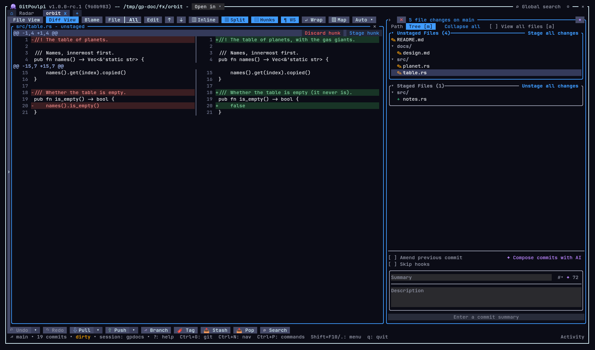
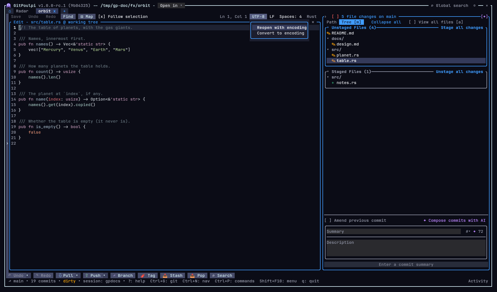

[English](../staging-and-committing.md) · [Čeština](../cs/staging-and-committing.md) · **Deutsch** · [Español](../es/staging-and-committing.md) · [Français](../fr/staging-and-committing.md) · [Italiano](../it/staging-and-committing.md) · [日本語](../ja/staging-and-committing.md) · [한국어](../ko/staging-and-committing.md) · [Nederlands](../nl/staging-and-committing.md) · [Polski](../pl/staging-and-committing.md) · [Português (Brasil)](../pt-BR/staging-and-committing.md) · [Português (Portugal)](../pt-PT/staging-and-committing.md) · [Русский](../ru/staging-and-committing.md) · [Svenska](../sv/staging-and-committing.md) · [Türkçe](../tr/staging-and-committing.md) · [Українська](../uk/staging-and-committing.md) · [简体中文](../zh-CN/staging-and-committing.md)

# Staging und Committen

Wie Sie sehen, was Sie geändert haben, genau auswählen, was in einen Commit kommt,
den Commit schreiben und Dateien genauer ansehen (Blame, Verlauf, der eingebaute
Editor). Begriffe wie *WIP-Zeile* und *Hunk* werden im
[Rundgang durch die Oberfläche](interface-tour.md) erklärt.

## Die Änderungen

Nicht committete Arbeit ist die **erste Zeile des Logs** (gestrichelter Kreis,
`// WIP`, mit Zählern `✎ n` geändert und `+ n` hinzugefügt). Wählen Sie sie aus, und
der rechte Bereich zeigt die Änderungen:


- **Unstaged Dateien**: bearbeitete, hinzugefügte (nicht verfolgte) und gelöschte
  Dateien, die noch nicht im nächsten Commit sind.
- **Staged Dateien**: was der nächste Commit enthalten wird.
- **Umbenannte oder verschobene Dateien** sind eine Zeile, `neu <- alt`, in beiden Listen (eine
  auf dem Datenträger gelöschte Datei und eine neue mit mindestens 50 % gleichem Inhalt zählen
  schon als Verschiebung, bevor Sie sie stagen). Stagen, Unstagen und Verwerfen wirken auf beide
  Namen: Stagen stagt das Löschen und die neue Datei, sodass Git eine Umbenennung sieht.
  Die Zeile zu öffnen zeigt den Inhalts-Diff gegen den alten Namen, überschrieben mit
  `alt -> neu (N% ähnlich)`; eine Verschiebung ohne Änderungen sagt **Keine Inhaltsänderung**.
  Dasselbe gilt für die Dateien eines Commits, und `gitpoulpi status` / `gitpoulpi diff`
  melden `renamed_from`.
- **Pfad** oder **Baum** (`m`) listet Dateien flach oder in Ordnern. **Alle
  einklappen** (`z`) faltet die Ordner. **Alle Dateien ansehen** (`a`) zeigt den
  ganzen Baum statt nur der geänderten Dateien. Rechtsklick auf den leeren Teil der Liste bietet
  **Alle aufklappen** / **Alle zuklappen**, eine Ordnerzeile **Alle Unterordner aufklappen** /
  **Alle Unterordner zuklappen**; Tasten `=`, `-`, `*`, `_` (siehe
  [Maus und Gesten](mouse-and-gestures.md)).
- Der Titel sagt, wie viele Dateien auf welchem Branch geändert wurden.

### Stagen, unstagen, verwerfen

| Um | Tun Sie |
|---|---|
| Eine Datei zu stagen | Über die Zeile fahren und **Datei stagen** klicken, oder sie auswählen und `Ctrl+Space` drücken, oder `Ctrl+G s` |
| Einen Ordner zu stagen | **Ordner stagen** in der Ordnerzeile |
| Alles zu stagen | **Alle Änderungen stagen** im Abschnittstitel, oder `Ctrl+G a` |
| Zu unstagen | Dieselben Schaltflächen und Tasten im Abschnitt Staged (`Ctrl+G u`) |
| Die Änderungen einer Datei zu verwerfen | Rechtsklick auf die Datei > **Änderungen verwerfen** (fragt vorher; `Ctrl+Z` bringt die Änderungen zurück) |

### Sensible Dateien

Beim Stagen einer Datei, eines Ordners oder von allem wird zuerst geprüft, was es hinzufügen würde. Eine Datei, deren
Name zu `[privacy] sensitive_patterns` passt (`.env` und `.env.*` außer den Dateien `.example`, `.sample` und
`.template`, `*.pem`, `*.key`, private SSH-Schlüssel, `*.p12`, `*.pfx`, `*.jks`, `*.keystore`, `*.crt`, `*.cer`,
`*.der`, `*.kdbx`) oder deren Text ein vom Scanner erkanntes Geheimnis enthält, wird nicht gestagt. Die Frage **Sensible
Dateien** listet jede Datei mit ihrem Grund auf (ein Muster oder die Art des Geheimnisses
mit maskierter Vorschau, nie der Wert) und bietet **1. Trotzdem stagen** oder **2. Abbrechen,
nichts stagen**. Keine Antwort ist hervorgehoben, bis Sie eine Pfeiltaste oder eine Ziffer drücken,
ein versehentliches Enter beantwortet also nichts; `Esc`, das Schließen-Kreuz und ein Klick außerhalb brechen ab.
Ein in einer Datei gefundenes Geheimnis nennt seine Zeile (`config/app.env:12`). Um vor der Entscheidung nachzusehen, klicken Sie einen Fund an (oder gehen mit `Tab` / `Shift+Tab`, `Ctrl+J` /
`Ctrl+K` über sie) und drücken die Schaltfläche **In Datei anzeigen**, `S`, oder in der Palette **Sensible
Dateien: In Datei anzeigen**: Die Datei öffnet sich in der Dateiansicht, zu dieser Zeile gescrollt und sie
hervorhebend, und die Frage kommt unverändert zurück, wenn Sie die Dateiansicht schließen
(`Esc`). Nachsehen stagt nichts.
Es ist dieselbe Frage von der Tastatur, per Schaltfläche, Menü, Palette oder
Drag-and-drop, weil alle dieselbe Anfrage senden. Abbrechen stagt nichts,
nicht einmal die gewöhnlichen Dateien desselben Stagings.

Textdateien bis zu 1 MiB je Datei und 32 MiB insgesamt werden gelesen; größere Dateien und Binärdateien
werden nur nach dem Namen beurteilt. `[privacy] staging_guard = false` schaltet die Prüfung aus.
Das Stagen eines Hunks oder einzelner Zeilen wird nicht geprüft: Sie arbeiten ohnehin schon an dieser Datei.

Rechtsklick auf eine Datei öffnet ihr Menü: stagen oder unstagen, verwerfen, den
Pfad kopieren, Dateiverlauf und Blame, in Ihrem externen Editor, Diff-Tool oder
Dateimanager öffnen (eingestellt unter
[Einstellungen > Diff & Editor](settings.md#diff--editor)) und mehr.

## Dateien ignorieren und als Binär- oder Textdateien behandeln

Rechtsklick auf eine Datei > **Ignorieren**, um sie oder ihre Endung zu ignorieren, oder auf eine Ordnerzeile > **Alle Dateien im Ordner ignorieren**. GitPoulpi fragt zuerst, in welche Datei die Regel gehört: die `.gitignore` des Repositorys (Standard), die `.gitignore` jedes Ordners bis zu dem der Datei oder `.git/info/exclude` (nur dieser Klon, nie eingecheckt). Noch nicht vorhandene Dateien sind als *neu* markiert und werden beim Bestätigen angelegt. Die Zeile wird relativ zur gewählten Datei geschrieben: aus `src/a/b.txt` wird `/a/b.txt` in `src/.gitignore`. Mit den Pfeiltasten bewegen, zum Eingrenzen tippen, `Enter` schreibt, `Esc` bricht ab. `Ctrl+Z` macht das Schreiben in eine `.gitignore` rückgängig; `.git/info/exclude` liegt außerhalb des Arbeitsverzeichnisses und ist nicht rückgängig zu machen.


Rechtsklick auf eine Datei > **Als Binärdatei behandeln** (oder **Als Textdatei behandeln**, wenn git sie schon als binär diffet) schreibt eine `.gitattributes`-Regel: `binary` oder `text diff`. Wählen Sie die Datei selbst oder alle Dateien mit ihrer Endung, dann die zu schreibende `.gitattributes` mit derselben Liste wie oben (und `.git/info/attributes` nur für diesen Klon). Eine für dasselbe Muster schon geschriebene Regel wird ersetzt, nie widersprochen. Der Diff der Datei aktualisiert sich sofort, und die Statuszeile sagt, was wohin geschrieben wurde (und warnt, wenn eine andere Regel noch Vorrang hat). Eine Ordnerzeile hat **Dateien im Ordner behandeln als** > **Binär** oder **Text**. Dasselbe gibt es in der Befehlspalette (**Änderungen: Ausgewählte Datei als Binärdatei behandeln...**) und auf der Kommandozeile (`gitpoulpi treat binary|text <Pfade>`). Die Dateiansicht folgt der Regel ebenfalls: Eine als Text behandelte Datei zeigt ihre Zeilen auch dann, wenn sie ein NUL-Byte enthält, und eine Datei, die git als binär diffet, zeigt den Binärhinweis.

## Menüs, Mehrfachauswahl und Konvertierung in den Dateilisten

Die Dateilisten im rechten Bereich (Unstaged, Staged, die geänderten Dateien eines Commits und **Alle Dateien ansehen**) haben dieselben Menüs und Gesten. Klicken Sie mit der rechten Maustaste auf eine Datei, eine Ordnerzeile oder den leeren Teil einer Liste, oder drücken Sie `.` (`Shift+F10`, die Menütaste) auf der fokussierten Zeile, oder führen Sie **Dateien: Menü der Zeile oder Auswahl öffnen** in der Palette aus.

- **Eine Datei eines Commits** (und eine Datei in **Alle Dateien ansehen**): **Diff öffnen**, **Datei öffnen**, **Dateiverlauf**, **Datei-Blame**, im Editor, im Standardprogramm oder in **Öffnen mit...** öffnen, **Im Ordner anzeigen**, **Datei bearbeiten**, **Dateipfad kopieren**, **Vollständigen Dateipfad kopieren**, **Ignorieren**, **Als Binärdatei behandeln** oder **Als Textdatei behandeln**, **Konvertieren**, **Datei aus diesem Commit wiederherstellen** (fragt vorher; wie `git checkout <commit> -- <Datei>` wird die Datei auch gestaged, und `Ctrl+Z` bringt die vorherige Datei zurück) und **Datei löschen**. Eine Zeile zur Arbeitskopie ist grau, mit Begründung, wenn die Datei nicht im Arbeitsverzeichnis liegt. **Diff zum Arbeitsverzeichnis** öffnet den Diff der Version des Commits gegen die Datei auf dem Datenträger. **Patch aus Dateiänderungen erstellen** schreibt einen Patch der Änderung dieser Datei im Commit (eine Auswahl und eine Ordnerzeile haben ihn ebenfalls; in **Alle Dateien ansehen** bei den Änderungen im Arbeitsverzeichnis enthält der Patch die Änderungen der Datei im Arbeitsverzeichnis).
- **Eine Ordnerzeile**: **Ordner öffnen**, **Dateipfad kopieren**, **Alle Dateien im Ordner ignorieren**, **Dateien im Ordner behandeln als**, **Konvertieren**, **Eine Datei in diesem Ordner erstellen**.
- **Der leere Teil einer Liste**: **Datei erstellen** und **Repository-Ordner öffnen**. Die Liste Unstaged ergänzt **Alle Änderungen stagen** und **Alle Änderungen verwerfen...**, die Liste Staged **Alle Änderungen unstagen**.


### Mehrere Dateien auswählen

Die Gesten sind die des Logs. **Ctrl+Klick** fügt eine Zeile zur Auswahl hinzu oder entfernt sie. **Shift+Klick** (**Alt+Klick** in Terminals, die Shift+Klick für sich behalten) nimmt den Bereich ab dem Anker. Ein einfacher Klick beginnt neu und öffnet den Diff wie bisher. `Esc` hebt die Auswahl auf. Per Tastatur schaltet `Space` oder `Insert` die aktuelle Zeile in jeder Liste um (in Unstaged und Staged stagt `Ctrl+Space` die Auswahl oder die aktuelle Zeile) und `Shift+Up` / `Shift+Down` erweitern den Bereich. Eine Ordnerzeile wählt alle Dateien darunter aus, eingeklappt oder nicht. Gewählte Zeilen sind hervorgehoben, die Statuszeile zählt sie. `Ctrl+A` wählt alle Zeilen der fokussierten Liste aus.

Klicken Sie mit der rechten Maustaste auf eine gewählte Zeile (oder drücken Sie `.`) für das Menü der ganzen Auswahl mit dem Titel **N Dateien**: stagen oder unstagen, verwerfen, ignorieren, als Binär- oder Textdatei behandeln, konvertieren, Pfade kopieren, aus dem Commit wiederherstellen, löschen. Stagen, Unstagen und Wiederherstellen sind je eine Aktion; Verwerfen und Löschen fragen vorher und nennen die Anzahl. Ein Rechtsklick auf eine Zeile außerhalb der Auswahl beginnt die Auswahl mit dieser Zeile neu.


### Kodierung, Zeilenenden und Einrückung konvertieren

**Konvertieren** steht im Menü einer Datei, eines Ordners oder einer Auswahl. `gitpoulpi convert` tut dasselbe auf der Kommandozeile.

- **Kodierung**: UTF-8, UTF-8 BOM, UTF-16 LE und BE, Windows-1252, ISO-8859-1, ISO-8859-15, Windows-1250, Windows-1251, KOI8-R, Shift_JIS, EUC-JP, GBK, Big5, EUC-KR.
- **Zeilenenden**: LF, CRLF oder CR.
- **Einrückung**: führende Leerzeichen oder Tabs, mit der Breite eines Tabs.

Die Dateien im Arbeitsverzeichnis werden im Hintergrund mit denselben Funktionen wie die Statuszeile des Editors neu geschrieben. Eine Datei, die kein gültiges UTF-8 ist und keine Byte-Order-Mark hat, wird wie im Editor als Windows-1252 gelesen. Binärdateien, fehlende Dateien und Dateien, die die Zielkodierung nicht darstellen kann, werden übersprungen und gemeldet (*12 Dateien konvertiert, 3 übersprungen (3 binär)*), nie beschädigt; eine Datei, die nicht geschrieben werden kann, löst eine Fehlermeldung aus. Der ganze Stapel ist ein Eintrag im Rückgängig-Journal: ein `Ctrl+Z` bringt alle Dateien zurück. Eine im Editor geöffnete Datei blockiert die Konvertierung, bis sie geschlossen ist.

## Einen Diff lesen

Klicken Sie auf einen Dateinamen (oder drücken Sie `d` darauf), und sein Diff
ersetzt in der Mitte das Log. `Esc` oder `q` bringt das Log zurück.


Die Leiste darüber schaltet die Ansicht um:

- **Inline** zeigt den einheitlichen Diff; **Split** stellt Vorher und Nachher
  nebeneinander (`m` schaltet die Layouts durch).
- **Hunks** (`Shift+H`) zeigt nur die geänderten Hunks mit einer Zeile Kontext.
  Schalten Sie es ab, um die ganze Datei zu sehen.
- **WS** (`s`) blendet Änderungen aus, die sich nur im Leerraum unterscheiden.
- **Umbr.** (`w`) bricht lange Zeilen um, statt sie abzuschneiden.
- **Map** (`Shift+M`) zeigt eine Minimap der ganzen Datei neben der Bildlaufleiste.
  Klicken Sie darauf, um zu springen. Andere Vorkommen eines ausgewählten Wortes
  sind getönt und auf der Bildlaufleiste markiert.
- `n` und `p` (oder die Pfeile der Leiste) springen zwischen Hunks.
- **Auto** (die letzte Schaltfläche, `Shift+C`) ist die Codierung, in der die Datei gelesen wird. Klicken Sie darauf (oder drücken Sie
  `Shift+C`, oder führen Sie *Diff: Codierung wählen...* aus der Palette aus) und wählen Sie eine aus der Liste:
  zuerst **Automatisch erkennen**, dann UTF-8, UTF-8 BOM, UTF-16 LE und BE, Windows-1252, ISO-8859-1,
  ISO-8859-15, Windows-1250, Windows-1251, KOI8-R, Shift_JIS, EUC-JP, GBK, Big5 und EUC-KR (tippen, um die Liste zu
  durchsuchen). Die beiden Seiten der Datei werden als exakte Bytes in dieser Codierung neu gelesen, sodass eine
  Latin-1-Datei ihre Akzente zeigt und eine UTF-16-Datei (die git als binär ansieht) ihre Zeilen. Die
  Wahl wird für den Pfad dieser Datei bis zum Beenden gemerkt, in dieser Ansicht und im
  [Review](review.md). Solange eine Codierung gewählt ist, gehören die Hunks dieser Ansicht allein, sodass Stagen und
  Verwerfen aus sind (wählen Sie **Automatisch erkennen**, um wieder zu stagen). Ein langsames Lesen sagt nach einem Moment *wird als ... gelesen...* im
  Titel.



Sie können Text mit der Maus markieren (ziehen oder Doppelklick auf ein Wort) und
mit `y` oder `Ctrl+C` kopieren; kopiert wird nur der Dateitext, nie Zeilennummern
oder die Markierungen `+` und `-`.

### Einen Hunk oder eine einzelne Zeile stagen

In einem Diff des Arbeitsverzeichnisses hat jede Hunk-Kopfzeile **Hunk stagen** und
**Hunk verwerfen** (auf der Staged-Seite **Hunk unstagen**).

- `Space` stagt den Hunk unter dem Cursor.
- Um einige Zeilen zu stagen, drücken Sie `v`, um eine Auswahl zu beginnen, bewegen
  sich mit `j`/`k` und drücken `Enter`. Nur *geänderte* Zeilen zählen.
- `x` verwirft den Hunk und `Shift+X` die ausgewählten Zeilen. Beide fragen vorher,
  und `Ctrl+Z` bringt die Änderungen zurück.
- Rechtsklick (oder `.`) auf einen Hunk öffnet sein Menü: stagen, unstagen,
  verwerfen, Dateiverlauf, Blame, kopieren.

Der Diff eines Commits ist schreibgeschützt. Ein geändertes Bild wird als Bild
gezeigt; siehe [Bilder](image-view.md).

## Den Commit schreiben

Das Commit-Formular steht unten im rechten Bereich, und seine **Zusammenfassung** ist
zugleich das Feld in der Zeile der Änderungen im Log: Was Sie in einem eintippen,
erscheint im anderen.


- **Zusammenfassung** (der Zähler zeigt, wie viele von 72 Zeichen übrig sind) und
  **Beschreibung**. `Enter` in der Zusammenfassung wechselt zur Beschreibung,
  `Enter` dort fügt eine Zeile hinzu.
- **Änderungen an N Dateien committen** (die grüne Schaltfläche) oder `Ctrl+Enter`
  committet die gestagten Änderungen. Ist nichts gestagt, sagt die Schaltfläche das
  und tut nichts.
- **Vorherigen Commit ändern** (`Shift+A`) arbeitet die gestagten Änderungen und die
  neue Nachricht in den letzten Commit ein. Ein bereits gepushter Commit braucht
  dann einen Force-Push (mit Lease).
- **Hooks überspringen** (`Shift+H` oder **Commit: Hooks überspringen umschalten** in der Palette) committet
  ohne die Hooks `pre-commit` und `commit-msg` des Repositorys auszuführen. Es gilt je Commit; unter
  **Einstellungen > Repository-spezifische Einstellungen > Commit** ist es vorab angehakt. Wird gezeigt, wenn die
  Zeile Platz hat.
- `c` im Status-Bereich setzt den Cursor ins Formular. `Esc` verlässt es.
- `Ctrl+G c` und `Ctrl+G Enter` (**Git: Commit...** und **Git: Staged Änderungen jetzt
  committen** in der Palette) sind ein und derselbe Befehl, die Commit-Schaltfläche von überall.
  Mit einer Zusammenfassung im Formular und gestagten Änderungen committet er sofort, beachtet
  **Vorherigen Commit ändern** und **Hooks überspringen** und lässt den Fokus, wo er ist.
  Andernfalls committet er nichts: Er setzt den Cursor in die Zusammenfassung des Formulars
  (und zeigt den Bereich, wenn er ausgeblendet oder eingeklappt war), und die Statuszeile nennt
  die Tastenkombination, die committet (standardmäßig `Ctrl+Enter`). Ist nichts gestagt, sagt
  er das. In der Statuszeile wird nichts getippt. Solange noch eine KI-Anfrage läuft, committet
  er nichts und meldet das (`Esc` bricht die Anfrage ab). `Ctrl+Z` nimmt den Commit wie jeden
  anderen zurück.
- Je Repository können die [Einstellungen](settings.md#repository-spezifisch-commit) **nach jedem Commit pushen**, das
  Formular mit einer **Commit-Vorlage** beginnen lassen (und deren `#`-Kommentare aus der Nachricht entfernen) und einen
  Merge zum **Squash** machen: Das Formular öffnet sich dann mit der Squash-Nachricht von Git.
- Ist eine Hosting-Integration verknüpft, fügt `Alt+R` im Formular eine
  Issue-Referenz ein; siehe [Hosting und Issue-Tracker](hosting-integration.md).

Ist die [KI](ai.md) an, schreibt die Schaltfläche **`✦`** rechts von der
Zusammenfassung eine Nachricht aus den gestagten Änderungen (`Ctrl+G i`), und
**Commits mit KI zusammenstellen** verteilt Ihre Arbeit auf mehrere Commits, siehe
unten. Der Text landet im Formular, damit Sie ihn bearbeiten; nichts wird committet,
bis Sie die Commit-Schaltfläche drücken.

**Commits mit KI zusammenstellen** sitzt am rechten Ende der Zeile mit **Vorherigen Commit ändern** und schrumpft mit
dem rechten Bereich, statt zu verschwinden: die volle Beschriftung, dann **Mit KI zusammenstellen**,
dann nur das **`✦`**. Es behält seinen Klick, seinen Tooltip und seine
Taste (`Ctrl+G Shift+C`) bei jeder Breite; die Beschriftungen von **Vorherigen Commit ändern** und **Hooks überspringen** weichen
ihm, nie umgekehrt.

## Der Commit-Composer: Änderungen auf Commits verteilen

*(Braucht eingeschaltete KI: siehe [KI-Unterstützung](ai.md).)* Drücken Sie **Commits
mit KI zusammenstellen** (oder `Ctrl+G C`, oder Rechtsklick auf die Zeile der
Änderungen). Das Modell schlägt mehrere Commits vor, jeden mit seinen Dateien; jede
geänderte Datei steckt in genau einem Commit, und ein ungültiger Plan wird einmal an
das Modell zurückgeschickt. Der Vorschlag öffnet sich als Prüfansicht, in der noch
nichts committet ist:


| Um | Tun Sie |
|---|---|
| Einen Commit auf- oder zuzuklappen | `Left` / `Right` oder auf den Winkel klicken; `*` schaltet alle um |
| Einen Commit nach oben oder unten zu schieben | Die `▲` `▼` in seiner Zeile, oder `Alt+Up` / `Alt+Down` (`K` / `J`) |
| Eine Datei in einen anderen Commit zu verschieben | Auf den Commit ziehen (aus der Liste oder aus der Liste der Änderungen rechts); oder `m` auf der Datei und den Commit aus der Dropdownliste wählen; oder `Alt+Up` / `Alt+Down` auf der Datei |
| Eine Datei in einen eigenen Commit zu legen | `n` auf der Datei oder die Schaltfläche `+ eigener Commit` |
| Einen Commit umzuformulieren | Der Stift, `e`, `Enter` oder ein Doppelklick: Nachricht bearbeiten, `Enter` behält sie, `Esc` verwirft |
| Einen Commit wegzulassen | `Drop` (`d` oder `Delete`); seine Dateien bleiben nicht committet. `wiederherst.` holt ihn zurück |
| Neu zu beginnen | **Zurücksetzen** (`r`) kehrt zum Plan des Modells zurück |
| Sie zu erstellen | **N Commits erstellen** (`Ctrl+S`, `Ctrl+Enter` oder `a`) |
| Zu verlassen | **Abbrechen** oder `Esc`: nichts geschieht |

Das Erstellen der Commits unstagt alles, stagt dann für jeden Commit seine Dateien
und committet, sodass Ihr Arbeitsverzeichnis nie angetastet wird. Schlägt ein Schritt
fehl, hält es an und sagt, wie viele Commits erstellt wurden. Es werden ganze Dateien
gestagt: Eine Datei, die nur teilweise gestagt war, wird ganz committet. Welches Profil
und welche Anweisungen der Composer nutzt, wählen Sie unter *Einstellungen > KI*;
siehe [KI-Unterstützung](ai.md#der-commit-composer).

## Dateiansicht, Blame und Dateiverlauf

Die Ansichtsleiste hat **Dateiansicht** (der Inhalt der Datei), **Diff**, **Blame** und die
Auswahl `Datei │ Alle` der [Commit-Spalte](interface-tour.md#die-commit-spalte) (ihre Liste
`Datei` ist der Dateiverlauf); dieselben stehen im Rechtsklick-Menü einer Datei.
Sie zeigen die Datei so, wie sie bei dem Commit war, von dem Sie kamen, oder als nicht
committet (`@ WIP`), wenn Sie sie aus den Änderungen geöffnet haben.

- **Blame** und der **Dateiverlauf** sind eigene vollständige Ansichten: siehe [Blame](log-and-history.md#blame) und [Dateiverlauf](log-and-history.md#dateiverlauf) unter *Mit dem Log arbeiten*. `Enter` auf einem Blame-Hunk oder einer Verlaufszeile springt zu diesem Commit im Log.
- `y` oder `Ctrl+C` kopiert den ausgewählten Text (in Blame nur den Code).
- `Shift+G` springt zur letzten Zeile. `q` schließt die Ansicht.

## Der eingebaute Editor

**Bearbeiten** (`e`) öffnet die *Arbeitsverzeichnis-Kopie* der Datei in einem kleinen
Editor über dem mittleren Bereich: Syntaxfarben, Zeilennummern, Rückgängig und
Wiederholen, Suchen und eine Statuszeile (Position, Zeilenende, Einrückung, Sprache).
Er bearbeitet immer die Arbeitskopie, auch wenn Sie ihn aus dem Diff eines alten
Commits geöffnet haben.


| Taste | Aktion |
|---|---|
| `Ctrl+S` | Speichern (die Datei wird in eine temporäre Datei geschrieben und umbenannt, ist also nie halb geschrieben; Zeilenenden, BOM und der abschließende Zeilenumbruch bleiben erhalten) |
| `Ctrl+Z`, `Ctrl+Y` | Rückgängig, Wiederholen |
| `Ctrl+F`, `F3` | Suchen, Weitersuchen |
| `Tab`, `Shift+Tab` | Einrücken, Ausrücken (nach dem eigenen Stil der Datei) |
| `Ctrl+A`, `Ctrl+C`, `Ctrl+X`, `Ctrl+V` | Alles markieren, kopieren, ausschneiden, einfügen |
| `Esc` | Schließen. Bei ungespeicherten Änderungen fragt es **Speichern** (`s`), **Verwerfen** (`d`) oder **Abbrechen** (`c`) |

Binärdateien werden abgelehnt.
Tabulatorbreite, Zeilenenden, Syntaxhervorhebung, Zeilennummern und Zeilenumbruch
stehen unter *Einstellungen > Diff & Editor*; siehe
[Einstellungen](settings.md#diff--editor).

Ist **Auswahl folgen** angehakt (das Kästchen in der Leiste des Editors, auch *Editor: Auswahl folgen umschalten* in der Palette und unter *Einstellungen > Diff & Editor*), öffnet die Auswahl einer anderen Datei im rechten Bereich, solange der Editor offen ist, die Arbeitskopie dieser Datei im Editor statt ihres Diffs oder ihrer Dateiansicht. Bei ungespeicherten Änderungen fragt er zuerst **Speichern**, **Verwerfen** oder **Abbrechen**; Abbrechen lässt Sie bei der aktuellen Datei. Eine Datei, die sich nicht bearbeiten lässt (binär, zu groß, gelöscht), öffnet sich in ihrer gewohnten Ansicht, und die Statuszeile nennt den Grund. Beim Schließen des Editors landen Sie in der Ansicht der ausgewählten Datei. Standardmäßig angehakt. Das gilt für die Änderungen der Arbeitskopie: Wählen Sie im Editor eine Datei eines Commits, verlassen Sie den Editor (nach der Frage, ob gespeichert werden soll) und sehen den Diff dieser Datei in dem Commit; die Commit-Spalte, die der Editor nicht hat, kehrt damit zurück.

Die Statuszeile zeigt rechts die **Kodierung**, die **Zeilenenden** und die
**Einrückung** der Datei, dann die Cursorposition und die Syntax. Die ersten drei sind
Schaltflächen: Jede öffnet ein Dropdown (Pfeiltasten oder Mausrad, zum Filtern
tippen, `Enter` zum Wählen, `Esc` zum Schließen). Die Palette (`Ctrl+P`) öffnet
dieselben Menüs: *Editor: Kodierung ändern*, *Editor: Mit Kodierung erneut öffnen*, *Editor: In Kodierung umwandeln*, *Editor: Zeilenumbrüche umwandeln*, *Editor: Einrückung ändern*.




- **Kodierung.** Eine Datei wird in der Kodierung geöffnet, die sie ankündigt (ein
  BOM: UTF-8 oder UTF-16), sonst als UTF-8, sonst als Windows-1252; die Leiste sagt,
  welche es ist. **Mit Kodierung erneut öffnen** liest die Bytes der Datei noch einmal
  mit einer anderen Kodierung (bei ungespeicherten Änderungen wird vorher gefragt):
  nützlich, wenn die Erkennung danebenlag. **In Kodierung umwandeln** behält den Text
  und ändert die Kodierung, in der die Datei gespeichert wird (UTF-8, UTF-8 BOM,
  UTF-16 LE und BE, Windows-1252, ISO-8859-1 und -15, Windows-1250, Windows-1251,
  KOI8-R, Shift_JIS, EUC-JP, GBK, Big5, EUC-KR). Geschrieben wird erst beim Speichern,
  und Rückgängig nimmt es zurück. Enthält der Text Zeichen, die das Ziel nicht
  darstellen kann, nennt die Statuszeile ihre Anzahl und die Position des ersten, und
  nichts wird umgewandelt; auch das Speichern lehnt so ab, es schreibt nie `?`.
- **Zeilenenden.** Zeigt `LF`, `CRLF`, `CR` oder `Gemischt`, wenn die Datei mehrere
  verwendet. Das Menü wandelt alle Zeilenumbrüche der Datei in einem Rückgängig-Schritt
  in LF, CRLF oder CR um. Neu getippte Zeilen verwenden das Zeilenende der Datei. Ihre
  Wahl hat Vorrang vor der Einstellung *Zeilenenden*.
- **Einrückung.** Zeigt `Leerzeichen: 4` oder `Tabs: 4`. Das Menü legt fest, was `Tab` und
  die automatische Einrückung einfügen (Leerzeichen oder Tabs), die Größe (1 bis 8:
  Einrückungsschritt und Breite eines Tabs in dieser Datei) und wandelt den führenden
  Leerraum jeder Zeile in Leerzeichen oder Tabs um, in einem Rückgängig-Schritt.

## Stash, Patches und Git LFS

- **Stash** und **Pop** stehen in der Symbolleiste; siehe
  [Mit dem Log arbeiten](log-and-history.md#branches-tags-und-die-refs-seitenleiste).
- **Patch erstellen** und **Patch anwenden** stehen in den Menüs von Commit und Ref;
  die CLI hat `gitpoulpi patch`.
- Große, mit Git LFS gespeicherte Dateien erscheinen als kleine Zeigerdateien, bis Sie
  ihren Inhalt pullen; siehe [Git LFS](lfs.md).

## Von der Kommandozeile

Alles auf dieser Seite lässt sich skripten:

```
gitpoulpi --json status
gitpoulpi stage --file src/lib.rs
gitpoulpi stage --all --allow-sensitive   # after the refusal below
gitpoulpi --json diff
gitpoulpi commit -m "feat: add the helper"
gitpoulpi discard --file src/lib.rs --hunk 1
```

`gitpoulpi stage` lehnt eine sensible Datei genauso ab: Nichts wird gestagt, der Exit-Code
ist 2, und `--json` gibt `{error: "sensitive_files", files: [{path, reason}]}` aus
(eine Regel und eine maskierte Vorschau, nie ein Wert). `--allow-sensitive` ist der erneute Versuch. Ein
MCP-Agent wird mit derselben Antwort abgewiesen und kann `allow_sensitive` nur übergeben, wenn
`[mcp] allow_sensitive_staging = true` gilt: Ihm wird gesagt, er solle Sie fragen.

Siehe die [CLI-Referenz](cli-reference.md).
