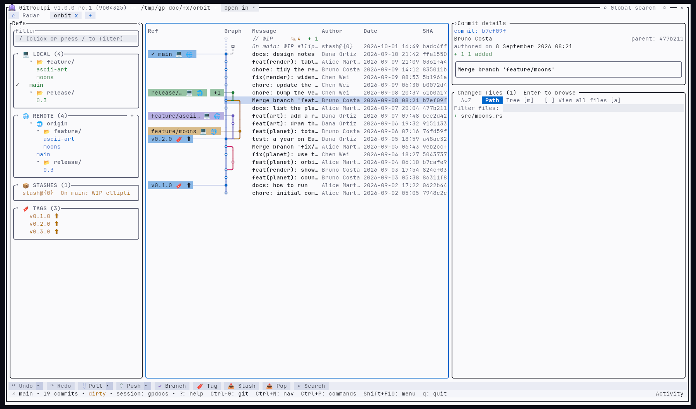
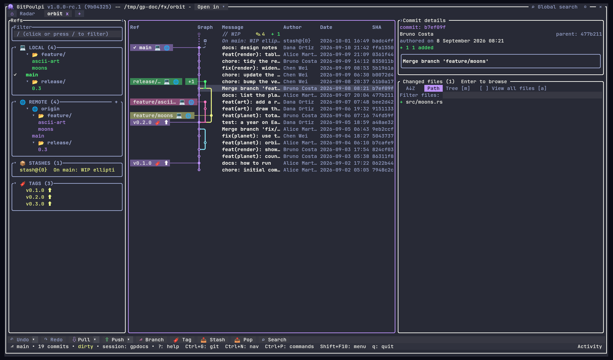
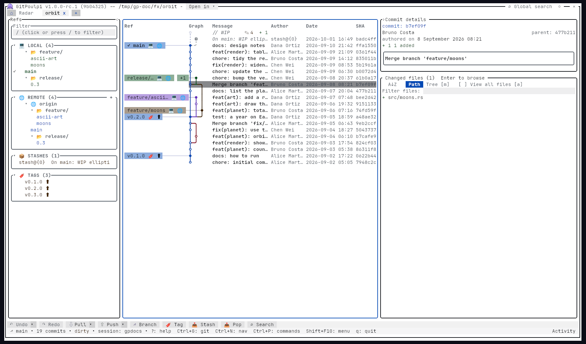
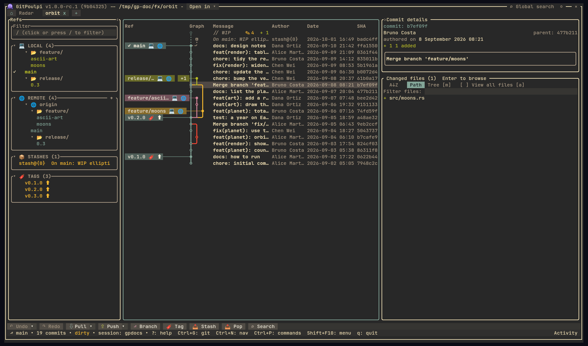
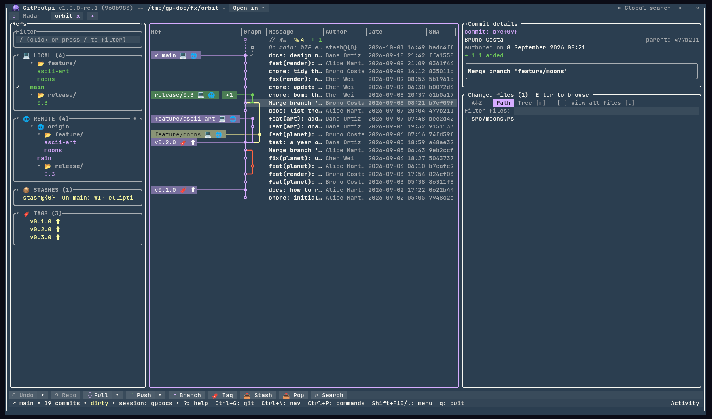
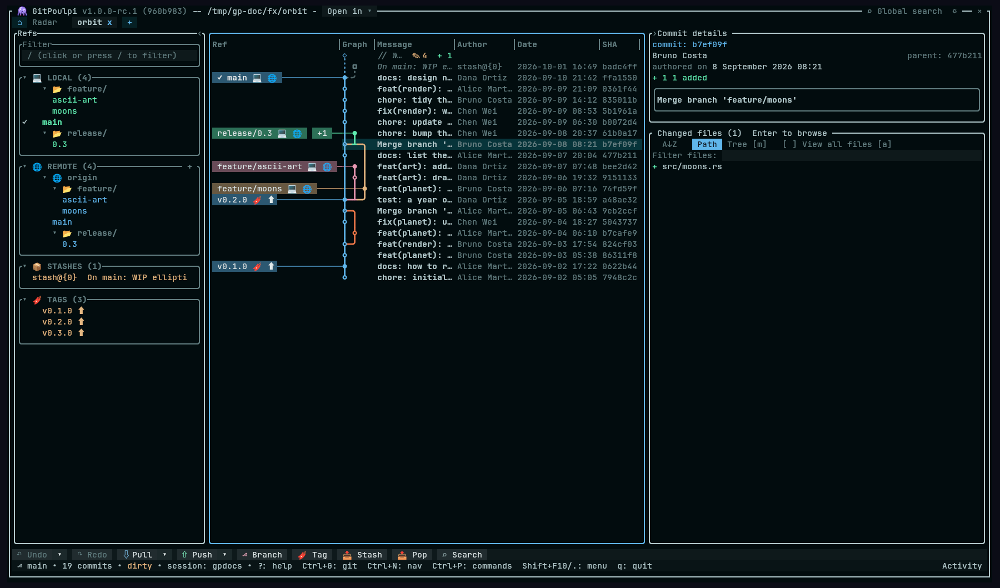
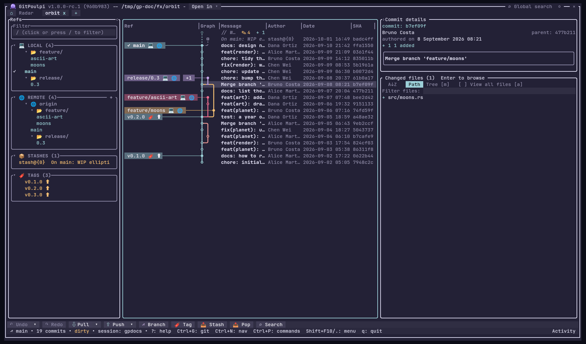
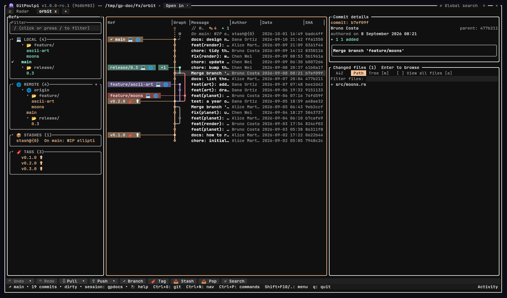

[English](../themes.md) · [Čeština](../cs/themes.md) · **Deutsch** · [Español](../es/themes.md) · [Français](../fr/themes.md) · [Italiano](../it/themes.md) · [日本語](../ja/themes.md) · [한국어](../ko/themes.md) · [Nederlands](../nl/themes.md) · [Polski](../pl/themes.md) · [Português (Brasil)](../pt-BR/themes.md) · [Português (Portugal)](../pt-PT/themes.md) · [Русский](../ru/themes.md) · [Svenska](../sv/themes.md) · [Türkçe](../tr/themes.md) · [Українська](../uk/themes.md) · [简体中文](../zh-CN/themes.md)

# Designs

Ein Design legt jede Farbe fest, die GitPoulpi malt: Text, Bereiche, Auswahl,
Schaltflächen, die Ansichten für Diff und Merge, den Editor, die Symbole der
Symbolleiste und die Spurfarben des Log-Graphen. Wechseln Sie das Design unter
**Einstellungen > Darstellung > Design** oder mit `gitpoulpi config set ui.theme <slug>`. Wie jedes aussieht, zeigt die [Galerie](#galerie).

## Eingebaute Voreinstellungen

`gitpoulpi theme list` gibt die Voreinstellungen Ihres Builds aus, in der Reihenfolge, in
der die Auswahl der Einstellungen sie zeigt: **GitPoulpi Dark** (`dark`, über den eigenen
Hintergrund Ihres Terminals gemalt) und **GitPoulpi Light** (`light`) zuerst, dann jede
andere Voreinstellung alphabetisch nach Bezeichnung. `ui.theme = "system"` (der Standard)
folgt Ihrem Terminal: Light bei hellem Terminal-Hintergrund, sonst Dark (siehe
„Systemerkennung“ unten); das ältere `default` ist dasselbe wie `system`. Die Auswahl der
Spurpaletten nutzt dieselbe Reihenfolge.

| Slug | Bezeichnung | Quelle der Farben |
|---|---|---|
| `system` (Standard) | System | keine Palette: GitPoulpi Light auf hellem Terminal-Hintergrund, sonst GitPoulpi Dark |
| `dark` | GitPoulpi Dark | ursprüngliches GitPoulpi-Design, über den eigenen Hintergrund Ihres Terminals gemalt |
| `light` | GitPoulpi Light | ursprüngliches GitPoulpi-Design |
| `catppuccin-latte` / `catppuccin-frappe` / `catppuccin-macchiato` / `catppuccin-mocha` | Catppuccin Latte / Frappé / Macchiato / Mocha | [github.com/catppuccin/palette](https://github.com/catppuccin/palette) |
| `cyberpunk` | Cyberpunk | [iTerm2-Color-Schemes](https://github.com/mbadolato/iTerm2-Color-Schemes) „Cyberpunk“ |
| `dracula` | Dracula | [draculatheme.com/contribute](https://draculatheme.com/contribute) |
| `everforest-dark` | Everforest Dark | [github.com/sainnhe/everforest/blob/master/palette.md](https://github.com/sainnhe/everforest/blob/master/palette.md) |
| `fire` / `fire-light` | Fire / Fire Light | ursprüngliche GitPoulpi-Designs: Fire ist Glut auf einem brandorangen Hintergrund mit Flammenorange; Fire Light ist sein helles Gegenstück auf einem echten orangefarbenen Hintergrund |
| `github-dark` / `github-light` | GitHub Dark / GitHub Light | die Primer-Designs von GitHub, [github.com/primer/github-vscode-theme](https://github.com/primer/github-vscode-theme) mit @primer/primitives (`canvas.default`, `canvas.inset` als Seitenleiste, `fg.*`, `accent.fg`); kein Wert angepasst |
| `gruvbox-dark` / `gruvbox-light` | Gruvbox Dark / Light | [github.com/morhetz/gruvbox#palette](https://github.com/morhetz/gruvbox#palette) |
| `kanagawa` / `kanagawa-lotus` | Kanagawa (wave) / Kanagawa Lotus | [github.com/rebelot/kanagawa.nvim](https://github.com/rebelot/kanagawa.nvim) |
| `matrix` | Matrix | [iTerm2-Color-Schemes](https://github.com/mbadolato/iTerm2-Color-Schemes) „Matrix“ (kein Rot im Schema: `danger` ist `#ff5555`) |
| `monokai` | Monokai | die ursprüngliche Monokai-Palette ([monokai.nl](https://monokai.nl/)) |
| `nord` | Nord | [www.nordtheme.com](https://www.nordtheme.com) |
| `one-dark` / `one-light` | One Dark / One Light | Atom One Dark / One Light ([One Dark](https://github.com/atom/one-dark-syntax), [One Light](https://github.com/atom/one-light-syntax)) |
| `rose-pine` / `rose-pine-moon` / `rose-pine-dawn` | Rosé Pine / Moon / Dawn | [rosepinetheme.com/palette](https://rosepinetheme.com/palette/) |
| `solarized-dark` / `solarized-light` | Solarized Dark / Light | Solarized von Ethan Schoonover ([ethanschoonover.com/solarized](https://ethanschoonover.com/solarized/)) |
| `sunset` | Sunset | ursprüngliches GitPoulpi-Design: indigoblaue Dämmerung mit Koralle und Gold |
| `terminal` | Terminal (16 Farben) | nutzt nur die eigenen 16 Farben Ihres Terminals |
| `tokyo-night` / `tokyo-night-day` | Tokyo Night (night) / Tokyo Night Day | [github.com/folke/tokyonight.nvim](https://github.com/folke/tokyonight.nvim) (der Vordergrund von Day ist abgedunkelt, um die Kontrastregeln zu bestehen) |
| `vesper` | Vesper | [github.com/raunofreiberg/vesper](https://github.com/raunofreiberg/vesper) (kein Blau und kein Lila in der Palette: Der Akzent ist Pfirsich) |
| `vscode-dark` / `vscode-light` | VS Code Dark / VS Code Light | die Standard-Designs Dark Modern / Light Modern von VS Code, [github.com/microsoft/vscode/tree/main/extensions/theme-defaults/themes](https://github.com/microsoft/vscode/tree/main/extensions/theme-defaults/themes) (`dark_modern.json`, `light_modern.json`, dazu die Farbstandards von VS Code für die Listenauswahl und die ANSI-/Diagramm-Akzente; das gedämpfte Grau von Light ist `616161`) |

### Importiert von terminalcolors.com

Importiert aus den Terminal-Paletten von terminalcolors.com; jedes Schema gehört seinen Autoren. 90 Voreinstellungen werden aus Hintergrund, Vordergrund, Auswahl und den 16 ANSI-Farben der Palette gebaut (Akzent = Blau, success = Grün, warning = Gelb, danger = Rot, AI = Magenta, muted = helles Schwarz), durch eine für alle gemeinsame Ableitung; eine Farbe, die die Kontrastregeln von GitPoulpi nicht besteht, wird aufgehellt oder abgedunkelt, bis sie sie besteht. Die Tabelle wird von `scripts/gen-terminalcolors.py` nach `crates/gitpoulpi-config/src/theme/terminalcolors_data.rs` erzeugt. Slugs sind `<Familie>-<Variante>` (`default` entfällt); die Bezeichnungen stehen in der Auswahl wie die anderen alphabetisch.

| Familie | Slugs |
|---|---|
| [Apprentice](https://terminalcolors.com/themes/apprentice/) | `apprentice` |
| [Ayu](https://terminalcolors.com/themes/ayu/) | `ayu-dark`, `ayu-light`, `ayu-mirage` |
| [Cobalt2](https://terminalcolors.com/themes/cobalt2/) | `cobalt2` |
| [Deus](https://terminalcolors.com/themes/deus/) | `deus` |
| [Dracula](https://terminalcolors.com/themes/dracula/) | `dracula-soft` |
| [Everforest](https://terminalcolors.com/themes/everforest/) | `everforest-light` |
| [GitHub](https://terminalcolors.com/themes/github/) | `github-dark-colorblind`, `github-dark-dimmed`, `github-dark-high-contrast`, `github-dark-legacy`, `github-light-colorblind`, `github-light-high-contrast`, `github-light-legacy` |
| [Gotham](https://terminalcolors.com/themes/gotham/) | `gotham` |
| [Gruvbox](https://terminalcolors.com/themes/gruvbox/) | `gruvbox-dark-hard-contrast`, `gruvbox-dark-soft-contrast`, `gruvbox-light-hard-contrast`, `gruvbox-light-soft-contrast` |
| [Iceberg](https://terminalcolors.com/themes/iceberg/) | `iceberg-dark`, `iceberg-light` |
| [Jellybeans](https://terminalcolors.com/themes/jellybeans/) | `jellybeans` |
| [Kanagawa](https://terminalcolors.com/themes/kanagawa/) | `kanagawa-dragon` |
| [Lucario](https://terminalcolors.com/themes/lucario/) | `lucario` |
| [Miasma](https://terminalcolors.com/themes/miasma/) | `miasma` |
| [Moonfly](https://terminalcolors.com/themes/moonfly/) | `moonfly` |
| [Night](https://terminalcolors.com/themes/night-owl/) | `night-owl-dark`, `night-owl-light` |
| [Nightfly](https://terminalcolors.com/themes/nightfly/) | `nightfly` |
| [Nightfox](https://terminalcolors.com/themes/nightfox/) | `nightfox`, `nightfox-carbonfox`, `nightfox-dawnfox`, `nightfox-dayfox`, `nightfox-duskfox`, `nightfox-nordfox`, `nightfox-terafox` |
| [Noctis](https://terminalcolors.com/themes/noctis/) | `noctis`, `noctis-azureus`, `noctis-bordo`, `noctis-hibernus`, `noctis-lilac`, `noctis-lux`, `noctis-minimus`, `noctis-obscuro`, `noctis-sereno`, `noctis-uva`, `noctis-viola` |
| [Nordic](https://terminalcolors.com/themes/nordic/) | `nordic` |
| [One](https://terminalcolors.com/themes/one-half/) | `one-half-dark`, `one-half-light` |
| [Panda](https://terminalcolors.com/themes/panda/) | `panda` |
| [Posterpole](https://terminalcolors.com/themes/posterpole/) | `posterpole`, `posterpole-gray` |
| [Seoul256](https://terminalcolors.com/themes/seoul256/) | `seoul256-dark`, `seoul256-light` |
| [Shades](https://terminalcolors.com/themes/shades-of-purple/) | `shades-of-purple`, `shades-of-purple-super-dark` |
| [Sonokai](https://terminalcolors.com/themes/sonokai/) | `sonokai`, `sonokai-andromeda`, `sonokai-atlantis`, `sonokai-espresso`, `sonokai-maia`, `sonokai-shusia` |
| [Srcery](https://terminalcolors.com/themes/srcery/) | `srcery` |
| [Tender](https://terminalcolors.com/themes/tender/) | `tender` |
| [Tokyo](https://terminalcolors.com/themes/tokyo-night/) | `tokyo-night-moon`, `tokyo-night-storm` |
| [Tomorrow](https://terminalcolors.com/themes/tomorrow/) | `tomorrow`, `tomorrow-night`, `tomorrow-night-blue`, `tomorrow-night-bright`, `tomorrow-night-eighties` |
| [Zenbones](https://terminalcolors.com/themes/zenbones/) | `zenbones-duckbones`, `zenbones-forestbones-dark`, `zenbones-forestbones-light`, `zenbones-kanagawabones`, `zenbones-neobones-dark`, `zenbones-neobones-light`, `zenbones-nordbones`, `zenbones-rosebones-dark`, `zenbones-rosebones-light`, `zenbones-seoulbones-dark`, `zenbones-seoulbones-light`, `zenbones-tokyobones-dark`, `zenbones-tokyobones-light`, `zenbones-vimbones`, `zenbones-zenburned`, `zenbones-zenwritten-dark`, `zenbones-zenwritten-light` |

`ui.side_bg` ist der Hintergrund des Refs-Bereichs und des rechten Bereichs
(Commit-Details, Änderungen, Dateilisten), so wie GitHub und VS Code ihre
Seitenleisten malen. Catppuccin (sein `mantle`), GitHub und
VS Code setzen es; bei jeder anderen Voreinstellung ist es `default`, also dasselbe wie
`ui.bg`. Eine Design-Datei kann `side_bg` unter `[ui]` setzen (`gitpoulpi theme export`
gibt es aus).

Drei weitere Rollen unter `[ui]` färben den Rahmen, wie es GitHub und VS Code tun:

| Rolle | Wo sie malt |
|---|---|
| `ui.toolbar_bg` | Die Zeile der Symbolleiste und den **ausgewählten Repository-Tab**, damit der Tab wie an die Symbolleiste angefügt wirkt. Die Chips der Schaltflächen der Symbolleiste behalten ihr eigenes `chrome.toolbar_bg`. |
| `ui.statusbar_bg` | Die Statuszeile (unten, sofern `ui.statusbar_position` sie nicht nach oben setzt). |
| `ui.statusbar_fg` | Der Text der Statuszeile. Text, der auf dieser Fläche nicht lesbar wäre, wird damit neu gemalt; Warn- und Fehlertext, der lesbar ist, behält seine Farbe. |

Die Voreinstellungen setzen sie passend zu ihrer Anwendung: VS Code Dark und Light die blaue
(`#007acc`) Statuszeile mit weißem Text und die Titelleisten-Grautöne von VS Code für die
Symbolleiste; GitHub seine Kopfzeilentöne. Jede andere Voreinstellung (einschließlich der
importierten Terminal-Paletten) leitet eine Symbolleiste eine Stufe neben `bg` und eine
Statuszeile etwas daneben ab, mit `text` darauf, und die Kontrastregeln halten den Text
lesbar. `dark` (GitPoulpi Dark) und `terminal` nutzen den eigenen Hintergrund des Terminals,
daher sind alle drei dort `default`: Es wird nichts gemalt, und der ausgewählte Tab behält
die Auswahlfarbe. Eine Design-Datei, die sie weglässt, erbt die Werte ihrer Basis;
`default` bedeutet keine Tönung (die Statuszeile folgt dann `side_bg`).

Ist das Kommentar- oder gedämpfte Grau eines Schemas zu dunkel zum Lesen, wird es
aufgehellt, bis es die Kontrastregeln von GitPoulpi besteht; Bereichs- und
Auswahlschattierungen, die dem Schema fehlen, werden aus seinem Hintergrund abgeleitet.

### Galerie

Jedes eingebaute Design, im selben Repository mit ausgewähltem Merge-Commit (`scripts/docs-screenshots.sh` nimmt sie neu auf).

| **GitPoulpi Dark** (`dark`) | **GitPoulpi Light** (`light`) | **Apprentice** (`apprentice`) |
|---|---|---|
|  |  |  |
| **Ayu Dark** (`ayu-dark`) | **Ayu Light** (`ayu-light`) | **Ayu Mirage** (`ayu-mirage`) |
|  |  |  |
| **Catppuccin Frappé** (`catppuccin-frappe`) | **Catppuccin Latte** (`catppuccin-latte`) | **Catppuccin Macchiato** (`catppuccin-macchiato`) |
|  |  |  |
| **Catppuccin Mocha** (`catppuccin-mocha`) | **Cobalt2** (`cobalt2`) | **Cyberpunk** (`cyberpunk`) |
|  |  |  |
| **Deus** (`deus`) | **Dracula** (`dracula`) | **Dracula Soft** (`dracula-soft`) |
|  |  |  |
| **Everforest Dark** (`everforest-dark`) | **Everforest Light** (`everforest-light`) | **Fire** (`fire`) |
|  |  |  |
| **Fire Light** (`fire-light`) | **GitHub Dark** (`github-dark`) | **GitHub Dark Colorblind** (`github-dark-colorblind`) |
|  |  |  |
| **GitHub Dark Dimmed** (`github-dark-dimmed`) | **GitHub Dark High Contrast** (`github-dark-high-contrast`) | **GitHub Dark Legacy** (`github-dark-legacy`) |
|  |  |  |
| **GitHub Light** (`github-light`) | **GitHub Light Colorblind** (`github-light-colorblind`) | **GitHub Light High Contrast** (`github-light-high-contrast`) |
|  |  |  |
| **GitHub Light Legacy** (`github-light-legacy`) | **Gotham** (`gotham`) | **Gruvbox Dark** (`gruvbox-dark`) |
|  |  |  |
| **Gruvbox Dark Hard Contrast** (`gruvbox-dark-hard-contrast`) | **Gruvbox Dark Soft Contrast** (`gruvbox-dark-soft-contrast`) | **Gruvbox Light** (`gruvbox-light`) |
|  |  |  |
| **Gruvbox Light Hard Contrast** (`gruvbox-light-hard-contrast`) | **Gruvbox Light Soft Contrast** (`gruvbox-light-soft-contrast`) | **Iceberg Dark** (`iceberg-dark`) |
|  |  |  |
| **Iceberg Light** (`iceberg-light`) | **Jellybeans** (`jellybeans`) | **Kanagawa** (`kanagawa`) |
|  |  |  |
| **Kanagawa Dragon** (`kanagawa-dragon`) | **Kanagawa Lotus** (`kanagawa-lotus`) | **Lucario** (`lucario`) |
|  |  |  |
| **Matrix** (`matrix`) | **Miasma** (`miasma`) | **Monokai** (`monokai`) |
|  |  |  |
| **Moonfly** (`moonfly`) | **Night Owl Dark** (`night-owl-dark`) | **Night Owl Light** (`night-owl-light`) |
|  |  |  |
| **Nightfly** (`nightfly`) | **Nightfox** (`nightfox`) | **Nightfox Carbonfox** (`nightfox-carbonfox`) |
|  |  |  |
| **Nightfox Dawnfox** (`nightfox-dawnfox`) | **Nightfox Dayfox** (`nightfox-dayfox`) | **Nightfox Duskfox** (`nightfox-duskfox`) |
|  |  |  |
| **Nightfox Nordfox** (`nightfox-nordfox`) | **Nightfox Terafox** (`nightfox-terafox`) | **Noctis** (`noctis`) |
|  |  |  |
| **Noctis Azureus** (`noctis-azureus`) | **Noctis Bordo** (`noctis-bordo`) | **Noctis Hibernus** (`noctis-hibernus`) |
|  |  |  |
| **Noctis Lilac** (`noctis-lilac`) | **Noctis Lux** (`noctis-lux`) | **Noctis Minimus** (`noctis-minimus`) |
|  |  |  |
| **Noctis Obscuro** (`noctis-obscuro`) | **Noctis Sereno** (`noctis-sereno`) | **Noctis Uva** (`noctis-uva`) |
|  |  |  |
| **Noctis Viola** (`noctis-viola`) | **Nord** (`nord`) | **Nordic** (`nordic`) |
|  |  |  |
| **One Dark** (`one-dark`) | **One Half Dark** (`one-half-dark`) | **One Half Light** (`one-half-light`) |
|  |  |  |
| **One Light** (`one-light`) | **Panda** (`panda`) | **Posterpole** (`posterpole`) |
|  |  |  |
| **Posterpole Gray** (`posterpole-gray`) | **Rosé Pine** (`rose-pine`) | **Rosé Pine Dawn** (`rose-pine-dawn`) |
|  |  |  |
| **Rosé Pine Moon** (`rose-pine-moon`) | **Seoul256 Dark** (`seoul256-dark`) | **Seoul256 Light** (`seoul256-light`) |
|  |  |  |
| **Shades of Purple** (`shades-of-purple`) | **Shades of Purple Super Dark** (`shades-of-purple-super-dark`) | **Solarized Dark** (`solarized-dark`) |
|  |  |  |
| **Solarized Light** (`solarized-light`) | **Sonokai** (`sonokai`) | **Sonokai Andromeda** (`sonokai-andromeda`) |
|  |  |  |
| **Sonokai Atlantis** (`sonokai-atlantis`) | **Sonokai Espresso** (`sonokai-espresso`) | **Sonokai Maia** (`sonokai-maia`) |
|  |  |  |
| **Sonokai Shusia** (`sonokai-shusia`) | **Srcery** (`srcery`) | **Sunset** (`sunset`) |
|  |  |  |
| **Tender** (`tender`) | **Terminal (16 colors)** (`terminal`) | **Tokyo Night** (`tokyo-night`) |
|  |  |  |
| **Tokyo Night Day** (`tokyo-night-day`) | **Tokyo Night Moon** (`tokyo-night-moon`) | **Tokyo Night Storm** (`tokyo-night-storm`) |
|  |  |  |
| **Tomorrow** (`tomorrow`) | **Tomorrow Night** (`tomorrow-night`) | **Tomorrow Night Blue** (`tomorrow-night-blue`) |
|  |  |  |
| **Tomorrow Night Bright** (`tomorrow-night-bright`) | **Tomorrow Night Eighties** (`tomorrow-night-eighties`) | **Vesper** (`vesper`) |
|  |  |  |
| **VS Code Dark** (`vscode-dark`) | **VS Code Light** (`vscode-light`) | **Zenbones Duckbones** (`zenbones-duckbones`) |
|  |  |  |
| **Zenbones Forestbones Dark** (`zenbones-forestbones-dark`) | **Zenbones Forestbones Light** (`zenbones-forestbones-light`) | **Zenbones Kanagawabones** (`zenbones-kanagawabones`) |
|  |  |  |
| **Zenbones Neobones Dark** (`zenbones-neobones-dark`) | **Zenbones Neobones Light** (`zenbones-neobones-light`) | **Zenbones Nordbones** (`zenbones-nordbones`) |
|  |  |  |
| **Zenbones Rosebones Dark** (`zenbones-rosebones-dark`) | **Zenbones Rosebones Light** (`zenbones-rosebones-light`) | **Zenbones Seoulbones Dark** (`zenbones-seoulbones-dark`) |
|  |  |  |
| **Zenbones Seoulbones Light** (`zenbones-seoulbones-light`) | **Zenbones Tokyobones Dark** (`zenbones-tokyobones-dark`) | **Zenbones Tokyobones Light** (`zenbones-tokyobones-light`) |
|  |  |  |
| **Zenbones Vimbones** (`zenbones-vimbones`) | **Zenbones Zenburned** (`zenbones-zenburned`) | **Zenbones Zenwritten Dark** (`zenbones-zenwritten-dark`) |
|  |  |  |
| **Zenbones Zenwritten Light** (`zenbones-zenwritten-light`) |
|  |

## Jedes Design mit jeder Spurpalette

Jedes Design bringt seine eigenen Spurfarben für den Log-Graphen mit, aber Sie können
jedes Design mit jeder Palette kombinieren: **Einstellungen > Darstellung > Farbschema des
Graphen** bietet **Design folgen** (der Standard) plus jede Spurpalette jedes Designs
(GitPoulpi Dark, GitPoulpi Light, dann Material, Serie, ... und das
`graph_palette` Ihrer eigenen Design-Dateien, nach den Voreinstellungen unter dem
Namen des Designs aufgelistet). Ein eigenes Design erscheint, wenn die Liste das nächste Mal
geöffnet wird (die Dateien werden dann neu gelesen), und die Wahl eines Designs speichert
seinen Dateinamen in `ui.graph_color_theme` (bei der primären Installation in `[ui]`, bei den
anderen in ihrem eigenen Eintrag `[installation.settings.<id>]`, wie das Design). Eine
Design-Datei ohne `graph_palette` hat die Spurfarben ihrer `base` (die Standardvoreinstellung,
wenn sie keine nennt), dieselbe Vererbung wie bei jeder anderen Farbe der Datei. Ein eigenes
Design mit dem Namen einer eingebauten Spurpalette (zum Beispiel `gruvbox`) ersetzt diese
Palette in der Liste. Gibt es den konfigurierten Namen nicht mehr (die Datei wurde gelöscht oder
umbenannt), verwendet der Graph die Spurfarben des aktiven Designs, und die Einstellungen zeigen
den Namen als *nicht gefunden* markiert, bis Sie einen anderen wählen. 

In der `tui.toml`:

```toml
[ui]
theme = "nord"
graph_color_theme = "material"   # or "theme" to follow the theme
```

`ui.input_color` ist dieselbe Art Überschreibung für Texteingaben: Der Standard `theme`
folgt den Eingabefarben des Designs; `gray`, `blue`, `slate`, `dark` und `custom`
erzwingen einen Hintergrund (es sind dunkle Farben, wählen Sie also bei einem hellen
Design `theme`).

## Ihre eigenen Designs

Legen Sie eine `.toml`-Datei in den Ordner `themes/` des Konfigurationsverzeichnisses
(`gitpoulpi config path` gibt dessen übergeordneten Ordner aus; der Ordner ist
`${config}/themes/`). Der Dateiname ohne `.toml` ist der Slug des Designs, den `ui.theme`
nimmt. Eine Datei darf den Slug einer Voreinstellung nicht wiederverwenden (sie wird mit
einer Warnung übersprungen).

Beginnen Sie mit einer vollständigen Datei:

```
gitpoulpi theme export nord > "$(dirname "$(gitpoulpi config path)")/themes/mine.toml"
```

Behalten Sie dann nur, was Sie ändern. Eine Datei ist eine Menge **teilweiser
Überschreibungen** auf einer `base` (eine Voreinstellung oder ein anderes Benutzerdesign;
Ketten sind höchstens 4 tief, Zyklen werden abgelehnt; keine `base` bedeutet `dark`):

```toml
name = "My Nord"            # the label in the combo; default = file name
base = "nord"
light = false               # inherited when absent
syntax = "base16-ocean.dark"
graph_palette = ["#88c0d0", "#a3be8c"]

[ui]
bg = "#2e3440"              # "default" | "#rrggbb" | "ansi:N"
accent = "#88c0d0"
toolbar_bg = "#3b4252"      # toolbar row and selected tab
statusbar_bg = "#5e81ac"    # status line
statusbar_fg = "#eceff4"

[diff]
add_bg = "#2f3b2f"
```

### Geänderte Wörter in einem Diff (`diff.add_emph_bg`, `diff.del_emph_bg`)

Die stärkeren Hintergründe, die die Diff-Ansicht auf die Wörter malt, die sich innerhalb einer
geänderten Zeile unterscheiden, über `diff.add_bg` (hinzugefügte Zeilen) und `diff.del_bg`
(entfernte Zeilen); der Text behält `diff.add_fg` und `diff.del_fg`. Jede Voreinstellung setzt
beide. Eine Design-Datei, die `diff.add_bg` oder `diff.del_bg` setzt, aber nicht die passende
Hervorhebung, bekommt eine davon abgeleitete (30 % des Weges zur Textfarbe dieser Seite), sodass
ein eigener Hintergrund nie mit der Hervorhebung des Basis-Designs endet. Ein Wert `default` (die
Voreinstellung Terminal) oder ein Terminal, dessen Farbtiefe beide Hintergründe gleich zeichnen
würde, markiert die Wörter stattdessen fett und unterstrichen. Siehe
[Geänderte Wörter in einem Diff](interface-tour.md#geänderte-wörter-in-einem-diff).

Farben sind `"#rrggbb"`, `"ansi:N"` (der Paletteneintrag N des Terminals) oder `"default"`
(die eigene Farbe des Terminals). Gruppen und Schlüssel sind die von
`gitpoulpi theme export <slug>`. Nichts ist fatal: Ein unbekannter Schlüssel oder eine
fehlerhafte Farbe wird ignoriert, eine unbekannte `base` fällt auf `dark` zurück, und
`gitpoulpi theme list` meldet jedes Problem unter `warnings` (die App zeigt sie einmal in
der Statuszeile).

Dateien werden neu gelesen, wenn die Design-Auswahl sich öffnet und wenn die Einstellungen
schließen. Ein laufendes Fenster bemerkt außerdem, wenn `tui.toml` (ein
`gitpoulpi config set ui.theme ...` aus einer Shell) oder die Datei des aktiven Designs neu
geschrieben wird, und wendet die neuen Farben innerhalb von etwa einer Sekunde ohne Neustart an.

### `ui.border_focused`

Der Rahmen des Bereichs, der den Tastaturfokus hat: das Log, die Refs-Seitenleiste, die
Bereiche Staged und Unstaged, die Commit-Details, die Bereiche für Verlauf, Review und
Rewrite, die Rahmen von Diff, Datei und Editor. Er färbt nur Rahmen; Text, Beschriftungen
und Symbole (die Beschriftung „commit :“, das Home-Symbol, die Tab-Schaltflächen) verwenden
weiterhin `ui.accent`. So kann ein Design den aktiven Bereich in einer Farbe einrahmen, die
als Text unlesbar wäre, zum Beispiel ein leuchtendes Gelb auf einem hellen Design. Setzt ein
Design ihn nicht, folgt er `ui.accent` (auch in einer Benutzerdatei: Eine Datei, die nur
`accent` ändert, bekommt diesen Akzent auch auf ihren fokussierten Rahmen), sodass jedes
mitgelieferte Design aussieht wie bisher. Dialoge und Popups behalten einen Akzentrahmen.

```toml
[ui]
accent = "#1f5fbf"
border_focused = "#ffd700"
```

## Systemerkennung

Mit `ui.theme = "system"` fragt GitPoulpi das Terminal **einmalig beim Start** nach seiner
Hintergrundfarbe (die OSC-11-Abfrage, die kitty, WezTerm, Alacritty, foot, iTerm2, Windows
Terminal, tmux und die meisten anderen beantworten) und wählt Light für einen hellen
Hintergrund, sonst Dark. Die Wartezeit beträgt höchstens etwa 100 ms, und ein Terminal, das
die Abfrage nicht kennt, kostet nichts: Die Antwort wird immer vor dem Start der Oberfläche
gelesen, sodass nichts ausgegeben und keine Taste verschluckt wird. Ohne Antwort (und unter
Windows immer, das die Abfrage nicht sendet) liest es `COLORFGBG` und fällt dann auf Dark
zurück. Ein Terminal, dessen Hintergrund sich ändert, während GitPoulpi läuft, wird nicht
verfolgt; starten Sie es neu oder wählen Sie Light oder Dark ausdrücklich.

## Farbtiefe

Designs sind Truecolor (`#rrggbb`). `ui.color_depth` (Einstellungen > Darstellung >
Farbtiefe, gilt sofort) entscheidet, wie das zum Terminal gelangt:

| Wert | Wirkung |
|---|---|
| `auto` (Standard) | Truecolor, außer wo es bekanntermaßen nicht funktioniert: Apple Terminal (`TERM_PROGRAM=Apple_Terminal`) nutzt 256 Farben, die Linux-Konsole (`TERM=linux`) 16, und ein `*-256color`-Terminal, das kein `COLORTERM` setzt (und nicht WezTerm, kitty oder Windows Terminal ist), 256. `COLORTERM=truecolor` bedeutet immer Truecolor. |
| `truecolor` | Immer 24-Bit-Farbe. |
| `256` | Jede RGB-Farbe wird der nächstgelegene xterm-256-Eintrag. |
| `16` | Die nächste der 16 ANSI-Farben; die eigene Palette des Terminals legt den genauen Farbton fest. |

Nutzen Sie `256` oder `16`, wenn ein Design über ssh oder in einem alten Multiplexer mit
falschen Farben erscheint. Die Voreinstellung Terminal braucht nichts davon. Truecolor
kostet nichts; der Umwandlungsdurchlauf geht nur einmal pro Bild über den Bildschirm und
nur, wenn er aktiv ist.

Das Design gilt pro Installation: Mehrere GitPoulpi-Installationen, die eine Konfiguration teilen, behalten jeweils ihr eigenes, sodass die Wahl eines Designs in einer Installation die anderen nie umfärbt.

## Live-Vorschau

Unter Einstellungen > Darstellung listet die Design-Auswahl **System (folgt dem Terminal)**,
die Voreinstellungen und dann Ihre eigenen Design-Dateien. Das Bewegen der Hervorhebung
wendet dieses Design sofort an, sodass sich der ganze Einstellungsbildschirm unter Ihnen neu
malt; **Enter** behält es (es wird gespeichert), **Esc** oder ein Klick daneben stellt das
vorherige wieder her und speichert nichts. Der Paletteneintrag **App: Design...**
(`Ctrl+P`) öffnet die Einstellungen auf dieser Zeile.

### Das Design über die Palette wechseln

**App: Design wechseln...** (`Ctrl+P` oder `Ctrl+N t`; die Taste lässt sich unter
`nav_prefix.change_theme` neu belegen) öffnet eine Liste derselben Designs, ohne über die
Einstellungen zu gehen: **System (folgt dem Terminal)**, die Voreinstellungen und dann Ihre
eigenen Design-Dateien, jedes mit vier kleinen Farb-Chips. Das aktuelle Design ist
abgehakt. Tippen Sie, um die Liste einzugrenzen; das Bewegen der Hervorhebung zeigt das
Design sofort in der Vorschau, **Enter** wendet es an und speichert `ui.theme` in der
`tui.toml`, **Esc** (oder ein Klick außerhalb der Liste) stellt das vorherige Design
wieder her und speichert nichts.

Unter dem Filterfeld grenzt ein segmentierter Vorfilter die Liste ein: **Alle**, **Dunkel**,
**Hell** und **Farbig**, dazu **Eigene**, wenn Sie eigene Design-Dateien haben (auf ein Segment
klicken, `Tab` / `Shift+Tab` oder `Alt+1`..`Alt+5`). Dunkel und Hell ergeben sich aus der Helligkeit des `ui.bg` des
Designs; **Farbig** behält die Designs, deren Hintergrund deutlich getönt ist (Blau,
Violett, Gelb, Grün...), und lässt weiße, gebrochen weiße, schwarze und fast schwarze Grautöne
aus, sodass Solarized Dark, Dracula oder Nord farbig sind, GitHub Dark und One Light aber
nicht. Ein farbiges Design erscheint auch unter Dunkel oder Hell. **System** und
transparente Designs (ohne eigenen Hintergrund) erscheinen nur unter Alle. **Eigene** behält nur
die Design-Dateien Ihres Ordners `themes/` (ein eigenes Design ist für diese Schaltflächen
weiterhin Dunkel, Hell oder Farbig); die Schaltfläche wird nicht gezeichnet und ist per Tasten
nicht erreichbar, solange dieser Ordner kein Design enthält. Der Vorfilter
kombiniert sich mit dem, was Sie tippen. Die Auswahllisten für Farbschema des Graphen und
Sprache zeigen ihre Vorschau genauso: Die Spuren des Logs und die ganze Oberfläche ändern
sich, während sich die Hervorhebung bewegt.


Unter der Auswahl zeigt ein Streifen von Farb-Chips das geltende Design (Hintergrund, Text,
gedämpft, Akzent, Auswahl, danger, Diff hinzugefügt, Diff entfernt, dann die ersten sechs
Spurfarben) und folgt der Vorschau. Die Auswahl **Farbschema des Graphen** unter
**Darstellung** zeigt neben jeder Palette einige Spurfarben, und Wahlen gelten beim
Schließen der Einstellungen.

Ein Design mit eigenem Hintergrund (Light und die anderen gemalten Voreinstellungen) füllt
das ganze Fenster aus, einschließlich der Einstellungen und der Ganzseitenansichten, und
gibt Text ohne eigene Farbe die Textfarbe des Designs; Dark und Terminal lassen die Farben
Ihres Terminals in Ruhe.

## Von der Kommandozeile

| Befehl | Ausgabe |
|---|---|
| `gitpoulpi theme list` | JSON `{themes: [{slug, label, source, light, lane_palette}], warnings}`; `source` ist `preset` oder `user`. |
| `gitpoulpi theme export <slug>` | Die vollständige Design-Datei als TOML auf stdout (JSON: `{slug, toml}`); sie lässt sich wieder zum selben Design einlesen. |
| `gitpoulpi config set ui.theme <slug>` | Gegen die Voreinstellungen und Ihren Ordner `themes/` geprüft; ein unbekannter Name ist ein Fehler, der die gültigen auflistet. `system` und `default` werden akzeptiert. |
| `gitpoulpi config set ui.graph_color_theme <name>` | `theme` (dem Design folgen) oder ein beliebiger Name einer Spurpalette; ein unbekannter Name listet die gültigen auf. |

Der MCP-Server bietet `theme_list` und `theme_export` als nur lesende Tools an.
