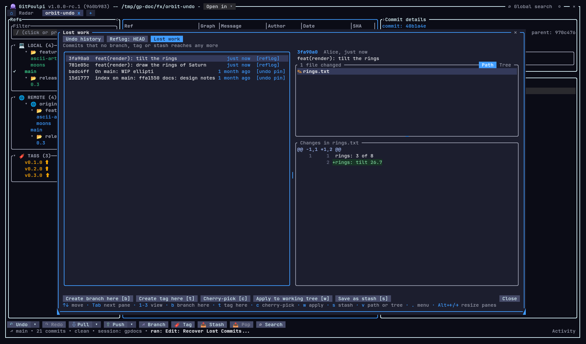

[English](../undo-redo.md) · [Čeština](../cs/undo-redo.md) · **Deutsch** · [Español](../es/undo-redo.md) · [Français](../fr/undo-redo.md) · [Italiano](../it/undo-redo.md) · [日本語](../ja/undo-redo.md) · [한국어](../ko/undo-redo.md) · [Nederlands](../nl/undo-redo.md) · [Polski](../pl/undo-redo.md) · [Português (Brasil)](../pt-BR/undo-redo.md) · [Português (Portugal)](../pt-PT/undo-redo.md) · [Русский](../ru/undo-redo.md) · [Svenska](../sv/undo-redo.md) · [Türkçe](../tr/undo-redo.md) · [Українська](../uk/undo-redo.md) · [简体中文](../zh-CN/undo-redo.md)

# Rückgängig und Wiederholen

**Sie können immer zurück.** Jede Änderung, die GitPoulpi an Ihrem Repository
vornimmt, wird aufgezeichnet (standardmäßig bis zu 100 Aktionen,
`general.undo_depth`), ebenso jede Position, die ein Branch je hatte, auch bei
Verschiebungen durch andere Programme. Haben Sie einen Fehler gemacht, bringt
eines dieser Mittel die Arbeit zurück:

| Sie möchten | Verwenden Sie |
|---|---|
| das Letzte zurücknehmen | `Ctrl+Z` (Wiederholen: `Ctrl+Y` oder `Ctrl+Shift+Z`) oder die Schaltflächen **Rückgängig** und **Wiederholen** der Symbolleiste |
| mehrere Dinge auf einmal zurücknehmen oder eines von weit früher | den **Rückgängig-Verlauf** (`Alt+Z`, der Pfeil neben Rückgängig, `Bearbeiten: Rückgängig-Verlauf...`) |
| einen Branch, Tag, Stash, eine Datei oder einen Hunk zurückholen, den Sie vor mehreren Aktionen entfernt haben, **ohne das Spätere rückgängig zu machen** | **Nur diese wiederherstellen** im Rückgängig-Verlauf |
| einen Branch dorthin zurücksetzen, wo er war, auch wenn ein anderes Programm ihn verschoben hat | das **Reflog** des Branches (Ref-Menü `Reflog...`) |
| Commits finden, die kein Branch mehr erreicht | **Verlorene Arbeit** (`Bearbeiten: Verlorene Commits wiederfinden...`) |
| zurücknehmen, was eine Shell oder ein **KI-Agent** an Branches, Tags, Stashes oder HEAD getan hat | dasselbe `Ctrl+Z`: Diese Änderungen stehen ebenfalls im Verlauf, als **außerhalb** markiert (siehe [Änderungen außerhalb von GitPoulpi](#änderungen-außerhalb-von-gitpoulpi)) |

Nach jeder Aktion, die etwas zerstört und sich rückgängig machen lässt
(Verwerfen, Datei löschen, Branch oder Tag löschen, Hard-Reset, Stash verwerfen,
Remote entfernen), sagt die Statuszeile es: „Verwerfen erledigt - Ctrl+Z zum
Rückgängigmachen“, mit der Taste, wie Sie sie belegt haben. Der Tooltip von
Rückgängig nennt, wie viele Aktionen Sie zurückgehen können.

`Ctrl+Z` nimmt das Letzte zurück, was GitPoulpi an Ihrem Repository getan hat.
`Ctrl+Y` (oder `Ctrl+Shift+Z`) stellt es wieder her. Die Symbolleiste hat die
Schaltflächen **Rückgängig** und **Wiederholen**, die Palette hat `Bearbeiten: Rückgängig`
und `Bearbeiten: Wiederholen`, und der Tooltip jeder Schaltfläche sagt, was sie
zurücknehmen würde („Commit "fix typo" (a81b9e4) rückgängig“).


Wiederholen führt den Vorgang nie erneut aus. Es stellt den aufgezeichneten
Zustand wieder her, sodass ein wiederholter Commit genau derselbe Commit ist, mit
derselben ID und demselben Zeitstempel.

`Ctrl+Z` ist wirkungslos, solange ein Textfeld die Tastatur hat (die
Commit-Nachricht, das Filterfeld, der Editor, der sein eigenes Text-Rückgängig
behält).

## Der Rückgängig-Verlauf

`Alt+Z` (umbelegbar), der Pfeil neben der Schaltfläche Rückgängig oder
`Bearbeiten: Rückgängig-Verlauf...` öffnet ein Fenster mit jeder aufgezeichneten
Aktion, die neueste zuerst: ein Symbol für die Art der Aktion (Commit, Branch,
Tag, Stash, Reset, Merge und Verwandtes, Verwerfen, Staging, Konfiguration,
Änderung von außen), was sie getan hat, in Ihrer Sprache, wie lange das her ist
und in welchem Zustand sie ist (**einzeln wiederherstellbar**, **blockiert** mit
dem Grund oder **rückgängig** und bereit zum Wiederholen). Reichen die Einträge
über mehrere Tage, beginnt jeder Tag mit einer dünnen Überschrift (Heute,
Gestern, dann das Datum). Die Kopfzeile zählt sie („12 Aktionen können
rückgängig gemacht werden (bis zu 100)“).

Die Aktionen, die Sie rückgängig gemacht haben, stehen **über** der neuesten
Aktion, unter einem Trenner („rückgängig - Wiederholen bringt sie zurück“),
abgedunkelt, wobei die, die Wiederholen als Nächste zurückbringt, dem Trenner am
nächsten steht. Die Auswahl beginnt bei der neuesten Aktion, nicht bei ihnen.
Die Pfeiltasten bewegen (Überschriften und Trenner werden übersprungen), `1` / `2` / `3`
(oder `Ctrl+Tab` / `Ctrl+Shift+Tab`) wechseln zwischen den drei Ansichten, `Esc` schließt.
`Enter` führt nie eine Aktion aus: Jede Schaltfläche hat ihren eigenen Buchstaben, der in der
Hinweiszeile unter den Schaltflächen steht. Für die gewählte Zeile gilt:

- **Bis hierher rückgängig** (`u`): macht diese Aktion und jede neuere
  rückgängig, die neueste zuerst, nach einer einzigen Bestätigung, die alle
  auflistet. Einen Schritt, den der Daemon für riskant hält, bestätigen Sie vor
  der Ausführung noch einmal.
- **Nur diese wiederherstellen** (`r`): holt zurück, was diese eine Aktion
  entfernt hat, und behält alles, was danach getan wurde. Ein gelöschter Branch
  oder Tag kommt an dem Commit zurück, den er hatte (ist sein Name inzwischen
  vergeben, werden Sie nach einem anderen gefragt, ein freier ist vorausgefüllt);
  ein verworfener Stash wird oben auf die Stash-Liste gelegt; eine verworfene oder
  gelöschte Datei wird an ihrem Platz zurückgeschrieben, wenn sie seitdem
  unverändert ist, sonst daneben als `name.restored` (nichts wird je
  überschrieben); ein entferntes Remote, ein Upstream, eine Ignorier- oder
  Attributzeile wird wieder hinzugefügt. Ein Reset, Amend, Rebase, Merge oder
  Commit erhält einen Branch `restore/<branch>-<sha>` an der alten Spitze - Ihr
  aktueller Branch und Ihre Dateien bewegen sich nie. Die Bestätigung zeigt genau,
  was geschehen wird, und die Wiederherstellung ist eine neue Aktion: `Ctrl+Z`
  nimmt sie zurück.
- **Bis hierher wiederholen** (`y`) bei einer rückgängig gemachten Zeile.
- **main auf den Stand nach „Commit“ zurücksetzen** (`o`, oder außerhalb des
  Fensters `Alt+Shift+Z` / `Bearbeiten: Branch dorthin zurücksetzen, wo die
  blockierte Aktion ihn gelassen hat`): Hat ein anderes Programm den Branch
  verschoben und Rückgängig blockiert, weiß das Reflog noch, wo die Aktion ihn
  gelassen hat.

Rechtsklick auf eine Zeile (oder `.`) öffnet dieselben Aktionen als Menü.


## Das Reflog

Das Ref-Menü eines lokalen Branches enthält **Reflog...**; `Bearbeiten: Reflog...`
zeigt das von HEAD, und der Rückgängig-Verlauf hat dafür einen eigenen Tab. Es
listet die Positionen, die der Branch hatte, die neueste zuerst: kurzer SHA,
aufgezeichneter Grund, wie lange das her ist, von wem - auch Verschiebungen aus
einer Shell. Die Nachricht und die geänderten Dateien der gewählten Position
stehen neben der Liste.

Das Reflog wird in Seiten zu je 200 Positionen gelesen. Ein längeres geht von selbst
weiter: Wird der Cursor (oder das Scrollen) nahe ans Listenende bewegt, wird die
nächste Seite geholt, und die letzte Zeile lautet **... Mehr laden**, solange es eine
gibt. **Mehr laden** (`m`, oder `Reflog: Mehr laden` in der Palette) holt sie sofort
und meldet in der Statuszeile „geladene Positionen: N“. Repositories im reftable-Format von
git werden wie jedes andere gelesen.


**Im Log zeigen** (`l`), **Branch hier erstellen** (`b`), **Tag hier erstellen** (`t`),
**Auf Arbeitsverzeichnis anwenden** (`w`), **Als Stash sichern** (`s`) (die letzten drei
funktionieren wie unter Verlorene Arbeit unten) und **`<branch>` auf diese Position zurücksetzen** (`r`). Das Zurücksetzen
lässt sich rückgängig machen. Ist der Branch ausgecheckt und gibt es lokale
Änderungen, die er nur durch Überschreiben verschieben könnte, fragt ein
Dropdown, was damit geschehen soll: meine Änderungen behalten, Soft, Mixed oder
Hard. Hard verwirft die Änderungen an Ihren Dateien, sichert sie aber vorher,
sodass `Ctrl+Z` sie zurückbringt (das steht in Rot dabei).

## Verlorene Arbeit

`Bearbeiten: Verlorene Commits wiederfinden...` (auch im Commit-Menü des Logs)
findet Commits, die kein Branch, Tag oder Stash erreicht: solche, die ein Reflog
noch nennt (die Commits eines gelöschten Branches), solche, die nur eine
Rückgängig-Sicherung am Leben hält, und unreferenzierte. Die Liste erscheint
sofort, und der langsamere Scan nach unreferenzierten Commits füllt sie auf,
während ein Spinner läuft; die Oberfläche blockiert er nie.



**Branch hier erstellen** (`b`) rettet einen Commit unter einem Namen Ihrer Wahl,
**Tag hier erstellen** (`t`) heftet ihn mit einem Tag fest (Standardname
`restored-<kurze ID>`), **Cherry-Pick** (`c`) wendet ihn auf den aktuellen Branch an.
Ein verlorener Commit steht nicht im Log, deshalb hat diese Ansicht kein „Im Log
zeigen“ (die Reflog-Ansicht behält es für die noch erreichbaren Commits).

**Änderungen wiederherstellen** bringt zurück, was der Commit geändert hat, ohne es zu
committen: **Auf Arbeitsverzeichnis anwenden** (`w`) spielt die Änderungen des Commits
auf die Dateien ein, ganz oder gar nicht (Index und HEAD bleiben; ein Merge-Commit wird
abgelehnt). Lässt sich nicht sauber anwenden, wird nichts angefasst und der Dialog bietet
**Als Stash sichern** (`s`) an, das dieselben Änderungen stattdessen als neuen Stash
festhält; diese Aktion ist auch immer für sich allein verfügbar. Beide sind im Verlauf
erfasst: `Ctrl+Z` stellt die Dateien wieder her oder verwirft den Stash wieder. Dieselben
Aktionen sind `gitpoulpi apply-commit <rev>` und `gitpoulpi stash from-commit <rev> [-m M]`,
und die Reflog-Ansicht hat sie ebenfalls.

### Bereiche, Hunks und das Fenster

Reflog und Verlorene Arbeit zeigen links die Commit-Liste und rechts den Kopf des
gewählten Commits, **jede Datei, die er geändert hat**, und die Hunks der gewählten Datei
(nur Hunks, an die Breite des Bereichs umgebrochen). Die Dateiliste ist die des rechten
Bereichs im Hauptfenster: `Pfad` oder `Baum` (`v`, oder auf den Umschalter klicken), ein
Ordner klappt mit `Enter`, `Links` oder `Rechts` ein oder aus, ein Klick oder die Pfeile
wählen eine Datei, und ihre Hunks erscheinen darunter (der Daemon wird außerhalb des
Oberflächen-Threads gefragt; die letzten Dateien bleiben im Zwischenspeicher). Commit-Liste,
Dateiliste und Hunks haben je eine Bildlaufleiste, die Sie anklicken und ziehen können.

- `Tab` / `Shift+Tab` gehen durch die Bereiche (Liste, Dateien, Hunks); die Pfeile,
  `PageUp`, `PageDown`, `Home` und `End` wirken auf den Bereich, der die Tastatur hat
  (sein Rahmen leuchtet). `Enter` auf einer Datei wechselt zu ihren Hunks.
- **Trennlinien**: Ziehen Sie die zwischen Liste und rechtem Bereich oder die zwischen
  Dateien und Hunks; ein Doppelklick auf eine Trennlinie setzt sie zurück. Per Tastatur:
  `Alt+Links` / `Alt+Rechts`, `Alt+Hoch` / `Alt+Runter`, `Alt+0` setzt beide zurück. Die
  Palette hat `Reflog / Verlorene Arbeit: Bereichsgrößen zurücksetzen`, `Nächster Bereich`
  und `Dateiliste als Pfade oder Baum`.
- `Ctrl+N` zeigt seine Badges über den drei Ansichts-Tabs und den drei Bereichen, wie im
  Hauptfenster; eine Badge-Taste springt dorthin.
- **Den Dialog verschieben und in der Größe ändern**: Ziehen Sie die Titelleiste, um ihn
  zu verschieben, und den linken, rechten oder unteren Rand oder eine untere Ecke (den
  Griff `◢`), um die Größe zu ändern (nie unter 60 x 16, immer auf dem Bildschirm). Das
  Schließkreuz behält seinen Klick, und ein Loslassen außerhalb des Dialogs schließt ihn
  nie. Das Tastatur-Gegenstück ist `Ctrl+N` und dann `m`: Die Pfeile verschieben,
  `Shift`+Pfeile ändern die Größe, `0` setzt zurück, `Enter` oder `Esc` beenden (der Rahmen
  sagt es, solange der Modus an ist). Die Palette hat `Dialog: Verschieben/Größe ändern`
  und `Dialog: Position und Größe zurücksetzen`. Ob der Platz behalten wird, bestimmt
  `ui.dialog_geometry` (Einstellungen > Darstellung): `session` (Standard),
  `saved` (beim nächsten Start wiederhergestellt) oder `never`.

## Über die Befehlspalette

Jede Zeilenaktion der drei Ansichten ist auch eine Zeile der Befehlspalette, sodass
das Panel weder Maus noch einen zu merkenden Buchstaben braucht. Drücken Sie
`Ctrl+P`, während das Panel offen ist: Die Palette öffnet sich darüber, und ihre
Zeilen **Rückgängig-Verlauf:**, **Reflog:** und **Verlorene Arbeit:** wirken auf die
ausgewählte Zeile der Ansicht, die auf dem Bildschirm ist.

| Ansicht | Palettenzeilen |
|---|---|
| Rückgängig-Verlauf | `Rückgängig-Verlauf: Bis hierher rückgängig...`, `Bis hierher wiederholen...`, `Nur diese wiederherstellen...`, `Branch dorthin zurücksetzen, wo er war...`, `Aktualisieren`, `Schließen` |
| Reflog | `Reflog: Im Log zeigen`, `Branch hier erstellen...`, `Tag hier erstellen...`, `Änderungen auf Arbeitsverzeichnis anwenden`, `Änderungen als Stash sichern`, `Auf diese Position zurücksetzen...`, `Mehr laden`, `Aktualisieren` |
| Verlorene Arbeit | `Verlorene Arbeit: Branch hier erstellen...`, `Tag hier erstellen...`, `Cherry-Pick`, `Änderungen auf Arbeitsverzeichnis anwenden`, `Änderungen als Stash sichern`, `Erneut suchen` |

Die Zeilen sind (mit Begründung) ausgegraut, solange ihre Ansicht nicht offen ist; die
drei Öffner `Bearbeiten: Rückgängig-Verlauf...`, `Bearbeiten: Reflog...` und
`Bearbeiten: Verlorene Commits wiederfinden...` schalten ein offenes Panel außerdem
auf ihre Ansicht um. Eine Zeile, die die Auswahl nicht ausführen kann, nennt den Grund
in der Statuszeile, statt nichts zu tun: „diese Aktion ist bereits rückgängig gemacht:
Bis hierher wiederholen verwenden“, den Grund, warum sich ein Eintrag nicht einzeln
wiederherstellen lässt, „nur ein Branch oder HEAD lässt sich zurücksetzen“ und so
weiter. Die Zeilen mit `...` öffnen dieselbe Bestätigung oder Namensabfrage wie die
Schaltfläche.

## Was sich rückgängig machen lässt

| Bereich | Vorgänge |
|---|---|
| Commits | Commit, Amend, Reword, der KI-Commit-Composer (alle seine Commits als ein Schritt) |
| Branches und Tags | anlegen, löschen, umbenennen, den Upstream setzen oder entfernen, einen Tracking-Branch anlegen, einen Tag anlegen / löschen / annotieren, Fast-Forward, einen Pull Request als Branch auschecken |
| Wechseln | Checkout eines Branches oder Commits (auch ein losgelöster HEAD) |
| Verlauf | Merge (Fast-Forward oder Merge-Commit), Rebase (einfach und interaktiv, sobald er abgeschlossen ist), Cherry-Pick, Revert, Reset (soft, mixed und hard), der lokale Teil eines Pulls |
| Änderungen | stagen und unstagen (Datei, Ordner, Hunk, Zeilen, alles), verwerfen (Datei, Ordner, Hunk, Zeilen, ein Datei-Checkout), einen Patch oder die Änderungen eines Commits anwenden (`apply-commit`), **eine Datei vom Datenträger löschen**, **ignorieren** (Datei, Endung oder Ordner: die Zeile in der von Ihnen gewählten `.gitignore`), **als Binär- oder Textdatei behandeln** (die `.gitattributes`-Zeile) |
| Stashes | push, apply, pop, drop, die Änderungen eines Commits als Stash sichern (`stash from-commit`) |
| Remotes und Konfiguration | ein Remote hinzufügen, entfernen, umbenennen, die URL oder Push-URL ändern, Git-LFS-Tracking an- und abschalten |
| Auf einem Server | **einen Branch oder Tag auf einem Remote löschen** (im Menü des Refs, in der Palette, per `branch delete-remote`, `tag delete-remote`, `tag delete --both` oder durch einen Workflow-Abschluss, der den Remote-Branch löscht): siehe unten |

Solange ein Merge, Cherry-Pick oder Revert bei Konflikten angehalten ist, sind
**Speichern & als gelöst markieren**, Stagen und Unstagen ebenfalls rückgängig
zu machen (jedes wird vor dem darunterliegenden zurückgenommen), und **Merge
abbrechen** (oder Cherry-Pick, Revert) ist rückgängig zu machen: Das bringt die
ganzen angehaltenen Vorgang zurück, mit ihren Konflikten (den drei Versionen
jeder ungelösten Datei), den bereits gelösten und gestagten Dateien, den
Konfliktmarkierungen im Arbeitsverzeichnis und der Merge-Nachricht;
Wiederholen bricht erneut ab. Staging und Lösungen sind nicht mehr rückgängig zu
machen, sobald der Vorgang beendet ist (committet oder abgebrochen). *Unstagen*
und *Alle unstagen* berühren nie eine Datei, die noch im Konflikt ist: Sie hat
keine gestagte Änderung zum Zurücknehmen.

Alles, was ein Verwerfen oder ein Hard-Reset wegwirft, wird zuvor aufbewahrt,
sodass das Rückgängigmachen genau dieselben Bytes zurückbringt, einschließlich
unversionierter Dateien, Ausführbit und symbolischer Links. Das
Rückgängigmachen eines verworfenen Stashs gibt denselben Stash zurück, mit
derselben Commit-ID (er landet oben auf der Stash-Liste, als `stash@{0}`, nicht
an seiner alten Position). Das Rückgängigmachen des Entfernens eines Remotes
bringt seine Remote-Tracking-Branches, seinen Alias `origin/HEAD` und die
Upstream-Einstellungen der Branches zurück, die ihm folgten.

### Einen Branch oder Tag auf einem Remote löschen

Vor dem Löschen fragt GitPoulpi den Server, was der Branch oder Tag gerade enthält,
und zeichnet es auf: das Remote, den Namen und den genauen Commit (bei einem
annotierten Tag das Tag-Objekt selbst, damit seine Annotation erhalten bleibt). Das
Löschen wird dann nur ausgeführt, wenn der Server noch genau diesen Wert hält.

**Rückgängig schiebt ihn zurück**, unter demselben Namen, auf denselben Commit, ohne
je zu erzwingen. Weil das eine Änderung auf einem Server ist, den andere sehen,
**fragt Rückgängig immer zuerst** und sagt es ausdrücklich („Das Rückgängigmachen
legt den Branch topic auf origin bei 3f2a1c0 neu an ...“); auch die Schritte des
Eintrags sagen es (`gitpoulpi undo --dry-run`). Es nutzt dieselben Zugangsdaten wie
ein Push. Der Remote-Tracking-Branch kommt mit zurück. **Wiederholen** löscht ihn mit
derselben Sicherheit erneut.

Rückgängig lehnt ab und ändert nichts, wenn:

- der Branch oder Tag seitdem auf dem Remote **neu angelegt** oder verschoben wurde: Er
  steht dann auf einem anderen Commit als dem aufgezeichneten, und das Hochladen würde
  die Arbeit eines anderen überschreiben (die Ablehnung nennt beide Commits);
- der Commit (oder das Tag-Objekt) **nicht mehr in Ihrem Repository** ist (er wurde von
  der Garbage Collection entfernt): Das Rückgängigmachen ist dann nicht möglich.

„Lokal und auf dem Remote löschen“ ist **ein Eintrag**: Rückgängig stellt den lokalen
und den entfernten Branch oder Tag zusammen wieder her, Wiederholen löscht beide
erneut. Wird nur der Remote-Branch gelöscht, bleibt der lokale unberührt; das
Rückgängigmachen verhält sich ebenso. Ein Workflow-Abschluss, der auch den Remote-Branch
löscht, ist als Ganzes rückgängig zu machen.

## Was sich nicht rückgängig machen lässt, und warum

- **Das meiste auf einem Server**: Push, Pushen eines Tags, LFS-Push, Sperren und
  Entsperren, das Öffnen eines Pull Requests. Dieser Zustand wird mit anderen
  geteilt; einen Push rückgängig zu machen wäre ein Force-Push oder ein Löschen bei
  den anderen, und das tut GitPoulpi nicht für Sie. (Das Löschen eines
  Remote-Branches oder -Tags ist die Ausnahme: Das Rückgängigmachen legt nur
  zurück, was der Server hielt, und lehnt ab, wenn sich dort etwas geändert hat.)
  Rückgängig wird auch nie von einem solchen Vorgang blockiert.
- **Fetch**: Er bewegt nur Remote-Tracking-Refs, die den Server spiegeln. Der
  nächste Fetch würde es wiederholen.
- **Einen Rebase abbrechen**: Rückgängig wird dafür nicht angeboten (ein Rebase
  bewegt Branches und behält seinen eigenen Zustand; das Abbrechen ist selbst
  der Weg zurück). Das Abbrechen eines **Merges, Cherry-Picks oder Reverts**
  *wird* aufgezeichnet, siehe oben.
- **Einen Worktree anlegen**, **eine Patch-Datei erzeugen**, Klonen, Init,
  Hosting-Aktionen (Pull Requests, Issues) und KI-Aufrufe: Sie gehören nicht zum
  Verlauf des Repositorys.
- **Eine neue leere Datei anlegen** aus dem Dateimenü, das automatische Entfernen
  von `*.orig`-Dateien nach einem Merge und das Speichern einer Datei im
  eingebauten Editor werden nicht aufgezeichnet. Ebenso wenig die Änderung des
  **SSH-Befehls** (`core.sshCommand`) und die Änderung des **Sparse Checkouts**
  (nichts geht verloren; *Deaktivieren* bringt jede Datei zurück).
- **Schreiben in `.git/info/exclude` oder `.git/info/attributes`** (die Wahl „nur dieser Klon“ in den Listen zum Ignorieren und zur Binär-/Text-Behandlung): Diese Dateien liegen außerhalb des Arbeitsverzeichnisses und werden deshalb nicht aufgezeichnet.
- **Änderungen an Dateien im Arbeitsverzeichnis außerhalb von GitPoulpi** (ein
  Editor, ein Skript, ein KI-Agent, der Code schreibt) werden nie erfasst: Es
  gibt keinen Snapshot davon, ein `git reset --hard` oder `git checkout -- file`
  in einer Shell verliert nicht committete Änderungen also endgültig. Erfasst
  wird von der Arbeit einer Shell, was in Refs liegt: siehe nächster Abschnitt.

## Änderungen außerhalb von GitPoulpi

Wer mit einem KI-Agenten (oder einer Shell neben GitPoulpi) arbeitet, erlebt
den Großteil der Git-Arbeit außerhalb des Fensters: Commits, neue Branches und
Worktrees, gelöschte Branches, Resets, Rebases, Stashes. GitPoulpi sieht das
ebenfalls. Der Daemon merkt sich die zuletzt gesehenen Refs (lokale Branches,
Tags, HEAD, die Stash-Liste, die Worktree-Liste) und zeichnet, sobald sich das
Repository geändert hat und nicht GitPoulpi selbst der Urheber war, **einen
Eintrag pro zusammenhängender Änderung** im Rückgängig-Verlauf auf, als
**außerhalb** markiert, mit dem Grund, den Git protokolliert hat (`commit: fix
login`, `rebase (finish)`, `reset: moving to HEAD~1`, `checkout: moving from a
to b`), und dem Namen, den Git für den Urheber festgehalten hat. GitPoulpi kann
eine Shell nicht von einem KI-Agenten unterscheiden und rät nie; der Eintrag
sagt nur, dass er außerhalb entstanden ist.

- **Ein Schwung ist ein Eintrag.** Zwanzig Commits zwischen zwei Blicken sind
  ein Eintrag vom ersten bis zum letzten Wert; ein Rebase ist ein Eintrag, der
  aufgezeichnet wird, wenn er endet (solange ein Rebase oder Merge angehalten
  ist, wird nichts aufgezeichnet).
- **Gelöschte Refs werden festgehalten.** Ein Branch, Tag oder Stash, der
  verschwunden ist, bleibt unter `refs/gitpoulpi/undo/` an seinem alten Commit
  am Leben, bevor ihn etwas bereinigen kann. So bringt **Nur diese
  wiederherstellen** (oder `Ctrl+Z`) den Branch zurück, den der Agent gelöscht
  hat, selbst nach Reflog und Garbage Collection.
- **Während GitPoulpi geschlossen war.** Der Snapshot liegt neben dem Journal
  (`.git/gitpoulpi/refs-snapshot.json`); was geschah, als kein GitPoulpi lief,
  wird beim nächsten Start gefunden und mit „während GitPoulpi geschlossen
  war“ markiert.
- **`Ctrl+Z` wirkt darauf wie auf jeden Eintrag**: Die Refs gehen zurück, ein
  gelöschter Branch wird neu angelegt, ein verworfener Stash wird wieder
  gespeichert, ein Checkout von außen checkt den alten Branch erneut aus. Ein
  ausgecheckter Branch geht zurück wie bei `git reset --keep`: Die Dateien
  folgen, und steht eine lokale Änderung von Ihnen im Weg, **lehnt es ab und
  ändert nichts**. Wiederholen wendet es erneut an. **Nur diese
  wiederherstellen** funktioniert ebenfalls: Ein gelöschter Branch kommt
  zurück, und die späteren Aktionen bleiben; ein verschobener Branch kommt als
  `restore/<branch>-<sha>` zurück.
- **Die Statuszeile sagt es einmal**: „Änderung außerhalb erfasst - Ctrl+Z zum
  Rückgängigmachen“, wenn ein neuer Eintrag von außen eintrifft und das
  Fenster im Vordergrund ist.
- Weil die Änderung von außen jetzt der neueste Eintrag ist, entfällt die
  frühere Ablehnung „durch eine Änderung von außen blockiert“ meist: Sie
  machen zuerst die Änderung von außen rückgängig.

Nicht aufgezeichnet werden: reine Fetch-Bewegungen von Remote-Tracking-Branches
(sie spiegeln den Server), die versteckten Refs von GitPoulpi selbst, ein
Worktree, der ohne jede Branch-Änderung hinzugefügt oder entfernt wurde (der
Eintrag des Branches, den er trägt, sagt „Worktree <Pfad> hinzugefügt“; das
Rückgängigmachen bewegt nur Refs, es entfernt den Worktree nicht) und alles
innerhalb von Dateien. `general.journal_outside = false` (Einstellungen >
Allgemein, „Änderungen außerhalb von GitPoulpi aufzeichnen“) schaltet das ab:
Nichts von außen wird aufgezeichnet, und eine Änderung von außen blockiert den
neuesten Eintrag, wie zuvor.

## Wenn Rückgängig ablehnt

Vor dem Handeln prüft GitPoulpi, dass alles, was der Vorgang berührt hat, noch
genau so ist, wie der Vorgang es hinterlassen hat. Wenn nicht, **ändert es
nichts** und sagt, was sich bewegt hat:

- `main` steht bei 3f2a1c0, nicht bei a81b9e4, wo Commit es hinterlassen hat
  (etwa ein Commit aus einer Shell);
- eine Datei, der Index, ein Stash oder ein Konfigurationsabschnitt wurde
  seitdem geändert;
- ein Merge, Rebase oder Cherry-Pick läuft;
- der Vorgang wurde nie abgeschlossen, weil GitPoulpi währenddessen beendet
  wurde (der Eintrag ist als *unterbrochen* markiert, wird nie automatisch
  rückgängig gemacht, und `gitpoulpi undo --list` zeigt, was er ändern wollte,
  damit Sie es von Hand korrigieren können).

Rückgängig arbeitet strikt nach dem Prinzip Last-in, First-out: Ein blockierter
neuester Eintrag blockiert auch die älteren, denn ein älterer Vorgang unter
einem neueren, noch wirksamen rückgängig zu machen, wäre Raten. Stellen Sie die
Dinge selbst wieder her, wird der Eintrag wieder gültig. Änderungen, die nichts
berühren, was ein Eintrag berührt hat (ein Shell-Commit auf einem anderen Branch,
ein Fetch), blockieren nichts.

### Ein blockierter Eintrag, den Sie nicht lösen können: Vergessen

Steckt der neueste Eintrag dauerhaft fest (das Repository hat sich außerhalb von
GitPoulpi weiterbewegt, oder der Eintrag wurde nie fertig), lässt sich auch
nichts darunter rückgängig machen. Der Tooltip von Rückgängig und die Ablehnung
sagen das dann und nennen den Ausweg: **Bearbeiten: Blockierten Rückgängig-Eintrag vergessen** in der Palette
(sie fragt vorher nach) oder `gitpoulpi undo-forget` auf der Kommandozeile.
Vergessen entfernt nur diesen einen Eintrag aus dem Journal; das Repository
wird nie berührt, und der Eintrag lässt sich nicht mehr rückgängig machen oder
wiederholen. Der Eintrag darunter wird dann der neueste.

Zwei Fälle erledigen sich von selbst:

- ein Merge oder Rebase im Konflikt, den Sie mit reinem git beenden: Der Eintrag
  wird beim nächsten Lesen des Repository-Zustands durch GitPoulpi geschlossen;
- die Dateien eines Stash-Pops oder -Applys im Konflikt, die Sie mit
  **Speichern & als gelöst markieren** lösen: Rückgängig stellt den Konflikt
  wieder her, solange die gelöste Datei noch gestagt und nicht committet ist.

## Rückfragen

Rückgängig fragt nur, wenn es riskant ist:

- der Commit (oder Merge, Rebase, Cherry-Pick, Revert), den Sie zurücknehmen,
  liegt bereits auf dem Upstream des Branches: Das Rückgängigmachen schreibt
  einen Verlauf um, den Sie veröffentlicht haben, und Sie müssten das Ergebnis
  per Force-Push hochladen;
- Sie haben nicht committete Änderungen, und das Rückgängigmachen bewegt das
  Arbeitsverzeichnis: Ihre Änderungen bleiben erhalten, aber das Rückgängig
  bricht ab, ohne etwas zu ändern, wenn eine davon in einer Datei liegt, die es
  umschreiben muss.

- der Eintrag hat einen Branch oder Tag auf einem Remote gelöscht: Das
  Rückgängigmachen **schiebt ihn zurück auf den Server** (siehe oben), also fragt es
  immer, und ebenso das Wiederholen, das ihn dort erneut löscht.

Wiederholen und jedes Rückgängig einer reinen Ref-Bewegung fragt nie: Die
Gegenrichtung ist eine Taste entfernt.

## Wie weit zurück

`general.undo_depth` (Einstellungen > Allgemein) ist die Zahl der aufbewahrten
Vorgänge. Der Standard ist **100**; `0` bedeutet unbegrenzt. Sie zu senken
vergisst die ältesten Einträge sofort. Ein neuer Vorgang nach einem Rückgängig
verwirft, was Sie hätten wiederholen können, wie in jedem Editor.

Der Verlauf wird pro Worktree geführt (ein verknüpfter Worktree hat seinen
eigenen), im Git-Verzeichnis (`.git/gitpoulpi/journal.json`), sodass er das
Schließen des Programms übersteht und nie Teil von `git status` oder eines
Commits ist.

## Abschalten

`general.undo_enabled = false` (Einstellungen > Allgemein, „Rückgängig aktiviert“)
schaltet die ganze Funktion ab (und damit auch das Aufzeichnen von Änderungen
von außen). Nichts wird aufgezeichnet oder aufbewahrt, also
sind Stagen, Verwerfen und Committen etwas schneller. Die Schaltflächen
Rückgängig und Wiederholen verschwinden, und `Ctrl+Z` meldet „Rückgängig ist
ausgeschaltet“.

**Abschalten löscht den Verlauf**: Die Journaldatei und die unten beschriebenen
versteckten Refs werden gelöscht, sobald zum ersten Mal eine Anfrage den Daemon
erreicht, während es abgeschaltet ist. Wieder einschalten beginnt mit einem
leeren Verlauf.

## Was gespeichert wird

Damit ein Rückgängig nie Daten verlieren kann, wird jeder Commit, jedes
Tag-Objekt, jeder Stash und jeder Snapshot, den ein Eintrag brauchen könnte, von
einer versteckten Ref unter `refs/gitpoulpi/undo/` am Leben gehalten, solange der
Eintrag im Verlauf steht. Sie sind aus GitPoulpis eigenen Listen ausgeschlossen,
aber ein `git log --all` oder `git for-each-ref` in der Shell zeigt sie, und
`git push --mirror` würde sie pushen (nehmen Sie stattdessen `git push --all`).
Sie werden gelöscht, wenn ihr Eintrag aus dem Verlauf fällt oder wenn Rückgängig
abgeschaltet wird. Sonst wird nie etwas gelöscht.

## Von der Kommandozeile und per MCP

```
gitpoulpi undo [--dry-run] [--expect <id>] [--yes]
gitpoulpi redo [--dry-run] [--expect <id>] [--yes]
gitpoulpi undo --list [--all]
gitpoulpi undo-forget [--dry-run] [--redo] [--expect <id>] [--yes]
```

- `--dry-run` beschreibt die Schritte und ändert nichts.
- `--list` gibt das Journal aus, der neueste zuletzt (`--all` fügt Einträge
  hinzu, die nicht mehr wiederholbar, aber noch aufbewahrt sind), mit ID und
  Zustand jedes Eintrags.
- `--expect <id>` lässt den Aufruf als *veraltet* ablehnen, sofern dieser Eintrag
  nicht noch der neueste ist: Ein Skript (oder ein zweites Fenster) macht nie
  etwas anderes rückgängig als das, was es angesehen hat.
- `undo-forget` entfernt den blockierten neuesten Eintrag aus dem Journal
  (`--redo`: den neuesten Wiederholen-Eintrag). Es lehnt ab, wenn dieser Eintrag
  nicht blockiert ist, und endet ohne `--yes` mit **3**. Für MCP ist es eine
  Mutation, aber keine destruktive: Das Repository bleibt unberührt.
- Exit-Code **0** erledigt, **2** abgelehnt (das JSON nennt den Grund, zum Beispiel
  `RemoteRefMoved`, wenn ein gelöschter Remote-Branch neu angelegt wurde), **3**
  riskant und braucht `--yes` (das Rückgängigmachen des Löschens eines Remote-Branches
  oder -Tags, das auf den Server pusht).

Zurückgehen, ohne alles Spätere rückgängig zu machen:

```
gitpoulpi undo-restore <id> [--name N] [--dry-run]      (auch: undo restore <id>)
gitpoulpi reflog [<ref>] [--skip N] [--limit N]
gitpoulpi reflog-restore <ref> <oid> [--mode keep|soft|mixed|hard] [--dry-run]   (auch: reflog restore ...)
gitpoulpi lost-commits [--skip N] [--limit N] [--no-deep] [--budget-ms MS]
```

- `undo --list` zeigt zu jedem Eintrag, was **Nur diese wiederherstellen**
  zurückbringen könnte (`restore.items`) oder warum nichts (`restore.not_restorable`),
  und wer ihn erzeugt hat: `"source": "gitpoulpi"`, oder `"source": "outside"`
  mit `outside.message` (der Grund von Git) und `outside.committer` bei einer
  Änderung einer Shell oder eines KI-Agenten. `undo`, `redo` und `undo-restore`
  behandeln Einträge von außen wie jeden anderen.
- `undo-restore <id>` bringt zurück, was dieser eine Eintrag entfernt hat (einen
  gelöschten Branch oder Tag, einen verworfenen Stash, eine verworfene oder
  gelöschte Datei, ein entferntes Remote samt Tracking-Branches und Upstreams,
  eine Ignorier-Zeile) und behält jeden späteren Vorgang. Es überschreibt nie:
  Eine Datei, die sich seitdem geändert hat, bekommt die aufbewahrte Version
  daneben als `<name>.restored`; ein vergebener Branch-Name ist eine Ablehnung
  (Exit 2), die einen freien vorschlägt, den Sie mit `--name` angeben; nach einem
  Reset, Amend oder Rebase legt es einen neuen Branch an der alten Spitze an und
  bewegt Ihren Branch nie. Die Wiederherstellung ist ein Journal-Eintrag, also
  nimmt `gitpoulpi undo` sie zurück.
- `reflog` listet, wo `HEAD` oder ein Branch war, mit dem Grund von git, auch
  was eine Shell getan hat. `reflog-restore` bewegt einen Branch (oder `HEAD`) auf
  eine dieser Positionen; ein ausgecheckter Branch mit nicht committeten
  Änderungen braucht `--mode`. Auch das wird im Journal geführt.
- `lost-commits` listet Commits, die kein Branch, Tag, Remote oder Stash
  erreicht. Um die Arbeit eines davon ohne Commit zurückzuholen: `apply-commit <rev>`
  (ins Arbeitsverzeichnis, ganz oder gar nicht) oder `stash from-commit <rev>` (als
  Stash); beide sind im Verlauf erfasst.
- Blockiert eine Verschiebung aus einer Shell den neuesten Eintrag, enthält die
  Ablehnung die Reflog-Position, die hält, was der Eintrag erwartet
  (`reason.RefMoved.restore`), zur Übergabe an `reflog-restore`.

Zwei Befehle gibt es, damit die obigen Aktionen von jeder Oberfläche aus
rückgängig zu machen sind: `gitpoulpi rm-file <paths>` (Dateien aus dem
Arbeitsverzeichnis löschen) und `gitpoulpi ignore <pattern> [--file <path/.gitignore>]`
(eine Zeile an eine `.gitignore` anhängen; es passiert nichts, wenn die Zeile
schon dort steht; Rückgängig stellt die Datei wieder her, wie sie war, oder
entfernt sie, wenn der Befehl sie angelegt hat, und lehnt ab, wenn die Datei
seitdem bearbeitet wurde).

Der MCP-Server hat ein Tool pro Befehl, also sind auch `undo`, `redo`, `rm-file`
und `ignore` Tools. `undo`, `redo` und `rm-file` gelten als destruktiv (wie
`reset` abgesichert, siehe [MCP und Agenten](mcp-and-agents.md)); `ignore` ist
eine gewöhnliche Mutation. Das Journal ist eine Datei im Repository, also nimmt
`gitpoulpi undo` in einer Shell zurück, was das Fenster getan hat, und das
Fenster kann rückgängig machen, was ein Skript getan hat.
