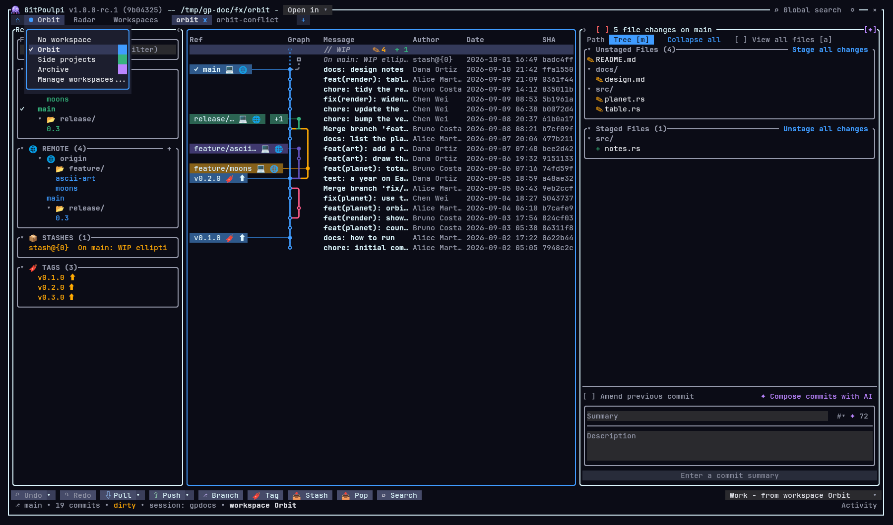

[English](../workspaces.md) · [Čeština](../cs/workspaces.md) · **Deutsch** · [Español](../es/workspaces.md) · [Français](../fr/workspaces.md) · [Italiano](../it/workspaces.md) · [日本語](../ja/workspaces.md) · [한국어](../ko/workspaces.md) · [Nederlands](../nl/workspaces.md) · [Polski](../pl/workspaces.md) · [Português (Brasil)](../pt-BR/workspaces.md) · [Português (Portugal)](../pt-PT/workspaces.md) · [Русский](../ru/workspaces.md) · [Svenska](../sv/workspaces.md) · [Türkçe](../tr/workspaces.md) · [Українська](../uk/workspaces.md) · [简体中文](../zh-CN/workspaces.md)

# Workspaces

Ein **Workspace** ist eine benannte Gruppe von Repositories: die, an denen Sie
zusammen arbeiten (ein Frontend, seine API, die Dokumentation). Er merkt sich,
welche davon als Tabs geöffnet sind, und kann ein **Standard-Commit-Profil**
tragen, damit Commits in diesen Repositories die richtige Identität verwenden,
ohne dass Sie von Hand umschalten. Ein Repository kann in mehreren Workspaces
sein, und in keinem zu sein ist in Ordnung: „Kein Workspace“ ist die gewohnte,
einfache Tab-Liste.

Workspaces liegen in `workspaces.toml`, neben `config.toml`, und werden von jeder
Sitzung, dem Fenster, der CLI und MCP gemeinsam genutzt (`gitpoulpi workspace ...`,
siehe die [CLI-Referenz](cli-reference.md)). Ein Workspace, der in einer Shell oder mit `gitpoulpi workspace ...` hinzugefügt, umbenannt oder entfernt wird, während das Fenster
offen ist, erscheint von selbst nach etwa einer Sekunde (der Tab Workspaces, der Chip der Tab-Leiste und seine Liste), ohne
Tastendruck. Das Schließen oder Löschen eines
Workspace berührt nie ein Repository auf dem Datenträger. Änderungen an Workspaces
sind Einstellungen, wie Favoriten und Profile: Sie gehören nicht zu
[Rückgängig und Wiederholen](undo-redo.md), und Löschen fragt vorher nach.

## Der Workspace-Chip

Sobald Sie einen Workspace haben, erscheint direkt hinter dem `⌂` ein Chip in der
Tab-Leiste: ein farbiger Punkt und der Name des aktiven Workspace oder „Kein
Workspace“ (abgedunkelt). In einer schmalen Leiste schrumpft er auf den Punkt, in
einer sehr schmalen verschwindet er.



- **Klicken Sie darauf**, drücken Sie `Alt+W` oder führen Sie in der Palette
  `Workspace: Wechseln...` aus, um eine Auswahl zu öffnen: Ihre Workspaces, „Kein
  Workspace“ und „Workspaces verwalten...“ (das den Tab Workspaces
  öffnet).
- **Das Wechseln tauscht die Tabs.** Die offenen Tabs bleiben für den Workspace
  erhalten, den Sie verlassen, und die Tabs des Ziels kommen zurück (beim ersten Mal
  seine Repositories, die existieren). Wechseln Sie zurück, ist alles wieder da, wo
  Sie es gelassen haben. Das Fenster startet dabei neu wie bei einem Tab-Wechsel; der
  Daemon bleibt.
- **Der Workspace wird gemerkt**: Der nächste Start kehrt in ihn zurück.
- **Das Schließen des letzten Tabs** eines Workspace lässt den Workspace aktiv und
  zeigt den Home-Tab.
- **Das `+` (neuer Tab) bei aktivem Workspace** fügt das gewählte Repository der
  Tab-Liste hinzu und fragt nichts. Um es in den Workspace selbst aufzunehmen, nutzen
  Sie „Zum Workspace hinzufügen“ im Rechtsklick-Menü des Tabs (oder `Workspace: Tab
  zum Workspace hinzufügen`); „Aus dem Workspace entfernen“ nimmt es wieder heraus
  und lässt den Tab offen.

Ohne Workspace gibt es keinen Chip: Legen Sie zuerst im Tab Workspaces oder in der
Palette einen an.

## Der Tab Workspaces

Öffnen Sie ihn über das Menü des `+`, mit `Alt+J` oder mit `Workspace: Verwalten...` in der Palette; sein `x` (oder `Ctrl+W`) schließt ihn, und er bleibt über Neustarts hinweg offen, bis Sie ihn schließen.
Jeder Workspace ist eine Zeile mit seinem Farbpunkt, Namen, der Zahl seiner
Repositories (und wie viele fehlen), seinem Standardprofil und „aktiv“, wenn das
Fenster in ihm ist. `Rechts`, `Leertaste` oder ein Klick klappt ihn zu seinen
Repositories auf.


| Pro Workspace | Taste | |
|---|---|---|
| Öffnen | `Enter` | Macht ihn aktiv und öffnet seine Tabs. |
| Bearbeiten... | `e` | Das Formular unten. |
| Löschen... | `x` | Fragt vorher nach. Repositories bleiben unberührt. |
| Alle abrufen (Fetch All) | `Shift+F` | Ein Repository nach dem anderen, Fortschritt in der Statuszeile, Fehler am Ende aufgelistet. |
| Alle holen (Pull All) | `Shift+P` | Dasselbe, nur Fast-Forward: Es hält nie bei einem Merge an. |
| Fehlende klonen | `m` | Klont jedes fehlende Repository mit gespeichertem Remote. |
| Neuer Workspace... | `n` | |
| Aus offenen Tabs... | `a` | Ein neuer Workspace, bei dem Ihre offenen Tabs angehakt sind. |

Ein **fehlendes** Repository (sein Ordner ist weg) bleibt aufgelistet und markiert,
mit **Suchen...** (`l` oder `Enter`: angeben, wo es jetzt liegt), **Klonen** (wenn
seine `origin`-URL beim Hinzufügen gespeichert wurde) und **Entfernen** (`x`). Jede
Zeile hat außerdem ein `⋮`-Menü (Rechtsklick, `.` oder `Shift+F10`) mit denselben
Aktionen, und jede Aktion steht in der Palette unter `Workspace:`.

## Das Formular Neu / Bearbeiten


- **Name**: erforderlich, eindeutig.
- **Farbe**: eine Auswahl der Designfarben; der Punkt am Chip und in den Zeilen.
- **Beschreibung**: freier Text.
- **Profil**: eine Auswahl Ihrer `[[profiles]]` oder „Keines“. Optional.
- **✦ KI-Anweisungen**: nur bei eingeschalteter KI, siehe [unten](#ki-anweisungen-eines-workspace).
- **Repositories**: eine Checkliste jedes Repositorys, das GitPoulpi kennt (offene
  Tabs, Favoriten, zuletzt geöffnete, die des Workspace selbst, auch fehlende).
  `Leertaste` hakt eine Zeile an; **Ordner hinzufügen...** (`Ctrl+B`) wählt ein
  Repository vom Datenträger. Die origin-URL jedes neuen Repositorys wird aus dem
  Repository gelesen und (ohne Zugangsdaten) gespeichert; das nutzt Klonen später.

## KI-Anweisungen eines Workspace

Bei eingeschalteter KI (*Einstellungen > KI*) hat das Formular eine Zeile **✦ KI-Anweisungen** mit einer Schaltfläche **Bearbeiten...** (`Enter` auf
der Zeile). Sie öffnet einen kleinen Editor für das, was der KI in **jedem Repository des Workspace** gesagt wird: Wählen Sie in der Liste **Für** *Jede KI-Aktion*
oder eine Aktion (Commit-Nachricht, Erklären, Stash-Nachricht, Pull Request, Commit-Composer, Konfliktlösung,
Code-Review), wählen Sie unter **Kombinieren** - *Zu global hinzufügen* (nach den globalen Anweisungen gesendet) oder
*Global ersetzen* (statt ihrer gesendet) - und schreiben Sie den Text. **Übernehmen** behält den ganzen Satz, **Speichern** im Formular
schreibt ihn mit dem Workspace in die `workspaces.toml`; **Abbrechen** verwirft, was Sie getippt haben. Bei ausgeschalteter KI ist die Zeile
ausgeblendet, und die Anweisungen des Workspace bleiben, wie sie sind.

Die Worte des Workspace stehen zwischen den globalen und den eigenen Anweisungen des Repositorys (siehe
[KI-Anweisungen](ai.md#anweisungen) für die Reihenfolge und dafür, was *Ersetzen* tut). Ein Repository in
mehreren Workspaces nutzt den aktiven Workspace des Fensters, wenn er es enthält, sonst den ersten, der es enthält. Aus einem
Skript: `gitpoulpi workspace set-ai-instructions <id> [--action <a>] [--mode append|replace] (--text ... |
--clear)`; `workspace show` gibt sie als `ai_instructions` aus.

```toml
[[workspace]]
id = "acme"
name = "Acme"
repos = ["/home/u/src/acme-api"]

[workspace.ai_instructions]       # every AI action in this workspace
text = "Use the Acme glossary."
mode = "add"                       # or "replace"

[workspace.ai_overrides.code_review]   # one action
text = "Flag missing tests."
mode = "add"
```

## Das Standardprofil

Commits werden mit dem ersten der folgenden Profile signiert, das zutrifft:

1. dem Profil, das Sie für dieses Repository **von Hand** gewählt haben (das
   Profilfeld der Symbolleiste),
2. dem Profil des **aktiven Workspace**, wenn das Repository dessen Mitglied ist,
3. `general.active_profile`.

Das Profilfeld der Symbolleiste sagt, woher es kommt: „Work - aus Workspace Acme“.
Das Feld erscheint auch bei nur einem Profil, solange der Standard eines Workspace
gilt. Ein Workspace, dessen Profil nicht mehr existiert, wirkt einfach nicht mehr. In
der CLI löst `commit --workspace <id>` (oder `GITPOULPI_WORKSPACE`) genauso auf.

## Tasten

| Taste | Aktion |
|---|---|
| `Alt+W` | Die Workspace-Auswahl öffnen |
| `Alt+J` | Tab Workspaces öffnen |
| `n`, `a` | Neuer Workspace, neu aus den offenen Tabs |
| `e` | Den Workspace bearbeiten |
| `Shift+F`, `Shift+P`, `m`, `l` | Alle abrufen, Alle holen, Fehlende klonen, Suchen |

Alle lassen sich unter Einstellungen > Tastatur & Maus neu belegen; die vollständige
Liste steht unter [Tastenkürzel](keybindings.md).
