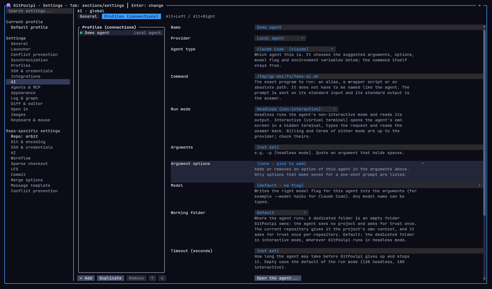

[English](../ai.md) · [Čeština](../cs/ai.md) · [Deutsch](../de/ai.md) · **Español** · [Français](../fr/ai.md) · [Italiano](../it/ai.md) · [日本語](../ja/ai.md) · [한국어](../ko/ai.md) · [Nederlands](../nl/ai.md) · [Polski](../pl/ai.md) · [Português (Brasil)](../pt-BR/ai.md) · [Português (Portugal)](../pt-PT/ai.md) · [Русский](../ru/ai.md) · [Svenska](../sv/ai.md) · [Türkçe](../tr/ai.md) · [Українська](../uk/ai.md) · [简体中文](../zh-CN/ai.md)

# Asistencia de IA

GitPoulpi nunca necesita una cuenta, y **la IA está desactivada por defecto**.
Cuando la IA está activada, puede escribir mensajes de commit y de stash,
explicar cambios, redactar descripciones de pull requests, sugerir resoluciones
de conflictos de merge y dividir tus cambios de trabajo en varios commits. El
modelo es tuyo: una clave de API que posees, un servidor local o una CLI de
agente ya instalada (como `claude -p`).

Cada control de IA muestra el `✦` morado. Mientras la IA está desactivada:

- No se envía nada a ninguna parte.
- No se muestra ningún control de IA: ni botón `✦`, ni comando `IA:` en la
  paleta, ni fila de IA en los menús, ni indicación de teclas de IA. Las teclas
  de IA no hacen nada.
- La página de IA del repositorio solo muestra «La IA está desactivada (Ajustes
  > IA)».
- El servidor MCP no lista las herramientas `ai_*`. Los comandos de CLI
  `gitpoulpi ai ...` se niegan con el mismo mensaje.

**Activar IA** surte efecto al instante. No hace falta reiniciar.

Hay dos formas de usar IA con GitPoulpi:

| | IA integrada (esta página) | Un agente externo |
|---|---|---|
| Qué es | GitPoulpi pide a un modelo un mensaje de commit, una explicación, ... | Claude Code, Cursor, Codex... manejan GitPoulpi como una herramienta |
| Se configura en | Ajustes > IA (`[ai]`) | la configuración MCP del agente, límites en `[mcp]` |
| Guía | más abajo | [MCP y agentes](mcp-and-agents.md) |

## Configurar la IA

1. `Ctrl+,` > **IA** > marca **Activar IA**.
2. Los perfiles forman la lista de la pestaña **Perfiles (conexiones)**, a la izquierda de la página (apilada encima en
   un terminal estrecho): elige uno para editarlo a la derecha (`Enter` pasa a
   sus filas; el comando de la paleta **IA: Editar perfil...** salta a la
   lista). **+ Añadir** crea otro, **Duplicar** copia el seleccionado (sin su
   clave) y **Quitar** pregunta antes. Siempre existe un perfil llamado
   *Default*. Elige el **Proveedor** y rellena sus campos:

   | Proveedor | Campos | Valores por defecto |
   |---|---|---|
   | **Agente local** (sin clave, sin cuenta propia) | **Tipo de agente** (qué agente es), **Comando** (el programa exacto: en tu `PATH`, un alias o script envoltorio, o una ruta completa), **Argumentos** que lo hacen no interactivo, y **Variables de entorno** opcionales. El prompt va por su stdin, la respuesta se lee de stdout. | Claude Code: `claude`, `-p --model haiku` |
   | **Anthropic** | **Clave de API**, **Modelo** y **URL base** opcionales | `claude-sonnet-5`, `https://api.anthropic.com/v1` |
   | **OpenAI** | **Clave de API**, Modelo, URL base | `gpt-5`, `https://api.openai.com/v1` |
   | **OpenRouter** | **Clave de API**, Modelo, URL base | `openai/gpt-5`, `https://openrouter.ai/api/v1` |
   | **Compatible con OpenAI** (Ollama, LM Studio, vLLM, una pasarela de empresa) | **URL base** (`.../v1`), **Modelo**, clave opcional | `http://localhost:11434/v1` (Ollama; LM Studio es `http://localhost:1234/v1`), `llama3` |

   **Preajustes** (siempre puedes escribir otro valor):

   

   - **Agente local > Tipo de agente** es un desplegable con las CLI de agentes
     más habituales, las más usadas primero: Claude Code, OpenAI Codex CLI,
     Gemini CLI, opencode, Cursor Agent, GitHub Copilot CLI, Pi, Qwen Code,
     Aider, Goose, Crush, Amp, u *Otro (sin sugerencias)*. El tipo está
     **separado del comando**: solo decide qué sugerencias recibes. Al elegir
     uno se rellenan **Comando** (mientras siga siendo el valor por defecto del
     tipo anterior) y **Argumentos** con la invocación sin interfaz (`claude
     -p`, `codex exec -`, `gemini -p ...`, ...). **Comando** es texto libre:
     escribe `/opt/bin/work-claude`, un script envoltorio o el destino de un
     alias y el tipo, con sus opciones, lista de modelos y variables, se
     mantiene. Cuando **Tipo de agente** está vacío, GitPoulpi lo deduce del
     comando.
   - **Opciones de argumentos** añade o quita opciones que encajan con el uso
     puntual de GitPoulpi, cada una con una razón de una línea: sin
     herramientas, sin sesión guardada, salida en texto plano, poco esfuerzo de
     razonamiento, modo de solo lectura, sin peticiones de permiso, sin
     comprobación de actualizaciones ni estadísticas. La lista cambia según el
     agente porque los agentes son distintos (solo algunos pueden desactivar las
     herramientas desde la línea de comandos; en opencode es una variable de
     entorno). **Modelo** lista los modelos de ese agente y escribe la opción
     adecuada (`--model haiku` para Claude Code, `-m gpt-6-luna` para Codex,
     `--model provider/model` para opencode); *(predeterminado - sin opción)* la
     quita. Amp no tiene opción de modelo. `aider` lee su prompt de
     `/dev/stdin`, así que solo funciona en Linux y macOS.
   - Las **Variables de entorno** se definen solo para el proceso de ese agente,
     nunca para GitPoulpi ni para otros perfiles. **Añadir una variable de
     entorno** ofrece las variables documentadas que importan para ese agente,
     cada una con lo que hace (desactivar telemetría y comprobación de
     actualizaciones, nivel de esfuerzo, carpeta de configuración, clave de API,
     URL base o host local, ...); también puedes escribir `NOMBRE` o
     `NOMBRE=valor`. Cada variable tiene entonces su propia fila **Env NOMBRE**:
     su valor como un botón (púlsalo para escribir uno nuevo; se guarda al salir
     del campo) y un botón **[x]** que elimina la variable. Un valor puede ser `${env:NOMBRE}` para tomar prestada
     una de las variables propias de GitPoulpi (útil para claves de API, así no
     se escriben en `config.toml`). Los valores que parecen secretos (nombres que
     terminan en `_KEY`, `_TOKEN`, `_SECRET`, ... o prefijos de clave conocidos)
     se muestran como puntos y se escriben desde cero. Los valores nunca se
     registran en logs.
   - **Proveedores HTTP > Ajuste del proveedor** rellena la URL base y un modelo
     para OpenAI, Anthropic, OpenRouter, Google Gemini, xAI, DeepSeek, Mistral,
     Groq, Together, Fireworks, Cerebras, Perplexity, Moonshot, Qwen
     (DashScope), Zhipu (GLM) y los servidores locales Ollama, LM Studio,
     llama.cpp, vLLM, Jan y LocalAI. **Modelo** es un desplegable con los
     modelos de ese proveedor, con texto libre permitido.

3. Pulsa **Probar conexión**: *Última prueba* indica `conectado: el modelo
   respondió` o `falló: <motivo>`.
4. Con varios perfiles, elige el **Perfil por defecto** al final; cada acción
   puede seguir indicando el suyo.



Las **claves de API** se introducen con `Enter` en la fila **Clave de API** y se
guardan en el credential helper de tu sistema (Git Credential Manager,
libsecret / `pass`, Keychain) bajo `ai:<id del perfil>`, nunca en `config.toml`.
Sin credential helper, GitPoulpi lo dice en lugar de fingir que la guarda.
*Ajustes > SSH y credenciales > Olvidar todos los usuarios y contraseñas* las
elimina.

Lo mismo en `config.toml` (todo lo demás está en la [referencia de
configuración](config-reference.md#ai-ia-integrada-desactivada-por-defecto)):

```toml
[ai]
enabled = true
default_profile = "claude-code"

[[ai.profiles]]
id = "claude-code"
name = "Claude Code"
kind = "local_agent"      # open_ai | anthropic | open_router | open_ai_compatible | local_agent
command = "claude"        # libre: un alias, un script envoltorio, una ruta absoluta
harness = "claude"        # qué agente es; vacío = se deduce de `command`
args = ["-p", "--model", "haiku"]

[ai.profiles.env]         # solo para el proceso de este agente; ${env:NAME} toma prestada una nuestra
CLAUDE_CODE_DISABLE_NONESSENTIAL_TRAFFIC = "1"
ANTHROPIC_API_KEY = "${env:ANTHROPIC_API_KEY}"
```

## Modo de ejecución: sin interfaz o terminal virtual

Un perfil de agente local ejecuta su agente de una de dos maneras, según el
**Modo de ejecución** (se muestra para Claude Code, OpenAI Codex CLI y Gemini
CLI):

- **Sin interfaz (no interactivo)**, el predeterminado: el modo de consulta
  única del agente (`claude -p`), prompt por stdin, respuesta por stdout.
- **Interactivo (terminal virtual)**: GitPoulpi arranca la pantalla propia del
  agente en un terminal oculto, escribe la petición como lo haría una persona,
  espera la respuesta y cierra el agente. Algunos agentes facturan o limitan su
  modo sin interfaz de forma distinta al interactivo; cuál te afecta, y qué
  dicen las condiciones del proveedor sobre cada uno, depende del proveedor,
  así que consulta las suyas.

Cada modo conserva sus propios **Argumentos**, **Opciones de argumentos** y
**Modelo**: cambiar de modo no pierde nada, y el modo interactivo solo ofrece
las opciones que tienen sentido sin la opción de modo sin interfaz. Otras dos
filas valen para ambos modos:

- **Carpeta de trabajo**: *Carpeta dedicada* es una carpeta vacía que pertenece
  a GitPoulpi, así que el agente no ve ningún proyecto y te pide confiar en
  ella una sola vez. *Repositorio actual* da al agente el contexto propio del
  proyecto (su `CLAUDE.md`, por ejemplo), y pide confianza una vez por
  repositorio. *Por defecto* es la carpeta dedicada en modo interactivo y, en
  modo sin interfaz, donde se ejecute GitPoulpi, como antes.
- **Tiempo de espera (segundos)**: cuánto tiempo puede tardar el agente antes
  de que GitPoulpi se rinda y lo detenga. Vacío significa 120 segundos sin
  interfaz y 180 interactivo.

**Las preguntas de primer arranque las respondes tú.** Un agente que nunca se
ha ejecutado en una carpeta pregunta algo primero (confiar en esta carpeta,
iniciar sesión, elegir un tema). GitPoulpi nunca responde por ti: la petición
se detiene con un mensaje, y **Abrir el agente...** (en el perfil, o *IA: Abrir
el agente* en la paleta de comandos) abre el agente una vez, en un terminal
visible, en la carpeta de trabajo que usará. Responde a la pregunta, cierra el
agente y vuelve a intentarlo; el agente recuerda la respuesta.

La respuesta se lee de la transcripción de sesión del agente en Claude Code (su
texto exacto, borrado después) y de la pantalla entre dos líneas marcadoras que
la petición pide, en Codex y Gemini. Como máximo se ejecutan dos ejecuciones de
terminal virtual a la vez, y pulsar Esc durante una petición detiene el agente.

```toml
[[ai.profiles]]
id = "claude-terminal"
kind = "local_agent"
command = "claude"
harness = "claude"
args = ["-p"]                       # el conjunto sin interfaz, conservado
run_mode = "terminal"               # headless (predeterminado) | terminal
terminal_args = ["--effort", "low"] # el conjunto interactivo
workdir = "dedicated"               # default | dedicated | repository
timeout_secs = 180                  # 0 o ausente: 120 sin interfaz, 180 terminal
```

## Instrucciones

Texto que añades a lo que se le dice al modelo. El prompt integrado de cada
acción (que fija el formato de la respuesta) va siempre primero y no se puede
editar; después cuatro niveles, del más general al más específico, cada uno solo
si no está vacío:

1. **Instrucciones globales** (todas las acciones). Los chips de *Inserción
   rápida* del editor insertan frases habituales: *Responder en `<idioma>`*,
   *Respuestas concisas*, *Usar modo imperativo*, *Tono técnico*, *Tono informal*.
2. **Instrucciones del espacio de trabajo** (todas las acciones, todos los
   repositorios del [espacio de trabajo](workspaces.md#instrucciones-de-ia-de-un-espacio-de-trabajo)):
   para todas las acciones y, opcionalmente, por acción. Se editan en el
   formulario Editar del espacio de trabajo.
3. **Instrucciones del repositorio** (todas las acciones, solo este
   repositorio), con *Combinar con las globales*: **Añadir a las globales**
   (después de ellas) o **Reemplazar las globales** (en lugar de ellas).
4. **Instrucciones de la acción** (*Generación de mensajes de commit*,
   *Explicar cambios*, *Generación de mensajes de stash*, *Pull request*,
   *Compositor de commits*, *Resolución de conflictos*, *Revisión de código*, *Dividir un commit*), cada bloque con sus
   propios chips en su editor (p. ej. *Formato conventional commits*, *Límite de 50
   caracteres*) y su propio desplegable **Perfil** (`Por defecto (<nombre>)`
   sigue el perfil por defecto).

`Enter` en una fila *Instrucciones personalizadas* abre un editor de varias
líneas (`Ctrl+S` guarda, `Esc` cancela). Sobre el texto, una fila *Inserción
rápida* reúne los chips de esa sección: haz clic en uno para insertar su frase
en el cursor. Con el teclado, `Tab` pasa a la fila, `Left`/`Right` eligen un chip,
`Enter` o `Espacio` lo inserta y vuelve al texto (`Tab` o `Esc` vuelven sin
insertar). Un chip cuya frase ya está en las instrucciones aparece atenuado e
insertarlo de nuevo no hace nada. El texto es un editor completo: un clic coloca
el cursor, un arrastre o `Shift`+flechas seleccionan, `Ctrl+A` selecciona todo,
`Ctrl+C` / `Ctrl+X` copian y cortan la selección, `Ctrl`+flechas saltan de palabra en
palabra, y `Inicio` / `Fin`, `RePág` / `AvPág` y la rueda del ratón recorren los
textos largos. La propia página solo muestra una vista previa de cada
instrucción.


**Por repositorio**: *Ajustes > Ajustes del repositorio > IA* (con un
repositorio abierto) contiene las instrucciones del repositorio y, por acción,
un perfil e instrucciones que prevalecen sobre los globales. Un campo vacío usa
el ajuste global (se muestra en gris en él); **Restablecer a las globales**
quita una anulación. Se guarda en el `.gitpoulpi/repo-state.toml` del
repositorio, y la CLI también lo respeta.


### Cómo se combinan los niveles

El orden de envío es: prompt integrado, **globales**, **espacio de trabajo**,
**repositorio** y, por último, las instrucciones de la propia acción. El modo de
un nivel decide qué ocurre con los que tiene encima:

- **Añadir** (por defecto): el texto del nivel se añade después de los más
  generales.
- **Reemplazar**: el texto del nivel se usa *en lugar de* todos los niveles más
  generales (las globales y, si el repositorio reemplaza, también las del espacio
  de trabajo). Un nivel sin texto nunca reemplaza nada.

Las instrucciones de la propia acción siguen la misma idea: las globales de esa
acción, luego las del espacio de trabajo para esa acción (añadidas después de
ellas, o reemplazándolas), y la anulación propia del repositorio para la acción
prevalece sobre ambas. El espacio de trabajo que se usa es el activo de la
ventana cuando contiene el repositorio y, si no, el primero que lo contiene; en
la línea de comandos es el de `GITPOULPI_WORKSPACE` y, si no, el primero.

Para ver exactamente qué se envía, nivel por nivel, ejecuta
`gitpoulpi ai prompt --action <acción> --repo .` (`base`, `global`, `workspace`,
`repository`, `task` y el `system_prompt` final). No llama a ningún modelo y
funciona con la IA desactivada. Las instrucciones de un espacio de trabajo se
fijan desde un script con `gitpoulpi workspace set-ai-instructions <id>
[--action <a>] [--mode append|replace] --text ...` (o `--clear`).

### Variables del prompt

Cualquier texto de instrucciones (globales, del espacio de trabajo, del repositorio, por acción) puede
contener variables `${nombre}`. Se sustituyen por su valor justo antes de
enviar el prompt (el texto guardado conserva el `${...}`). Un nombre que no esté
en la tabla se envía tal cual y el editor avisa; escribe `$${` para un `${`
literal.

| Variable | Se expande a | Ejemplo |
|---|---|---|
| `${uilang}` | El idioma de la interfaz, por su nombre en inglés | `French` |
| `${repo}` | El nombre de la carpeta del repositorio | `gitpoulpi` |
| `${branch}` | La rama actual | `main` |
| `${ref}` / `${commit}` | Sha corto del commit al que se refiere la acción (*Explicar*), o si no HEAD | `4c0443d` |
| `${commit_subject}` | Asunto de ese commit | `feat: add search` |
| `${date}` | Fecha local, ISO | `2026-10-03` |
| `${time}` | Hora local, `HH:MM` | `14:05` |
| `${datetime}` | Fecha y hora locales | `2026-10-03 14:05` |
| `${user}` / `${email}` | `git config user.name` / `user.email` | `Ada Lovelace` |
| `${remote}` | El remoto predeterminado (`origin`, o si no el primero) | `origin` |
| `${host}` | `github`, `gitlab`, `other` (otra plataforma) o `none` | `github` |
| `${files}` | Número de archivos del diff de la acción | `3` |
| `${action}` | La acción en curso | `commit_message` |

En el editor de instrucciones: escribe `${` y un popup lista las variables que
coinciden (`Up`/`Down` eligen, `Enter` o `Tab` inserta, `Esc` lo cierra); o usa
el desplegable **Variables** de abajo a la izquierda (`Ctrl+T`, o *IA: Insertar
variable de prompt* en la paleta de comandos), que inserta en el cursor. Cada
entrada tiene una descripción, que se muestra en el desplegable y en la línea
sobre los botones mientras pasas el puntero o la resaltas.

## Qué puede hacer

| Acción | En la ventana | CLI |
|---|---|---|
| **Mensaje de commit** | Haz stage de cambios, pulsa el `✦` a la derecha del campo Resumen, `Ctrl+G i`, o el comando de la paleta `IA: Generar mensaje de commit`. El resumen y la descripción se rellenan para que los edites; no se hace commit de nada. | `ai commit-message` (imprime), `commit --ai` (hace commit) |
| **Explicar cambios** | El `✦` arriba a la derecha del panel de cambios de trabajo (`Ctrl+G w`: el commit seleccionado o, si no, los cambios de trabajo), o *Explicar cambios (IA)* en el menú de un commit. Un popup: las flechas desplazan, `c` copia, `Esc` cierra. | `ai explain [rev] [--wip]` |
| **Mensaje de stash** | `Ctrl+G m` abre el prompt de stash; `Ctrl+G` dentro de él se lo pide al modelo. El comando de la paleta `IA: Generar mensaje de stash` hace ambas cosas. | `stash push --ai` |
| **Título y descripción de pull request** | *Generar título y descripción* en el formulario Crear pull request (los commits y el diff de la rama se leen en local). | |
| **Resolución de conflictos de merge** | En el editor de conflictos de merge: el botón `✦ Sugerir` de la barra de herramientas, el menú de clic derecho de un conflicto *✦ Sugerir resolución (IA)*, `Alt+I`, o el comando de la paleta `IA: Sugerir resolución de conflicto de merge`. La sugerencia reemplaza la región del *conflicto actual* en el Resultado como una sola edición (marcada como editada, un único paso de deshacer); no se guarda ni se pasa a stage nada hasta que guardes. | `ai resolve-conflict <path> [--conflict N]` (imprime) |
| **Revisión de código** | En la [revisión de un pull o merge request](review.md#borrador-de-revisión-con-ia): el botón `✦ Redactar revisión...`, `s`, o el comando de la paleta `Revisión: ✦ Redactar revisión...` (abre las opciones de la revisión, `Enter` la ejecuta). El modelo lee el diff, la descripción y los comentarios existentes de la solicitud (y, por defecto, el `CLAUDE.md` y el `AGENTS.md` del proyecto: ver [Contexto de la revisión](#contexto-de-la-revisión)) y propone comentarios; aceptas, editas o descartas cada uno. Nada llega al host antes de que envíes la revisión. | `hosting review suggest <n>` (imprime JSON, no publica nada), `ai review-context` (los valores por defecto) |
| **Dividir un commit** | El menú de un commit *Dividir commit (IA)...*, o el comando de la paleta `IA: Dividir el commit seleccionado...`. El editor de división se abre con la agrupación del modelo ya rellenada; véase más abajo. | `ai split-plan <rev>` (imprime) |
| **Script de reescritura del historial** | En el [editor de reescritura del historial](history-rewrite.md#escribir-un-script-con-ia): el botón `✦ Escribir con IA...` del editor de scripts, o el comando de la paleta `Reescritura: Escribir un script con IA...`. Un diálogo muestra exactamente qué se enviará; el script llega al editor, marcado, y nunca se ejecuta ni se aplica por ti. | `ai rewrite-script "<instrucción>" [--sample N]` (imprime) |
| **Reglas de reescritura del historial** | En el [editor de reescritura del historial](history-rewrite.md#crear-reglas-con-ia): el botón `✦ Crear reglas con IA...`, `Alt+I`, o el comando de la paleta `Reescritura: Crear reglas con IA...`. Un diálogo de varias líneas muestra exactamente qué se enviará; las reglas y los ajustes llegan al editor y no se previsualiza ni se aplica nada por ti. | `ai rewrite-rules "<descripción>" [--context]` (imprime) |
| **Compositor de commits** | El menú de la fila WIP *Componer commits (IA)...*, `Ctrl+G C`, el comando de la paleta `IA: Componer commits a partir de los cambios de trabajo...` | |

`Esc` cancela una petición en curso (el proceso de un agente local se mata).

### Resolución de conflictos de merge

El modelo recibe la ruta y el lenguaje del archivo, los bloques base, actual (A)
y entrante (B) del conflicto con las etiquetas que muestra el editor, hasta 20
líneas de texto ya fusionado antes y después, y tus instrucciones (globales, del
repositorio y las de *Resolución de conflictos* en Ajustes > IA). Responde con
el texto resuelto de ese único conflicto en un bloque de código; una respuesta
con marcadores de conflicto o con charla en lugar de código se devuelve una vez
y después se rechaza. Un conflicto de más de 40 KB (`ai.limits.conflict_bytes`,
*Ajustes > IA > Límites*) se retiene tras un aviso que indica su tamaño y el límite,
con *Enviar igualmente* (solo esta petición, que sigue pasando por las
comprobaciones de privacidad), *Abrir ajuste* y *Cancelar*; el límite es una
protección propia de GitPoulpi, así que súbelo si tu modelo tiene margen. Los
controles se ocultan mientras la IA está desactivada, y una sugerencia nunca
guarda, pasa a stage ni resuelve nada: revisa el Resultado, edítalo y guarda
como de costumbre.


### El compositor de commits

El modelo divide los cambios de trabajo en varios commits (cada archivo
modificado en exactamente uno; un plan no válido se devuelve una vez y después
se rechaza). Mientras queden archivos con conflictos no se pregunta nada: un
diálogo los lista y abre la vista de resolución de conflictos, porque el
compositor necesita un árbol sin conflictos. Revisas el plan antes de que se
haga commit de nada:


| Tecla | Ratón | Hace |
|---|---|---|
| `Up` / `Down` (`k` / `j`) | clic en una fila | moverse por commits y archivos |
| `Alt+Up` / `Alt+Down` (`K` / `J`), `m` | las flechas, arrastrar y soltar | mover un commit; mover un archivo a otro commit |
| `Right` / `Left`, `*` | la flecha de la fila | expandir / contraer un commit, todos (`ui.composer_files` fija el estado inicial) |
| `e` / `Enter` | el lápiz | editar el mensaje |
| `d` / `Delete` | `drop` / `restaurar` | dejar un commit fuera (sus archivos quedan sin commit) |
| `n` | `+ commit propio` | mover un archivo a un commit propio |
| `r` | `Restablecer` | volver al plan del modelo |
| `Ctrl+S` / `a` | `Crear N commits` | crearlos, en orden |
| `Esc` | `Cancelar` | salir, sin hacer nada |

Al crear, se pasan a stage los archivos de cada commit y se hace commit uno tras
otro; el árbol de trabajo nunca se toca. Un archivo con stage parcial se
confirma entero. Si un paso falla, se detiene e indica cuántos commits se
hicieron.

### Dividir un commit

El modelo lee los cambios del commit, numerados como los numera el [editor de
división](log-and-history.md#dividir-un-commit), y propone varios commits con un
mensaje cada uno; puede agrupar hunks y líneas sueltas. Se rechaza una respuesta
que deja fuera un cambio, asigna uno dos veces o nombra algo que no existe. En
cualquier caso se abre el editor de división: con la propuesta ya rellenada o, si
el modelo falló, con el motivo en una nota para que dividas a mano. No se divide
nada hasta que pulses **Dividir** (`Ctrl+S`); si la agrupación no es la adecuada,
antes puedes mover cambios, renombrar commits o añadir uno. El perfil y las
instrucciones son los de *Dividir un commit* en Ajustes > IA.

### Un script de reescritura del historial

Describes qué debe hacer la reescritura («pasar a la mañana siguiente todos los commits hechos de noche», «sustituir mi correo antiguo por el nuevo, solo antes de 2024») y el modelo escribe un [script Lua](history-rewrite.md#scripts-lua) para la regla Script, con la cabecera, `rewrite_commit(c, ctx)` y las funciones auxiliares del entorno aislado. El daemon compila la respuesta; si no compila, el error vuelve al modelo una vez. Lo que queda se muestra en el editor: léelo, pruébalo y luego genera la vista previa. Los detalles y el diálogo están en [Reescribir el historial](history-rewrite.md#escribir-un-script-con-ia). El perfil y las instrucciones son los de *Script de reescritura del historial* en Ajustes > IA.

### Reglas de reescritura del historial

Describes con tus palabras cómo debe reescribirse el historial («sustituir mi antiguo correo a@b.org por
c@d.org», «quitar secrets.txt de todo el historial») y el modelo propone un alcance, algunos ajustes y
una lista de [reglas de reescritura](history-rewrite.md#crear-reglas-con-ia) en el vocabulario propio del
editor. **Solo prepara**: la respuesta rellena el editor, no se previsualiza ni se aplica nada,
y una entrada que no se puede usar aparece con el motivo, mientras que las válidas se conservan. Nunca se
crea una regla Script de esta manera. Opcionalmente se envían también el alcance, los nombres de ramas y
etiquetas y los autores de los commits más recientes (una casilla, desactivada por defecto, que se refleja en
el panel «qué se envía»). El perfil y las instrucciones son los de *Reglas de reescritura del historial* en
Ajustes > IA.

## Adónde va la clave

Una clave de API (OpenAI, Anthropic, OpenRouter, un servidor compatible con OpenAI) queda vinculada a la dirección para la que se guardó: el origen de la URL base del perfil, registrado en `trust.toml` en la carpeta de datos privada que solo lee el usuario. Si la URL base pasa a apuntar a otro sitio, la petición se rechaza antes de enviar nada y la clave se queda donde está. Ejecuta `gitpoulpi ai trust <profile> --accept-origin <url>` (o acéptalo en la aplicación) para mover la clave a la nueva dirección a propósito.

- `http://` sin cifrar se permite en esta máquina (Ollama, LM Studio en `localhost`); en cualquier otro sitio necesita `gitpoulpi ai trust <profile> --allow-insecure-http on`.
- Un servidor autoalojado cuyo certificado no encadena con una autoridad conocida solo se acepta para la huella de clave que fijes con `--accept-certificate <sha256>`; el handshake TLS sigue demostrando que el servidor tiene esa clave.
- Un perfil que ya tenía una clave antes de que existiera esta comprobación se registra en silencio, desde su URL base actual, la primera vez que se usa.
- Un agente local (`claude -p` y similares) no tiene clave ni HTTP, así que no hay nada que vincular.

## Contexto de la revisión

Un borrador de revisión de código (`✦`, o `hosting review suggest`) lee el diff, el título, la descripción y los
comentarios existentes de la solicitud. También puede recibir las convenciones propias del proyecto, en un bloque
**Project conventions** colocado antes del diff, y un agente local puede trabajar dentro del repositorio. Los
valores por defecto son:

| Ajuste | Por defecto | Significado |
|---|---|---|
| `run_in_repository` | `profile` | `profile`: decide la *Carpeta de trabajo* del perfil de IA. `yes`: un agente local se ejecuta en el repositorio durante la revisión, diga lo que diga el perfil. `no`: no allí (un perfil con *Repositorio* usa la carpeta dedicada). Los perfiles HTTP no tienen carpeta de trabajo, así que para ellos no cambia nada. |
| `include_claude_md` | activado | Da al modelo el `CLAUDE.md` del repositorio. |
| `include_agents_md` | activado | Da al modelo el `AGENTS.md` del repositorio. |
| `extra_file` | ninguno | Un archivo más: una ruta relativa a la raíz del repositorio, una ruta absoluta o un enlace. |

Se superponen como las instrucciones, y gana el más específico campo por campo: la tabla global `[ai.review]`,
luego los valores propios del repositorio (un campo sin fijar hereda) y después las elecciones de una ejecución. Un
repositorio que no está clonado guarda los suyos por `host/project` en `remote-reviews.toml`, junto a sus
borradores de revisión.

Un repositorio también puede desactivar el archivo adicional global: su `no_extra_file = true` (la casilla
**Ningún archivo adicional** de *Ajustes del repositorio > IA*, del diálogo ✦ Opciones de la revisión y el flag
`--no-extra-file` de `ai review-context`) significa "ningún archivo adicional para este repositorio", diga lo que diga
`[ai.review]`. Un campo **Archivo adicional** **vacío** no es lo mismo: hereda el archivo global. Un archivo del
repositorio y el interruptor se excluyen entre sí (fijar uno borra el otro), y el interruptor gana si un archivo editado
a mano contiene ambos. Un antiguo `extra_file = ""` de un repositorio sigue significando ninguno.

De dónde salen los archivos:

- `CLAUDE.md`, `AGENTS.md` y un archivo adicional con ruta relativa se leen de la **raíz** del repositorio en la
  rama a la que apunta la solicitud, nunca del árbol de trabajo (que puede estar en otra rama o tener cambios
  locales). Con un clon, desde el commit base de la solicitud; sin él, desde la API del host.
- Una ruta absoluta se lee de este equipo.
- Un enlace a un archivo de un host de código (GitHub `.../blob/<branch>/<path>`, GitLab `.../-/blob/<branch>/<path>`,
  Gitea y Forgejo `.../src/branch/<branch>/<path>`, o un enlace raw) se lee a través del perfil de integración
  cuyo host coincide, así que un repositorio privado funciona con el token que ya diste. Un enlace que ningún
  perfil reconoce, o cualquier otra dirección, se descarga de forma anónima. Un nombre de rama con barra no se
  puede leer desde un enlace: usa una ruta, o un enlace a una rama sin barra.
- Un `CLAUDE.md` o `AGENTS.md` que falta se omite sin avisar; un archivo adicional que falta se comunica
  (`context.problems` en el JSON de la CLI).
- Cada archivo se corta a **8 KB** y todos juntos a **16 KB**, con una nota visible
  `[CLAUDE.md cut: showing ... of ... bytes]` en lo que lee el modelo.

Cuando un agente local se ejecuta en el repositorio, el prompt le avisa de que los archivos del checkout pueden no
coincidir con el head de la solicitud y de que el diff es el que manda.

En la vista de revisión, `s` abre el diálogo **✦ Opciones de la revisión** con estos valores rellenados: los del
repositorio sobre los globales. Cámbialos solo para esta ejecución, o marca *Guardar como valores por defecto de
este repositorio* para conservarlos (ver [Opciones de la revisión](review.md#opciones-de-la-revisión)). Los valores
por defecto también se editan en *Ajustes > IA* (el bloque *Revisión de código*, cuatro filas) y por repositorio en
*Ajustes del repositorio: IA*, donde cada fila puede *usar el valor global* y un botón *Restablecer al global*
descarta los valores propios del repositorio; la búsqueda de Ajustes los encuentra (`Incluir AGENTS.md`,
`Archivo adicional`). Lo que no se pudo dar al modelo (un archivo adicional que falta) o que se cortó para caber se
muestra en la tarjeta del borrador.

Desde la línea de comandos:

```sh
gitpoulpi ai review-context                      # los valores globales y lo que recibe una revisión
gitpoulpi ai review-context --agents-md off      # guarda un valor global por defecto
gitpoulpi --repo ~/work/app ai review-context --claude-md off --context-file docs/REVIEW.md
gitpoulpi ai review-context --project github.com/acme/app --context-file https://github.com/acme/rules/blob/main/review.md
gitpoulpi ai review-context --repo ~/work/app --reset   # vuelve a seguir los valores globales
gitpoulpi hosting review suggest 12 --claude-md off --context-file docs/REVIEW.md --run-in-repo no
```

`ai review-context` no necesita modelo y funciona con la IA desactivada. `ai prompt --action code_review` imprime el
contexto efectivo como `review_context`. Los mismos cuatro ajustes son `ai.review.*` en `config.toml`
([referencia](config-reference.md#ai-ia-integrada-desactivada-por-defecto)).

## Límites de entrada

Cada entrada que GitPoulpi pone en una petición tiene un límite de tamaño, un
ajuste bajo `[ai.limits]` (*Ajustes > IA > Límites*). Los límites son una
protección propia de GitPoulpi (la ventana de contexto cambia según el modelo):
súbelos si tu modelo tiene margen, bájalos para mantener las peticiones pequeñas.

| Ajuste (`ai.limits.`) | Por defecto | Qué limita |
|---|---|---|
| `conflict_bytes` | 40000 | Los bloques base, actual y entrante de un conflicto de merge |
| `diff_bytes` | 60000 | El diff de un mensaje de commit, una explicación, un nombre de stash, una descripción de pull request, un plan de commits o una división; el diff completo de una revisión de código |
| `review_file_bytes` | 12000 | El diff de un archivo en una revisión de código |
| `review_text_bytes` | 4000 | La descripción de la pull request revisada |
| `review_threads_bytes` | 6000 | Los comentarios de revisión que ya existen |
| `review_context_file_bytes` | 8192 | Un archivo de contexto del proyecto en una revisión (`CLAUDE.md`, `AGENTS.md`, el archivo extra) |
| `review_context_bytes` | 16384 | Todos los archivos de contexto de una revisión juntos |

**Nada se corta en silencio.** Cuando una entrada supera su límite, la petición
espera y *Por encima del límite de la IA* lista lo que lo supera: qué parte (el
diff, un archivo, la descripción, un archivo de contexto), su tamaño, el límite y
el ajuste. Una revisión lista todas las partes que lo superan en un solo diálogo.
Los botones, cada uno con su tecla:

- *Enviar todo* (`T`): solo esta petición, no se corta nada. Sigue pasando por las
  comprobaciones de privacidad (secretos reemplazados, archivos sensibles
  omitidos) y, si está activo, por el panel *Qué se envía*, que viene después.
- *Enviar recortado* (`R`): se corta lo que supera su límite, como siempre; cada
  línea del diálogo indica qué se omite (el final del diff, los últimos hunks,
  los archivos que no caben).
- *Abrir ajuste* (`A`): cancela la petición y abre *Ajustes > IA > Límites* en el
  primer límite listado. El foco empieza aquí: Enter nunca envía.
- *Cancelar* (`C`, `Esc`, la cruz o un clic fuera): no envía nada.

Un conflicto es la excepción: nunca se corta. *Enviar igualmente* lo envía entero
una vez.

Nada inicia una petición de IA por sí solo, así que no hay ejecución en segundo
plano que pueda preguntar: cada petición es una que iniciaste tú. Una ejecución
que no puede preguntar (la CLI y MCP) trunca como antes e indica que lo hizo;
véase abajo.

**En la línea de comandos**, nada puede responder a un diálogo, así que una
entrada que supera su límite se trunca como antes y la respuesta indica qué se
cortó: `truncated: [{part, detail?, bytes, limit, setting}]` (solo está presente
cuando algo se cortó; `part` es uno de `diff`, `split_hunks`, `review_diff`,
`review_file`, `review_text`, `review_threads`, `context_file`, `context_total`).
`--send-all` (alias `--no-truncate`) envía todo entero en su lugar: en `ai`
(todos sus comandos, incluido `ai resolve-conflict`, donde un conflicto por
encima de su límite se rechaza si no), en `commit --ai`, en `stash push --ai` y en
`hosting review suggest`. Las herramientas MCP tienen el mismo argumento
`send_all` y el mismo campo `truncated`.

## Privacidad

- No se envía nada hasta que pulsas un botón o ejecutas un comando. Sin IA en
  segundo plano, sin telemetría, sin cuenta de GitPoulpi.
- Qué se envía: el prompt (el integrado y luego tus instrucciones) y el diff
  sobre el que preguntaste; para una pull request, también los asuntos de los
  commits de la rama. Un diff de más de 60 KB (`ai.limits.diff_bytes`) nunca se
  corta en silencio: véase [Límites de entrada](#límites-de-entrada).
- Una petición de script de reescritura envía tu instrucción y el contrato fijo del script (la API del entorno aislado). El autor, la fecha y el asunto de hasta 20 commits se envían **solo** si marcas *Enviar una muestra* en el diálogo (desactivado por defecto; la CLI necesita `--sample N`). El contenido de los archivos y los valores secretos nunca se envían.
- Va solo al perfil elegido para esa acción: ese host de API, o el stdin de tu
  comando de agente local (que entonces hace lo que haga ese agente).
- Las claves de API las usa el propio proceso `gitpoulpi` y nunca llegan al
  daemon, a los demás clientes de la ventana ni a un cliente MCP.
- El texto generado nunca se confirma, se envía con push ni se aplica por sí
  solo.

### Qué se limpia de una petición

Toda petición, la envíe la acción que la envíe y la reciba el proveedor que la
reciba (una API alojada o un agente local), pasa antes por el mismo paso de
limpieza:

- **Se ocultan los secretos** (`[ai.privacy] redact_secrets`, activado por
  defecto). Un token con un prefijo conocido, un bloque de clave privada, un JWT,
  una contraseña en una URL y una línea `password = valor` cuyo valor parece
  aleatorio se sustituyen por `[REDACTED:<rule>]`. No es exhaustivo: encuentra las
  formas habituales (el mismo escáner que `rewrite scan-secrets`).
- **Se dejan fuera los archivos sensibles** (`[ai.privacy]
  exclude_sensitive_files`, activado por defecto). El diff de un archivo que
  coincide con `[privacy] sensitive_patterns` (`.env` y `.env.*` salvo los
  archivos `.example`, `.sample` y `.template`, `*.pem`, `*.key`, claves privadas
  SSH, `*.p12`, `*.pfx`, `*.jks`, `*.keystore`, `*.crt`, `*.cer`, `*.der`,
  `*.kdbx`) no forma parte de la petición. Una pieza de división o una lista de
  archivos del compositor que nombra un archivo así se recorta igual, así que un
  plan para él puede rechazarse por incompleto: haz tú mismo el stage o la
  división de ese archivo.

Desactivar cualquiera de los dos es una decisión, y Ajustes > IA muestra una línea
roja debajo mientras esté desactivado.

**Qué se envía, antes de enviarlo.** Antes de que salga una petición, la TUI
muestra el diálogo **Revisa lo que se envía**: las instrucciones y la petición ya
limpias (el mismo panel que los diálogos de reescritura del historial,
desplazable, `Alt+W` lo muestra u oculta), cuántos secretos se reemplazaron y qué
archivos se dejaron fuera (una regla y una vista previa enmascarada como
`ghp_****abcd`, nunca un valor), una casilla **No mostrar más para <acción>** y
**Enviar** / **Cancelar** (`Esc`, la cruz de cierre y un clic fuera cancelan; no
sale nada hasta Enviar). La casilla escribe `[ai.sent_preview] <action> = false`;
Ajustes > IA > *Mostrar lo que se envía antes de...* tiene un interruptor por
acción y **Mostrar todo otra vez**. Los dos diálogos de reescritura del historial
ya muestran su petición, así que no tienen interruptor.

**En la línea de comandos**, cada respuesta de `ai ...` (y de `hosting review
suggest`) lleva `privacy: {redactions: N, excluded_files: [...]}`, y
`--print-sent` imprime el texto de sistema y de usuario ya limpio, como `{sent:
[{system, user}], privacy, dry_run: true}`, sin llamar al modelo (necesita
`ai.enabled = true`, ninguna clave y ninguna red).

**Un límite.** Un agente local cuya carpeta de trabajo es el repositorio
(`workdir = repository`, o *Ejecutar el agente en el repositorio* para una
revisión) puede leer los archivos por sí mismo: la limpieza cubre lo que
GitPoulpi le envía, no lo que abre por su cuenta. Usa la carpeta de trabajo
`dedicated` para mantenerlo fuera del repositorio.

## Solución de problemas

| Síntoma | Solución |
|---|---|
| No hay ningún `✦` en ninguna parte | La IA está desactivada: *Ajustes > IA > Activar IA*. |
| El `✦` está en gris | No hay nada en stage (mensaje de commit). |
| *Probar conexión*: comando no encontrado | El **Comando** del agente local no está en el `PATH` que ve GitPoulpi: inicia GitPoulpi donde funcione `claude --version`, o indica la ruta completa. |
| Un agente local se cuelga o muestra una pantalla interactiva | En el modo de ejecución *Sin interfaz*, añade su opción sin interfaz (`-p` en Claude Code) a **Argumentos**, o elige de nuevo su **Tipo de agente** para restaurar la invocación sin interfaz. La pantalla interactiva es para lo que sirve el modo de ejecución *Interactivo (terminal virtual)*. |
| "Use "Open the agent"..." | El agente hizo una pregunta de primer arranque (confiar en la carpeta, iniciar sesión). Usa **Abrir el agente...** en el perfil, respóndela, cierra el agente y vuelve a intentarlo. |
| Una petición de terminal virtual agota el tiempo | El mensaje termina con las últimas líneas de la pantalla del agente: ahí se ve un aviso de permisos, un inicio de sesión o una pregunta de actualización. Respóndela con **Abrir el agente...**, o sube el **Tiempo de espera**. |
| `falló:` 401 | Clave incorrecta, o clave de otro proveedor: vuelve a introducirla. |
| `falló:` 404 | El **Modelo** no existe allí: bórralo para usar el predeterminado. |
| `falló:` error de conexión (Ollama, LM Studio) | El servidor no está en marcha, o la **URL base** tiene el puerto equivocado o le falta `/v1`. |
| La clave muestra `(sin definir)` tras escribirla | No hay credential helper: configura uno (`git config --global credential.helper ...`) y vuelve a introducirla. |
| *Por encima del límite de la IA* | Una entrada de la petición supera un límite de `[ai.limits]`: elige *Enviar todo*, *Enviar recortado*, *Abrir ajuste* o *Cancelar* (véase [Límites de entrada](#límites-de-entrada)). |
| «El conflicto es mayor que el límite» | El conflicto supera `ai.limits.conflict_bytes` (40000 por defecto). *Enviar igualmente* lo envía una vez; *Abrir ajuste* va al límite en Ajustes > IA > Límites. |
| Idioma o estilo equivocado | Añade instrucciones; los chips de Inserción rápida del editor lo hacen rápido. |
| El compositor dice que el plan no es válido | El modelo se saltó o repitió un archivo: inténtalo de nuevo o usa un modelo más potente. |

## Archivos de configuración antiguos

Un `config.toml` antiguo con `[[ai.presets]]` y `[ai.defaults]` sigue
cargándose:

- El preajuste por defecto de cada acción pasa a ser su
  `[ai.actions.<action>]` (`system_prompt` pasa a ser `instructions`).
- Cada preajuste antiguo se conserva en `[[ai.legacy_presets]]`. Ajustes > IA
  los muestra en *Preajustes antiguos*, con *Eliminar archivo*.
- El antiguo `[preferences.ai_presets]` de un repositorio pasa a ser una
  anulación del repositorio.

El prompt integrado va ahora siempre primero. Si un prompt antiguo copiaba un
prompt integrado, quita la parte copiada y deja solo lo que quieras añadir.
