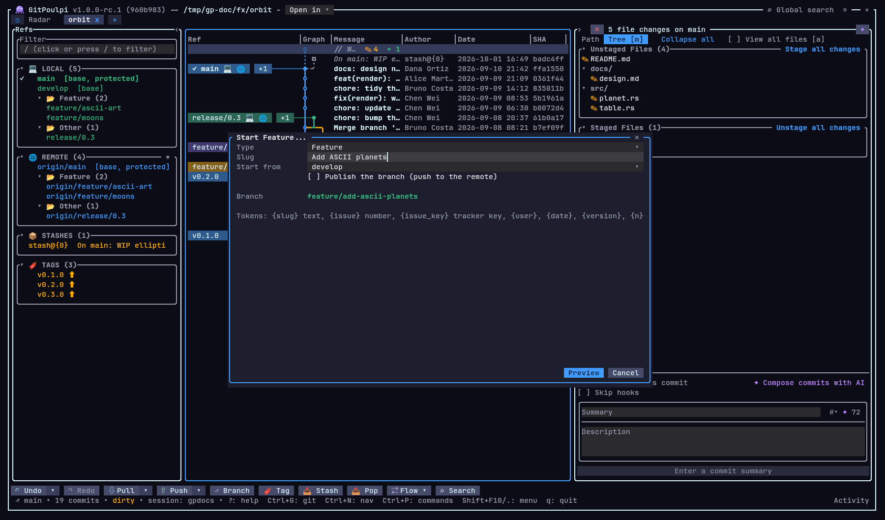

[English](../branching-workflows.md) · [Čeština](../cs/branching-workflows.md) · [Deutsch](../de/branching-workflows.md) · **Español** · [Français](../fr/branching-workflows.md) · [Italiano](../it/branching-workflows.md) · [日本語](../ja/branching-workflows.md) · [한국어](../ko/branching-workflows.md) · [Nederlands](../nl/branching-workflows.md) · [Polski](../pl/branching-workflows.md) · [Português (Brasil)](../pt-BR/branching-workflows.md) · [Português (Portugal)](../pt-PT/branching-workflows.md) · [Русский](../ru/branching-workflows.md) · [Svenska](../sv/branching-workflows.md) · [Türkçe](../tr/branching-workflows.md) · [Українська](../uk/branching-workflows.md) · [简体中文](../zh-CN/branching-workflows.md)

# Flujos de trabajo de ramas

Un flujo de trabajo de ramas le dice a GitPoulpi cómo usa tu equipo las ramas: cuáles
viven para siempre (`main`, `develop`, `production`), cuáles son ramas temáticas de
vida corta (`feature/...`, `hotfix/...`), cómo se nombran y dónde empieza y termina
cada una. Es Git Flow personalizable: nombres fijos, prefijos y sufijos, o patrones
con marcadores, de modo que las ramas que un bot crea a partir de un issue se
reconocen igual que las tuyas.

Esta página cubre el modelo, el archivo, las plantillas, la detección y la
importación, los comandos de solo lectura, las acciones que empiezan, terminan,
sincronizan y promueven ramas (CLI, MCP y aplicación) y las pantallas de la
aplicación: el editor de ajustes, la barra lateral agrupada, el menú `Flow` y sus
diálogos.

## Conceptos

- Una **rama base** es de larga vida. Una base puede tener un **padre** (`develop`
  se integra en `main`); un tronco no tiene ninguno. Una base puede listar varios
  nombres candidatos (`main` o `master`, `develop` o `dev`): se usa el que exista.
- Un **tipo de rama** es una clase de rama de vida corta (feature, bugfix, release,
  hotfix, support...). Tiene un **patrón de nombre**, un **padre** (donde empieza y
  en lo que se termina) y una forma de terminar.
- Cada rama está **clasificada**: es una base (por nombre), una rama temática de
  algún tipo (por patrón) o queda sin clasificar.
- El **padre de una rama** es, por orden: el registrado cuando GitPoulpi creó la
  rama (`git config branch.<name>.gitpoulpi-parent`); si no, el
  `git-town-branch.<name>.parent` de Git Town cuando existe; si no, el padre de su
  tipo.

## Dónde se guarda

| Qué | Dónde | Se hace commit |
|---|---|---|
| El flujo de trabajo compartido | `.gitpoulpi/workflow.toml` en el repositorio | Sí, lo haces tú: GitPoulpi solo lo escribe cuando se lo pides |
| Tus ajustes propios | `[workflow]` en `.gitpoulpi/repo-state.toml` | No (ese archivo se ignora) |

El directorio de estado se ignora a sí mismo (`.gitpoulpi/.gitignore`), salvo
`workflow.toml`, que está pensado para hacer commit de él. El flujo de trabajo
efectivo es el archivo compartido con tu ajuste encima: una base con el mismo
nombre, o un tipo con el mismo id, se sustituye; los nuevos se añaden;
`disable_bases` y `disable_topics` quitan los compartidos solo para ti.

Guardar sobre un archivo existente conserva las claves que esta versión no conoce
(las de un GitPoulpi más nuevo, las de un compañero), pero no los comentarios ni
el orden de las claves.

## El archivo

```toml
template = "git-flow"          # git-flow | github-flow | gitlab-flow | trunk | custom (informativo)

[[base]]
name = "main"
names = ["master"]             # otras grafías de la misma rama
protected = true               # nunca se elimina, los commits directos son sospechosos

[[base]]
name = "develop"
names = ["dev"]
parent = "main"
merge = "merge"                # merge | squash | rebase | fast-forward
tag_on_merge = false
# environment = true           # una rama de entorno (GitLab Flow): se promueve aguas abajo

[[topic]]
id = "feature"
label = "Feature"
pattern = "feature/{slug}"
patterns = ["features/{slug}"] # más nombres que también coinciden; nunca se usan para crear
# regex = "^feat-(?P<slug>.+)$"  # también coincide; los grupos con nombre se convierten en campos
parent = "develop"             # donde empieza, y el destino de terminación por defecto
finish = [{ into = "develop", merge = "squash" }]
finish_mode = "merge-request"  # local-merge | merge-request | ask
delete_after_finish = true

[hooks]                        # comandos de shell opcionales, siempre mostrados antes de ejecutarse
after_start = []
before_finish = ["cargo test"]

[issue_flow]                   # flujos dirigidos por el host, ver más abajo
mode = "local"                 # local | host-creates-branch | bot
```

`merge`, `finish`, `finish_mode` y `hooks` dirigen las [acciones](#acciones) de más abajo;
`issue_flow` dirige los [flujos dirigidos por el host](#flujos-dirigidos-por-el-host).

### Patrones de nombre

Texto con `{marcadores}`:

| Marcador | Coincide con | Se genera a partir de |
|---|---|---|
| `{slug}` | texto libre; puede contener `/` si va al final | el texto, en minúsculas, sin acentos, con `-` entre palabras, como máximo 50 caracteres |
| `{issue}` | dígitos (`123`) | `123` o `#123` |
| `{issue_key}` | una clave del gestor (`PROJ-123`) | tal cual |
| `{user}` | un nombre sin `/` | convertido a slug |
| `{date}` | `2026-10-16` o `20261016` | tal cual |
| `{version}` | `1.2.0`, `v1.2`, `1.2.0-rc1` | tal cual |
| `{n}` | dígitos | tal cual |

Todo lo demás es literal, así que los prefijos y sufijos son simplemente texto:
`feature/{slug}`, `{user}/{issue}-{slug}-wip`, `bot/{issue_key}`. Cada marcador
puede aparecer una vez, y dos marcadores necesitan texto entre ellos. Un patrón
debe producir nombres de rama válidos (las reglas de `git check-ref-format`):
sin espacios, sin `~ ^ : ? * [ \`, sin `..`, sin componentes que empiecen por `.`
o terminen en `.lock`.

Una `regex` sirve solo para coincidir (está anclada en ambos extremos); úsala para
nombres que ningún patrón puede expresar. Los grupos con nombre se convierten en
los campos de la rama.

### Qué tipo gana

1. Una rama con el nombre de una base (cualquiera de sus nombres) es esa base.
2. Si no, todos los patrones de todos los tipos que coinciden son candidatos:
   `pattern`, luego `patterns`, luego `regex`, tipo por tipo en el orden del
   archivo. Gana el que fija más caracteres literales (`release/{version}` gana a
   `{user}/{slug}`, que gana a un `{slug}` solo); una regex cuenta su prefijo
   literal. Un empate lo gana el primero del archivo.
3. Si no, la rama queda sin clasificar.

Un patrón o una regex rotos se notifican como aviso y se omiten; el resto sigue
funcionando.

## Plantillas

| Plantilla | Bases | Tipos |
|---|---|---|
| `git-flow` | `main` o `master`; `develop` o `dev` (padre main) | `feature/` y `bugfix/` (desde develop), `release/` (desde develop, hacia main y develop, con tag), `hotfix/` (desde main, hacia main y develop, con tag), `support/` (desde main); también coinciden las grafías en plural (`features/`, `releases/`...) |
| `github-flow` | `main` | `feature/` o cualquier nombre, desde main, merge request hacia main, squash, eliminada después |
| `gitlab-flow` | `main`; `pre-production` y `production` (ramas de entorno, encadenadas main, pre-production, production) | `feature/` o cualquier nombre desde main; `release/{version}` como destino de cherry-pick |
| `trunk` | `main` | `{user}/{slug}` de vida corta desde main, con rebase |
| `custom` | ninguna | ninguno |

Las ramas de entorno también coinciden como `preprod`, `staging` y `prod`. Una
plantilla es un punto de partida: imprímela con `flow config init` y edita el archivo.

## Detección e importación

`gitpoulpi flow detect` ordena las plantillas según las ramas que tiene el
repositorio, con una puntuación sobre 100 y los nombres concretos hallados
(`master` para `main`, `dev` para `develop`, `features/` para `feature/`). Las bases
valen 60 puntos, la proporción de otras ramas que reconocen los patrones
específicos de la plantilla, 40, y una rama de larga vida de otra plantilla (un
`develop` en un candidato GitHub Flow) resta 25.

`gitpoulpi flow import --from git-flow` lee los ajustes clásicos de git-flow
(`gitflow.branch.master`, `gitflow.branch.develop`,
`gitflow.prefix.feature|bugfix|release|hotfix|support|versiontag`) del propio
`.git/config` del repositorio; `--from git-town` lee `git-town.main-branch` y
`git-town.perennial-branches` (el padre de cada rama,
`git-town-branch.<name>.parent`, se recoge como padre registrado). Nada se aplica
en silencio: el comando imprime el TOML, y `--write` crea
`.gitpoulpi/workflow.toml` solo si no existe.

## Comandos

Todos aceptan `--json`; el servidor MCP los expone como herramientas
(`flow_status`, `flow_templates`, `flow_detect`, `flow_config_show` leen; las
acciones se describen más abajo).

| Comando | Qué hace |
|---|---|
| `gitpoulpi flow status` | Cada rama local y remota: clase (base, temática, sin clasificar), tipo y campos, padre y de dónde viene (`recorded`, `git_town`, `type`, `base`) y, en las ramas locales, cuántos commits lleva de ventaja (`ahead`) y de retraso (`behind`) respecto a su padre. También los avisos hallados en la definición, la detección ordenada y los ajustes de otra herramienta que se podrían importar. |
| `gitpoulpi flow templates` | Las plantillas anteriores, con su definición completa. No necesita repositorio. |
| `gitpoulpi flow detect` | Las plantillas ordenadas con las bases y los tipos hallados. |
| `gitpoulpi flow config [--show-effective]` | El archivo compartido (su ruta, si existe, el flujo de trabajo leído, las claves desconocidas) o, con `--show-effective`, el flujo de trabajo con el que se clasifican tus ramas. `flow config show` es lo mismo. |
| `gitpoulpi flow config init --template <t> [--write]` | Imprime el TOML de una plantilla; `--write` crea `.gitpoulpi/workflow.toml` y se niega a sobrescribir uno. |
| `gitpoulpi flow import --from git-flow\|git-town [--write]` | Como se ha descrito. |

Los contadores de ventaja y retraso se calculan para como máximo 300 ramas locales por llamada.

Un archivo de flujo de trabajo que no se puede leer (TOML incorrecto, un valor con
el tipo equivocado) es un error que nombra el archivo; nunca se ignora en silencio.

## Acciones

`start`, `finish`, `sync`, `promote` y `set-parent` actúan sobre el repositorio. Cada
una **planifica** primero: lista cada paso de git que hará, con el comando de git
al que equivale cada uno, los avisos, lo que no se puede deshacer y todo lo que la
bloquea. No cambia nada hasta que confirmas. Cada ejecución es **una entrada del
historial de deshacer** (`gitpoulpi undo` revierte a la vez las ramas, el tag, la
rama eliminada, el padre registrado y el checkout).

| Comando | Qué hace |
|---|---|
| `gitpoulpi flow start <type> [name=value ...] [--from <ref>] [--publish]` | Nombra la rama según el patrón del tipo (`flow start feature "Login form"` crea `feature/login-form`; `flow start release version=1.2.0` crea `release/1.2.0`; una palabra suelta es el `slug`; `user` y `date` toman por defecto tu usuario y hoy), la crea desde el padre del tipo o desde `--from` (una rama, una rama remota o un tag), hace checkout de ella y registra su padre. `--publish` hace push con `-u` (`undo` no lo deshace). |
| `gitpoulpi flow finish [<branch>]` | Para cada destino `finish` del tipo, por orden: hace checkout del destino y merge de la rama con la estrategia del destino (`merge`: siempre un commit de merge; `squash`: un solo commit titulado con `--title` o a partir del nombre de la rama; `rebase`: rebase de la rama sobre el destino y luego fast-forward; `fast-forward`), crea el tag cuando el destino tiene uno (`tag = "v{version}"`, anotado), y después hace checkout del padre y elimina la rama local cuando el tipo lo indica (`--delete` / `--keep` lo anulan; `--delete-remote` la elimina también en el remoto, no se puede deshacer). Con `finish_mode = "merge-request"` (o `--mode merge-request`) solo hace push de la rama y abre el pull o merge request hacia el padre, con `--title`, `--draft`, `--assignee`, `--reviewer`, `--label`, `--milestone` y `--integration` (no se puede deshacer; en local no se hace merge ni se elimina nada). `--mode local-merge` anula un tipo `merge-request`, y un tipo que dice `ask` necesita una de las dos. |
| `gitpoulpi flow sync [<branch>] [--stack] [--rebase\|--merge]` | Trae a la rama los commits del padre: un merge, o un rebase cuando la estrategia de la rama es `rebase` (o con `--rebase`). Con `--stack` también las ramas cuyo padre es esta (registrado con `set-parent`), de forma recursiva y por orden. Vuelve a la rama en la que estabas. |
| `gitpoulpi flow promote <env-branch>` | Ramas de entorno de GitLab Flow: hace merge en ella de la rama de la que depende (`main` en `pre-production`, `pre-production` en `production`), en un solo paso, y vuelve. Hace fast-forward cuando puede. |
| `gitpoulpi flow set-parent <branch> <parent>` / `--clear` | Escribe (o quita) `branch.<name>.gitpoulpi-parent`. Rechaza un ciclo. Deshacible. |

Una rama iniciada desde otro sitio termina allí: cuando el padre registrado
(por `--from` o `set-parent`) difiere del del tipo, el primer destino de
terminación es el padre registrado.

### Confirmar, planificar, automatizar

| Opción | Significado |
|---|---|
| `--dry-run` | Imprime el plan como JSON (`{"plan": ...}`) y se detiene. Código de salida 1 cuando algo lo bloquea. |
| `--yes` | Ejecuta sin preguntar. |
| ninguna | En un terminal: se muestra el plan y se te pregunta. En otro caso (un script, `--json`, un agente) el plan vuelve como `{"needs_confirmation": {"plan": ...}}` con código de salida 3 y sin cambiar nada. `start` sin `--publish` ni hooks, `set-parent` y `--abort` no necesitan confirmación. |
| `--run-hooks` / `--no-hooks` | Consulta los [hooks](#hooks). |
| `--autostash` | Hace stash de los cambios locales que bloquean un checkout o un merge y los devuelve después, diga lo que diga `general.auto_stash`. |

Un plan bloqueado nombra el motivo: una rama base donde hace falta una temática, un
nombre que ya existe, un campo que falta (`release/{version}` necesita
`version=...`), un tag que existe, una rama de destino que está por detrás de su
remoto (`--allow-behind` continúa de todos modos), un merge o rebase ya en curso,
un flujo de trabajo sin configurar.

Con el ajuste de **auto-stash** (`general.auto_stash`), los cambios de trabajo que
bloquean un checkout o un merge se guardan con stash y se restauran alrededor de la
acción exactamente igual que en un checkout normal; con `never` la acción se
detiene antes de cambiar nada.

### Conflictos

Un merge o rebase que se detiene por conflictos deja el estado normal de conflicto
(el aviso de conflicto, `gitpoulpi conflicts ...`) y el flujo se recuerda. Código
de salida 2, `status: "conflicted"`, las rutas en `conflicts`. Resuelve los
archivos y márcalos como resueltos; después:

- `gitpoulpi flow finish --continue` hace commit del merge (o continúa el rebase,
  o hace commit del squash con su mensaje) y ejecuta los pasos restantes;
- `gitpoulpi flow finish --abort` aborta el merge o el rebase, vuelve a la rama en
  la que empezó el flujo y olvida el resto. Los pasos ya completados (el primer
  destino de una terminación doble, con su tag) se quedan: `undo` los revierte.

Un flujo detenido por un hook que falla se reanuda igual (`--continue` vuelve a
ejecutar ese paso). La ejecución con conflicto y su continuación son dos entradas
de deshacer.

### Merge requests

El daemon hace push de la rama; abrir la solicitud necesita tu token de alojamiento,
así que la CLI lo hace con el mismo código que `gitpoulpi hosting pr` (una
integración que coincida con el remoto o, si no, la página web del host
rellenada, impresa como URL). El resultado lleva `merge_request` (lo que se pidió)
y `opened` (lo que respondió el host), o `open_error` cuando la rama está subida
pero no se pudo abrir la solicitud.

### Hooks

`[hooks]` en el archivo del flujo de trabajo lista comandos de shell
(`after_start`, `before_finish`). Vienen de un archivo que comparte tu equipo, así
que **nunca se ejecutan salvo que lo pidas**: `--run-hooks`, o responder sí a la
pregunta que hace un terminal tras listarlos. El plan siempre los lista, con
`hooks_run: false` cuando no se ejecutarán. Un hook se ejecuta en un shell con el
repositorio como directorio de trabajo y con `GITPOULPI_FLOW_ACTION` /
`GITPOULPI_FLOW_BRANCH` definidas; su comando exacto, su código de salida y toda su
salida están en el resultado. Un hook que sale con un código distinto de cero
detiene el flujo en ese punto (un hook `before_finish` se ejecuta antes de que
cambie nada, así que es un error normal; tras un hook `after_start` la rama ya
existe y el flujo se puede continuar o abortar). `--no-hooks` los omite sin
preguntar. Un hook puede hacer cualquier cosa, así que `undo` solo revierte los
cambios de git.

### Para agentes (MCP)

Las herramientas son `flow_start`, `flow_finish`, `flow_sync`, `flow_promote` y
`flow_set_parent` (finish, sync y promote están anotadas como destructivas, así
que `allow_mutations` las controla). Son de planificar y después ejecutar: llama
con `dry_run: true` para obtener el plan (un resultado normal) y otra vez con
`yes: true` para ejecutarlo. Sin ninguno de los dos, la llamada se rechaza y lleva
el plan, de modo que nada se ejecuta por accidente. Los hooks solo se ejecutan con
un `run_hooks: true` explícito; el plan los lista (`hooks`, `hooks_run`) para que
el agente pueda mostrar antes los comandos al usuario. Tras un conflicto,
`continue_: true` (la opción es `--continue`) o `abort: true`.

### Deshacer

| Acción | Qué hace `undo` |
|---|---|
| start | Elimina la rama, olvida su padre y vuelve a hacer checkout de la rama anterior. |
| finish | Restaura cada rama que movió, el tag, la rama eliminada y el checkout, en un solo paso. Una rama subida, una eliminación remota y un merge request abierto se quedan (el plan lo dice). |
| sync | Devuelve cada rama actualizada a su sitio, archivos incluidos para la rama activa. |
| promote | Devuelve la rama de entorno a su sitio. |
| set-parent | Restaura el padre registrado anterior. |

## Flujos dirigidos por el host

Equipos donde un issue inicia el trabajo: el issue se escribe a partir de una
plantilla, y el host (GitLab, GitHub, Gitea, Forgejo) o un bot crea la rama y el
merge request. GitPoulpi crea el issue, espera lo que crea el host y lo recoge: una
rama local que sigue a la remota, con su padre registrado (el destino del merge
request) y con checkout hecho. Necesita la sección ISSUES vinculada a un gestor
(`gitpoulpi hosting link issues`); el enlace de PULL REQUESTS indica dónde viven las
ramas y las solicitudes (el proyecto de ISSUES cuando no está vinculado).

```toml
[issue_flow]
mode = "bot"                         # local | host-creates-branch | bot
issue_title = "[{type}] {title}"     # {type} {title} {user} {date}
issue_labels = ["workflow::{type}"]  # un bot suele activarse con una etiqueta
description_template = ".github/ISSUE_TEMPLATE/feature.md"   # un archivo del repositorio
branch_from_issue = "{type}/{issue}-{slug}"   # cómo nombra la rama el host o el bot
wait_for = "branch-or-mr"            # branch | mr | branch-or-mr
timeout_secs = 600                   # cuánto consulta `wait`
merge_request = true                 # host-creates-branch: también una solicitud en borrador
assignees = []
```

`{type}` en `branch_from_issue` es el id del tipo de rama; el resto son los
marcadores habituales de los [patrones de nombre](#patrones-de-nombre) (`{issue}`,
`{slug}`, `{issue_key}`...). Una rama pertenece al issue 12 cuando coincide con ese
patrón con `{issue}` igual a 12 (`feature/12-login` sí, `feature/120-x` no).

| Modo | Tras crear el issue |
|---|---|
| `local` | Nada en el host. Con `--pick-up`, un `flow start` del tipo con el número y el título del issue (deshacible como cualquier start). |
| `host-creates-branch` | GitPoulpi crea la rama **en el host** desde el padre del tipo (GitLab: la API de ramas; GitHub: `createLinkedBranch`, de modo que el issue la muestra en Development; Gitea/Forgejo: la API de ramas) y una solicitud **en borrador** que dice `Closes #12`. Un host que rechaza una solicitud vacía (GitHub: aún sin commits) deja la rama y lo indica como aviso. |
| `bot` | Nada: un bot (un manejador de webhooks, un trabajo de CI, una GitHub App) crea la rama y la solicitud. `--wait` consulta hasta que se cumple `wait_for`. |

Lo que mira `wait`, en todos los proveedores: los enlaces propios del host (GitLab
`issues/:iid/related_merge_requests` y `closed_by`; GitHub, las ramas vinculadas y los
pull requests `connected` / `cross-referenced` de la línea de tiempo), las ramas cuyo
nombre coincide con `branch_from_issue` y las solicitudes abiertas cuya rama de origen
coincide. Consulta con una pausa creciente (1, 2, 3, 5, 8 y luego cada 10 s) hasta que
se cumple `wait_for` o termina `timeout_secs`, y un host que va lento o está
brevemente inaccesible tras una respuesta se reintenta. Una fuente que el host no
ofrece (un Gitea no tiene enlaces de issues) se omite; cuando todas las fuentes
fallan, la respuesta es el primer error.

| Comando | Qué hace |
|---|---|
| `gitpoulpi flow issue new --type <t> --title "..." [--body T \| --body-file F] [--label L] [--assignee A] [--milestone M] [--wait] [--pick-up] [--timeout S] [--integration ID] [--dry-run]` | Crea el issue a partir de la plantilla (`issue_title`, `issue_labels`, el archivo de descripción, `--body` en su lugar) y continúa según el modo. `--dry-run` imprime lo que se crearía (`{"plan": ...}`) y no crea nada. `--pick-up` espera primero en modo `bot`. Código de salida 4: se agotó la espera (el issue existe; `flow issue wait` sigue esperando). |
| `gitpoulpi flow issue wait <#12> [--type t] [--for branch\|mr\|branch-or-mr] [--timeout S] [--once] [--pick-up]` | Consulta lo que el host ha creado para un issue, con el progreso en stderr en un terminal; Ctrl+C lo cancela. `--once` mira una sola vez. Código de salida 4: aún nada. |
| `gitpoulpi flow pick-up <#12 \| !5 \| branch> [--remote R] [--parent B] [--no-fetch] [--dry-run]` | Hace fetch, crea la rama local que sigue a `origin/<branch>`, registra su padre y hace checkout de ella. `#12` busca en el host la rama o la solicitud del issue, `!5` una solicitud, cualquier otra cosa es un nombre de rama. El padre es el destino de la solicitud (`--parent` lo anula) o, si no, el padre del tipo. No necesita `--yes`: es local y deshacible, como `start`. Un `--dry-run` sigue haciendo fetch (solo mueve refs de seguimiento remoto, y el plan necesita ver la rama). |

`pick-up` es una entrada del historial de deshacer: `gitpoulpi undo` elimina la
rama, olvida el padre y vuelve a hacer checkout de la rama anterior (el fetch se
queda, como todo fetch). Se planifica como las demás acciones: `--dry-run` imprime
su plan (`create_branch`, `set_upstream`, `checkout`, `record_parent`) y se aplican
los bloqueos habituales (los cambios de trabajo siguen el ajuste de auto-stash). La
petición es `{"action": "pick_up", "branch": ..., "parent": ...}`.

Los issues creados por un flujo quedan **vigilados** (`watched_issues` en
`.gitpoulpi/repo-state.toml`, nunca se hace commit de ellos): tras cada fetch la
aplicación compara las ramas remotas con `branch_from_issue` y te avisa cuando ha
aparecido una para un issue vigilado. Recogerla lo resuelve.

### Para agentes (dirigidos por el host)

Las herramientas son `flow_issue_new`, `flow_issue_wait` y `flow_pick_up` (escritura,
red; `allow_mutations` las controla). `flow_issue_new` con `dry_run: true` devuelve el
plan; `flow_issue_wait` bloquea hasta `timeout` segundos, así que dale a un agente
uno corto y llámalo otra vez (`once: true` responde al instante). Ambas devuelven
JSON con `found` (`branches`, `requests`) y `timed_out`.

### Flujos dirigidos por el host en la aplicación

Con un flujo de trabajo y un gestor vinculado, el menú Flow incluye *Nuevo issue de tipo \<tipo\>...* (uno por
tipo; paleta `Flow: Nuevo issue de tipo <tipo>...` y `Flow: Nuevo issue...`) y *Recoger una rama
creada por el host...* (paleta `Flow: Recoger rama del host...`).

- **Nuevo issue** pide el tipo (una lista desplegable) y el título; muestra de dónde
  viene la descripción y quién crea la rama. *Recoger la rama cuando exista* está
  activada por defecto. *Crear issue* lo crea y, en modo `bot`, muestra la
  **tarjeta de espera**: un spinner, qué espera, el tiempo transcurrido y el tiempo en
  que se rinde, y **Dejar de esperar** (`Esc`). Dejar de esperar no pierde el issue:
  sigue vigilado. Cuando la rama existe, se recoge y la barra de estado lo indica.
- **Ha aparecido una rama** es una tarjeta que se abre cuando un fetch ha traído la
  rama de un issue vigilado (si no hay otro diálogo abierto): *Recoger* la toma, *Más
  tarde* la cierra (no se vuelve a ofrecer hasta que se reinicie la aplicación).
- **Recoger** acepta `#12`, `!5` o un nombre de rama y muestra lo que ha encontrado
  antes de recogerla.

Todo se ejecuta en segundo plano; una llamada que dura más de 150 ms muestra un
spinner.

### Probarlo en un banco de pruebas

`scripts/fake-gitlab-bot.sh` es un bot de pega para el GitLab de Docker
(`scripts/test-bench.sh`): vigila un proyecto en busca de issues con una etiqueta y crea
`<type>/<iid>-<slug>` (con un commit) y una solicitud en borrador que cierra el issue.
`cargo run -p xtask -- mock-host --flow-bare <bare repo>` sirve lo mismo sin conexión
(una API con forma de GitLab sobre un repositorio bare real, con el bot).

## En la aplicación





Todo lo que sigue aparece solo en un repositorio que tiene un flujo de trabajo (un
`.gitpoulpi/workflow.toml` o un ajuste tuyo). Sin uno no cambia nada: la barra
lateral es el árbol normal y no hay botón `Flow`.

### Ajustes > Flujo de trabajo

*Ajustes > Ajustes del repositorio > Flujo de trabajo* edita la definición. Trabaja
sobre un borrador y no guarda nada hasta que pulsas un botón Guardar.

- **Plantilla** es una lista desplegable de las plantillas; elegir una sustituye las
  bases y los tipos de rama de abajo por los de la plantilla (tus hooks y tu flujo de
  issues se quedan).
- **Detectar a partir de las ramas** lee los nombres de rama de este repositorio y
  muestra la plantilla más cercana con su puntuación, los nombres de base hallados
  (`master` para `main`), cuántas ramas reconoce cada tipo de rama, con ejemplos, y la
  puntuación de cada plantilla. **Usar el flujo de trabajo detectado** lo carga en el
  borrador.
- Cuando el repositorio contiene la configuración de otra herramienta (los
  `gitflow.*` de Git Flow, los `git-town.*` de Git Town), se ofrece **Importarlo**, que
  carga la definición importada en el borrador. No se aplica nada hasta que lo pulsas.
- Las **Ramas base**, los **Tipos de rama** y sus **Reglas de terminación** forman
  una [lista](settings.md#listas) con grupos en la pestaña **Reglas**; la pestaña **General**
  contiene el resto (plantilla, detección, hooks, flujo de issues). Selecciona un elemento para
  editarlo a la derecha (nombre y otros nombres, padre, protegida, estrategia de
  merge, tag en cada merge, rama de entorno; etiqueta, patrón de nombre, otros
  patrones, expresión regular, padre, modo de terminación, eliminar al terminar).
  **+ Añadir ▾** elige qué añadir (una regla de terminación pertenece al tipo de
  rama seleccionado); añadir, duplicar, quitar y arrastrar funcionan como en todas las
  listas de Ajustes, y los elementos se mueven dentro de su grupo. La fila **Patrón de nombre** lista los
  marcadores (`{slug} {issue} {issue_key} {user} {date} {version} {n}`); debajo, una
  vista previa en vivo muestra las ramas existentes con las que coincide el patrón y
  el nombre que crearía, y un patrón que no se puede interpretar dice por qué en
  rojo, justo bajo el campo (no se pierde nada de lo escrito).
- **Hooks** son comandos de shell, uno por línea (`Tras empezar`, `Antes de
  terminar`), que se editan en un editor multilínea (`Ctrl+S` guarda, `Esc`
  cancela). Ejecutan comandos en tu máquina: la página lo dice y los diálogos los
  muestran antes de ejecutarlos.
- **Flujo de issues** contiene los campos que usan los [flujos dirigidos por el
  host](#flujos-dirigidos-por-el-host) (modo, título y etiquetas del issue, patrón de
  rama, qué esperar), guardados en el archivo del flujo de trabajo.
- **Problemas** lista lo que la definición tiene mal (un padre que no existe, un
  patrón roto).
- Una barra fija al pie de la página muestra **● Sin guardar** (o **Sin cambios**).
  **Guardar en el archivo compartido** escribe el borrador en
  `.gitpoulpi/workflow.toml` (haz commit de él), conservando las claves que esta
  versión no conoce, e integra en él tu ajuste propio. **Solo para mí** conserva solo
  la diferencia con el archivo compartido en el estado de tu repositorio
  (`.gitpoulpi/repo-state.toml`, sin commit). **Descartar cambios** vuelve a leer lo
  guardado. Cerrar Ajustes con un borrador sin guardar pregunta antes.

### La barra lateral

LOCAL y REMOTE se agrupan según el flujo de trabajo: primero las ramas base, cada una
con una insignia `[base]` (`[base, protegida]` cuando está protegida), luego una
carpeta por tipo de rama con el nombre de su etiqueta y el número de ramas
(`Feature (3)`), y después, bajo `Otras`, las ramas que ningún tipo reclama. Las
carpetas se pliegan como cualquier carpeta; los árboles normales vuelven con *Flow >
Agrupar las ramas por tipo* (la fila del menú Flow) o con el comando de la paleta
`Flow: Alternar ramas agrupadas`. Al pasar el ratón sobre una rama se muestra su tipo,
su padre y cuánto va por detrás (y por delante) del padre.

### El menú Flow y sus diálogos

El botón **Flow** de la barra de herramientas (`Ctrl+G Shift+W`, paleta `Flow: Abrir menú`)
lista *Empezar \<tipo\>...* para cada tipo de rama, *Terminar la rama actual...*,
*Sincronizar con el padre...*, *Promover...* (ramas de entorno de GitLab Flow),
*Establecer padre...*, el interruptor de agrupación y *Ajustes del flujo de trabajo...*.
La paleta tiene los mismos comandos (`Flow: Empezar feature...` se genera para cada
tipo).

- **Empezar** es un formulario construido a partir del patrón de nombre del tipo: un
  campo por marcador. `{issue}` y `{issue_key}` vienen con una lista desplegable de los
  issues del gestor vinculado, que también rellena `{slug}` con el título del issue;
  `{version}` sugiere la versión siguiente a tu tag de release más alto; `{user}` es tu
  perfil activo; `{date}` es hoy. Una línea muestra el nombre de rama que genera el
  patrón (o por qué no puede: una ref no válida, un nombre ya usado). *Empezar desde*
  es una lista desplegable (primero el padre del tipo), y *Publicar* hace push de la
  rama nueva.
- **Terminar**, **Sincronizar**, **Promover** y **Establecer padre** piden lo que
  necesitan y luego muestran la **vista previa** que calcula el daemon (el mismo plan
  que imprime `gitpoulpi flow ... --dry-run`): cada paso por orden, avisos (un destino
  por detrás de su remoto, ramas apiladas sobre esta) y **bloqueos** (un destino que
  no existe, un destino por detrás de su remoto) que desactivan el botón de ejecutar y
  dicen por qué. Los pasos que no se pueden deshacer (un push, la eliminación de una
  rama remota, un merge request) se marcan con `!` y con color, con una línea «Deshacer
  no revertirá: ...». Los hooks que se ejecutarían se listan bajo un aviso, con una
  casilla *Ejecutar los hooks* (desactivada por defecto). Cuando el modo de terminación
  del tipo es `ask`, Terminar pregunta primero *Terminar con*: merge en local, o abrir
  un pull o merge request.
- La acción se ejecuta entonces con una marca por paso (un spinner a los 150 ms) y el
  diálogo muestra cómo fue cada paso. Toda la acción es **una entrada de deshacer**:
  `Ctrl+Z` revierte de una vez el start, finish, sync o promote (el historial de
  deshacer dice `Flow finish feature/login`); los push, las eliminaciones remotas y
  los merge requests se quedan, como decía la vista previa.
- Un **conflicto** detiene la acción con **Continuar** y **Abortar**. El diálogo se
  puede cerrar para resolver el conflicto con las herramientas habituales de conflictos
  y reabrirlo con el comando de la paleta `Flow: Continuar o abortar la acción
  detenida...` (también una fila del menú Flow mientras una acción está detenida);
  Continuar se niega mientras queden archivos en conflicto y conserva ambos botones.
  Abortar vuelve a la rama en la que empezó la acción; los pasos ya hechos se quedan
  (deshacer los revierte).
- Una terminación por **merge request** hace push de la rama y abre el formulario
  habitual *Crear pull request* (*Crear merge request* en GitLab) rellenado: el destino
  es el padre de la rama y el título sale de la rama (y del issue). Los botones de
  metadatos (asignados, revisores, etiquetas, hito) funcionan como en cualquier pull
  request. Cuando ninguna integración responde por el remoto, en su lugar se abre en el
  navegador la URL de comparación (y se muestra en la barra de estado).
- Los textos de los pasos y de los bloqueos están en inglés, como los de la CLI; el
  texto propio del diálogo está traducido. Un árbol de trabajo con cambios sigue el
  ajuste `auto-stash`.

Todo esto es accesible desde el teclado y la paleta, y cada lista desplegable es un
combobox (Enter la abre, escribir filtra, Enter elige).

Las filas dirigidas por el host (*Nuevo issue de tipo \<tipo\>...*, *Recoger una rama
creada por el host...*) se describen [más arriba](#flujos-dirigidos-por-el-host-en-la-aplicación).
