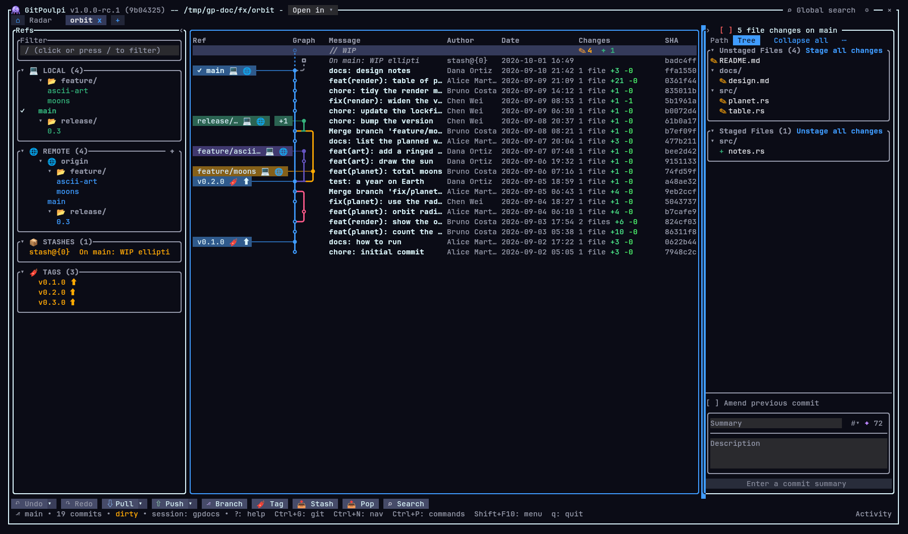

[English](../log-and-history.md) · [Čeština](../cs/log-and-history.md) · [Deutsch](../de/log-and-history.md) · **Español** · [Français](../fr/log-and-history.md) · [Italiano](../it/log-and-history.md) · [日本語](../ja/log-and-history.md) · [한국어](../ko/log-and-history.md) · [Nederlands](../nl/log-and-history.md) · [Polski](../pl/log-and-history.md) · [Português (Brasil)](../pt-BR/log-and-history.md) · [Português (Portugal)](../pt-PT/log-and-history.md) · [Русский](../ru/log-and-history.md) · [Svenska](../sv/log-and-history.md) · [Türkçe](../tr/log-and-history.md) · [Українська](../uk/log-and-history.md) · [简体中文](../zh-CN/log-and-history.md)

# Trabajar con el Log

El Log es el centro de GitPoulpi: todo el historial como un grafo, con cada rama,
tag y stash en él. Esta página cubre cómo leerlo, cómo buscar cosas en él y todo
lo que puedes hacer con los commits y las refs. Las zonas se nombran en el
[recorrido por la interfaz](interface-tour.md); las teclas exactas están en
[Atajos de teclado](keybindings.md) y los gestos del ratón en
[Ratón y gestos](mouse-and-gestures.md).


## Leer el grafo

Cada fila es un commit, el más reciente primero. Un punto está en el carril del
commit; las líneas unen un commit con sus padres; un merge muestra dos líneas que
se juntan. Los chips de ref de la izquierda nombran las ramas y los tags de ese
commit, con el color del carril, con una línea fina hasta el punto. Un icono de
portátil marca una rama local, un globo una remota y `✓` la rama con checkout.
`+N` significa que apuntan a ese commit más refs; pasa el puntero por encima para
listarlas, o usa el menú de abajo.

La primera fila son los **cambios de trabajo** (un círculo discontinuo: tu trabajo
sin commit, unido al commit sobre el que está). Los stashes aparecen como
cuadraditos en un carril junto al commit sobre el que se hicieron.

### Colores, tinte de fila y avatares

Los colores de los carriles vienen del tema. *Ajustes > Apariencia > Tema de color
del grafo* combina cualquier tema con cualquier paleta de carriles, y el selector
*App: Cambiar tema de color del grafo...* de la paleta (`Ctrl+N Shift+Y`)
previsualiza cada paleta en directo; consulta [Temas](themes.md). *Fondo de los
carriles del grafo* en **Tinte de fila** pinta una banda tenue del color del carril
detrás de la columna del grafo y una barra fina en su borde. *Intensidad del tinte
de fila* (**Fuerte**, **Media** (por defecto), **Sutil**) fija cuánto se atenúa la
banda.

| Paleta de carriles Serie con tinte de fila | Paleta de carriles Material con tinte de fila |
|---|---|
|  |  |

Los *Avatares de autor* (una imagen en el punto del grafo o en la columna Autor)
están desactivados por defecto. Al activarlos se envía a Gravatar un hash del
correo de cada autor, y se consulta a tu proveedor de alojamiento. *Fuentes de
avatares* y *Avatar de reserva* en la misma página eligen de dónde vienen las
imágenes y qué se dibuja cuando no hay ninguna.

Si tu terminal no puede mostrar imágenes, el grafo se dibuja con caracteres.
*Renderizador del grafo* y *Protocolo de imagen* fuerzan una u otra cosa; consulta
[Solución de problemas](troubleshooting.md).

El resaltado de la fila seleccionada o bajo el puntero empieza en el círculo del
commit. Los carriles a su izquierda conservan el fondo normal.

### Columnas

Haz clic derecho en la cabecera para elegir las columnas: **Ref**, **Grafo**,
**Mensaje** (siempre activa), **Autor**, **Fecha**, **Cambios** y **SHA**. La
columna opcional **Cambios** muestra, para cada commit, `n files +added -removed`.
Arrastra el borde entre dos cabeceras para cambiar el tamaño de una columna; la
elección se recuerda, en celdas del terminal. Con el valor por defecto `ui.column_resize = "line"`, el borde es el hueco de una celda al final de una columna: una pequeña marca descansa en él en la fila de cabecera y, mientras el puntero está sobre el hueco (en la cabecera o en cualquier punto de la tabla), se dibuja una línea fina de acento sobre toda la altura de la tabla y un arrastre desde cualquier punto de ella redimensiona (el puntero se convierte en un puntero de redimensionar en los terminales que lo admiten). Con `"header"` no hay marca ni línea: el primer carácter de la celda de cabecera que sigue al borde se ilumina al pasar el puntero y el arrastre empieza desde él, solo en la fila de cabecera (Ajustes > Log y grafo > Redimensionado de columnas). Las filas se ven igual en ambos modos: el hueco forma parte de la columna que queda a su izquierda, así que la selección y los tintes de fila lo atraviesan. Ref, Grafo y las demás columnas
conservan su ancho cuando se cambia el tamaño de la ventana o se maximiza: solo
**Mensaje** crece o se reduce (en una ventana muy estrecha las demás columnas
ceden temporalmente, Grafo la primera, y vuelven a tus anchos cuando la ventana
vuelve a crecer). Arrastra la columna Grafo hasta su ancho mínimo, un punto de commit, y el grafo se vuelve compacto: cada commit queda en un solo carril, uno bajo otro, sin líneas de rama ni de merge. Una celda más ancha y el árbol vuelve. Con las imágenes de los autores en los círculos de commit (Ajustes > Apariencia > Avatares de autor: grafo) el círculo ocupa dos celdas, así que la columna se detiene una celda antes (tres celdas) y nunca recorta una imagen.

Al arrastrar una cabecera aparece un fantasma de su nombre que sigue al puntero y una barra de acento donde caería la columna; el orden cambia al soltar y `Esc` cancela. El selector que abre el clic derecho es una lista de casillas (`[x]` / `[ ]`) con una ✕ en su título; también se alcanza desde la paleta (`Ver: Log: elegir las columnas que se muestran`), se mueve con las flechas y se alterna con `Espacio` / `Intro`.

Con el teclado, `Shift+C` (o `Ver: Columna del Log: elegir una columna para moverla o ajustarla` de la paleta) elige una columna y su celda de cabecera se ilumina. Después `Tab` / `Shift+Tab` eligen otra columna, `<` / `>` la mueven un lugar a la izquierda o a la derecha entre las columnas visibles (el equivalente de arrastrar su cabecera), `]` / `[` la ensanchan o la estrechan (el equivalente de arrastrar su borde; la última columna mueve su borde izquierdo), `0` devuelve todos los anchos al modo automático y `Esc` o `Enter` salen. Mientras tanto, las flechas siguen moviéndose por los commits. El orden y los anchos se recuerdan como los de un arrastre, y son propios del Log: la columna de commits junto a un diff guarda una lista propia.

*Ajustar al contenido.* Un **doble clic** en el borde de una columna ajusta la columna de su izquierda a su contenido visible más ancho y a su cabecera (los caracteres anchos y los emoji cuentan por las celdas que ocupan). En la disposición ajustada el Log siempre llena su panel, así que una columna se detiene en lo que cabe en el panel una vez que **Mensaje** conserva su parte y cada otra columna su ancho mínimo: la línea de estado dice entonces `Autor necesita 34 celdas, caben 20.` Lo mismo con el teclado: con una columna elegida (`Shift+C`, `Tab`), `=` la ajusta y `+` ajusta todas las columnas; la paleta tiene `Ver: Columna del Log: ajustar la columna a su contenido` y `... ajustar todas las columnas a su contenido`; el selector del clic derecho lista `Ajustar <columna> a su contenido` (la columna bajo el puntero), `Ajustar todas las columnas a su contenido` y `Restablecer los anchos de columna` bajo sus casillas. **Mensaje** es la columna flexible y no tiene ancho propio que ajustar: ocupa el espacio que dejan las demás.

*Desplazar lateralmente.* Por defecto todas las columnas caben en el panel. En la disposición **scroll** (la casilla `Desplazar lateralmente (las columnas conservan su ancho)` del selector, Ajustes > Log y grafo > Disposición de columnas, `Ver: Log: alternar el desplazamiento lateral de las columnas` de la paleta, o `s` mientras hay una columna elegida) las columnas conservan sus anchos, **Mensaje** incluido (ahí tiene un ancho propio, y ajustarlo toma su resumen más ancho), no se cede nada cuando la ventana es estrecha y la tabla puede ser más ancha que el panel. Una barra en el borde inferior la desplaza: arrastra el pulgar, pulsa la pista vacía para traer el pulgar bajo el puntero, o usa sus flechas de los extremos. Con el teclado, `Shift+Izquierda` / `Shift+Derecha` desplazan cuatro celdas (la paleta tiene `Ver: Log: desplazar las columnas a la izquierda` / `a la derecha`); la rueda horizontal o `Shift`+rueda sobre la tabla hacen lo mismo, y elegir una columna (`Shift+C`, `Tab`) la desplaza hasta dejarla a la vista. Una tabla más estrecha que el panel deja espacio en blanco a la derecha, y la banda de una fila seleccionada llega hasta el borde. Cada disposición guarda sus propios anchos (`ui.log_column_widths` y `ui.log_column_widths_scroll`); el primer arrastre, tecla o ajuste en la disposición scroll guarda cada columna con el ancho que tiene, así que solo se mueve la que cambias. En la disposición ajustada, un ajuste que no cabe en el panel lo dice y apunta a esta disposición.

*El agarre de la última columna.* La última columna también tiene un agarre, en su propia última celda (no en el borde del panel, que sigue cambiando el tamaño de los paneles): un arrastre la mueve según lo que haya recorrido el puntero, y **Mensaje** absorbe la diferencia. **SHA** mide 8 celdas por defecto (los 7 dígitos y esa celda de agarre).



### Autores y `.mailmap`

Cuando el repositorio tiene un `.mailmap` (el archivo de git que da un solo nombre y correo a una persona que hizo commits con varios), la columna **Autor** del Log, los detalles del commit, el blame y el historial del archivo muestran la identidad **canónica**, igual que `git log`. Los commits en sí no se tocan. El ajuste `log.use_mailmap` (Ajustes > Historial y grafo, activado por defecto) lo desactiva para mostrar los nombres guardados. Buscar por autor coincide con el nombre y el correo tal como se muestran, así que buscar el nombre canónico encuentra todos los commits de esa persona. La pestaña **Identidades** del editor del historial lista los nombres y correos del historial y escribe por ti las líneas del `.mailmap`, véase `history-rewrite.md`; desde un terminal: `gitpoulpi mailmap list|check|add`.

## Buscar cosas

- **Búsqueda** (`f`, el botón **Buscar** de la barra de herramientas, o
  *Navegación: Buscar commits...* de la paleta): coincide con todo el mensaje del
  commit, el nombre y el correo del autor, el hash y los nombres de las refs.
  Atenúa lo que no coincide y mantiene la forma del grafo. `Enter` /
  `Shift+Enter` saltan a la siguiente / anterior coincidencia.
- **Filtro de refs** (`/` en la barra lateral): reduce por nombre las listas de
  ramas, tags y remotos.
- **Solo** (la tecla `o`, o el menú de la ref, sobre una ref, carpeta o remoto):
  muestra solo los commits de las refs en solo; pon varias en solo para ver su
  unión. `Shift+O` deja de usar solo.
- **Ocultar** una ref (su menú) para sacarla del grafo: su píldora desaparece y
  también los commits que solo ella alcanza (el commit con checkout siempre se
  queda, con la fila del árbol de trabajo). *Ocultas n* en el título de Refs las
  cuenta, **Mostrar todo** (`Shift+H`) las devuelve. El total de la línea de
  estado cuenta el historial visible.

## Ramas, tags y la barra lateral Refs

Haz doble clic en una rama local o en un tag para hacer checkout. Haz clic derecho
en una ref (en la barra lateral, o en su chip del Log) para ver su menú. Las
entradas más útiles:

| Entrada | Hace |
|---|---|
| Mostrar en el grafo | Desplaza el Log hasta el commit de la ref (cargando antes historial más antiguo si hace falta) y hace parpadear la fila; la selección se mantiene. Un solo clic en una ref hace lo mismo, salvo que *Clic en una ref para mostrarla en el grafo* esté desactivado en Ajustes. Una ref oculta del grafo (o por Solo) lo indica en la barra de estado en su lugar |
| Checkout | Cambia a la rama o se desacopla en el tag |
| Merge, Rebase sobre | Hace merge de esta ref en la rama con checkout, o rebase de la rama con checkout sobre ella |
| Fast-forward `<branch>` a `<current>` / `<current>` a `<branch>` | Avanza una rama cuando es un fast-forward; si no, queda atenuada con el motivo (`divergen, no es un avance rápido`) |
| Crear worktree desde... | Abre un worktree vinculado en su propia pestaña |
| Pull, Push, Fetch, Definir upstream... | Operaciones de red sobre esa rama |
| Ocultar / Mostrar en el grafo, Solo | Solo visualización; ocultan o ponen en solo una ref (ocultar también quita los commits que solo esa ref alcanza) sin tocar el repositorio |
| Renombrar, Eliminar | Eliminar pregunta antes; también se puede eliminar su gemela remota |
| Copiar nombre de la rama, Copiar enlace de la rama en el remoto | Al portapapeles |

**Dónde vive un tag.** Un tag puede estar en este equipo, en un remoto o en ambos, y
las filas TAGS de la barra lateral (y la píldora del tag en el Log) lo indican con una marca
tras el nombre. Pasa el puntero sobre un tag para verlo explicado con palabras.

| Marca | Significado |
|---|---|
| flecha hacia arriba | Solo aquí: ningún remoto lo tiene. Su menú ofrece *Push* |
| flecha izquierda-derecha | Aquí y en un remoto, en el mismo commit |
| flecha hacia abajo (fila atenuada) | Solo en un remoto: no está en este repositorio (nunca se trajo o se eliminó aquí). Su menú ofrece *Fetch de `<tag>` desde `<remote>`* y *Eliminar `<tag>` en `<remote>`...*; `Git: Fetch Selected Tag` en la paleta |
| flecha arriba-abajo | También está en un remoto, pero en un commit distinto (un push sería rechazado) |

git no guarda refs de seguimiento remoto para los tags, así que GitPoulpi sabe qué tiene cada remoto
por tu último **fetch** (cualquiera, también el automático) y por sus propios push y eliminaciones de
tags. Nada consulta la red mientras navegas; si otra persona cambió los tags de un remoto, haz un fetch
para verlo. La misma información está en `gitpoulpi tag list` (campos `local`, `remote`, `differs_on`,
`where`).

**Eliminar un tag.** Cuando un remoto tiene el tag, el botón rojo **Eliminar** abre un diálogo
con tres filas numeradas (`1`-`9`, o Arriba/Abajo y `Enter`; `Esc` cancela), y
la fila resaltada se explica debajo:

1. **Eliminar en local**: lo quita solo de este repositorio. Se ejecuta al instante y
   el mensaje avisa de que el remoto aún lo tiene. **El próximo fetch lo recupera**
   (git sigue los tags del remoto), salvo que lo elimines también en el remoto.
2. **Eliminar en `<remote>`**: lo quita allí para todo el mundo (`git push <remote>
   --delete`). Pide una confirmación que nombra el remoto. Tu tag local
   se queda. No se puede deshacer.
3. **Eliminar en local y en `<remote>`**: las dos cosas, tras la misma confirmación, así que
   un fetch no puede recuperarlo. **Deshacer restaura solo el tag local** (el mismo objeto
   tag); queda de nuevo solo en local y *Push* lo devuelve al remoto.


Con varios remotos, cada uno tiene sus propias filas. Un tag solo local conserva la confirmación
sencilla; un tag que está solo en un remoto va directo a la confirmación de ese remoto.
CLI: `gitpoulpi tag delete <name> [--local | --remote <r> | --both [--remote <r>]]`.

**Fetch y tags.** Un fetch actualiza también lo que tiene cada remoto (las marcas) y
el seguimiento de tags propio de git sigue valiendo: un tag eliminado solo aquí se vuelve a traer.
Un tag que alguien **eliminó en el remoto** desaparece del lado del remoto en la
marca tras cualquier fetch, pero se queda aquí como tag local (ahora *solo aquí*),
porque por defecto git no poda tags. **Ajustes > Sincronización > Auto-prune
de tags** (desactivado por defecto; `gitpoulpi fetch --prune-tags`) elimina también ese tag local,
pero solo si había estado en el remoto: un tag que nunca enviaste, o uno que
moviste, nunca se toca. Hace falta git 2.41 o posterior para saber qué se podó.

**Rama o tag nuevo.** Los botones **Rama** y **Tag** de la barra de herramientas,
`Ctrl+G b` y `Ctrl+G t`, o *Crear rama aquí...* de un commit piden el nombre en un
cuadro en línea de la columna Ref, en la fila del commit de destino. `Enter` lo
crea, `Esc` cancela, y un nombre que git rechazaría se notifica en rojo sin cerrar
el cuadro.

En un commit sin ref, pasar el puntero por su fila muestra además, en la columna Ref, una píldora tenue con el nombre de la rama a la que pertenece (si no, su rama remota), deducida del historial; los tags nunca se muestran como fantasma. Una rama borrada tras una fusión se sigue mostrando, tachada, con el nombre que figura en el asunto del commit de fusión (`Merge branch 'x'`, `Merge pull request #N from owner/x`...); las fusiones con squash, los rebases y los avances rápidos no dejan esa huella. Al pasar por la píldora se ve su tipo. No crea nada: use el comando de crear rama de arriba. **Mostrar una rama fantasma en el commit bajo el puntero** en Ajustes > Log y grafo la desactiva; no se dibuja donde la columna Ref es demasiado estrecha.

**Remotos.** El `+` del título REMOTAS añade uno; haz clic derecho en el nombre de
un remoto para hacer fetch, copiar su enlace web, convertirlo en el remoto por
defecto, ocultarlo del grafo, editar sus URL o eliminarlo. **Ocultar un remoto**
(el ojo de su fila, *Ocultar remoto del grafo* del menú o `Remoto: Ocultar remoto en el grafo...`
en la paleta) oculta todas las ramas que tiene ahora o que reciba después, y los
commits que solo él alcanza salen del Log: la forma de explorar una historia sin la
de un remoto de archivo ajeno; se recupera con *Mostrar remoto en el grafo*. Mostrar
un remoto también muestra las ramas suyas que se habían ocultado una a una. Una rama
de un remoto oculto lo dice en la línea de estado si se usa su ojo: muestra primero el remoto.

**Stashes.** **Stash** hace stash de todo (archivos sin seguimiento incluidos);
`Ctrl+G m` pide antes un mensaje (con la IA activada, `Ctrl+G` dentro de ese
cuadro sugiere uno). Haz clic derecho en una fila de stash, en el Log o en la
sección STASHES, para ver **Pop**, **Aplicar** (conserva el stash) o **Drop**.

**Worktrees.** *Crear worktree desde...* (en una rama, tag o commit) abre un
diálogo que propone una carpeta junto al repositorio, un nombre opcional de rama
nueva y «Abrir el nuevo worktree en una pestaña». Los worktrees aparecen en la
sección WORKTREES; haz doble clic en uno para abrirlo, y su pestaña se cierra sola
cuando se elimina el worktree.

## Arrastrar refs sobre commits

Puedes pulsar sobre una rama (en la barra lateral o en su
chip del Log) y arrastrarla. Un rótulo fantasma sigue al puntero y los
destinos válidos se iluminan; suelta para obtener un menú:

- una rama local **sobre otra rama local**: Merge, Rebase, Rebase interactivo,
  Fast-forward;
- una rama local **sobre una rama remota**: Push a ese remoto;
- una rama remota **sobre una rama local**: Merge, Rebase, Fast-forward, Pull.

`Esc` cancela un arrastre. El equivalente de teclado es el comando de la paleta
*Refs: Soltar la ref seleccionada sobre la rama activa...*.

**Merge o fast-forward.** Cuando el destino no tiene ningún commit propio (la rama arrastrada solo va por delante), un
merge podría limitarse a mover el destino hacia delante. Por defecto (Ajustes > Git > **Merge fast-forward** = *never*,
o la elección propia de un repositorio en su página Opciones de merge) la fila del menú dice *Merge x en y (commit de
merge)* y crea un commit de merge de verdad, de modo que el historial conserva la rama; usa la fila aparte
*Fast-forward de y a x* cuando quieras el simple avance (para una línea recta, usa *Rebase* en su lugar). Con
*allowed* la fila de Merge dice *(con fast-forward)*, y con *only* *(solo fast-forward)*, en gris y con el motivo
cuando las ramas han divergido. Las mismas filas y rótulos están en el menú propio de una rama, y
`gitpoulpi merge --ff | --no-ff | --ff-only` elige en cada merge.

## El menú del commit

Haz clic derecho en un commit (o pulsa `.` sobre él) para ver su menú:


| Entrada | Hace |
|---|---|
| **Cherry-pick sobre `<branch>`** | Reproduce el commit en la rama con checkout |
| **Revertir commit...** | Crea un commit que lo deshace. En un commit de merge, un desplegable pregunta primero qué padre es la línea principal (el lado que se conserva; el padre 1 es la rama sobre la que se hizo el merge) y después viene la confirmación de siempre. Deshacer restaura el estado anterior |
| **Reset de `<branch>` a este commit** | Un submenú con el tipo de reset; un reset hard pide confirmación |
| **Editar mensaje del commit...** | Consulta más abajo |
| **Modificar...** | Cambia el mensaje, el nombre, el correo y la fecha del autor del commit en un solo diálogo; véase [Modificar un commit](#modificar-un-commit-mensaje-autor-fechas) |
| **Dividir commit...** | Divide el commit en varios; véase [Dividir un commit](#dividir-un-commit) |
| **Dividir commit (IA)...** | Lo mismo, con una agrupación propuesta por el modelo; solo cuando la [IA](ai.md) está activada |
| **Explicar cambios (IA)** | Una ventana emergente con una explicación de la IA; solo cuando la [IA](ai.md) está activada |
| **Rebase interactivo desde aquí...** | Consulta más abajo |
| **Crear rama aquí...**, **Crear tag aquí...**, **Crear tag anotado aquí...** | Cuadro de nombre en línea |
| **Checkout de este commit**, **Crear worktree aquí...** | HEAD desacoplado, o un worktree |
| **Crear parche desde este commit...**, **desde aquí hasta `<branch>`...** | Escribe archivos `.patch`; *Aplicar parche* está en el menú de una ref |
| **Copiar enlace del commit en el remoto**, **Copiar** > | Al portapapeles (hash, mensaje y más) |

## Editar el mensaje de un commit (reword)

*Editar mensaje del commit...* (o `Ctrl+G e`) abre el mensaje completo: un resumen
de una línea con un contador, una descripción debajo, **Cancelar** y **Actualizar
mensaje**. Se puede hacer reword de cualquier commit de la rama con checkout
(HEAD o un ancestro); los commits que hay encima se recrean con sus propios
árboles, autores y fechas, los merges siguen siendo merges, y tus cambios con
stage y sin stage se dejan como están. Si el commit ya se ha enviado, la ventana
emergente avisa en ámbar de que necesitarás un force push (con lease) y pide una
segunda confirmación. `Ctrl+Z` (el Deshacer de la barra de herramientas) revierte
el reword; consulta [Deshacer y rehacer](undo-redo.md). La barra de estado
también nombra la punta anterior.

## Modificar un commit (mensaje, autor, fechas)

*Modificar...* en el menú del commit (o `Ctrl+G Shift+E`, o *Commit: Modificar...* en la paleta) abre un solo diálogo con las propiedades del commit: el resumen, la descripción y el nombre, el correo y la fecha del autor, cada uno rellenado con los valores del commit. Cambia lo que quieras y pulsa **Aplicar**; solo se envían los campos modificados. Una fecha se escribe `YYYY-MM-DD HH:MM:SS +HH:MM` y se muestra en UTC mientras no la edites. El committer eres tú, ahora (igual que en un reword). Se puede modificar cualquier commit de la rama activa, con las mismas reglas, el mismo aviso de commit ya enviado y la misma segunda confirmación que *Editar mensaje del commit...*; los commits de encima se recrean con sus propios autores y fechas, y tus cambios preparados y sin preparar no se tocan. `Ctrl+Z` (Deshacer de la barra de herramientas) lo revierte. En las compilaciones con reescritura del historial, **Modificar el historial más a fondo...** (`Alt+H`), abajo a la izquierda del diálogo, lo cierra sin aplicar nada y abre el [editor de reescritura del historial](history-rewrite.md) con el alcance desde este commit hasta el más reciente; si editaste un campo, pregunta antes (`Esc` confirma). `Ctrl+N` muestra una insignia en cada campo y botón del diálogo; púlsala para poner el cursor en ese campo o pulsar ese botón (consulta [Insignias](keybindings.md#insignias)).

Todas las formas de abrir el diálogo lo abren completo, con todos los campos visibles y editables; solo cambia la posición del cursor. En el panel de detalle del commit (a la derecha), haz clic derecho en el resumen, la descripción o el bloque del autor y elige *Modificar el resumen...*, *Modificar la descripción...* o *Modificar el autor...*, o haz doble clic en el resumen, la descripción, el autor o la fecha de autoría: el diálogo se abre con el cursor en ese campo. Los equivalentes de teclado funcionan desde el Log y desde el panel de detalle: `Ctrl+G Shift+E` (todos los campos), `Ctrl+G Shift+A` (el autor) y, en la paleta, *Commit: Modificar...*, *Commit: Modificar autor...*, *Commit: Modificar resumen...* y *Commit: Modificar descripción...*. Ambos acordes se pueden reasignar (`git_prefix.amend`, `git_prefix.edit_author`; véase [Atajos de teclado](keybindings.md)). Desde un script o un agente: `gitpoulpi amend <commit>` con `--message` (o `--summary` / `--description`), `--author-name`, `--author-email`, `--author-date` y las opciones `--committer-*` correspondientes (la herramienta MCP es `amend`).

## Dividir un commit

*Dividir commit...* en el menú del commit (o en la paleta: *Git: Dividir el commit
seleccionado...*) parte un commit en dos o más, del más antiguo al más reciente.
Se puede dividir cualquier commit que no sea de merge de la rama con checkout (HEAD
o un ancestro, también un commit raíz). El editor de división tiene dos paneles:
**Nuevos commits** a la izquierda (cada uno con su mensaje) y los **Cambios** del
commit a la derecha, una fila por archivo y hunk, cada una con un campo `[N v]` que
nombra el commit nuevo que lo recibe.

| Tecla | Ratón | Hace |
|---|---|---|
| `Up` / `Down` (`k` / `j`) | clic en una fila | moverse por los cambios (`Shift+Up` / `Shift+Down` amplía la selección) |
| `1`-`9` | el campo `[N v]` de la fila, y luego una opción | dar el cambio seleccionado a ese commit nuevo; `0` lo deja sin asignar |
| `Enter` / `m` | el campo `[N v]` | abrir la lista de commits para el cambio seleccionado |
| `n` | `+ Nuevo commit` | poner el cambio seleccionado en un commit nuevo |
| `v` | | **modo por líneas**: dividir un hunk línea a línea (arrastra sobre las líneas para seleccionar un rango) |
| `Tab` | clic en un panel | alternar entre los commits y los cambios |
| `e` / `Enter` (en el panel de commits) | el lápiz | editar el mensaje de ese commit |
| `d` / `Delete` | la cruz | quitar un commit nuevo (sus cambios quedan sin asignar) |
| `Alt+Up` / `Alt+Down` | las flechas | subir o bajar un commit nuevo |
| `s` | la casilla | firmar los commits nuevos |
| `Shift+R` | `Restablecer` | volver al plan inicial |
| `Ctrl+S` | `Dividir en N` | dividir |
| `Esc` | la cruz, `Cancelar` | salir; con ediciones pendientes, una segunda pulsación lo confirma |

Cada cambio debe ir a exactamente un commit; el editor cuenta lo que sigue *Sin
asignar* y el botón se rechaza hasta que llega a cero. Un archivo binario, que solo
cambia su modo, que es nuevo o eliminado en el commit, un submódulo o un archivo LFS
solo se puede dar entero. El primer commit empieza con el mensaje original; da un
mensaje a cada uno de los nuevos. Un commit nuevo conserva el autor y la fecha
originales; quien confirma eres tú, ahora.

**En tu repositorio no cambia nada salvo la rama.** El último commit nuevo tiene
exactamente el contenido del commit original, así que los commits que hay encima se
recrean con los mismos árboles, autores y mensajes (los merges siguen siendo
merges), y tus cambios en stage y sin stage se dejan como están: un árbol de trabajo
con cambios no es problema y no puede haber conflicto. Los hooks no se ejecutan.
Una división queda bloqueada mientras haya un auto-stash pendiente.

**Firma.** La casilla *Firmar commits* parte del `commit.gpgSign` del repositorio.
Desmarcada, se pierden las firmas de los commits reescritos (los nuevos y los que
hay encima), y el editor lo dice bajo la casilla. Marcada, se firman todos; si la
firma falla, no se cambia nada.

**Deshacer.** Un solo `Ctrl+Z` (el Deshacer de la barra de herramientas) devuelve el
commit original, también con un árbol de trabajo con cambios; consulta [Deshacer y
rehacer](undo-redo.md). Un commit que ya se había enviado necesita después un force
push (con lease).

**Desde el rebase interactivo.** Cada fila de la revisión del rebase tiene un
pequeño botón **dividir...** (`t` en la fila): abre el mismo editor para ese commit
y, cuando la división termina (o la cancelas), vuelves a la pantalla de revisión,
sobre el historial nuevo. Si habías editado el plan, pulsa dividir una segunda vez
para confirmar que esas ediciones se pierden.

Para scripts y agentes: `split-source` y `split-commit` en la [referencia de la
CLI](cli-reference.md); un agente también puede abrirte este editor ya rellenado
para que lo revises (`ui propose split`, véase [MCP y agentes](mcp-and-agents.md)).

## Rebase interactivo

Elige **Rebase interactivo desde aquí...** en un commit que sea ancestro de la
rama con checkout, o arrastra una rama sobre otra y elige *Rebase interactivo*. El
Log se sustituye por una pantalla de revisión: una fila por commit, el más
reciente arriba, cada una con un asa de arrastre y un desplegable de acción.


| Acción | Tecla | Efecto |
|---|---|---|
| Pick | `p` | Conserva el commit |
| Reword | `r` | Lo conserva con un mensaje nuevo |
| Squash | `s` | Lo funde en el commit de abajo, combinando los mensajes |
| Fixup | `f` | Lo funde en el commit de abajo, descartando su mensaje |
| Drop | `d` | Lo deja fuera |
| Edit | `e` | Se detiene ahí para que puedas modificarlo |

Arrastra una fila (o `Ctrl+Up` / `Ctrl+Down`) para reordenar. `a` previsualiza el
autosquash (los commits `squash!` y `fixup!` se colocan junto a sus destinos). No
ocurre nada hasta que pulsas **Iniciar rebase** (`Ctrl+S`); **Restablecer** devuelve
el plan al original y **Cancelar rebase** (`Esc`) sale sin cambiar nada. Cuando un
paso se detiene por un conflicto o un `edit`, un aviso sobre el Log ofrece
**Continuar**, **Omitir** y **Abortar**. Un rango que contiene un commit de merge
no se puede rebasar de forma interactiva; la entrada del menú dice por qué.

## Cherry-pick de varios commits

`Ctrl+clic` alterna un commit, `Shift+clic` (o `Alt+clic`) selecciona un rango, `Space` alterna el
actual, `Esc` limpia. Haz clic derecho en un commit seleccionado para ver
**Cherry-pick de N commits sobre `<branch>`...**: se abre la misma pantalla de
revisión, con las mismas acciones y el mismo reordenamiento, e **Iniciar
cherry-pick** los reproduce en orden.

## Copiar commits como gitGraph de Mermaid


Selecciona commits en el Log (`Ctrl+clic`, `Shift+clic`, `Space`; o deja el cursor en uno)
y abre **Copiar como gitGraph de Mermaid...**: `Shift+Y` en el Log, el submenú **Copiar**
del menú del commit, o `Log: Copiar como gitGraph de Mermaid...` en la paleta. Un popup
muestra el script de [Mermaid](https://mermaid.js.org/syntax/gitgraph.html) generado, en vivo y
con desplazamiento; `Enter` (o el botón **Copiar**) pone exactamente ese texto en el portapapeles.
Pégalo en un README, en la descripción de un pull request o en [mermaid.live](https://mermaid.live).

El popup tiene tres comboboxes, una casilla y la vista previa (`Tab` se mueve entre ellos; cada
combobox se abre con `Enter`, `Space` o `Down`):

- **Commits**: la selección o, cuando hay un commit seleccionado y HEAD desciende de él, **De la
  selección a HEAD**, la serie de commits entre ambos (se responde con la parte cargada del Log).
- **Detalle**: `structure` (commits, ramas y merges; los ids son SHA cortos), `refs` (añade los
  nombres reales de rama como ramas de Mermaid, los tags como `tag:` y el commit HEAD como
  `type: HIGHLIGHT`), `subjects` (el id del commit pasa a ser `<sha> <asunto>`, escapado y recortado a
  `ui.mermaid_subject_width` caracteres) y `full` (añade el autor y la fecha UTC al id).
- **Dirección**: de izquierda a derecha (`gitGraph LR:`) o de arriba abajo (`gitGraph TB:`).
- **Incluir el bloque ```mermaid** envuelve el script en un bloque de código de Markdown.

El detalle, la dirección y el bloque se recuerdan (`ui.mermaid_detail`, `ui.mermaid_orientation`,
`ui.mermaid_fence`). El mismo generador funciona desde la línea de comandos:
`gitpoulpi log --format mermaid [--detail structure|refs|subjects|full] [--orientation lr|tb] [--fence]
[--range A..B | --limit N]` (consulta la [referencia de la CLI](cli-reference.md)); el servidor MCP lo expone como
el argumento `format` de la herramienta `log`.

El `gitGraph` de Mermaid es un lenguaje de reproducción (commit, branch, checkout, merge), no una
descripción de grafo, así que el generador toma algunas decisiones que conviene conocer:

- Un commit continúa la rama de su primer padre seleccionado; los demás hijos abren una rama
  nueva con el nombre de una rama real sobre él (`b1`, `b2`... en `structure`). La primera rama es `main`
  (o el nombre real, mediante una cabecera `mainBranchName`) y sigue la cadena de primeros padres de HEAD.
- Un merge se une a la rama del otro padre. Cuando esa rama avanzó después del padre, el
  generador bifurca una pequeña rama puntero (`<rama>-<sha>`) en el padre y hace merge de esa, para que el
  merge siga apuntando al commit correcto.
- Un padre fuera de la selección se descarta: un commit que se queda sin padre seleccionado empieza una línea
  propia, de modo que los huecos de una selección aparecen como líneas desconectadas.
- Un merge octopus (tres o más padres) pasa a ser una serie de merges; los intermedios llevan el
  sufijo ` (octopus 1/2)`, y el último lleva el commit real.
- Los cherry-picks no se detectan; las comillas dobles de los asuntos pasan a ser apóstrofos (Mermaid no
  puede escaparlas).

## Comparar commits

Selecciona dos o más filas del Log: `Ctrl+clic` alterna una
fila, `Shift+clic` (o `Alt+clic`, `Shift+Up/Down`, `Alt+Up/Down`) toma un rango,
`Space` alterna la fila actual. Se pueden seleccionar commits, la fila **WIP** y
las filas de **stash**. El panel derecho se convierte en un panel **Comparar**:

- la cabecera tiene un botón **Intercambiar** y debajo se lista cada fila
  seleccionada en el orden del Log (la más reciente primero) como una
  **tarjeta** de dos líneas: el
  avatar del autor (según los ajustes de avatares del Log: una imagen en los
  terminales con imágenes, iniciales en los demás), el nombre, hace cuánto, el
  id corto y el resumen. La fila **WIP** es «Árbol de trabajo / Cambios sin
  confirmar»; un stash muestra el glifo de stash, `stash@{n}` y su mensaje. El
  extremo más antiguo lleva una etiqueta **Desde** y el más reciente una
  etiqueta **Hasta** (Intercambiar las mueve); con tres o más filas una nota
  dice que los cambios se combinan. La lista de tarjetas ocupa como mucho un
  tercio del panel y luego se desplaza (rueda, barra de desplazamiento, o
  arrastra el divisor de debajo para cambiar su tamaño);
- haz clic en una tarjeta para llevar el cursor del Log a esa fila y hacerla
  parpadear en el grafo; la selección no cambia, así que `Space` quita después
  esa fila de ella;
- debajo, la lista habitual de archivos cambiados (vista de ruta o de árbol,
  filtro, orden) lista los archivos que difieren entre ellas. Haz clic en un
  archivo, o pulsa `Enter`, para abrir su diff en el centro, con los mismos
  diseños unificado o dividido, con Blame, Historial del archivo y la vista del
  archivo en el extremo más reciente.


Lo que se compara depende de la selección:

| Selección | Se compara |
|---|---|
| dos commits (o un stash y un commit) | el más antiguo con el más reciente, en el orden del Log, sea cual sea el orden de los clics |
| la fila WIP y un commit o stash | ese commit con el árbol de trabajo: cambios staged y unstaged de los archivos con seguimiento (los archivos sin seguimiento no forman parte de un diff) |
| tres o más commits | sus cambios combinados: desde justo antes del más antiguo hasta el más reciente (los merges siguen su primer padre) |

Un renombrado se muestra como un borrado más un añadido. **Intercambiar** (`x`)
cambia los extremos de una comparación de dos filas; con la fila WIP, que
siempre es el extremo más reciente, o con un rango de tres o más, no hay nada
que intercambiar. Una comparación con la fila WIP sigue al árbol de trabajo
mientras guardas archivos.

Teclado: `v` (o **Log: Comparar la selección** en la paleta de comandos) lleva
el foco a la lista de archivos de la comparación; `x` (o **Log: Intercambiar los
extremos de la comparación**) intercambia; `n` (o **Log: Ir a la siguiente fila
comparada**) es el equivalente de teclado de hacer clic en una tarjeta: el
cursor del Log va a la siguiente fila seleccionada, dando la vuelta. `Esc` o un
clic simple en una fila vuelve al commit único. La entrada **Cherry-pick** solo
cuenta los commits de la selección; la fila WIP y los stashes se ignoran ahí.

Las mismas listas están disponibles para scripts y agentes:
`gitpoulpi diff --from <rev> [--to <rev|worktree>] [--name-only]` (la CLI y la
herramienta MCP `diff`; `--to` es el árbol de trabajo por defecto).

## Conflictos y otros avisos

Cuando un merge, rebase, cherry-pick o revert se detiene por un conflicto, aparece
un aviso sobre el Log y los archivos en conflicto llevan un `!` rojo en el panel
Estado. Resuélvelos en el editor de merge y luego usa **Continuar** o **Commit de
merge** del aviso, o **Abortar** para retroceder. Consulta
[Resolver conflictos de merge](merge-conflicts.md).

Otros avisos sobre el Log:

| Aviso | Botones | Paleta |
|---|---|---|
| *Rebase de `<rama>` sobre `<commit>` · paso/total · detenido en ...* | **Continuar**, **Omitir**, **Abortar** | *Rebase: Continuar / Omitir / Abortar* |
| *Aplicando parches (git am) · parche n de m* (un `git am` que se detuvo) | **Resolver conflictos...** (cuando un parche entra en conflicto), **Continuar**, **Omitir**, **Abortar** (pregunta antes) | *git am: Continuar / Omitir este parche / Abortar* |
| *Un index.lock residual (n s) bloquea cualquier cambio en este repositorio* (un comando de git murió y dejó `.git/index.lock`) | **Eliminar index.lock** (pregunta antes; solo se ofrece cuando el archivo tiene al menos 10 segundos) | *Repositorio: Eliminar index.lock obsoleto* |
| *Auto-stash pendiente: ...* | Consulta [Auto-stash](#auto-stash) | *Aviso: ...* |

## Blame

Blame muestra todo el archivo con números de línea y colores de sintaxis, y una columna de anotaciones a la **derecha** del código (`ui.blame_side = "left"` la pasa a la izquierda). Ábrelo desde la barra de un archivo (`Blame`), el menú del archivo, la paleta o desde una fila del Historial del archivo (`b`). Desde el árbol de trabajo, las líneas aún sin commit se muestran aparte (consulta Franjas).

- **Hunks.** Una serie de líneas consecutivas cuyo último cambio es de un mismo commit forma un hunk. Su primera línea muestra el avatar del autor (una imagen si el terminal dibuja imágenes, si no la insignia de iniciales, nada si *Avatares de autor* está desactivado), el autor, hace cuánto y el resumen del commit; las demás líneas solo muestran la barra de color del autor. Una línea fina separa los hunks. Si un hunk empieza por encima de la pantalla, su anotación se repite en la primera fila visible.
- **Franjas.** Junto a la anotación, la barra de color del autor y una **franja de calor de antigüedad**: cálida para líneas recientes, fría para antiguas, relativa a la línea más antigua y la más reciente del propio archivo (la leyenda está en el título). Las líneas sin commit van punteadas y dicen «Aún sin confirmar».
- **Tarjeta.** Deja el puntero un momento sobre una anotación, o pulsa `i`, para ver la tarjeta de detalle del hunk: ID completo del commit, autor y correo, fecha, resumen y sus acciones. El hunk seleccionado se tiñe.

  
- **Acciones** (filas de la tarjeta, menú contextual sobre un hunk, teclas y `Blame: ...` en la paleta): mostrar el commit en el Log (`Enter`), copiar su ID (`Shift+Y`), mostrar el diff del commit para este archivo (`d`), Blame en el padre del commit (`b`, siguiendo renombrados), abrir el Historial del archivo (`Shift+H`).
- **Moverse.** `j` / `k`, PageUp/PageDown, Home, `Shift+G` y la rueda como en todas partes; `n` / `p` hunk siguiente / anterior, `Shift+N` / `Shift+P` hunk siguiente / anterior del mismo commit, `g` ir a un número de línea.
- **Hunks altos.** Bajo el resumen, un hunk de tres o más líneas muestra el ID corto del commit y la fecha completa (atenuados), para que la columna no quede vacía.
- **Minimapa.** Con `ui.minimap` activado (el botón `Mapa`, `M`), el minimapa del archivo queda junto al código, coloreado con el mismo calor de antigüedad que la franja; haz clic o arrastra a lo largo para desplazarte.
- **Ancho.** Arrastra el borde de la columna de anotaciones o pulsa `>` / `<`; el ancho se guarda como `ui.blame_width`.

## Historial del archivo

Ábrelo desde el segmento `Archivo` del selector `Archivo │ Todos` de la barra del diff, un menú de archivo o la paleta (`Historial del archivo: ...`). El centro se divide en dos: a la izquierda los commits del archivo, del más reciente al más antiguo, siguiendo renombrados; a la derecha el diff del archivo en el commit seleccionado, con todos los modos de la vista Diff (hunks / archivo entero, en línea / dividido, diff por palabras, minimapa, ajuste de línea).

- **La lista.** Dos líneas por commit. La primera: la letra del cambio (A añadido, M modificado, D eliminado, R renombrado), el resumen y los `+añadidas -eliminadas` en color. La segunda, atenuada: el avatar del autor (exactamente lo que muestra la columna Autor del Log según *Avatares de autor*), el autor, la fecha relativa, el ID corto del commit y `antiguo -> nuevo` en el commit que renombró el archivo. Una lista estrecha omite primero el renombrado, luego el ID y después el final del nombre del autor, pero nunca el autor ni la fecha. Las páginas de 100 se cargan al acercarse al final; mientras tanto aparece una fila `cargando más…`.
- **Moverse.** `j` / `k`, flechas, PageUp/PageDown, Home / End, la rueda y un clic; el diff sigue al instante (los diffs se leen en segundo plano, se guardan por fila, y una tecla mantenida solo pide uno). Una fila anterior a un renombrado se compara con el nombre que tenía entonces el archivo.
- **Diff / Ver archivo / Blame.** Los botones **Ver archivo**, **Diff** y **Blame** de la barra de la vista eligen lo que muestra el lado derecho para el commit seleccionado: su **vista Diff**, la **vista de archivo** (el archivo tal como era en ese commit) o su **Blame**, todo dentro de la división y con la lista a la izquierda; el segmento `Archivo` del selector de la columna sigue iluminado. El modo elegido se conserva al cambiar de fila y el lado derecho sigue la selección. Teclas `Alt+1` / `Alt+2` / `Alt+3` (en la lista también `d` / `o` / `b`), desde cualquier mitad, y las filas `Historial: ...` de la paleta hacen lo mismo; `Esc` vuelve al Diff.
- **La columna.** La lista es la *columna de commits* con su lista **Archivo**: ocultar, mostrar, los tamaños y el selector `Archivo │ Todos` se describen una sola vez en [La columna de commits](interface-tour.md#la-columna-de-commits). Un clic en `Todos` sale del Historial y deja la vista en el commit seleccionado.

  

  
- **Comparar dos commits.** `Shift+Up` / `Shift+Down` o `Shift+clic` seleccionan un rango; el lado derecho muestra el diff del archivo entre los dos extremos, cada uno con su ruta. `Esc` descarta el rango.
- **Foco.** `Tab` (o un clic) da el teclado al diff y lo devuelve; el diff conserva sus propias teclas.
- **Acciones** (menú contextual, teclas y `Historial del archivo: ...` en la paleta): mostrar en el Log (`Enter`, doble clic; el Log carga hasta donde haga falta), copiar el ID (`y`) o el resumen (`Shift+Y`), mostrar el diff (`d`), el archivo en ese commit (`o`) o su blame (`b`) a la derecha, comparar con el árbol de trabajo (`c`, otra vez para salir), restaurar el archivo a esa versión (`Shift+R`, con confirmación).
- **Deshacer.** Restaurar una versión es un paso registrado: Deshacer (`Ctrl+Z`) devuelve los bytes anteriores del archivo.
- **Divisor.** Arrastra el borde entre las mitades, o `Alt+Right` / `Alt+Left`, `Alt+0` para restablecer; el ancho se recuerda por sesión.

## Fetch, pull y push

- **Pull** (`Ctrl+G p`) hace pull como indica *Ajustes > Git y codificación > Botón
  Pull* (`git.pull_mode`: merge, solo fast-forward, rebase; un ajuste por
  repositorio). Su `▾` ejecuta una vez *Fetch All*, *Pull (fast-forward si es
  posible)*, *Pull (solo fast-forward)* o *Pull (rebase)*, sin cambiar el botón.
  El modo se pasa siempre a git de forma explícita, así que el `pull.rebase` de tu
  config de git no puede sorprenderte.
- **Push** (`Ctrl+G Shift+P`) envía la rama con checkout al remoto por defecto,
  fijando el upstream la primera vez. Su `▾` hace push una vez a otro remoto que
  elijas. Si el remoto tiene commits que tú no tienes, un diálogo ofrece **Pull
  (merge) y luego push**, **Force push (con lease)...** (nunca un `--force` a
  secas) o **Cancelar**.
- `Ctrl+G f` hace fetch de todos los remotos. En *Ajustes > Sincronización*,
  *Auto-prune* decide si los fetch podan, y *Intervalo de auto-fetch (minutos)*
  hace fetch en segundo plano.

Todo ello está también disponible como `gitpoulpi fetch`, `pull` y `push` en la
[CLI](cli-reference.md).

## Auto-stash

Cuando unos cambios sin commit bloquean un checkout, pull, merge o rebase,
GitPoulpi puede apartarlos por ti: hace stash, ejecuta la operación y luego hace
pop del stash. *Ajustes > Sincronización > Auto-stash antes de checkout, pull,
merge o rebase* (`general.auto_stash`):

- **preguntar** (por defecto): un diálogo ofrece *Hacer stash de los cambios y continuar*, *Hacer stash siempre automáticamente* (lo mismo, y establece `general.auto_stash = "always"` para que no vuelva a preguntarte; Ajustes > Sincronización lo revierte) o *Cancelar*.
  La CLI y el MCP fallan en su lugar y nombran `--autostash`.
- **siempre**: se hace sin preguntar. **nunca**: la operación se rechaza.

*Incluir archivos sin seguimiento en el auto-stash* también incluye los archivos
sin seguimiento. Un árbol limpio nunca ve un stash. El stash, la operación y el
pop se pueden deshacer cada uno por separado.

Si el stash no se puede restaurar (entra en conflicto con el resultado, o un merge
o rebase se detuvo por su propio conflicto), se queda en la lista de stashes. Un
**aviso sobre el Log** dice *Auto-stash pendiente: tus cambios de antes del
checkout están en stash@{n}*. Sus botones:

| Botón | Hace |
|---|---|
| **Resolver conflictos...** | Abre el editor de merge (solo tras un pop con conflictos) |
| **Conservar resultado** | Conserva el árbol de trabajo tal cual y descarta la copia del stash (solo tras un pop con conflictos, cuando ya no queda ningún archivo en conflicto) |
| **Pop now** (**Reintentar pop** tras un pop fallido) | Devuelve el stash |
| **Show stash** | Muestra los cambios del stash |
| **Empezar de nuevo** | Consulta más abajo |
| **Drop** | Descarta el stash (pregunta antes) |

Cada botón tiene un comando de la paleta (*Aviso: Pop del auto-stash pendiente*,
*Aviso: Empezar de nuevo...*, ...). Nada se reintenta ni se descarta por ti.

**Empezar de nuevo** pregunta antes. Después:

1. conserva una copia del estado actual de los archivos del stash bajo
   `refs/gitpoulpi-backup/autostash-start-over-<time>`;
2. descarta los cambios solo de esos archivos (se niega, y los nombra, si otros
   archivos tienen cambios locales que podrían perderse);
3. deshace la operación que hizo el auto-stash, mediante el diario de deshacer
   (así que esa operación debe ser la última);
4. hace pop del stash sobre el commit original y limpia el aviso.

Si un paso falla, se detiene con el stash intacto y dice dónde. Mientras se
muestra el aviso y la última operación es la que hizo el auto-stash, **Deshacer**
(`Ctrl+Z`, `gitpoulpi undo`) hace lo mismo, tras una confirmación. Los scripts usan
`gitpoulpi autostash start-over [--dry-run] [--yes]` (código de salida 3 sin
`--yes`).

**Mientras hay un auto-stash pendiente, se rechazan las operaciones que mueven el
historial:** checkout de una rama o commit, merge, rebase (también el
interactivo), pull, fast-forward, cherry-pick, revert, reword, composición de
commits con IA y rehacer. La ventana atenúa estos botones y entradas de la paleta
y da el motivo. La CLI y el MCP reciben un error `PendingAutoStash` (código de salida
1). Todo lo demás sigue permitido: lecturas, staging, descartar, commit, ramas,
tags, remotos, fetch, push, continuar / omitir / abortar un rebase, resolución de
conflictos, `stash push`, `reset` y `stash pop` / `apply` / `drop`. Deshacer
también está permitido.

Cuando el auto-stash espera a un merge o rebase que se detuvo por conflictos, se
hace pop solo en cuanto esa operación termina (en GitPoulpi, o con git a secas
seguido de una actualización).
