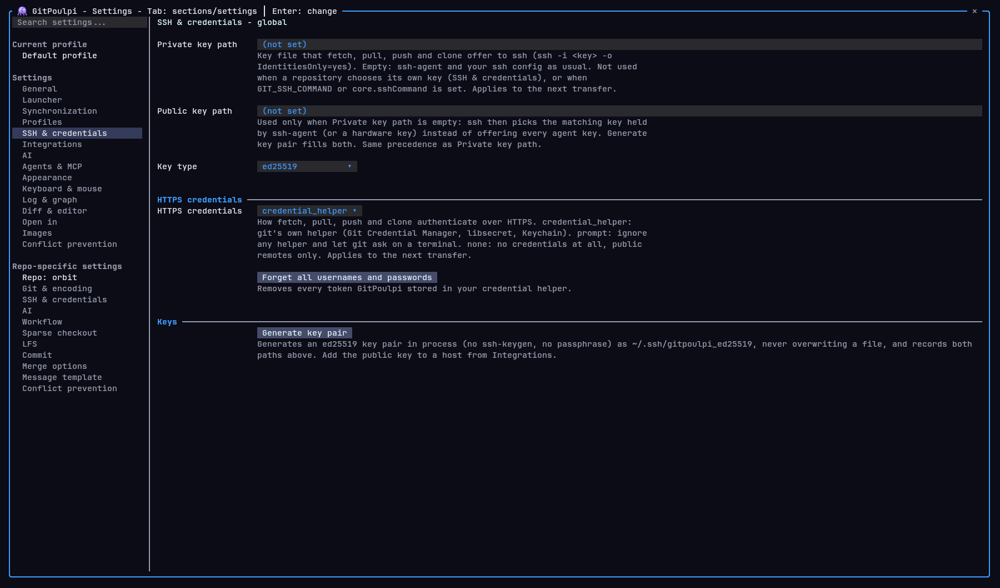
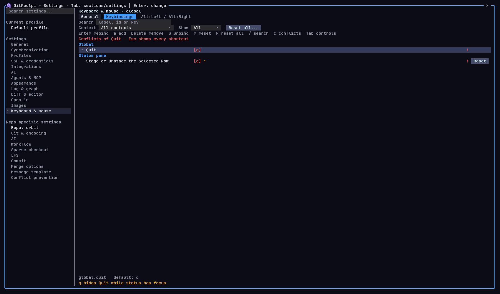

[English](../settings.md) · [Čeština](../cs/settings.md) · [Deutsch](../de/settings.md) · **Español** · [Français](../fr/settings.md) · [Italiano](../it/settings.md) · [日本語](../ja/settings.md) · [한국어](../ko/settings.md) · [Nederlands](../nl/settings.md) · [Polski](../pl/settings.md) · [Português (Brasil)](../pt-BR/settings.md) · [Português (Portugal)](../pt-PT/settings.md) · [Русский](../ru/settings.md) · [Svenska](../sv/settings.md) · [Türkçe](../tr/settings.md) · [Українська](../uk/settings.md) · [简体中文](../zh-CN/settings.md)

# Ajustes

Abre los Ajustes con `Ctrl+,`, con `Ctrl+N` y luego `,`, con el engranaje de la
barra de título (a la izquierda de la `×`) o con `Ctrl+P` > *Ajustes*. La pantalla de
Ajustes sustituye a la ventana mientras está abierta. Ciérrala con la `✕` de la
esquina superior derecha, con `Esc` o con `q`. Solo pregunta antes cuando cerrar
hiciera perder algo (véase [Cerrar Ajustes](#cerrar-ajustes)).

Los cambios se guardan en `config.toml` al instante. La
[referencia de configuración](config-reference.md) describe cada clave, su valor
por defecto y su variable de entorno. Esta página describe la pantalla de Ajustes.

## Usar la pantalla de Ajustes

| Para | Haz |
|---|---|
| Moverte entre la lista de páginas y las opciones | `Tab` / `Shift+Tab`, o clic. |
| Moverte | `j` / `k` o las flechas. |
| Cambiar una opción | `Enter` o `Space`, o clic en su valor. Consulta más abajo. |
| Cerrar | Clic en `✕`, o `Esc` o `q`. Mientras hay un campo, un desplegable o una confirmación abiertos, `Esc` solo cierra eso. |

Lo que hacen `Enter` o `Space` depende de la fila:

- Una casilla se activa o desactiva.
- Un desplegable se abre. Las flechas eligen, `Enter` acepta.
- Un campo de texto o de número empieza a editarse. Funcionan las flechas,
  `Home`, `End`, `Backspace` y `Delete`, y un clic coloca el cursor. `Enter`,
  `Tab`, `Up`, `Down` o un clic en otro sitio guarda el valor. `Esc` cancela. Un
  valor rechazado se queda en el campo, en rojo, y la barra de estado da el
  motivo.
- Una fila de botones (**Crear**, **Quitar**, **Probar**...) muestra solo los
  botones que se pueden usar ahora. `Left` / `Right` eligen uno, `Enter` lo
  pulsa, o haz clic en él. Un botón que elimina algo pregunta antes.

En todas las páginas los valores empiezan en una misma columna: las etiquetas
quedan alineadas a la izquierda y los campos a la derecha. Un texto o un número es
una banda tintada, una opción es una banda que acaba en `▾` y una casilla es
`[x]`. Una etiqueta larga se ajusta en varias líneas en vez de cortarse, y en una
ventana estrecha el valor pasa debajo de su etiqueta.

Una fila atenuada dice por qué está inactiva. Por ejemplo, **Intensidad del
tinte de fila** está atenuada mientras **Fondo de los carriles del grafo** está en
**Desactivado**.

### Listas

Las páginas que editan varios elementos del mismo tipo (Perfiles, IA, Flujo de
trabajo, Abrir en, Imágenes) los muestran como una **lista a la izquierda y los
campos del elemento seleccionado a la derecha**. En una ventana estrecha, la lista
queda sobre los campos. La lista tiene la misma forma en todas partes:

- La marca de una fila indica su estado: `●` el perfil activo, `★` la entrada
  predeterminada, `⚠` un elemento sin terminar (un perfil sin correo), con el
  motivo en el lugar de los detalles.
- Bajo la lista: **+ Añadir**, **Duplicar**, **Quitar**, `↑` y `↓`. Un botón que no
  se puede usar ahora (`↑` en la primera fila) aparece atenuado. **+ Añadir ▾**
  abre un desplegable cuando la página ofrece preajustes o tipos.
- **Quitar** pregunta antes, salvo para un elemento que acabas de añadir y no has
  editado.
- Arrastra una fila para moverla; una barra muestra dónde quedará, y `Esc`
  cancela el arrastre. Un doble clic pasa a los campos del elemento.

| Tecla | Hace |
|---|---|
| `Up` / `Down`, `Home` / `End`, `PageUp` / `PageDown` | Selecciona un elemento. |
| `Insert` | Añade un elemento (abre el desplegable si lo hay). |
| `Ctrl+D` | Duplica el elemento. |
| `Delete` | Quita el elemento, tras una confirmación. |
| `Alt+Up` / `Alt+Down` | Sube o baja el elemento. |
| `Enter` o `Right` | Pasa a los campos del elemento. |
| `Left` | Vuelve a la lista de páginas. |
| `Alt+Left` / `Alt+Right` | Alterna entre la pestaña General y la de la lista (en cualquier punto de la página). |

Cada una de estas páginas tiene dos **subpestañas** bajo su título, para que un ajuste de la página no se confunda nunca con una propiedad del elemento seleccionado: **General**, los ajustes propios de la página (el perfil activo, la entrada predeterminada, las instrucciones que recibe cada acción de IA, la plantilla de flujo...), y una pestaña con el nombre de los elementos (**Perfiles**, **Perfiles (conexiones)**, **Entradas**, **Editores**, **Reglas**) que contiene la lista y los campos del elemento seleccionado. Una página se abre en **General**; los ajustes recuerdan la pestaña en la que dejaste cada página hasta que cierres la aplicación, y también la posición de desplazamiento y la fila seleccionada de cada página (y pestaña). Haz clic en una pestaña o pulsa `Alt+Left` / `Alt+Right`. El buscador, las filas de ajustes de la paleta de comandos y los enlaces que dicen «configúralo en los ajustes» abren la pestaña donde está el ajuste.
[Teclado y ratón](#teclado-y-ratón) tiene las mismas dos pestañas (**General**, **Atajos de teclado**).

Las teclas se pueden reasignar en **Teclado y ratón** (contexto *preferences*,
véase [Atajos de teclado](keybindings.md)).

### Editores multilínea

Los ajustes que contienen varias líneas (por ejemplo, las rutas del checkout parcial, la descripción de la plantilla de commit, las ramas base de la prevención de conflictos y los hooks del flujo de trabajo) se abren en un pequeño editor con `Enter` o con un clic; `Ctrl+S` conserva el texto y `Esc` lo descarta. El ratón funciona ahí como en cualquier cuadro de texto:

- Un clic coloca el cursor donde hiciste clic.
- Arrastrar selecciona texto; la rueda desplaza.
- Un doble clic selecciona la palabra bajo el puntero.
- `Shift` + clic amplía la selección desde el cursor hasta el puntero.

El teclado ofrece lo mismo: `Shift` con las flechas selecciona, `Ctrl` con las flechas salta de palabra en palabra, `Ctrl+A` selecciona todo, `Ctrl+C` y `Ctrl+X` copian y cortan.

### Cerrar Ajustes

La `✕`, `Esc` y `q` hacen lo mismo. Ajustes aplica cada cambio al instante, así que
casi siempre se limita a cerrarse. Solo pregunta **¿Cerrar Ajustes?** cuando se
perdería algo:

- la página **Flujo de trabajo** tiene cambios sin guardar;
- la plantilla del mensaje de commit tiene cambios sin guardar;
- un perfil no tiene correo de autor (los commits que hace no se pueden atribuir a
  ti).

El cuadro ofrece **Ir ahí** (abre esa página), **Descartar y cerrar** o **Cerrar de
todos modos**, y **Cancelar**. Los pequeños editores dentro de Ajustes (un texto de
instrucciones de IA, un hook del flujo de trabajo, las rutas del checkout parcial)
tienen su propia `✕` y solo preguntan **¿Descartar los cambios?** cuando se editó
su texto.

### Ventanas emergentes sobre Ajustes

La línea del título muestra el pulpo y el nombre de la aplicación, como la ventana principal. Haz clic en el pulpo para abrir Acerca de.

Algunas ventanas emergentes globales se abren sobre Ajustes y los devuelven tal como estaban (la página, la posición de desplazamiento y los cambios sin guardar del flujo de trabajo o de las plantillas se conservan):

- la paleta de comandos (`Ctrl+P`),
- el selector de tema (`Ctrl+N t`, **App: Cambiar tema...**), que previsualiza cada tema en los propios Ajustes; `Esc` restaura el tema anterior,
- los selectores de idioma y de colores del grafo (`Ctrl+N` y las mismas letras que en la ventana principal),
- la búsqueda en el espacio de trabajo (`Ctrl+Alt+F`),
- Acerca de (`Ctrl+N a`, el pulpo, o **Ayuda: Acerca de GitPoulpi**) y la ayuda (`?`).

Cierra cada una con `Esc`, con su propia `✕` o haciendo clic fuera. Los comandos que actúan sobre lo que cubren los Ajustes (una pestaña, una rama, un diff...) aparecen en la paleta pero atenuados, con «cierra primero los Ajustes», y los atajos `Ctrl+N` correspondientes muestran esa línea en el borde inferior de los Ajustes: cierra los Ajustes y ejecútalos entonces.

`Ctrl+N` muestra una insignia en cada control de la página: el cuadro de búsqueda, la lista de páginas (una sola insignia, en la página actual), las subpestañas, la lista y sus botones, cada campo en pantalla y la cruz de cierre. Pulsa el carácter de una insignia y ocurre lo mismo que al hacer clic en ese control: un campo de texto se abre para editarlo, una casilla se marca, una lista desplegable se abre, un botón se ejecuta. `Esc` cancela. Un campo desplazado fuera de la vista no tiene insignia. Mientras escribes en un campo, o hay una lista desplegable, un editor o la búsqueda abiertos, `Ctrl+N` les pertenece. Véase [Insignias](keybindings.md#insignias).

### El cuadro de búsqueda

El cuadro de la parte superior de la lista de páginas busca en el nombre y la
descripción de cada opción de cada página. Haz clic en él, o pulsa `/` o
`Ctrl+F`, y escribe. Se despliega una lista de coincidencias. Cada una muestra la
opción y su página. `Up` / `Down` eligen, `Enter` va a la opción, `Esc` cierra la
lista.

## Ajustes desde la paleta de comandos

La mayoría de los ajustes se cambian sin abrir esta pantalla: escribe `Ajustes:` o `Settings:` en la paleta de comandos (`Ctrl+P`). Las filas se generan a partir de los campos de las páginas, así que un ajuste nuevo aparece en ambos sitios.

- Una casilla es **Ajustes: Alternar ...**. Cambia al instante y la fila muestra `[x]` o `[ ]`.
- Una lista desplegable es **Ajustes: ...**. `Enter` reduce la paleta a sus valores, con el actual marcado como `actual`; `Enter` sobre un valor lo elige.
- Un número o un texto abre un aviso con el valor actual. Un valor que la página rechazaría (no es un número, fuera del rango) se rechaza igual y el aviso sigue abierto.
- Un ajuste que necesita su página (una lista, un combo cuyas opciones se descubren al ejecutar) abre los Ajustes en él.

Un valor se guarda en `config.toml` y se aplica exactamente como lo hace la página. Las palabras en inglés de la clave del ajuste (`remember tabs`) encuentran la fila en cualquier idioma.

## Las páginas

La lista de páginas tiene dos grupos:

- **Ajustes**: los ajustes globales.
- **Ajustes del repositorio**: ajustes del repositorio de la pestaña activa.
  Solo se muestran mientras hay un repositorio abierto.

### General

| Opción | Qué hace |
|---|---|
| **Idioma** | El idioma de la interfaz: **Auto** (el idioma de tu sistema, o inglés en su defecto), English, Français, Español, Português (Brasil), Português (Portugal), Italiano, Deutsch, 简体中文, 日本語, 한국어, Русский, Українська, Polski, Čeština, Nederlands, Svenska, Türkçe. Se aplica al instante, sin reiniciar. Los nombres de los meses y las fechas del Log lo siguen. La variable de entorno `GITPOULPI_LANG` (por ejemplo `GITPOULPI_LANG=fr`) prevalece sobre esta elección. La salida de la CLI y del MCP sigue en inglés. |
| **Traducir términos de git** | Desactivado por defecto: commit, push, pull, stash, tag y los demás términos de git se quedan en inglés en todos los idiomas. Activado: se usa el vocabulario de git propio del idioma (español: *Enviar*, *Traer*, *Guardado rápido*, *Etiqueta*). Se aplica al instante. |
| **Palabras git en inglés** | Solo para japonés, coreano y chino: muestra *stage*, *unstage*, *staged* como palabras inglesas en lugar de su transcripción. Sin efecto mientras **Traducir términos de git** está activado. |
| **Recordar pestañas** | Reabre al arrancar las pestañas de la última sesión. Desactivado, un arranque dentro de un repositorio abre solo ese repositorio, y un arranque fuera de uno empieza en Inicio sin ninguna pestaña de repositorio. Requiere reiniciar. |
| **Radar activado** | Activado por defecto (`general.radar_enabled`). Desactivado oculta la pestaña del Radar, sus comandos de la paleta y `Alt+R`, y no se descarga nada para él en segundo plano. Se aplica al momento. Véase [el Radar](radar.md#cerrar-la-pestaña-o-desactivar-el-radar). No aparece en una compilación sin Radar. |
| **Pestaña de arranque dentro de un repositorio** | La pestaña en la que se abre un arranque cuando la carpeta desde la que se inicia está dentro de un repositorio (`general.startup_tab_in_repo`): **Repositorio actual** (por defecto, la pestaña de ese repositorio, abierta si hace falta), **Última pestaña** (la pestaña activa al cerrar por última vez), **Inicio**, **Radar**. Un repositorio indicado con `--repo` abre siempre su propia pestaña. **Última pestaña** es Inicio si **Recordar pestañas** está desactivado o no hay nada recordado; **Radar** es Inicio si el Radar está desactivado o no está en la compilación. Se lee una vez al iniciar; requiere reiniciar. |
| **Pestaña de arranque fuera de un repositorio** | La pestaña en la que se abre un arranque cuando la carpeta desde la que se inicia no es un repositorio (una carpeta de usuario, por ejemplo) (`general.startup_tab_outside_repo`): **Inicio** (por defecto), **Última pestaña**, **Radar**. **Última pestaña** es Inicio si **Recordar pestañas** está desactivado o no hay nada recordado; **Radar** es Inicio si el Radar está desactivado o no está en la compilación. Se lee una vez al iniciar; requiere reiniciar. |
| **Pestaña de arranque desde el lanzador** | La pestaña en la que se abre un arranque cuando GitPoulpi se inicia desde el acceso directo del escritorio o del menú Inicio que ha creado (pasan `--launcher`), sea cual sea la carpeta (`general.startup_tab_launcher`): **Última pestaña** (por defecto), **Inicio**, **Radar**. Tiene prioridad sobre los dos ajustes anteriores. **Última pestaña** es Inicio si **Recordar pestañas** está desactivado o no hay nada recordado; **Radar** es Inicio si el Radar está desactivado o no está en la compilación. Los accesos directos de una versión anterior reciben el indicador en el siguiente arranque. Se lee una vez al iniciar; requiere reiniciar. En Windows, una copia que hayas anclado a la barra de tareas también se reescribe en el siguiente arranque, y un arranque sin shell alrededor (doble clic, el propio exe anclado) cuenta como un arranque desde el lanzador. |
| **Agrupar las pestañas de worktrees** | Activado por defecto (`general.group_worktree_tabs`). Las pestañas de los worktrees enlazados de un repositorio van justo después de la pestaña del repositorio, y una pestaña de worktree arrastrada lejos vuelve a su sitio. Desactivado deja las pestañas donde las pone. Al activarlo se reagrupan las pestañas abiertas. |
| **Carpeta de clonado por defecto** | Dónde empieza el diálogo Clonar. Vacío: `%USERPROFILE%\source\repos` en Windows, `~/src` en el resto. |
| **El diálogo Clonar empieza en** | La fuente con la que se abre el diálogo Clonar (`repos.clone_start_source`): **Última usada** (por defecto, la fuente que mostraba al cerrarse por última vez, al clonar o al cancelar), **Clonar con URL**, o una de tus integraciones conectadas. Una fuente que ya no está disponible vuelve a Clonar con URL. Un clon iniciado desde el Radar conserva su propia fuente. |
| **Carpeta de exploración por defecto** | Dónde se abre Examinar. Vacío: la última carpeta que usaste, o si no tu carpeta personal. |
| **Ubicación de los datos del repositorio** | Dónde guarda GitPoulpi sus datos de cada repositorio (`session.per_repo_state_dir`): **Dentro de .git** (por defecto: nada aparece en tu árbol de trabajo y todos los worktrees lo comparten), **En el árbol de trabajo** (una carpeta `.gitpoulpi`; hace falta para hacer commit de un `workflow.toml` del equipo) o **En mi carpeta de datos de usuario** (fuera del repositorio). Una carpeta `.gitpoulpi` que dejó una versión anterior se traslada al sitio nuevo la primera vez que hace falta, y se elimina cuando queda vacía; un archivo que git sigue (un `workflow.toml` con commit) nunca se mueve ni se borra y sigue siendo legible. |
| **Nombre de rama por defecto** | La primera rama de un repositorio que creas con Init. Vacío: decide git. No renombra ninguna rama existente. |
| **Nivel del registro**, **Conservar los archivos de registro**, **Tamaño máximo de un archivo de registro** | El registro de la aplicación que hay detrás del Registro de actividad: la línea más detallada que se registra (`log.level`), cuánto tiempo se conservan los archivos (un número entero y una unidad, días, semanas, meses o años, en una sola línea: haz clic en el número para escribirlo, Arriba y Abajo lo cambian, Tab pasa a la unidad y Enter abre su lista; hasta 10 años como máximo, por defecto 1 semana, `log.retention_days` y `log.retention_unit`) y el tamaño al que se rota el archivo de un día (un número y MiB o GiB, de 1 MiB a 1 GiB, `log.max_file_mb` y `log.max_file_unit`). |
| **Mostrar la duración de las operaciones**, **Registro ampliado** | La pestaña Operaciones de git del Registro de actividad: la duración de cada operación (`log.timings`, activado por defecto) y también el trabajo en segundo plano, actualización y auto-fetch (`log.extended`, desactivado por defecto). Consulta [Cuando algo falla](troubleshooting.md#el-registro-de-actividad). |
| **Deshacer activado**, **Profundidad del historial de deshacer**, **Registrar los cambios hechos fuera de GitPoulpi** | El grupo **Historial de deshacer**. Activa o desactiva Deshacer, y fija cuántas operaciones conserva (por defecto 100, `0` significa sin límite). Desactivar Deshacer borra el historial de deshacer, tras una confirmación. La última opción también registra lo que un shell o un agente hace en ramas, tags, stashes y HEAD. Consulta [Deshacer y rehacer](undo-redo.md). |

El comando de la paleta **App: Cambiar idioma...** (`Ctrl+N l`) abre la misma
lista de idiomas. Ahí, el idioma resaltado se previsualiza en directo; `Enter` lo
conserva y `Esc` restaura el anterior.

### Lanzador

La página **Lanzador** (`gitpoulpi ui show settings launcher`) crea un acceso directo que inicia
GitPoulpi desde el lanzador del sistema, en el terminal que elijas.

| Fila | Qué hace |
|---|---|
| **Terminal de los accesos directos** | `ui.launch_terminal`: **Automático**, **Predeterminado del sistema** o uno de los terminales encontrados en este equipo (la misma detección que **Abrir en**). Automático: Windows Terminal en Windows (si no, WezTerm, Alacritty, la consola simple), `xdg-terminal-exec` en Linux (Omarchy; si no, el primer terminal encontrado), Terminal en macOS salvo que estén instalados iTerm2, Ghostty, WezTerm o kitty. |
| **Reabrir en ese terminal con doble clic** | Solo Windows (`ui.relaunch_in_terminal`). Al hacer doble clic en el exe se abre la consola predeterminada, que dibuja mal las imágenes: GitPoulpi se reabre en el terminal elegido y la primera ventana se cierra. No ocurre si se inició desde un terminal. |
| **Mostrar la ventana abierta al hacer clic** | `ui.reuse_window` (activado por defecto). Un clic en un acceso directo de GitPoulpi (`gitpoulpi launch`) muestra la ventana de un GitPoulpi que ya está abierto, en lugar de iniciar otro. Solo se inicia un terminal nuevo si no hay ninguno abierto, el ajuste está desactivado o la ventana no puede pasar al primer plano. Pasa al primer plano en Windows, en WezTerm y en Hyprland; en otros escritorios Linux el clic sigue iniciando una ventana nueva. Para abrir otra ventana a propósito, mantén **Shift** al hacer clic (Windows, también en el icono anclado a la barra de tareas) o usa la acción **New Window** de la entrada del lanzador de Linux (clic derecho en el icono); `gitpoulpi launch --new-window` lo hace desde un script. No se usa en macOS (el Dock ya lo hace). |
| **Alias del comando** | `ui.command_alias`: un desplegable con **Ninguno** y `gp`, o escribe cualquier nombre (letras, dígitos, `-`, `_`, `.`; sin espacios ni separadores de ruta). El botón **Crear** de la propia fila hace que ese nombre inicie GitPoulpi (pasa a ser **Quitar** cuando el alias ya existe, y quita todos los alias que creó GitPoulpi). Bajo la fila aparece un aviso cuando el nombre ya ejecuta otra cosa de tu PATH y, en Windows, cuando PowerShell tiene un alias propio con ese nombre (allí `gp` es `Get-ItemProperty` y prevalece sobre cualquier archivo). Un alias o una función de shell no se puede ver desde aquí: oh-my-zsh define `gp` por su cuenta y prevalece sobre el nuestro. |
| **Alias de pestaña nueva** | `ui.command_alias_add`: un segundo comando, por ejemplo `gpa`, que abre la carpeta actual en una pestaña nueva del GitPoulpi que ya está en marcha (`gitpoulpi --add`) en lugar de iniciar otro; si no hay ninguno en marcha inicia GitPoulpi como de costumbre, y si hay varios pregunta a cuál unirse. Un desplegable con **Ninguno**, `gpa` y el nombre del alias seguido de `a`, o escribe cualquier nombre (mismas reglas que arriba). El único botón **Crear** hace ambos comandos, **Quitar** quita todos los comandos que creó GitPoulpi; cada uno tiene su propia fila de estado. En Linux y macOS es un script de dos líneas, en Windows un `.cmd`. Ver la [referencia de la CLI](cli-reference.md#añadir-una-carpeta-a-la-ventana-abierta). |
| **Añadir GitPoulpi al PATH** | Pone en tu PATH la carpeta desde la que se ejecuta GitPoulpi y la carpeta de los alias, para los terminales nuevos. El botón de la fila dice **Añadir** o **Quitar**, y **Quitar** quita exactamente lo que se añadió. Las carpetas que ya están en el PATH se dejan como están (la fila dice entonces **ya está en el PATH**). |
| **Lanzador de aplicaciones** (Linux) | Escribe `~/.local/share/applications/gitpoulpi.desktop` (respeta `XDG_DATA_HOME`) y el icono en `~/.local/share/icons/hicolor/256x256/apps`. En Omarchy la entrada es la que crea `omarchy-tui-install` (`xdg-terminal-exec --app-id=TUI.tile -e <exe>`); para los demás terminales, el comando correspondiente (`kitty`, `wezterm start --`, `alacritty -e`, `ghostty -e`, `foot`, ...). |
| **Escritorio** (Linux) | La misma entrada en tu carpeta Escritorio, si existe. |
| **Menú Inicio** (Windows) | `GitPoulpi.lnk` en `%APPDATA%\Microsoft\Windows\Start Menu\Programs`. Una copia anclada a la barra de tareas sigue sola los cambios de icono y de color; si su icono se queda antiguo, desánclala y vuelve a anclarla (clic derecho en la entrada del menú Inicio y **Anclar a la barra de tareas**). |
| **Escritorio** (Windows) | `GitPoulpi.lnk` en tu Escritorio. |
| **Carpeta Aplicaciones** (macOS) | `~/Applications/GitPoulpi.app`, un pequeño paquete que abre el terminal ejecutando GitPoulpi. |

Cada fila muestra su estado: **no creado**, **creado**, **desactualizado**
(el exe se movió o se eligió otro terminal; GitPoulpi lo reescribe solo en menos de un segundo, así que rara vez lo verás) o **hay un archivo
que no es de GitPoulpi** (existe un archivo con ese nombre que GitPoulpi no creó, así que
nunca se toca). **Quitar** borra solo los archivos que creó GitPoulpi (llevan la marca
`X-GitPoulpi=1`). El icono es el pulpo en el color de tu logo (Acerca de > color); en Linux
cada color tiene su propio nombre de icono, así que un lanzador que guarda los iconos en caché
muestra el color nuevo. Una vez creado, un acceso directo se mantiene al día solo: cuando cambias
el color, el terminal o el exe se mueve, GitPoulpi reescribe los accesos directos que creó (nunca
uno que no creó, y nunca crea uno nuevo), al arrancar y mientras se ejecuta. No hay botón
Actualizar; solo **Crear** (para un acceso directo que aún no existe) y **Quitar**.

**Agrupación en la barra de tareas y el dock.** GitPoulpi se ejecuta dentro de una ventana de terminal, así que la barra de tareas suele mostrarlo bajo el icono del terminal, sin el punto de «en ejecución» bajo el icono de GitPoulpi anclado. Windows: los accesos directos llevan el AppUserModelID `GitPoulpi.GitPoulpi`, y un GitPoulpi iniciado desde uno de ellos da a la ventana de su terminal el mismo ID y su icono (encuentra la ventana poniéndole un instante un título único y luego restaura el título), de modo que la ventana queda bajo el icono de GitPoulpi anclado. Una ventana de terminal con varias pestañas se mueve como un todo: todas sus pestañas se agrupan bajo el icono de GitPoulpi mientras GitPoulpi se ejecuta en ella. Los accesos directos y los anclajes de la barra de tareas creados antes los reescribe la misma sincronización; si un anclaje sigue mostrando el icono del terminal, desancla y vuelve a anclar. Linux: kitty, foot, Alacritty, WezTerm y Ghostty se inician con la clase de ventana `gitpoulpi` y la entrada `.desktop` la nombra (`StartupWMClass`), así que un dock agrupa la ventana bajo el icono del lanzador; los demás terminales conservan su propio icono. macOS: nada que hacer, el Dock agrupa por aplicación.

#### Alias del comando y PATH, según el sistema

| Sistema | Alias | PATH |
|---|---|---|
| Linux, macOS | Un enlace simbólico `~/.local/bin/<nombre>` a `gitpoulpi-tui`. Un enlace no puede llevar una marca, así que cuenta como nuestro cuando su destino es un archivo llamado `gitpoulpi-tui`; un archivo normal, o un enlace a cualquier otra cosa, **no es nuestro** y nunca se reemplaza ni se quita. | Un bloque entre `# >>> GitPoulpi PATH (X-GitPoulpi=1) >>>` y `# <<< GitPoulpi PATH <<<` en `~/.bashrc` y `~/.zshrc` (los que existan; `~/.zshrc` en macOS y `~/.bashrc` en el resto si no existe ninguno), y `~/.config/fish/conf.d/gitpoulpi-path.fish` cuando fish está configurado. Quitar borra el bloque (o el archivo de fish) y nada más. |
| Windows | `%LOCALAPPDATA%\Programs\GitPoulpi\bin\<nombre>.cmd`, un script corto que lleva `REM X-GitPoulpi=1` (también exporta `GITPOULPI_CMDCMDLINE`, con lo que se reconoce un arranque desde la barra de direcciones). | El PATH de usuario en `HKCU\Environment`, escrito mediante PowerShell, seguido de un aviso `WM_SETTINGCHANGE` para que los programas nuevos lo vean. El valor `GitPoulpiPathAdded` anota lo que se añadió, y Quitar solo quita eso. |

Los terminales nuevos ven el cambio del PATH; los que ya estaban abiertos, no. Ninguna de las dos acciones queda en el historial de deshacer: no hay Deshacer para ellas, **Quitar** es la vuelta atrás.

La paleta tiene las mismas acciones (**Lanzador: Crear acceso directo**, **Lanzador: Crear
acceso directo del escritorio**, **Lanzador: Quitar accesos directos**, **Lanzador: Crear alias del comando**,
**Lanzador: Quitar alias del comando**, **Lanzador: Añadir al PATH**, **Lanzador: Quitar del PATH**), y `gitpoulpi desktop shortcut
status|install|remove [--where launcher|desktop|startmenu]` lo
hace desde un script.

#### Escribir en la barra de direcciones del Explorador de archivos (Windows)

Escribe el alias (`gp`) o `gitpoulpi` en la barra de direcciones de una ventana del Explorador de archivos y pulsa Enter: GitPoulpi se abre en el terminal elegido en **Terminal de los accesos directos**, sobre la carpeta que muestra la ventana, sin abrir la **Última pestaña**. Con **Mostrar la ventana abierta al hacer clic** activado y un GitPoulpi ya abierto, la carpeta pasa a ser una pestaña nueva de esa ventana.

- **`gp` (el alias del comando).** Una vez que existe el alias, crearlo también registra `gp.exe` en `HKCU\Software\Microsoft\Windows\CurrentVersion\App Paths`, apuntando a `gitpoulpi-launch.exe`, y Quitar borra esa clave (solo cuando es nuestra). Cuando la carpeta del alias está en tu PATH (**Añadir GitPoulpi al PATH**), Windows ejecuta antes el script `.cmd` y puede parpadear un instante una ventana de consola antes de que aparezca GitPoulpi. Un script escrito por una versión anterior se reescribe solo cuando Ajustes lee el alias.
- **`gitpoulpi`.** Funciona con el **Menú del administrador de archivos** instalado: Instalar también registra `gitpoulpi.exe` en App Paths. Sin él, `gitpoulpi` solo se encuentra cuando la carpeta de GitPoulpi está en tu PATH, y entonces la consola puede parpadear como arriba.

El Explorador de archivos conserva el PATH que tenía cuando iniciaste sesión en Windows: una carpeta añadida al PATH después solo se ve allí tras cerrar la sesión y volver a iniciarla. Hasta entonces solo se encuentran las entradas de App Paths, y un nombre que Windows no encuentra se abre como dirección web en tu navegador.

Linux y macOS no tienen nada equivalente: las barras de ubicación de sus administradores de archivos no ejecutan programas. Usa la entrada del **Menú del administrador de archivos** o el alias del comando en un terminal.

#### Menú del administrador de archivos (Abrir en GitPoulpi)

Bajo los accesos directos, las filas del **Menú del administrador de archivos** añaden **Abrir en GitPoulpi** al menú contextual de las carpetas. Hay una fila de estado por administrador de archivos (en Linux, una por cada administrador encontrado aquí y por cada uno que aún conserve la entrada; una fila **Detectados** enumera lo encontrado), y luego los botones **Instalar** y **Quitar**. **Instalar** escribe la entrada para cada administrador de archivos encontrado; **Quitar** pregunta antes y luego quita exactamente lo que escribió Instalar, esté o no instalado todavía ese administrador.

La entrada ejecuta `gitpoulpi launch --folder <carpeta>` (en Windows, `gitpoulpi-launch.exe --folder`, sin consola), y ese comando decide al hacer clic: con **Mostrar la ventana abierta al hacer clic** activado y una ventana de GitPoulpi abierta, una carpeta dentro de un repositorio pasa a ser una pestaña nueva de la ventana usada más recientemente, que pasa al primer plano; si no, el terminal elegido en **Terminal de los accesos directos** inicia GitPoulpi sobre esa carpeta. Por eso cambiar de terminal nunca deja una entrada desactualizada; un exe movido o un color de logo nuevo sí, y GitPoulpi reescribe solo sus propias entradas (sin crear nunca una), como los accesos directos. La entrada necesita el ayudante de arranque junto a GitPoulpi (`gitpoulpi`, o `gitpoulpi-launch.exe` en Windows); sin él la fila lo dice y los botones quedan desactivados.

| Sistema | Qué escribe Instalar |
|---|---|
| Windows | Claves por usuario, sin administrador: `HKCU\Software\Classes\Directory\shell\GitPoulpi`, `Directory\Background\shell\GitPoulpi` y `Drive\shell\GitPoulpi`, cada una con una subclave `command`, de modo que la entrada aparece en una carpeta, en el fondo de una carpeta abierta y en una unidad. Cada clave lleva un valor `X-GitPoulpi`; una clave sin él **no es nuestra** y nunca se toca. También registra `gitpoulpi.exe` en `HKCU\Software\Microsoft\Windows\CurrentVersion\App Paths`, apuntando a `gitpoulpi-launch.exe`. En Windows 11 la entrada está solo en el menú clásico: **Mostrar más opciones**, Shift+F10 o Shift+clic derecho (el nuevo menú de primer nivel solo muestra aplicaciones empaquetadas). Quitar borra nuestras claves y luego las claves padre que creó Instalar, solo si quedan vacías. |
| Linux | Solo para los administradores de archivos que haya en el PATH. GNOME Files y Caja: un script con el nombre de la entrada en `~/.local/share/nautilus/scripts` o `~/.config/caja/scripts` (en el submenú **Scripts**). Dolphin: `~/.local/share/kio/servicemenus/gitpoulpi-open.desktop`, ejecutable (KDE Frameworks 6 ignora un menú de servicio de usuario que no lo sea; KDE Frameworks 5 anterior a 5.85 no es compatible). Nemo: dos acciones en `~/.local/share/nemo/actions` (una carpeta seleccionada, el fondo). Thunar: una acción fusionada en `~/.config/Thunar/uca.xml`; tus propias acciones se conservan, y Quitar devuelve el archivo byte a byte (o lo borra si lo creó Instalar). PCManFM y PCManFM-Qt: `~/.local/share/file-manager/actions/gitpoulpi-open.desktop`. El icono va a `~/.local/share/icons/hicolor/256x256/apps/gitpoulpi-folder.png` y se va con la última entrada. Se respetan `XDG_DATA_HOME` y `XDG_CONFIG_HOME`. La entrada aparece en una carpeta seleccionada y, donde el administrador de archivos lo ofrece, en el fondo de la carpeta. |
| macOS | Una Acción rápida, `~/Library/Services/Open in GitPoulpi.workflow`: clic derecho en una carpeta en Finder y luego **Acciones rápidas**. Solo carpetas seleccionadas (Finder no tiene menú para el fondo de la carpeta). La primera vez que haces clic, macOS pregunta si el servicio de flujos de trabajo puede controlar tu terminal (un aviso de Automatización, por ejemplo "WorkflowServiceRunner.xpc quiere acceso para controlar ..."): permítelo. Si falta la entrada, actívala en Ajustes del Sistema > Teclado > Funciones rápidas de teclado > Servicios. |

Cada archivo y cada clave que escribe GitPoulpi lleva la marca `X-GitPoulpi=1` (una línea `# X-GitPoulpi=1` en un script), y Quitar borra solo los marcados. Estas acciones cambian tu sistema, no un repositorio: Deshacer no las cubre, **Quitar** es la vuelta atrás. Las barras de ubicación de los administradores de archivos no ejecutan programas en Linux y macOS, así que allí no hay nada que escribir; un terminal tiene el alias del comando.

La paleta tiene **Lanzador: Instalar menú Abrir en GitPoulpi** y **Lanzador: Quitar menú Abrir en GitPoulpi**, y `gitpoulpi desktop folder-menu status|install|remove` lo hace desde un script.

### Sincronización

Cómo mantiene GitPoulpi un repositorio al día con sus remotos, y qué hace con tus
cambios locales mientras tanto.

| Opción | Qué hace |
|---|---|
| **Intervalo de auto-fetch** | Hace fetch de todos los remotos en segundo plano con este intervalo, un número y una unidad (minutos u horas) en una sola línea. Por defecto 5 minutos, máximo 60 minutos (1 hora), `0` lo desactiva. `general.auto_fetch_interval_minutes` sigue en minutos; `general.auto_fetch_interval_unit` solo guarda cómo se muestra. Requiere reiniciar. |
| **Fetch al abrir una pestaña** | Ejecuta Fetch All en segundo plano cuando se abre una pestaña de repositorio. Activado por defecto. Un repositorio con fetch en los últimos 60 segundos no vuelve a hacerlo. |
| **Auto-prune** | Los fetch también eliminan las ramas de seguimiento remoto que ya no existen en el remoto. Activado por defecto, así que una rama borrada en el servidor (por ejemplo en GitLab) sale de la sección REMOTE tras el siguiente fetch. No se puede deshacer: una rama podada vuelve en el siguiente fetch si reaparece en el remoto. |
| **Auto-prune de tags** | Los fetch también eliminan los tags locales que el remoto ha eliminado. Solo se tocan los tags que estaban en el remoto: un tag que nunca enviaste (push) se conserva. Desactivado por defecto, como en git. Requiere git 2.41 o posterior. CLI: `gitpoulpi fetch --prune-tags`; clave de configuración `general.auto_prune_tags`. Consulta [Ramas, tags y la barra lateral Refs](log-and-history.md#ramas-tags-y-la-barra-lateral-refs). |
| **Mantener los submódulos al día** | Tras un checkout o un pull, actualiza los submódulos a los commits que registra el repositorio. Consulta [Submódulos](submodules.md). |
| **Eliminar archivos ".orig" tras hacer merge** | Cuando termina un merge, elimina los archivos de copia de seguridad `*.orig`. Desactivado por defecto. |
| **Auto-stash antes de checkout, pull, merge o rebase** | Qué hacer cuando cambios locales bloquean una de estas operaciones: **preguntar** (un diálogo ofrece hacer stash de los cambios, ejecutar la operación y restaurar el stash), **siempre** (hacerlo sin preguntar) o **nunca** (rechazar). |
| **Incluir archivos sin seguimiento en el auto-stash** | El stash automático también incluye los archivos sin seguimiento. |

También en esta página, bajo **Actualizaciones**:

| Opción | Qué hace |
|---|---|
| **Buscar actualizaciones** | Un desplegable (`updates.mode`): **Notificar** (por defecto) comprueba una vez al día en segundo plano y muestra `vX.Y.Z disponible` en la barra de título; **Auto** además descarga la actualización en segundo plano cuando GitPoulpi se instaló desde un paquete de versión (tú eliges cuándo reiniciar); **Desactivado** nunca hace ninguna petición. Se aplica al instante. Consulta [Actualizaciones](updates.md). |
| **Canal de actualización** | Un desplegable (`updates.channel`): **Estable** (por defecto) o **Preliminar** (también versiones candidatas). Se aplica al instante. |
| **Instalado con** | Solo lectura. Cómo llegó GitPoulpi a este equipo (un archivo de versión, el instalador para este usuario o para todos, Chocolatey, Scoop, Homebrew, apt, un paquete MSI, una imagen de Docker, cargo o una compilación de desarrollo). Decide cómo se aplican las actualizaciones, consulta [Actualizaciones](updates.md). |

Una fila que tu administrador ha fijado en la política de actualización para todo el equipo muestra **Fijado por tu administrador** y no se puede cambiar aquí.

También en esta página, bajo **Reescritura del historial**, los límites de tiempo de los scripts externos (véase [Reescritura del historial](history-rewrite.md)):

| Opción | Qué hace |
|---|---|
| **Límite de respuesta del script** | Cuánto tiempo tiene un script externo para responder a un commit, un número y una unidad (milisegundos o segundos) en una sola línea. Por defecto 5 segundos, de 1 milisegundo a 10 minutos (`rewrite.script_timeout_ms`, `rewrite.script_timeout_unit`). Si se agota, se detiene todo el proceso y la reescritura falla sin mover nada. |
| **Límite del script por pasada** | Cuánto puede durar una pasada completa de un script externo, un número y una unidad (segundos, minutos u horas). Por defecto 1 hora, hasta 24 horas (`rewrite.script_total_timeout_s`, `rewrite.script_total_timeout_unit`). |

### Perfiles

Perfiles de identidad de commit: el nombre y el correo usados en los commits
hechos desde GitPoulpi. La pestaña **General** contiene el desplegable **Perfil
activo**; la pestaña **Perfiles** es una [lista](#listas) (añadir, duplicar,
quitar, reordenar) con los campos del perfil seleccionado. Cada perfil tiene un **Id del perfil**, un **Nombre
del perfil**, un **Nombre del autor** y un **Correo del autor**. Un perfil sin
correo muestra `⚠` en la lista. Sin perfil activo, o con un perfil con el nombre o
el correo en blanco, se aplican los `user.name` y `user.email` propios del
repositorio.

Con dos o más perfiles, la barra de herramientas muestra un combo de perfiles en
su extremo derecho. Fija el perfil solo para el repositorio activo. Tras elegir,
un diálogo ofrece escribir también la identidad en la config de ese
repositorio. El comando de la paleta es **Repositorio: Cambiar perfil...**.

Estos perfiles no son los perfiles de alojamiento de la página Integraciones ni
los perfiles de IA de la página IA.

### SSH y credenciales

SSH usa el `ssh` de tu sistema, así que tu ssh-agent y tu configuración de ssh
siguen funcionando. GitPoulpi nunca lee el material de las claves.

| Opción | Qué hace |
|---|---|
| **Ruta de la clave privada** | Si se indica, fetch, pull, push y clone ejecutan git con `GIT_SSH_COMMAND=ssh -i "<key>" -o IdentitiesOnly=yes`, de modo que ssh ofrece solo esa clave. Vacío: se aplican sin cambios el agente y tu configuración de ssh. |
| **Ruta de la clave pública** | Solo se usa cuando la ruta de la clave privada está vacía: ssh elige la clave correspondiente que tenga el ssh-agent (o una clave de hardware). |
| **Tipo de clave** | El tipo que crea **Generar par de claves**: `ed25519`, `rsa` (4096 bits) o `ecdsa` (NIST P-256). |
| **Credenciales HTTPS** | Cómo se autentican fetch, pull, push y clone por HTTPS: **credential_helper** (el helper propio de git, el valor por defecto), **prompt** (ignora los helpers; git pregunta en un terminal) o **none** (sin credenciales, solo remotos públicos). |
| **Olvidar todos los usuarios y contraseñas** | Elimina todos los tokens que GitPoulpi guardó en tu credential helper. Pide confirmación antes. |
| **Generar par de claves** | Crea un par de claves del **Tipo de clave** en `~/.ssh/gitpoulpi_<tipo>`, sin frase de contraseña, y registra sus dos rutas. Nunca sobrescribe un archivo. |

Las rutas de las claves se aplican a la siguiente transferencia. Un prefijo `~/`
significa tu carpeta personal.

Un ajuste hecho en otro lugar siempre prevalece sobre estas rutas. El orden, de
mayor a menor prioridad:

0. Una clave elegida para un repositorio en su propia página
   [SSH y credenciales](#ajustes-del-repositorio-ssh-y-credenciales) (el grupo del repositorio).
1. `GIT_SSH_COMMAND` o `GIT_SSH` en el entorno en el que se ejecuta GitPoulpi.
2. `core.sshCommand` en la config de git del repositorio o en tu config global
   de git.
3. Las dos rutas de clave de esta página.
4. Los valores por defecto de ssh y el agente.

Una clave también puede pertenecer a una cuenta de alojamiento; consulta
[Alojamiento y gestores de issues](hosting-integration.md#clave-ssh-por-perfil).

### Integraciones

Conecta tus cuentas. El grupo **Alojamiento** tiene GitHub, GitHub Enterprise,
GitLab, GitLab Self-Managed, Azure DevOps, Azure DevOps Server, Bitbucket, Bitbucket Data Center, Gitea, Forgejo y Gerrit. El grupo **Gestores de issues** tiene Jira Cloud, Jira Data Center, Trello, Linear, YouTrack, Redmine y Local Markdown. Cada proveedor tiene **Conectar**, un campo de token, los
ámbitos (scopes) que necesita el token y un enlace a la página de tokens del
host. Esta página tiene su propia guía:
[Alojamiento y gestores de issues](hosting-integration.md).

Sobre los proveedores hay dos opciones. Pulsa `Up` en el primer proveedor para
llegar a ellas.

| Opción | Qué hace |
|---|---|
| **Actualización de pull requests e issues** | Cada cuánto se actualizan las listas de la barra lateral y el chip de la barra de herramientas, un número y una unidad (minutos u horas). Por defecto 5 minutos, hasta 2 horas, `0` apaga el temporizador (`general.hosting_refresh_minutes`, `general.hosting_refresh_unit`). |
| **Publicar como** | El nombre con el que se publican los mensajes en un host cuando el token del repositorio es el de un bot (un token de GitHub App), por ejemplo `my-app[bot]`; sirve también para reconocer tus propios comentarios. Vacío: se pregunta al host y, si no, se aprende del primer mensaje publicado. Un repositorio puede sustituirlo en Ajustes > Ajustes del repositorio > SSH y credenciales > Alojamiento (`general.hosting_post_as`). |
| **Terminología de las solicitudes de revisión** | La palabra usada para las revisiones alojadas: **Auto (según el host)**, **Pull request** o **Merge request**. |
| **Ocultar el chip de pull request cuando se cierra o se integra** | Activado por defecto (`ui.hide_finished_pr_chip`; en GitLab dice «merge request»). El chip de la barra de herramientas muestra la última solicitud de la rama activa; cuando esa solicitud se cierra o se integra, se oculta y en su lugar aparece el chip atenuado **+ PR** (iniciar una solicitud nueva), como si la rama no tuviera ninguna. Desactivado, el chip muestra siempre la última solicitud, sea cual sea su estado. Se aplica al instante. |

### IA

En la pestaña **General**: el interruptor que activa la IA, el perfil
predeterminado, las instrucciones que recibe cada acción, y un perfil e
instrucciones para cada acción. La pestaña **Perfiles (conexiones)** es una
[lista](#listas) de los perfiles de IA con una tabla en línea para las variables
de entorno de un perfil. El bloque *Revisión de código* de la pestaña General también
contiene los valores por defecto del [contexto de la revisión](ai.md#contexto-de-la-revisión): **Ejecutar el agente en el repositorio**
(*Ajuste del perfil*, *Sí*, *No*), **Incluir CLAUDE.md**, **Incluir AGENTS.md** y **Archivo adicional** (una ruta o un
enlace; vacío no añade ninguno, con un botón **Examinar...** debajo que abre un selector de archivos; `Enter` sobre el botón es su forma de teclado). Esta página tiene su propia guía: [Asistencia de IA](ai.md).

El bloque **Respuestas en un host** contiene lo que redacta comentarios, respuestas y descripciones de issues: su perfil e instrucciones, el **Prompt base** (vacío usa el integrado) y un grupo **Acceso al repositorio**: **Dejar que la IA lea el repositorio por defecto** (desactivado: la opción de cada cuadro de texto empieza desmarcada), **Mantener la sesión del agente entre respuestas** y **Conservar un contexto del repositorio durante (minutos)**. Los límites de bytes **Conversación más grande que se envía para una respuesta**, **Archivo del repositorio más grande para una respuesta**, **Mapa del repositorio más grande para una respuesta**, **Máx. de resultados de búsqueda por término en una respuesta** y **Máx. de términos de búsqueda en una respuesta** están con los demás límites de entrada. Ver [Ayuda para escribir en un host](ai.md#ayuda-para-escribir-en-un-host).

Bajo los bloques por acción, el grupo **Privacidad**:

| Opción | Qué hace |
|---|---|
| **Ocultar secretos antes de enviar** | Activado (por defecto): los tokens, claves privadas y contraseñas que se encuentren en una petición se sustituyen por `[REDACTED:<rule>]` antes de que salga. Desactivado: una línea roja avisa de que los secretos se envían tal cual. |
| **Dejar fuera archivos sensibles** | Activado (por defecto): los cambios de archivos `.env`, claves privadas y certificados (`[privacy] sensitive_patterns`) nunca forman parte de una petición. Desactivado: una línea roja avisa de que se envían cuando forman parte de una. |
| **Mostrar lo que se envía antes de...** | Un interruptor por acción (mensaje de commit, explicar, mensaje de stash, descripción de pull request, compositor de commits, resolución de conflictos, revisión de código, dividir commit): muestra la petición en el diálogo **Revisa lo que se envía** antes de que salga. La casilla *No mostrar más* del diálogo desactiva uno. Las acciones de reescritura del historial muestran su propio diálogo. |
| **Mostrar todo otra vez** | Aparece mientras un interruptor está desactivado; vuelve a activarlos todos. |

Consulta [IA > Privacidad](ai.md#privacidad).

### Agentes y MCP

Qué pueden hacer los agentes de IA en esta ventana, si el servidor MCP puede
funcionar y cómo se protege su endpoint HTTP. Las filas de MCP solo aparecen en
las compilaciones que incluyen el servidor; consulta [MCP y agentes](mcp-and-agents.md).

| Opción | Qué hace |
|---|---|
| **Servidor MCP** | Activado (por defecto): un agente puede arrancar el servidor (`gitpoulpi mcp serve`). Desactivado: se niega a arrancar. Se guarda como `mcp.enabled`. Un cambio se aplica la próxima vez que un agente arranque el servidor; un servidor que ya está en marcha conserva sus ajustes. |
| **Puerto del servidor MCP** | El puerto en el que escucha `--http` cuando no se da ninguna dirección, de 1 a 65535 (por defecto 8808). Se guarda en el puerto de `mcp.bind`; se conserva su parte de host (`127.0.0.1` si está vacío). Se aplica la próxima vez que un agente arranque el servidor. |
| **Permitir que los agentes de IA controlen la vista** | Deja que los agentes te muestren un commit, un archivo o un aviso en esta ventana (`ui show`). Desactivado: ningún agente llega a la ventana. |
| **Dejar que los agentes de IA propongan cambios para que yo los confirme** | Deja que los agentes abran diálogos de Reword, commit, rama o tag rellenados de antemano que tú confirmas. Desactivado por defecto. Consulta [MCP y agentes](mcp-and-agents.md#permisos). |
| **Abrir una ventana para agentes**, **Comando de lanzamiento (custom)** | Si un agente puede abrir una ventana de GitPoulpi cuando no hay ninguna abierta, y con qué terminal o multiplexor. Desactivado por defecto. |
| **Autenticación HTTP** | Activado (por defecto): el endpoint HTTP de MCP solo responde a una solicitud que lleve el token de acceso. Desactivado muestra un aviso rojo: cualquier programa que llegue al endpoint puede ejecutar todas las herramientas que permiten los ajustes de MCP, y `--allow-remote` se rechaza. Se guarda como `mcp.http_auth`. |
| **Token de acceso** | El token, enmascarado. El valor enmascarado es un botón: `Enter` (o un clic) lo muestra completo en la fila de abajo y lo vuelve a ocultar. **Copiar** lo pone en el portapapeles sin mostrarlo en la línea de estado, **Renovar** lo reemplaza tras una confirmación (los clientes que tengan el token anterior se rechazan al instante, sin reiniciar el servidor), **Crear** hace el primero. `Left` / `Right` se mueven entre los botones y `Enter` pulsa uno. El mismo token es `gitpoulpi mcp token`. |
| **TLS** | **Desactivado** (por defecto), **Autofirmado** (el servidor crea un certificado una vez y muestra su huella) o **Archivos** (tu certificado y tu clave). El servidor termina TLS él mismo. Se guarda como `mcp.tls`; se aplica la próxima vez que arranque el servidor. |
| **Ruta del certificado**, **Ruta de la clave** | Los archivos PEM que se usan con **Archivos** (`mcp.tls_cert`, `mcp.tls_key`). |
| **Huella del certificado** | Solo lectura: la huella SHA-256 del certificado que sirve el endpoint, para que los clientes la comprueben. |
| **Detrás de un túnel o proxy inverso** | Tu declaración de que un túnel o proxy delante del endpoint cifra el tráfico, lo que permite que `--allow-remote` funcione sin TLS. El servidor no puede comprobarlo, así que muestra un aviso rojo mientras está activado. Se guarda como `mcp.behind_proxy`. Consulta [MCP y agentes](mcp-and-agents.md#acceder-al-endpoint-desde-otra-máquina). |

### Apariencia

| Opción | Qué hace |
|---|---|
| **Tema** | **Sistema (sigue el terminal)**, un tema integrado o uno de tus propios archivos de tema. El tema resaltado se previsualiza en directo: `Enter` lo conserva, `Esc` restaura el anterior. La tira **Colores** bajo la fila muestra los colores en vigor. Consulta [Temas](themes.md). |
| **Avatares de autor** | **desactivado** (por defecto, sin red), **grafo** (en el punto del commit) o **autor** (en la columna Autor). Si se activan, se envía a Gravatar y a tu proveedor de alojamiento un hash del correo de cada autor. |
| **Fuentes de avatares**, **Avatar de reserva** | Dónde se buscan las imágenes y en qué orden. Para los autores sin imagen: **identicon** (un patrón generado) o **iniciales**. |
| **Color de entrada**, **Color de entrada personalizado** | El fondo de los campos de texto: **Seguir el tema** (por defecto), un color oscuro fijo o tu propio `#rrggbb`. |
| **Cursor de texto** | `ui.text_cursor`: **terminal** (por defecto) coloca el cursor del propio terminal en el punto de inserción del campo de texto con foco, como una barra (se aplican los ajustes de cursor de tu terminal y la ventana de candidatos de un método de entrada se abre junto al cursor); **drawn** dibuja el cursor propio de GitPoulpi y mantiene oculto el del terminal. Se aplica al instante. Paleta: `Ajustes: Cursor de texto...`. |
| **Profundidad de color** | **auto** (por defecto), **truecolor**, **256** o **16**. Consulta [Temas](themes.md). |
| **Tema de color del grafo** | **Seguir el tema** (por defecto: los colores de carril del propio tema) o cualquier paleta de carriles. Cada paleta muestra algunos de sus colores. Se aplica al cerrar los Ajustes. El comando de la paleta **App: Cambiar tema de color del grafo...** (`Ctrl+N Shift+T`) previsualiza cada paleta en directo. |
| **Fondo de los carriles del grafo** | **Desactivado** (transparente) o **Tinte de fila**: una banda tenue del color del carril detrás de la columna del grafo, con una barra fina en su borde. |
| **Intensidad del tinte de fila** | Cuánto se atenúa la banda del tinte de fila: **Fuerte**, **Media** (por defecto) o **Sutil**. La barra del borde conserva su color completo. |
| **Posición de la barra de herramientas** | `ui.toolbar_position`: Dónde va la barra de herramientas: Arriba, Abajo (por defecto), Izquierda o Derecha. Izquierda y Derecha forman una columna junto a los paneles; una ventana de menos de 80 columnas la dibuja abajo. Se aplica al instante. |
| **Recordar la posición y el tamaño de los diálogos** | `ui.dialog_geometry`: **Durante esta sesión** (por defecto), **Guardado en disco** o **Nunca**: si un diálogo que moviste o cuyo tamaño cambiaste conserva su sitio. Un solo ajuste para todos los diálogos; cada uno recuerda su propio lugar y tamaño. Se aplica al instante. |
| **Alineación de los botones de la barra de herramientas** | `ui.toolbar_align`: Dónde van los botones a lo largo de la barra: Inicio (por defecto), Centro o Final. El inicio es la izquierda de una fila y la parte superior de una columna; el final es la derecha y la parte inferior. Se aplica al instante. |
| **Fijar el botón de pull request al final** | `ui.toolbar_pr_pinned`: Activado (por defecto), el botón de pull request queda en el extremo de la barra de herramientas (a la derecha, o abajo en una columna), sea cual sea la alineación. Desactivado, fluye con los demás botones y se alinea con ellos. Se aplica al instante. |
| **Posición de la barra de estado** | `ui.statusbar_position`: Dónde va la barra de estado (rama, contadores, mensajes, atajos): Arriba, sobre las pestañas de repositorio, o Abajo (por defecto). La pestaña Inicio conserva su propia barra de estado abajo. Se aplica al instante. |
| **Posición de la barra de pestañas** | `ui.tabs_position`: Dónde van las pestañas de repositorio: Arriba (por defecto), Abajo o Izquierda, una lista con una pestaña por fila en el borde izquierdo de la ventana. Una ventana de menos de 80 columnas las dibuja arriba. Junto a una barra de herramientas en columna, las pestañas quedan en el exterior. Se aplica al instante. |
| **Configuración regional de fecha/hora** | **sistema** (por defecto): nombres de meses y de días de la semana en el idioma de la interfaz. **english**: siempre nombres en inglés. |
| **Formato de fecha**, **Formato de fecha/hora**, **Formato de fecha detallado** | Los patrones de fecha de la columna de fecha del Historial de archivo y del Blame, de la columna Fecha del Log y de los detalles del commit. Cada uno muestra una vista previa en directo. Consulta la [referencia de configuración](config-reference.md#ui) para ver los tokens. |

### Teclado y ratón

**Ajustes > Teclado y ratón** tiene dos pestañas (clic, o `Alt+Left` / `Alt+Right`).
**General** contiene el protocolo de teclado y los ajustes del ratón; **Atajos de teclado**
lista todos los atajos por contexto, con un cuadro de búsqueda (`/`) y filtros. En una fila:

| Tecla | Acción |
|---|---|
| `Enter` o doble clic | Captura una tecla nueva. Los conflictos y los avisos del terminal se muestran mientras la pulsas. |
| `a` | Añade una tecla alternativa. |
| `u` | Desvincula la acción. |
| `r` | Restablece la fila a su valor por defecto. |
| `R` | Restablece todos los atajos, tras una confirmación. |
| `c` o un clic en el `!` de la fila | Muestra la acción con todas las acciones con las que choca su tecla; `Esc` vuelve a mostrarlas todas. Una tecla que choca con la de otra acción sale en rojo, un aviso solo sobre la tecla (el terminal no puede enviarla) en naranja. |

Úsala para resolver choques con tmux, AutoHotkey, herdr o tu terminal. Los mismos
ajustes están en la tabla `[keybindings]` de `config.toml`; consulta la
[referencia de configuración](config-reference.md#keybindings) y
[Atajos de teclado](keybindings.md).

Hay tres opciones en la pestaña **General**.

| Opción | Qué hace |
|---|---|
| **Protocolo de teclado de Kitty** | **auto** pide al terminal el protocolo de teclado de kitty, de modo que llegan `Ctrl+,`, `Ctrl+Enter` y `Ctrl+Shift+N`. **off** nunca lo pide; úsalo si un terminal se porta mal. Requiere reiniciar. |
| **Ratón activado** | Desactivado deja el ratón y la selección de texto a tu terminal. Requiere reiniciar. |
| **Líneas de la rueda del ratón** | Cuántas filas mueve un paso de rueda en el Log. Requiere reiniciar. |

### Historial y grafo

Cómo se dibuja el grafo de commits y cuántos commits carga el Log. Los colores
del grafo están en la página **Apariencia**.

| Opción | Qué hace |
|---|---|
| **Renderizador del grafo** | **auto** dibuja una imagen donde el terminal lo admite, y caracteres en el resto. **imagen** fuerza la imagen, **texto** fuerza los caracteres. Requiere reiniciar. |
| **Protocolo de imagen** | Cómo llegan las imágenes al terminal: **auto**, **kitty**, **iterm2**, **sixel** o **none**. Requiere reiniciar. |
| **Mostrar stashes en el grafo** | Una fila por cada stash en el Log. Desactivado: los stashes solo aparecen en la barra lateral. |
| **Mostrar una rama fantasma en el commit bajo el puntero** | Activado por defecto (`ui.graph_ghost_ref`). En la columna Ref, el commit bajo el puntero que no tiene ref propia muestra una píldora tenue con el nombre de la rama a la que pertenece (si no, su rama remota), deducida del historial, donde la columna tiene sitio. Una rama que se eliminó tras un merge sigue apareciendo, tachada, con el nombre del asunto del commit de merge (`Merge branch 'x'`, `Merge pull request #N from owner/x`, ...); los squash merges, rebases y fast-forwards no dejan tal rastro. Los tags nunca se muestran como fantasma. Al pasar el puntero por la píldora se ve su tipo. Un clic no hace nada especial; el comando de paleta `Git: Crear rama en el commit seleccionado...` crea una rama. |
| **Conector ref-commit** | Una línea fina desde el chip de una ref hasta el punto de su commit. |
| **Disposición de columnas** | `ui.log_columns_layout`, aplicada al instante al Log. **Ajustar al panel** (por defecto): cada columna cabe exactamente en el panel y solo Mensaje se adapta. **Desplazar lateralmente**: las columnas conservan sus anchos, Mensaje también, y la tabla se desplaza lateralmente cuando es más ancha que el panel (`Shift+Izquierda` / `Shift+Derecha`, la rueda horizontal, una barra en el borde inferior). El mismo interruptor está en el selector de columnas del Log y en la paleta. |
| **Redimensionado de columnas** | `ui.column_resize`, aplicado al instante al Log, al Radar y a la columna de commits de las vistas de diff, de archivo y de blame. **line** (por defecto): cada límite de columna es un hueco de una celda con una pequeña marca en la cabecera, se dibuja una línea fina de acento sobre toda la tabla mientras el puntero está sobre el límite, y arrastrar desde cualquier punto de ella redimensiona. **header**: sin marca; se ilumina el primer carácter de la celda de cabecera que sigue al límite y es el único sitio desde el que arrastrar. Las teclas de dimensionado (`Shift+C` en el Log, `C` en el Radar, `Tab` en la columna de commits) hacen lo mismo en ambos. |
| **Mostrar los recuentos de cambios WIP en el mensaje cuando la columna Cambios está oculta** | Muestra los recuentos de cambios (`✎ 3  + 2  − 1`) en el mensaje de la fila WIP. Cuando se muestra la columna Cambios, los recuentos van allí. |
| **Árbol de carpetas de ramas** | Agrupa las ramas y los tags por `/` en carpetas en la barra lateral. `y` en el panel Refs lo alterna. |
| **Secciones del panel izquierdo** | De quién es la elección de secciones mostradas u ocultas del panel izquierdo: **por repositorio** (por defecto; cada repositorio conserva su conjunto, y el global es el punto de partida) o **global** (un mismo conjunto para todos los repositorios). Cambiar de uno a otro conserva ambos conjuntos. Véase [ratón y gestos](mouse-and-gestures.md). (`ui.sidebar_sections_scope`) |
| **Clic en una ref para mostrarla en el grafo** | Un solo clic en una ref del panel Refs desplaza el Log hasta donde apunta y hace parpadear la fila (la selección de commits y el panel derecho no cambian). Desactivado: un clic solo selecciona la fila de la barra lateral. **Mostrar en el grafo** funciona en ambos casos. |
| **Propuestas del compositor** | Si el compositor de commits de IA se abre con los archivos de cada propuesta **expandido** o **contraído**. |
| **Commits iniciales en el grafo** | Cuántos commits carga el Log al abrir un repositorio. Por defecto 5000, mínimo 500. Valores mayores ralentizan los repositorios grandes. |
| **Carga diferida de commits en el grafo** | Activado: se cargan más commits en segundo plano cuando te desplazas hasta el commit cargado más antiguo. Desactivado: el Log se detiene en los commits iniciales. |
| **Commits por página diferida** | Cuántos commits trae una carga en segundo plano. |
| **Máximo de commits en el grafo** | La carga diferida se detiene en este número. `0` significa sin límite. Cada commit usa unos 300 bytes de memoria. |
| **Contar el total de commits con** | Cómo averigua la barra de estado el total de `cargados / total` (`log.commit_count`, un desplegable, se aplica al instante): **Git del sistema** ejecuta un proceso `git rev-list --count` (por defecto, lo más rápido en condiciones normales); **libgit2** cuenta dentro de GitPoulpi y no inicia ningún proceso, para equipos donde el antivirus analiza cada comando y hace lento cada uso de git; **Desactivado** nunca cuenta y muestra solo los commits cargados. |
| **Mostrar autores según .mailmap** | El Log, el blame y el historial del archivo muestran cada autor con el nombre que le da el `.mailmap` del repositorio (`log.use_mailmap`, un interruptor, activado por defecto, se aplica al instante). Los commits guardados nunca cambian. Desactivado, muestra los nombres tal como se hicieron. Véase `history-rewrite.md`, *La pestaña Identidades*. |

### Diff y editor

| Opción | Qué hace |
|---|---|
| **Tamaño de tabulación** | Columnas por tabulación, de 1 a 8 (por defecto 4). |
| **Fin de línea** | Lo que escribe el editor al guardar: **Auto (conservar el del archivo)**, **LF** o **CRLF**. |
| **Resaltado de sintaxis** | Colores por lenguaje en el editor. |
| **Números de línea** | La columna de números de línea del editor y del diff. |
| **Seguir la selección en el editor** | Mientras el editor está abierto, seleccionar otro archivo en el panel derecho lo abre también en el editor, tras preguntar si se guardan los cambios pendientes. Un archivo que no se puede editar se abre en su vista habitual. Solo para los cambios de trabajo: un archivo elegido de un commit sale del editor hacia el diff de ese commit. Activado por defecto (`editor.follow_selection`). |
| **Ajuste de línea** | Ajusta las líneas largas del diff. |
| **Disposición por defecto**, **Solo hunks**, **Mostrar cambios solo de espacios en blanco**, **Minimapa** | El estado inicial de la vista Diff. La barra de la vista Diff los cambia y los guarda. |
| **Anotaciones del blame**, **Ancho de las anotaciones del blame** | Qué lado de la vista Blame lleva la columna de anotaciones (avatar, autor, antigüedad, resumen): **right** (por defecto) o **left**, y su ancho en celdas (24 a 90). Arrastrar el borde de la columna en la vista Blame, o las teclas `>` / `<`, guarda aquí el ancho (`ui.blame_side`, `ui.blame_width`). Consulta [Blame](log-and-history.md#blame). |
| **Editor de merge: lado a lado desde (columnas)** | A partir de este ancho, el editor de merge muestra A y B lado a lado. Por defecto 100, mínimo 40, `0` significa siempre. Por debajo, A y B son pestañas. Consulta [Resolver conflictos de merge](merge-conflicts.md). |
| **Editor externo** | El comando del elemento *Abrir en el editor externo* de un archivo. `{file}` es la ruta. Vacío: VS Code si está instalado, o si no el predeterminado del sistema. |
| **Herramienta de diff externa** | El comando de *Abrir en herramienta de diff externa*. `{local}` y `{remote}` son las dos versiones. Vacío: `git difftool`. |
| **Herramienta de merge externa** | El comando de *Abrir en herramienta de merge* en una tarjeta de conflicto. `{base}`, `{local}`, `{remote}` y `{merged}` son los archivos. Vacío: `git mergetool`. |
| **Explorador de archivos** | El comando de *Mostrar en la carpeta*. `{path}` es el archivo, `{dir}` su carpeta. |

### Abrir en

Edita la lista del botón **Abrir en** de la barra de título. La pestaña
**General** contiene los botones de carpeta **Salir y cd**, la **Entrada
predeterminada** y **Restaurar valores detectados**. La pestaña **Entradas** es
una [lista](#listas) (cada una con una etiqueta y un comando): **+ Añadir ▾**
ofrece los preajustes y **Personalizada**, y la entrada predeterminada lleva la
marca `★`. Los campos de la entrada seleccionada incluyen **Puede abrir un worktree**
(marcada por defecto: la entrada se ofrece en el menú Abrir en de la fila de un
worktree, consulta [Worktrees](worktrees.md)) y un botón **Probar**.
Consulta [Abrir en](open-in.md).

La primera fila, **Seguir la carpeta de la pestaña activa**, tiene dos valores:

- **botones** (por defecto): la fila de pestañas muestra **Salir y cd aquí**
  cuando la pestaña activa no es la carpeta en la que se inició GitPoulpi.
- **auto**: sin botón. Cada salida cambia la carpeta de tu shell a la de la
  pestaña activa, y abrir una pestaña nueva ejecuta la entrada predeterminada de
  Abrir en.

Consulta [Seguir la carpeta de la pestaña activa](following-the-tab-folder.md).

### Imágenes

Cómo se muestran los archivos de imagen y qué programa usa **Editar en**.
Consulta [Imágenes](image-view.md). La pestaña **General** contiene las opciones
del visor de abajo, la **Entrada predeterminada** y **Restaurar valores
detectados**; la pestaña **Editores** es la lista de editores de imágenes. Una
compilación sin vista previa de imágenes no tiene opciones del visor.

| Opción | Qué hace |
|---|---|
| **Previsualizar imágenes** | Muestra un archivo de imagen como imagen en la vista Diff y en la vista de archivo. Desactivado: el aviso binario normal. Activado por defecto. |
| **Sin protocolo de imagen** | En un terminal sin protocolo de imágenes en línea: **Colores de medio bloque** (por defecto) o **Solo tarjeta de información**. |
| **Tamaño máximo de vista previa** | Las imágenes más grandes no se decodifican; en su lugar se muestra la tarjeta de información. Un número y MiB o GiB, por defecto 32 MiB, hasta 1 GiB (`ui.image_view_max_mib`, `ui.image_view_max_unit`). |
| **Zoom pixelado desde** | `1x`, `2x` (por defecto) o `never`: a partir de este zoom, la imagen muestra píxeles cuadrados en lugar de una imagen suavizada. |
| **Sincronizar zoom y desplazamiento antes/después** | Los dos paneles de un diff de imagen comparten un mismo zoom y una misma posición de desplazamiento. Activado por defecto. |

La pestaña **Editores** es una [lista](#listas) como la de
[Abrir en](open-in.md): por editor, una
**Etiqueta**, un **Comando**, los chips de variables `${file}` `${dir}` `${name}`
`${repo}` y **Probar con una imagen de ejemplo**; **+ Añadir ▾** ofrece
preajustes y **Personalizada**, y **Restaurar valores detectados** restablece la
lista. Hasta que la edites, la lista contiene los editores instalados en
esta máquina y la aplicación predeterminada del sistema. Cada cambio se aplica al
instante.

### Prevención de conflictos

La parte global de la detección proactiva de conflictos (`gitpoulpi ui show settings conflict-prevention-global`); la página de cada repositorio es
[Ajustes del repositorio: Prevención de conflictos](#ajustes-del-repositorio-prevención-de-conflictos). El comando de la paleta **Conflictos: Editar listas de ramas base...** abre esta página.

| Opción | Qué hace |
|---|---|
| **Activar la detección proactiva de conflictos** | Activada por defecto (`general.conflict_detection`). Avisa en el Log cuando hacer merge de la rama actual en la rama de la que partió daría conflictos, antes de que lo intentes. Un repositorio puede desactivarla para sí mismo en su propia página **Prevención de conflictos**. Consulta [Resolver conflictos de merge](merge-conflicts.md#prevención-de-conflictos). Se aplica al cerrar Ajustes. |
| **Ramas base predeterminadas** | Bajo el interruptor. La lista de patrones de ramas base que usan los repositorios que no tienen una propia: **Integrada (`**`)**, que son todas las ramas, o una de tus listas con nombre (`conflict_prevention.default_list`). Se aplica a los repositorios abiertos al cerrar Ajustes. **Volver a la lista integrada** regresa a `**`. |
| **Listas de ramas base** | También en esta página: tus listas con nombre de patrones de ramas base (`[conflict_prevention.lists.<name>]`), un bloque cada una con su **Nombre** (renombrar la mantiene como predeterminada si lo era; un repositorio que seguía el nombre anterior usa la lista predeterminada hasta que vuelvas a elegir la renombrada), sus **Patrones** (uno por línea, `Enter` o un clic abre el editor, `Ctrl+S` lo conserva), **Hacer predeterminada** y **Eliminar lista** (pregunta antes, y avisa de que los repositorios que la siguen usarán la lista predeterminada). Escribe un nombre en **Nueva lista** y pulsa `Enter` para añadir una; empieza con `**`. Editar una lista cambia todos los repositorios que la siguen. |

### Ajustes del repositorio: Git y codificación

| Opción | Qué hace |
|---|---|
| **Backend de git** | `git2` (libgit2, el valor por defecto) o `system` (tu `git` instalado). Global. Se aplica a los daemons iniciados después del cambio. |
| **Botón Pull** | Qué hace el botón Pull: merge (fast-forward si es posible), solo fast-forward o rebase. Global. Los elementos de `▾` no lo cambian. |
| **Merge fast-forward** | Qué hace un merge que inicias cuando la rama podría avanzar con un simple fast-forward: **never** (por defecto) crea siempre un commit de merge, **allowed** hace fast-forward cuando es posible (el comportamiento por defecto de git), **only** hace fast-forward o rechaza. Global (`git.merge_fast_forward`); un repositorio lo anula en su página [Opciones de merge](#ajustes-del-repositorio-opciones-de-merge). |
| **Botón Push** | **directo** hace push al instante; **preguntar** muestra antes el menú de remotos. Global. |
| **Comprobar todos los remotos antes de un push** | Activado por defecto (`git.push_group_preflight`). Antes de un push de una rama con destinos de push adicionales, mira primero cada remoto (una consulta rápida, más una descarga de ese remoto solo si difiere), de modo que un problema en el tercer remoto se vea antes de que empiece el primer push. Desactivado: hace push a cada remoto por turnos e informa de lo ocurrido. Global. |
| **Codificación por defecto** | La codificación usada para mostrar el texto que **no es UTF-8 válido**: contenido de archivos, blame, diffs y mensajes de commit. La página tiene una fila global y una fila para este repositorio; prevalece la del repositorio. El UTF-8 válido nunca se vuelve a decodificar, y el staging nunca recodifica nada. |
| **core.autocrlf**, **core.eol** | Los ajustes de git propios de este repositorio. La fila escribe `core.autocrlf` o `core.eol` en la config de git del repositorio. **(heredado)** elimina el valor del repositorio, de modo que se aplica tu config global de git. `Ctrl+Z` restaura el valor anterior. El equivalente en la CLI es `gitpoulpi repo-config`. |
| **Destinos de push adicionales para ramas nuevas** | Solo este repositorio: bajo este encabezado, una casilla por remoto del repositorio. Un remoto marcado pasa a ser un destino de push adicional de cada rama nueva, además de su upstream, en el momento en que la rama obtiene por primera vez un upstream (un primer push que lo define, o una rama creada desde una rama remota). La elección se copia a las claves `gitpoulpi-push-to` de la propia rama, así que las ramas que ya existen no cambian: edítalas desde la insignia de **remotos** de su fila en Refs (o `u` en la fila). Se guarda en los datos del repositorio (`default_push_targets` en `repo-state.toml`). |
| **Git LFS** | Muestra Git LFS en la interfaz. Consulta [Git LFS](lfs.md). |
| **Instalar los filtros LFS antes de pull y push** | Antes de un pull o un push, ejecuta `git lfs install --local` cuando el repositorio usa LFS y faltan sus filtros. |
| **Programa git-lfs** | El programa `git-lfs` detectado (solo lectura). |
| **Inicializar LFS en este repositorio** | Ejecuta `git lfs install --local` ahora. |

### Ajustes del repositorio: SSH y credenciales

`gitpoulpi ui show settings ssh-credentials`. Cómo inicia sesión *este repositorio*, guardado en la carpeta privada de
GitPoulpi: no se escribe nada en el repositorio ni en la configuración de git, y no se puede deshacer (como cualquier
ajuste). Lo usan el fetch, el pull, el push, los submódulos y LFS de este repositorio, y solo de este. Su gemelo de CLI es
`gitpoulpi repo-auth` (véase la [referencia de la CLI](cli-reference.md)). A la página también se llega desde la paleta de
comandos: **Repositorio: SSH y credenciales...**. No se envía nada hasta que pulsas **Guardar**; la página consulta al
daemon, así que nunca se bloquea.

| Fila | Qué hace |
|---|---|
| **HTTPS: Iniciar sesión con** | **Sistema** (los helpers propios de git, el valor por defecto), **Cuenta de GitPoulpi** (el token de una integración; primero van las cuentas cuyo host es uno de los remotos de este repositorio, y la línea de debajo dice qué encontró la última comprobación del token: permisos que faltan y que sobran), **Credential helper** o **Comando de token**. |
| **Usuario de git** | Se envía como nombre de usuario en los remotos HTTPS. Con **Sistema** permite que un gestor de credenciales elija una de varias cuentas guardadas. |
| **Ignorar los credential helpers definidos por este repositorio** | Solo con **Sistema**. Los helpers que el repositorio define por su cuenta (su `.git/config`, los archivos que incluye) se listan debajo con el archivo de donde viene cada uno; los helpers del sistema y globales siguen funcionando. |
| **Helper**, **Comando**, **Hosts**, **Caché (minutos)** | Un comando que el repositorio ejecuta para iniciar sesión. Un *helper* es un credential helper de git; un *comando de token* imprime un token (la lista de argumentos se separa por espacios, con comillas alrededor de un argumento que contenga espacios, y se muestra bajo **Se ejecuta como**; ninguna shell lo ejecuta, se ejecuta en la carpeta del repositorio). **Hosts** lo limita a esos hosts (vacío: el host del remoto principal); **Caché** es cuánto tiempo se reutiliza un token (50 minutos por defecto). **Usar el helper actual de este repositorio** copia en el campo el helper que define el repositorio. |
| **Usar para la API del host (issues, pull requests)** | Con un comando de token: el mismo comando también da el token de las llamadas de issues y pull requests de este repositorio, en lugar de tu token personal (un token de instalación de una GitHub App, así que los comentarios aparecen como la App). Activarlo o desactivarlo pide confirmación. Ver «Actuar como bot de una GitHub App» en la guía de [integraciones de alojamiento](hosting-integration.md). |
| **Asignación** | **Permitida** (por defecto) o **Bloqueada**, se guarda al instante. Bloqueada, no se puede asignar nada en los issues y pull requests de este repositorio desde la app, la CLI ni un agente; los asignados existentes siguen visibles. |
| **SSH: Iniciar sesión con** | **Sistema** (la configuración propia de ssh, el agente y las claves por defecto), **Archivo de clave** o **Clave de la cuenta** (la clave de una integración). |
| **Archivo de clave privada** | Elige una de las claves que hay en `~/.ssh` o escribe una ruta. Solo se ofrece esta clave, a todos los remotos SSH del repositorio, submódulos incluidos. Cuando otras cuentas pueden leer el archivo de clave (un bit de permiso para grupo u otros en Linux y macOS, una entrada para Todos, Usuarios o Usuarios autenticados en Windows), una advertencia dice que OpenSSH rechaza una clave así («bad permissions») y **Restringir a mi cuenta** lo arregla (`chmod 600`, o en Windows una DACL solo para tu cuenta y SYSTEM). |
| **Archivo known_hosts**, **Comprobación estricta de la clave del host** | Un archivo opcional de claves de host de confianza, y el rechazo de un host que no esté en él. |
| **Programa ssh** | El programa que se ejecutará (solo lectura). |
| **Fijada en la configuración de git** | Solo cuando este repositorio define su propio `core.sshCommand` (la antigua fijación «Clave SSH de este repositorio», que GitPoulpi escribía antes). El comando se muestra en solo lectura. **Mover a GitPoulpi** guarda la elección equivalente de **Archivo de clave** y después quita la fijación de la configuración de git; se ofrece cuando el comando es una simple fijación `ssh -i <clave>`, y solo mientras la página no tiene ediciones sin guardar y su elección SSH sigue siendo **Sistema**. Cualquier otro comando se muestra con una nota: edítalo con `git config`. El movimiento no se puede deshacer, como todos los ajustes de aquí, y quitar la fijación tampoco está en la pila de Deshacer (no se pierde nada: la clave está en el perfil). |
| **Remotos** | Solo lectura: cada remoto con su protocolo y la identidad que usará. Los ajustes que el perfil anula (`core.sshCommand`, `credential.helper`) se listan con su archivo, y un perfil que no se puede usar dice por qué. |

Botones (cada uno con una tecla: `Tab`/`Left`/`Right` entre ellos, `Enter` pulsa):

- **Probar conexión** comprueba todos los remotos con las opciones guardadas, primero el fetch y luego el push (no se mueve ningún dato), y abre
  un panel de resultados: por remoto, correcto o fallido, la identidad que respondió (la clave que aceptó el servidor, o la cuenta
  cuyo token se aceptó), la duración y una explicación clara de un fallo. Se ejecuta en segundo plano, con un indicador giratorio
  pasado un momento. El panel se desplaza con `Up`/`Down`, `PgUp`/`PgDn`, `Home`/`End`, la rueda y su barra de desplazamiento, y
  se cierra con `Esc` o con su cruz. El gemelo de la paleta es **Repositorio: Probar conexión**.
- **Guardar** envía las opciones. **Revertir** descarta las no guardadas. Cerrar Ajustes con opciones sin guardar pregunta antes.
- **Usar valores predeterminados** pregunta y luego olvida el perfil: los helpers de git para HTTPS y la configuración propia de ssh para SSH. El gemelo de la paleta
  es **Repositorio: Usar credenciales predeterminadas**, que también pregunta.

Guardar un **Credential helper** o un **Comando de token** pregunta antes **¿Permitir este comando?**: el comando se muestra palabra por
palabra (los caracteres de control se escriben explícitamente, las líneas largas se ajustan), con su SHA-256 y dos respuestas, `1` **Guardar y permitir**
y `2` **Cancelar**. No hay ninguna respuesta elegida hasta que pulsas una flecha o un dígito, así que un `Enter` accidental no hace nada;
`Esc`, **Cancelar** y la cruz del panel cancelan. `PgUp`/`PgDn`/`Home`/`End` y la barra de desplazamiento desplazan un comando
largo. Si el comando ya está guardado y no ha cambiado, guardar la otra mitad de la página no vuelve a preguntar.

Un perfil que no se puede usar (un archivo de clave que falta, un origen que esta versión aún no ejecuta) hace que la transferencia falle
con su motivo en lugar de volver a la identidad propia de la máquina.

Cuando el perfil no es todo por defecto, el menú **Push** termina con una línea que dice con quién inicia sesión el push (**Inicia sesión
como: github-corp (token)** o **Clave SSH: work_ed25519**); abre esta página. La misma línea se añade a las entradas del Registro de
actividad de fetch, pull y push. Un fallo causado por las opciones de esta página (un credential helper que no se pudo ejecutar,
una clave de host SSH aún desconocida, un inicio de sesión rechazado, un comando de token que falló, un token que no se envió
porque el servidor no es la dirección de la cuenta) muestra un botón **SSH y credenciales...** en su entrada del Registro de actividad
(`r` sobre la entrada), junto a **Abrir Integraciones** cuando una cuenta de integración puede ser el origen. La fila **SSH y credenciales...** del menú de pestaña
también abre la página; sustituye al antiguo menú de fijación **Clave SSH...** y a su entrada de la paleta.

### Ajustes del repositorio: Checkout parcial

Los mismos controles que el diálogo Checkout parcial (`Repositorio: Checkout parcial...`), como página de los ajustes
de este repositorio (`gitpoulpi ui show settings sparse-checkout`).

| Opción | Qué hace |
|---|---|
| **Estado** | Si este árbol de trabajo es un checkout parcial. |
| **Directorios que conservar** | Un directorio por línea, relativo a la raíz del repositorio. `Enter` (o un clic) abre un editor multilínea: `Ctrl+S` conserva el texto y `Esc` lo descarta. Mientras el checkout parcial está activado, el campo muestra los directorios actuales. El modo cone de git solo conoce directorios (ni patrones ni archivos sueltos), los archivos de la raíz siempre están en el checkout y una lista vacía se rechaza. |
| **Iniciar checkout parcial** | Hace checkout solo de los directorios de la lista. Una vez activado, el mismo botón pasa a decir **Aplicar lista de directorios** y aplica la lista editada: un directorio que salió de la lista se quita de tu directorio de trabajo. Atenuado mientras la lista está vacía. |
| **Detener checkout parcial** | Vuelve a un checkout completo: todos los archivos regresan (tras una confirmación). Atenuado mientras el checkout parcial está desactivado. |
| **Actualizar checkout parcial** | Vuelve a aplicar la lista actual (por ejemplo, después de que un script u otra herramienta hiciera checkout de archivos fuera de ella). Envía los directorios actuales, no el texto sin enviar del campo. Atenuado mientras el checkout parcial está desactivado. |

Los botones se ejecutan como acciones normales en segundo plano (la página muestra «aplicando el checkout parcial...»
mientras una se ejecuta). Igual que el diálogo, no están en la pila de deshacer: no se pierde nada, y **Detener**
devuelve todos los archivos.

### Ajustes del repositorio: LFS

El estado de LFS de este repositorio (`gitpoulpi ui show settings lfs`; no existe en una compilación sin LFS).

- **Sin inicializar:** «Git LFS no está configurado en `<repositorio>`» y el botón **Configurar LFS aquí**,
  que ejecuta `git lfs install --local` (los filtros y hooks de este repositorio, nunca tu configuración global;
  requiere `git-lfs`). Cuando el `.gitattributes` del repositorio ya pasa archivos por LFS pero faltan sus hooks, la
  página lo dice.
- **Inicializado:** «Git LFS está configurado en `<repositorio>`» y los patrones con seguimiento en `.gitattributes`
  (`filter=lfs`).

LFS cuenta como **inicializado** cuando este repositorio tiene sus propios hooks de LFS (el hook `pre-push` o
`post-checkout` que escribe `git lfs install --local`). Los filtros solos no cuentan: `git lfs install` a nivel de
usuario los define para todos los repositorios, así que todos parecerían inicializados.

El botón **`LFS ▾`** de la barra de herramientas sigue el mismo estado: solo aparece en un repositorio donde LFS está
inicializado o donde `.gitattributes` ya lo usa, y se queda oculto en un repositorio normal (y hasta que llega la
primera lectura de LFS de un repositorio, así que puede aparecer un instante después de abrirlo). Inicializar desde
esta página hace que aparezca. Los comandos `LFS:` de la paleta siguen disponibles en todas partes, incluido
**LFS: Inicializar en este repositorio**.

### Ajustes del repositorio: Commit

Cómo se comporta un commit hecho en este repositorio (`gitpoulpi ui show settings commit`). Los dos interruptores
están **desactivados** por defecto y se guardan solo para este repositorio (`[preferences]` en
[`repo-state.toml`](config-reference.md#ajustes-por-repositorio-gitpoulpirepo-statetoml)).

| Ajuste | Qué hace |
|---|---|
| **Push en cada commit** | Tras un commit correcto, hace push de la rama activa a su upstream, como un push normal (una transferencia con seguimiento, con el texto en curso «haciendo commit y luego push...»). Una rama sin upstream recibe el commit pero no el push, y el aviso lo dice: el primer push de una rama nueva sigue siendo cosa del botón **Push**, que fija el upstream. Un push rechazado abre la tarjeta habitual de push rechazado; el commit se queda. |
| **Eludir los hooks de git por defecto en cada commit** | La casilla **Omitir hooks** del formulario de commit (junto a **Modificar el commit anterior**; `Shift+H` en el panel Estado, o **Commit: Alternar omitir hooks** en la paleta) empieza marcada, de modo que los hooks `pre-commit` y `commit-msg` no se ejecutan (`git commit --no-verify`). Sigue siendo una elección que se hace en cada commit: tras un commit vuelve a este valor por defecto. |

Sin el valor por defecto, los hooks de commit de un repositorio se ejecutan en cada commit, sea cual sea el backend
que use GitPoulpi (un repositorio con hooks de commit se confirma mediante el `git` del sistema, porque libgit2 no
ejecuta ninguno). Un hook que falla muestra su salida en su entrada del Registro de actividad (la barra de estado dice que el commit falló) y no se hace commit de nada.

### Ajustes del repositorio: Opciones de merge

Dos ajustes. **Fast-forward** indica qué hace un merge cuando la rama podría avanzar con un simple fast-forward:

| Opción | Un merge que inicias... |
|---|---|
| **(heredado)** | sigue el ajuste global **Merge fast-forward** de la página Git (por defecto **never**). |
| **never** | crea siempre un commit de merge (`git merge --no-ff`), aunque la rama solo vaya por delante. El primer padre del commit es la punta anterior, el segundo la rama fusionada, y su mensaje es el propio de git (`Merge branch 'x' into y`). |
| **allowed** | hace fast-forward cuando puede y crea un commit de merge en caso contrario (el comportamiento por defecto de git). |
| **only** | hace fast-forward, y rechaza con *cannot fast-forward* cuando las ramas han divergido (`git merge --ff-only`). |

Se aplica a todo merge que inicias: el menú de la rama, un arrastrar y soltar, `Merge` en la paleta y `gitpoulpi merge`
(cuyos flags `--ff`, `--no-ff` y `--ff-only` lo anulan en un merge concreto). Los menús dicen qué hará el merge:
*Merge x en y (commit de merge)*, *(con fast-forward)* o *(solo fast-forward)*, y el elemento aparte
*Fast-forward de y a x* (y su comando de la paleta) sigue a un gesto de distancia con cualquier opción. Un commit de
merge es una entrada de deshacer normal, como un fast-forward. Las acciones de Flow eligen su propia estrategia de merge
y ignoran este ajuste.

Tu propia elección prevalece sobre la de git: un merge que inicia GitPoulpi con **never** u **only** pasa el flag de
forma explícita, así que un `merge.ff` en la configuración git del repositorio queda anulado. Solo con **allowed** sigue
vigente el `merge.ff` de git, y cuando el repositorio lo define la página lo muestra bajo la fila. (Para esa línea solo
se lee el `.git/config` del propio repositorio, no tu configuración global de git.)

**Squash** (desactivado por defecto). Activado, hacer merge de una rama local (el menú de la
rama, un arrastrar y soltar, `Merge` en la paleta) deja en el índice los cambios de la rama sin crear un commit de
merge (`git merge --squash`): el commit queda en tus manos. El formulario de commit se abre con el mensaje de squash
de git (`SQUASH_MSG`, sin las líneas de comentario), una vez por cada squash. Después no queda nada en curso (no hay
`MERGE_HEAD`), así que **Abortar** no se aplica: para volver atrás, descarta los cambios en stage. Un squash que se
detiene por conflictos los deja en el panel Estado como cualquier merge con conflictos. Los cambios en stage no son una
entrada de deshacer (no se movió ninguna ref, así que no hay nada que restaurar); el
`gitpoulpi merge <branch> --squash` de la CLI hace lo mismo, sea cual sea el ajuste. Un squash prevalece sobre **Fast-forward**.

### Ajustes del repositorio: Plantilla de mensaje

Un mensaje con el que empieza el formulario de commit (`gitpoulpi ui show settings commit-template`).

- **Rellenar un panel de commit vacío con la plantilla**: un formulario de commit *vacío* se rellena con la plantilla,
  una vez por commit (si la borras a mano se respeta hasta el siguiente commit).
- **Quitar las líneas de comentario en cada commit**: al hacer el commit, las líneas que empiezan por `#` (o por el
  `core.commentChar` del repositorio) se quitan del mensaje, como haría `git commit --cleanup=strip`. GitPoulpi hace
  commit con `-m`, que git no limpia, así que lo hace él mismo. Con el interruptor desactivado, una línea con `#` se
  queda en el commit.
- **Resumen** (la etiqueta cuenta las columnas que quedan de las 72, y cuántas sobran) y una **Descripción** multilínea
  (`Enter` o un clic abre el editor, `Ctrl+S` la conserva).
- **Guardar plantilla** escribe la plantilla en `commit-template.txt` en la carpeta de datos del repositorio
  (consulta `session.per_repo_state_dir`) y fija el `commit.template` de este repositorio a ese archivo, de modo que
  `git commit` en la línea de comandos y otras herramientas también la usan. Si `commit.template` ya apunta a otro
  archivo, la página muestra la ruta de ese archivo, edita *ese archivo* y deja el ajuste como está.

### Ajustes del repositorio: Prevención de conflictos

`gitpoulpi ui show settings conflict-prevention`. La página de la detección proactiva de conflictos de este
repositorio (consulta [Resolver conflictos de merge](merge-conflicts.md#prevención-de-conflictos)):

- **Activar la detección proactiva de conflictos con la rama de destino**: activada por defecto. Al desmarcarla se
  desactiva la detección solo para este repositorio; el interruptor global es **Activar la detección proactiva de
  conflictos** de la página global **Prevención de conflictos**. Los dos deben estar activados.
- **Ramas base desde**: de dónde vienen las ramas base de este repositorio. **Predeterminada** sigue el valor global
  (el `**` integrado, o la lista elegida en **Ramas base predeterminadas** de Ajustes > Prevención de conflictos); **Lista: <nombre>**
  sigue una de tus listas con nombre, así que editar la lista cambia también este repositorio; **Lista propia** es una
  lista del propio repositorio (al elegirla se parte de una copia de los patrones vigentes). Un archivo de repositorio
  escrito antes de existir esta elección y que contiene patrones propios se lee como **Lista propia**.
- **Ramas base** (un patrón por línea): con **Lista propia**, `Enter` o un clic abre el editor y `Ctrl+S` lo conserva;
  con **Predeterminada** o **Lista**, los patrones vigentes se muestran de solo lectura. La tabla de patrones de debajo
  es la referencia:

  | Patrón | Coincide con |
  |---|---|
  | `origin/main` | solo esa rama |
  | `origin/**` | todas las ramas del remoto `origin` |
  | `origin/feature/**` | las ramas de `origin` que empiezan por `feature/` |
  | `!origin/abc` | excluye esa rama |

  Una rama local es su nombre a secas (`main`); una de seguimiento remoto lleva delante su remoto (`origin/main`). `*`
  y `?` se quedan dentro de un segmento de la ruta, `**` los cruza. Las líneas en blanco y los comentarios con `#`
  se ignoran; una lista solo de exclusiones significa «todas las ramas salvo estas». La elección se guarda en `repo-state.toml` y se
  vuelve a leer al cerrar Ajustes.
- **Guardar como lista...**: escribe un nombre y pulsa `Enter`; los patrones vigentes pasan a ser una lista con nombre
  (la misma que edita Ajustes > Prevención de conflictos) y este repositorio la sigue.
- **Restablecer a predeterminado** (pregunta antes): descarta la elección, la lista y los patrones propios de este
  repositorio; vuelve a seguir la predeterminada.
- **Usar las ramas base del flujo de trabajo** (se muestra cuando hay un [flujo de ramas](branching-workflows.md) con
  ramas base configurado para el repositorio): rellena la **Lista propia** con esas bases, cada una como rama local y
  como rama de cualquier remoto (`main` y `*/main`). Las copia una sola vez; no sigue los cambios posteriores del flujo.

### Ajustes del repositorio: IA

El perfil de IA de este repositorio y las instrucciones para cada acción, y las
*Instrucciones del repositorio* que se aplican a todas las acciones en este
repositorio. Los campos vacíos usan los ajustes de IA globales. Consulta
[Asistencia de IA](ai.md#instrucciones). Su bloque *Revisión de código* repite las
cuatro filas del contexto de la revisión: cada elección empieza en *Usar las globales (valor)*, que muestra el valor global, y un
**Archivo adicional** vacío muestra el global en gris (y tiene el mismo botón **Examinar...**; el selector empieza en la
raíz del repositorio y un archivo dentro del repositorio se guarda relativo a ella); el interruptor **Ningún archivo
adicional** desactiva el archivo adicional global para este repositorio, mientras que un campo vacío sigue heredándolo;
**Restablecer al global** (aparece cuando el repositorio tiene valores propios) los devuelve todos a su estado. Se guardan en el `repo-state.toml` de este repositorio.

### Ajustes del repositorio: Flujo de trabajo

`gitpoulpi ui show settings workflow`. El flujo de ramas de este repositorio (plantilla, detección, rama base) tiene su propia guía: [Flujos de ramas](branching-workflows.md#ajustes--flujo-de-trabajo). La pestaña **General**
contiene lo que no es una regla (plantilla, detección, hooks, flujo de issues, dónde se guarda); la pestaña **Reglas** es una
[lista](#listas) con grupos (**Ramas base**, **Tipos de rama**, **Reglas de terminación**); **+ Añadir ▾** elige
qué añadir y los elementos se mueven dentro de su grupo. A diferencia de las demás páginas, guarda un borrador (su barra está en ambas pestañas): una barra
fija al pie de la página muestra **● Sin guardar** (o **Sin cambios**) con **Guardar en el archivo compartido**, **Solo
para mí** y **Descartar cambios**, y cerrar Ajustes con un borrador sin guardar pregunta antes.

## Archivos, variables de entorno y la CLI

- El archivo de ajustes es `config.toml` en la carpeta de configuración de tu SO.
  `gitpoulpi config path` imprime su ubicación.
- El estado por repositorio vive en `.gitpoulpi/repo-state.toml` dentro del
  repositorio.
- `gitpoulpi config get <key>` y `gitpoulpi config set <key> <value>` leen y
  escriben todos los ajustes.
- Las variables de entorno y las opciones de la línea de comandos prevalecen
  sobre el archivo.

La [referencia de configuración](config-reference.md) da los detalles.
