[English](../themes.md) · [Čeština](../cs/themes.md) · [Deutsch](../de/themes.md) · **Español** · [Français](../fr/themes.md) · [Italiano](../it/themes.md) · [日本語](../ja/themes.md) · [한국어](../ko/themes.md) · [Nederlands](../nl/themes.md) · [Polski](../pl/themes.md) · [Português (Brasil)](../pt-BR/themes.md) · [Português (Portugal)](../pt-PT/themes.md) · [Русский](../ru/themes.md) · [Svenska](../sv/themes.md) · [Türkçe](../tr/themes.md) · [Українська](../uk/themes.md) · [简体中文](../zh-CN/themes.md)

# Temas

Un tema define todos los colores que pinta GitPoulpi: texto, paneles, selección,
botones, las vistas de diff y de merge, el editor, los iconos de la barra de
herramientas y los colores de carril del grafo del Log. Cambia de tema en
**Ajustes > Apariencia > Tema**, o con
`gitpoulpi config set ui.theme <slug>`. Para ver cómo se ve cada uno, ve directamente a la [galería](#galería).

## Presets integrados

`gitpoulpi theme list` imprime los de tu compilación, en el orden en que los
muestra el combo de Ajustes: primero **GitPoulpi Dark** (`dark`, pintado
sobre el fondo propio de tu terminal) y **GitPoulpi Light** (`light`),
luego todos los demás presets por orden alfabético de etiqueta. `ui.theme = "system"` (el
valor por defecto) sigue a tu terminal: Light con un fondo de terminal claro, Dark
en caso contrario (ver «Detección del sistema» más abajo); el antiguo `default` equivale a
`system`. El combo de paletas de carril usa el mismo orden.

| Slug | Etiqueta | Origen de los colores |
|---|---|---|
| `system` (predeterminado) | Sistema | no es una paleta: GitPoulpi Light con un fondo de terminal claro, GitPoulpi Dark en caso contrario |
| `dark` | GitPoulpi Dark | tema original de GitPoulpi, pintado sobre el fondo propio de tu terminal |
| `light` | GitPoulpi Light | tema original de GitPoulpi |
| `catppuccin-latte` / `catppuccin-frappe` / `catppuccin-macchiato` / `catppuccin-mocha` | Catppuccin Latte / Frappé / Macchiato / Mocha | [github.com/catppuccin/palette](https://github.com/catppuccin/palette) |
| `cyberpunk` | Cyberpunk | [iTerm2-Color-Schemes](https://github.com/mbadolato/iTerm2-Color-Schemes) "Cyberpunk" |
| `dracula` | Dracula | [draculatheme.com/contribute](https://draculatheme.com/contribute) |
| `everforest-dark` | Everforest Dark | [github.com/sainnhe/everforest/blob/master/palette.md](https://github.com/sainnhe/everforest/blob/master/palette.md) |
| `fire` / `fire-light` | Fire / Fire Light | temas originales de GitPoulpi: Fire son brasas sobre un fondo naranja quemado con naranja llama; Fire Light es su gemelo claro sobre un fondo naranja de verdad |
| `github-dark` / `github-light` | GitHub Dark / GitHub Light | los temas Primer de GitHub, [github.com/primer/github-vscode-theme](https://github.com/primer/github-vscode-theme) con @primer/primitives (`canvas.default`, `canvas.inset` como barra lateral, `fg.*`, `accent.fg`); ningún valor ajustado |
| `gruvbox-dark` / `gruvbox-light` | Gruvbox Dark / Light | [github.com/morhetz/gruvbox#palette](https://github.com/morhetz/gruvbox#palette) |
| `kanagawa` / `kanagawa-lotus` | Kanagawa (wave) / Kanagawa Lotus | [github.com/rebelot/kanagawa.nvim](https://github.com/rebelot/kanagawa.nvim) |
| `matrix` | Matrix | [iTerm2-Color-Schemes](https://github.com/mbadolato/iTerm2-Color-Schemes) "Matrix" (el esquema no tiene rojo: `danger` es `#ff5555`) |
| `monokai` | Monokai | la paleta Monokai original ([monokai.nl](https://monokai.nl/)) |
| `nord` | Nord | [www.nordtheme.com](https://www.nordtheme.com) |
| `one-dark` / `one-light` | One Dark / One Light | Atom One Dark / One Light ([One Dark](https://github.com/atom/one-dark-syntax), [One Light](https://github.com/atom/one-light-syntax)) |
| `rose-pine` / `rose-pine-moon` / `rose-pine-dawn` | Rosé Pine / Moon / Dawn | [rosepinetheme.com/palette](https://rosepinetheme.com/palette/) |
| `solarized-dark` / `solarized-light` | Solarized Dark / Light | Solarized de Ethan Schoonover ([ethanschoonover.com/solarized](https://ethanschoonover.com/solarized/)) |
| `sunset` | Sunset | tema original de GitPoulpi: crepúsculo índigo con coral y dorado |
| `terminal` | Terminal (16 colors) | usa solo los 16 colores propios de tu terminal |
| `tokyo-night` / `tokyo-night-day` | Tokyo Night (night) / Tokyo Night Day | [github.com/folke/tokyonight.nvim](https://github.com/folke/tokyonight.nvim) (el primer plano de Day se oscurece para cumplir las reglas de contraste) |
| `vesper` | Vesper | [github.com/raunofreiberg/vesper](https://github.com/raunofreiberg/vesper) (la paleta no tiene azul ni morado: el acento es melocotón) |
| `vscode-dark` / `vscode-light` | VS Code Dark / VS Code Light | Dark Modern / Light Modern por defecto de VS Code, [github.com/microsoft/vscode/tree/main/extensions/theme-defaults/themes](https://github.com/microsoft/vscode/tree/main/extensions/theme-defaults/themes) (`dark_modern.json`, `light_modern.json`, más los colores por defecto de VS Code para la selección de listas y los acentos ANSI/de gráficos; el gris atenuado de Light es `616161`) |

### Importados de terminalcolors.com

Importados de las paletas de terminal de terminalcolors.com; cada esquema pertenece a sus autores. 90 presets se construyen a partir del fondo, el primer plano, la selección y los 16 colores ANSI de la paleta (acento = azul, success = verde, warning = amarillo, danger = rojo, IA = magenta, muted = negro brillante), mediante una derivación compartida por todos; un color que no cumple las reglas de contraste de GitPoulpi se aclara u oscurece hasta que las cumple. La tabla la genera `scripts/gen-terminalcolors.py` en `crates/gitpoulpi-config/src/theme/terminalcolors_data.rs`. Los slugs son `<familia>-<variante>` (se omite `default`); las etiquetas van por orden alfabético en el combo, como las demás.

| Familia | Slugs |
|---|---|
| [Apprentice](https://terminalcolors.com/themes/apprentice/) | `apprentice` |
| [Ayu](https://terminalcolors.com/themes/ayu/) | `ayu-dark`, `ayu-light`, `ayu-mirage` |
| [Cobalt2](https://terminalcolors.com/themes/cobalt2/) | `cobalt2` |
| [Deus](https://terminalcolors.com/themes/deus/) | `deus` |
| [Dracula](https://terminalcolors.com/themes/dracula/) | `dracula-soft` |
| [Everforest](https://terminalcolors.com/themes/everforest/) | `everforest-light` |
| [GitHub](https://terminalcolors.com/themes/github/) | `github-dark-colorblind`, `github-dark-dimmed`, `github-dark-high-contrast`, `github-dark-legacy`, `github-light-colorblind`, `github-light-high-contrast`, `github-light-legacy` |
| [Gotham](https://terminalcolors.com/themes/gotham/) | `gotham` |
| [Gruvbox](https://terminalcolors.com/themes/gruvbox/) | `gruvbox-dark-hard-contrast`, `gruvbox-dark-soft-contrast`, `gruvbox-light-hard-contrast`, `gruvbox-light-soft-contrast` |
| [Iceberg](https://terminalcolors.com/themes/iceberg/) | `iceberg-dark`, `iceberg-light` |
| [Jellybeans](https://terminalcolors.com/themes/jellybeans/) | `jellybeans` |
| [Kanagawa](https://terminalcolors.com/themes/kanagawa/) | `kanagawa-dragon` |
| [Lucario](https://terminalcolors.com/themes/lucario/) | `lucario` |
| [Miasma](https://terminalcolors.com/themes/miasma/) | `miasma` |
| [Moonfly](https://terminalcolors.com/themes/moonfly/) | `moonfly` |
| [Night](https://terminalcolors.com/themes/night-owl/) | `night-owl-dark`, `night-owl-light` |
| [Nightfly](https://terminalcolors.com/themes/nightfly/) | `nightfly` |
| [Nightfox](https://terminalcolors.com/themes/nightfox/) | `nightfox`, `nightfox-carbonfox`, `nightfox-dawnfox`, `nightfox-dayfox`, `nightfox-duskfox`, `nightfox-nordfox`, `nightfox-terafox` |
| [Noctis](https://terminalcolors.com/themes/noctis/) | `noctis`, `noctis-azureus`, `noctis-bordo`, `noctis-hibernus`, `noctis-lilac`, `noctis-lux`, `noctis-minimus`, `noctis-obscuro`, `noctis-sereno`, `noctis-uva`, `noctis-viola` |
| [Nordic](https://terminalcolors.com/themes/nordic/) | `nordic` |
| [One](https://terminalcolors.com/themes/one-half/) | `one-half-dark`, `one-half-light` |
| [Panda](https://terminalcolors.com/themes/panda/) | `panda` |
| [Posterpole](https://terminalcolors.com/themes/posterpole/) | `posterpole`, `posterpole-gray` |
| [Seoul256](https://terminalcolors.com/themes/seoul256/) | `seoul256-dark`, `seoul256-light` |
| [Shades](https://terminalcolors.com/themes/shades-of-purple/) | `shades-of-purple`, `shades-of-purple-super-dark` |
| [Sonokai](https://terminalcolors.com/themes/sonokai/) | `sonokai`, `sonokai-andromeda`, `sonokai-atlantis`, `sonokai-espresso`, `sonokai-maia`, `sonokai-shusia` |
| [Srcery](https://terminalcolors.com/themes/srcery/) | `srcery` |
| [Tender](https://terminalcolors.com/themes/tender/) | `tender` |
| [Tokyo](https://terminalcolors.com/themes/tokyo-night/) | `tokyo-night-moon`, `tokyo-night-storm` |
| [Tomorrow](https://terminalcolors.com/themes/tomorrow/) | `tomorrow`, `tomorrow-night`, `tomorrow-night-blue`, `tomorrow-night-bright`, `tomorrow-night-eighties` |
| [Zenbones](https://terminalcolors.com/themes/zenbones/) | `zenbones-duckbones`, `zenbones-forestbones-dark`, `zenbones-forestbones-light`, `zenbones-kanagawabones`, `zenbones-neobones-dark`, `zenbones-neobones-light`, `zenbones-nordbones`, `zenbones-rosebones-dark`, `zenbones-rosebones-light`, `zenbones-seoulbones-dark`, `zenbones-seoulbones-light`, `zenbones-tokyobones-dark`, `zenbones-tokyobones-light`, `zenbones-vimbones`, `zenbones-zenburned`, `zenbones-zenwritten-dark`, `zenbones-zenwritten-light` |

`ui.side_bg` es el fondo del panel Refs y del panel derecho (detalle del commit,
cambios de trabajo, listas de archivos), como pintan sus barras laterales
GitHub y VS Code. Catppuccin (su `mantle`),
GitHub y VS Code lo definen; en todos los demás presets es `default`, es decir,
igual que `ui.bg`. Un archivo de tema puede definir `side_bg` bajo `[ui]` (`gitpoulpi theme export`
lo imprime).

Otros tres roles bajo `[ui]` colorean el marco de la interfaz, como hacen GitHub y VS Code:

| Rol | Dónde pinta |
|---|---|
| `ui.toolbar_bg` | La fila de la barra de herramientas y la **pestaña de repositorio seleccionada**, de modo que la pestaña parezca unida a la barra de herramientas. Los chips de botón de la barra mantienen su propio `chrome.toolbar_bg`. |
| `ui.statusbar_bg` | La barra de estado (abajo, salvo que `ui.statusbar_position` diga arriba). |
| `ui.statusbar_fg` | El texto de la barra de estado. El texto que no se leería sobre ese relleno se repinta con este color; el texto de advertencia y de error que sí se lee conserva el suyo. |

Los presets los definen para coincidir con su aplicación: VS Code Dark y Light la barra de estado azul (`#007acc`)
con texto blanco y los grises de la barra de título de VS Code para la barra de herramientas; GitHub
los tonos de su cabecera. Todos los demás presets (incluidas las paletas de terminal importadas) derivan
una barra de herramientas un paso por encima de `bg` y una barra de estado algo más allá,
con `text` encima, y las reglas de contraste mantienen el texto legible. `dark` (GitPoulpi Dark) y `terminal`
usan el fondo propio del terminal, así que los tres son `default` ahí: no se pinta nada
y la pestaña seleccionada conserva el color de selección. Un archivo de tema que
los omite hereda los valores de su base; `default` significa sin tinte (la barra de estado
sigue entonces a `side_bg`).

Cuando el gris de comentario o atenuado de un esquema es demasiado tenue para leerse, se aclara
hasta que cumple las reglas de contraste de GitPoulpi; los tonos de panel y de selección que
le faltan al esquema se derivan de su fondo.

### Galería

Todos los temas integrados, sobre el mismo repositorio con un commit de merge seleccionado (`scripts/docs-screenshots.sh` vuelve a tomarlas).

| **GitPoulpi Dark** (`dark`) | **GitPoulpi Light** (`light`) | **Apprentice** (`apprentice`) |
|---|---|---|
|  |  |  |
| **Ayu Dark** (`ayu-dark`) | **Ayu Light** (`ayu-light`) | **Ayu Mirage** (`ayu-mirage`) |
|  | 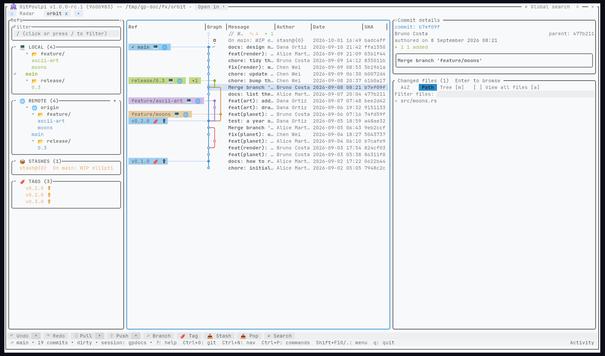 |  |
| **Catppuccin Frappé** (`catppuccin-frappe`) | **Catppuccin Latte** (`catppuccin-latte`) | **Catppuccin Macchiato** (`catppuccin-macchiato`) |
|  |  |  |
| **Catppuccin Mocha** (`catppuccin-mocha`) | **Cobalt2** (`cobalt2`) | **Cyberpunk** (`cyberpunk`) |
|  |  |  |
| **Deus** (`deus`) | **Dracula** (`dracula`) | **Dracula Soft** (`dracula-soft`) |
|  |  |  |
| **Everforest Dark** (`everforest-dark`) | **Everforest Light** (`everforest-light`) | **Fire** (`fire`) |
|  |  |  |
| **Fire Light** (`fire-light`) | **GitHub Dark** (`github-dark`) | **GitHub Dark Colorblind** (`github-dark-colorblind`) |
|  |  |  |
| **GitHub Dark Dimmed** (`github-dark-dimmed`) | **GitHub Dark High Contrast** (`github-dark-high-contrast`) | **GitHub Dark Legacy** (`github-dark-legacy`) |
|  |  |  |
| **GitHub Light** (`github-light`) | **GitHub Light Colorblind** (`github-light-colorblind`) | **GitHub Light High Contrast** (`github-light-high-contrast`) |
|  |  |  |
| **GitHub Light Legacy** (`github-light-legacy`) | **Gotham** (`gotham`) | **Gruvbox Dark** (`gruvbox-dark`) |
|  |  |  |
| **Gruvbox Dark Hard Contrast** (`gruvbox-dark-hard-contrast`) | **Gruvbox Dark Soft Contrast** (`gruvbox-dark-soft-contrast`) | **Gruvbox Light** (`gruvbox-light`) |
| 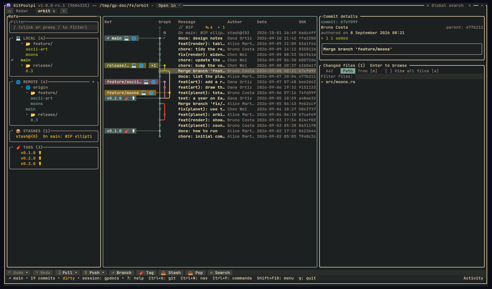 | 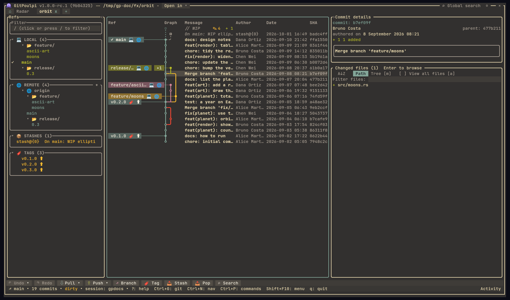 |  |
| **Gruvbox Light Hard Contrast** (`gruvbox-light-hard-contrast`) | **Gruvbox Light Soft Contrast** (`gruvbox-light-soft-contrast`) | **Iceberg Dark** (`iceberg-dark`) |
|  |  |  |
| **Iceberg Light** (`iceberg-light`) | **Jellybeans** (`jellybeans`) | **Kanagawa** (`kanagawa`) |
|  |  |  |
| **Kanagawa Dragon** (`kanagawa-dragon`) | **Kanagawa Lotus** (`kanagawa-lotus`) | **Lucario** (`lucario`) |
|  |  |  |
| **Matrix** (`matrix`) | **Miasma** (`miasma`) | **Monokai** (`monokai`) |
|  |  |  |
| **Moonfly** (`moonfly`) | **Night Owl Dark** (`night-owl-dark`) | **Night Owl Light** (`night-owl-light`) |
|  |  |  |
| **Nightfly** (`nightfly`) | **Nightfox** (`nightfox`) | **Nightfox Carbonfox** (`nightfox-carbonfox`) |
|  |  |  |
| **Nightfox Dawnfox** (`nightfox-dawnfox`) | **Nightfox Dayfox** (`nightfox-dayfox`) | **Nightfox Duskfox** (`nightfox-duskfox`) |
|  | 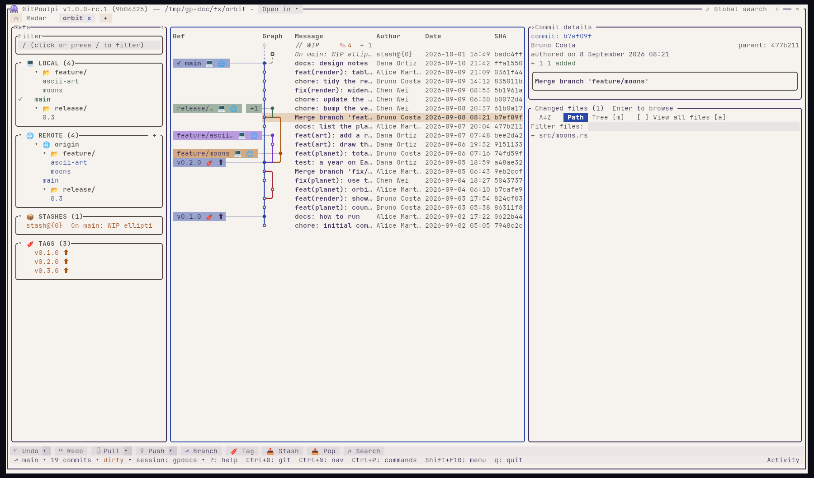 |  |
| **Nightfox Nordfox** (`nightfox-nordfox`) | **Nightfox Terafox** (`nightfox-terafox`) | **Noctis** (`noctis`) |
|  |  |  |
| **Noctis Azureus** (`noctis-azureus`) | **Noctis Bordo** (`noctis-bordo`) | **Noctis Hibernus** (`noctis-hibernus`) |
| 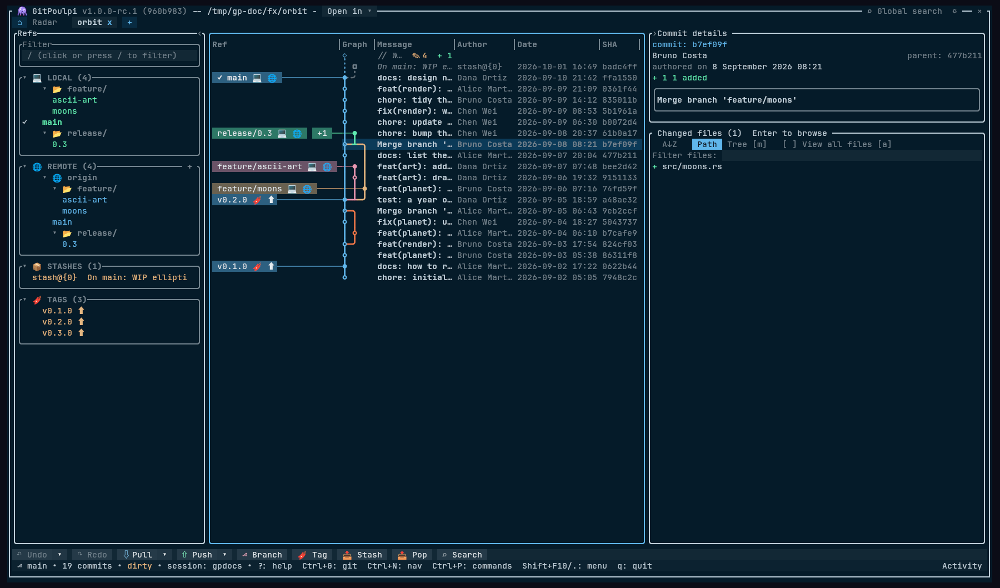 |  |  |
| **Noctis Lilac** (`noctis-lilac`) | **Noctis Lux** (`noctis-lux`) | **Noctis Minimus** (`noctis-minimus`) |
|  |  |  |
| **Noctis Obscuro** (`noctis-obscuro`) | **Noctis Sereno** (`noctis-sereno`) | **Noctis Uva** (`noctis-uva`) |
|  |  |  |
| **Noctis Viola** (`noctis-viola`) | **Nord** (`nord`) | **Nordic** (`nordic`) |
|  | 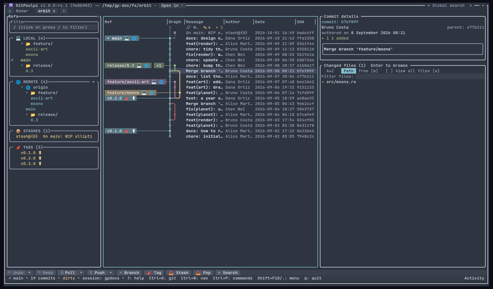 |  |
| **One Dark** (`one-dark`) | **One Half Dark** (`one-half-dark`) | **One Half Light** (`one-half-light`) |
| 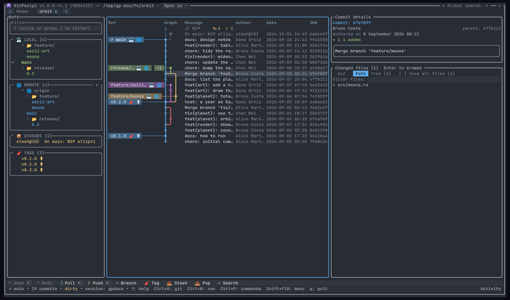 |  |  |
| **One Light** (`one-light`) | **Panda** (`panda`) | **Posterpole** (`posterpole`) |
|  |  |  |
| **Posterpole Gray** (`posterpole-gray`) | **Rosé Pine** (`rose-pine`) | **Rosé Pine Dawn** (`rose-pine-dawn`) |
| 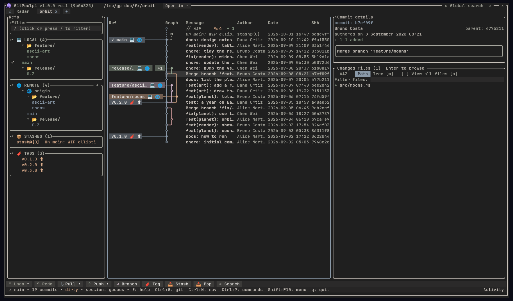 |  |  |
| **Rosé Pine Moon** (`rose-pine-moon`) | **Seoul256 Dark** (`seoul256-dark`) | **Seoul256 Light** (`seoul256-light`) |
|  |  |  |
| **Shades of Purple** (`shades-of-purple`) | **Shades of Purple Super Dark** (`shades-of-purple-super-dark`) | **Solarized Dark** (`solarized-dark`) |
|  | 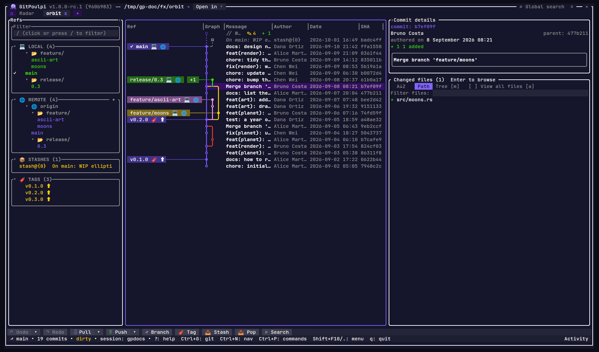 |  |
| **Solarized Light** (`solarized-light`) | **Sonokai** (`sonokai`) | **Sonokai Andromeda** (`sonokai-andromeda`) |
| 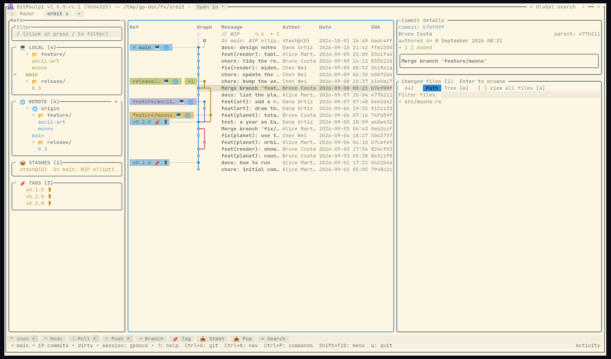 |  |  |
| **Sonokai Atlantis** (`sonokai-atlantis`) | **Sonokai Espresso** (`sonokai-espresso`) | **Sonokai Maia** (`sonokai-maia`) |
|  |  |  |
| **Sonokai Shusia** (`sonokai-shusia`) | **Srcery** (`srcery`) | **Sunset** (`sunset`) |
|  | 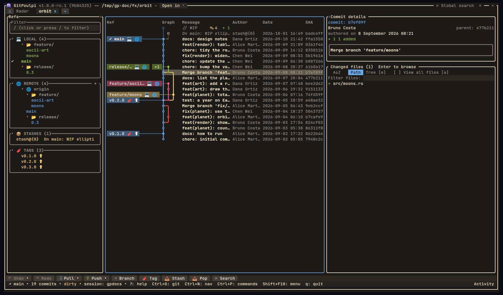 |  |
| **Tender** (`tender`) | **Terminal (16 colors)** (`terminal`) | **Tokyo Night** (`tokyo-night`) |
|  |  |  |
| **Tokyo Night Day** (`tokyo-night-day`) | **Tokyo Night Moon** (`tokyo-night-moon`) | **Tokyo Night Storm** (`tokyo-night-storm`) |
|  |  | 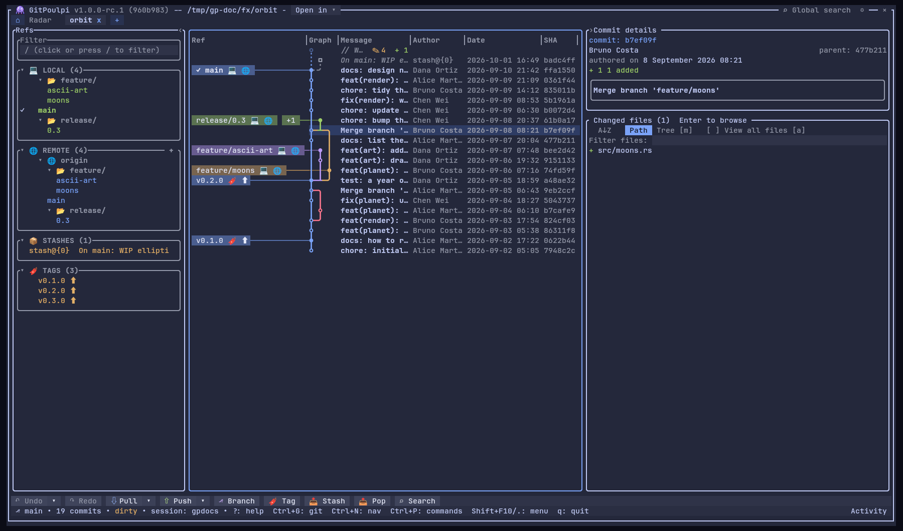 |
| **Tomorrow** (`tomorrow`) | **Tomorrow Night** (`tomorrow-night`) | **Tomorrow Night Blue** (`tomorrow-night-blue`) |
|  | 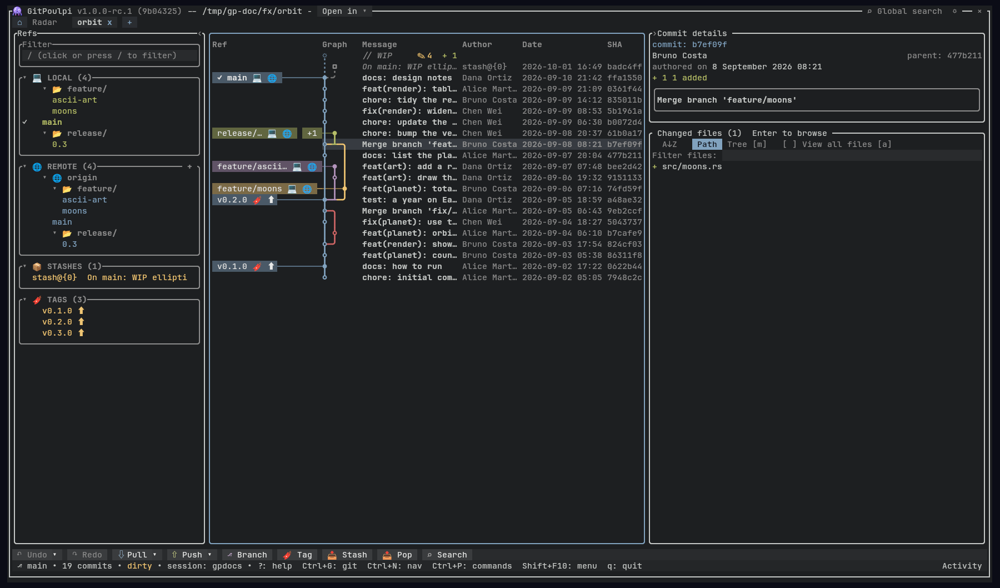 |  |
| **Tomorrow Night Bright** (`tomorrow-night-bright`) | **Tomorrow Night Eighties** (`tomorrow-night-eighties`) | **Vesper** (`vesper`) |
| 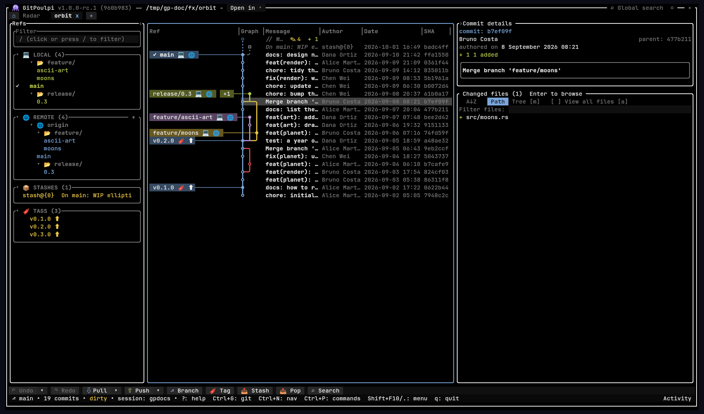 |  |  |
| **VS Code Dark** (`vscode-dark`) | **VS Code Light** (`vscode-light`) | **Zenbones Duckbones** (`zenbones-duckbones`) |
|  |  |  |
| **Zenbones Forestbones Dark** (`zenbones-forestbones-dark`) | **Zenbones Forestbones Light** (`zenbones-forestbones-light`) | **Zenbones Kanagawabones** (`zenbones-kanagawabones`) |
|  |  |  |
| **Zenbones Neobones Dark** (`zenbones-neobones-dark`) | **Zenbones Neobones Light** (`zenbones-neobones-light`) | **Zenbones Nordbones** (`zenbones-nordbones`) |
|  |  |  |
| **Zenbones Rosebones Dark** (`zenbones-rosebones-dark`) | **Zenbones Rosebones Light** (`zenbones-rosebones-light`) | **Zenbones Seoulbones Dark** (`zenbones-seoulbones-dark`) |
|  |  |  |
| **Zenbones Seoulbones Light** (`zenbones-seoulbones-light`) | **Zenbones Tokyobones Dark** (`zenbones-tokyobones-dark`) | **Zenbones Tokyobones Light** (`zenbones-tokyobones-light`) |
|  |  |  |
| **Zenbones Vimbones** (`zenbones-vimbones`) | **Zenbones Zenburned** (`zenbones-zenburned`) | **Zenbones Zenwritten Dark** (`zenbones-zenwritten-dark`) |
|  |  |  |
| **Zenbones Zenwritten Light** (`zenbones-zenwritten-light`) |
|  |

## Cualquier tema con cualquier paleta de carriles

Cada tema trae sus propios colores de carril para el grafo del Log, pero puedes
combinar cualquier tema con cualquier paleta: **Ajustes > Apariencia > Tema de color del
grafo** ofrece **Seguir el tema** (el valor por defecto) más todas las paletas de carriles de todos los
temas (GitPoulpi Dark, GitPoulpi Light, luego Material, Serie, ... y el
`graph_palette` de tus propios archivos de tema, listados después de los predefinidos bajo el
nombre del tema). Un tema propio aparece la próxima vez que se abre la lista (los
archivos se vuelven a leer entonces), y elegir uno guarda el nombre de su archivo en
`ui.graph_color_theme` (para la instalación primaria en `[ui]`, para las
demás en su propia entrada `[installation.settings.<id>]`, como el tema). Un
archivo de tema sin `graph_palette` tiene los colores de carril de su `base` (el
preset por defecto cuando no nombra ninguno), la misma herencia que cualquier otro color
del archivo. Un tema propio con el nombre de una paleta de carriles integrada (por ejemplo
`gruvbox`) sustituye a esa paleta en la lista. Si el nombre configurado ya no
existe (el archivo se eliminó o se renombró), el grafo usa los colores de carril del tema
activo, y Ajustes muestra el nombre marcado como *no encontrado* hasta que
elijas otro. 

En `config.toml`:

```toml
[ui]
theme = "nord"
graph_color_theme = "material"   # o "theme" para seguir el tema
```

`ui.input_color` es el mismo tipo de anulación para los campos de texto: el valor
por defecto `theme` sigue los colores de entrada del tema; `gray`, `blue`, `slate`, `dark` y
`custom` fuerzan un fondo (son colores oscuros, así que elige `theme` en un tema
claro).

## Tus propios temas

Pon un archivo `.toml` en la carpeta `themes/` del directorio de configuración
(`gitpoulpi config path` imprime su carpeta padre; la carpeta es `${config}/themes/`).
El nombre del archivo sin `.toml` es el slug del tema, que es lo que toma `ui.theme`.
Un archivo no puede reutilizar el slug de un preset (se omite con una advertencia).

Parte de un archivo completo:

```
gitpoulpi theme export nord > "$(dirname "$(gitpoulpi config path)")/themes/mine.toml"
```

Luego conserva solo lo que cambies. Un archivo es un conjunto de **anulaciones
parciales** sobre una `base` (un preset u otro tema de usuario; las cadenas tienen
como máximo 4 niveles y los ciclos se rechazan; sin `base` significa `dark`):

```toml
name = "My Nord"            # la etiqueta en el combo; por defecto = nombre del archivo
base = "nord"
light = false               # se hereda cuando falta
syntax = "base16-ocean.dark"
graph_palette = ["#88c0d0", "#a3be8c"]

[ui]
bg = "#2e3440"              # "default" | "#rrggbb" | "ansi:N"
accent = "#88c0d0"
toolbar_bg = "#3b4252"      # fila de la barra de herramientas y pestaña seleccionada
statusbar_bg = "#5e81ac"    # barra de estado
statusbar_fg = "#eceff4"

[diff]
add_bg = "#2f3b2f"
```

### Palabras cambiadas en un diff (`diff.add_emph_bg`, `diff.del_emph_bg`)

Los fondos más intensos que la vista Diff pinta sobre las palabras que difieren dentro de
una línea modificada, encima de `diff.add_bg` (líneas añadidas) y `diff.del_bg` (líneas
eliminadas); el texto conserva `diff.add_fg` y `diff.del_fg`. Todos los presets definen ambos.
Un archivo de tema que define `diff.add_bg` o `diff.del_bg` pero no el énfasis correspondiente
recibe uno derivado de él (el 30 % del camino hacia el color del texto de
ese lado), de modo que un fondo propio nunca acaba con el énfasis del tema base. Un valor
`default` (el preset Terminal), o un terminal cuya profundidad de color dibujaría ambos fondos
igual, marca las palabras en negrita y subrayado. Consulta
[Palabras cambiadas en un diff](interface-tour.md#palabras-cambiadas-en-un-diff).

Los colores son `"#rrggbb"`, `"ansi:N"` (la entrada N de la paleta del terminal) o
`"default"` (el color propio del terminal). Los grupos y claves son los de
`gitpoulpi theme export <slug>`. Nada es fatal: una clave desconocida o un
color incorrecto se ignora, una `base` desconocida recurre a `dark`, y
`gitpoulpi theme list` informa de cada problema en `warnings` (la aplicación los
muestra una vez en la barra de estado).

Los archivos se vuelven a leer al abrir el combo Tema y al cerrar Ajustes. Una
ventana en marcha también nota cuando se reescriben `config.toml` (un
`gitpoulpi config set ui.theme ...` desde una shell) y el archivo del tema activo,
y aplica los colores nuevos en aproximadamente un segundo, sin reiniciar.

### `ui.border_focused`

El marco del panel que tiene el foco del teclado: el Log, la barra lateral de
Refs, los paneles Staged y Unstaged, el detalle del commit, los paneles de
historial, revisión y reescritura, y los marcos del diff, de los archivos y del
editor. Pinta solo bordes; el texto, las etiquetas y los iconos (la etiqueta
"commit :", el icono de Inicio, los botones de pestaña) siguen usando
`ui.accent`. Así un tema puede enmarcar el panel activo con un color que sería
ilegible como texto, por ejemplo un amarillo vivo en un tema claro. Cuando un
tema no lo define, sigue a `ui.accent` (también en un archivo de usuario: un
archivo que cambia solo `accent` da ese acento a sus marcos con foco), de modo
que todos los temas integrados se ven como antes. Los diálogos y las ventanas
emergentes conservan un marco con el acento.

```toml
[ui]
accent = "#1f5fbf"
border_focused = "#ffd700"
```

## Detección del sistema

Con `ui.theme = "system"`, GitPoulpi pide al terminal su color de fondo
**una sola vez, al arrancar** (la consulta OSC 11, que responden kitty, WezTerm,
Alacritty, foot, iTerm2, Windows Terminal, tmux y la mayoría de los demás) y elige
Light para un fondo claro, Dark en caso contrario. La espera es de unos
100 ms como máximo, y un terminal que no conoce la consulta no cuesta nada: la respuesta
se lee siempre antes de que arranque la interfaz, así que no se imprime nada y no se
pierde ninguna tecla. Sin respuesta (y siempre en Windows, que no envía
la consulta) lee `COLORFGBG` y, si no, recurre a Dark. Un terminal cuyo
fondo cambia mientras GitPoulpi se ejecuta no se sigue; reinícialo, o elige
Light o Dark explícitamente.

## Profundidad de color

Los temas son truecolor (`#rrggbb`). `ui.color_depth` (Ajustes > Apariencia >
Profundidad de color, se aplica al instante) decide cómo llega eso al terminal:

| Valor | Efecto |
|---|---|
| `auto` (por defecto) | Truecolor, salvo donde se sabe que no funciona: Apple Terminal (`TERM_PROGRAM=Apple_Terminal`) usa 256 colores, la consola de Linux (`TERM=linux`) 16, y un terminal `*-256color` que no define `COLORTERM` (y no es WezTerm, kitty ni Windows Terminal) 256. `COLORTERM=truecolor` siempre significa truecolor. |
| `truecolor` | Siempre color de 24 bits. |
| `256` | Cada color RGB pasa a la entrada xterm-256 más cercana. |
| `16` | El más cercano de los 16 colores ANSI; la paleta propia del terminal fija el matiz exacto. |

Usa `256` o `16` si un tema se ve con colores erróneos por ssh o en un multiplexor
antiguo. El preset Terminal no necesita nada de esto. Truecolor no cuesta nada;
la pasada de conversión recorre la pantalla una vez por fotograma solo cuando está activa.

El tema es por instalación: varias instalaciones de GitPoulpi que comparten una misma configuración conservan cada una el suyo, así que elegir uno en una instalación nunca recolorea las demás.

## Vista previa en vivo

En Ajustes > Apariencia, el combo Tema lista **Sistema (sigue el terminal)**,
los presets y luego tus propios archivos de tema. Al mover el resaltado se aplica ese tema
al instante, de modo que toda la pantalla de Ajustes se repinta bajo tus ojos; **Enter** lo conserva
(se guarda), **Esc** o un clic fuera restaura el anterior y no guarda
nada. La entrada de la paleta **App: Tema...** (`Ctrl+P`) abre Ajustes en esa
fila.

### Cambiar de tema desde la paleta

**App: Cambiar tema...** (`Ctrl+P`, o `Ctrl+N t`; la tecla se puede reasignar como
`nav_prefix.change_theme`) abre una lista de los mismos temas sin pasar por
Ajustes: **Sistema (sigue el terminal)**, los presets y luego tus propios
archivos de tema, cada uno con cuatro pequeños chips de color. El tema actual aparece marcado.
Escribe para filtrar la lista; al mover el resaltado se previsualiza el tema al instante,
**Enter** lo aplica y guarda `ui.theme` en `config.toml`, **Esc** (o un clic
fuera de la lista) devuelve el tema anterior y no guarda nada.

Bajo el campo de filtro, un prefiltro segmentado acota la lista: **Todos**,
**Oscuros**, **Claros** y **Con color**, más **Propios** cuando tienes archivos de tema propios
(haz clic en un segmento, `Tab` / `Shift+Tab`, o `Alt+1`..`Alt+5`). Oscuros y Claros salen del brillo del `ui.bg` del tema;
**Con color** conserva los temas cuyo fondo está claramente teñido (azul,
violeta, amarillo, verde...) y deja fuera los grises blancos, casi blancos, negros y
casi negros, así que Solarized Dark, Dracula o Nord tienen color mientras que GitHub
Dark y One Light no. Un tema con color también aparece en Oscuros o Claros.
**Sistema** y los temas transparentes (sin fondo propio) aparecen solo en
Todos. **Propios** conserva solo los archivos de tema de tu carpeta `themes/` (un tema propio
sigue siendo Oscuro, Claro o Con color para esos botones); el botón no se dibuja y no
se alcanza con teclas mientras esa carpeta no tenga ningún tema. El prefiltro se combina
con lo que escribes. Los selectores de tema de color
del grafo y de idioma se previsualizan igual: los carriles del Log y toda la interfaz
cambian al mover el resaltado.


Bajo el combo, una tira de chips de color muestra el tema en vigor (fondo,
texto, atenuado, acento, selección, danger, diff añadido, diff eliminado, luego los
seis primeros colores de carril), y sigue la vista previa. El combo **Tema de color del grafo** en
**Apariencia** muestra unos cuantos colores de carril junto a cada paleta, y la elección
se aplica al cerrar Ajustes.

Un tema con fondo propio (Light y los demás presets pintados) rellena toda la
ventana, incluidos Ajustes y las vistas de página completa, y da al texto que
no tiene color propio el color de texto del tema; Dark y Terminal dejan en paz los colores de tu
terminal.

## Desde la línea de comandos

| Comando | Salida |
|---|---|
| `gitpoulpi theme list` | JSON `{themes: [{slug, label, source, light, lane_palette}], warnings}`; `source` es `preset` o `user`. |
| `gitpoulpi theme export <slug>` | El archivo de tema completo como TOML en stdout (JSON: `{slug, toml}`); se vuelve a analizar como el mismo tema. |
| `gitpoulpi config set ui.theme <slug>` | Se valida contra los presets y tu carpeta `themes/`; un nombre desconocido es un error que lista los válidos. Se aceptan `system` y `default`. |
| `gitpoulpi config set ui.graph_color_theme <name>` | `theme` (seguir el tema) o cualquier nombre de paleta de carriles; un nombre desconocido lista los válidos. |

El servidor MCP ofrece `theme_list` y `theme_export` como herramientas de solo lectura.
