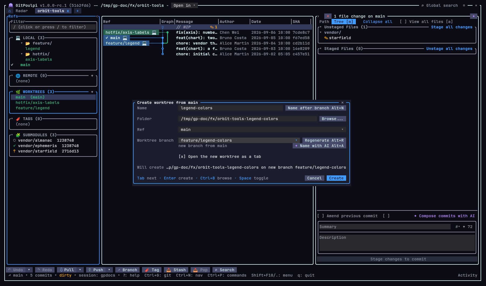

[English](../worktrees.md) · [Čeština](../cs/worktrees.md) · [Deutsch](../de/worktrees.md) · **Español** · [Français](../fr/worktrees.md) · [Italiano](../it/worktrees.md) · [日本語](../ja/worktrees.md) · [한국어](../ko/worktrees.md) · [Nederlands](../nl/worktrees.md) · [Polski](../pl/worktrees.md) · [Português (Brasil)](../pt-BR/worktrees.md) · [Português (Portugal)](../pt-PT/worktrees.md) · [Русский](../ru/worktrees.md) · [Svenska](../sv/worktrees.md) · [Türkçe](../tr/worktrees.md) · [Українська](../uk/worktrees.md) · [简体中文](../zh-CN/worktrees.md)

# Worktrees

Un worktree es una segunda copia del repositorio con checkout: otra carpeta, en
otra rama, que comparte el mismo historial. La sección WORKTREES del panel Refs
los lista; el principal lleva la marca `(principal)`.

## Mostrar la sección

La sección está oculta en un repositorio que aún no tiene ningún worktree
vinculado. Para verla de todos modos (entonces dice «Aún no hay worktrees: +
para crear uno»), usa el comando de la paleta **Panel izquierdo: Mostrar la
sección Worktrees**, marca **WORKTREES** en la lista de secciones visibles del
panel (clic derecho en el encabezado de una sección) o ejecuta cualquiera de
los comandos de creación de abajo. GitPoulpi lo recuerda para ese repositorio
(consulta **Secciones del panel izquierdo** en [Ajustes](settings.md)); otro
repositorio sin worktrees sigue empezando con la sección oculta.

## Crear un worktree

El **+** del encabezado de WORKTREES (teclado: `+` en la sección; paleta:
**Refs: Crear worktree...**) abre un menú:

- **Desde la rama actual**: la rama ya tiene checkout en la carpeta principal,
  así que el diálogo propone una rama nueva sobre ella (`worktree-<id>`).
- **Desde commit: selección**: en gris hasta que se selecciona un commit en el
  Log. El diálogo propone una rama nueva `worktree-<id>` que empieza ahí; vacía
  el campo de la rama para un worktree desacoplado.
- **Elegir una rama...**: el diálogo se abre sobre su lista **Rama del
  worktree**, para abrir una rama que ya existe.

La paleta tiene las mismas tres (**Refs: Crear worktree desde la rama actual**,
**Git: Crear worktree en el commit seleccionado...**, **Refs: Crear worktree
eligiendo una rama**). Las entradas anteriores siguen funcionando: **Crear
worktree desde...** en el menú de una rama, un tag o un commit.

El diálogo lo propone todo y te deja cambiarlo. El **Nombre** y la rama nueva
empiezan como `worktree-<id>`, donde `<id>` son 8 dígitos hexadecimales
aleatorios (los mismos para ambos), así que dos worktrees nunca chocan.

| Campo | Significado |
|---|---|
| **Nombre** | De él se construye el nombre de la carpeta. **Nombre de rama** (`Alt+N`) lo pone en `worktree-<rama>`: las barras pasan a `-` y la palabra no se duplica (`worktree-foo` y `feature/worktree-x` conservan la suya, `feature/login` da `worktree-feature-login`). |
| **Carpeta** | Una carpeta hermana del repositorio, `<repositorio>-<nombre>`. Sigue al Nombre hasta que escribes en Carpeta; **Examinar** elige dónde. |
| **Ref** | Dónde empieza una rama *nueva*: una rama o un commit (una lista; escribe para buscar). No se usa, y lo dice, mientras hay elegida una rama existente. |
| **Rama del worktree** | Un campo con dos significados, indicados debajo. Un nombre que no es una rama local crea una rama nueva desde Ref (**rama nueva desde main**). Una rama local sin checkout en otro sitio (elígela en la lista o escribe su nombre) se activa ahí tal cual (**hace checkout de esta rama**). La primera fila de la lista, o un campo vacío, hace checkout de la rama de Ref (o deja HEAD desacoplado en un commit); se rechaza cuando esa rama ya tiene checkout. |
| **Regenerar** | `Alt+R`. Saca un `<id>` nuevo y sustituye el Nombre y la rama por él, salvo lo que escribiste tú (un Nombre o una rama escritos se conservan) y una rama existente (nunca se sustituye). Un Nombre de **Nombre de rama** o de la IA cuenta como generado. |
| **Nombrar con IA** | Solo con la IA activada (ver abajo). |
| **Abrir el nuevo worktree en una pestaña** | Activado por defecto. |

Una carpeta que no está vacía, un nombre no válido, un nombre de rama que git
rechaza o una rama que tiene otro worktree se indican en la propia línea del
diálogo, y **Crear** sigue en gris.

### Poner nombre con IA

Con la [IA](ai.md) activada, **Nombrar con IA** (`Alt+A`) abre un cuadro dentro
del diálogo: *Describe la función, el error o la tarea*. **Nombrar** pide al
modelo un nombre corto de worktree y un nombre de rama que siga los nombres de
rama del propio repositorio (`feature/`, `fix/`, kebab-case en minúsculas).
Rellenan el Nombre (como `worktree-<nombre>`) y el campo de la rama, que se
pueden seguir editando; un nombre de rama que ya existe recibe el sufijo `-2`
para que la respuesta nunca haga un checkout en silencio. El cuadro muestra el
estado de espera, **Detener** (o `Esc`) cancela, y un fallo se muestra dentro
del diálogo. Solo se envían tu descripción y los nombres de las ramas locales.

## El menú de la fila

Haz clic derecho en un worktree (o selecciónalo y pulsa la tecla de menú,
`Shift+F10` o `.`):

- **Abrir en una pestaña nueva**: como un doble clic o `Enter`.
- **Abrir en**: las entradas de [Abrir en](open-in.md) que tienen marcada la
  casilla **Puede abrir un worktree** (Ajustes > Abrir en; todas vienen
  marcadas por defecto). Se ejecutan con la carpeta del worktree como `${cwd}`.
- **Merge de <rama> en...**: elige la rama en la que hacer merge (por defecto,
  la del worktree principal). El merge normal se ejecuta en el worktree donde
  esa rama tiene checkout, con tus opciones de merge; un conflicto se resuelve
  allí con el flujo de conflictos habitual. Una rama que no tiene checkout en
  ningún sitio se rechaza con el motivo. No se ofrece para un worktree
  desacoplado.
- **Eliminar worktree...**: nunca el principal.

**Abrir en una pestaña nueva** (o un doble clic, o `Enter`) abre la carpeta del worktree como
una pestaña propia, con su propio Log, su estado y su rama:

La paleta tiene las mismas acciones sobre la fila seleccionada (**Refs: Abrir
worktree en...**, **Refs: Merge de la rama del worktree en...**, **Refs:
Eliminar worktree...**, **Refs: Abrir worktree en una pestaña**).

## Eliminar un worktree

Un worktree limpio recibe una confirmación sencilla. Si su rama ya está
incluida por merge (en su upstream, en la rama del worktree principal o en
`main` / `master`), la casilla **Borrar también la rama <r>** viene marcada por
defecto; una rama sin merge avisa de que se conserva. **Merge en... y
eliminar** hace primero el merge y elimina solo cuando este terminó sin
conflictos.

Con cambios sin confirmar (con seguimiento o sin él), el diálogo los lista
(cantidad, con desplazamiento) y ofrece:

- **Hacer commit y eliminar**: un campo de mensaje en el diálogo; todos los
  cambios se preparan (se respeta `.gitignore`) y se confirman en la rama del
  worktree, y después se elimina el worktree. Un worktree desacoplado pone
  nombre a una rama para el commit en el mismo diálogo.
- **Hacer stash y eliminar**: todos los cambios, también los archivos sin
  seguimiento, se guardan en un stash con un mensaje editable (por defecto
  «WIP en <carpeta>»), y después se elimina el worktree. La lista de stashes la
  comparten todos los worktrees: el stash queda después en los STASHES del
  repositorio principal, listo para hacer pop.
- **Abrir para commit**: abre el worktree en una pestaña con el mensaje de
  commit enfocado; no se elimina nada.
- **Eliminar igualmente**: descarta los cambios tras una segunda confirmación
  explícita.

## Deshacer

Eliminar un worktree no se puede deshacer: la carpeta desaparece. Lo que se
guardó antes se queda: el commit está en su rama y el stash en la lista. El
borrado de la rama que añade **Borrar también la rama** es el habitual del
diario: **Deshacer** devuelve la rama (no la carpeta). Crear un worktree
tampoco forma parte del historial.

## Desde un script o un agente

`gitpoulpi worktree changes <path>` lista los cambios sin confirmar de un
worktree. `gitpoulpi worktree remove <path> [--force] [--commit-message M
[--commit-branch B]] [--stash-message M] [--delete-branch]` lo elimina; las
herramientas MCP son `worktree_changes` y `worktree_remove`. `gitpoulpi ai
worktree-name --describe "<tarea>"` imprime los nombres de worktree y de rama
que propone la IA (`{ name, worktree, branch }`) y no crea nada; la herramienta
MCP es `ai_worktree_name`. Consulta la [referencia de la CLI](cli-reference.md).
