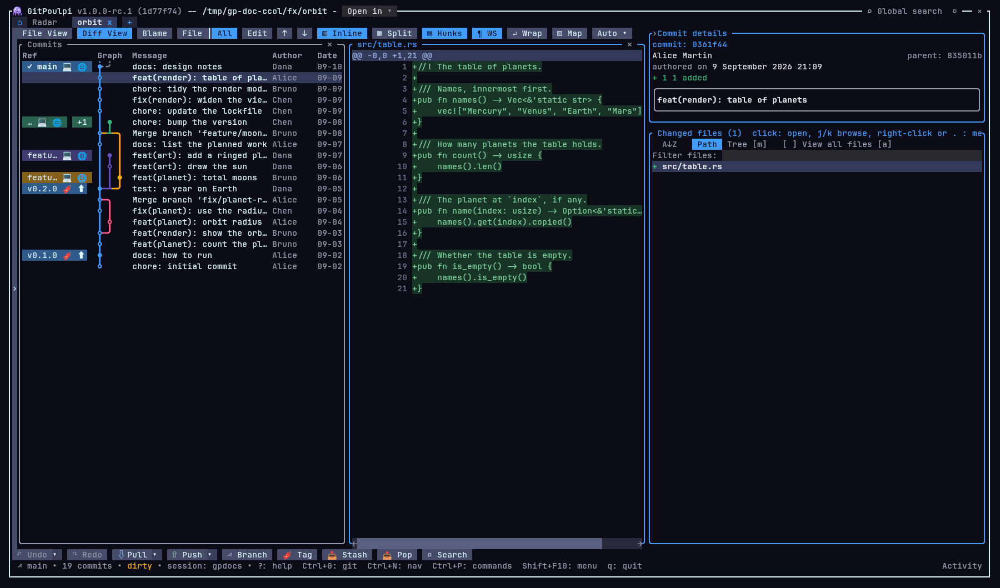

[English](../interface-tour.md) · [Čeština](../cs/interface-tour.md) · [Deutsch](../de/interface-tour.md) · [Español](../es/interface-tour.md) · **Français** · [Italiano](../it/interface-tour.md) · [日本語](../ja/interface-tour.md) · [한국어](../ko/interface-tour.md) · [Nederlands](../nl/interface-tour.md) · [Polski](../pl/interface-tour.md) · [Português (Brasil)](../pt-BR/interface-tour.md) · [Português (Portugal)](../pt-PT/interface-tour.md) · [Русский](../ru/interface-tour.md) · [Svenska](../sv/interface-tour.md) · [Türkçe](../tr/interface-tour.md) · [Українська](../uk/interface-tour.md) · [简体中文](../zh-CN/interface-tour.md)

# Visite de l'interface

Cette page nomme chaque zone de la fenêtre GitPoulpi, de haut en bas. Les autres
pages utilisent les mêmes noms. Les images utilisent un petit dépôt de
démonstration avec des auteurs inventés.

## Le cadre

### Barre de titre

Le bord supérieur de la fenêtre affiche
 `GitPoulpi vX.Y.Z -- <chemin du dépôt>` (le nom de la session est dans la ligne d'état, en bas par défaut).

- **** ouvre la fenêtre **À propos** : version, fonctions du build, licence, liens, une courte mention indiquant que GitPoulpi est un projet indépendant, les crates tierces, et les licences et crédits. Sur un terminal qui affiche des images, la pieuvre est le logo en pixels, dans la couleur de votre logo (ailleurs, elle reste l'émoji). Palette : `Aide : À propos de GitPoulpi` ; touches : `Ctrl+N` puis `A`. Dans À propos, les pupilles de la pieuvre suivent le pointeur de la souris. Cliquez sur le logo (ou appuyez sur `Space`) pour le faire tourner vers la couleur suivante. Faites un clic droit sur le logo (ou appuyez sur `c`) pour la liste des couleurs. GitPoulpi enregistre votre choix dans `ui.logo_color`. Les liens s'ouvrent d'un clic ou avec leur touche d'accès (`s` code source, `d` documentation, `i` licence), et `l` liste les crates tierces avec leurs versions et leurs licences (une liste défilante ; `Esc` ou `l` pour revenir, tout comme un clic sur son titre). Chaque crate de la liste porte un lien vers sa page (son dépôt, ou à défaut sa page sur crates.io) : cliquez sur la ligne, ou choisissez-la avec `↑` `↓` et appuyez sur `Enter`, pour l'ouvrir dans le navigateur. `t` (ou la commande de palette `Aide : Licences et crédits`) affiche les mentions de licence et les crédits de tout ce qui est intégré au programme, dans un texte défilant (`Up` / `Down`, `PgUp` / `PgDn`, `Home` / `End` ; `Esc` ou `t` pour revenir). Depuis un script, `gitpoulpi licenses` affiche le même texte.
- La **version** (`v1.0.0` ; `vX.Y.Z disponible` quand une version plus récente existe)
  se trouve entre le nom et le chemin : un clic ouvre le panneau de mise à jour seulement quand une version plus récente existe ou qu'une mise à jour est en cours, sinon l'onglet **Notes de version**, voir
  [Mises à jour](updates.md).
- **Ouvrir dans ▾**, juste après le chemin, ouvre le dossier de l'onglet dans un
  terminal, un éditeur, un multiplexeur ou le gestionnaire de fichiers
  (`Alt+O`). Voir [Ouvrir dans](open-in.md).
- **⌕ Recherche globale** (une loupe et son libellé), juste à gauche de l'engrenage, ouvre la [recherche globale](search.md) (`Ctrl+Alt+F`). C'est le premier élément à céder la place quand la barre de titre est trop étroite : le libellé disparaît d'abord (la loupe reste), puis le bouton.
- L'**engrenage** (`⚙`), juste à gauche de la **×**, ouvre les **Paramètres** (`Ctrl+,`).
- **×** à l'extrémité droite quitte, comme `q`.

### Ligne d'état

Par défaut, la ligne d'état est la dernière ligne de la fenêtre ; **Paramètres > Apparence > Position de la ligne d'état** la place en haut, au-dessus des onglets de dépôt.

Elle montre la branche courante, le nombre de commits chargés,
`dirty` ou `clean`, le nom de la session, et les touches les plus utiles : `?`
aide, `Ctrl+G` actions git, `Ctrl+N` navigation, `Ctrl+P` commandes,
`Shift+F10` menu, `q` quitter. Sur une fenêtre étroite, les touches les moins
utiles sont omises. La ligne d'état affiche aussi les messages d'état et la
progression. Les touches qu'elle montre sont toujours celles en vigueur, y
compris celles que vous avez changées (voir
[Paramètres](settings.md#clavier-et-souris)).

Le nombre de commits s'affiche `500 / 48213 commits` tant qu'il reste de l'historique plus ancien à charger (`500 / … commits` pendant que le total est compté), et seulement `2500 commits` une fois tout chargé. Dans un checkout partiel (sparse), un badge `partiel` suit le nom de la session. La façon de compter le total est un réglage : **Compter le total des commits avec** (voir [Paramètres](settings.md#journal-et-graphe)).

À son extrémité droite, le bouton **Activité** ouvre le Journal d'activité : un onglet Opérations Git (les opérations avec leur durée, les messages et les erreurs), un onglet Application (le journal de l'application, avec une zone de niveau et un bouton **Effacer le journal**) et une zone Périmètre qui limite les deux à ce dépôt, à un espace de travail ou à tous les dépôts. Un nombre sur le bouton compte les erreurs que vous n'avez pas encore consultées. Quand une opération échoue, la ligne d'état dit pourquoi en rouge, où que vous soyez ; un clic dessus (ou la palette, `Journal d'activité : Ouvrir la dernière erreur`) ouvre l'entrée du journal d'activité, avec les détails, un Copier pour une IA et la prochaine étape suggérée. Les deux sont décrits dans [Quand quelque chose échoue](troubleshooting.md#quand-quelque-chose-échoue).

Sur l'onglet **Application**, **Effacer le journal** (`x`) vide les fichiers du journal de l'application après confirmation. À gauche du bouton **Activité**, l'indicateur de tâches montre une tâche d'arrière-plan en cours avec un `[x]` pour l'annuler (la liste des tâches a **Tout annuler**, et la palette a *Tâches : annuler tout ce qui peut l'être* ; une tâche qui ne peut pas être arrêtée sans risque dit pourquoi). L'onglet Accueil a la même ligne d'état, avec le bouton **Activité** en bas à droite (il s'ouvre sur Tous les dépôts).

### Surcouches

La palette de commandes, l'aide, les menus contextuels, les boîtes de dialogue,
les fenêtres contextuelles et les Paramètres s'ouvrent par-dessus la fenêtre.
Chacun porte un `✕` en haut à droite de sa bordure ; `Esc` ou un clic sur `✕` le ferme, et un clic à l'extérieur
ferme une boîte de dialogue, une fenêtre contextuelle ou un panneau (voir
[Fermer les fenêtres et les boîtes de dialogue](mouse-and-gestures.md#fermer-les-fenêtres-et-les-boîtes-de-dialogue)).

### Quand la fenêtre est petite

Rien ne disparaît en silence quand la fenêtre se rétrécit. Un bouton perd d'abord
son libellé long (coupé par `...`), puis passe sur une deuxième ligne ou se range
dans le menu `⋯` de sa ligne, et sa touche et son entrée de palette continuent de
marcher. Une boîte de dialogue trop grande pour la fenêtre dessine un petit cadre
avec son titre, le `✕` et la ligne **Fenêtre trop petite : agrandissez-la** au
lieu de rien ; `Esc` et `✕` la ferment, et elle revient en entier quand vous
agrandissez la fenêtre.

## Barre d'onglets

L'onglet **Accueil** (l'icône de maison) est à l'extrémité gauche, suivi de la
[pastille d'espace de travail](workspaces.md) (dès que vous avez un espace de travail), de
l'onglet **Radar** épinglé (il se ferme comme n'importe quel onglet ; voir
[le Radar](radar.md)) et de l'onglet **Espaces de travail** une fois que vous l'avez ouvert
(`Alt+J` ; il se ferme comme n'importe quel onglet). Viennent ensuite un onglet par dépôt
ouvert. Le `x` qui ferme un onglet n'apparaît que sur l'onglet actif et sur celui qui est
sous le pointeur. La ligne d'onglets ne porte que des onglets (le bouton de
[recherche globale](search.md) est dans la barre de titre).

Quand les onglets des dépôts ne tiennent pas, la ligne défile au lieu de les
rétrécir : les onglets sont entre deux boutons fléchés, `‹` à gauche et `›` à droite.
Une flèche est grisée quand aucun onglet n'est caché de son côté. Cliquez sur une
flèche pour montrer un onglet de plus de ce côté (maintenez-la pour continuer à
faire défiler), ou utilisez la molette sur la ligne (vers le haut ou la gauche pour
les onglets précédents). Chaque fois que l'onglet actif change (vous changez d'onglet
au clavier, par le sélecteur d'onglets ou la palette, ouvrez ou fermez un onglet,
ou redimensionnez la fenêtre), la ligne défile juste assez pour le montrer en entier.
Si la place le permet, un bouton `…` après la flèche droite ouvre le sélecteur
d'onglets. Faire glisser un onglet sur une flèche fait défiler la ligne tant que vous
y restez, pour le déposer au-delà des onglets visibles. `Ctrl+N` affiche un badge sur
chaque flèche active.

**Paramètres > Apparence > Position de la barre d'onglets** déplace cette ligne en bas de la fenêtre (sous la ligne d'état) ou en fait une colonne au bord gauche : un onglet par ligne, Accueil d'abord, puis la pastille d'espace de travail, le Radar, l'onglet Espaces de travail, les onglets (un nom long finit par `…`) et le `+`. Quand les onglets dépassent les lignes, une ligne `…` indique combien sont cachés au-dessus (`▲`) et en dessous (`▼`) et ouvre la liste des onglets ; la molette fait défiler la colonne. À côté d'une barre d'outils en colonne, les onglets restent à l'extérieur. Une fenêtre de moins de 80 colonnes garde les onglets en haut. Clics, croix de fermeture, clic du milieu, menu du clic droit, glisser pour réordonner et clavier marchent de la même façon à chaque position.

- Le **+** juste après le dernier onglet ouvre un petit menu : **Nouvel onglet**
  (`Alt+T`, palette **Onglet : Nouvel onglet**) et, tant que leurs onglets sont
  fermés, **Radar** et **Espaces de travail** (`Alt+J`), qui ouvrent ces onglets ; la
  commande de palette **Onglet : Nouveau...** ouvre le même menu. Un **Nouvel
  onglet** est la vue Accueil avec la zone de recherche prête, si bien que taper
  filtre aussitôt vos dépôts. Choisissez-en un (ou
  Parcourir, Cloner, Init) et son onglet apparaît au bout de la barre ; un dépôt
  déjà ouvert est simplement activé. `Esc` sur la recherche vide, `Ctrl+W`, son
  `x` ou un clic du milieu ferment le Nouvel onglet et vous ramènent à l'onglet
  où vous étiez. Il n'est jamais enregistré avec votre session.

  
- Faites un clic droit sur un onglet, ou appuyez sur `Ctrl+T`, pour le menu de
  l'onglet : **Nouvel onglet**, **Fermer l'onglet**, **Fermer les autres onglets...**, **Fermer les onglets à droite...**,
  **Ajouter aux favoris** (ou **Retirer des favoris**), **Ajouter à l'espace de travail**
  (ou **Retirer de l'espace de travail**, quand vous avez des espaces de travail),
  **Copier le chemin**, **Ouvrir dans ›**, **SSH et identifiants...** et **Extraction partielle...**.
- `Ctrl+PageUp` et `Ctrl+PageDown` changent d'onglet. `Ctrl+W` ferme l'onglet
  courant. Un clic du milieu sur un onglet le ferme aussi (avec la même question).
- `t` (ou `Ctrl+N Tab`) ouvre le sélecteur d'onglets, une liste filtrable des
  onglets ouverts.
- **Réordonner les onglets :** appuyez sur un onglet de dépôt et faites-le glisser
  sur le côté (un fantôme de l'onglet suit le pointeur et une barre montre où il
  atterrira ; `Esc` annule), ou faites glisser une ligne du sélecteur d'onglets,
  appuyez sur `Alt+Up` / `Alt+Down` sur la ligne en surbrillance du sélecteur, ou
  lancez **Onglet : Déplacer à gauche** / **Onglet : Déplacer à droite** depuis la
  palette. L'ordre est enregistré avec la session. Un simple clic sans mouvement
  sélectionne toujours l'onglet. La maison, la pastille d'espace de travail et le
  `+` ne bougent jamais.
- **Quitter & cd ici** apparaît à droite des onglets quand vous avez lancé
  GitPoulpi via le wrapper shell `gp` et que l'onglet n'est pas le dossier où
  vous avez démarré. Voir [Suivre le dossier de l'onglet](following-the-tab-folder.md).
- La **pastille d'espace de travail** juste après la maison (un point coloré et
  un nom, ou « Aucun espace de travail ») change d'[espace de travail](workspaces.md) :
  cliquez dessus ou appuyez sur `Alt+W`. Elle apparaît dès que vous avez un
  espace de travail.

Avec **Mémoriser les onglets** activé (par défaut), vos onglets reviennent au
lancement suivant. Un worktree s'ouvre dans son propre onglet. Cet onglet se
ferme quand le worktree est supprimé.

L'onglet d'un worktree se place juste après celui de son dépôt, et un onglet de worktree écarté y revient (**Regrouper les onglets de worktrees** dans Paramètres > Général, activé par défaut).

### Accueil

L'onglet Accueil est le gestionnaire de dépôts. Il a quatre sections : **Dépôts
ouverts**, **Favoris**, **Dépôts récents** et **Tous les dépôts**. Chaque ligne
montre la branche, les nombres d'avance et de retard et le nombre de
modifications, puis le chemin du dossier quand il y a de la place : abrégé avec `~` et
coupé au milieu quand c'est étroit, il ne repousse jamais le nom, le propriétaire ni la branche. Chaque ligne a une étoile (favori), **Ouvrir** ou **Aller**,
**Fermer** ou **Retirer**, et un menu `⋮`.

En haut : **Parcourir**, **Cloner**, **Init**, une zone de recherche, **Tout
replier** et **Tout déplier**. Un dossier qui n'existe plus quitte *Récents* et
*Tous* tout seul. Un favori manquant reste, avec un bouton **Retirer**.
**Retirer** ne supprime jamais rien sur le disque.

Touches : `Enter` ouvrir, `f` favori, `x` fermer ou retirer, `y` copier le chemin, `o` ouvrir avec l'outil par défaut (**Ouvrir dans** du menu `⋮` en propose un autre), `.` menu, `/`
recherche, `Space` replier une section, `Esc` retour à votre onglet.
`Ctrl+N` affiche un badge sur la zone de recherche, chaque section et chaque bouton : appuyez sur le caractère d'un badge pour y placer le focus ou l'actionner (voir [Badges](keybindings.md#badges)).

Une seule zone de recherche filtre tout ce qui est dessous, Favoris compris : un dépôt reste si son nom, sa branche ou son chemin contient le texte. Les espaces de travail ont leur propre onglet et ne sont pas une page de l'onglet Accueil : ouvrez-le depuis le menu du `+`, avec `Alt+J` ou depuis la palette, et fermez-le avec son `x` : voir [Espaces de travail](workspaces.md).

**Cloner** liste, pour chaque profil connecté (GitHub, GitLab, Gitea, Forgejo, Azure DevOps, Bitbucket, Gerrit), les dépôts auxquels vous avez accès, une section par propriétaire : les vôtres d'abord, puis une par organisation ou groupe (par ordre alphabétique), chacune sous un en-tête. Un cadenas marque un dépôt privé. La zone de recherche filtre toutes les sections ; une section sans résultat disparaît. `Up` et `Down` sautent les en-têtes, et `Home`, `End`, `PgUp` et `PgDn` fonctionnent dans la liste.

## Barre d'outils

Par défaut, une ligne sous les volets et au-dessus de la ligne d'état. **Paramètres > Apparence > Position de la barre d'outils** la place en haut (sous les onglets), en bas, ou en colonne à gauche ou à droite des volets (une fenêtre de moins de 80 colonnes dessine la colonne comme une ligne en bas). Les boutons se placent au début de la ligne ou de la colonne ; **Paramètres > Apparence > Alignement des boutons de la barre d'outils** les centre ou les met à la fin. Chaque bouton a sa propre couleur d'icône, que fixe le thème (voir [Thèmes](themes.md)). Quand il n'y a pas la place pour tous, les boutons les moins importants passent derrière un `⋯`. En colonne, chaque bouton occupe une ligne, avec son `▾` en bout de ligne, et son menu s'ouvre à côté de la colonne ; le menu d'une barre d'outils en bas s'ouvre vers le haut.

| Bouton | Ce qu'il fait |
|---|---|
| **Annuler**, **Rétablir** | Reprennent ou restaurent la dernière opération (`Ctrl+Z`, `Ctrl+Y`). Masqués quand l'annulation est désactivée. Voir [Annuler et rétablir](undo-redo.md). |
| **Pull** `▾` | Fait le pull comme le dit **Paramètres > Git et encodage > Bouton Pull**. La liste `▾` contient **Fetch All**, **Pull (fast-forward si possible)**, **Pull (fast-forward seul)** et **Pull (rebase)**. Un élément de la liste s'exécute une fois et ne change pas le bouton. |
| **Push** `▾` | Pousse la branche extraite. La liste `▾` pousse une fois vers le distant que vous choisissez. |
| **Branche** | Crée une branche au commit extrait. |
| **Tag** | Crée un tag au commit extrait. |
| **Stash**, **Pop** | Fait un stash de toutes les modifications. Fait un pop du dernier stash. |
| **LFS** `▾` | Actions Git LFS : fetch, checkout, pull, push, prune (`Ctrl+G l`). Masqué quand Git LFS est désactivé. Voir [Git LFS](lfs.md). |
| **Flow** `▾` | Le menu du workflow de branches (démarrer, terminer, synchroniser, promouvoir ; `Ctrl+G Shift+W`). Seulement dans un dépôt qui a un workflow. Voir [Workflows de branches](branching-workflows.md). |
| **Chercher** | Ouvre la barre de recherche de commits au-dessus du Log (`f`). |

À l'extrémité (la droite d'une ligne, le bas d'une colonne), quand le dépôt est lié à un hébergeur, une **pastille** montre la pull request de la branche extraite (par exemple `GH #12` ou `GL !53`), ou un `+ PR` estompé. **Paramètres > Apparence > Épingler le bouton pull request en bout de barre** (activé par défaut) l'y garde ; désactivé, elle suit les autres boutons et leur alignement. Voir [Hébergeurs et suivi de tickets](hosting-integration.md). En colonne, la liste déroulante de profils prend la dernière ligne.

À l'extrémité droite, quand vous avez au moins deux [profils](settings.md#profils),
la **liste déroulante de profils** choisit l'identité de commit pour ce dépôt.
La première ligne, *Par défaut*, suit **Paramètres > Profils**. Après avoir choisi
un profil, GitPoulpi demande s'il faut aussi écrire son nom et son e-mail dans
la configuration git du dépôt (`user.name`, `user.email`). **Écrire dans la config git**
les écrit. `Esc` garde le choix dans GitPoulpi seulement. Palette :
`Dépôt : changer de profil...`.

Chaque bouton a une commande de palette et un raccourci.

## Bandeaux

Une bande au-dessus du Log vous signale quand le dépôt est dans un état
particulier. Elle a des boutons pour la suite. Chaque bouton est aussi une
commande de palette.

| Bandeau | Boutons |
|---|---|
| Un merge, cherry-pick ou revert arrêté sur des conflits | **Résoudre les conflits...**, **Commiter** ou **Continuer**, **Annuler** |
| Un rebase en cours | **Résoudre les conflits...**, **Continuer**, **Passer**, **Annuler** |
| **Application de patchs (git am)** | **Résoudre les conflits**, **Continuer**, **Passer**, **Annuler** |
| Un `index.lock` oublié bloque toute modification | **Supprimer index.lock** (demande d'abord) |
| Un auto-stash n'a pas été remis | **Pop maintenant**, **Voir le stash**, **Repartir de zéro**, **Abandonner** (les choix dépendent de l'état) |

Voir [Résoudre les conflits de merge](merge-conflicts.md) et
[Dépannage](troubleshooting.md).

## Panneau latéral Refs (à gauche)

Un arbre de tout ce qui nomme un commit. Chaque section a un compteur dans son
titre, un chevron pour la replier et sa propre position de défilement. Glissez
la bordure entre deux sections pour les redimensionner.

- Zone **Filtre** en haut (`/`) : filtre chaque section par nom.
- **LOCALES** : vos branches, dans des dossiers découpés sur `/` (`feature/`,
  `fix/`). Une coche indique la branche extraite. Vous pouvez désactiver les
  dossiers dans les Paramètres.
- **DISTANTES** : les branches de chaque dépôt distant, rangées sous son nom.
- **WORKTREES** : les worktrees liés, s'il y en a (ou quand vous avez affiché la
  section). Le **+** de son en-tête en crée un ; double-cliquez sur un worktree
  pour l'ouvrir dans son propre onglet, clic droit pour Ouvrir dans, Merge et
  Retirer. Voir [Worktrees](worktrees.md).
- **STASHES** : vos stashes. Clic droit sur l'un pour **Pop**, **Appliquer** et
  **Supprimer**.
- **TAGS** : vos tags, rangés en dossiers découpés sur `/` comme les branches (`releases/`, `backups/`). Une flèche signifie que le tag est aussi sur le distant.
- **PULL REQUESTS** et **TICKETS** : après avoir connecté un compte d'hébergeur
  et lié le dépôt.
- **SOUS-MODULES** : les sous-modules et leur état, s'il y en a. Voir
  [Sous-modules](submodules.md).

**Afficher ou masquer une section :** clic droit sur l'en-tête d'une section, ou sur la partie vide du volet, pour une liste à cocher des sections (la dernière visible reste). Le choix est propre à chaque dépôt et conservé d'un lancement à l'autre ; voir [Sections du volet gauche](mouse-and-gestures.md#sections-du-volet-gauche).

Survolez une ligne pour afficher ses boutons : masquer ou afficher la ref dans
le Log, et **Solo** (n'afficher que les commits de cette ref). Double-cliquez sur
une branche locale ou un tag pour l'extraire. Clic droit sur une ligne pour son
menu. Le `‹` du titre du volet le replie (`Ctrl+N Shift+H`).

Les deux volets latéraux (le panneau Refs, `Ctrl+N Shift+H`, et le volet de droite, `Ctrl+N Shift+L`) appartiennent au Log : en afficher ou en replier un pendant qu'un diff, une vue fichier ou l'éditeur est ouvert ne vaut que pour cette vue. Un diff ou une vue fichier replie aussi le panneau Refs de lui-même, pour laisser de la place au contenu. De retour dans le Log, les deux volets sont comme vous les y aviez laissés, et c'est cet état qui est enregistré pour le prochain lancement.

## Le Log (au centre)

Une ligne par commit, du plus récent au plus ancien. Clic droit sur l'en-tête
pour afficher ou masquer des colonnes. Glissez la bordure entre deux en-têtes
pour redimensionner une colonne. Glissez un en-tête pour déplacer la colonne. Les largeurs appartiennent au dépôt : elles sont enregistrées avec lui
et reviennent quand vous le rouvrez, et un dépôt ouvert pour la première fois a chaque colonne ajustée à ce que montre le Log
(*Ajuster toutes les colonnes au contenu* le refait, *Réinitialiser les largeurs de colonnes* revient aux largeurs automatiques, qui restent).

Le volet n'a pas de titre : les en-têtes de colonnes disent ce qu'il est. Les tags sont dessinés là où ils sont, jamais en fantôme. Sur un commit sans ref, la ligne survolée affiche une pastille estompée avec le nom de la branche à laquelle il appartient ; si cette branche a été supprimée, une pastille barrée montre le nom lu dans le commit de fusion qui l'a fusionnée (désactivable avec **Afficher une branche fantôme sur le commit survolé** dans Paramètres > Journal et graphe).

| Colonne | Affiche |
|---|---|
| **Ref** | Des pastilles colorées pour les branches et les tags du commit : une icône d'ordinateur portable pour le local, un globe pour le distant, une icône d'étiquette pour les tags, `+N` quand d'autres refs pointent là. |
| **Graph** | Les voies des branches, les merges et les points de départ des branches. Dessiné en images dans kitty, Ghostty, WezTerm, Rio et iTerm2 (ainsi que Windows Terminal, foot et Tabby, via sixel), et en caractères dans les autres terminaux. Les couleurs des voies viennent du thème ou d'une palette de votre choix (voir [Thèmes](themes.md)). À sa largeur minimale (un point de commit), la colonne devient compacte : tous les commits sur une seule voie, sans lignes de branche ni de merge. |
| **Message** | Le résumé du commit. |
| **Auteur** | L'auteur, avec un avatar facultatif. |
| **Date** | La date d'auteur, dans le format que vous choisissez. |
| **Modifs** | Facultatif : fichiers modifiés et lignes `+ajoutées -supprimées`. |
| **SHA** | Le hash court. |

Lignes spéciales :

- **La ligne des modifications locales** (ligne WIP) en haut : un cercle en
  pointillés, `// WIP` ou votre brouillon de message, et le nombre de fichiers
  modifiés et ajoutés. Cliquez dessus pour stager et commiter dans le volet de
  droite.
- **Lignes de stash** : un petit carré sur une voie, à côté du commit sur lequel
  le stash a été fait.
- Pendant une recherche, les lignes qui ne correspondent pas sont estompées.

Survolez une cellule pour une infobulle avec le texte complet. Clic droit sur une
ligne pour le [menu du commit](log-and-history.md#le-menu-du-commit).

## Le volet de droite

Le volet de droite suit la sélection dans le Log.

**Modifications locales** (la ligne WIP est sélectionnée) :

- Un titre comme `4 file changes on main`. Pendant un merge en conflit, il ajoute
  le nombre de fichiers en conflit. Un `✗` rouge à gauche abandonne tous les
  modifications (demande d'abord). Quand l'IA est activée, un `✦` à droite
  explique les modifications.
- **Chemins** ou **Arbre** (une liste plate ou des dossiers, `m`), **Tout
  replier** et **Tous les fichiers** (`a`).
- **Fichiers unstaged** et **Fichiers staged**, chacun avec un compteur et un
  bouton **Stage de tout** ou **Unstage de tout**. Survolez une ligne pour son
  bouton **Stage fichier** ou **Unstage fichier**.
- Le **formulaire de commit** en bas : **Amender le commit précédent**,
  **Composer les commits avec l'IA** (quand l'IA est activée), le **Résumé** avec un
  compteur de caractères et le bouton `✦`, la **Description**, et le bouton
  **Commiter N fichiers**.

**Détails du commit** (un commit est sélectionné), de haut en bas : le hash
complet, l'auteur avec avatar et date, le hash du parent et les nombres de
modifications, puis le message (résumé et description ; glissez sa bordure
inférieure pour le redimensionner). Le volet **Fichiers modifiés** en dessous
commence par ses propres contrôles : le tri, **Chemins** / **Arbre**, **Tous les
fichiers** et une zone **Filtrer les fichiers**, fixes au-dessus de la liste, qui
est la seule partie qui défile. Cliquez sur un fichier pour ouvrir son diff.
Sur une fenêtre basse, le message cède d'abord (jusqu'à une ligne), puis la liste.
La vue des modifications en cours garde sa ligne **Chemins** / **Arbre** /
**Tous les fichiers** en haut des listes de fichiers, au-dessus des listes
Non indexés et Indexés.

**Liens dans un message.** Une adresse web saisie dans le message (`https://...`, ou la
cible d'un `[texte](https://...)` markdown) est soulignée, affiche le pointeur en main
et, au clic, demande **Ouvrir ce lien ?** avec l'adresse entière avant que
quoi que ce soit s'ouvre : le texte d'un message n'est pas fiable. **Ouvrir** (`O`)
lance le navigateur, **Annuler** (`A`, `Esc`, la croix) ne fait rien. Seules les adresses
`http` et `https` sont proposées. L'équivalent clavier est la commande de palette
`Détails du commit : Ouvrir un lien du message...`, qui interroge sur la première
adresse du message et passe aux suivantes avec **Suivant** (`S`).
Certains terminaux soulignent eux-mêmes une adresse sous le pointeur et l'ouvrent
d'un clic avec modificateur (souvent Shift+clic) ; c'est une fonction du
terminal, pas de GitPoulpi.

Chaque liste de fichiers a des menus sur les fichiers, les dossiers et la partie vide, et plusieurs fichiers peuvent être sélectionnés à la fois (**Ctrl+clic**, **Shift+clic**) ; voir [Stage et commit](staging-and-committing.md).

## Le volet central quand un fichier est ouvert

Cliquez sur un fichier modifié et sa vue remplace le Log. `Esc` ramène le Log. Une
barre de boutons court en haut :

| Bouton | Ce qu'il fait |
|---|---|
| **Vue fichier**, **Vue diff**, **Blame** | Choisissent ce que le volet montre pour le fichier. |
| **Fichier │ Tout** | Choisit la liste de la [colonne des commits](#la-colonne-des-commits) à côté de la vue et affiche la colonne. |
| **Éditer** | Ouvre l'éditeur intégré sur la copie du fichier dans l'arbre de travail. |
| `↑` `↓` | Hunk précédent ou suivant. |
| **En ligne**, **Côte à côte** | Une colonne, ou avant et après. |
| **Hunks** | Seulement les hunks modifiés, ou le fichier entier. |
| **Esp.** | Afficher ou masquer les modifications d'espaces seuls. |
| **Retour** | Replier les longues lignes. |
| **Carte** | Une minimap de tout le fichier à côté de la barre de défilement. |
| **Encodage** | L'encodage dans lequel le fichier est lu (**Auto** en premier). |

Dans un diff de l'arbre de travail, chaque hunk a des boutons **Stage du hunk** et
**Abandonner le hunk**. Appuyez sur `v` pour sélectionner des lignes, puis stagez ou
abandonnez seulement ces lignes.

Les deux vues sont décrites dans [Blame](log-and-history.md#blame) et [Historique du fichier](log-and-history.md#historique-du-fichier).

L'**éditeur** intégré a la coloration syntaxique, les numéros de ligne,
l'annulation, la recherche, et une ligne d'état avec la ligne, la colonne, la fin
de ligne, l'indentation et le langage.

Un fichier image s'affiche comme une image : avant et après dans le diff, ou le
fichier lui-même dans la vue Fichier. Voir [Images](image-view.md).

Un fichier binaire qui n'est pas une image (un PDF, un document, une archive) affiche un bouton **Ouvrir dans** quand le système connaît des applications pour son type : voir [Ouvrir dans](open-in.md).

## La colonne des commits

Une colonne peut s'afficher à gauche du diff d'un fichier d'un commit, de sa vue Fichier ou de son Blame (jamais à côté de l'éditeur intégré, qui modifie la copie de travail : la colonne disparaît à l'ouverture de l'éditeur et revient à sa fermeture sur le diff). Elle a trois états :

- **Fichier** : les commits de ce seul fichier, sur deux lignes chacun (l'[Historique du fichier](log-and-history.md#historique-du-fichier)). Le côté droit montre la version du fichier au commit sélectionné.
- **Tout** : une liste compacte des commits du Log avec son graphe, décrite plus bas.
- **Masquée** : une fine bande `›` à gauche de la vue ramène la colonne (son infobulle donne le raccourci).

La barre de boutons de la vue couvre toujours toute la largeur au-dessus de la colonne : aucun bouton ne bouge quand la colonne s'ouvre, se ferme ou change de liste. Sur cette barre, le sélecteur **`Fichier │ Tout`** (deux segments d'un seul contrôle, toujours de la même largeur) choisit la liste : un clic sur un segment affiche cette liste, en ouvrant la colonne si elle était masquée ; un clic sur le segment déjà sélectionné, quand la colonne est affichée, la masque. Le segment de la liste affichée est allumé ; quand la colonne est masquée, celui avec lequel elle reviendra est souligné et la liste est gardée. Son infobulle donne le clic, le second clic sur le segment sélectionné et `Alt+C`. L'Historique du fichier s'ouvre aussi par les entrées qui l'ont toujours ouvert (menus de fichier, `Historique du fichier : ...` dans la palette).

- **Afficher ou masquer** : `Alt+C` (palette `Affichage : Afficher ou masquer la colonne des commits`), un clic sur le segment sélectionné du sélecteur, le ✕ de la colonne ou la bande `›`. Dans la palette, `Affichage : Colonne des commits : Masquer`, `... : Historique du fichier` et `... : Tous les commits` choisissent un état. Le choix, avec la liste qu'elle avait, est mémorisé avec les autres réglages de la colonne. Sans choix, c'est la largeur du terminal qui décide pour la liste Tout : elle s'affiche à partir de 140 colonnes. La colonne n'est pas dessinée quand la vue à côté serait réduite à moins de 30 colonnes, ni le graphe Tout pour un diff de l'arbre de travail ou une comparaison (l'historique du fichier s'affiche quand même, il n'a pas besoin de commit).
- **Largeur** : faites glisser sa bordure droite (la bordure éclairée suit le pointeur), ou utilisez `Affichage : Élargir la colonne des commits` et `Affichage : Rétrécir la colonne des commits`. Elle peut prendre jusqu'à 70 % de la colonne centrale (le reste revient à la vue, qui n'est jamais réduite à moins de 30 colonnes). Elle est mémorisée avec les autres tailles.
- **Choisir un commit** : cliquez dessus, ou donnez le clavier à la colonne (`Ctrl+N` puis son badge, ou `Affichage : Placer le clavier sur la colonne des commits`) et utilisez `Up` / `Down`, `PageUp` / `PageDown`, `Home` / `End`. `Enter` ou `Right` passe à la liste des fichiers du commit, `Esc` rend le clavier à la vue. Le volet droit suit le choix : détails du commit et fichiers modifiés, pour ouvrir un autre de ses fichiers.
- **Ce que fait la vue** : le fichier ouvert reste ouvert. Si le commit choisi l'a modifié, la vue affiche son diff dans ce commit. Sinon, elle affiche le fichier tel qu'il était alors, avec « inchangé dans ce commit » dans son titre. Si le commit n'a pas ce fichier, la vue le dit et reste utilisable. Un Blame reste un Blame, à la date du commit choisi.

La liste Tout s'affiche sous un en-tête (les noms de colonnes du Log). Un commit par ligne : les voies du graphe, le titre (le message), le prénom de l'auteur et une date courte et, si vous l'activez, les étiquettes de branches et de tags. C'est la liste du Log elle-même, avec les mêmes commits dans le même ordre, et elle charge les plus anciens en défilant. Les voies sont dessinées comme dans la colonne Graphe du Log : sur un terminal qui affiche des images (voir [Choisir un terminal](terminals.md)), en voies connectées avec des marqueurs ronds et, avec le réglage des avatars sur Graphe, les photos des auteurs dans les cercles ; ailleurs, en caractères. Par défaut, les voies prennent la place dont elles ont besoin et le titre garde toujours quelques mots : dans une colonne étroite, l'auteur puis la date cèdent avant que les voies ne soient coupées. Réduite à sa largeur minimale, un point de commit, la partie Graphe est compacte, comme dans le Log : tous les commits sur une seule voie, sans lignes de branche ni de merge. Une partie coupée par le volet (la ligne défilée sur le côté, ou une partie Graphe plus large que la place) garde ses images et ses avatars, rognés au bord. La molette fait défiler la liste sous le pointeur.

- **Survol et menu** : s'arrêter sur une ligne affiche l'infobulle du Log pour la partie sous le pointeur (le message entier sur le titre, le nom et l'e-mail de l'auteur, la date complète). Un clic droit sur une ligne (ou la touche menu, `Shift+F10`, quand la colonne a le clavier ; `Affichage : Colonne des commits : Menu de la ligne choisie` dans la palette) ouvre son menu : *Afficher dans le Log*, le diff du commit pour ce fichier, le fichier tel qu'il était à ce commit, son blame à ce commit, puis le menu du Log pour ce commit (copier, cherry-pick, branche et, sous un trait, les lignes qui réécrivent, comme revert). Chacune des quatre premières lignes a aussi une entrée de palette (`Affichage : Colonne des commits : ...`). Dans la liste Fichier, les lignes ont le menu et les infobulles de l'Historique du fichier.
- **Dimensionner les parties et défiler sur le côté** : faites glisser un séparateur de l'en-tête pour dimensionner la partie située à sa gauche : les voies, le message, l'auteur, la date, les refs, les modifs ou le SHA. La dernière partie a aussi un séparateur : la cellule juste après elle (la bordure de la colonne quand la ligne remplit la place), éclairée de la même façon, qui dimensionne cette dernière partie. Comme dans le Log (`ui.column_resize`), le séparateur est par défaut la cellule de séparation entre deux parties, où s'arrête la teinte de ligne du Graph (la teinte la traverse, donc aucune cellule nue ne la sépare de la partie suivante) : un repère y repose dans l'en-tête et un trait fin est tracé le long de la colonne tant que le pointeur est dessus ou le fait glisser, un glissement depuis n'importe quel point du trait redimensionnant ; avec `header`, c'est la première lettre du nom suivant, qui s'éclaire quand le pointeur est dessus (aucune ligne n'est tracée, l'en-tête est le seul endroit d'où glisser). Tant que vous ne dimensionnez rien, le message prend ce que les autres laissent ; le premier glissé fige chaque partie à la largeur qu'elle a, message compris, si bien que dimensionner une partie déplace les suivantes sans modifier aucune autre largeur. Une partie dimensionnée est gardée, jamais abandonnée pour faire de la place : quand la ligne est alors plus large que la colonne, elle défile sur le côté avec Shift+molette, une molette horizontale ou `Shift+Left` / `Shift+Right` quand la colonne a le clavier, et une barre de défilement sur sa bordure basse montre où vous en êtes. Au clavier : `Tab` choisit la partie (parmi celles affichées), `]` l'élargit, `[` la rétrécit, `0` remet toutes les parties en largeur automatique (la palette a `Affichage : Colonne des commits : Dimensionner la partie suivante`, `... Élargir la partie`, `... Rétrécir la partie`, `... Réinitialiser les largeurs des parties`, `... Faire défiler à gauche` et `... Faire défiler à droite`). Les largeurs sont mémorisées. Tant que les voies sont coupées par le défilement, elles sont dessinées en caractères, même sur un terminal qui affiche des images.
- **Choisir les parties** : un clic droit sur l'en-tête ouvre un menu avec une case à cocher par partie : Ref, Graph, Message, Auteur, Date, Modifs et SHA, soit toutes les colonnes que propose le Log. Message est toujours affiché. **Ref**, **Modifs** et **SHA** sont désactivées par défaut ; affichées, Ref porte les étiquettes de branches et de tags du commit, Modifs ses fichiers et ses lignes `+ajoutées -supprimées` et SHA son hachage court, comme les colonnes du Log elles-mêmes. Comme Ref, Modifs et SHA ne sont jamais abandonnées pour faire de la place : la ligne défile alors sur le côté. Au clavier, `Affichage : Colonne des commits : Choisir les colonnes` ouvre le même menu (les flèches et `Enter` choisissent une ligne) et `Affichage : Colonne des commits : Afficher ou masquer Refs`, `... Afficher ou masquer Graphe`, `... Afficher ou masquer Auteur`, `... Afficher ou masquer Date`, `... Afficher ou masquer Modifs` et `... Afficher ou masquer SHA` basculent une partie d'un coup. Les parties affichées, leur ordre et leurs largeurs n'appartiennent qu'à la colonne : elles sont enregistrées dans `config.toml` (`ui.commit_column_columns_visible`, `ui.commit_column_columns_order`, `ui.commit_column_columns_widths`), à part des colonnes du Log, qui ne changent jamais avec elles, ni l'inverse.
- **Déplacer les parties** : faites glisser un nom de l'en-tête sur un autre pour y déplacer cette partie, comme dans le Log (la ligne suit le pointeur ; avec `ui.column_resize = "header"`, la première lettre d'un nom est le séparateur de dimensionnement, appuyez donc sur le reste du nom). N'importe quelle partie peut aller n'importe où, les voies et les étiquettes Ref comprises. Au clavier, `Tab` choisit la partie et `<` / `>` la déplacent d'une place vers la gauche ou la droite parmi celles affichées (la palette a `Affichage : Colonne des commits : Déplacer la partie à gauche` et `... Déplacer la partie à droite`). L'ordre est mémorisé.

  

Les gestes de la souris sont aussi listés dans [Souris et gestes](mouse-and-gestures.md#la-colonne-des-commits-liste-tout).

## Les tailles sont mémorisées

GitPoulpi garde chaque taille que vous glissez, d'un onglet à l'autre et d'un
redémarrage à l'autre. Les tailles sont les mêmes pour tous les dépôts. Cela
couvre les séparateurs entre le panneau Refs, le Log et le volet de droite, la
hauteur de chaque section Refs, le bloc du message de commit, la largeur des
colonnes du Log, les volets de l'éditeur de merge, et le séparateur du sélecteur
de dossiers. Les tailles sont stockées en proportions de la fenêtre, si bien
qu'une disposition faite sur un terminal large convient aussi à un terminal
étroit.

Pour réinitialiser toutes les tailles, lancez la commande de palette `Navigation : Réinitialiser la disposition`.
Certaines tailles ont aussi leur propre réinitialisation :
`Navigation : Réinitialiser la taille des sections Refs`,
`Détails du commit : Réinitialiser la taille du message`, et dans l'éditeur de merge un
double-clic sur un séparateur ou `Alt+0`.

## Surcouches et écrans spéciaux

- **Palette de commandes** (`Ctrl+P`) : une zone de filtre sur chaque commande.
  Chaque ligne montre son raccourci. Une commande qui ne peut pas s'exécuter
  maintenant est grisée, et la raison est affichée en bas. Les commandes ont un
  préfixe de groupe comme `Git :`, `Refs :`, `Navigation :`, `Diff :`,
  `Modifications locales :`, `Commit :`, `Affichage :`, `Dépôt :`, `Onglet :`, `LFS :`,
  `Pull requests :`, `Tickets :` ou `IA :`. Tapez un préfixe pour voir son
  groupe.
- **Sélecteurs** : certaines commandes de palette ouvrent une seconde liste, par
  exemple `Application : Changer de thème...`, `Application : Changer de langue...` et
  `Application : Changer le thème de couleurs du graphe...`. La fenêtre montre chaque
  choix en direct pendant que vous parcourez la liste. `Enter` le garde. `Esc`
  remet l'ancien choix. La liste des thèmes a des filtres **Tous**, **Sombres**,
  **Clairs** et **Colorés**. Voir [Thèmes](themes.md).
- **Aide** (`?`) : des onglets. **Raccourcis** liste chaque touche et chaque geste ;
  les autres onglets (Départ, Log, Modifs, Refs, Hébergeur, Paramètres, IA & CLI)
  sont de courts guides des actions, avec le moyen d'atteindre chacune. Changez
  d'onglet avec `Tab` / `Shift+Tab`, `Left` / `Right`, `Alt+1`..`Alt+8` ou un clic.
  Tapez pour filtrer l'onglet courant. `Ctrl+D`, ou un clic sur le lien en bas,
  ouvre la page de documentation de l'onglet affiché.

  

  
- **Barre de recherche** (`f`) : en haut à droite du Log. Elle affiche `n of N`
  résultats.
- **Menus contextuels** : clic droit, ou `.` sur la ligne sélectionnée. Une ligne
  avec `›` ouvre un sous-menu.
- **Boîtes de dialogue** : confirmations, un nom de branche ou de tag, Cloner,
  Init, Créer une pull request, les choix après un push rejeté, et d'autres.
  `Enter` accepte, `Esc` annule.
- Le **rebase interactif** et le **compositeur de commits** remplacent le Log par
  un écran de revue. Voir
  [Travailler avec le Log](log-and-history.md#rebase-interactif) et
  [Stage et commit](staging-and-committing.md#le-compositeur-de-commits-répartir-vos-modifications-en-commits).

  

- **Paramètres** (`Ctrl+,` ou l'engrenage) : une liste de pages à gauche et les
  options de la page à droite. Voir [Paramètres](settings.md).

  

- **Fenêtres contextuelles** pour les longues réponses, comme la fenêtre **Expliquer
  les modifications** de l'IA (`↑` `↓` défilent, `c` copie, `Esc` ferme).

  

Toutes les listes des fenêtres contextuelles fonctionnent de la même manière. Voir
[Raccourcis clavier](keybindings.md) et [Souris et gestes](mouse-and-gestures.md).

## Mots utilisés dans cette documentation

| Mot | Signification |
|---|---|
| Volet | L'une des trois colonnes : panneau Refs, Log (ou le fichier ouvert), volet de droite. |
| Pastille | Une étiquette de branche ou de tag dans la colonne Ref. |
| Ligne WIP | La ligne des modifications locales en haut du Log. |
| Hunk | Un bloc de lignes modifiées dans un diff. |
| Compositeur | Le formulaire de commit, et la revue IA qui répartit les modifications en commits. |
| Enchaînement | Une touche suivie d'une autre, comme `Ctrl+G` puis `s`. |
| Préfixe | `Ctrl+G` (actions git) ou `Ctrl+N` (navigation). |
| Badge | La lettre que `Ctrl+N` affiche à côté d'un contrôle. Appuyez dessus pour cibler ce contrôle. |
