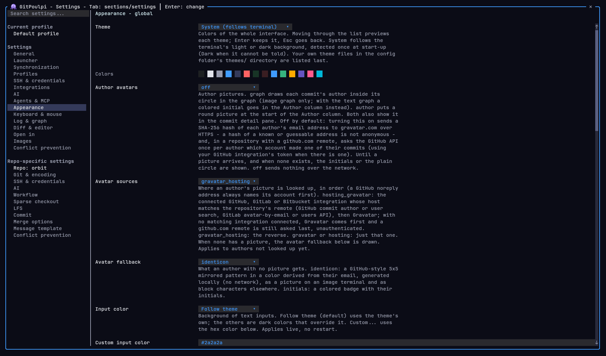

[English](../settings.md) · [Čeština](../cs/settings.md) · [Deutsch](../de/settings.md) · [Español](../es/settings.md) · **Français** · [Italiano](../it/settings.md) · [日本語](../ja/settings.md) · [한국어](../ko/settings.md) · [Nederlands](../nl/settings.md) · [Polski](../pl/settings.md) · [Português (Brasil)](../pt-BR/settings.md) · [Português (Portugal)](../pt-PT/settings.md) · [Русский](../ru/settings.md) · [Svenska](../sv/settings.md) · [Türkçe](../tr/settings.md) · [Українська](../uk/settings.md) · [简体中文](../zh-CN/settings.md)

# Paramètres

Ouvrez les Paramètres avec `Ctrl+,`, `Ctrl+N` puis `,`, l'engrenage de la barre
de titre (à gauche de la `×`), ou `Ctrl+P` > *Paramètres*. L'écran des Paramètres
remplace la fenêtre tant qu'il est ouvert. Fermez-le avec le `✕` en haut à droite, `Esc` ou
`q`. Il ne demande confirmation que si la fermeture ferait perdre quelque chose (voir
[Fermer les Paramètres](#fermer-les-paramètres)).

Les changements sont enregistrés aussitôt dans `config.toml`. La
[référence de configuration](config-reference.md) décrit chaque clé, sa valeur
par défaut et sa variable d'environnement. Cette page décrit l'écran des
Paramètres.

## Utiliser l'écran des Paramètres

| Pour | Faites |
|---|---|
| Passer de la liste des pages aux options | `Tab` / `Shift+Tab`, ou cliquez. |
| Se déplacer | `j` / `k` ou les flèches. |
| Changer une option | `Enter` ou `Space`, ou cliquez sur sa valeur. Voir ci-dessous. |
| Fermer | Cliquez sur `✕`, ou appuyez sur `Esc` ou `q`. Tant qu'un champ, une liste déroulante ou une confirmation est ouvert, `Esc` ne ferme que cet élément. |

Ce que fait `Enter` ou `Space` dépend de la ligne :

- Une case à cocher bascule.
- Une liste déroulante s'ouvre. Les flèches choisissent, `Enter` valide.
- Un champ de texte ou de nombre démarre la modification. Les flèches, `Home`,
  `End`, `Backspace` et `Delete` fonctionnent, et un clic place le curseur.
  `Enter`, `Tab`, `Up`, `Down` ou un clic ailleurs enregistre la valeur. `Esc`
  annule. Une valeur refusée reste dans le champ, en rouge, et la ligne d'état
  donne la raison.
- Une ligne de boutons (**Créer**, **Supprimer**, **Tester**...) n'affiche que les boutons qui
  s'appliquent à ce moment. `Left` / `Right` en choisissent un, `Enter` l'actionne, ou cliquez
  dessus. Un bouton qui supprime quelque chose demande d'abord confirmation.

Sur chaque page, les valeurs commencent dans une même colonne : les libellés s'alignent à
gauche et les champs à droite. Un texte ou un nombre est une bande teintée, un choix est une
bande qui se termine par `▾`, une case à cocher est `[x]`. Un libellé trop long passe à la
ligne au lieu d'être coupé, et dans une fenêtre étroite la valeur se place sous son libellé.

Une ligne grisée dit pourquoi elle est inactive. Par exemple, **Force de la
teinte** est grisée tant que **Fond des voies du graphe** est sur **Désactivé**.

### Listes

Les pages qui modifient plusieurs éléments de même nature (Profils, IA, Workflow, Ouvrir dans,
Images) les présentent sous forme de **liste à gauche et de champs de l'élément sélectionné à
droite**. Dans une fenêtre étroite, la liste passe au-dessus des champs. Partout, la liste a la
même forme :

- La pastille d'une ligne indique son état : `●` le profil actif, `★` l'entrée par défaut, `⚠`
  un élément inachevé (un profil sans e-mail), avec la raison à la place des détails.
- Sous la liste : **+ Ajouter**, **Dupliquer**, **Supprimer**, `↑` et `↓`. Un bouton qui ne
  s'applique pas pour l'instant (`↑` sur la première ligne) est atténué. **+ Ajouter ▾** ouvre
  une liste déroulante quand la page propose des préréglages ou des types.
- **Supprimer** demande d'abord confirmation, sauf pour un élément ajouté à l'instant et pas
  encore modifié.
- Faites glisser une ligne pour la déplacer ; une barre montre où elle atterrira, et `Esc`
  annule le glissement. Un double-clic passe aux champs de l'élément.

| Touche | Action |
|---|---|
| `Up` / `Down`, `Home` / `End`, `PageUp` / `PageDown` | Sélectionner un élément. |
| `Insert` | Ajouter un élément (ouvre la liste déroulante s'il y en a une). |
| `Ctrl+D` | Dupliquer l'élément. |
| `Delete` | Supprimer l'élément, après confirmation. |
| `Alt+Up` / `Alt+Down` | Monter ou descendre l'élément. |
| `Enter` ou `Right` | Aller aux champs de l'élément. |
| `Left` | Retour à la liste des pages. |
| `Alt+Left` / `Alt+Right` | Passe de l'onglet Général à l'onglet de la liste (partout sur la page). |

Chacune de ces pages a deux **sous-onglets** sous son titre, pour qu'un réglage de la page ne soit jamais pris pour une propriété de l'élément sélectionné : **Général**, les réglages propres à la page (le profil actif, l'entrée par défaut, les instructions que reçoit chaque action d'IA, le modèle de workflow...), et un onglet qui porte le nom des éléments (**Profils**, **Profils (connexions)**, **Entrées**, **Éditeurs**, **Règles**) et contient la liste et les champs de l'élément sélectionné. Une page s'ouvre sur **Général** ; les paramètres retiennent l'onglet où vous avez quitté chaque page jusqu'à la fermeture de l'application, ainsi que la position de défilement et la ligne sélectionnée de chaque page (et de chaque onglet). Cliquez sur un onglet, ou appuyez sur `Alt+Left` / `Alt+Right`. La recherche, les lignes de réglages de la palette de commandes et les liens « à régler dans les paramètres » ouvrent l'onglet où se trouve le réglage.
[Clavier et souris](#clavier-et-souris) a les deux mêmes onglets (**Général**, **Raccourcis clavier**).

Ces touches se reconfigurent dans **Clavier et souris** (contexte *preferences*, voir
[Raccourcis clavier](keybindings.md)).

### Éditeurs multilignes

Les paramètres qui contiennent plusieurs lignes (par exemple les chemins de l'extraction partielle, la description du modèle de commit, les branches de base de la prévention des conflits et les hooks de workflow) s'ouvrent dans un petit éditeur avec `Enter` ou un clic ; `Ctrl+S` garde le texte et `Esc` l'abandonne. La souris y fonctionne comme dans n'importe quel champ de texte :

- Un clic place le curseur à l'endroit cliqué.
- Le glisser sélectionne du texte ; la molette fait défiler.
- Un double-clic sélectionne le mot sous le pointeur.
- `Maj` + clic étend la sélection du curseur jusqu'au pointeur.

Le clavier offre la même chose : `Maj` avec les flèches sélectionne, `Ctrl` avec les flèches saute de mot en mot, `Ctrl+A` sélectionne tout, `Ctrl+C` et `Ctrl+X` copient et coupent.

### Fermer les Paramètres

Le `✕`, `Esc` et `q` font la même chose. Les Paramètres appliquent chaque changement aussitôt :
le plus souvent, ils se ferment donc simplement. Ils demandent **Fermer les paramètres ?**
seulement quand quelque chose serait perdu :

- la page **Workflow** contient des modifications non enregistrées ;
- le modèle de message de commit contient des modifications non enregistrées ;
- un profil n'a pas d'e-mail d'auteur (les commits qu'il fait ne peuvent pas vous être attribués).

La boîte propose **Y aller** (ouvre cette page), **Abandonner et fermer** ou **Fermer quand
même**, et **Annuler**. Les petits éditeurs des Paramètres (un texte d'instructions IA, un hook de
workflow, les chemins de l'extraction partielle) ont leur propre `✕` et ne demandent **Abandonner
les modifications ?** que si leur texte a été modifié.

### Fenêtres ouvertes par-dessus les Paramètres

La ligne de titre affiche la pieuvre et le nom de l'application, comme la fenêtre
principale. Cliquez sur la pieuvre pour ouvrir À propos.

Quelques fenêtres qui couvrent tout l'écran s'ouvrent par-dessus les Paramètres
et les rendent tels qu'ils étaient (la page, la position de défilement et les
modifications non enregistrées du Workflow ou des modèles sont conservées) :

- la palette de commandes (`Ctrl+P`),
- le sélecteur de thème (`Ctrl+N t`, **Application : Changer de thème...**), qui
  prévisualise chaque thème sur les Paramètres eux-mêmes ; `Esc` remet le thème précédent,
- les sélecteurs de langue et de couleurs du graphe (`Ctrl+N` puis les mêmes lettres que dans la fenêtre principale),
- la recherche dans l'espace de travail (`Ctrl+Alt+F`),
- À propos (`Ctrl+N a`, la pieuvre, ou **Aide : À propos de GitPoulpi**) et l'aide (`?`).

Fermez-les avec `Esc`, leur propre `✕` ou un clic en dehors. Les commandes qui
agissent sur ce que les Paramètres recouvrent (un onglet, une branche, un diff...)
figurent dans la palette mais sont grisées avec « fermez d'abord les Paramètres »,
et les enchaînements `Ctrl+N` correspondants affichent cette ligne sur la
bordure basse des Paramètres : fermez les Paramètres, puis lancez-les.

`Ctrl+N` affiche un badge sur chaque contrôle de la page : la zone de recherche, la liste des pages (un seul badge, sur la page courante), les sous-onglets, la liste et ses boutons, chaque champ à l'écran et la croix de fermeture. Appuyez sur le caractère d'un badge : c'est comme un clic sur ce contrôle. Un champ de texte s'ouvre en édition, une case se coche, une liste déroulante s'ouvre, un bouton s'exécute. `Esc` annule. Un champ défilé hors de la vue n'a pas de badge. Pendant que vous tapez dans un champ, ou qu'une liste déroulante, un éditeur ou la recherche est ouvert, `Ctrl+N` leur appartient. Voir [Badges](keybindings.md#badges).

### La zone de recherche

La zone en haut de la liste des pages cherche dans le nom et la description de
chaque option de chaque page. Cliquez dessus, ou appuyez sur `/` ou `Ctrl+F`, et
tapez. Une liste de résultats se déroule. Chaque résultat montre l'option et sa
page. `Up` / `Down` choisissent, `Enter` va à l'option, `Esc` ferme la liste.

## Paramètres depuis la palette de commandes

La plupart des paramètres se changent sans ouvrir cet écran : tapez `Paramètres` ou `Settings:` dans la palette de commandes (`Ctrl+P`). Les lignes sont générées à partir des champs des pages, donc un nouveau paramètre apparaît aux deux endroits.

- Une case à cocher est **Paramètres : basculer ...**. Elle bascule aussitôt, et la ligne affiche `[x]` ou `[ ]`.
- Une liste déroulante est **Paramètres : ...**. `Enter` réduit la palette à ses valeurs, la valeur actuelle étant marquée `actuel` ; `Enter` sur une valeur la choisit.
- Un nombre ou un texte ouvre une invite remplie avec la valeur actuelle. Une valeur que la page refuserait (pas un nombre, hors de la plage) est refusée de la même façon, et l'invite reste ouverte.
- Un paramètre qui a besoin de sa page (une liste, un menu dont les options sont trouvées à l'exécution) ouvre les Paramètres dessus.

Une valeur est enregistrée dans `config.toml` et appliquée exactement comme la page le fait. Les mots anglais de la clé du paramètre (`remember tabs`) trouvent la ligne dans toutes les langues.

## Les pages

La liste des pages a deux groupes :

- **Paramètres** : paramètres globaux.
- **Paramètres du dépôt** : paramètres du dépôt de l'onglet actif. Ils
  n'apparaissent que lorsqu'un dépôt est ouvert.

### Général

| Option | Ce qu'elle fait |
|---|---|
| **Langue** | La langue de l'interface : **Auto** (la langue de votre système, sinon l'anglais), English, Français, Español, Português (Brasil), Português (Portugal), Italiano, Deutsch, 简体中文, 日本語, 한국어, Русский, Українська, Polski, Čeština, Nederlands, Svenska, Türkçe. Elle s'applique aussitôt, sans redémarrage. Les noms de mois et les dates du Log la suivent. La variable d'environnement `GITPOULPI_LANG` (par exemple `GITPOULPI_LANG=fr`) l'emporte sur ce choix. La sortie de la CLI et de MCP reste en anglais. |
| **Traduire les termes git** | Désactivé par défaut : commit, push, pull, stash, tag et les autres termes git restent en anglais dans toutes les langues. Activé : le vocabulaire git propre à la langue est utilisé (français : *Tirer*, *Pousser*, *Remiser*, *Étiquette*). S'applique aussitôt. |
| **Mots git en anglais** | Seulement pour le japonais, le coréen et le chinois : affiche *stage*, *unstage*, *staged* en mots anglais au lieu de leur transcription. Sans effet tant que **Traduire les termes git** est activé. |
| **Mémoriser les onglets** | Rouvre les onglets de la dernière session au lancement. Désactivé, un lancement dans un dépôt n'ouvre que ce dépôt, et un lancement hors d'un dépôt démarre sur Accueil sans onglet de dépôt. Demande un redémarrage. |
| **Activer le Radar** | Activé par défaut (`general.radar_enabled`). Désactivé, l'onglet Radar, ses commandes de palette et `Alt+R` disparaissent, et rien n'est récupéré pour lui en arrière-plan. S'applique tout de suite. Voir [le Radar](radar.md#fermer-longlet-ou-désactiver-le-radar). Absent d'une compilation sans Radar. |
| **Onglet de démarrage dans un dépôt** | L'onglet sur lequel s'ouvre un démarrage lorsque le dossier de lancement se trouve dans un dépôt (`general.startup_tab_in_repo`): **Dépôt courant** (par défaut, l'onglet de ce dépôt, ouvert si besoin), **Dernier onglet** (l'onglet actif à la dernière fermeture), **Accueil**, **Radar**. Un dépôt donné avec `--repo` ouvre toujours son propre onglet. **Dernier onglet** vaut Accueil si **Mémoriser les onglets** est désactivé ou si rien n'est mémorisé ; **Radar** vaut Accueil si le Radar est désactivé ou absent du build. Lu une seule fois au démarrage ; demande un redémarrage. |
| **Onglet de démarrage hors d'un dépôt** | L'onglet sur lequel s'ouvre un démarrage lorsque le dossier de lancement n'est pas un dépôt (un dossier personnel, par exemple) (`general.startup_tab_outside_repo`): **Accueil** (par défaut), **Dernier onglet**, **Radar**. **Dernier onglet** vaut Accueil si **Mémoriser les onglets** est désactivé ou si rien n'est mémorisé ; **Radar** vaut Accueil si le Radar est désactivé ou absent du build. Lu une seule fois au démarrage ; demande un redémarrage. |
| **Onglet de démarrage depuis le lanceur** | L'onglet sur lequel s'ouvre un démarrage lorsque GitPoulpi est lancé depuis le raccourci du bureau ou du menu Démarrer qu'il a créé (il passe `--launcher`), quel que soit le dossier (`general.startup_tab_launcher`): **Dernier onglet** (par défaut), **Accueil**, **Radar**. Prioritaire sur les deux réglages ci-dessus. **Dernier onglet** vaut Accueil si **Mémoriser les onglets** est désactivé ou si rien n'est mémorisé ; **Radar** vaut Accueil si le Radar est désactivé ou absent du build. Les raccourcis d'une ancienne version reçoivent l'option au démarrage suivant. Lu une seule fois au démarrage ; demande un redémarrage. Sous Windows, une copie que vous avez épinglée à la barre des tâches est elle aussi réécrite au prochain démarrage, et un démarrage hors de tout shell (double-clic, ou l'exe lui-même épinglé) compte comme un démarrage depuis le lanceur. |
| **Regrouper les onglets de worktrees** | Activé par défaut (`general.group_worktree_tabs`). Les onglets des worktrees liés d'un dépôt se placent juste après l'onglet du dépôt, et un onglet de worktree écarté y revient. Désactivé, les onglets restent où vous les mettez. L'activer regroupe les onglets ouverts. |
| **Dossier de clonage par défaut** | Où la boîte Cloner démarre. Vide : `%USERPROFILE%\source\repos` sous Windows, `~/src` ailleurs. |
| **La boîte Cloner s'ouvre sur** | La source sur laquelle s'ouvre la boîte Cloner (`repos.clone_start_source`) : **Dernière utilisée** (par défaut, la source affichée à sa dernière fermeture, par un clonage ou une annulation), **Cloner par URL**, ou l'une de vos intégrations connectées. Une source qui n'est plus disponible revient à Cloner par URL. Un clonage lancé depuis le Radar garde sa propre source. |
| **Dossier de navigation par défaut** | Où Parcourir s'ouvre. Vide : le dernier dossier utilisé, sinon votre dossier personnel. |
| **Emplacement des données du dépôt** | Où GitPoulpi garde ses données propres à chaque dépôt (`session.per_repo_state_dir`) : **Dans .git** (par défaut : rien n'apparaît dans votre arbre de travail, tous les worktrees le partagent), **Dans l'arbre de travail** (un dossier `.gitpoulpi` ; nécessaire pour commiter un `workflow.toml` d'équipe) ou **Dans mon dossier de données utilisateur** (hors du dépôt). Un dossier `.gitpoulpi` laissé par une ancienne version est déplacé vers le nouvel endroit la première fois qu'il sert, puis supprimé une fois vide ; un fichier suivi par git (un `workflow.toml` commité) n'est jamais déplacé ni supprimé et reste lisible. |
| **Nom de branche par défaut** | La première branche d'un dépôt créé avec Init. Vide : git décide. Cela ne renomme aucune branche existante. |
| **Niveau du journal**, **Durée de conservation des journaux**, **Taille maximale d'un fichier journal** | Le journal de l'application derrière le Journal d'activité : le niveau le plus bavard enregistré (`log.level`), la durée de conservation des fichiers (un nombre entier et une unité, jours, semaines, mois ou années, sur une ligne : cliquez sur le nombre pour le taper, Haut et Bas le font varier, Tab passe à l'unité et Entrée ouvre sa liste ; de 1 à 10 ans au plus, 1 semaine par défaut, `log.retention_days` et `log.retention_unit`) et la taille à laquelle le fichier d'une journée est renouvelé (un nombre et Mio ou Gio, de 1 Mio à 1 Gio, `log.max_file_mb` et `log.max_file_unit`). |
| **Afficher la durée des opérations**, **Journalisation étendue** | L'onglet Opérations Git du Journal d'activité : la durée de chaque opération (`log.timings`, activé par défaut) et aussi le travail en arrière-plan, actualisation et auto-fetch (`log.extended`, désactivé par défaut). Voir [Quand quelque chose échoue](troubleshooting.md#le-journal-dactivité). |
| **Annulation activée**, **Profondeur de l'historique**, **Enregistrer les changements faits hors de GitPoulpi** | Le groupe **Historique d'annulation**. Active ou désactive l'annulation, et règle combien d'opérations elle conserve (100 par défaut, `0` signifie illimité). Désactiver l'annulation efface l'historique d'annulation, après confirmation. La dernière option enregistre aussi ce qu'un shell ou un agent fait aux branches, aux tags, aux stashes et à HEAD. Voir [Annuler et rétablir](undo-redo.md). |

La commande de palette **Application : Changer de langue...** (`Ctrl+N l`) ouvre
la même liste de langues. Là, la langue en surbrillance est prévisualisée en
direct ; `Enter` la garde et `Esc` rétablit la précédente.

### Lanceur

La page **Lanceur** (`gitpoulpi ui show settings launcher`) crée un raccourci qui démarre
GitPoulpi depuis le lanceur du système, dans le terminal de votre choix.

| Ligne | Ce qu'elle fait |
|---|---|
| **Terminal des raccourcis** | `ui.launch_terminal` : **Automatique**, **Par défaut (système)**, ou l'un des terminaux trouvés sur cette machine (la même détection que **Ouvrir dans**). Automatique : Windows Terminal sous Windows (sinon WezTerm, Alacritty, la console simple), `xdg-terminal-exec` sous Linux (Omarchy ; sinon le premier terminal trouvé), Terminal sous macOS, sauf si iTerm2, Ghostty, WezTerm ou kitty est installé. |
| **Rouvrir dans ce terminal au double-clic** | Windows uniquement (`ui.relaunch_in_terminal`). Un double-clic sur l'exe ouvre la console par défaut, qui affiche mal les images : GitPoulpi se rouvre dans le terminal choisi et la première fenêtre se ferme. Rien de tel quand il a été lancé depuis un terminal. |
| **Afficher la fenêtre ouverte au clic** | `ui.reuse_window` (activé par défaut). Un clic sur un raccourci GitPoulpi (`gitpoulpi launch`) affiche la fenêtre d'un GitPoulpi déjà ouvert au lieu d'en démarrer un autre. Un nouveau terminal ne démarre que si aucun n'est ouvert, si le réglage est désactivé ou si la fenêtre ne peut pas passer au premier plan. Elle y passe sous Windows, dans WezTerm et sous Hyprland ; sur les autres bureaux Linux, le clic démarre toujours une nouvelle fenêtre. Sans effet sous macOS (le Dock s'en charge déjà). Maintenez **Shift** en cliquant (Windows) ou utilisez l'action de lanceur **Nouvelle fenêtre** (Linux) pour ouvrir volontairement une autre fenêtre ; `gitpoulpi launch --new-window` le fait depuis un script. |
| **Alias de commande** | `ui.command_alias` : une liste déroulante avec **Aucun** et `gp`, ou tapez le nom de votre choix (lettres, chiffres, `-`, `_`, `.` ; ni espaces ni séparateurs de chemin). Le bouton **Créer** de la ligne fait de ce nom la commande qui démarre GitPoulpi (il devient **Supprimer** une fois l'alias créé, et supprime alors tous les alias créés par GitPoulpi). Un avertissement s'affiche sous la ligne quand le nom lance déjà autre chose dans votre PATH, et sous Windows quand PowerShell a un alias intégré de ce nom (`gp` y est `Get-ItemProperty`, et il l'emporte sur n'importe quel fichier). Un alias ou une fonction du shell est invisible d'ici : oh-my-zsh définit lui-même `gp` et il l'emporte sur le nôtre. |
| **Alias nouvel onglet** | `ui.command_alias_add` : une seconde commande, par exemple `gpa`, qui ouvre le dossier courant dans un nouvel onglet du GitPoulpi déjà lancé (`gitpoulpi --add`) au lieu d'en démarrer un autre ; si aucun n'est lancé, elle démarre GitPoulpi normalement, et s'il y en a plusieurs elle demande lequel rejoindre. Une liste déroulante avec **Aucun**, `gpa` et le nom de l'alias suivi d'un `a`, ou tapez le nom de votre choix (mêmes règles que ci-dessus). Le seul bouton **Créer** crée les deux commandes, **Supprimer** supprime toutes les commandes créées par GitPoulpi ; chacune a sa propre ligne d'état. Sous Linux et macOS, c'est un script de deux lignes, sous Windows un `.cmd`. Voir la [référence CLI](cli-reference.md#ajouter-un-dossier-à-la-fenêtre-ouverte). |
| **Ajouter GitPoulpi au PATH** | Place le dossier d'où GitPoulpi s'exécute et le dossier de l'alias dans votre PATH, pour les nouveaux terminaux. Le bouton de la ligne affiche **Ajouter** ou **Retirer**, et **Retirer** retire exactement ce qui a été ajouté. Les dossiers déjà présents dans le PATH sont laissés tels quels (la ligne indique alors **déjà dans le PATH**). |
| **Lanceur d'applications** (Linux) | Écrit `~/.local/share/applications/gitpoulpi.desktop` (respecte `XDG_DATA_HOME`) et l'icône dans `~/.local/share/icons/hicolor/256x256/apps`. Sous Omarchy, l'entrée est celle que crée `omarchy-tui-install` (`xdg-terminal-exec --app-id=TUI.tile -e <exe>`) ; pour les autres terminaux, la commande correspondante (`kitty`, `wezterm start --`, `alacritty -e`, `ghostty -e`, `foot`, ...). |
| **Bureau** (Linux) | La même entrée dans votre dossier Bureau, s'il existe. |
| **Menu Démarrer** (Windows) | `GitPoulpi.lnk` dans `%APPDATA%\Microsoft\Windows\Start Menu\Programs`. Une copie épinglée à la barre des tâches suit toute seule les changements d'icône et de couleur ; si son icône reste ancienne, désépinglez-la puis épinglez-la de nouveau (clic droit sur l'entrée du menu Démarrer, puis **Épingler à la barre des tâches**). |
| **Bureau** (Windows) | `GitPoulpi.lnk` sur votre Bureau. |
| **Dossier Applications** (macOS) | `~/Applications/GitPoulpi.app`, un petit paquet qui ouvre le terminal en y lançant GitPoulpi. |

Chaque ligne affiche son état : **non créé**, **créé**, **périmé, mise à jour...**
(l'exe a été déplacé ou un autre terminal est choisi ; GitPoulpi le réécrit tout seul en une seconde, vous le voyez donc rarement) ou
**un fichier qui n'est pas celui de GitPoulpi existe** (un fichier de ce nom existe et
GitPoulpi ne l'a pas créé : il n'y touche jamais). **Supprimer** n'efface que les fichiers
créés par GitPoulpi (ils portent le marqueur `X-GitPoulpi=1`). L'icône est la pieuvre dans
la couleur de votre logo (À propos > couleur) ; sous Linux, chaque couleur a son propre nom d'icône, si bien qu'un lanceur qui met les icônes en cache affiche la nouvelle couleur. Une fois un raccourci créé, il reste à jour tout seul : quand vous changez de couleur, que le terminal ou l'exe change de place, GitPoulpi réécrit les raccourcis qu'il a créés (jamais un qu'il n'a pas créé, et sans jamais en créer un), au démarrage et pendant son exécution. Il n'y a pas de bouton Mettre à jour ; seulement **Créer** (pour un raccourci qui n'existe pas encore) et **Supprimer**.

**Regroupement dans la barre des tâches et le dock.** GitPoulpi tourne dans une fenêtre de terminal, donc la barre des tâches l'affiche normalement sous l'icône du terminal, sans point « en cours d'exécution » sous l'icône GitPoulpi épinglée. Windows : les raccourcis portent l'AppUserModelID `GitPoulpi.GitPoulpi`, et un GitPoulpi lancé depuis l'un d'eux donne le même ID et son icône à la fenêtre de son terminal (il retrouve la fenêtre en lui donnant un instant un titre unique, puis rétablit le titre), si bien que la fenêtre se range sous l'icône GitPoulpi épinglée. Une fenêtre de terminal à plusieurs onglets se déplace d'un bloc : tous ses onglets se regroupent sous l'icône de GitPoulpi tant que GitPoulpi y tourne. Les raccourcis et les épingles de barre des tâches créés plus tôt sont réécrits par la même synchronisation ; si une épingle affiche encore l'icône du terminal, désépinglez-la puis épinglez-la de nouveau. Linux : kitty, foot, Alacritty, WezTerm et Ghostty démarrent avec la classe de fenêtre `gitpoulpi` et l'entrée `.desktop` la nomme (`StartupWMClass`), donc un dock range la fenêtre sous l'icône du lanceur ; les autres terminaux gardent leur propre icône. macOS : rien à faire, le Dock regroupe par application.

#### Alias de commande et PATH, selon le système

| Système | Alias | PATH |
|---|---|---|
| Linux, macOS | Un lien symbolique `~/.local/bin/<nom>` vers `gitpoulpi`. Un lien ne peut pas porter de marqueur : il compte comme le nôtre quand sa cible est un fichier nommé `gitpoulpi` (ou `gitpoulpi-tui`, l'ancienne cible, qui est réécrite automatiquement en `gitpoulpi`) ; un fichier ordinaire, ou un lien vers autre chose, n'est **pas le nôtre** et n'est jamais remplacé ni supprimé. | Un bloc entre `# >>> GitPoulpi PATH (X-GitPoulpi=1) >>>` et `# <<< GitPoulpi PATH <<<` dans `~/.bashrc` et `~/.zshrc` (ceux qui existent ; `~/.zshrc` sous macOS, `~/.bashrc` sinon quand aucun n'existe), et `~/.config/fish/conf.d/gitpoulpi-path.fish` quand fish est configuré. Supprimer retire le bloc (ou le fichier fish) et rien d'autre. |
| Windows | `%LOCALAPPDATA%\Programs\GitPoulpi\bin\<nom>.cmd`, un court script contenant `REM X-GitPoulpi=1` (il exporte aussi `GITPOULPI_CMDCMDLINE`, ce qui permet de reconnaître un démarrage depuis la barre d'adresse). | Le PATH de l'utilisateur dans `HKCU\Environment`, écrit via PowerShell, puis une diffusion `WM_SETTINGCHANGE` pour que les nouveaux programmes le voient. La valeur `GitPoulpiPathAdded` enregistre ce qui a été ajouté, et Retirer ne retire que cela. |

Les nouveaux terminaux voient le changement du PATH, pas ceux qui sont déjà ouverts. Aucune de ces actions n'est journalisée : il n'y a pas d'annulation pour elles, **Retirer** est le moyen de revenir en arrière.

La palette propose les mêmes actions (**Lanceur : Créer le raccourci**, **Lanceur : Créer
le raccourci du bureau**, **Lanceur : Supprimer les raccourcis**, **Lanceur : Créer l'alias de commande**, **Lanceur : Supprimer l'alias de commande**, **Lanceur : Ajouter au PATH**, **Lanceur : Retirer du PATH**), et `gitpoulpi desktop shortcut
status|install|remove [--where launcher|desktop|startmenu]` fait de
même depuis un script.

#### Saisir dans la barre d'adresse de l'Explorateur de fichiers (Windows)

Saisissez l'alias (`gp`) ou `gitpoulpi` dans la barre d'adresse d'une fenêtre de l'Explorateur de fichiers et appuyez sur Entrée : GitPoulpi s'ouvre dans le terminal choisi dans **Terminal des raccourcis**, sur le dossier que montre la fenêtre, sans ouvrir le **Dernier onglet**. Avec **Afficher la fenêtre ouverte au clic** activé et un GitPoulpi déjà ouvert, le dossier devient plutôt un nouvel onglet de cette fenêtre.

- **`gp` (l'alias de commande).** Une fois l'alias créé, sa création enregistre aussi `gp.exe` sous `HKCU\Software\Microsoft\Windows\CurrentVersion\App Paths`, pointant vers `gitpoulpi-launch.exe`, et Supprimer efface cette clé (seulement si elle est la nôtre). Quand le dossier de l'alias est dans votre PATH (**Ajouter GitPoulpi au PATH**), Windows exécute d'abord le script `.cmd` et une fenêtre de console peut clignoter un instant avant l'apparition de GitPoulpi. Un script écrit par une version plus ancienne est réécrit automatiquement quand les Paramètres lisent l'alias.
- **`gitpoulpi`.** Fonctionne avec le **Menu du gestionnaire de fichiers** installé : Installer enregistre aussi `gitpoulpi.exe` sous App Paths. Sans lui, `gitpoulpi` n'est trouvé que si le dossier de GitPoulpi est dans votre PATH, et la console peut alors clignoter comme ci-dessus.

L'Explorateur de fichiers garde le PATH qu'il avait à l'ouverture de votre session Windows : un dossier ajouté plus tard au PATH n'y est vu qu'après une déconnexion puis une reconnexion. Jusque-là, seules les entrées App Paths sont trouvées, et un nom que Windows ne trouve pas est ouvert comme une adresse web dans votre navigateur.

Linux et macOS n'ont pas d'équivalent : les barres d'emplacement de leurs gestionnaires de fichiers n'exécutent pas de programmes. Utilisez l'entrée du **Menu du gestionnaire de fichiers** ou l'alias de commande dans un terminal.

#### Menu du gestionnaire de fichiers (Ouvrir dans GitPoulpi)

Sous les raccourcis, les lignes **Menu du gestionnaire de fichiers** ajoutent **Ouvrir dans GitPoulpi** au menu contextuel des dossiers. Une ligne d'état par gestionnaire de fichiers (sous Linux, une pour chaque gestionnaire trouvé ici et pour tout gestionnaire qui garde encore l'entrée ; une ligne **Détectés** liste ce qui a été trouvé), puis les boutons **Installer** et **Supprimer**. **Installer** écrit l'entrée pour chaque gestionnaire de fichiers trouvé ; **Supprimer** demande d'abord, puis retire exactement ce qu'Installer a écrit, que ce gestionnaire soit encore installé ou non.

L'entrée exécute `gitpoulpi launch --folder <dossier>` (sous Windows, `gitpoulpi-launch.exe --folder`, sans console), et cette commande décide au moment du clic : avec **Afficher la fenêtre ouverte au clic** activé et une fenêtre GitPoulpi ouverte, un dossier situé dans un dépôt devient un nouvel onglet de la fenêtre la plus récemment utilisée, qui passe au premier plan ; sinon le terminal choisi dans **Terminal des raccourcis** démarre GitPoulpi sur ce dossier. Changer de terminal ne rend donc jamais une entrée périmée ; un exe déplacé ou une nouvelle couleur de logo, si, et GitPoulpi réécrit seul ses entrées (sans jamais en créer une), comme les raccourcis. L'entrée a besoin de l'assistant de lancement à côté de GitPoulpi (`gitpoulpi`, ou `gitpoulpi-launch.exe` sous Windows) ; sans lui la ligne le dit et les boutons restent désactivés.

| Système | Ce qu'Installer écrit |
|---|---|
| Windows | Des clés par utilisateur, sans administrateur : `HKCU\Software\Classes\Directory\shell\GitPoulpi`, `Directory\Background\shell\GitPoulpi` et `Drive\shell\GitPoulpi`, chacune avec une sous-clé `command`, si bien que l'entrée apparaît sur un dossier, sur l'arrière-plan d'un dossier ouvert et sur un lecteur. Chaque clé porte une valeur `X-GitPoulpi` ; une clé sans elle n'est **pas la nôtre** et n'est jamais touchée. Installer enregistre aussi `gitpoulpi.exe` sous `HKCU\Software\Microsoft\Windows\CurrentVersion\App Paths`, pointant vers `gitpoulpi-launch.exe`. Sous Windows 11, l'entrée est dans le menu classique seulement : **Afficher d'autres options**, Shift+F10 ou Shift+clic droit (le nouveau menu de premier niveau ne liste que les applications empaquetées). Supprimer efface nos clés, puis les clés parentes qu'Installer a créées, seulement si elles sont restées vides. |
| Linux | Seulement pour les gestionnaires de fichiers trouvés dans le PATH. GNOME Fichiers et Caja : un script nommé d'après l'entrée dans `~/.local/share/nautilus/scripts` ou `~/.config/caja/scripts` (dans le sous-menu **Scripts**). Dolphin : `~/.local/share/kio/servicemenus/gitpoulpi-open.desktop`, exécutable (KDE Frameworks 6 ignore un menu de service utilisateur qui ne l'est pas ; KDE Frameworks 5 avant 5.85 n'est pas pris en charge). Nemo : deux actions dans `~/.local/share/nemo/actions` (un dossier sélectionné, l'arrière-plan). Thunar : une action fusionnée dans `~/.config/Thunar/uca.xml` ; vos propres actions restent, et Supprimer rend le fichier octet pour octet (ou le supprime si Installer l'a créé). PCManFM et PCManFM-Qt : `~/.local/share/file-manager/actions/gitpoulpi-open.desktop`. L'icône va dans `~/.local/share/icons/hicolor/256x256/apps/gitpoulpi-folder.png` et part avec la dernière entrée. `XDG_DATA_HOME` et `XDG_CONFIG_HOME` sont respectés. L'entrée apparaît sur un dossier sélectionné, et sur l'arrière-plan du dossier là où le gestionnaire de fichiers le permet. |
| macOS | Une Action rapide, `~/Library/Services/Open in GitPoulpi.workflow` : clic droit sur un dossier dans le Finder, puis **Actions rapides**. Dossiers sélectionnés seulement (le Finder n'a pas de menu pour l'arrière-plan d'un dossier). La première fois que vous cliquez dessus, macOS demande si le service de workflow peut contrôler votre terminal (une invite d'Automatisation, par exemple « WorkflowServiceRunner.xpc souhaite contrôler ... ») : autorisez-le. Si l'entrée est absente, activez-la dans Réglages Système > Clavier > Raccourcis clavier > Services. |

Chaque fichier et chaque clé écrits par GitPoulpi portent le marqueur `X-GitPoulpi=1` (une ligne `# X-GitPoulpi=1` dans un script), et Supprimer n'efface que ceux qui sont marqués. Ces actions modifient votre système, pas un dépôt : Annuler ne les couvre pas, **Supprimer** est le moyen de revenir en arrière. Les barres d'emplacement des gestionnaires de fichiers n'exécutent pas de programmes sous Linux et macOS, il n'y a donc rien à y saisir ; un terminal a l'alias de commande.

La palette propose **Lanceur : Installer le menu Ouvrir dans GitPoulpi** et **Lanceur : Supprimer le menu Ouvrir dans GitPoulpi**, et `gitpoulpi desktop folder-menu status|install|remove` fait de même depuis un script.

### Synchronisation

Comment GitPoulpi garde un dépôt aligné avec ses distants, et ce qu'il fait de vos
modifications locales entre-temps.

| Option | Ce qu'elle fait |
|---|---|
| **Intervalle d'auto-fetch** | Fait un fetch de chaque distant en arrière-plan à cet intervalle, un nombre et une unité (minutes ou heures) sur une ligne. Défaut 5 minutes, maximum 60 minutes (1 heure), `0` le désactive. `general.auto_fetch_interval_minutes` reste en minutes ; `general.auto_fetch_interval_unit` ne garde que la façon de l'afficher. Demande un redémarrage. |
| **Fetch à l'ouverture d'un onglet** | Lance Fetch All en arrière-plan à l'ouverture d'un onglet de dépôt. Activé par défaut. Un dépôt dont le fetch date de moins de 60 secondes n'est pas refetché. |
| **Auto-prune** | Les fetchs suppriment aussi les branches de suivi distant qui n'existent plus sur le distant. Activé par défaut. Non annulable : une branche élaguée revient au prochain fetch si elle réapparaît sur le distant. |
| **Élagage automatique des tags** | Les fetchs suppriment aussi les tags locaux que le distant a supprimés. Seuls les tags qui étaient sur le distant sont concernés : un tag jamais envoyé (push) est conservé. Désactivé par défaut, comme git. Demande git 2.41 ou plus récent. CLI : `gitpoulpi fetch --prune-tags` ; clé de configuration `general.auto_prune_tags`. Voir [Branches, tags et le panneau Refs](log-and-history.md#branches-tags-et-le-panneau-refs). |
| **Garder les sous-modules à jour** | Après un checkout ou un pull, met à jour les sous-modules aux commits que le dépôt enregistre. Voir [Sous-modules](submodules.md). |
| **Supprimer les fichiers « .orig » après un merge** | Une fois un merge terminé, supprime les fichiers de sauvegarde `*.orig`. Désactivé par défaut. |
| **Auto-stash avant un checkout, un pull, un merge ou un rebase** | Que faire quand des modifications locales bloquent l'une de ces opérations : **demander** (une boîte propose de stasher les modifications, lancer l'opération et restaurer le stash), **toujours** (le faire sans demander) ou **jamais** (refuser). |
| **Inclure les fichiers non suivis dans l'auto-stash** | Le stash automatique prend aussi les fichiers non suivis. |

Aussi sur cette page, sous **Mises à jour** :

| Option | Ce qu'elle fait |
|---|---|
| **Rechercher les mises à jour** | Une liste déroulante (`updates.mode`) : **Notifier** (par défaut) vérifie une fois par jour en arrière-plan et affiche `vX.Y.Z disponible` dans la barre de titre ; **Auto** télécharge aussi la mise à jour en arrière-plan quand GitPoulpi a été installé depuis une archive de version (vous choisissez toujours quand redémarrer) ; **Désactivé** ne fait jamais de requête. S'applique immédiatement. Voir [Mises à jour](updates.md). |
| **Canal de mise à jour** | Une liste déroulante (`updates.channel`) : **Stable** (par défaut) ou **Préversion** (aussi les versions candidates). S'applique immédiatement. |
| **Installé avec** | Lecture seule. Comment GitPoulpi est arrivé sur cet ordinateur (une archive de version, l'installeur pour cet utilisateur ou tous les utilisateurs, Chocolatey, Scoop, Homebrew, apt, un paquet MSI, une image Docker, cargo, ou une version de développement). Cela décide de la façon dont les mises à jour sont appliquées, voir [Mises à jour](updates.md). |

Une ligne que votre administrateur a définie dans la politique de mise à jour valable pour toute la machine affiche **Défini par votre administrateur** et ne peut pas être modifiée ici.

Aussi sur cette page, sous **Réécriture d'historique**, les limites de temps des scripts externes (voir [Réécriture d'historique](history-rewrite.md)) :

| Option | Ce qu'elle fait |
|---|---|
| **Délai de réponse d'un script** | Le temps dont dispose un script externe pour répondre pour un commit, un nombre et une unité (millisecondes ou secondes) sur une ligne. Défaut 5 secondes, de 1 milliseconde à 10 minutes (`rewrite.script_timeout_ms`, `rewrite.script_timeout_unit`). En cas de dépassement, tout le processus est arrêté et la réécriture échoue sans que rien ne bouge. |
| **Délai maximal par passage** | Le temps que peut prendre un passage complet d'un script externe, un nombre et une unité (secondes, minutes ou heures). Défaut 1 heure, jusqu'à 24 heures (`rewrite.script_total_timeout_s`, `rewrite.script_total_timeout_unit`). |

### Profils

Profils d'identité de commit : le nom et l'e-mail utilisés pour les commits faits
depuis GitPoulpi. L'onglet **Général** contient la liste déroulante **Profil actif** ; l'onglet
**Profils** est une [liste](#listes) (ajouter, dupliquer, supprimer, réordonner) avec les champs
du profil sélectionné. Chaque profil a un **Identifiant du profil**, un **Nom du profil**, un
**Nom de l'auteur** et un **E-mail de l'auteur**. Un profil sans e-mail affiche `⚠` dans la
liste. Sans profil actif, ou avec un profil dont le nom ou l'e-mail est vide, les `user.name`
et `user.email` propres au dépôt s'appliquent.

Avec deux profils ou plus, la barre d'outils montre une liste déroulante de profils
à son extrémité droite. Elle règle le profil du dépôt actif seulement. Après votre
choix, une boîte propose d'écrire aussi l'identité dans la configuration git de ce
dépôt. La commande de palette est **Dépôt : changer de profil...**.

Ces profils ne sont ni les profils d'hébergeurs de la page Intégrations, ni les
profils IA de la page IA.

### SSH et identifiants

SSH utilise le `ssh` de votre système, si bien que votre ssh-agent et votre
configuration ssh continuent de fonctionner. GitPoulpi ne lit jamais le matériel
de clé.

| Option | Ce qu'elle fait |
|---|---|
| **Chemin de la clé privée** | Quand il est défini, fetch, pull, push et clone lancent git avec `GIT_SSH_COMMAND=ssh -i "<key>" -o IdentitiesOnly=yes`, de sorte que ssh ne propose que cette clé. Vide : l'agent et votre configuration ssh s'appliquent inchangés. |
| **Chemin de la clé publique** | Utilisé seulement quand le chemin de la clé privée est vide : ssh choisit la clé correspondante détenue par ssh-agent (ou une clé matérielle). |
| **Type de clé** | Le type que crée **Générer une paire de clés** : `ed25519`, `rsa` (4096 bits) ou `ecdsa` (NIST P-256). |
| **Identifiants HTTPS** | Comment fetch, pull, push et clone s'authentifient en HTTPS : **credential_helper** (l'assistant propre à git, par défaut), **prompt** (ignore les assistants ; git demande dans un terminal) ou **none** (aucun identifiant, distants publics seulement). |
| **Oublier tous les noms d'utilisateur et mots de passe** | Supprime chaque jeton que GitPoulpi a stocké dans votre assistant d'identifiants. Il demande d'abord confirmation. |
| **Générer une paire de clés** | Crée une paire de clés du **Type de clé** dans `~/.ssh/gitpoulpi_<type>`, sans phrase secrète, et enregistre ses deux chemins. Il n'écrase jamais un fichier. |

Les chemins de clé s'appliquent au prochain transfert. Un préfixe `~/` désigne
votre dossier personnel.

Un paramètre fait ailleurs l'emporte toujours sur ces chemins. L'ordre, du plus
prioritaire au moins prioritaire :

0. Une clé choisie pour un seul dépôt sur sa propre page
   [SSH et identifiants](#propre-au-dépôt--ssh-et-identifiants) (le groupe propre au dépôt).
1. `GIT_SSH_COMMAND` ou `GIT_SSH` dans l'environnement où GitPoulpi tourne.
2. `core.sshCommand` dans la configuration git du dépôt ou votre configuration git
   globale. L'ancienne épingle « Clé SSH... » du menu de l'onglet l'écrivait pour un dépôt.
3. Les deux chemins de clé de cette page.
4. Les valeurs par défaut de ssh et l'agent.

Une clé peut aussi appartenir à un compte d'hébergeur ; voir
[Hébergeurs et suivi de tickets](hosting-integration.md#clé-ssh-par-profil).

### Intégrations

Connecte vos comptes. Le groupe **Hébergement** a GitHub, GitHub Enterprise,
GitLab, GitLab auto-hébergé, Azure DevOps, Azure DevOps Server, Bitbucket, Bitbucket Data Center, Gitea, Forgejo et Gerrit. Le groupe **Suivi de tickets** a Jira Cloud, Jira Data Center, Trello, Linear, YouTrack, Redmine et Local Markdown. Chaque fournisseur a **Se connecter**, un champ de jeton, les
portées dont le jeton a besoin et un lien vers la page de jetons de l'hébergeur.
Cette page a son propre guide : [Hébergeurs et suivi de tickets](hosting-integration.md).

Deux options se trouvent au-dessus des fournisseurs. Appuyez sur `Up` sur le
premier fournisseur pour les atteindre.

| Option | Ce qu'elle fait |
|---|---|
| **Actualisation des pull requests et des tickets** | À quelle fréquence les listes du panneau latéral et la pastille de la barre d'outils se rafraîchissent, un nombre et une unité (minutes ou heures). Défaut 5 minutes, jusqu'à 2 heures, `0` désactive le minuteur (`general.hosting_refresh_minutes`, `general.hosting_refresh_unit`). |
| **Publier en tant que** | Le nom sous lequel les messages vers un hébergeur sont publiés quand le jeton du dépôt est celui d'un bot (un jeton de GitHub App), par exemple `my-app[bot]` ; sert aussi à reconnaître vos propres commentaires. Vide : demandé à l'hébergeur, sinon appris au premier message publié. Un dépôt peut le remplacer dans Paramètres > Propre au dépôt : SSH et identifiants > Hébergement (`general.hosting_post_as`). |
| **Terme pour les demandes de revue** | Le mot employé pour les revues hébergées : **Auto (selon l'hébergeur)**, **Pull request** ou **Merge request**. |
| **Masquer la pastille de pull request quand elle est fermée ou mergée** | Activé par défaut (`ui.hide_finished_pr_chip` ; elle dit « merge request » sur GitLab). La pastille de la barre d'outils affiche la dernière demande de la branche extraite ; une fois cette demande fermée ou mergée, elle est masquée et c'est la pastille atténuée **+ PR** (créer une nouvelle demande) qui s'affiche, comme si la branche n'en avait aucune. Désactivé, la pastille affiche toujours la dernière demande, quel que soit son état. S'applique aussitôt. |

### IA

Sur l'onglet **Général** : l'interrupteur qui active l'IA, le profil par défaut, les
instructions que reçoit chaque action, et un profil et des instructions pour chaque action.
L'onglet **Profils (connexions)** est une [liste](#listes) des profils IA avec un tableau
intégré pour les variables d'environnement d'un profil. Le bloc *Revue de code* de l'onglet Général contient aussi
les valeurs par défaut du [contexte de la revue](ai.md#contexte-de-la-revue) : **Lancer l'agent dans le dépôt**
(*Réglage du profil*, *Oui*, *Non*), **Inclure CLAUDE.md**, **Inclure AGENTS.md** et **Fichier supplémentaire** (un
chemin ou un lien ; vide, il n'ajoute rien, avec un bouton **Parcourir...** dessous qui ouvre un sélecteur de fichier ; `Entrée` sur le bouton en est la forme clavier). Cette page a son propre guide : [Assistance IA](ai.md).

Le bloc **Réponses sur un hébergeur** contient ce qui rédige les commentaires, les réponses et les descriptions de tickets : son profil et ses instructions, le **Prompt de base** (vide, c'est le prompt intégré qui sert) et un groupe **Accès au dépôt** : **Laisser l'IA lire le dépôt par défaut** (désactivé : le choix de chaque éditeur démarre décoché), **Garder la session de l'agent entre deux réponses** et **Durée de conservation d'un contexte du dépôt (minutes)**. Les limites en octets **Plus grande conversation envoyée pour une réponse**, **Plus gros fichier du dépôt pour une réponse**, **Plus grande carte du dépôt pour une réponse**, **Nombre maximal de résultats de recherche par terme pour une réponse** et **Nombre maximal de termes recherchés pour une réponse** sont avec les autres limites d'entrée. Voir [Aide à la rédaction sur un hébergeur](ai.md#aide-à-la-rédaction-sur-un-hébergeur).

Sous les blocs par action, le groupe **Confidentialité** :

| Option | Ce qu'elle fait |
|---|---|
| **Masquer les secrets avant l'envoi** | Activé (par défaut) : les jetons, clés privées et mots de passe trouvés dans une requête sont remplacés par `[REDACTED:<rule>]` avant son départ. Désactivé : une ligne rouge indique que les secrets sont envoyés tels quels. |
| **Exclure les fichiers sensibles** | Activé (par défaut) : les modifications des fichiers `.env`, des clés privées et des certificats (`[privacy] sensitive_patterns`) ne font jamais partie d'une requête. Désactivé : une ligne rouge indique qu'elles sont envoyées quand elles en font partie. |
| **Afficher ce qui est envoyé avant...** | Une option par action (message de commit, explication, message de stash, description de pull request, compositeur de commits, résolution de conflit, revue de code, scission de commit) : affiche la requête dans la boîte **Ce qui est envoyé** avant son départ. La case *Ne plus afficher* de la boîte en désactive une. Les actions de réécriture d'historique affichent leur propre boîte. |
| **Tout réafficher** | Apparaît tant qu'une option est désactivée ; les réactive toutes. |

Voir [IA > Confidentialité](ai.md#confidentialité).

### Agents et MCP

Ce que les agents IA peuvent faire dans cette fenêtre, si le serveur MCP peut
tourner, et comment son point d'accès HTTP est protégé. Les lignes MCP n'apparaissent
que dans les builds qui incluent le serveur ; voir [MCP et agents](mcp-and-agents.md).

| Option | Ce qu'elle fait |
|---|---|
| **Serveur MCP** | Activé (par défaut) : un agent peut démarrer le serveur (`gitpoulpi mcp serve`). Désactivé : il refuse de démarrer. Enregistré dans `mcp.enabled`. Le changement s'applique au prochain démarrage du serveur par un agent ; un serveur déjà lancé garde ses réglages. |
| **Port du serveur MCP** | Le port d'écoute de `--http` quand aucune adresse n'est donnée, de 1 à 65535 (8808 par défaut). Enregistré dans le port de `mcp.bind` ; sa partie hôte est conservée (`127.0.0.1` si vide). S'applique au prochain démarrage du serveur par un agent. |
| **Laisser les agents IA piloter la vue** | Permet aux agents de vous montrer un commit, un fichier ou un avis dans cette fenêtre (`ui show`). Désactivé : aucun agent n'atteint la fenêtre. |
| **Laisser les agents IA proposer des modifications à confirmer** | Permet aux agents d'ouvrir des boîtes Reword, commit, branche ou tag préremplies que vous confirmez. Désactivé par défaut. Voir [MCP et agents](mcp-and-agents.md#permissions). |
| **Ouvrir une fenêtre pour les agents**, **Commande de lancement (custom)** | Si un agent peut ouvrir une fenêtre GitPoulpi quand aucune n'est ouverte, et avec quel terminal ou multiplexeur. Désactivé par défaut. |
| **Authentification HTTP** | Activé (par défaut) : le point d'accès HTTP MCP ne répond qu'à une requête portant le jeton d'accès. Désactivé affiche un avertissement rouge : tout programme qui peut joindre le point d'accès peut lancer chaque outil autorisé par les paramètres MCP, et `--allow-remote` est refusé. Enregistré dans `mcp.http_auth`. |
| **Jeton d'accès** | Le jeton, masqué. La valeur masquée est un bouton : `Enter` (ou un clic) l'affiche en entier sur la ligne du dessous et le masque de nouveau. **Copier** le met dans le presse-papiers sans le répéter dans la ligne d'état, **Renouveler** le remplace après confirmation (les clients qui détiennent l'ancien jeton sont refusés aussitôt, sans redémarrer le serveur), **Créer** fait le premier. `Left` / `Right` passent d'un bouton à l'autre et `Enter` en appuie un. C'est le même jeton que `gitpoulpi mcp token`. |
| **TLS** | **Désactivé** (par défaut), **Auto-signé** (le serveur crée un certificat une fois et affiche son empreinte) ou **Fichiers** (votre certificat et votre clé). Le serveur termine lui-même le TLS. Enregistré dans `mcp.tls` ; s'applique au prochain démarrage du serveur. |
| **Chemin du certificat**, **Chemin de la clé** | Les fichiers PEM utilisés avec **Fichiers** (`mcp.tls_cert`, `mcp.tls_key`). |
| **Empreinte du certificat** | Lecture seule : l'empreinte SHA-256 du certificat présenté par le point d'accès, pour que les clients la vérifient. |
| **Derrière un tunnel ou un proxy inverse** | Votre déclaration qu'un tunnel ou un proxy placé devant le point d'accès chiffre le trafic, ce qui permet à `--allow-remote` de fonctionner sans TLS. Le serveur ne peut pas le vérifier : un avertissement rouge s'affiche tant que c'est activé. Enregistré dans `mcp.behind_proxy`. Voir [MCP et agents](mcp-and-agents.md#joindre-le-point-daccès-depuis-une-autre-machine). |

### Apparence

| Option | Ce qu'elle fait |
|---|---|
| **Thème** | **Système (suit le terminal)**, un thème intégré, ou un de vos propres fichiers de thème. Le thème en surbrillance est prévisualisé en direct : `Enter` le garde, `Esc` rétablit le précédent. La bande **Couleurs** sous la ligne montre les couleurs en vigueur. Voir [Thèmes](themes.md). |
| **Avatars des auteurs** | **désactivé** (par défaut, aucun réseau), **graph** (dans le point du commit) ou **author** (dans la colonne Auteur). Activé, un hash de chaque e-mail d'auteur est envoyé à Gravatar et à votre hébergeur. |
| **Sources d'avatars**, **Avatar de repli** | Où les images sont cherchées, et dans quel ordre. Pour les auteurs sans image : **identicon** (un motif généré) ou **initiales**. |
| **Couleur des champs**, **Couleur de champ personnalisée** | Le fond des champs de texte : **Suivre le thème** (par défaut), une couleur sombre fixe, ou votre propre `#rrggbb`. |
| **Curseur de texte** | `ui.text_cursor` : **terminal** (par défaut) place le curseur du terminal lui-même au point d'insertion du champ de texte actif, en barre (les réglages de curseur de votre terminal s'appliquent, et la fenêtre de candidats d'une méthode de saisie s'ouvre à cet endroit) ; **drawn** dessine le curseur propre à GitPoulpi et garde le curseur du terminal masqué. S'applique immédiatement. Palette : `Paramètres : Curseur de texte...`. |
| **Profondeur de couleur** | **auto** (par défaut), **truecolor**, **256** ou **16**. Voir [Thèmes](themes.md). |
| **Thème de couleurs du graphe** | **Suivre le thème** (par défaut : les couleurs de voies propres au thème) ou n'importe quelle palette de voies. Chaque palette montre quelques-unes de ses couleurs. S'applique à la fermeture des Paramètres. La commande de palette **Application : Changer le thème de couleurs du graphe...** (`Ctrl+N Shift+T`) prévisualise chaque palette en direct. |
| **Fond des voies du graphe** | **Désactivé** (transparent) ou **Teinte de ligne** : une bande légère de la couleur de la voie derrière la colonne du graphe, avec une fine barre à son bord. |
| **Force de la teinte** | À quel point la bande de Teinte de ligne est estompée : **Forte**, **Moyenne** (par défaut) ou **Subtile**. La barre du bord garde sa couleur pleine. |
| **Position de la barre d'outils** | `ui.toolbar_position` : où se place la barre d'outils : **Haut**, **Bas** (par défaut), **Gauche** ou **Droite**. Gauche et Droite en font une colonne à côté des volets ; une fenêtre de moins de 80 colonnes la dessine en bas. S'applique immédiatement. |
| **Mémoriser la position et la taille des dialogues** | `ui.dialog_geometry` : **Pour cette session** (par défaut), **Enregistrés sur disque** ou **Jamais** : si un dialogue que vous avez déplacé ou redimensionné garde sa place. Un seul réglage pour tous les dialogues ; chaque dialogue mémorise sa propre place et sa propre taille. S'applique immédiatement. |
| **Alignement des boutons de la barre d'outils** | `ui.toolbar_align` : où se placent les boutons le long de la barre d'outils : **Début** (par défaut), **Centre** ou **Fin**. Le début est la gauche d'une ligne et le haut d'une colonne ; la fin est la droite et le bas. S'applique immédiatement. |
| **Épingler le bouton pull request en bout de barre** | `ui.toolbar_pr_pinned` : activé (par défaut), le bouton pull request se place à l'extrémité de la barre d'outils (à droite, ou en bas dans une colonne), quel que soit l'alignement. Désactivé, il suit les autres boutons et s'aligne avec eux. S'applique immédiatement. |
| **Position de la ligne d'état** | `ui.statusbar_position` : où se place la ligne d'état (branche, compteurs, messages, aide des touches) : **Haut** (au-dessus des onglets de dépôt) ou **Bas** (par défaut). L'onglet Accueil garde sa propre ligne d'état en bas. S'applique immédiatement. |
| **Position de la barre d'onglets** | `ui.tabs_position` : où se placent les onglets de dépôt : **Haut** (par défaut), **Bas** ou **Gauche**, une liste d'un onglet par ligne au bord gauche de la fenêtre. Une fenêtre de moins de 80 colonnes les dessine en haut. À côté d'une barre d'outils en colonne, les onglets restent à l'extérieur. S'applique immédiatement. |
| **Locale de date/heure** | **système** (par défaut) : noms de mois et de jours dans la langue de l'interface. **english** : toujours des noms anglais. |
| **Format de date**, **Format de date/heure**, **Format de date détaillé** | Les motifs de date de la colonne de date de l'Historique du fichier et du Blame, de la colonne Date du Log, et des détails du commit. Chacun montre un aperçu en direct. Voir la [référence de configuration](config-reference.md#ui) pour les jetons. |

### Clavier et souris

**Paramètres > Clavier et souris** a deux onglets (clic, ou `Alt+Left` / `Alt+Right`).
**Général** contient le protocole clavier et les réglages de la souris ; **Raccourcis clavier**
liste chaque raccourci par contexte, avec une zone de recherche (`/`) et des filtres. Sur une ligne :

| Touche | Action |
|---|---|
| `Enter` ou double-clic | Capture une nouvelle touche. Les conflits et les avertissements du terminal s'affichent pendant que vous appuyez. |
| `a` | Ajoute une touche alternative. |
| `u` | Dissocie l'action. |
| `r` | Remet la ligne à sa valeur par défaut. |
| `R` | Remet tous les raccourcis à zéro, après confirmation. |
| `c` ou un clic sur le `!` de la ligne | Affiche l'action avec toutes celles dont la touche entre en conflit avec la sienne ; `Esc` réaffiche tout. Une touche en conflit avec celle d'une autre action est en rouge, un avertissement sur la touche seule (le terminal ne peut pas l'envoyer) en orange. |

Servez-vous-en pour résoudre les conflits avec tmux, AutoHotkey, herdr ou votre
terminal. Les mêmes paramètres vivent dans la table `[keybindings]` de
`config.toml` ; voir la [référence de configuration](config-reference.md#keybindings) et
[Raccourcis clavier](keybindings.md).

Trois options se trouvent sur l'onglet **Général**.

| Option | Ce qu'elle fait |
|---|---|
| **Protocole clavier kitty** | **auto** demande au terminal le protocole clavier kitty, de sorte que `Ctrl+,`, `Ctrl+Enter` et `Ctrl+Shift+N` arrivent. **off** ne demande jamais ; utilisez-le si un terminal se comporte mal. Demande un redémarrage. |
| **Souris activée** | Désactivé laisse la souris et la sélection de texte à votre terminal. Demande un redémarrage. |
| **Lignes par cran de molette** | Combien de lignes un cran de molette déplace dans le Log. Demande un redémarrage. |

### Journal et graphe

Comment le graphe de commits est dessiné et combien de commits le Log charge. Les
couleurs du graphe sont sur la page **Apparence**.

| Option | Ce qu'elle fait |
|---|---|
| **Rendu du graphe** | **auto** dessine une image là où le terminal le permet, et des caractères ailleurs. **image** force l'image, **text** force les caractères. Demande un redémarrage. |
| **Protocole d'image** | Comment les images parviennent au terminal : **auto**, **kitty**, **iterm2**, **sixel** ou **none**. Demande un redémarrage. |
| **Afficher les stashes dans le graphe** | Une ligne pour chaque stash dans le Log. Désactivé : les stashes n'apparaissent que dans le panneau latéral. |
| **Afficher une branche fantôme sur le commit survolé** | Activé par défaut (`ui.graph_ghost_ref`). Dans la colonne Ref, le commit survolé qui n'a pas de ref propre affiche une pastille estompée avec le nom de la branche à laquelle il appartient (sinon sa branche distante), déduit de l'historique (jamais un tag), là où la colonne a la place. Une branche supprimée après une fusion s'affiche barrée, sous le nom lu dans le sujet du commit de fusion ; les squash, rebases et fast-forwards ne laissent pas cette trace. Survoler la pastille indique son type. Un clic dessus ne fait rien de particulier ; la commande de palette `Git : Créer une branche sur le commit sélectionné...` crée une branche. |
| **Disposition des colonnes** | `ui.log_columns_layout`, appliquée aussitôt au Log. **Ajuster au volet** (par défaut) : chaque colonne tient exactement dans le volet et seul Message s'adapte. **Défilement latéral** : les colonnes gardent leur largeur, Message aussi, et le tableau défile latéralement quand il est plus large que le volet (`Shift+Left` / `Shift+Right`, la molette horizontale, une barre sur la bordure inférieure). Le même choix est dans le sélecteur de colonnes du Log et la palette. |
| **Redimensionnement des colonnes** | `ui.column_resize`, appliqué aussitôt au Log, au Radar et à la colonne des commits des vues de diff, de fichier et de blame. **line** (la valeur par défaut) : chaque frontière de colonne est un espace d'une cellule avec un petit repère dans l'en-tête, un trait fin d'accent est tracé sur tout le tableau tant que le pointeur est sur la frontière, et glisser n'importe où le long du trait redimensionne. **header** : pas de repère, le premier caractère de la cellule d'en-tête après la frontière s'allume et est le seul endroit d'où glisser. Les touches de dimensionnement (`Shift+C` dans le Log, `C` dans le Radar, `Tab` dans la colonne des commits) font la même chose dans les deux. |
| **Lien ref vers commit** | Un trait fin d'une étiquette de ref à son point de commit. |
| **Compteurs WIP dans le message si Modifs est masquée** | Affiche les compteurs de modifications (`✎ 3  + 2  − 1`) dans le message de la ligne WIP. Quand la colonne Modifs est affichée, les compteurs vont là. |
| **Arbre de dossiers des branches** | Regroupe les branches et les tags sur `/` en dossiers dans le panneau latéral. `y` dans le volet Refs le bascule. |
| **Sections du volet gauche** | À qui appartient le choix des sections affichées ou masquées du volet gauche : **repository** (par défaut ; chaque dépôt garde son propre jeu, le jeu global sert de point de départ) ou **global** (un seul jeu pour tous les dépôts). Passer de l'un à l'autre conserve les deux jeux. Voir [souris et gestes](mouse-and-gestures.md). (`ui.sidebar_sections_scope`) |
| **Un clic sur une ref la révèle dans le graphe** | Un simple clic sur une ref du volet Refs fait défiler le Log jusqu'à l'endroit où elle pointe et fait clignoter la ligne (la sélection de commit et le panneau de droite ne bougent pas). Désactivé : un clic ne fait que sélectionner la ligne du panneau. **Révéler dans le graphe** fonctionne dans les deux cas. |
| **Propositions du compositeur** | Si le compositeur de commits IA s'ouvre avec les fichiers de chaque proposition **développés** ou **repliés**. |
| **Commits initiaux dans le graphe** | Combien de commits le Log charge à l'ouverture d'un dépôt. Défaut 5000, minimum 500. Des valeurs plus élevées ralentissent les gros dépôts. |
| **Chargement progressif des commits** | Activé : d'autres commits se chargent en arrière-plan quand vous atteignez le plus ancien commit chargé. Désactivé : le Log s'arrête aux commits initiaux. |
| **Commits par page progressive** | Combien de commits un chargement en arrière-plan récupère. |
| **Maximum de commits dans le graphe** | Le chargement progressif s'arrête à ce nombre. `0` signifie aucune limite. Chaque commit utilise environ 300 octets de mémoire. |
| **Compter le total des commits avec** | Comment la ligne d'état obtient le total de `chargés / total` (`log.commit_count`, une liste déroulante, s'applique immédiatement) : **Git système** lance un processus `git rev-list --count` (par défaut, le plus rapide en général) ; **libgit2 (sans processus)** compte dans GitPoulpi et ne lance aucun processus, pour les machines où un antivirus analyse chaque commande et ralentit chaque appel à git ; **Désactivé** ne compte jamais et n'affiche que les commits chargés. |
| **Afficher les auteurs d'après .mailmap** | Le Log, le blame et l'historique d'un fichier affichent chaque auteur sous le nom que le `.mailmap` du dépôt lui donne (`log.use_mailmap`, un interrupteur, activé par défaut, s'applique immédiatement). Les commits enregistrés ne changent jamais. Désactivé, les noms s'affichent tels qu'ils ont été commités. Voir `history-rewrite.md`, *L'onglet Identités*. |

### Diff et éditeur

| Option | Ce qu'elle fait |
|---|---|
| **Taille de tabulation** | Colonnes par taquet de tabulation, 1 à 8 (défaut 4). |
| **Fin de ligne** | Ce que l'éditeur écrit à l'enregistrement : **Auto (garder celui du fichier)**, **LF** ou **CRLF**. |
| **Coloration syntaxique** | Couleurs de langage dans l'éditeur. |
| **Numéros de ligne** | La colonne des numéros de ligne de l'éditeur et du diff. |
| **Suivre la sélection dans l'éditeur** | Tant que l'éditeur est ouvert, sélectionner un autre fichier dans le volet de droite l'ouvre aussi dans l'éditeur, après avoir proposé d'enregistrer les modifications non sauvegardées. Un fichier qui ne peut pas être édité s'ouvre dans sa vue habituelle. Seulement pour les modifications de travail : un fichier choisi dans un commit quitte l'éditeur pour le diff de ce commit. |
| **Retour à la ligne** | Replie les longues lignes du diff. |
| **Disposition par défaut**, **Hunks seulement**, **Montrer les modifications d'espaces seuls**, **Minimap** | L'état initial de la vue diff. La barre de la vue diff les change et les enregistre. |
| **Annotations du blame**, **Largeur des annotations du blame** | Côté de la vue Blame qui porte la colonne d'annotation (avatar, auteur, ancienneté, résumé) : **right** (par défaut) ou **left**, et sa largeur en cellules (24 à 90). Tirer la bordure de la colonne dans la vue Blame, ou les touches `>` / `<`, enregistre la largeur ici (`ui.blame_side`, `ui.blame_width`). Voir [Blame](log-and-history.md#blame). |
| **Éditeur de merge : côte à côte dès (colonnes)** | À partir de cette largeur, l'éditeur de merge montre A et B côte à côte. Défaut 100, minimum 40, `0` signifie toujours. En dessous, A et B sont des onglets. Voir [Résoudre les conflits de merge](merge-conflicts.md). |
| **Éditeur externe** | La commande de l'élément *Ouvrir dans l'éditeur* d'un fichier. `{file}` est le chemin. Vide : VS Code s'il est installé, sinon le défaut du système. |
| **Outil de diff externe** | La commande pour *Ouvrir dans l'outil de diff externe*. `{local}` et `{remote}` sont les deux versions. Vide : `git difftool`. |
| **Outil de merge externe** | La commande pour *Ouvrir dans l'outil de merge* sur une carte de conflit. `{base}`, `{local}`, `{remote}` et `{merged}` sont les fichiers. Vide : `git mergetool`. |
| **Explorateur de fichiers** | La commande pour *Afficher dans le dossier*. `{path}` est le fichier, `{dir}` son dossier. |

### Ouvrir dans

Modifie la liste du bouton **Ouvrir dans** de la barre de titre. L'onglet **Général**
contient les boutons de dossier **Quitter & cd ici**, l'**Entrée par défaut** et **Restaurer les
valeurs détectées**. L'onglet **Entrées** est une [liste](#listes) (un libellé et une commande
chacune) : **+ Ajouter ▾** propose les préréglages et **Entrée personnalisée**, et l'entrée par défaut est marquée `★`. Les champs de l'entrée
sélectionnée comprennent **Peut ouvrir un worktree** (coché par défaut : l'entrée est proposée dans le menu Ouvrir dans d'une ligne de worktree, voir [Worktrees](worktrees.md)) et un bouton **Tester**. Voir [Ouvrir dans](open-in.md).

La première ligne, **Suivre le dossier de l'onglet actif**, a deux valeurs :

- **boutons** (par défaut) : la barre d'onglets montre **Quitter & cd ici** quand
  l'onglet actif n'est pas le dossier où GitPoulpi a été lancé.
- **auto** : aucun bouton. Chaque sortie place le dossier de votre shell sur
  l'onglet actif, et l'ouverture d'un nouvel onglet lance l'entrée Ouvrir dans par
  défaut.

Voir [Suivre le dossier de l'onglet actif](following-the-tab-folder.md).

### Images

Comment les fichiers image sont affichés, et quel programme **Éditer avec**
utilise. Voir [Images](image-view.md). L'onglet **Général** contient les options de visionneuse
ci-dessous, l'**Entrée par défaut** et **Restaurer les valeurs détectées** ; l'onglet **Éditeurs**
est la liste des éditeurs d'images. Un build sans aperçu d'image n'a pas d'options de visionneuse.

| Option | Ce qu'elle fait |
|---|---|
| **Aperçu des images** | Affiche un fichier image comme une image dans la vue Diff et la vue Fichier. Désactivé : l'avis binaire simple. Activé par défaut. |
| **Sans protocole d'image** | Sur un terminal sans protocole d'image intégré : **Couleurs demi-blocs** (par défaut) ou **Fiche d'information seule**. |
| **Taille maximale de l'aperçu** | Les images plus grandes ne sont pas décodées ; la fiche d'information s'affiche à la place. Un nombre et Mio ou Gio, 32 Mio par défaut, jusqu'à 1 Gio (`ui.image_view_max_mib`, `ui.image_view_max_unit`). |
| **Zoom pixellisé à partir de** | `1x`, `2x` (par défaut) ou `jamais` : à partir de ce zoom, l'image montre des pixels carrés au lieu d'une image lissée. |
| **Synchroniser zoom et défilement avant/après** | Les deux volets d'un diff d'image partagent un zoom et une position de défilement. Activé par défaut. |

L'onglet **Éditeurs** est une [liste](#listes) comme celle d'[Ouvrir dans](open-in.md) :
pour chaque éditeur un **Libellé**, une **Commande**, les
pastilles de variables `${file}` `${dir}` `${name}` `${repo}` et **Tester avec une image
d'exemple** ; **+ Ajouter ▾** propose les préréglages et **Entrée personnalisée**, et **Restaurer les
valeurs détectées** réinitialise la liste. Tant que vous ne la modifiez pas, la liste contient les éditeurs installés sur cette machine et l'application par défaut
du système. Chaque changement s'applique aussitôt.

### Prévention des conflits

La partie globale de la détection proactive des conflits (`gitpoulpi ui show settings conflict-prevention-global`) ; la page propre à un dépôt est
[Propre au dépôt : Prévention des conflits](#propre-au-dépôt--prévention-des-conflits). La commande de palette **Conflits : Modifier les listes de branches de base...** ouvre cette page.

| Option | Ce qu'elle fait |
|---|---|
| **Activer la détection proactive des conflits** | Activée par défaut (`general.conflict_detection`). Avertit sur le Log quand fusionner la branche courante dans la branche dont elle est partie provoquerait un conflit, avant même que vous essayiez. Un dépôt peut la désactiver pour lui-même sur sa propre page **Prévention des conflits**. Voir [Résoudre les conflits de merge](merge-conflicts.md#prévention-des-conflits). S'applique à la fermeture des Paramètres. |
| **Branches de base par défaut** | Sous l'option. La liste de motifs de branches de base qu'utilisent les dépôts qui n'ont pas la leur : **Intégrée (`**`)**, c'est-à-dire toutes les branches, ou l'une de vos listes nommées (`conflict_prevention.default_list`). S'applique aux dépôts ouverts à la fermeture des Paramètres. **Revenir à la valeur intégrée** revient à `**`. |
| **Listes de branches de base** | Aussi sur cette page : vos listes nommées de motifs de branches de base (`[conflict_prevention.lists.<nom>]`), un bloc chacune avec son **Nom** (renommer la conserve par défaut si elle l'était ; un dépôt qui suivait l'ancien nom utilise la liste par défaut tant que vous ne la choisissez pas à nouveau), ses **Motifs** (un par ligne, `Enter` ou un clic ouvre l'éditeur, `Ctrl+S` le garde), **Définir par défaut** et **Supprimer la liste** (il demande d'abord, et précise que les dépôts qui la suivent utiliseront la liste par défaut). Saisissez un nom dans **Nouvelle liste** et appuyez sur `Enter` pour en ajouter une ; elle commence par `**`. Modifier une liste change chaque dépôt qui la suit. |

### Propre au dépôt : Git et encodage

| Option | Ce qu'elle fait |
|---|---|
| **Moteur Git** | `git2` (libgit2, par défaut) ou `system` (votre `git` installé). Global. S'applique aux démons démarrés après le changement. |
| **Bouton Pull** | Ce que fait le bouton Pull : merge (fast-forward si possible), fast-forward seul, ou rebase. Global. Les éléments `▾` ne le changent pas. |
| **Bouton Push** | **direct** pousse aussitôt ; **ask** montre d'abord le menu des distants. Global. |
| **Vérifier chaque distant avant un push** | Activé par défaut (`git.push_group_preflight`). Avant un push d'une branche qui a des cibles de push supplémentaires, regarde d'abord chaque distant (une requête rapide, plus un téléchargement de ce distant seulement quand il diffère), pour qu'un problème sur le troisième distant apparaisse avant le début du premier push. Désactivé : pousse vers chaque distant à tour de rôle et rend compte. Global. |
| **Merge fast-forward** | Ce que fait un merge que vous lancez quand la branche pourrait simplement avancer en fast-forward : **never** (par défaut) crée toujours un commit de merge, **allowed** fait un fast-forward quand c'est possible (le comportement par défaut de git), **only** fait un fast-forward ou refuse. Global (`git.merge_fast_forward`) ; un dépôt le remplace sur sa page [Options de merge](#propre-au-dépôt--options-de-merge). |
| **Encodage par défaut** | L'encodage utilisé pour afficher le texte qui **n'est pas de l'UTF-8 valide** : contenus de fichiers, blame, diffs et messages de commit. La page a une ligne globale et une ligne pour ce dépôt ; celle du dépôt l'emporte. L'UTF-8 valide n'est jamais redécodé, et le stage ne réencode jamais rien. |
| **core.autocrlf**, **core.eol** | Les paramètres git propres à ce dépôt. La ligne écrit `core.autocrlf` ou `core.eol` dans la configuration git du dépôt. **(hérité)** retire la valeur du dépôt, de sorte que votre configuration git globale s'applique. `Ctrl+Z` restaure la valeur précédente. L'équivalent CLI est `gitpoulpi repo-config`. |
| **Cibles de push supplémentaires pour les nouvelles branches** | Ce dépôt seulement : sous ce titre, une case par distant du dépôt. Un distant coché devient une cible de push supplémentaire de chaque nouvelle branche, en plus de son amont, au moment où la branche reçoit son premier amont (un premier push qui le définit, ou une branche créée depuis une branche distante). Le choix est copié dans les clés `gitpoulpi-push-to` de la branche, donc les branches existantes ne changent pas : modifiez-les depuis le badge **Distants** de leur ligne Refs (ou `u` sur la ligne). Enregistré dans les données du dépôt (`default_push_targets` dans `repo-state.toml`). |
| **Git LFS** | Affiche Git LFS dans l'interface. Voir [Git LFS](lfs.md). |
| **Installer les filtres LFS avant pull et push** | Avant un pull ou un push, lance `git lfs install --local` quand le dépôt utilise LFS et que ses filtres manquent. |
| **Programme git-lfs** | Le programme `git-lfs` détecté (lecture seule). |
| **Initialiser LFS pour ce dépôt** | Lance `git lfs install --local` maintenant. |

### Propre au dépôt : SSH et identifiants

`gitpoulpi ui show settings ssh-credentials`. Comment *ce dépôt* se connecte, conservé dans le dossier privé de
GitPoulpi : rien n'est écrit dans le dépôt ni dans la configuration de git, et ce n'est pas annulable (comme tout
réglage). Cela ne sert qu'aux fetch, pull, push, sous-modules et LFS de ce dépôt. Son jumeau en CLI est
`gitpoulpi repo-auth` (voir la [référence de la CLI](cli-reference.md)). On atteint aussi la page depuis la palette de
commandes : **Dépôt : SSH et identifiants...**. Rien n'est envoyé tant que vous n'appuyez pas sur **Enregistrer** ; la
page interroge le démon, donc elle ne bloque jamais.

| Ligne | Ce qu'elle fait |
|---|---|
| **HTTPS : Se connecter avec** | **Système** (les assistants propres à git, par défaut), **Compte GitPoulpi** (le jeton d'une intégration ; les comptes dont l'hôte est l'un des distants de ce dépôt viennent en premier, et la ligne dessous dit ce qu'a trouvé la dernière vérification du jeton : portées manquantes et en trop), **Assistant d'identifiants** ou **Commande de jeton**. |
| **Nom d'utilisateur git** | Envoyé comme nom d'utilisateur des distants HTTPS. Avec **Système**, il permet à un gestionnaire d'identifiants de choisir l'un de plusieurs comptes enregistrés. |
| **Ignorer les assistants d'identifiants définis par ce dépôt** | **Système** seulement. Les assistants que le dépôt définit lui-même (son `.git/config`, les fichiers qu'il inclut) sont listés dessous avec le fichier dont chacun vient ; les assistants du système et globaux continuent de fonctionner. |
| **Assistant**, **Commande**, **Hôtes**, **Cache (minutes)** | Une commande que le dépôt exécute pour se connecter. Un *assistant* est un assistant d'identifiants git ; une *commande de jeton* affiche un jeton (la liste d'arguments est découpée aux espaces, avec des guillemets autour d'un argument qui contient des espaces, et affichée sous **Exécutée comme** ; aucun shell ne l'exécute, elle s'exécute dans le dossier du dépôt). **Hôtes** la limite à ces hôtes (vide : l'hôte du distant principal) ; **Cache** est la durée de réutilisation d'un jeton (50 minutes par défaut). **Utiliser l'assistant actuel de ce dépôt** copie dans le champ l'assistant que le dépôt définit. |
| **Utiliser pour l'API d'hébergement (tickets, pull requests)** | Avec une commande de jeton : la même commande donne aussi le jeton des appels de tickets et de pull requests de ce dépôt, à la place de votre jeton personnel (un jeton d'installation de GitHub App : les commentaires apparaissent alors au nom de l'App). L'activer ou le désactiver demande une confirmation. Voir « Agir comme bot GitHub App » dans le guide des [intégrations d'hébergeurs](hosting-integration.md).
| **Assignation** | **Autorisée** (par défaut) ou **Bloquée**, enregistrée aussitôt. Bloquée, rien ne peut être assigné dans les tickets et les pull requests de ce dépôt depuis l'application, le CLI ou un agent ; les assignés existants restent visibles. |
| **SSH : Se connecter avec** | **Système** (la configuration propre à ssh, l'agent et les clés par défaut), **Fichier de clé** ou **Clé du compte** (la clé d'une intégration). |
| **Fichier de clé privée** | Choisissez l'une des clés trouvées dans `~/.ssh` ou saisissez un chemin. Seule cette clé est proposée, à chaque distant SSH du dépôt, sous-modules compris. Quand d'autres comptes peuvent lire le fichier de clé (un bit de permission pour le groupe ou les autres sous Linux et macOS, une entrée pour Tout le monde, Utilisateurs ou Utilisateurs authentifiés sous Windows), un avertissement dit qu'OpenSSH refuse une telle clé (« bad permissions ») et **Limiter à mon compte** corrige cela (`chmod 600`, ou une DACL pour votre compte et SYSTEM seulement sous Windows). |
| **Fichier known_hosts**, **Vérification stricte de la clé d'hôte** | Un fichier facultatif de clés d'hôtes de confiance, et le refus d'un hôte qui n'y figure pas. |
| **Programme ssh** | Le programme qui sera exécuté (lecture seule). |
| **Épinglée dans la config de git** | Seulement quand ce dépôt définit son propre `core.sshCommand` (l'ancienne épingle « Clé SSH de ce dépôt », que GitPoulpi écrivait). La commande est affichée en lecture seule. **Déplacer dans GitPoulpi** enregistre le choix **Fichier de clé** équivalent puis retire l'épingle de la config de git ; il est proposé quand la commande est une simple épingle `ssh -i <key>`, et seulement tant que la page n'a aucune modification non enregistrée et que son choix SSH est encore **Système**. Toute autre commande est affichée avec une note à la place : modifiez-la avec `git config`. Le déplacement n'est pas annulable, comme chaque réglage ici, et le retrait de l'épingle n'est pas non plus dans la pile d'annulation (rien n'est perdu : la clé est dans le profil). |
| **Distants** | Lecture seule : chaque distant avec son protocole et l'identité qu'il utilisera. Les réglages que le profil remplace (`core.sshCommand`, `credential.helper`) sont listés avec leur fichier, et un profil inutilisable dit pourquoi. |

Boutons (une touche pour chacun : `Tab`/`Left`/`Right` pour passer de l'un à l'autre, `Enter` appuie) :

- **Tester la connexion** vérifie chaque distant avec les choix enregistrés, fetch d'abord puis push (aucune donnée ne
  circule), et ouvre un panneau de résultats : par distant, ok ou échec, l'identité qui a répondu (la clé que le
  serveur a acceptée, ou le compte dont le jeton a été accepté), la durée et une lecture claire d'un échec. Il
  s'exécute en arrière-plan, avec un indicateur d'attente après un instant. Le panneau défile avec `Up`/`Down`,
  `PgUp`/`PgDn`, `Home`/`End`, la molette et sa barre de défilement, et se ferme avec `Esc` ou sa croix. Le jumeau de
  palette est **Dépôt : Tester la connexion**.
- **Enregistrer** envoie les choix. **Rétablir** abandonne ceux qui ne sont pas enregistrés. Fermer les Paramètres avec
  des choix non enregistrés demande d'abord.
- **Valeurs par défaut** demande, puis oublie le profil : les assistants de git pour HTTPS et la configuration propre à
  ssh pour SSH. Le jumeau de palette est **Dépôt : Utiliser les identifiants par défaut**, qui demande aussi.

Enregistrer un **Assistant d'identifiants** ou une **Commande de jeton** demande d'abord **Autoriser cette commande ?** :
la commande est montrée mot pour mot (les caractères de contrôle sont écrits en toutes lettres, les longues lignes
sont renvoyées à la ligne), avec son SHA-256 et deux réponses, `1` **Enregistrer et autoriser** et `2` **Annuler**.
Aucune réponse n'est choisie tant que vous n'appuyez pas sur une flèche ou un chiffre, donc un `Enter` perdu ne fait
rien ; `Esc`, **Annuler** et la croix du panneau annulent tous. `PgUp`/`PgDn`/`Home`/`End` et la barre de défilement
font défiler une longue commande. Si la commande est déjà enregistrée et inchangée, enregistrer l'autre moitié de la
page ne redemande pas.

Un profil inutilisable (un fichier de clé manquant, une source que cette version ne gère pas encore) fait échouer le
transfert avec sa raison au lieu de se rabattre sur l'identité de la machine.

Quand le profil n'est pas entièrement par défaut, le menu **Push** se termine par une ligne disant avec quelle identité
le push se connecte (**Connecté en tant que : github-corp (jeton)** ou **Clé SSH : work_ed25519**) ; elle ouvre cette
page. La même ligne est ajoutée aux entrées du Journal d'activité des fetch, pull et push. Un échec causé par les
choix de cette page (un assistant d'identifiants qui n'a pas pu s'exécuter, une clé d'hôte SSH pas encore connue, une
connexion refusée, une commande de jeton qui a échoué, un jeton qui n'a pas été envoyé parce que le serveur n'est pas
l'adresse du compte) affiche un bouton **SSH et identifiants...** sur son entrée du Journal d'activité (`r` sur
l'entrée), à côté de **Ouvrir les Intégrations** quand un compte d'intégration peut être la source. La ligne **SSH et
identifiants...** du menu de l'onglet ouvre aussi la page ; elle remplace l'ancien menu d'épingle **Clé SSH...** et son
entrée de palette.

### Propre au dépôt : Extraction partielle

Les mêmes commandes que la boîte Extraction partielle (`Dépôt : Extraction partielle...`), sous forme de page des
paramètres de ce dépôt (`gitpoulpi ui show settings sparse-checkout`).

| Option | Ce qu'elle fait |
|---|---|
| **État** | Si cet arbre de travail est une extraction partielle. |
| **Dossiers à conserver** | Un dossier par ligne, relatif à la racine du dépôt. `Enter` (ou un clic) ouvre un éditeur multiligne : `Ctrl+S` garde le texte, `Esc` l'abandonne. Tant que l'extraction partielle est activée, le champ montre les dossiers actuels. Le mode cone de git ne connaît que les dossiers (ni motifs, ni fichiers isolés), les fichiers à la racine sont toujours extraits, et une liste vide est refusée. |
| **Démarrer l'extraction partielle** | N'extrait que les dossiers listés. Une fois l'extraction partielle activée, le même bouton devient **Appliquer la liste des dossiers** et applique la liste modifiée : un dossier sorti de la liste est retiré de votre dossier de travail. Grisé tant que la liste est vide. |
| **Arrêter l'extraction partielle** | Retour à une extraction complète : tous les fichiers reviennent (après confirmation). Grisé tant que l'extraction partielle est désactivée. |
| **Actualiser l'extraction partielle** | Applique de nouveau la liste actuelle (par exemple après qu'un script ou un autre outil a extrait des fichiers hors de la liste). Elle envoie les dossiers actuels, pas le texte non envoyé du champ. Grisé tant que l'extraction partielle est désactivée. |

Les boutons s'exécutent comme des actions ordinaires en arrière-plan (la page affiche « application de l'extraction
partielle... » pendant l'une d'elles). Comme la boîte, ils ne sont pas dans la pile d'annulation : rien n'est perdu,
et **Arrêter** ramène tous les fichiers.

### Propre au dépôt : LFS

L'état LFS de ce dépôt (`gitpoulpi ui show settings lfs` ; absent d'un build sans LFS).

- **Non initialisé :** « Git LFS n'est pas configuré dans `<dépôt>` » et le bouton **Configurer LFS ici**,
  qui lance `git lfs install --local` (les filtres et hooks de ce dépôt, jamais votre configuration globale ;
  nécessite `git-lfs`). Quand le `.gitattributes` du dépôt fait déjà passer des fichiers par LFS mais que ses hooks
  manquent, la page le dit.
- **Initialisé :** « Git LFS est configuré dans `<dépôt>` », et les motifs suivis dans `.gitattributes`
  (`filter=lfs`).

LFS compte comme **initialisé** quand ce dépôt a ses propres hooks LFS (le hook `pre-push` ou `post-checkout` que
`git lfs install --local` écrit). Les filtres seuls ne comptent pas : `git lfs install` au niveau utilisateur les
définit pour tous les dépôts, qui sembleraient alors tous initialisés.

Le bouton **`LFS ▾`** de la barre d'outils suit le même état : il n'apparaît que dans un dépôt où LFS est initialisé
ou dont le `.gitattributes` l'utilise déjà, et reste masqué dans un dépôt ordinaire (ainsi que tant que la première
lecture LFS d'un dépôt n'est pas arrivée, il peut donc apparaître un instant après l'ouverture du dépôt). L'initialiser
depuis cette page le fait apparaître. Les commandes de palette `LFS :` restent disponibles partout, **LFS : Initialiser
pour ce dépôt** comprise.

### Propre au dépôt : Commit

Comment se comporte un commit fait dans ce dépôt (`gitpoulpi ui show settings commit`). Les deux options sont
**désactivées** par défaut et enregistrées pour ce dépôt seulement (`[preferences]` dans
[`repo-state.toml`](config-reference.md#paramètres-par-dépôt-gitpoulpirepo-statetoml)).

| Option | Ce qu'elle fait |
|---|---|
| **Pousser à chaque commit** | Après un commit réussi, pousse la branche extraite vers son amont, comme le push habituel (un transfert suivi, avec le texte en cours « commit puis push en cours... »). Une branche sans amont est commitée mais pas poussée, et l'avis le dit : le premier push d'une nouvelle branche reste celui du bouton **Push**, qui définit l'amont. Un push rejeté ouvre la carte habituelle de push rejeté ; le commit reste. |
| **Contourner les hooks git par défaut à chaque commit** | La case **Ignorer les hooks** du formulaire de commit (à côté de **Amender le commit précédent** ; `Shift+H` dans le volet Status, ou **Commit : Basculer Ignorer les hooks** dans la palette) est cochée au départ : les hooks `pre-commit` et `commit-msg` ne s'exécutent donc pas (`git commit --no-verify`). Cela reste un choix fait pour chaque commit : après un commit, la case revient à cette valeur par défaut. |

Sans cette valeur par défaut, les hooks de commit d'un dépôt s'exécutent à chaque commit, quel que soit le moteur
utilisé par GitPoulpi (un dépôt qui a des hooks de commit est commité par le `git` du système, car libgit2 n'en
exécute aucun). Un hook qui échoue montre sa sortie dans son entrée du Journal d'activité (la ligne d'état dit que le commit a échoué) et rien n'est commité.

### Propre au dépôt : Options de merge

Deux réglages. **Fast-forward** dit ce que fait un merge quand la branche pourrait simplement avancer en fast-forward :

| Choix | Un merge que vous lancez... |
|---|---|
| **(hérité)** | suit le réglage global **Merge fast-forward** de la page Git (**never** par défaut). |
| **never** | crée toujours un commit de merge (`git merge --no-ff`), même quand la branche est juste en avance. Le premier parent du commit est l'ancienne pointe, le second la branche fusionnée, et son message est celui de git (`Merge branch 'x' into y`). |
| **allowed** | fait un fast-forward quand il le peut et crée sinon un commit de merge (le comportement par défaut de git). |
| **only** | fait un fast-forward, et refuse avec *cannot fast-forward* quand les branches ont divergé (`git merge --ff-only`). |

Il s'applique à chaque merge que vous lancez : le menu de la branche, un glisser-déposer, `Merge` dans la palette et `gitpoulpi merge` (dont les options `--ff`, `--no-ff` et `--ff-only` le remplacent pour un seul merge). Les menus disent ce que fera le merge : *Merge x dans y (commit de merge)*, *(fast-forward)* ou *(fast-forward seul)*, et la ligne séparée *Fast-forward de y vers x* (et sa commande de palette) reste à un geste sous chaque choix. Un commit de merge est une entrée d'annulation ordinaire, comme un fast-forward. Les actions Flow choisissent leur propre stratégie de merge et ignorent ce réglage.

Votre propre choix l'emporte sur celui de git : un merge lancé par GitPoulpi sous **never** ou **only** passe l'option explicitement, si bien qu'un `merge.ff` dans la configuration git du dépôt est écrasé. Seul **allowed** laisse `merge.ff` de git s'appliquer, et quand le dépôt le définit la page l'affiche sous la ligne. (Seul le `.git/config` du dépôt est lu pour cette ligne, pas votre configuration git globale.)

**Squash** (désactivée par défaut). Activée, le merge d'une branche locale (le menu de la branche,
un glisser-déposer, `Merge` dans la palette) indexe les modifications de la branche sans créer de commit de merge
(`git merge --squash`) : le commit vous est laissé. Le formulaire de commit s'ouvre avec le message de squash
de git (`SQUASH_MSG`, lignes de commentaire retirées), une fois par squash. Rien n'est en cours ensuite (pas de
`MERGE_HEAD`), **Abandonner** ne s'applique donc pas : pour revenir en arrière, abandonnez les modifications
indexées. Un squash qui s'arrête sur des conflits les laisse dans le volet Status comme n'importe quel merge en
conflit. Les modifications indexées ne sont pas une entrée d'annulation (aucune ref n'a bougé, il n'y a donc rien à
restaurer) ; la commande `gitpoulpi merge <branche> --squash` de la CLI fait la même chose, quel que soit le
paramètre. Un squash l'emporte sur **Fast-forward**.

### Propre au dépôt : Modèle de message

Un message avec lequel le formulaire de commit démarre (`gitpoulpi ui show settings commit-template`).

- **Préremplir un volet de commit vide avec le modèle** : un formulaire de commit *vide* est prérempli avec le modèle, une fois
  par commit (l'effacer à la main est respecté jusqu'au commit suivant).
- **Supprimer les lignes de commentaire lors d'un commit** : au moment du commit, les lignes qui commencent par `#` (ou par
  le `core.commentChar` du dépôt) sont retirées du message, comme le ferait `git commit --cleanup=strip`. GitPoulpi
  commite avec `-m`, que git ne nettoie pas : il le fait donc lui-même. Option désactivée, une ligne `#` reste dans le
  commit.
- **Résumé** (le libellé compte les 72 colonnes restantes, et combien sont en trop) et une **Description** multiligne
  (`Enter` ou un clic ouvre l'éditeur, `Ctrl+S` la garde).
- **Enregistrer le modèle** écrit le modèle dans `commit-template.txt` dans le dossier de données du dépôt
  (voir `session.per_repo_state_dir`) et définit le `commit.template` de ce dépôt vers ce fichier, pour que `git commit`
  en ligne de commande et les autres outils l'utilisent aussi. Si `commit.template` pointe déjà vers un autre fichier,
  la page montre le chemin de ce fichier, modifie *ce fichier* et laisse le paramètre tel quel.

### Propre au dépôt : Prévention des conflits

`gitpoulpi ui show settings conflict-prevention`. La page de la détection proactive des conflits de ce dépôt
(voir [Résoudre les conflits de merge](merge-conflicts.md#prévention-des-conflits)) :

- **Rechercher les conflits avec la branche de base** : activée par défaut. La décocher désactive la
  détection pour ce dépôt seulement ; l'option globale est **Activer la détection proactive des conflits**, sur la page globale
  **Prévention des conflits**. Les deux doivent être activées.
- **Branches de base issues de** : d'où viennent les branches de base de ce dépôt. **Par défaut** suit la liste globale
  par défaut (le `**` intégré, ou la liste choisie sous **Branches de base par défaut** dans Paramètres > Prévention des conflits) ;
  **Liste : <nom>** suit l'une de vos listes nommées, si bien que la modifier change aussi ce dépôt ; **Liste propre**
  est une liste à lui (la choisir part d'une copie des motifs en vigueur). Un fichier de dépôt écrit avant ce choix et
  contenant ses propres motifs se lit comme **Liste propre**.
- **Branches de base** (un motif par ligne) : avec **Liste propre**, `Enter` ou un clic ouvre l'éditeur et `Ctrl+S` le
  garde ; avec **Par défaut** ou **Liste**, les motifs en vigueur s'affichent en lecture seule. Le tableau des motifs en
  dessous sert de référence :

  | Motif | Correspond à |
  |---|---|
  | `origin/main` | uniquement cette branche |
  | `origin/**` | toutes les branches du distant `origin` |
  | `origin/feature/**` | les branches d'`origin` qui commencent par `feature/` |
  | `!origin/abc` | exclut cette branche |

  Une branche locale s'écrit avec son nom seul (`main`), une branche de suivi distant avec son distant devant
  (`origin/main`). `*` et `?` restent à l'intérieur d'un segment de chemin, `**` les traverse. Les lignes vides et les
  commentaires `#` sont ignorés ; une liste d'exclusions seules signifie « toutes les branches sauf celles-ci ». Le
  choix est enregistré dans `repo-state.toml` et relu à la fermeture des Paramètres.
- **Enregistrer comme liste...** : saisissez un nom et appuyez sur `Enter` ; les motifs en vigueur deviennent une liste
  nommée (la même que modifie Paramètres > Prévention des conflits) et ce dépôt la suit.
- **Revenir au défaut** (demande d'abord) : abandonne le choix, la liste et les motifs propres de ce dépôt ; il suit de
  nouveau le défaut.
- **Utiliser les branches de base du workflow** (affiché quand un [workflow de branches](branching-workflows.md) avec
  des branches de base est configuré pour le dépôt) : remplit **Liste propre** avec ces bases, chacune comme branche
  locale et comme branche de n'importe quel distant (`main` et `*/main`). Il les copie une fois ; il ne suit pas les
  changements ultérieurs du workflow.

### Propre au dépôt : IA

Le profil IA de ce dépôt et les instructions pour chaque action, ainsi que les
*Instructions du dépôt* qui s'appliquent à chaque action dans ce dépôt. Les champs
vides utilisent les paramètres IA globaux. Voir [Assistance IA](ai.md#instructions). Son bloc *Revue de code* reprend
les quatre lignes du contexte de la revue : chaque choix démarre sur *Utiliser le global (valeur)*, qui montre la valeur
globale, et un **Fichier supplémentaire** vide affiche la valeur globale en grisé (et a le même bouton **Parcourir...** ; le sélecteur part de la
racine du dépôt et un fichier du dépôt est stocké relativement à elle) ; l'interrupteur **Aucun fichier supplémentaire** désactive
le fichier supplémentaire global pour ce dépôt, alors qu'un champ vide continue de le suivre ; **Revenir au global** (visible dès que
le dépôt a ses propres valeurs) les remet tous à zéro. Elles sont stockées dans le `repo-state.toml` de ce dépôt.

### Propre au dépôt : Workflow

`gitpoulpi ui show settings workflow`. Le workflow de branches de ce dépôt (modèle, détection, branche de base) a son propre guide : [Workflows de branches](branching-workflows.md#paramètres--workflow). L'onglet
**Général** contient ce qui n'est pas une règle (modèle, détection, hooks, flux de tickets, où c'est enregistré) ;
l'onglet **Règles** est une [liste](#listes) en groupes (**Branches de base**, **Types de branche**, **Règles de fin**) ;
**+ Ajouter ▾** propose le genre d'élément à ajouter, et les éléments se déplacent au sein de leur groupe.
Contrairement aux autres pages, elle garde un brouillon (la barre est sur les deux onglets) : une barre fixée en bas de la page affiche
**● Non enregistré** (ou **Aucun changement**) avec **Enregistrer dans le fichier partagé**, **Pour moi
seul** et **Abandonner les modifications**, et fermer les Paramètres avec un brouillon non enregistré demande
d'abord confirmation.

## Fichiers, variables d'environnement et CLI

- Le fichier de paramètres est `config.toml` dans le dossier de configuration de
  votre OS. `gitpoulpi config path` affiche son emplacement.
- L'état par dépôt vit dans `.gitpoulpi/repo-state.toml` à l'intérieur du dépôt.
- `gitpoulpi config get <key>` et `gitpoulpi config set <key> <value>` lisent et
  écrivent chaque paramètre.
- Les variables d'environnement et les options de ligne de commande l'emportent
  sur le fichier.

La [référence de configuration](config-reference.md) donne les détails.
