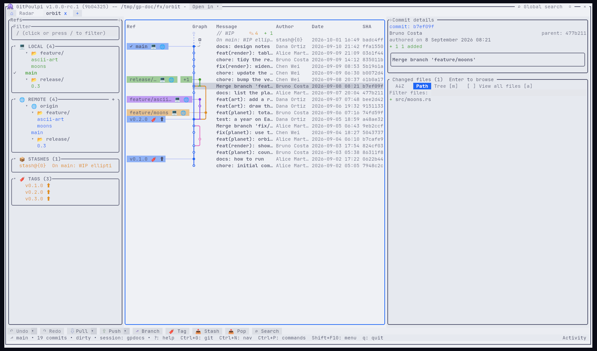
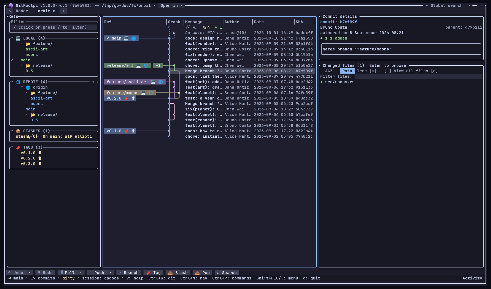
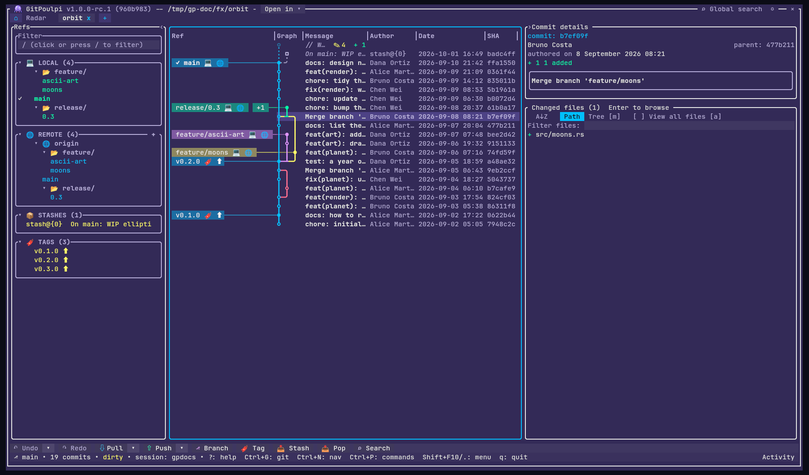
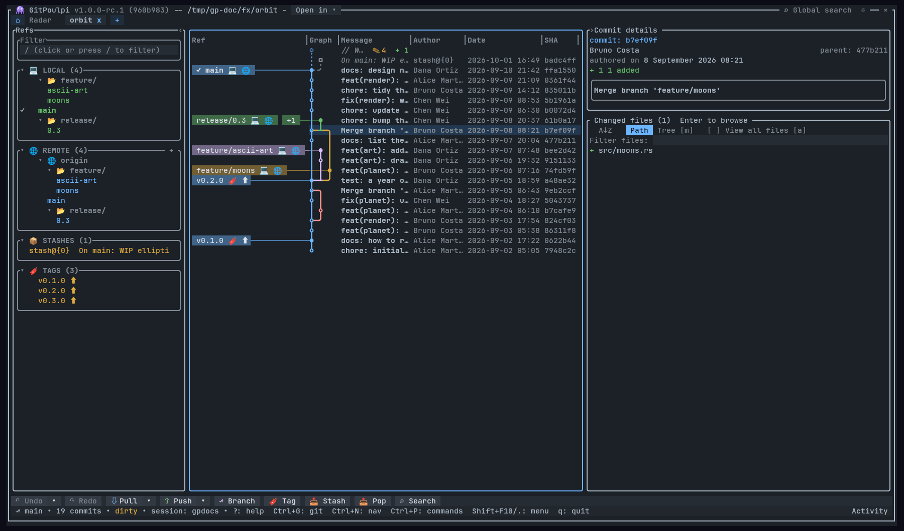
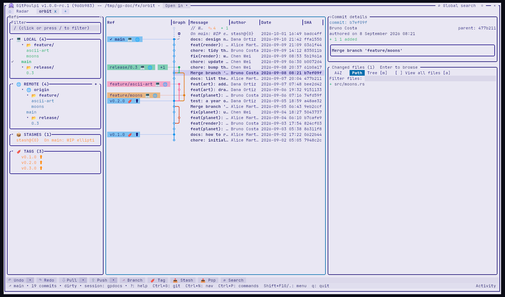
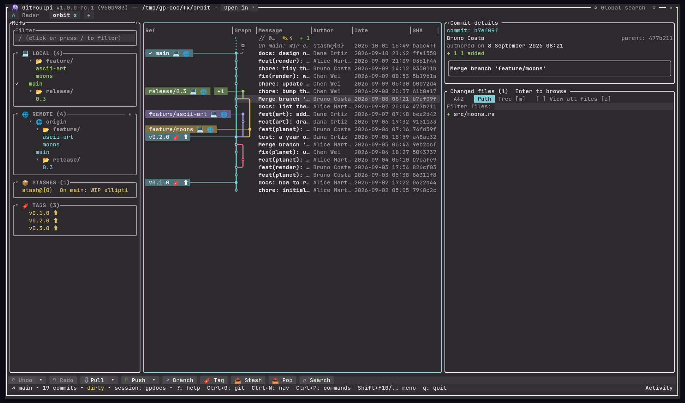
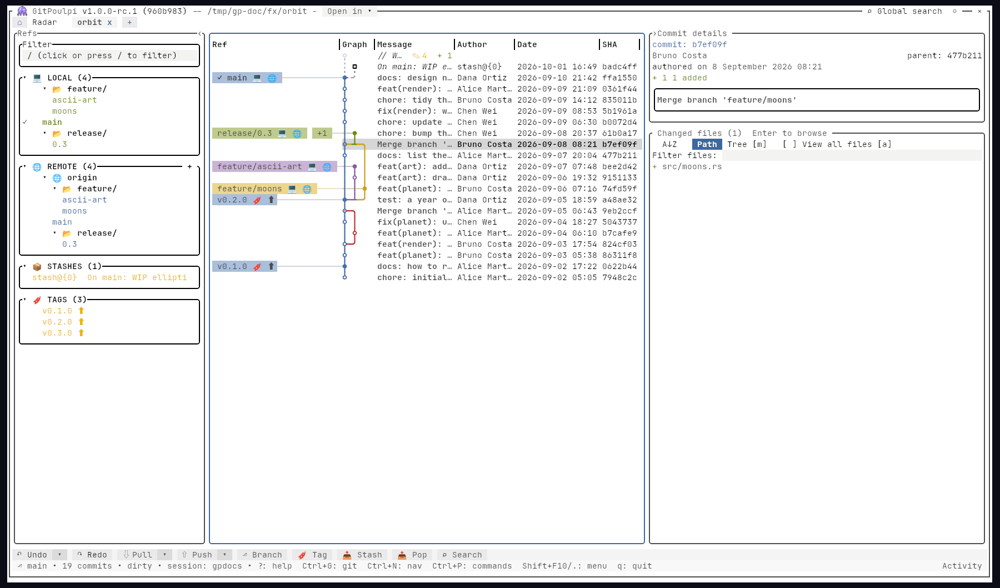
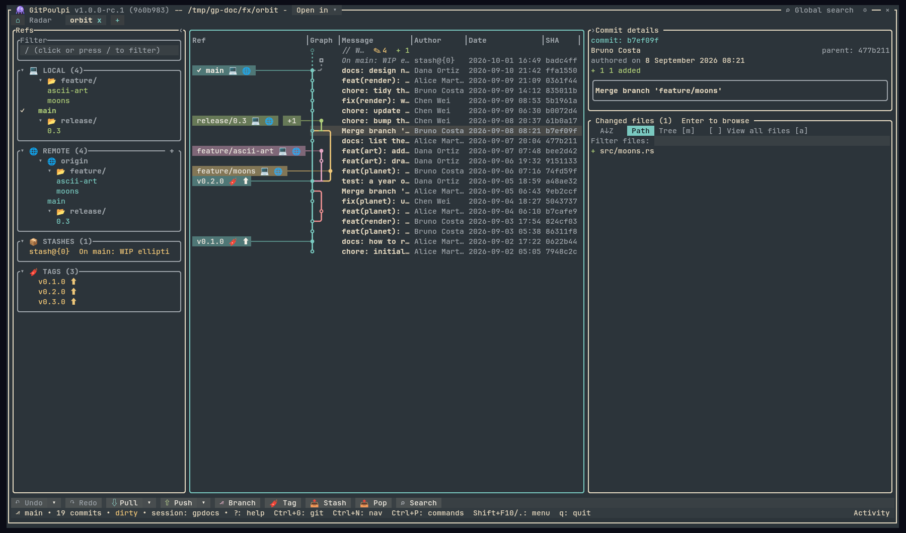

[English](../themes.md) · [Čeština](../cs/themes.md) · [Deutsch](../de/themes.md) · [Español](../es/themes.md) · **Français** · [Italiano](../it/themes.md) · [日本語](../ja/themes.md) · [한국어](../ko/themes.md) · [Nederlands](../nl/themes.md) · [Polski](../pl/themes.md) · [Português (Brasil)](../pt-BR/themes.md) · [Português (Portugal)](../pt-PT/themes.md) · [Русский](../ru/themes.md) · [Svenska](../sv/themes.md) · [Türkçe](../tr/themes.md) · [Українська](../uk/themes.md) · [简体中文](../zh-CN/themes.md)

# Thèmes

Un thème fixe chaque couleur que peint GitPoulpi : texte, panneaux, sélection,
boutons, vues de diff et de merge, éditeur, icônes de la barre d'outils et couleurs
des voies du graphe du Log. Changez de thème dans **Paramètres > Apparence > Thème**, ou
avec `gitpoulpi config set ui.theme <slug>`. Pour voir à quoi ressemble chacun, allez directement à la [galerie](#galerie).

## Préréglages intégrés

`gitpoulpi theme list` affiche ceux de votre build, dans l'ordre où la liste des
Paramètres les montre : **GitPoulpi Dark** (`dark`, peint par-dessus le fond propre de
votre terminal) et **GitPoulpi Light** (`light`) d'abord, puis chaque autre
préréglage par ordre alphabétique de libellé. `ui.theme = "system"` (le défaut) suit
votre terminal : Light sur un fond de terminal clair, Dark sinon (voir « Détection du
système » plus bas) ; l'ancien `default` équivaut à `system`. La liste des palettes
de voies utilise le même ordre.

| Slug | Libellé | Source des couleurs |
|---|---|---|
| `system` (défaut) | Système | pas une palette : GitPoulpi Light sur un fond de terminal clair, GitPoulpi Dark sinon |
| `dark` | GitPoulpi Dark | thème original de GitPoulpi, peint par-dessus le fond propre de votre terminal |
| `light` | GitPoulpi Light | thème original de GitPoulpi |
| `catppuccin-latte` / `catppuccin-frappe` / `catppuccin-macchiato` / `catppuccin-mocha` | Catppuccin Latte / Frappé / Macchiato / Mocha | [github.com/catppuccin/palette](https://github.com/catppuccin/palette) |
| `cyberpunk` | Cyberpunk | [iTerm2-Color-Schemes](https://github.com/mbadolato/iTerm2-Color-Schemes) « Cyberpunk » |
| `dracula` | Dracula | [draculatheme.com/contribute](https://draculatheme.com/contribute) |
| `everforest-dark` | Everforest Dark | [github.com/sainnhe/everforest/blob/master/palette.md](https://github.com/sainnhe/everforest/blob/master/palette.md) |
| `fire` / `fire-light` | Fire / Fire Light | thèmes originaux de GitPoulpi : Fire, des braises sur un fond orange brûlé avec de l'orange flamme ; Fire Light, son jumeau clair sur un vrai fond orange |
| `github-dark` / `github-light` | GitHub Dark / GitHub Light | les thèmes Primer de GitHub, [github.com/primer/github-vscode-theme](https://github.com/primer/github-vscode-theme) avec @primer/primitives (`canvas.default`, `canvas.inset` pour le panneau latéral, `fg.*`, `accent.fg`) ; aucune valeur ajustée |
| `gruvbox-dark` / `gruvbox-light` | Gruvbox Dark / Light | [github.com/morhetz/gruvbox#palette](https://github.com/morhetz/gruvbox#palette) |
| `kanagawa` / `kanagawa-lotus` | Kanagawa (wave) / Kanagawa Lotus | [github.com/rebelot/kanagawa.nvim](https://github.com/rebelot/kanagawa.nvim) |
| `matrix` | Matrix | [iTerm2-Color-Schemes](https://github.com/mbadolato/iTerm2-Color-Schemes) « Matrix » (pas de rouge dans le schéma : `danger` vaut `#ff5555`) |
| `monokai` | Monokai | la palette Monokai d'origine ([monokai.nl](https://monokai.nl/)) |
| `nord` | Nord | [www.nordtheme.com](https://www.nordtheme.com) |
| `one-dark` / `one-light` | One Dark / One Light | Atom One Dark / One Light ([One Dark](https://github.com/atom/one-dark-syntax), [One Light](https://github.com/atom/one-light-syntax)) |
| `rose-pine` / `rose-pine-moon` / `rose-pine-dawn` | Rosé Pine / Moon / Dawn | [rosepinetheme.com/palette](https://rosepinetheme.com/palette/) |
| `solarized-dark` / `solarized-light` | Solarized Dark / Light | Solarized d'Ethan Schoonover ([ethanschoonover.com/solarized](https://ethanschoonover.com/solarized/)) |
| `sunset` | Sunset | thème original de GitPoulpi : crépuscule indigo avec corail et or |
| `terminal` | Terminal (16 couleurs) | n'utilise que les 16 couleurs propres de votre terminal |
| `tokyo-night` / `tokyo-night-day` | Tokyo Night (night) / Tokyo Night Day | [github.com/folke/tokyonight.nvim](https://github.com/folke/tokyonight.nvim) (le premier plan de Day est assombri pour passer les règles de contraste) |
| `vesper` | Vesper | [github.com/raunofreiberg/vesper](https://github.com/raunofreiberg/vesper) (pas de bleu ni de violet dans la palette : l'accent est pêche) |
| `vscode-dark` / `vscode-light` | VS Code Dark / VS Code Light | les Dark Modern / Light Modern par défaut de VS Code, [github.com/microsoft/vscode/tree/main/extensions/theme-defaults/themes](https://github.com/microsoft/vscode/tree/main/extensions/theme-defaults/themes) (`dark_modern.json`, `light_modern.json`, plus les couleurs par défaut de VS Code pour la sélection de liste et les accents ANSI/graphiques ; le gris atténué de Light est `616161`) |

### Importés depuis terminalcolors.com

Importés depuis les palettes de terminal de terminalcolors.com ; chaque schéma appartient à ses auteurs. 90 préréglages sont construits à partir du fond, du premier plan, de la sélection et des 16 couleurs ANSI de la palette (accent = bleu, success = vert, warning = jaune, danger = rouge, AI = magenta, muted = noir vif), par une dérivation partagée par tous ; une couleur qui échoue aux règles de contraste de GitPoulpi est éclaircie ou assombrie jusqu'à les passer. Le tableau est généré par `scripts/gen-terminalcolors.py` dans `crates/gitpoulpi-config/src/theme/terminalcolors_data.rs`. Les slugs sont `<famille>-<variante>` (`default` omis) ; les libellés sont par ordre alphabétique dans la liste comme les autres.

| Famille | Slugs |
|---|---|
| [Apprentice](https://terminalcolors.com/themes/apprentice/) | `apprentice` |
| [Ayu](https://terminalcolors.com/themes/ayu/) | `ayu-dark`, `ayu-light`, `ayu-mirage` |
| [Cobalt2](https://terminalcolors.com/themes/cobalt2/) | `cobalt2` |
| [Deus](https://terminalcolors.com/themes/deus/) | `deus` |
| [Dracula](https://terminalcolors.com/themes/dracula/) | `dracula-soft` |
| [Everforest](https://terminalcolors.com/themes/everforest/) | `everforest-light` |
| [GitHub](https://terminalcolors.com/themes/github/) | `github-dark-colorblind`, `github-dark-dimmed`, `github-dark-high-contrast`, `github-dark-legacy`, `github-light-colorblind`, `github-light-high-contrast`, `github-light-legacy` |
| [Gotham](https://terminalcolors.com/themes/gotham/) | `gotham` |
| [Gruvbox](https://terminalcolors.com/themes/gruvbox/) | `gruvbox-dark-hard-contrast`, `gruvbox-dark-soft-contrast`, `gruvbox-light-hard-contrast`, `gruvbox-light-soft-contrast` |
| [Iceberg](https://terminalcolors.com/themes/iceberg/) | `iceberg-dark`, `iceberg-light` |
| [Jellybeans](https://terminalcolors.com/themes/jellybeans/) | `jellybeans` |
| [Kanagawa](https://terminalcolors.com/themes/kanagawa/) | `kanagawa-dragon` |
| [Lucario](https://terminalcolors.com/themes/lucario/) | `lucario` |
| [Miasma](https://terminalcolors.com/themes/miasma/) | `miasma` |
| [Moonfly](https://terminalcolors.com/themes/moonfly/) | `moonfly` |
| [Night](https://terminalcolors.com/themes/night-owl/) | `night-owl-dark`, `night-owl-light` |
| [Nightfly](https://terminalcolors.com/themes/nightfly/) | `nightfly` |
| [Nightfox](https://terminalcolors.com/themes/nightfox/) | `nightfox`, `nightfox-carbonfox`, `nightfox-dawnfox`, `nightfox-dayfox`, `nightfox-duskfox`, `nightfox-nordfox`, `nightfox-terafox` |
| [Noctis](https://terminalcolors.com/themes/noctis/) | `noctis`, `noctis-azureus`, `noctis-bordo`, `noctis-hibernus`, `noctis-lilac`, `noctis-lux`, `noctis-minimus`, `noctis-obscuro`, `noctis-sereno`, `noctis-uva`, `noctis-viola` |
| [Nordic](https://terminalcolors.com/themes/nordic/) | `nordic` |
| [One](https://terminalcolors.com/themes/one-half/) | `one-half-dark`, `one-half-light` |
| [Panda](https://terminalcolors.com/themes/panda/) | `panda` |
| [Posterpole](https://terminalcolors.com/themes/posterpole/) | `posterpole`, `posterpole-gray` |
| [Seoul256](https://terminalcolors.com/themes/seoul256/) | `seoul256-dark`, `seoul256-light` |
| [Shades](https://terminalcolors.com/themes/shades-of-purple/) | `shades-of-purple`, `shades-of-purple-super-dark` |
| [Sonokai](https://terminalcolors.com/themes/sonokai/) | `sonokai`, `sonokai-andromeda`, `sonokai-atlantis`, `sonokai-espresso`, `sonokai-maia`, `sonokai-shusia` |
| [Srcery](https://terminalcolors.com/themes/srcery/) | `srcery` |
| [Tender](https://terminalcolors.com/themes/tender/) | `tender` |
| [Tokyo](https://terminalcolors.com/themes/tokyo-night/) | `tokyo-night-moon`, `tokyo-night-storm` |
| [Tomorrow](https://terminalcolors.com/themes/tomorrow/) | `tomorrow`, `tomorrow-night`, `tomorrow-night-blue`, `tomorrow-night-bright`, `tomorrow-night-eighties` |
| [Zenbones](https://terminalcolors.com/themes/zenbones/) | `zenbones-duckbones`, `zenbones-forestbones-dark`, `zenbones-forestbones-light`, `zenbones-kanagawabones`, `zenbones-neobones-dark`, `zenbones-neobones-light`, `zenbones-nordbones`, `zenbones-rosebones-dark`, `zenbones-rosebones-light`, `zenbones-seoulbones-dark`, `zenbones-seoulbones-light`, `zenbones-tokyobones-dark`, `zenbones-tokyobones-light`, `zenbones-vimbones`, `zenbones-zenburned`, `zenbones-zenwritten-dark`, `zenbones-zenwritten-light` |

`ui.side_bg` est le fond du panneau Refs et du volet de droite (détails du commit,
modifications locales, listes de fichiers), comme GitHub et VS Code peignent
leurs panneaux latéraux. Catppuccin (son `mantle`), GitHub
et VS Code le fixent ; pour tout autre préréglage il vaut `default`, c'est-à-dire comme
`ui.bg`. Un fichier de thème peut fixer `side_bg` sous `[ui]` (`gitpoulpi theme export`
l'affiche).

Trois autres rôles sous `[ui]` colorent le cadre, comme le font GitHub et VS Code :

| Rôle | Où il peint |
|---|---|
| `ui.toolbar_bg` | La ligne de la barre d'outils, et l'**onglet de dépôt sélectionné**, pour que l'onglet paraisse rattaché à la barre d'outils. Les pastilles des boutons de la barre d'outils gardent leur propre `chrome.toolbar_bg`. |
| `ui.statusbar_bg` | La ligne d'état (en bas, sauf si `ui.statusbar_position` dit en haut). |
| `ui.statusbar_fg` | Le texte de la ligne d'état. Le texte qui ne se lirait pas sur ce fond est repeint avec lui ; le texte d'avertissement et d'erreur qui se lit garde sa couleur. |

Les préréglages les fixent pour correspondre à leur application : VS Code Dark et Light la ligne d'état bleue
(`#007acc`) avec du texte blanc et les gris de barre de titre de VS Code pour la barre
d'outils ; GitHub ses tons d'en-tête. Tout autre préréglage (y compris les palettes de
terminal importées) dérive une barre d'outils d'un cran de `bg` et une ligne d'état un
peu à côté, avec `text` dessus, et les règles de contraste gardent le texte lisible. `dark`
(GitPoulpi Dark) et `terminal` utilisent le fond propre du terminal, donc les trois valent
`default` : rien n'est peint et l'onglet sélectionné garde la couleur de sélection. Un
fichier de thème qui les omet hérite des valeurs de sa base ; `default` signifie aucune
teinte (la ligne d'état suit alors `side_bg`).

Quand le gris de commentaire ou atténué d'un schéma est trop sombre pour se lire, il est
éclairci jusqu'à passer les règles de contraste de GitPoulpi ; les nuances de panneau et
de sélection qui manquent au schéma sont dérivées de son fond.

### Galerie

Chaque thème intégré, sur le même dépôt avec un commit de merge sélectionné (`scripts/docs-screenshots.sh` les reprend).

| **GitPoulpi Dark** (`dark`) | **GitPoulpi Light** (`light`) | **Apprentice** (`apprentice`) |
|---|---|---|
|  |  |  |
| **Ayu Dark** (`ayu-dark`) | **Ayu Light** (`ayu-light`) | **Ayu Mirage** (`ayu-mirage`) |
|  |  |  |
| **Catppuccin Frappé** (`catppuccin-frappe`) | **Catppuccin Latte** (`catppuccin-latte`) | **Catppuccin Macchiato** (`catppuccin-macchiato`) |
|  |  |  |
| **Catppuccin Mocha** (`catppuccin-mocha`) | **Cobalt2** (`cobalt2`) | **Cyberpunk** (`cyberpunk`) |
|  |  |  |
| **Deus** (`deus`) | **Dracula** (`dracula`) | **Dracula Soft** (`dracula-soft`) |
|  |  |  |
| **Everforest Dark** (`everforest-dark`) | **Everforest Light** (`everforest-light`) | **Fire** (`fire`) |
|  |  |  |
| **Fire Light** (`fire-light`) | **GitHub Dark** (`github-dark`) | **GitHub Dark Colorblind** (`github-dark-colorblind`) |
|  |  |  |
| **GitHub Dark Dimmed** (`github-dark-dimmed`) | **GitHub Dark High Contrast** (`github-dark-high-contrast`) | **GitHub Dark Legacy** (`github-dark-legacy`) |
|  |  |  |
| **GitHub Light** (`github-light`) | **GitHub Light Colorblind** (`github-light-colorblind`) | **GitHub Light High Contrast** (`github-light-high-contrast`) |
|  |  |  |
| **GitHub Light Legacy** (`github-light-legacy`) | **Gotham** (`gotham`) | **Gruvbox Dark** (`gruvbox-dark`) |
|  |  |  |
| **Gruvbox Dark Hard Contrast** (`gruvbox-dark-hard-contrast`) | **Gruvbox Dark Soft Contrast** (`gruvbox-dark-soft-contrast`) | **Gruvbox Light** (`gruvbox-light`) |
|  |  |  |
| **Gruvbox Light Hard Contrast** (`gruvbox-light-hard-contrast`) | **Gruvbox Light Soft Contrast** (`gruvbox-light-soft-contrast`) | **Iceberg Dark** (`iceberg-dark`) |
|  |  |  |
| **Iceberg Light** (`iceberg-light`) | **Jellybeans** (`jellybeans`) | **Kanagawa** (`kanagawa`) |
|  |  |  |
| **Kanagawa Dragon** (`kanagawa-dragon`) | **Kanagawa Lotus** (`kanagawa-lotus`) | **Lucario** (`lucario`) |
|  |  |  |
| **Matrix** (`matrix`) | **Miasma** (`miasma`) | **Monokai** (`monokai`) |
|  |  |  |
| **Moonfly** (`moonfly`) | **Night Owl Dark** (`night-owl-dark`) | **Night Owl Light** (`night-owl-light`) |
|  |  |  |
| **Nightfly** (`nightfly`) | **Nightfox** (`nightfox`) | **Nightfox Carbonfox** (`nightfox-carbonfox`) |
|  |  |  |
| **Nightfox Dawnfox** (`nightfox-dawnfox`) | **Nightfox Dayfox** (`nightfox-dayfox`) | **Nightfox Duskfox** (`nightfox-duskfox`) |
|  |  |  |
| **Nightfox Nordfox** (`nightfox-nordfox`) | **Nightfox Terafox** (`nightfox-terafox`) | **Noctis** (`noctis`) |
|  |  |  |
| **Noctis Azureus** (`noctis-azureus`) | **Noctis Bordo** (`noctis-bordo`) | **Noctis Hibernus** (`noctis-hibernus`) |
|  |  |  |
| **Noctis Lilac** (`noctis-lilac`) | **Noctis Lux** (`noctis-lux`) | **Noctis Minimus** (`noctis-minimus`) |
|  |  |  |
| **Noctis Obscuro** (`noctis-obscuro`) | **Noctis Sereno** (`noctis-sereno`) | **Noctis Uva** (`noctis-uva`) |
|  |  |  |
| **Noctis Viola** (`noctis-viola`) | **Nord** (`nord`) | **Nordic** (`nordic`) |
|  |  |  |
| **One Dark** (`one-dark`) | **One Half Dark** (`one-half-dark`) | **One Half Light** (`one-half-light`) |
|  |  |  |
| **One Light** (`one-light`) | **Panda** (`panda`) | **Posterpole** (`posterpole`) |
|  |  |  |
| **Posterpole Gray** (`posterpole-gray`) | **Rosé Pine** (`rose-pine`) | **Rosé Pine Dawn** (`rose-pine-dawn`) |
|  |  |  |
| **Rosé Pine Moon** (`rose-pine-moon`) | **Seoul256 Dark** (`seoul256-dark`) | **Seoul256 Light** (`seoul256-light`) |
|  |  |  |
| **Shades of Purple** (`shades-of-purple`) | **Shades of Purple Super Dark** (`shades-of-purple-super-dark`) | **Solarized Dark** (`solarized-dark`) |
|  |  |  |
| **Solarized Light** (`solarized-light`) | **Sonokai** (`sonokai`) | **Sonokai Andromeda** (`sonokai-andromeda`) |
|  |  |  |
| **Sonokai Atlantis** (`sonokai-atlantis`) | **Sonokai Espresso** (`sonokai-espresso`) | **Sonokai Maia** (`sonokai-maia`) |
|  |  |  |
| **Sonokai Shusia** (`sonokai-shusia`) | **Srcery** (`srcery`) | **Sunset** (`sunset`) |
|  |  |  |
| **Tender** (`tender`) | **Terminal (16 colors)** (`terminal`) | **Tokyo Night** (`tokyo-night`) |
|  |  |  |
| **Tokyo Night Day** (`tokyo-night-day`) | **Tokyo Night Moon** (`tokyo-night-moon`) | **Tokyo Night Storm** (`tokyo-night-storm`) |
|  |  |  |
| **Tomorrow** (`tomorrow`) | **Tomorrow Night** (`tomorrow-night`) | **Tomorrow Night Blue** (`tomorrow-night-blue`) |
|  |  |  |
| **Tomorrow Night Bright** (`tomorrow-night-bright`) | **Tomorrow Night Eighties** (`tomorrow-night-eighties`) | **Vesper** (`vesper`) |
|  |  |  |
| **VS Code Dark** (`vscode-dark`) | **VS Code Light** (`vscode-light`) | **Zenbones Duckbones** (`zenbones-duckbones`) |
|  |  |  |
| **Zenbones Forestbones Dark** (`zenbones-forestbones-dark`) | **Zenbones Forestbones Light** (`zenbones-forestbones-light`) | **Zenbones Kanagawabones** (`zenbones-kanagawabones`) |
|  |  |  |
| **Zenbones Neobones Dark** (`zenbones-neobones-dark`) | **Zenbones Neobones Light** (`zenbones-neobones-light`) | **Zenbones Nordbones** (`zenbones-nordbones`) |
|  |  |  |
| **Zenbones Rosebones Dark** (`zenbones-rosebones-dark`) | **Zenbones Rosebones Light** (`zenbones-rosebones-light`) | **Zenbones Seoulbones Dark** (`zenbones-seoulbones-dark`) |
|  |  |  |
| **Zenbones Seoulbones Light** (`zenbones-seoulbones-light`) | **Zenbones Tokyobones Dark** (`zenbones-tokyobones-dark`) | **Zenbones Tokyobones Light** (`zenbones-tokyobones-light`) |
|  |  |  |
| **Zenbones Vimbones** (`zenbones-vimbones`) | **Zenbones Zenburned** (`zenbones-zenburned`) | **Zenbones Zenwritten Dark** (`zenbones-zenwritten-dark`) |
|  |  |  |
| **Zenbones Zenwritten Light** (`zenbones-zenwritten-light`) |
|  |

## N'importe quel thème avec n'importe quelle palette de voies

Chaque thème apporte ses propres couleurs de voies pour le graphe du Log, mais vous
pouvez combiner n'importe quel thème avec n'importe quelle palette : **Paramètres > Apparence >
Thème de couleurs du graphe** propose **Suivre le thème** (le défaut) plus chaque
palette de voies de chaque thème (GitPoulpi Dark, GitPoulpi Light, puis Material,
Serie, ... et le `graph_palette` de vos propres fichiers de thème, listés après les préréglages sous
le nom du thème). Un thème personnalisé apparaît à la prochaine ouverture de la liste (les
fichiers sont alors relus), et en choisir un enregistre son nom de fichier dans
`ui.graph_color_theme` (pour l'installation principale dans `[ui]`, pour les
autres dans leur propre entrée `[installation.settings.<id>]`, comme le thème). Un
fichier de thème sans `graph_palette` a les couleurs de voies de sa `base` (le
préréglage par défaut quand il n'en nomme aucune), le même héritage que toutes les autres couleurs
du fichier. Un thème personnalisé nommé comme une palette de voies intégrée (par exemple
`gruvbox`) remplace cette palette dans la liste. Si le nom configuré n'existe
plus (le fichier a été supprimé ou renommé), le graphe utilise les couleurs de voies du
thème actif, et les Paramètres montrent le nom marqué *introuvable* jusqu'à ce que vous
en choisissiez un autre. 

Dans `config.toml` :

```toml
[ui]
theme = "nord"
graph_color_theme = "material"   # or "theme" to follow the theme
```

`ui.input_color` est le même genre de surcharge pour les champs de texte : le défaut
`theme` suit les couleurs de champ du thème ; `gray`, `blue`, `slate`, `dark` et
`custom` forcent un fond (ce sont des couleurs sombres, choisissez donc `theme` sur un
thème clair).

## Vos propres thèmes

Placez un fichier `.toml` dans le dossier `themes/` du dossier de configuration
(`gitpoulpi config path` affiche son parent ; le dossier est `${config}/themes/`).
Le nom du fichier sans `.toml` est le slug du thème, ce que prend `ui.theme`. Un
fichier ne peut pas réutiliser le slug d'un préréglage (il est ignoré avec un
avertissement).

Partez d'un fichier complet :

```
gitpoulpi theme export nord > "$(dirname "$(gitpoulpi config path)")/themes/mine.toml"
```

Ne gardez ensuite que ce que vous changez. Un fichier est un ensemble de **surcharges
partielles** sur une `base` (un préréglage, ou un autre thème utilisateur ; les chaînes
font au plus 4 niveaux et les cycles sont rejetés ; sans `base`, c'est `dark`) :

```toml
name = "My Nord"            # the label in the combo; default = file name
base = "nord"
light = false               # inherited when absent
syntax = "base16-ocean.dark"
graph_palette = ["#88c0d0", "#a3be8c"]

[ui]
bg = "#2e3440"              # "default" | "#rrggbb" | "ansi:N"
accent = "#88c0d0"
toolbar_bg = "#3b4252"      # toolbar row and selected tab
statusbar_bg = "#5e81ac"    # status line
statusbar_fg = "#eceff4"

[diff]
add_bg = "#2f3b2f"
```

### Mots modifiés dans un diff (`diff.add_emph_bg`, `diff.del_emph_bg`)

Les fonds plus marqués que la vue Diff peint sur les mots qui diffèrent à l'intérieur
d'une ligne modifiée, par-dessus `diff.add_bg` (lignes ajoutées) et `diff.del_bg` (lignes
supprimées) ; le texte garde `diff.add_fg` et `diff.del_fg`. Chaque préréglage définit les deux.
Un fichier de thème qui définit `diff.add_bg` ou `diff.del_bg` mais pas l'accentuation
correspondante en reçoit une dérivée (à 30 % du chemin vers la couleur de texte de ce
côté), si bien qu'un fond personnalisé ne se retrouve jamais avec l'accentuation du thème
de base. Une valeur `default` (le préréglage Terminal), ou un terminal dont la profondeur de
couleur dessinerait les deux fonds à l'identique, marque plutôt les mots en gras et
soulignés. Voir [Mots modifiés dans un diff](interface-tour.md#mots-modifiés-dans-un-diff).

Les couleurs sont `"#rrggbb"`, `"ansi:N"` (l'entrée N de la palette du terminal) ou
`"default"` (la couleur propre du terminal). Les groupes et les clés sont ceux de
`gitpoulpi theme export <slug>`. Rien n'est fatal : une clé inconnue ou une mauvaise
couleur est ignorée, une `base` inconnue retombe sur `dark`, et `gitpoulpi theme list`
signale chaque problème sous `warnings` (l'application les montre une fois dans la ligne
d'état).

Les fichiers sont relus à l'ouverture de la liste Thème et à la fermeture des Paramètres.
Une fenêtre en cours remarque aussi que `config.toml` (un `gitpoulpi config set ui.theme ...`
lancé depuis un shell) ou le fichier du thème actif a été réécrit, et applique les nouvelles
couleurs en environ une seconde, sans redémarrage.

### `ui.border_focused`

Le cadre du volet qui a le focus clavier : le Log, la barre latérale Refs, les volets Non
indexés et Indexés, le détail du commit, les volets d'historique, de revue et de réécriture,
les cadres du diff, des fichiers et de l'éditeur. Elle ne peint que des bordures ; le texte,
les libellés et les icônes (le libellé « commit : », l'icône Accueil, les boutons d'onglet)
continuent d'utiliser `ui.accent`. Un thème peut ainsi encadrer le volet actif d'une couleur
qui serait illisible en texte, par exemple un jaune vif sur un thème clair. Quand un thème ne
la définit pas, elle suit `ui.accent` (dans un fichier utilisateur aussi : un fichier qui
ne change que `accent` donne cet accent à ses cadres focalisés), donc chaque thème intégré
garde son aspect. Les dialogues et les fenêtres contextuelles gardent un cadre d'accent.

```toml
[ui]
accent = "#1f5fbf"
border_focused = "#ffd700"
```

## Détection du système

Avec `ui.theme = "system"`, GitPoulpi demande au terminal sa couleur de fond **une
seule fois, au démarrage** (la requête OSC 11, à laquelle répondent kitty, WezTerm,
Alacritty, foot, iTerm2, Windows Terminal, tmux et la plupart des autres) et choisit
Light pour un fond clair, Dark sinon. L'attente est d'environ 100 ms au plus, et un
terminal qui ne connaît pas la requête ne coûte rien : la réponse est toujours lue
avant le démarrage de l'interface, donc rien n'est affiché et aucune touche n'est avalée.
Sans réponse (et toujours sous Windows, qui n'envoie pas la requête), il lit
`COLORFGBG`, puis retombe sur Dark. Un terminal dont le fond change pendant que
GitPoulpi tourne n'est pas suivi ; redémarrez-le, ou choisissez Light ou Dark
explicitement.

## Profondeur de couleur

Les thèmes sont en truecolor (`#rrggbb`). `ui.color_depth` (Paramètres > Apparence >
Profondeur de couleur, s'applique aussitôt) décide comment cela parvient au terminal :

| Valeur | Effet |
|---|---|
| `auto` (défaut) | Truecolor, sauf là où l'on sait que cela ne marche pas : Apple Terminal (`TERM_PROGRAM=Apple_Terminal`) utilise 256 couleurs, la console Linux (`TERM=linux`) 16, et un terminal `*-256color` qui ne définit pas `COLORTERM` (et n'est ni WezTerm, ni kitty, ni Windows Terminal) 256. `COLORTERM=truecolor` signifie toujours truecolor. |
| `truecolor` | Couleur 24 bits toujours. |
| `256` | Chaque couleur RVB devient l'entrée xterm-256 la plus proche. |
| `16` | La plus proche des 16 couleurs ANSI ; la palette propre du terminal fixe la nuance exacte. |

Utilisez `256` ou `16` si un thème s'affiche avec de mauvaises couleurs sur ssh ou dans
un vieux multiplexeur. Le préréglage Terminal n'a besoin de rien de tout cela. Le
truecolor ne coûte rien ; la passe de conversion ne parcourt l'écran qu'une fois par
image et seulement quand elle est active.

Le thème est propre à chaque installation : plusieurs installations de GitPoulpi qui partagent une même configuration gardent chacune le leur, donc en choisir un dans une installation ne recolore jamais les autres.

## Aperçu en direct

Dans Paramètres > Apparence, la liste Thème contient **Système (suit le terminal)**, les
préréglages, puis vos propres fichiers de thème. Déplacer la surbrillance applique ce
thème aussitôt, si bien que tout l'écran des Paramètres se repeint sous vos yeux ;
**Enter** le garde (il est enregistré), **Esc** ou un clic ailleurs rétablit le
précédent et n'enregistre rien. L'entrée de palette **Application : Thème...** (`Ctrl+P`)
ouvre les Paramètres sur cette ligne.

### Changer de thème depuis la palette

**Application : Changer de thème...** (`Ctrl+P`, ou `Ctrl+N t` ; la touche est
réaffectable sous `nav_prefix.change_theme`) ouvre une liste des mêmes thèmes sans passer
par les Paramètres : **Système (suit le terminal)**, les préréglages, puis vos propres
fichiers de thème, chacun avec quatre petites pastilles de couleur. Le thème courant est
coché. Tapez pour restreindre la liste ; déplacer la surbrillance prévisualise le thème
aussitôt, **Enter** l'applique et enregistre `ui.theme` dans `config.toml`, **Esc** (ou un
clic hors de la liste) remet le thème précédent et n'enregistre rien.

Sous le champ de filtre, un préfiltre segmenté restreint la liste : **Tous**,
**Sombres**, **Clairs** et **Colorés**, plus **Personnalisés** quand vous avez vos propres fichiers de thème
(cliquez sur un segment, `Tab` / `Shift+Tab`, ou `Alt+1`..`Alt+5`). Sombre et Clair viennent de la luminosité du `ui.bg` du thème ;
**Colorés** garde les thèmes dont le fond est nettement teinté (bleu, violet, jaune,
vert...) et exclut les gris blancs, blanc cassé, noirs et presque noirs, si bien que
Solarized Dark, Dracula ou Nord sont colorés alors que GitHub Dark et One Light ne le sont
pas. Un thème coloré apparaît aussi sous Sombre ou Clair. **Système** et les thèmes
transparents (sans fond propre) n'apparaissent que sous Tous. **Personnalisés** ne garde que les
fichiers de thème de votre dossier `themes/` (un thème personnalisé reste Sombre, Clair ou Coloré
pour ces boutons) ; le bouton n'est pas dessiné et n'est pas atteignable au clavier tant que ce
dossier ne contient aucun thème. Le préfiltre se combine avec
ce que vous tapez. Les sélecteurs du thème de couleurs du graphe et de la langue
prévisualisent de la même façon : les voies du Log et toute l'interface changent pendant
que la surbrillance se déplace.


Sous la liste, une bande de pastilles de couleur montre le thème en vigueur (fond, texte,
atténué, accent, sélection, danger, ajout du diff, suppression du diff, puis les six
premières couleurs de voies), et suit l'aperçu. La liste **Thème de couleurs du graphe**
dans **Apparence** montre quelques couleurs de voies à côté de chaque palette, et les choix
s'appliquent à la fermeture des Paramètres.

Un thème avec son propre fond (Light et les autres préréglages peints) remplit toute la
fenêtre, y compris les Paramètres et les vues pleine page, et donne aux textes qui n'ont pas
de couleur propre la couleur de texte du thème ; Dark et Terminal laissent en paix les
couleurs de votre terminal.

## En ligne de commande

| Commande | Sortie |
|---|---|
| `gitpoulpi theme list` | JSON `{themes: [{slug, label, source, light, lane_palette}], warnings}` ; `source` vaut `preset` ou `user`. |
| `gitpoulpi theme export <slug>` | Le fichier de thème complet en TOML sur stdout (JSON : `{slug, toml}`) ; il se relit en donnant le même thème. |
| `gitpoulpi config set ui.theme <slug>` | Validé par rapport aux préréglages et à votre dossier `themes/` ; un nom inconnu est une erreur qui liste les valides. `system` et `default` sont acceptés. |
| `gitpoulpi config set ui.graph_color_theme <name>` | `theme` (suivre le thème) ou n'importe quel nom de palette de voies ; un nom inconnu liste les valides. |

Le serveur MCP offre `theme_list` et `theme_export` comme outils en lecture seule.
