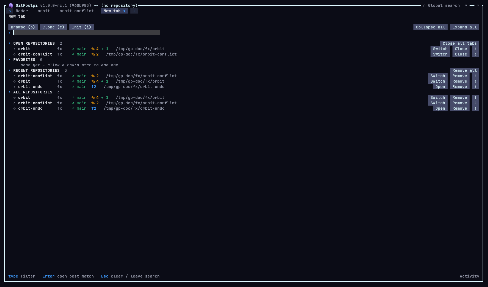
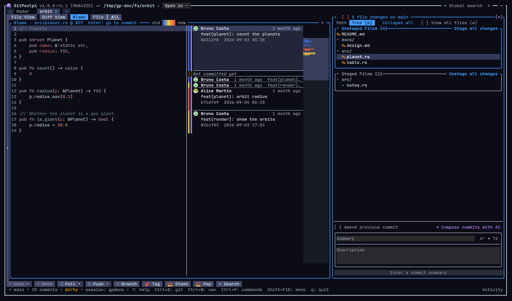

**English** · [Čeština](cs/interface-tour.md) · [Deutsch](de/interface-tour.md) · [Español](es/interface-tour.md) · [Français](fr/interface-tour.md) · [Italiano](it/interface-tour.md) · [日本語](ja/interface-tour.md) · [한국어](ko/interface-tour.md) · [Nederlands](nl/interface-tour.md) · [Polski](pl/interface-tour.md) · [Português (Brasil)](pt-BR/interface-tour.md) · [Português (Portugal)](pt-PT/interface-tour.md) · [Русский](ru/interface-tour.md) · [Svenska](sv/interface-tour.md) · [Türkçe](tr/interface-tour.md) · [Українська](uk/interface-tour.md) · [简体中文](zh-CN/interface-tour.md)

# Tour of the interface

This page names every area of the GitPoulpi window, from top to bottom. The
other pages use the same names. The pictures use a small demo repository with
made-up authors.

## The frame

### Title bar

The top edge of the window reads
 `GitPoulpi vX.Y.Z -- <repository path>` (the session name is in the status line, at the bottom by default).

- **** opens the **About** window: version, build features, license, links,
  a short notice that GitPoulpi is an independent project, the third-party crates
  and the licenses and credits. On a terminal that draws images the octopus is
  the pixel logo, in your logo color (elsewhere it stays the emoji). Palette:
  `Help: About GitPoulpi`; keys: `Ctrl+N` then `A`. In About, the octopus's
  pupils follow the mouse pointer. Click the logo (or press `Space`) to spin it
  to the next color. Right-click the logo (or press `c`) for the list of
  colors. GitPoulpi saves your choice in `ui.logo_color`. The links open with
  a click or their access key (`s` source, `d` documentation, `i` license),
  and `l` lists the third-party crates with their versions and licenses (a
  scrollable list; `Esc` or `l` goes back, and so does a click on its
  title). Every crate in the list carries a link to its page (its repository,
  else its page on crates.io): click the row, or pick it with `Up` / `Down`
  and press `Enter`, to open it in the browser. `t` (or the palette's
  `Help: Licenses and Credits`) reads the license notices and credits of
  everything built into the program, a scrollable text (`Up` / `Down`,
  `PgUp` / `PgDn`, `Home` / `End`; `Esc` or `t` goes back). From a script,
  `gitpoulpi licenses` prints the same text.
- The **version** (`v1.0.0`; `vX.Y.Z available` when a newer release exists)
  sits between the name and the path: a click opens the update panel only when a
  newer release exists or an update is under way, the Release notes tab otherwise. See [Updates](updates.md).
- **Open in ▾**, right after the path, opens the tab's folder in a terminal,
  an editor, a multiplexer or the file manager (`Alt+O`). See
  [Open in](open-in.md).
- **⌕ Global search** (a magnifier and its label), just left of the gear, opens the [global search](search.md) (`Ctrl+Alt+F`). It is the first thing to give way when the title bar is too narrow: the label goes first (the magnifier stays), then the button.
- The **gear** (`⚙`), just left of the **×**, opens the **Settings** (`Ctrl+,`).
- **×** at the right end quits, like `q`.

### Status line

The status line is the last row of the window by default (**Settings > Appearance > Status line position** moves it to the top, above the repository tabs). It shows the current branch, the commits
loaded (`500 / 48213 commits` while older history is still to load, with a
`...` in place of the total while it is being counted; just `2500 commits` once
the whole history is loaded), `dirty` or `clean`, the session name, a `sparse`
badge in a sparse checkout, and the most useful keys: `?` help, `Ctrl+G` git
actions, `Ctrl+N` navigation, `Ctrl+P` commands, `Shift+F10` menu, `q` quit.
On a narrow window the least useful keys are left out. The status line also shows
status messages and progress. The keys it shows are always the keys in effect,
including the ones you changed (see [Settings](settings.md#keyboard--mouse)).
How the total is counted is a setting (**Count the total commits with**, see
[Settings](settings.md#log--graph)).

At its right end, the **Activity** button opens the Activity Log: a Git operations tab
(the operations with how long they took, messages and errors), an Application tab (the application
log with a level box and a **Clear log** button) and a Scope box that narrows both to this
repository, a workspace or all repositories. A number on the
button counts the errors you have not looked at. Left of it, the jobs indicator
shows a running background job with an `[x]` to cancel it. The
**Home** tab has the same status line, with the Activity button at its bottom
right (it opens on All repositories). When an operation fails, the status
line says why in red, wherever you are; a click on it (or the palette's
`Activity Log: Open the Last Error`) opens the Activity entry, with the
details, a Copy for an AI and the suggested next step. Both are described in
[When something fails](troubleshooting.md#when-something-fails).

### Overlays

The command palette, the help, context menus, dialogs, popups and the
Settings open over the window. Each has a `✕` at the top right of its border;
`Esc` or a click on `✕` closes it, and a click outside closes a dialog, popup or
panel (see [Closing windows and dialogs](mouse-and-gestures.md#closing-windows-and-dialogs)).

### When the window is small

Nothing disappears silently as the window narrows. A button first loses its
long label (clipped with `...`), then wraps to a second row or goes behind the
`⋯` menu of its row, and its key and palette entry keep working throughout. A
dialog too big for the window draws a small frame with its title, the `✕` and
the line **Window too small: enlarge it** instead of nothing; `Esc` and `✕`
close it, and it comes back whole when you enlarge the window.

## Tab row

The **Home** tab (the house icon) is at the left end, followed by the
[workspace chip](workspaces.md) (once you have a workspace), the pinned
**Radar** tab (it closes like any tab; see [the Radar](radar.md)) and the
**Workspaces** tab once you have opened it (`Alt+J`; it closes like any tab). Then
comes one tab per open repository. The `x` that closes a tab shows only on the tab
you are on and on the one under the pointer. The tab row only
carries tabs (the [global search](search.md) button is in the title bar).

When the repository tabs do not fit, the row scrolls instead of shrinking them:
the tabs sit between two arrow buttons, `‹` at the left and `›` at the right.
An arrow is dimmed when no tab is hidden on its side. Click an arrow to show one
more tab on that side (hold it down to keep scrolling), or use the wheel over the
row (up or left shows the earlier tabs). Whenever the current tab changes (you
switch tabs from the keyboard, the tab picker or the palette, open or close a
tab, or resize the window), the row scrolls just enough to show it whole. With
room for it, a `…` button after the right arrow opens the tab picker. Dragging a
tab onto an arrow scrolls the row while you hold it there, so you can drop it
past the tabs on screen. `Ctrl+N` puts a badge on each live arrow.

**Settings > Appearance > Tab bar position** moves this row to the bottom of the window (below the status line) or turns it into a column at the left edge: one tab per row, Home first, then the workspace chip, the Radar, the Workspaces tab, the tabs (a long name ends in `…`), and the `+`. When the tabs outnumber the rows, a `…` row shows how many are hidden above (`▲`) and below (`▼`) and opens the tab list; the wheel scrolls the column. Next to a column toolbar the tabs stay outermost. A window under 80 columns keeps the tabs on top. Clicks, the close cross, middle click, the right-click menu, dragging to reorder and the keyboard work the same in every position.

- The **+** right after the last tab opens a small menu: **New tab** (`Alt+T`,
  palette **Tab: New Tab**) and, while their tabs are closed, **Radar** and
  **Workspaces** (`Alt+J`), which open those tabs; the palette's **Tab: New...**
  opens the same menu. A **New tab** is: the Home view with the search field ready, so typing
  filters your repositories at once. Pick one (or Browse, Clone, Init) and its
  tab appears at the end of the bar; a repository that is already open is just
  switched to. `Esc` on the empty search, `Ctrl+W`, its `x` or a middle-click
  closes the New tab and returns to the tab you were on. It is never saved with
  your session.

  
- Right-click a tab, or press `Ctrl+T`, for the tab menu: **New tab**, **Close tab**,
  **Close other tabs...**, **Close tabs to the right...**, **Add to favorites** (or
  **Remove from favorites**), **Add to workspace** (or **Remove from
  workspace**, when you have workspaces), **Copy path**, **Open in ›**,
  **SSH & credentials...** and **Sparse checkout...**.
- `Ctrl+PageUp` and `Ctrl+PageDown` switch tabs. `Ctrl+W` closes the current
  tab. A middle-click on a tab closes it too (with the same question).
- `t` (or `Ctrl+N t`) opens the tab picker, a searchable list of the open
  tabs.
- **Reorder tabs:** press a repository tab and drag it sideways (a ghost of the
  tab follows the pointer and a bar shows where it will land; `Esc` cancels),
  or drag a row of the tab picker, press `Alt+Up` / `Alt+Down` on the
  highlighted row of the picker, or run **Tab: Move Left** / **Tab: Move
  Right** from the palette. The order is saved with the session. A plain click
  without movement still selects the tab. The house, the workspace chip and the
  `+` never move.
- **Quit & cd here** appears at the right of the tabs when you started
  GitPoulpi through the `gp` shell wrapper and the tab is not the folder you
  started in. See [Following the tab's folder](following-the-tab-folder.md).
- The **workspace chip** right after the house (a colored dot and a name, or
  "No workspace") switches [workspace](workspaces.md): click it or press `Alt+W`.
  It appears once you have a workspace.

With **Remember tabs** on (the default), your tabs come back at the next
launch. A worktree opens in its own tab, placed right after its repository's
tab (**Group worktree tabs together** in Settings > General; on by default).
That tab closes when the worktree is removed.

### Home

The Home tab is the repository manager. It has four sections: **OPEN
REPOSITORIES**, **FAVORITES**, **RECENT REPOSITORIES** and **ALL
REPOSITORIES**. Each row shows the branch, the ahead and behind counts and the
number of changes, then the folder's path when there is room: shortened with `~`
and cut in the middle when narrow, it never pushes the name, owner or branch
out. Each row has a star (favorite), **Open** or **Switch**,
**Close** or **Remove**, and a `⋮` menu.

At the top: **Browse**, **Clone**, **Init**, a search box, **Collapse all**
and **Expand all**. A folder that no longer exists leaves *Recent* and *All*
by itself. A missing favorite stays, with a **Remove** button. **Remove**
never deletes anything on disk.

Keys: `Enter` open, `f` favorite, `x` close or remove, `y` copy the path, `o` open in the default tool (the `⋮` menu's **Open in** picks another), `.` menu, `/` search,
`Space` fold a section, `Esc` back to your tab. `Ctrl+N` shows a badge on the
search box, each section, and each button: press a badge's
character to focus it or press it (see [Badges](keybindings.md#badges)).

One search box filters everything below it, Favorites included: a repository stays if its name, branch or path contains the text. Workspaces are a tab of their own, not a page of Home: open it from the `+` menu, with `Alt+J` or from the palette, and close it with its `x`: see [Workspaces](workspaces.md).

**Clone** lists, for each connected profile (GitHub, GitLab, Gitea, Forgejo, Azure DevOps, Bitbucket, Gerrit), the repositories
you can access, one section per owner: your own first, then one per
organization or group (alphabetical), each under a header. A lock marks a
private repository. The search box filters across all sections; a section with
no match disappears. `Up` and `Down` skip the headers, and `Home`, `End`,
`PgUp` and `PgDn` work in the list.

## Toolbar

By default a row above the status line, under the panes. **Settings > Appearance > Toolbar position** puts it at the top (under the tabs), at the bottom, or in a column on the left or right of the panes (a window under 80 columns draws a column as a bottom row). The buttons sit at the start of the row or column; **Toolbar button alignment** centers them or moves them to the end. Each button
has its own icon color, which the theme sets (see [Themes](themes.md)). When there is not room for all of them, the least important buttons move behind a `⋯`. In a column each button is one row, with its `▾` at the row's end, and its menu opens beside the column; a menu from a bottom toolbar opens upward.

| Button | What it does |
|---|---|
| **Undo**, **Redo** | Take back or restore the last operation (`Ctrl+Z`, `Ctrl+Y`). Hidden when Undo is off. See [Undo and redo](undo-redo.md). |
| **Pull** `▾` | Pulls the way **Settings > Git & encoding > Pull button** says. The `▾` list has **Fetch All**, **Pull (fast-forward if possible)**, **Pull (fast-forward only)** and **Pull (rebase)**. A list item runs once and does not change the button. |
| **Push** `▾` | Pushes the checked-out branch. The `▾` list pushes once to the remote you choose. |
| **Branch** | Creates a branch at the checked-out commit. |
| **Tag** | Creates a tag at the checked-out commit. |
| **Stash**, **Pop** | Stashes all changes. Pops the latest stash. |
| **LFS** `▾` | Git LFS actions: fetch, check out, pull, push, prune (`Ctrl+G l`). Hidden when Git LFS is off. See [Git LFS](lfs.md). |
| **Flow** `▾` | The branching-workflow menu (start, finish, sync, promote; `Ctrl+G Shift+W`). Only in a repository that has a workflow. See [Branching workflows](branching-workflows.md). |
| **Search** | Opens the commit search bar over the Log (`f`). |

At the far end (the right of a row, the bottom of a column), when the repository is linked to a host, a **chip** shows
the pull request of the checked-out branch (for example `GH #12` or
`GL !53`), or a dim `+ PR`. **Pin the pull request button to the end** (on by default) keeps it there; off, it flows with the other buttons and follows their alignment. See
[Hosting and issue trackers](hosting-integration.md).

Next to it (in a column, on its last row), when you have two or more [profiles](settings.md#profiles),
the **profile combobox** picks the commit identity for this repository. The
first row, *Default*, follows **Settings > Profiles**. After you pick a
profile, GitPoulpi asks whether to also write its name and email into the
repository's git config (`user.name`, `user.email`). **Write to git config**
writes them. `Esc` keeps the choice in GitPoulpi only. Palette:
`Repository: Change Profile...`.

Every button has a palette command and a shortcut.

## Banners

A strip above the Log tells you when the repository is in a special state. It
has buttons for the way forward. Each button is also a palette command.

| Banner | Buttons |
|---|---|
| A merge, cherry-pick or revert stopped on conflicts | **Resolve conflicts...**, **Commit** or **Continue**, **Abort** |
| A rebase in progress | **Resolve conflicts...**, **Continue**, **Skip**, **Abort** |
| **Applying patches (git am)** | **Resolve conflicts**, **Continue**, **Skip**, **Abort** |
| A leftover `index.lock` blocks every change | **Remove index.lock** (asks first) |
| An auto-stash was not put back | **Pop now**, **Show stash**, **Start over**, **Drop** (the choices depend on the state) |

See [Resolving merge conflicts](merge-conflicts.md) and
[Troubleshooting](troubleshooting.md).

## Refs sidebar (left)

A tree of everything that names a commit. Each section has a count in its
title, a chevron to fold it, and its own scroll position. Drag the border
between two sections to resize them.

- **Filter** box at the top (`/`): filters every section by name.
- **LOCAL**: your branches, in folders split on `/` (`feature/`, `fix/`). A
  check mark shows the checked-out branch. You can turn the folders off in
  Settings.
- **REMOTE**: each remote, with its branches under it.
- **WORKTREES**: linked worktrees, when there are any (or when you showed the
  section). The **+** on its header creates one; double-click a worktree to open
  it in its own tab, right-click it for Open in, Merge and Remove. See
  [Worktrees](worktrees.md).
- **STASHES**: your stashes. Right-click one for **Pop**, **Apply** and
  **Drop**.
- **TAGS**: your tags, in folders split on `/` like branches (`releases/`, `backups/`). An arrow means the tag is also on the remote.
- **PULL REQUESTS** and **ISSUES**: after you connect a hosting account and
  link the repository.
- **SUBMODULES**: the submodules and their state, when there are any. See
  [Submodules](submodules.md).

**Show or hide a section:** right-click a section header, or the empty part of
the pane, for a checklist of the sections (the last visible one stays). The choice is kept per repository, across restarts; see
[Left pane sections](mouse-and-gestures.md#left-pane-sections).

Hover a row to show its buttons: hide or show the ref in the Log, and **Solo**
(show only that ref's commits). Double-click a local branch or a tag to check
it out. Right-click a row for its menu. The `‹` in the sidebar title collapses
the sidebar (`Ctrl+N h`).

The two side panes (the Refs sidebar, `Ctrl+N h`, and the right pane,
`Ctrl+N l`) belong to the Log: showing or collapsing one while a diff, file
view or editor is open applies to that view only. A diff or file view also
collapses the Refs sidebar on its own to give the content room. Back in the
Log both panes are as you left them there, and that is the state saved for
the next launch.

## The Log (center)

One row per commit, newest first. The pane has no title: the column headers
say what it is. Right-click the header to show or hide
columns. Drag the border between two headers to resize a column. Drag a header
to move the column. The widths belong to the repository: they are saved with it
and come back when you reopen it, and a repository opened for the first time has
every column fitted to what the Log shows (`Fit All Columns to Content` does it
again, `Reset Column Widths` goes back to automatic widths, which stay).

| Column | Shows |
|---|---|
| **Ref** | Colored pills for the branches and tags on the commit: a laptop icon for local, a globe for remote, a tag icon for tags, `+N` when more refs point there. Tags are drawn where they are, never as a ghost. On a commit with no ref, the hovered row shows a faded pill with the name of the branch it belongs to; if that branch was deleted, a struck-through pill shows the name read from the merge commit that merged it (turn it off with **Show a ghost branch on the hovered commit** in Settings > Log & graph). |
| **Graph** | The branch lanes, merges and branch points. Drawn as pictures in kitty, Ghostty, WezTerm, Rio, iTerm2 and the terminals that draw sixel pictures (Windows Terminal, foot, Tabby), and as characters in other terminals. The lane colors come from the theme or a palette you choose (see [Themes](themes.md)). At its least width (one commit dot) the column is compact: every commit on one lane, no branch or merge lines. |
| **Message** | The commit summary. |
| **Author** | The author, with an optional avatar. |
| **Date** | The author date, in the format you choose. |
| **Changes** | Optional: files changed and `+added -removed` lines. |
| **SHA** | The short hash. |

Special rows:

- **The working-changes row** (WIP row) at the top: a dashed circle,
  `// WIP` or your draft message, and the counts of modified and added files.
  Click it to stage and commit in the right pane.
- **Stash rows**: a small square on a lane, beside the commit the stash was
  made on.
- During a search, rows that do not match are dimmed.

Hover a cell for a tooltip with the full text. Right-click a row for the
[commit menu](log-and-history.md#the-commit-menu).

## The right pane

The right pane follows the selection in the Log.

**Working changes** (the WIP row is selected):

- A title such as `4 file changes on main`. During a conflicted merge it adds
  the number of conflicted files. A red `✗` at the left discards all
  changes (asks first). When AI is on, a `✦` at the right explains the
  changes.
- **Path** or **Tree** (a flat list or folders, `m`), **Collapse all** and
  **View all files** (`a`).
- **Unstaged Files** and **Staged Files**, each with a count and a
  **Stage all changes** or **Unstage all changes** button. Hover a row for
  its **Stage file** or **Unstage file** button.
- The **commit form** at the bottom: **Amend previous commit**, **Compose
  commits with AI** (when AI is on), the **Summary** with a character counter
  and the `✦` button, the **Description**, and the **Commit changes to N files** button.

**Commit details** (a commit is selected), top to bottom: the full hash, the
author with avatar and date, the parent hash and the change counts, then the
message (summary and description; drag its bottom border to resize it). The
**Changed files** pane below starts with its own controls: the sort toggle,
**Path** / **Tree**, **View all files** and a **Filter files** box, fixed above
the list, which is the only part that scrolls. Click a file to open its diff.
On a short window the message gives way first (down to one row), then the list.
The working changes view keeps its **Path** / **Tree** / **View all files**
row at the top of the file lists, above the Unstaged and Staged lists.

**Links in a message.** A web address typed in the message (`https://...`, or
the target of a markdown `[text](https://...)`) is underlined, shows the hand
pointer and, on a click, asks **Open this link?** with the whole address
before anything opens: the text of a message is untrusted. **Open** (`O`)
launches the browser, **Cancel** (`C`, `Esc`, the cross) does nothing. Only
`http` and `https` addresses are offered. The keyboard twin is the palette
command `Commit Details: Open Link in Message...`, which asks about the first
address of the message and cycles through the others with **Next** (`N`).
Some terminals draw their own underline on an address under the pointer and
open it themselves on a modified click (often Shift+click); that is the
terminal's feature, not GitPoulpi's.

Every file list has menus on files, folders and the empty part, and several files can be selected at once (**Ctrl+click**, **Shift+click**); see [Staging and committing](staging-and-committing.md).

## The center pane when a file is open

Click a changed file and its view replaces the Log. `Esc` brings the Log
back. A bar of buttons runs along the top:

| Button | What it does |
|---|---|
| **File View**, **Diff View**, **Blame** | Choose what the pane shows for the file. |
| **File │ All** | Picks the list of the [commit column](#the-commit-column) beside the view and shows the column. |
| **Edit** | Opens the built-in editor on the working copy. |
| `↑` `↓` | Previous or next hunk. |
| **Inline**, **Split** | One column, or side by side. |
| **Hunks** | Only the changed hunks, or the whole file. |
| **WS** | Show or hide whitespace-only changes. |
| **Wrap** | Wrap long lines. |
| **Map** | A minimap of the whole file beside the scrollbar. |
| **Encoding** | The encoding the file is read in (**Auto** first). |

In a diff of the working tree, each hunk has **Stage hunk** and **Discard
hunk** buttons. Press `v` to select lines, then stage or discard only those
lines.

Both views are described in [Blame](log-and-history.md#blame) and [File History](log-and-history.md#file-history).

The built-in **editor** has syntax colors, line numbers, undo, find, and a
status line with the line, column, line ending, indentation and language.

A picture file is shown as a picture: before and after in the diff, or the
file itself in the File View. See [Pictures](image-view.md).

A binary file that is not a picture (a PDF, a document, an archive) shows an **Open in** button when the system knows applications for its type: see [Open in](open-in.md).

## The commit column

One column can sit on the left of a commit's file Diff, File View or Blame (never beside the built-in editor, which edits the working copy: the column goes when the editor opens and is back when it closes onto the diff). It has three states:

- **File**: the commits of that one file, two lines each (the [File History](log-and-history.md#file-history)). The right side shows the selected commit's version of the file.
- **All**: a compact list of the Log's commits with its graph, described below.
- **Hidden**: a thin `›` strip at the left of the view brings the column back (its tooltip names the key).

The view's button bar always spans the whole width above the column, so no button moves when the column opens, closes or changes list. On it, the **`File │ All`** selector (two segments of one control, always the same width) picks the list: a click on a segment shows that list, opening the column if it was hidden; a click on the segment already selected, while the column is shown, hides it. The segment of the list on screen is lit; while the column is hidden, the one it will come back with is underlined and the list is kept. Its tooltip names the click, the second click on the selected segment and `Alt+C`. The File History also opens from the places that always opened it (file menus, `File History: ...` in the palette).

- **Show or hide**: `Alt+C` (palette `View: Toggle Commit Column`), a click on the selected segment of the selector, the ✕ on the column, or the `›` strip. In the palette, `View: Commit Column: Hide`, `... : File History` and `... : All Commits` pick a state. The choice, with the list it had, is remembered with the column's other settings. Without a choice, the terminal's width decides for the All list: it shows from 140 columns wide. The column is not drawn when the view beside it would be left under 30 columns, nor the All graph for a diff of the working tree or a comparison (the file history still shows, as it needs no commit).
- **Width**: drag its right border (the lit border follows the pointer), or use `View: Widen the Commit Column` and `View: Narrow the Commit Column`. It can take up to 70% of the central column (the rest stays the view's, which is never left under 30 columns). It is remembered with the other sizes.
- **Picking a commit**: click it, or give the column the keyboard (`Ctrl+N` then the column's badge, or `View: Focus the Commit Column`) and use `Up` / `Down`, `PageUp` / `PageDown`, `Home` / `End`. `Enter` or `Right` goes on to the commit's file list, `Esc` gives the keyboard back to the view. The right pane follows the pick: the commit's details and its changed files, so you can open another of its files.
- **What the view does**: the open file stays open. If the picked commit changed it, the view shows its diff in that commit. If not, it shows the file as it was then, with "unchanged in this commit" in its title. If the commit has no such file, the view says so and stays usable. A Blame stays a Blame, as of the picked commit.

The All list sits under a header (the Log's own column names). One commit per line: the graph lanes, the title (the message), the author's first name and a short date, and, if you turn it on, the branch and tag labels. It is the Log's own list, with the same commits in the same order, and it loads older ones as you scroll. The lanes are drawn like the Log's Graph column: on a terminal that shows pictures (see [Choosing a terminal](terminals.md)) as connected lanes with round markers and, with the avatars setting on Graph, the authors' pictures in the circles; elsewhere as characters. By default the lanes take the room they need, and the title always keeps a few words: on a narrow column the author and then the date give way before the lanes are cut. Sized down to its least width, one commit dot, the Graph part is compact, as in the Log: every commit on one lane with no branch or merge lines. A part cut by the pane (the row scrolled sideways, or a Graph part wider than the room) keeps its pictures and avatars, clipped at the edge. The wheel scrolls the list under the pointer.

- **Hover and the menu**: resting on a row shows the Log's tooltip for the part under the pointer (the whole message on the title, the author's name and email, the full date). A right-click on a row (or the menu key, `Shift+F10`, when the column has the keyboard; `View: Commit Column: Menu of the Selected Row` in the palette) opens its menu: *Show in the Log*, the commit's diff of the file, the file as it was at that commit, the file's blame at that commit, then the Log's own menu for that commit (copy, cherry-pick, branch, and below a rule the rows that rewrite things, such as revert). Each of the four first rows has a palette entry too (`View: Commit Column: Show ...`). In the File list, the rows have the File History's own menu and the same tooltips.
- **Sizing the parts and scrolling sideways**: drag a boundary of the header to size the part on its left: the lanes, the message, the author, the date, the refs, the changes or the SHA. The last part has a boundary too: the cell right after it (the column's own border when the row fills the room), lit the same way, which sizes that last part. As in the Log (`ui.column_resize`), the boundary is by default the separator cell between two parts, where the Graph's row tint ends (the tint runs through it, so no plain cell sits between it and the next part): a tick rests in it in the header and a thin line is drawn down the column while the pointer is on it or drags it, a drag from any point of the line resizing; with `header` it is the first letter of the next name, which lights while the pointer is on it (no line is drawn, the header is the only place to drag from). Until you size something, the message takes what the others leave; the first drag fixes every part at the width it has, the message included, so sizing one part moves the parts after it and moves no other width. A part you sized is kept, never given up for room: when the row is then wider than the column, it scrolls sideways with Shift+wheel, a horizontal wheel or `Shift+Left` / `Shift+Right` when the column has the keyboard, and a scrollbar on its bottom border shows where you are. From the keyboard: `Tab` picks the part (among the shown ones), `]` widens it, `[` narrows it, `0` puts every part back to automatic (the palette has `View: Commit Column: Size the Next Part`, `... Widen the Part`, `... Narrow the Part`, `... Reset the Part Widths`, `... Scroll Left` and `... Scroll Right`). The widths are remembered. While the lanes are cut by a scroll, they are drawn as characters even on a terminal that shows pictures.
- **Choosing the parts**: a right-click on the header opens a menu with a check box per part, every column the Log offers: Ref, Graph, Message, Author, Date, Changes and SHA. Message is always shown. **Ref**, **Changes** and **SHA** are off by default; shown, Ref carries the commit's branch and tag labels, Changes its files and `+added -removed` lines and SHA its short hash, all as the Log's own columns do. Like Ref, Changes and SHA are never given up for room: the row scrolls sideways instead. From the keyboard, `View: Commit Column: Choose the Columns` opens the same menu (arrows and `Enter` pick a row) and `View: Commit Column: Toggle Ref`, `... Toggle Graph`, `... Toggle Author`, `... Toggle Date`, `... Toggle Changes` and `... Toggle SHA` flip a part at once. The shown parts, their order and their widths belong to the column alone: they are saved in `config.toml` (`ui.commit_column_columns_visible`, `ui.commit_column_columns_order`, `ui.commit_column_columns_widths`), apart from the Log's own columns, which never change with them, nor the other way round.
- **Moving the parts**: drag a name of the header over another to move that part there, as in the Log (the row follows the pointer; with `ui.column_resize = "header"` the first letter of a name is the resize boundary, so press on the rest of the name). Any part can go anywhere, the lanes and the Ref labels included. From the keyboard, `Tab` picks the part and `<` / `>` move it one place left or right among the shown ones (the palette has `View: Commit Column: Move the Part Left` and `... Move the Part Right`). The order is remembered.

  

The mouse gestures are also listed in [Mouse and gestures](mouse-and-gestures.md#the-commit-column-all-list).

## Sizes are remembered

GitPoulpi keeps every size you drag, across tab switches and restarts. The
sizes are the same for every repository. This covers the dividers between the
Refs sidebar, the Log and the right pane, the height of each Refs section,
the commit message block, the Log column widths, the merge editor panes, and
the folder picker divider. Sizes are stored as parts of the window, so a
layout made on a wide terminal also fits a narrow one.

To reset all sizes, run the palette command `Navigation: Reset Layout`. Some
sizes also have their own reset: `Navigation: Reset Refs Section Sizes`,
`Commit Details: Reset Message Size`, and in the merge editor a double-click
on a divider or `Alt+0`.

## Overlays and special screens

- **Command palette** (`Ctrl+P`): a filter box over every command. Each row
  shows its shortcut. A command that cannot run now is grayed, and the reason
  is shown at the bottom. Commands have a group prefix such as `Git:`,
  `Refs:`, `Navigation:`, `Diff:`, `Working Changes:`, `Commit:`, `View:`,
  `Repository:`, `Tab:`, `LFS:`, `Pull Requests:`, `Issues:` or `AI:`. Type
  a prefix to see its group.
- **Pickers**: some palette commands open a second list, for example
  `App: Change Theme...`, `App: Change Language...` and
  `App: Change Graph Color Theme...`. The window shows each choice live
  while you move through the list. `Enter` keeps it. `Esc` puts the old
  choice back. The theme list has **All**, **Dark**, **Light** and
  **Colored** filters. See [Themes](themes.md).
- **Help** (`?`): tabs. **Keys** lists every key and gesture; the other tabs
  (Start, Log, Changes, Refs, Hosting, Setup, AI & CLI) are short guides to the
  actions, with how to reach each. Switch tab with `Tab` / `Shift+Tab`,
  `Left` / `Right`, `Alt+1`..`Alt+8` or a click. Type to filter the current tab.
  `Ctrl+D`, or a click on the link at the bottom, opens the documentation page
  of the tab you are on.

  

  
- **Search bar** (`f`): at the top right of the Log. It shows `n of N`
  matches.
- **Context menus**: right-click, or press `.` on the selected row. A row
  with `›` opens a submenu.
- **Dialogs**: confirmations, a branch or tag name, Clone, Init, Create Pull
  Request, the choices after a rejected push, and others. `Enter` accepts,
  `Esc` cancels.
- **Interactive rebase** and the **commit composer** replace the Log with a
  review screen. See
  [Working with the Log](log-and-history.md#interactive-rebase) and
  [Staging and committing](staging-and-committing.md#the-commit-composer-split-your-changes-into-commits).

  

- **Settings** (`Ctrl+,` or the gear in the title bar): a list of pages on the left and the
  options of the page on the right. See [Settings](settings.md).

  

- **Popups** for long answers, such as the AI **Explain changes** popup
  (`↑` `↓` scroll, `c` copy, `Esc` close).

  

All the lists in popups work the same way. See
[Keybindings](keybindings.md) and [Mouse and gestures](mouse-and-gestures.md).

## Words used in this documentation

| Word | Meaning |
|---|---|
| Pane | One of the three columns: Refs sidebar, Log (or the open file), right pane. |
| Pill | A branch or tag label in the Ref column. |
| WIP row | The working-changes row at the top of the Log. |
| Hunk | One block of changed lines in a diff. |
| Composer | The commit form, and the AI review that splits changes into commits. |
| Chord | A key followed by another key, such as `Ctrl+G` then `s`. |
| Prefix | `Ctrl+G` (git actions) or `Ctrl+N` (navigation). |
| Badge | The letter that `Ctrl+N` shows beside a control. Press it to focus that control. |
