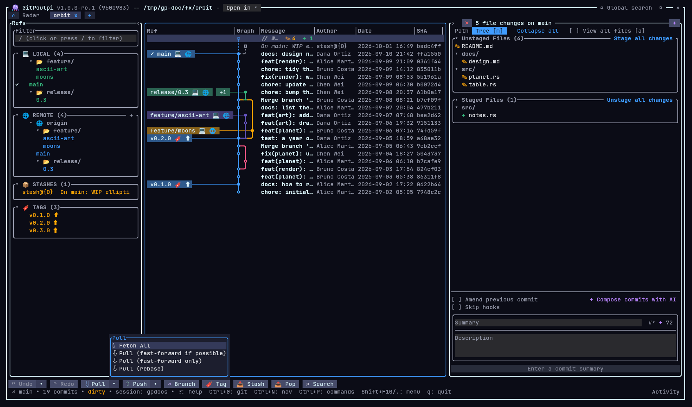
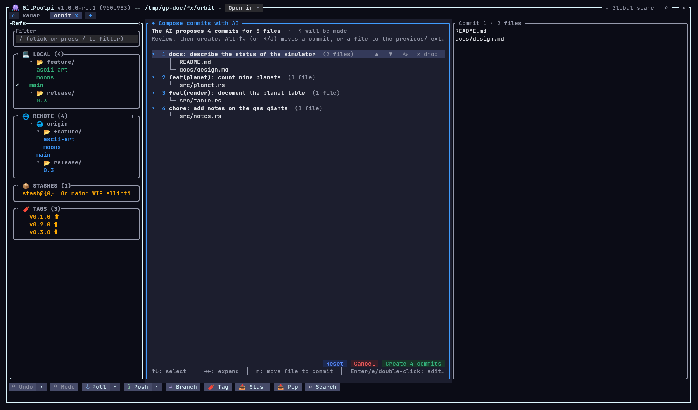

[English](../interface-tour.md) · [Čeština](../cs/interface-tour.md) · [Deutsch](../de/interface-tour.md) · [Español](../es/interface-tour.md) · [Français](../fr/interface-tour.md) · **Italiano** · [日本語](../ja/interface-tour.md) · [한국어](../ko/interface-tour.md) · [Nederlands](../nl/interface-tour.md) · [Polski](../pl/interface-tour.md) · [Português (Brasil)](../pt-BR/interface-tour.md) · [Português (Portugal)](../pt-PT/interface-tour.md) · [Русский](../ru/interface-tour.md) · [Svenska](../sv/interface-tour.md) · [Türkçe](../tr/interface-tour.md) · [Українська](../uk/interface-tour.md) · [简体中文](../zh-CN/interface-tour.md)

# Tour dell'interfaccia

Questa pagina dà un nome a ogni area della finestra di GitPoulpi, dall'alto verso
il basso. Le altre pagine usano gli stessi nomi. Le immagini usano un piccolo
repository dimostrativo con autori inventati.

## La cornice

### Barra del titolo

Il bordo superiore della finestra riporta
`🐙 GitPoulpi vX.Y.Z -- <percorso del repository>` (il nome della sessione è nella barra di stato, in basso per impostazione predefinita).

- **🐙** apre la finestra **Informazioni**: versione, funzionalità della build,
  licenza, link, una breve nota che dice che GitPoulpi è un progetto indipendente,
  i crate di terze parti e le licenze e i crediti. In un terminale che disegna
  immagini il polpo è il logo in pixel, nel colore del tuo logo (altrove resta
  l'emoji). Palette: `Aiuto: Informazioni su GitPoulpi`; tasti: `Ctrl+N` poi `A`. In
  Informazioni le pupille del polpo seguono il puntatore del mouse. Clicca il
  logo (o premi `Space`) per farlo girare sul colore successivo. Clic destro sul
  logo (o premi `c`) per l'elenco dei colori. GitPoulpi salva la tua scelta in
  `ui.logo_color`. I link si aprono con un clic o con il loro tasto di accesso
  (`s` codice sorgente, `d` documentazione, `i` licenza), e `l` elenca i crate di
  terze parti con versioni e licenze (un elenco scorrevole; `Esc` o `l` torna
  indietro, come un clic sul suo titolo).
  Ogni crate dell'elenco ha un link alla sua pagina (il suo repository o, in mancanza, la sua pagina su crates.io): fai clic sulla riga, oppure sceglila con `Up` / `Down` e premi `Enter`, per aprirla nel browser. `t` (o il comando della palette `Aiuto: Licenze e crediti`) mostra le note di licenza e i crediti di tutto ciò che è incluso nel programma, in un testo scorrevole (`Up` / `Down`, `PgUp` / `PgDn`, `Home` / `End`; `Esc` o `t` per tornare). Da uno script, `gitpoulpi licenses` stampa lo stesso testo.
- La **versione** (`v1.0.0`, oppure `vX.Y.Z disponibile` quando esiste una versione più recente)
  sta tra il nome e il percorso: un clic apre il pannello degli aggiornamenti quando
  esiste una versione più recente, altrimenti la scheda Note di rilascio. Vedi
  [Aggiornamenti](updates.md).
- **Apri in ▾**, subito dopo il percorso, apre la cartella della scheda in un
  terminale, un editor, un multiplexer o il gestore file (`Alt+O`). Vedi
  [Apri in](open-in.md).
- **⌕ Ricerca globale** (una lente e la sua etichetta), subito a sinistra dell'ingranaggio, apre la [ricerca globale](search.md) (`Ctrl+Alt+F`). È il primo elemento a cedere il posto quando la barra del titolo è troppo stretta: prima sparisce l'etichetta (la lente resta), poi il pulsante.
- L'**ingranaggio** (`⚙`), subito a sinistra della **×**, apre le **Impostazioni** (`Ctrl+,`).
- **×** all'estremità destra esce, come `q`.

### Barra di stato

Per impostazione predefinita la barra di stato è l'ultima riga della finestra (**Impostazioni > Aspetto > Posizione della barra di stato** la porta in alto, sopra le schede dei repository).
Mostra il branch corrente, il numero di commit caricati,
`modificato` o `pulito`, il nome della sessione e i tasti più utili: `?` aiuto,
`Ctrl+G` azioni git, `Ctrl+N` navigazione, `Ctrl+P` comandi, `Shift+F10` menu,
`q` esci. Su una finestra stretta i tasti meno utili vengono omessi. La barra
di stato mostra anche messaggi di stato e avanzamento. I tasti che mostra sono
sempre quelli in vigore, compresi quelli che hai cambiato (vedi
[Impostazioni](settings.md#tastiera-e-mouse)).

Il conteggio dei commit appare come `500 / 48213 commit` finché c'è ancora storia più vecchia da caricare (`500 / … commit` mentre il totale viene contato) e solo come `2500 commit` quando è tutto caricato. In un checkout parziale (sparse), un badge `parziale` segue il nome della sessione. Il modo di contare il totale è un'impostazione: **Conta il totale dei commit con** (vedi [Impostazioni](settings.md#log-e-grafo)).

All'estremità destra, il pulsante **Attività** apre il Registro attività: una
scheda Operazioni git (le operazioni con la loro durata, messaggi ed errori), una
scheda Applicazione (il registro dell'applicazione, con una casella del livello e
un pulsante **Svuota il registro**, `x`, che svuota i file del registro dopo una
conferma) e una casella Ambito che le restringe entrambe a questo repository, a
un'area di lavoro o a tutti i repository. Un numero sul pulsante conta gli errori
che non hai ancora guardato. A sinistra del pulsante, l'indicatore dei lavori mostra
un lavoro in background con una `[x]` per annullarlo. La scheda **Home** ha la stessa
barra di stato, con il pulsante **Attività** in basso a destra (si apre su Tutti i
repository). Quando un'operazione fallisce, la barra di stato ne dice il motivo in rosso, ovunque
tu sia; un clic su di essa (o sulla palette `Registro attività: Apri l'ultimo errore`)
apre la voce di Attività, con i dettagli, una Copia per un'IA e il passo successivo
suggerito. Entrambi sono descritti in
[Quando qualcosa non funziona](troubleshooting.md#quando-qualcosa-non-funziona).

### Sovrapposizioni

La palette dei comandi, l'aiuto, i menu contestuali, i dialoghi, i popup e le
Impostazioni si aprono sopra la finestra. Ognuno ha una `✕` in alto a destra del bordo;
`Esc` o un clic sulla `✕` lo chiude, e un clic all'esterno chiude un dialogo, un popup o
un pannello (vedi [Chiudere finestre e dialoghi](mouse-and-gestures.md#chiudere-finestre-e-dialoghi)).

## Barra delle schede

La scheda **Home** (l'icona della casa) è all'estremità sinistra, seguita dal
[chip dell'area di lavoro](workspaces.md) (quando hai un'area di lavoro), dalla scheda
**Radar** fissata (si chiude come ogni scheda; vedi [il Radar](radar.md)) e dalla scheda
**Aree di lavoro** quando l'hai aperta (`Alt+J`; si chiude come ogni scheda). Poi viene
una scheda per ogni repository aperto. La `x` che chiude una scheda compare solo sulla
scheda attiva e su quella sotto il puntatore. La barra delle schede contiene solo schede
(il pulsante della [ricerca globale](search.md) è nella barra del titolo).

**Impostazioni > Aspetto > Posizione della barra delle schede** sposta questa riga in fondo alla finestra (sotto la barra di stato) o ne fa una colonna al bordo sinistro: una scheda per riga, prima Home, poi il chip dell'area di lavoro, il Radar, la scheda Aree di lavoro, le schede (un nome lungo finisce con `…`) e il `+`. Quando le schede superano le righe, una riga `…` mostra quante sono nascoste sopra (`▲`) e sotto (`▼`) e apre l'elenco delle schede; la rotella scorre la colonna. Accanto a una barra degli strumenti in colonna, le schede restano all'esterno. Una finestra sotto le 80 colonne tiene le schede in alto. Clic, croce di chiusura, clic centrale, menu del clic destro, trascinamento per riordinare e tastiera funzionano allo stesso modo in ogni posizione.

- Il **+** subito dopo l'ultima scheda apre un piccolo menu: **Nuova scheda** (`Alt+T`,
  palette **Scheda: Nuova scheda**) e, finché le loro schede sono chiuse, **Radar** e
  **Aree di lavoro** (`Alt+J`), che aprono quelle schede; la voce di palette
  **Scheda: Nuova...** apre lo stesso menu. Una **Nuova scheda** è la vista Home con il campo di
  ricerca pronto, così digitare filtra subito i tuoi repository. Sceglierne uno (o
  Sfoglia, Clona, Init) fa comparire la sua scheda in fondo alla barra; un
  repository già aperto viene semplicemente attivato. `Esc` sulla ricerca vuota,
  `Ctrl+W`, la sua `x` o un clic con il tasto centrale chiudono la Nuova scheda e
  tornano alla scheda in cui eri. Non viene mai salvata con la tua sessione.

  
- Clic destro su una scheda, o `Ctrl+T`, per il menu della scheda: **Nuova
  scheda**, **Chiudi la
  scheda**, **Chiudi le altre schede...**, **Chiudi le schede a destra...**, **Aggiungi
  ai preferiti** (o **Rimuovi dai preferiti**), **Aggiungi all'area di lavoro** (o
  **Rimuovi dall'area di lavoro**, quando hai delle aree di lavoro), **Copia il percorso**,
  **Apri in ›**, **Chiave SSH...** e **Checkout parziale...**.
- `Ctrl+PageUp` e `Ctrl+PageDown` cambiano scheda. `Ctrl+W` chiude la scheda
  corrente. Anche un clic con il tasto centrale su una scheda la chiude (con la
  stessa domanda).
- `t` (o `Ctrl+N t`) apre il selettore di schede, un elenco ricercabile delle
  schede aperte.
- **Riordinare le schede:** premi una scheda di repository e trascinala di lato (un'ombra della
  scheda segue il puntatore e una barra mostra dove cadrà; `Esc` annulla), oppure trascina una
  riga del selettore di schede, premi `Alt+Su` / `Alt+Giù` sulla riga evidenziata del selettore, o
  esegui **Scheda: Sposta a sinistra** / **Scheda: Sposta a destra** dalla palette. L'ordine
  viene salvato con la sessione. Un semplice clic senza movimento seleziona comunque la scheda. La
  casa, il chip dell'area di lavoro e il `+` non si spostano mai.
- **Esci e cd qui** compare a destra delle schede quando hai avviato GitPoulpi
  tramite il wrapper di shell `gp` e la scheda non è la cartella da cui sei
  partito. Vedi [Seguire la cartella della scheda](following-the-tab-folder.md).
- Il **chip dell'area di lavoro** subito dopo la casa (un punto colorato e un nome,
  o «Nessuna area di lavoro») cambia [area di lavoro](workspaces.md): cliccalo o
  premi `Alt+W`. Compare quando hai un'area di lavoro.

Con **Ricorda le schede** attivo (il predefinito), le tue schede tornano al
prossimo avvio. Un worktree si apre in una scheda propria, subito dopo quella del suo
repository (**Raggruppa le schede dei worktree** in Impostazioni > Generali, attivo per
impostazione predefinita). Quella scheda si chiude quando il worktree viene rimosso.

### Home

La scheda Home è il gestore dei repository. Ha quattro sezioni: **REPOSITORY
APERTI**, **PREFERITI**, **REPOSITORY RECENTI** e **TUTTI I REPOSITORY**. Ogni riga
mostra il branch, i conteggi di ahead e behind e il numero di modifiche. Ogni riga
ha una stella (preferito), **Apri** o **Vai a**, **Chiudi** o **Rimuovi**, e un
menu `⋮`.

In alto: **Sfoglia**, **Clona**, **Init**, una casella di ricerca, **Comprimi
tutto** ed **Espandi tutto**. Una cartella che non esiste più esce da *Recenti* e
da *Tutti* da sola. Un preferito mancante resta, con un pulsante **Rimuovi**.
**Rimuovi** non elimina mai nulla su disco.

Tasti: `Enter` apre, `f` preferito, `x` chiude o rimuove, `.` menu, `/` cerca,
`Space` comprime una sezione, `Esc` torna alla tua scheda.
`Ctrl+N` mostra un badge sul campo di ricerca, su ogni sezione e su ogni pulsante: premi il carattere di un badge per portare il focus su
quel controllo o per premerlo (vedi [Badge](keybindings.md#badge)).

Un'unica casella di ricerca filtra tutto ciò che sta sotto, Preferiti compresi: un repository resta se il suo nome, il suo branch o il suo percorso contiene il testo. Le aree di lavoro hanno una scheda propria e non sono una pagina della scheda Home: aprila dal menu del `+`, con `Alt+J` o dalla palette, e chiudila con la sua `x`: vedi [Aree di lavoro](workspaces.md).

**Clona** elenca, per ogni profilo collegato (GitHub, GitLab, Gitea, Forgejo, Azure DevOps, Bitbucket, Gerrit), i repository a cui
hai accesso, una sezione per proprietario: prima i tuoi, poi una per
organizzazione o gruppo (in ordine alfabetico), ciascuna sotto un'intestazione.
Un lucchetto segna un repository privato. La casella di ricerca filtra tutte le
sezioni; una sezione senza risultati scompare. `Su` e `Giù` saltano le
intestazioni, e `Home`, `End`, `PgUp` e `PgDn` funzionano nell'elenco.

## Barra degli strumenti

Per impostazione predefinita, una riga sotto i pannelli e sopra la barra di stato. **Impostazioni > Aspetto > Posizione della barra degli strumenti** la porta in alto (sotto le schede), in basso, o in una colonna a sinistra o a destra dei pannelli (una finestra sotto le 80 colonne disegna la colonna come una riga in basso). I pulsanti stanno all'inizio della riga o della colonna; **Impostazioni > Aspetto > Allineamento dei pulsanti della barra degli strumenti** li centra o li porta in fondo. Ogni pulsante ha un proprio colore dell'icona, impostato dal tema (vedi [Temi](themes.md)). Quando non c'è posto per tutti, i pulsanti meno importanti passano dietro un `⋯`. In una colonna ogni pulsante occupa una riga, con il suo `▾` a fine riga, e il suo menu si apre accanto alla colonna; il menu di una barra in basso si apre verso l'alto.

| Pulsante | Cosa fa |
|---|---|
| **Annulla**, **Ripeti** | Annullano o ripristinano l'ultima operazione (`Ctrl+Z`, `Ctrl+Y`). Nascosti quando Annulla è disattivato. Vedi [Annulla e ripeti](undo-redo.md). |
| **Pull** `▾` | Fa il pull come stabilito da **Impostazioni > Git e codifica > Pulsante Pull**. L'elenco `▾` ha **Fetch All**, **Pull (fast-forward se possibile)**, **Pull (solo fast-forward)** e **Pull (rebase)**. Una voce dell'elenco agisce una volta sola e non cambia il pulsante. |
| **Push** `▾` | Fa il push del branch attivo. L'elenco `▾` fa il push una volta sola verso il remoto che scegli. |
| **Branch** | Crea un branch sul commit attivo. |
| **Tag** | Crea un tag sul commit attivo. |
| **Stash**, **Pop** | Mette in stash tutte le modifiche. Estrae l'ultimo stash. |
| **LFS** `▾` | Azioni di Git LFS: fetch, checkout, pull, push, prune (`Ctrl+G l`). Nascosto quando Git LFS è disattivato. Vedi [Git LFS](lfs.md). |
| **Flow** `▾` | Il menu del workflow di branching (avvia, concludi, sincronizza, promuovi; `Ctrl+G Shift+W`). Solo in un repository che ha un workflow. Vedi [Workflow di branching](branching-workflows.md). |
| **Cerca** | Apre la barra di ricerca dei commit sopra il Log (`f`). |

All'estremità (la destra di una riga, il fondo di una colonna), quando il repository è collegato a un host, un **chip** mostra la pull request del branch attivo (per esempio `GH #12` o `GL !53`), oppure un tenue `+ PR`. **Impostazioni > Aspetto > Fissa il pulsante pull request in fondo** (attivo per impostazione predefinita) lo tiene lì; disattivo, scorre con gli altri pulsanti e ne segue l'allineamento. Vedi [Hosting e issue tracker](hosting-integration.md). In una colonna, la combobox dei profili occupa l'ultima riga.

All'estremità destra, quando hai due o più [profili](settings.md#profili), la
**combobox dei profili** sceglie l'identità di commit per questo repository. La
prima riga, *Predefinito*, segue **Impostazioni > Profili**. Dopo aver scelto un
profilo, GitPoulpi chiede se scrivere anche il suo nome e la sua e-mail nella
config git del repository (`user.name`, `user.email`). **Scrivi nella config di
git** li scrive. `Esc` mantiene la scelta solo in GitPoulpi. Palette:
`Repository: Cambia profilo...`.

Ogni pulsante ha un comando della palette e una scorciatoia.

## Banner

Una striscia sopra il Log ti avvisa quando il repository è in uno stato speciale.
Ha pulsanti per proseguire. Ogni pulsante è anche un comando della palette.

| Banner | Pulsanti |
|---|---|
| Un merge, cherry-pick o revert si è fermato sui conflitti | **Risolvi i conflitti...**, **Commit** o **Continua**, **Interrompi** |
| Un rebase in corso | **Risolvi i conflitti...**, **Continua**, **Salta**, **Interrompi** |
| **Applicazione delle patch (git am)** | **Risolvi i conflitti...**, **Continua**, **Salta**, **Interrompi** |
| Un `index.lock` rimasto blocca ogni modifica | **Rimuovi index.lock** (chiede prima) |
| Un auto-stash non è stato ripristinato | **Pop ora**, **Mostra lo stash**, **Ricomincia**, **Drop** (le scelte dipendono dallo stato) |

Vedi [Risolvere i conflitti di merge](merge-conflicts.md) e
[Risoluzione dei problemi](troubleshooting.md).

## Barra laterale Refs (a sinistra)

Un albero di tutto ciò che dà un nome a un commit. Ogni sezione ha un conteggio nel
titolo, un chevron per comprimerla e una propria posizione di scorrimento.
Trascina il bordo tra due sezioni per ridimensionarle.

- La casella **Filtro** in alto (`/`): filtra per nome ogni sezione.
- **LOCALI**: i tuoi branch, in cartelle divise su `/` (`feature/`, `fix/`). Un
  segno di spunta indica il branch attivo. Puoi disattivare le cartelle nelle
  Impostazioni.
- **REMOTI**: ogni remoto, con i suoi branch sotto.
- **WORKTREES**: i worktree collegati, quando ce ne sono. Doppio clic su uno per
  aprirlo in una scheda propria.
- **STASH**: i tuoi stash. Clic destro su uno per **Pop**, **Applica** ed
  **Elimina**.
- **TAG**: i tuoi tag, in cartelle divise sul carattere `/` come i branch (`releases/`, `backups/`). Una freccia indica che il tag è anche sul remoto.
- **PULL REQUEST** e **ISSUE**: dopo aver collegato un account di hosting e il
  repository.
- **SOTTOMODULI**: i sottomoduli e il loro stato, quando ce ne sono. Vedi
  [Sottomoduli](submodules.md).

**Mostrare o nascondere una sezione:** clic destro sull'intestazione di una sezione, o sulla parte vuota del pannello, per un elenco di spunte delle sezioni (l'ultima visibile resta). La scelta viene conservata per repository, tra i riavvii; vedi [Sezioni del pannello sinistro](mouse-and-gestures.md#sezioni-del-pannello-sinistro).

Passa il mouse su una riga per mostrarne i pulsanti: nascondere o mostrare il ref
nel Log, e **Solo** (mostra solo i commit di quel ref). Doppio clic su un branch
locale o su un tag per fare il checkout. Clic destro su una riga per il suo menu.
Il `‹` nel titolo della barra laterale la comprime (`Ctrl+N h`).

I due pannelli laterali (la barra laterale Refs, `Ctrl+N h`, e il pannello
destro, `Ctrl+N l`) appartengono al Log: mostrarne o comprimerne uno mentre sono
aperti un diff, una vista file o l'editor vale solo per quella vista. Un diff o
una vista file comprime inoltre da solo la barra laterale Refs, per lasciare
spazio al contenuto. Tornando nel Log trovi entrambi i pannelli come li avevi
lasciati lì, ed è quello lo stato salvato per l'avvio successivo.

## Il Log (al centro)

Una riga per commit, dal più recente. Clic destro sull'intestazione per mostrare o
nascondere le colonne. Trascina il bordo tra due intestazioni per ridimensionare
una colonna. Trascina un'intestazione per spostare la colonna.

Il pannello non ha titolo: lo dicono le intestazioni delle colonne. I tag sono disegnati dove sono, mai come fantasma. Su un commit senza ref, la riga evidenziata mostra una pillola sbiadita con il nome del branch a cui appartiene; se quel branch è stato eliminato, una pillola barrata mostra il nome letto dal commit di unione che lo ha unito (si disattiva con **Mostra un branch fantasma sul commit evidenziato** in Impostazioni > Log e grafo).

| Colonna | Mostra |
|---|---|
| **Ref** | Pillole colorate per i branch e i tag del commit: un'icona di laptop per i locali, un globo per i remoti, un'icona di tag per i tag, `+N` quando altri ref puntano lì. |
| **Grafo** | Le corsie dei branch, i merge e i punti di diramazione. Disegnato come immagini in kitty, Ghostty, WezTerm e iTerm2 (e anche Windows Terminal e foot, tramite sixel), e come caratteri negli altri terminali. I colori delle corsie vengono dal tema o da una tavolozza che scegli (vedi [Temi](themes.md)). Alla sua larghezza minima (un solo punto di commit) la colonna diventa compatta: ogni commit su un'unica corsia, senza linee di branch o di merge. |
| **Messaggio** | Il riepilogo del commit. |
| **Autore** | L'autore, con un avatar facoltativo. |
| **Data** | La data dell'autore, nel formato che scegli. |
| **Modif.** | Facoltativa: file modificati e righe `+aggiunte -rimosse`. |
| **SHA** | L'hash breve. |

Righe speciali:

- **La riga delle modifiche in corso** (riga WIP) in cima: un cerchio tratteggiato,
  `// WIP` o il tuo messaggio in bozza, e i conteggi dei file modificati e
  aggiunti. Cliccala per fare stage e commit nel pannello destro.
- **Righe di stash**: un piccolo quadrato su una corsia, accanto al commit su cui
  è stato creato lo stash.
- Durante una ricerca, le righe che non corrispondono sono attenuate.

Passa il mouse su una cella per un tooltip con il testo completo. Clic destro su una
riga per il [menu del commit](log-and-history.md#il-menu-del-commit).

## Il pannello destro

Il pannello destro segue la selezione nel Log.

**Modifiche in corso** (la riga WIP è selezionata):

- Un titolo come `4 file modificati su main`. Durante un merge in conflitto
  aggiunge il numero di file in conflitto. Un `[✖]` rosso a sinistra scarta tutte
  le modifiche (chiede prima). Quando l'IA è attiva, un `[✦]` a destra spiega le
  modifiche.
- **Percorso** o **Albero** (un elenco piatto o cartelle, `m`), **Comprimi tutto** e
  **Vedi tutti i file** (`a`).
- **File non in stage** e **File in stage**, ognuno con un conteggio e un pulsante
  **Stage di tutto** o **Unstage di tutto**. Passa il mouse su una riga per il suo
  pulsante **Stage del file** o **Unstage del file**.
- Il **modulo di commit** in basso: **Modifica il commit precedente**, **Componi
  commit con l'IA** (quando l'IA è attiva), il **Riepilogo** con un contatore di
  caratteri e il pulsante `✦`, la **Descrizione** e il pulsante **Commit delle
  modifiche**.

**Dettagli del commit** (è selezionato un commit), dall'alto in basso: l'hash
completo, l'autore con avatar e data, l'hash del genitore e i conteggi delle
modifiche, poi il messaggio (riepilogo e descrizione; trascina il suo bordo inferiore
per ridimensionarlo). Il riquadro **File modificati** sotto inizia con i propri
controlli: l'interruttore dell'ordinamento, **Percorso** / **Albero**, **Vedi tutti i
file** e una casella **Filtra i file**, fissi sopra l'elenco, che è l'unica parte che
scorre. Clicca un file per aprirne il diff. In una finestra bassa cede prima il
messaggio (fino a una riga), poi l'elenco. La vista delle modifiche in corso tiene la
sua riga **Percorso** / **Albero** / **Vedi tutti i file** in cima agli elenchi dei
file, sopra gli elenchi File non in stage e File in stage.

Ogni lista di file ha menu su file, cartelle e parte vuota, e si possono selezionare più file insieme (**Ctrl+clic**, **Shift+clic**); vedi [Stage e commit](staging-and-committing.md).

## Il pannello centrale quando un file è aperto

Clicca un file modificato e la sua vista sostituisce il Log. `Esc` riporta il Log.
In alto corre una barra di pulsanti:

| Pulsante | Cosa fa |
|---|---|
| **Vista file**, **Vista diff**, **Blame** | Scelgono cosa mostra il pannello per il file. |
| **File │ Tutti** | Sceglie l'elenco della [colonna dei commit](#la-colonna-dei-commit) accanto alla vista e mostra la colonna. |
| **Modifica** | Apre l'editor integrato sul file nella directory di lavoro. |
| `↑` `↓` | Hunk precedente o successivo. |
| **Inline**, **Affiancato** | Una colonna, oppure affiancate. |
| **Hunk** | Solo gli hunk modificati, oppure l'intero file. |
| **WS** | Mostra o nasconde le modifiche di soli spazi. |
| **A capo** | Manda a capo le righe lunghe. |
| **Mappa** | Una minimappa dell'intero file accanto alla barra di scorrimento. |
| **Codifica** | La codifica con cui viene letto il file (prima **Auto**). |

In un diff della directory di lavoro, ogni hunk ha i pulsanti **Stage dell'hunk** e
**Scarta l'hunk**. Premi `v` per selezionare righe, poi fai stage o scarta solo
quelle righe.

Le due viste sono descritte in [Blame](log-and-history.md#blame) e [Cronologia del file](log-and-history.md#cronologia-del-file).

L'**editor** integrato ha i colori della sintassi, i numeri di riga, annulla, cerca e
una barra di stato con riga, colonna, fine riga, rientro e linguaggio.

Un file immagine viene mostrato come immagine: prima e dopo nel diff, oppure il
file stesso nella Vista file. Vedi [Immagini](image-view.md).

Un file binario che non è un'immagine (un PDF, un documento, un archivio) mostra un pulsante **Apri in** quando il sistema conosce applicazioni per il suo tipo: vedi [Apri in](open-in.md).

## La colonna dei commit

Una colonna può comparire a sinistra del file di un commit, aperto come diff, nella vista file o in Blame (mai accanto all'editor integrato, che modifica la copia di lavoro: la colonna sparisce quando l'editor si apre e torna quando si chiude sul diff). Ha tre stati:

- **File**: i commit di quel solo file, due righe ciascuno (la [Cronologia del file](log-and-history.md#cronologia-del-file)). A destra la vista mostra la versione del file nel commit selezionato.
- **Tutti**: un elenco compatto dei commit del Log con il suo grafo, descritto qui sotto.
- **Nascosta**: una sottile striscia `›` a sinistra della vista riporta la colonna (il suo suggerimento indica il tasto).

La barra dei pulsanti della vista occupa sempre tutta la larghezza sopra la colonna, così nessun pulsante si sposta quando la colonna si apre, si chiude o cambia elenco. Sulla barra, il selettore **`File │ Tutti`** (due segmenti di un solo controllo, sempre della stessa larghezza) sceglie l'elenco: un clic su un segmento mostra quell'elenco e apre la colonna se era nascosta; un clic sul segmento già scelto, mentre la colonna è visibile, la nasconde. Il segmento dell'elenco a schermo è acceso; mentre la colonna è nascosta, è sottolineato quello con cui tornerà e l'elenco viene mantenuto. Il suo suggerimento indica il clic, il secondo clic sul segmento scelto e `Alt+C`. La Cronologia del file si apre anche dai posti di sempre (menu del file, `Cronologia: ...` nella palette).

- **Mostrare o nascondere**: `Alt+C` (palette `Vista: Mostra o nascondi la colonna dei commit`), un clic sul segmento scelto del selettore, la ✕ sulla colonna o la striscia `›`. Nella palette, `Vista: Colonna dei commit: nascondi`, `... : cronologia del file` e `... : tutti i commit` scelgono uno stato. La scelta, con l'elenco che aveva, viene ricordata con le altre impostazioni della colonna. Senza scelta, per l'elenco Tutti decide la larghezza del terminale: compare da 140 colonne. La colonna non viene disegnata quando la vista accanto resterebbe sotto le 30 colonne, né il grafo Tutti per un diff della directory di lavoro o un confronto (la cronologia del file sì: non ha bisogno di un commit).
- **Larghezza**: trascina il bordo destro (il bordo acceso segue il puntatore), oppure usa `Vista: Allarga la colonna dei commit` e `Vista: Restringi la colonna dei commit`. Può occupare fino al 70% della colonna centrale (il resto resta alla vista, che non scende mai sotto le 30 colonne). Viene ricordata con le altre dimensioni.
- **Scegliere un commit**: clicca su di esso, oppure dai la tastiera alla colonna (`Ctrl+N` e il suo badge, o `Vista: Porta il focus sulla colonna dei commit`) e usa `Su` / `Giù`, `PagSu` / `PagGiù`, `Home` / `Fine`. `Invio` o `Destra` passa all'elenco dei file del commit, `Esc` restituisce la tastiera alla vista. Il pannello destro segue la scelta: dettagli del commit e file modificati, per aprire un altro dei suoi file.
- **Cosa fa la vista**: il file aperto resta aperto. Se il commit scelto lo ha modificato, la vista mostra il suo diff in quel commit. Altrimenti mostra il file com'era allora, con "invariato in questo commit" nel titolo. Se il commit non ha quel file, la vista lo dice e resta utilizzabile. Un Blame resta un Blame, allo stato del commit scelto.

L'elenco Tutti sta sotto un'intestazione (i nomi delle colonne del Log). Un commit per riga: le corsie del grafo, il titolo (il messaggio), il nome dell'autore e una data breve e, se lo attivi, le etichette di branch e tag. È l'elenco stesso del Log, con gli stessi commit nello stesso ordine, e carica i più vecchi mentre scorri. Le corsie sono disegnate come nella colonna Grafo del Log: su un terminale che mostra immagini (vedi [Scegliere un terminale](terminals.md)) come corsie collegate con marcatori rotondi e, con l'impostazione degli avatar su Grafo, le immagini degli autori dentro i cerchi; altrove come caratteri. Per impostazione predefinita le corsie prendono lo spazio che serve e il titolo conserva sempre qualche parola: in una colonna stretta cedono prima l'autore e poi la data, prima che le corsie vengano tagliate. Ridimensionata fino alla larghezza minima, un solo punto di commit, la parte Grafo diventa compatta, come nel Log: ogni commit su un'unica corsia, senza linee di branch o di merge. Una parte tagliata dal pannello (la riga fatta scorrere di lato, o una parte Grafo più larga dello spazio disponibile) conserva le sue immagini e gli avatar, ritagliati al bordo. La rotella scorre l'elenco sotto il puntatore.

- **Passaggio del mouse e menu**: sostando su una riga compare il suggerimento del Log per la parte sotto il puntatore (il messaggio intero sul titolo, nome ed e-mail dell'autore, la data completa). Un clic destro su una riga (o il tasto menu, `Shift+F10`, quando la colonna ha la tastiera; `Vista: Colonna dei commit: menu della riga selezionata` nella palette) apre il suo menu: *Mostra nel Log*, il diff del file in quel commit, il file com'era in quel commit, il blame del file in quel commit, poi il menu stesso del Log per quel commit (copia, cherry-pick, branch e, sotto una linea, le voci che riscrivono, come il revert). Anche ciascuna delle prime quattro voci ha un comando nella palette (`Vista: Colonna dei commit: mostra ...`). Nell'elenco File, le righe hanno il menu proprio della Cronologia del file e gli stessi suggerimenti.
- **Dimensionare le parti e scorrere in orizzontale**: trascina un bordo dell'intestazione per dimensionare la parte alla sua sinistra: le corsie, il messaggio, l'autore, la data, i ref, le modifiche o lo SHA. Anche l'ultima parte ha un bordo: la cella subito dopo di essa (il bordo stesso della colonna quando la riga riempie lo spazio), accesa allo stesso modo, che dimensiona quell'ultima parte. Come nel Log (`ui.column_resize`), il bordo è per impostazione predefinita la cella di separazione tra due parti, dove termina la tinta di riga del Grafo (la tinta la attraversa, quindi nessuna cella semplice sta tra essa e la parte successiva): nell'intestazione vi sta un segno e una linea sottile viene disegnata lungo la colonna mentre il puntatore ci passa sopra o la trascina, e un trascinamento da qualsiasi punto della linea ridimensiona; con `header` è la prima lettera del nome successivo, che si accende quando il puntatore ci passa sopra (non viene disegnata alcuna linea, l'intestazione è l'unico punto da cui trascinare). Finché non dimensioni nulla, il messaggio prende ciò che gli altri lasciano; il primo trascinamento fissa ogni parte alla larghezza che ha, messaggio compreso, quindi dimensionare una parte sposta le parti che la seguono e non cambia nessun'altra larghezza. Una parte che hai dimensionato viene mantenuta e non cede mai spazio: quando la riga diventa più larga della colonna, scorre in orizzontale con Shift+rotellina, una rotellina orizzontale o `Shift+Left` / `Shift+Right` quando la colonna ha la tastiera, e una barra di scorrimento sul bordo inferiore mostra dove sei. Da tastiera: `Tab` sceglie la parte (tra quelle mostrate), `]` la allarga, `[` la restringe, `0` riporta tutte le parti all'automatico (la palette ha `Vista: Colonna dei commit: dimensiona la parte successiva`, `... allarga la parte`, `... restringi la parte`, `... reimposta le larghezze delle parti`, `... scorri a sinistra` e `... scorri a destra`). Le larghezze vengono ricordate. Mentre le corsie sono tagliate da uno scorrimento, vengono disegnate come caratteri anche su un terminale che mostra immagini.
- **Scegliere le parti**: un clic destro sull'intestazione apre un menu con una casella per parte, cioè per ogni colonna che offre il Log: Ref, Grafo, Messaggio, Autore, Data, Modif. e SHA. Il messaggio è sempre visibile. **Ref**, **Modif.** e **SHA** sono disattivati per impostazione predefinita; se mostrate, Ref porta le etichette di branch e tag del commit, Modif. i suoi file e le righe `+aggiunte -rimosse` e SHA il suo hash breve, tutto come fanno le colonne del Log. Come Ref, Modif. e SHA non cedono mai spazio: la riga scorre di lato. Da tastiera, `Vista: Colonna dei commit: scegli le colonne` apre lo stesso menu (le frecce e `Invio` scelgono una voce) e `Vista: Colonna dei commit: mostra o nascondi Ref`, `... mostra o nascondi Grafo`, `... mostra o nascondi Autore`, `... mostra o nascondi Data`, `... mostra o nascondi Modif.` e `... mostra o nascondi SHA` attivano o disattivano subito una parte. Le parti mostrate, il loro ordine e le loro larghezze appartengono alla sola colonna: vengono salvate in `config.toml` (`ui.commit_column_columns_visible`, `ui.commit_column_columns_order`, `ui.commit_column_columns_widths`), a parte dalle colonne del Log, che non cambiano mai con esse, né viceversa.
- **Spostare le parti**: trascina un nome dell'intestazione su un altro per spostare lì quella parte, come nel Log (la riga segue il puntatore; con `ui.column_resize = "header"` la prima lettera di un nome è il bordo di ridimensionamento, quindi premi sul resto del nome). Qualsiasi parte può andare ovunque, comprese le corsie e le etichette Ref. Da tastiera, `Tab` sceglie la parte e `<` / `>` la spostano di un posto a sinistra o a destra tra quelle mostrate (la palette ha `Vista: Colonna dei commit: sposta la parte a sinistra` e `... sposta la parte a destra`). L'ordine viene ricordato.

  

I gesti del mouse sono elencati anche in [Mouse e gesti](mouse-and-gestures.md#la-colonna-dei-commit-elenco-tutti).

## Le dimensioni vengono ricordate

GitPoulpi conserva ogni dimensione che trascini, tra un cambio di scheda e l'altro
e dopo i riavvii. Le dimensioni sono le stesse per ogni repository. Vale per i
divisori tra la barra laterale Refs, il Log e il pannello destro, l'altezza di ogni
sezione Refs, il blocco del messaggio di commit, le larghezze delle colonne del Log,
i pannelli dell'editor di merge e il divisore del selettore di cartelle. Le
dimensioni sono salvate come frazioni della finestra, quindi un layout creato su un
terminale largo va bene anche su uno stretto.

Per reimpostare tutte le dimensioni, esegui il comando della palette `Navigazione:
Reimposta il layout`. Alcune dimensioni hanno anche un proprio ripristino:
`Navigazione: Reimposta le dimensioni delle sezioni Refs`, `Dettagli commit:
Reimposta la dimensione del messaggio` e, nell'editor di merge, un doppio clic su un
divisore o `Alt+0`.

## Sovrapposizioni e schermate speciali

- **Palette dei comandi** (`Ctrl+P`): una casella di filtro su tutti i comandi. Ogni
  riga mostra la sua scorciatoia. Un comando che ora non può essere eseguito è
  grigio, e il motivo compare in fondo. I comandi hanno un prefisso di gruppo come
  `Git:`, `Refs:`, `Navigazione:`, `Diff:`, `Modifiche in corso:`, `Commit:`,
  `Vista:`, `Repository:`, `Scheda:`, `LFS:`, `Pull request:`, `Issue:` o `IA:`.
  Scrivi un prefisso per vedere il suo gruppo.
- **Selettori**: alcuni comandi della palette aprono un secondo elenco, per esempio
  `App: Cambia tema...`, `App: Cambia lingua...` e `App: Cambia tema colori del
  grafo...`. La finestra mostra ogni scelta dal vivo mentre ti muovi nell'elenco.
  `Enter` la mantiene. `Esc` rimette la scelta precedente. L'elenco dei temi ha i
  filtri **Tutti**, **Scuri**, **Chiari** e **Colorati**. Vedi [Temi](themes.md).
- **Aiuto** (`?`): schede. **Tasti** elenca ogni tasto e gesto; le altre schede
  (Inizio, Log, Modifiche, Refs, Hosting, Impost., IA e CLI) sono brevi guide alle
  azioni, con il modo di raggiungere ciascuna. Cambia scheda con `Tab` / `Shift+Tab`,
  `Sinistra` / `Destra`, `Alt+1`..`Alt+8` o un clic. Scrivi per filtrare la scheda
  corrente. `Ctrl+D`, o un clic sul link in basso, apre la pagina della
  documentazione della scheda in cui ti trovi.

  

  
- **Barra di ricerca** (`f`): in alto a destra del Log. Mostra `n di N` risultati.
- **Menu contestuali**: clic destro, oppure `.` sulla riga selezionata. Una riga con
  `›` apre un sottomenu.
- **Dialoghi**: conferme, il nome di un branch o di un tag, Clona, Init, Crea
  Pull Request, le scelte dopo un push rifiutato e altri. `Enter` accetta, `Esc`
  annulla.
- **Rebase interattivo** e **compositore di commit** sostituiscono il Log con una
  schermata di revisione. Vedi
  [Lavorare con il Log](log-and-history.md#rebase-interattivo) e
  [Stage e commit](staging-and-committing.md#il-compositore-di-commit-dividere-le-modifiche-in-commit).

  

- **Impostazioni** (`Ctrl+,` o l'ingranaggio): un elenco di pagine a sinistra e le
  opzioni della pagina a destra. Vedi [Impostazioni](settings.md).

  

- **Popup** per risposte lunghe, come il popup **Spiega le modifiche in corso**
  dell'IA (`↑` `↓` scorrono, `c` copia, `Esc` chiude).

  

Tutti gli elenchi nei popup funzionano allo stesso modo. Vedi
[Scorciatoie da tastiera](keybindings.md) e [Mouse e gesti](mouse-and-gestures.md).

## Parole usate in questa documentazione

| Parola | Significato |
|---|---|
| Pannello | Una delle tre colonne: barra laterale Refs, Log (o il file aperto), pannello destro. |
| Pillola | L'etichetta di un branch o di un tag nella colonna Ref. |
| Riga WIP | La riga delle modifiche in corso in cima al Log. |
| Hunk | Un blocco di righe modificate in un diff. |
| Compositore | Il modulo di commit, e la revisione IA che divide le modifiche in commit. |
| Sequenza | Un tasto seguito da un altro, come `Ctrl+G` poi `s`. |
| Prefisso | `Ctrl+G` (azioni git) o `Ctrl+N` (navigazione). |
| Badge | La lettera che `Ctrl+N` mostra accanto a un controllo. Premila per dare il focus a quel controllo. |
