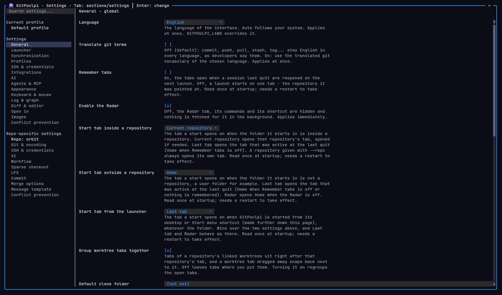
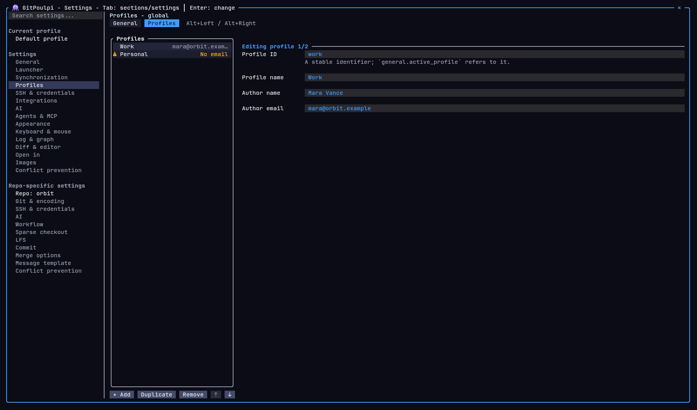

[English](../settings.md) · [Čeština](../cs/settings.md) · [Deutsch](../de/settings.md) · [Español](../es/settings.md) · [Français](../fr/settings.md) · **Italiano** · [日本語](../ja/settings.md) · [한국어](../ko/settings.md) · [Nederlands](../nl/settings.md) · [Polski](../pl/settings.md) · [Português (Brasil)](../pt-BR/settings.md) · [Português (Portugal)](../pt-PT/settings.md) · [Русский](../ru/settings.md) · [Svenska](../sv/settings.md) · [Türkçe](../tr/settings.md) · [Українська](../uk/settings.md) · [简体中文](../zh-CN/settings.md)

# Impostazioni

Apri le Impostazioni con `Ctrl+,`, `Ctrl+N` e poi `,`, l'ingranaggio nella barra
del titolo (a sinistra della `×`), oppure `Ctrl+P` > *Impostazioni*. La schermata
delle Impostazioni sostituisce la finestra finché è aperta. Chiudila con la `✕` in alto
a destra, con `Esc` o con `q`. Chiede conferma solo quando chiudere farebbe perdere
qualcosa (vedi [Chiudere le Impostazioni](#chiudere-le-impostazioni)).

Le modifiche vengono salvate subito in `config.toml`. Il
[riferimento della configurazione](config-reference.md) descrive ogni chiave, il
suo valore predefinito e la sua variabile d'ambiente. Questa pagina descrive la
schermata delle Impostazioni.

## Usare la schermata delle Impostazioni

| Per | Fai |
|---|---|
| Passare tra l'elenco delle pagine e le opzioni | `Tab` / `Shift+Tab`, oppure clicca. |
| Spostarti | `j` / `k` o i tasti freccia. |
| Cambiare un'opzione | `Enter` o `Space`, oppure clicca il suo valore. Vedi sotto. |
| Chiudere | Clicca `✕`, oppure premi `Esc` o `q`. Finché un campo, un menu a tendina o una conferma è aperto, `Esc` chiude solo quello. |

Cosa fanno `Enter` o `Space` dipende dalla riga:

- Una casella di controllo si attiva o disattiva.
- Un menu a tendina si apre. I tasti freccia scelgono, `Enter` accetta.
- Un campo di testo o numerico inizia la modifica. Funzionano i tasti freccia,
  `Home`, `End`, `Backspace` e `Delete`, e un clic posiziona il cursore. `Enter`,
  `Tab`, `Su`, `Giù` o un clic altrove salvano il valore. `Esc` annulla. Un valore
  rifiutato resta nel campo, in rosso, e la barra di stato ne dà il motivo.
- Una riga di pulsanti (**Crea**, **Rimuovi**, **Prova**...) mostra solo i pulsanti che
  valgono in quel momento. `Sinistra` / `Destra` ne scelgono uno, `Enter` lo preme, oppure
  cliccalo. Un pulsante che elimina qualcosa chiede prima conferma.

In ogni pagina i valori iniziano in un'unica colonna: le etichette sono allineate a
sinistra e i campi a destra. Un testo o un numero è una fascia colorata, una scelta è una
fascia che finisce con `▾`, una casella di controllo è `[x]`. Un'etichetta lunga va a capo
invece di essere tagliata e, su una finestra stretta, il valore passa sotto la sua etichetta.

Una riga grigia dice perché è inattiva. Per esempio, **Intensità della tinta di riga**
è grigia finché **Sfondo delle corsie del grafo** è **Disattivato**.

### Elenchi

Le pagine che modificano più voci dello stesso tipo (Profili, IA, Workflow, Apri in,
Immagini) le mostrano come un **elenco a sinistra, con i campi della voce selezionata a
destra**. Su una finestra stretta l'elenco sta sopra i campi. L'elenco ha ovunque la stessa
forma:

- Il simbolo di una riga ne indica lo stato: `●` il profilo attivo, `★` la voce
  predefinita, `⚠` una voce non completa (un profilo senza e-mail), con il motivo al posto
  dei dettagli.
- Sotto l'elenco: **+ Aggiungi**, **Duplica**, **Rimuovi**, `↑` e `↓`. Un pulsante che in
  quel momento non si può usare (`↑` sulla prima riga) è attenuato. **+ Aggiungi ▾** apre
  un menu a tendina dove la pagina offre preimpostazioni o tipi.
- **Rimuovi** chiede prima conferma, tranne per una voce aggiunta un attimo fa e non
  ancora modificata.
- Trascina una riga per spostarla: una barra mostra dove finirà, e `Esc` annulla il
  trascinamento. Un doppio clic passa ai campi della voce.

| Tasto | Fa |
|---|---|
| `Su` / `Giù`, `Home` / `End`, `PageUp` / `PageDown` | Seleziona una voce. |
| `Insert` | Aggiunge una voce (apre il menu a tendina, se c'è). |
| `Ctrl+D` | Duplica la voce. |
| `Delete` | Rimuove la voce, dopo una conferma. |
| `Alt+Su` / `Alt+Giù` | Sposta la voce in su o in giù. |
| `Enter` o `Destra` | Passa ai campi della voce. |
| `Sinistra` | Torna all'elenco delle pagine. |
| `Alt+Left` / `Alt+Right` | Passa dalla scheda Generali alla scheda dell'elenco (ovunque nella pagina). |

Ognuna di queste pagine ha due **sotto-schede** sotto il titolo, così un'impostazione della pagina non viene mai scambiata per una proprietà della voce selezionata: **Generali**, le impostazioni della pagina stessa (il profilo attivo, la voce predefinita, le istruzioni che ogni azione IA riceve, il modello di workflow...), e una scheda col nome delle voci (**Profili**, **Profili (connessioni)**, **Voci**, **Editor**, **Regole**) che contiene l'elenco e i campi della voce selezionata. Una pagina si apre su **Generali**; le impostazioni ricordano la scheda in cui hai lasciato ogni pagina finché non chiudi l'applicazione, e lo stesso vale per la posizione di scorrimento e la riga selezionata di ogni pagina (e scheda). Fai clic su una scheda oppure premi `Alt+Left` / `Alt+Right`. La ricerca, le righe delle impostazioni della palette dei comandi e i link che dicono «impostalo nelle impostazioni» aprono la scheda in cui si trova l'impostazione.
[Tastiera e mouse](#tastiera-e-mouse) ha le stesse due schede (**Generali**, **Scorciatoie da tastiera**).

I tasti si possono riassegnare in **Tastiera e mouse** (contesto *preferences*, vedi
[Scorciatoie da tastiera](keybindings.md)).

### Editor su più righe

Le impostazioni che contengono più righe (per esempio i percorsi del checkout parziale, la descrizione del modello di commit, i branch di base della prevenzione dei conflitti e gli hook del workflow) si aprono in un piccolo editor con `Enter` o con un clic; `Ctrl+S` conserva il testo e `Esc` lo scarta. Il mouse vi funziona come in qualsiasi campo di testo:

- Un clic posiziona il cursore dove hai cliccato.
- Trascinando si seleziona il testo; la rotellina scorre.
- Un doppio clic seleziona la parola sotto il puntatore.
- `Shift` + clic estende la selezione dal cursore al puntatore.

La tastiera offre lo stesso: `Shift` con le frecce seleziona, `Ctrl` con le frecce salta di parola in parola, `Ctrl+A` seleziona tutto, `Ctrl+C` e `Ctrl+X` copiano e tagliano.

### Chiudere le Impostazioni

`✕`, `Esc` e `q` fanno la stessa cosa. Le Impostazioni applicano ogni modifica subito,
quindi di solito si chiudono e basta. Chiedono **Chiudere le Impostazioni?** solo quando
qualcosa andrebbe perso:

- la pagina **Workflow** ha modifiche non salvate;
- il modello del messaggio di commit ha modifiche non salvate;
- un profilo non ha l'e-mail dell'autore (i commit che fa non ti possono essere attribuiti).

La finestra offre **Vai al problema** (apre quella pagina), **Scarta e chiudi** o **Chiudi
comunque**, e **Annulla**. I piccoli editor dentro le Impostazioni (un testo di istruzioni
IA, un hook del workflow, i percorsi del checkout parziale) hanno una propria `✕` e
chiedono **Scartare le modifiche?** solo quando il loro testo è stato modificato.

### Popup sopra le Impostazioni

La riga del titolo mostra il polpo dell'applicazione e il suo nome, come la finestra
principale. Fai clic sul polpo per aprire Informazioni.

Alcuni popup validi per l'intera finestra si aprono sopra le Impostazioni e le
restituiscono com'erano (la pagina, la posizione di scorrimento e le modifiche non
salvate al Workflow o ai modelli restano):

- la palette dei comandi (`Ctrl+P`),
- il selettore del tema (`Ctrl+N y`, **App: Cambia tema...**), che mostra l'anteprima
  di ogni tema sulle Impostazioni stesse; `Esc` rimette il tema precedente,
- i selettori della lingua e dei colori del grafo (`Ctrl+N` poi le stesse lettere
  della finestra principale),
- la ricerca nell'area di lavoro (`Ctrl+Alt+F`),
- Informazioni (`Ctrl+N a`, il polpo, o **Aiuto: Informazioni su GitPoulpi**) e la
  guida in sovrimpressione (`?`).

Chiudi ciascuno con `Esc`, con la sua `✕` o con un clic all'esterno. I comandi che
agiscono su ciò che le Impostazioni coprono (una scheda, un branch, un diff...) sono
elencati nella palette ma in grigio con «chiudi prima le Impostazioni», e le sequenze
`Ctrl+N` per essi mostrano quella riga sul bordo inferiore delle Impostazioni: chiudi
le Impostazioni, poi eseguili.

`Ctrl+N` mostra un badge su ogni controllo della pagina: la casella di ricerca, l'elenco delle pagine (un solo badge, sulla pagina corrente), le sotto-schede, l'elenco e i suoi pulsanti, ogni campo sullo schermo e la croce di chiusura. Premi il carattere di un badge e succede come con un clic su quel controllo: un campo di testo si apre in modifica, una casella si spunta, un menu a tendina si apre, un pulsante viene eseguito. `Esc` annulla. Un campo scorso fuori dalla vista non ha badge. Mentre scrivi in un campo, o è aperto un menu a tendina, un editor o la ricerca, `Ctrl+N` appartiene a quell'elemento. Vedi [Badge](keybindings.md#badge).

### La casella di ricerca

La casella in cima all'elenco delle pagine cerca nel nome e nella descrizione di
ogni opzione di ogni pagina. Cliccala, oppure premi `/` o `Ctrl+F`, e scrivi.
Compare un elenco di risultati. Ogni risultato mostra l'opzione e la sua pagina.
`Su` / `Giù` scelgono, `Enter` va all'opzione, `Esc` chiude l'elenco.

## Impostazioni dalla palette dei comandi

La maggior parte delle impostazioni si cambia senza aprire questa schermata: digita `Impostazioni:` o `Settings:` nella palette dei comandi (`Ctrl+P`). Le righe sono generate dai campi delle pagine, quindi una nuova impostazione compare in entrambi i posti.

- Una casella è **Impostazioni: attiva/disattiva ...**. Cambia subito, e la riga mostra `[x]` o `[ ]`.
- Un elenco a discesa è **Impostazioni: ...**. `Enter` riduce la palette ai suoi valori, con quello attuale segnato `attuale`; `Enter` su un valore lo sceglie.
- Un numero o un testo apre una richiesta con il valore attuale. Un valore che la pagina rifiuterebbe (non è un numero, fuori intervallo) viene rifiutato allo stesso modo e la richiesta resta aperta.
- Un'impostazione che richiede la sua pagina (un elenco, un combo con opzioni scoperte a runtime) apre le Impostazioni su di essa.

Un valore viene salvato in `config.toml` e applicato esattamente come fa la pagina. Le parole inglesi della chiave dell'impostazione (`remember tabs`) trovano la riga in qualsiasi lingua.

## Le pagine

L'elenco delle pagine ha due gruppi:

- **Impostazioni**: le impostazioni globali.
- **Impostazioni specifiche del repository**: impostazioni per il repository della
  scheda attiva. Compaiono solo mentre è aperto un repository.

### Generali

| Opzione | Cosa fa |
|---|---|
| **Lingua** | La lingua dell'interfaccia: **Auto** (la lingua del sistema, altrimenti inglese), English, Français, Español, Português (Brasil), Português (Portugal), Italiano, Deutsch, 简体中文, 日本語, 한국어, Русский, Українська, Polski, Čeština, Nederlands, Svenska, Türkçe. Si applica subito, senza riavvio. I nomi dei mesi e le date del Log la seguono. La variabile d'ambiente `GITPOULPI_LANG` (per esempio `GITPOULPI_LANG=fr`) ha la precedenza su questa scelta. L'output della CLI e di MCP resta in inglese. |
| **Traduci i termini di git** | Disattivata di base: commit, push, pull, stash, tag e gli altri termini di git restano in inglese in ogni lingua. Attivata: si usa il vocabolario di git proprio della lingua (francese: *Tirer*, *Pousser*, *Remiser*, *Étiquette*). Si applica subito. |
| **Parole git in inglese** | Solo per giapponese, coreano e cinese: mostra *stage*, *unstage*, *staged* come parole inglesi invece della loro trascrizione. Nessun effetto finché **Traduci i termini di git** è attiva. |
| **Ricorda le schede** | Riapre all'avvio le schede dell'ultima sessione. Se disattivato, un avvio dentro un repository apre solo quel repository, e un avvio fuori da un repository parte da Home senza schede di repository. Richiede un riavvio. |
| **Attiva il Radar** | Attivo per impostazione predefinita (`general.radar_enabled`). Disattivato nasconde la scheda del Radar, i suoi comandi della palette e `Alt+R`, e in background non viene scaricato nulla per esso. Si applica subito. Vedi [il Radar](radar.md#chiudere-la-scheda-o-disattivare-il-radar). Non compare in una build senza Radar. |
| **Scheda di avvio dentro un repository** | La scheda su cui si apre un avvio quando la cartella da cui parte si trova dentro un repository (`general.startup_tab_in_repo`): **Repository corrente** (predefinito, la scheda di quel repository, aperta se serve), **Ultima scheda** (la scheda attiva all'ultima chiusura), **Home**, **Radar**. Un repository indicato con `--repo` apre sempre la propria scheda. **Ultima scheda** è Home se **Ricorda le schede** è disattivato o non c'è nulla di ricordato; **Radar** è Home se il Radar è disattivato o assente dalla build. Letto una sola volta all'avvio; richiede un riavvio. |
| **Scheda di avvio fuori da un repository** | La scheda su cui si apre un avvio quando la cartella da cui parte non è un repository (ad esempio la cartella utente) (`general.startup_tab_outside_repo`): **Home** (predefinito), **Ultima scheda**, **Radar**. **Ultima scheda** è Home se **Ricorda le schede** è disattivato o non c'è nulla di ricordato; **Radar** è Home se il Radar è disattivato o assente dalla build. Letto una sola volta all'avvio; richiede un riavvio. |
| **Scheda di avvio dal launcher** | La scheda su cui si apre un avvio quando GitPoulpi viene avviato dal collegamento sul desktop o nel menu Start che ha creato (passa `--launcher`), qualunque sia la cartella (`general.startup_tab_launcher`): **Ultima scheda** (predefinito), **Home**, **Radar**. Ha la precedenza sulle due impostazioni qui sopra. **Ultima scheda** è Home se **Ricorda le schede** è disattivato o non c'è nulla di ricordato; **Radar** è Home se il Radar è disattivato o assente dalla build. I collegamenti di una versione precedente ricevono l'opzione al prossimo avvio. Letto una sola volta all'avvio; richiede un riavvio. Su Windows anche una copia che hai fissato sulla barra delle applicazioni viene riscritta al prossimo avvio, e un avvio senza una shell intorno (doppio clic, l'eseguibile stesso fissato) conta come un avvio dal launcher. |
| **Raggruppa le schede dei worktree** | Attivo per impostazione predefinita (`general.group_worktree_tabs`). Le schede dei worktree collegati di un repository stanno subito dopo la scheda del repository, e una scheda di worktree trascinata via vi ritorna. Disattivato lascia le schede dove le mettete. Attivarlo raggruppa di nuovo le schede aperte. |
| **Cartella di clonazione predefinita** | Da dove parte il dialogo Clona. Vuoto: `%USERPROFILE%\source\repos` su Windows, `~/src` altrove. |
| **La finestra Clona si apre su** | L'origine su cui si apre la finestra Clona (`repos.clone_start_source`): **Ultima usata** (predefinita, l'origine mostrata alla precedente chiusura, con un clone o annullando), **Clona con URL**, o una delle integrazioni collegate. Un'origine non più disponibile ripiega su Clona con URL. Un clone avviato dal Radar mantiene la propria origine. |
| **Cartella di esplorazione predefinita** | Dove si apre Sfoglia. Vuoto: l'ultima cartella usata, altrimenti la tua cartella home. |
| **Posizione dei dati del repository** | Dove GitPoulpi conserva i suoi dati per ogni repository (`session.per_repo_state_dir`): **Dentro .git** (predefinito: nella directory di lavoro non compare nulla e tutti i worktree lo condividono), **Nella directory di lavoro** (una cartella `.gitpoulpi`; serve per fare il commit di un `workflow.toml` di squadra) o **Nella mia cartella dati utente** (fuori dal repository). Una cartella `.gitpoulpi` lasciata da una versione precedente viene spostata nella nuova posizione la prima volta che serve, e rimossa quando è vuota; un file tracciato da git (un `workflow.toml` di cui è stato fatto il commit) non viene mai spostato né eliminato e resta leggibile. |
| **Nome del branch predefinito** | Il primo branch di un repository creato con Init. Vuoto: decide git. Non rinomina nessun branch esistente. |
| **Livello del registro**, **Conserva i file di registro per**, **Dimensione massima di un file di registro** | Il registro dell'applicazione dietro il Registro attività: la riga più dettagliata registrata (`log.level`), per quanto tempo vengono conservati i file (un numero intero e un'unità, giorni, settimane, mesi o anni, su una riga: clicca il numero per scriverlo, Su e Giù lo cambiano, Tab passa all'unità ed Enter ne apre l'elenco; da 1 a 10 anni al massimo, predefinito 1 settimana, `log.retention_days` e `log.retention_unit`) e la dimensione a cui il file di un giorno viene ruotato (un numero e MiB o GiB, da 1 MiB a 1 GiB, `log.max_file_mb` e `log.max_file_unit`). |
| **Mostra la durata delle operazioni**, **Registrazione estesa** | La scheda Operazioni git del Registro attività: la durata di ogni operazione (`log.timings`, attivo per impostazione predefinita) e anche il lavoro in background, aggiornamento e auto-fetch (`log.extended`, disattivo per impostazione predefinita). Vedi [Quando qualcosa non funziona](troubleshooting.md#il-registro-attività). |
| **Annulla attivo**, **Profondità della cronologia di annullamento**, **Registra le modifiche fatte fuori da GitPoulpi** | Il gruppo **Cronologia annullamenti**. Attiva o disattiva Annulla, e imposta quante operazioni conserva (predefinito 100, `0` significa illimitato). Disattivare Annulla cancella la cronologia di annullamento, dopo una conferma. L'ultima registra anche ciò che una shell o un agente fa a branch, tag, stash e HEAD. Vedi [Annulla e ripeti](undo-redo.md). |

Il comando della palette **App: Cambia lingua...** (`Ctrl+N g`) apre lo stesso
elenco di lingue. Lì la lingua evidenziata mostra l'anteprima dal vivo; `Enter` la
mantiene ed `Esc` ripristina la precedente.

### Launcher

La pagina **Launcher** (`gitpoulpi ui show settings launcher`) crea un collegamento che avvia
GitPoulpi dal launcher del sistema, nel terminale che scegli.

| Riga | Cosa fa |
|---|---|
| **Terminale dei collegamenti** | `ui.launch_terminal`: **Automatico**, **Predefinito del sistema** o uno dei terminali trovati su questa macchina (lo stesso rilevamento di **Apri in**). Automatico: Windows Terminal su Windows (altrimenti WezTerm, Alacritty, la console semplice), `xdg-terminal-exec` su Linux (Omarchy; altrimenti il primo terminale trovato), Terminal su macOS, a meno che non siano installati iTerm2, Ghostty, WezTerm o kitty. |
| **Riapri in quel terminale con doppio clic** | Solo Windows (`ui.relaunch_in_terminal`). Il doppio clic sull'exe apre la console predefinita, che disegna male le immagini: GitPoulpi si riapre nel terminale scelto e la prima finestra si chiude. Non succede se è stato avviato da un terminale. |
| **Mostra la finestra aperta al clic** | `ui.reuse_window` (attivo per impostazione predefinita). Un clic su un collegamento di GitPoulpi (`gitpoulpi launch`) mostra la finestra di un GitPoulpi già aperto invece di avviarne un altro. Un nuovo terminale si avvia solo se non ce n'è nessuno aperto, l'impostazione è disattivata o la finestra non può passare in primo piano. Passa in primo piano su Windows, in WezTerm e su Hyprland; su altri desktop Linux il clic avvia comunque una nuova finestra. Per aprire apposta un'altra finestra, tieni premuto **Shift** mentre fai clic (Windows, anche sull'icona fissata sulla barra delle applicazioni) oppure usa l'azione **New Window** della voce del launcher di Linux (clic destro sull'icona); `gitpoulpi launch --new-window` lo fa da uno script. Non usata su macOS (ci pensa già il Dock). |
| **Alias del comando** | `ui.command_alias`: un menu a discesa con **Nessuno** e `gp`, oppure scrivi un nome qualsiasi (lettere, cifre, `-`, `_`, `.`; niente spazi né separatori di percorso). Il pulsante in linea **Crea** fa avviare GitPoulpi con quel nome (diventa **Rimuovi** quando l'alias esiste, e rimuove ogni alias creato da GitPoulpi). Sotto la riga compare un avviso quando il nome esegue già qualcos'altro nel tuo PATH e, su Windows, quando PowerShell ha un alias integrato con quel nome (lì `gp` è `Get-ItemProperty`, e ha la precedenza su qualsiasi file). Un alias o una funzione della shell da qui non si vede: oh-my-zsh definisce `gp` da sé e ha la precedenza sul nostro. |
| **Alias per nuova scheda** | `ui.command_alias_add`: un secondo comando, per esempio `gpa`, che apre la cartella corrente in una nuova scheda del GitPoulpi già avviato (`gitpoulpi --add`) invece di avviarne un altro; se nessuno è avviato, avvia GitPoulpi come al solito, e se ce ne sono più di uno chiede a quale unirsi. Un menu a discesa con **Nessuno**, `gpa` e il nome dell'alias seguito da `a`, oppure scrivi un nome qualsiasi (stesse regole di sopra). Un solo pulsante **Crea** crea entrambi i comandi, **Rimuovi** rimuove ogni comando creato da GitPoulpi; ognuno ha la propria barra di stato. Su Linux e macOS è uno script di due righe, su Windows un `.cmd`. Vedi la [guida della CLI](cli-reference.md#aggiungere-una-cartella-alla-finestra-aperta). |
| **Aggiungi GitPoulpi al PATH** | Mette nel PATH, per i nuovi terminali, la cartella da cui gira GitPoulpi e la cartella degli alias. Il pulsante della riga dice **Aggiungi** o **Rimuovi**, e **Rimuovi** toglie esattamente ciò che era stato aggiunto. Le cartelle già nel PATH restano come sono (la riga dice allora **già nel PATH**). |
| **Launcher delle applicazioni** (Linux) | Scrive `~/.local/share/applications/gitpoulpi.desktop` (rispetta `XDG_DATA_HOME`) e l'icona in `~/.local/share/icons/hicolor/256x256/apps`. Su Omarchy la voce è quella creata da `omarchy-tui-install` (`xdg-terminal-exec --app-id=TUI.tile -e <exe>`); per gli altri terminali, il comando corrispondente (`kitty`, `wezterm start --`, `alacritty -e`, `ghostty -e`, `foot`, ...). |
| **Desktop** (Linux) | La stessa voce nella tua cartella Desktop, se esiste. |
| **Menu Start** (Windows) | `GitPoulpi.lnk` in `%APPDATA%\Microsoft\Windows\Start Menu\Programs`. Una copia aggiunta alla barra delle applicazioni segue da sola le modifiche di icona e colore; se la sua icona resta vecchia, rimuovila e aggiungila di nuovo (clic destro sulla voce del menu Start, poi **Aggiungi alla barra delle applicazioni**). |
| **Desktop** (Windows) | `GitPoulpi.lnk` sul tuo Desktop. |
| **Cartella Applicazioni** (macOS) | `~/Applications/GitPoulpi.app`, un piccolo pacchetto che apre il terminale con GitPoulpi in esecuzione. |

Ogni riga mostra il suo stato: **non creato**, **creato**, **obsoleto**
(l'exe è stato spostato o è scelto un altro terminale; GitPoulpi lo riscrive da solo
entro un secondo, quindi raramente lo vedrai) o **esiste un file che non è di
GitPoulpi** (esiste un file con quel nome che GitPoulpi non ha creato, quindi non
viene mai toccato). **Rimuovi** elimina solo i file creati da GitPoulpi (portano il
marcatore `X-GitPoulpi=1`). L'icona è il polpo nel colore del tuo logo (Informazioni >
colore); su Linux ogni colore ha il proprio nome di icona, così un launcher che mette
in cache le icone mostra il colore nuovo. Una volta creato, un collegamento si mantiene
aggiornato da solo: quando cambi il colore, il terminale o l'exe viene spostato,
GitPoulpi riscrive i collegamenti che ha creato (mai uno che non ha creato, e senza
mai crearne di nuovi), all'avvio e mentre è in esecuzione. Non c'è un pulsante
Aggiorna; solo **Crea** (per un collegamento che non esiste ancora) e **Rimuovi**.

**Raggruppamento nella barra delle applicazioni e nel dock.** GitPoulpi gira in una finestra di terminale, quindi la barra delle applicazioni di norma la mostra sotto l'icona del terminale, senza il punto «in esecuzione» sotto l'icona di GitPoulpi bloccata. Windows: i collegamenti portano l'AppUserModelID `GitPoulpi.GitPoulpi`, e un GitPoulpi avviato da uno di essi dà alla finestra del suo terminale lo stesso ID e la sua icona (trova la finestra dandole per un attimo un titolo univoco, poi ripristina il titolo), così la finestra si colloca sotto l'icona di GitPoulpi bloccata. Una finestra di terminale con più schede si sposta come un tutt'uno: tutte le sue schede si raggruppano sotto l'icona di GitPoulpi finché GitPoulpi vi gira. I collegamenti e i blocchi nella barra creati prima vengono riscritti dalla stessa sincronizzazione; se un blocco mostra ancora l'icona del terminale, sbloccalo e bloccalo di nuovo. Linux: kitty, foot, Alacritty, WezTerm e Ghostty vengono avviati con la classe di finestra `gitpoulpi` e la voce `.desktop` la nomina (`StartupWMClass`), così un dock raggruppa la finestra sotto l'icona del lanciatore; gli altri terminali mantengono la propria icona. macOS: niente da fare, il Dock raggruppa per app.

#### Alias del comando e PATH, sistema per sistema

| Sistema | Alias | PATH |
|---|---|---|
| Linux, macOS | Un collegamento simbolico `~/.local/bin/<nome>` a `gitpoulpi-tui`. Un collegamento non può portare un marcatore, quindi conta come nostro quando punta a un file di nome `gitpoulpi-tui`; un file normale, o un collegamento verso qualsiasi altra cosa, **non è nostro** e non viene mai sostituito né rimosso. | Un blocco tra `# >>> GitPoulpi PATH (X-GitPoulpi=1) >>>` e `# <<< GitPoulpi PATH <<<` in `~/.bashrc` e `~/.zshrc` (quelli che esistono; se non esiste nessuno, `~/.zshrc` su macOS e `~/.bashrc` altrove), e `~/.config/fish/conf.d/gitpoulpi-path.fish` se fish è configurato. Rimuovi elimina il blocco (o il file di fish) e nient'altro. |
| Windows | `%LOCALAPPDATA%\Programs\GitPoulpi\bin\<nome>.cmd`, un breve script che contiene `REM X-GitPoulpi=1` (esporta anche `GITPOULPI_CMDCMDLINE`, con cui si riconosce un avvio dalla barra degli indirizzi). | Il PATH dell'utente in `HKCU\Environment`, scritto tramite PowerShell, poi una trasmissione `WM_SETTINGCHANGE` perché i nuovi programmi lo vedano. Il valore `GitPoulpiPathAdded` registra cosa è stato aggiunto, e Rimuovi toglie solo quello. |

I nuovi terminali vedono la modifica del PATH, non quelli già aperti. Nessuna delle due azioni viene registrata nel journal: non c'è un Annulla per loro, la via del ritorno è **Rimuovi**.

La palette ha le stesse azioni (**Launcher: Crea collegamento**, **Launcher: Crea
collegamento sul desktop**, **Launcher: Rimuovi collegamenti**, **Launcher: Crea alias del comando**,
**Launcher: Rimuovi alias del comando**, **Launcher: Aggiungi al PATH**, **Launcher: Rimuovi dal PATH**), e `gitpoulpi desktop shortcut
status|install|remove [--where launcher|desktop|startmenu]` fa lo
stesso da uno script.

#### Scrivere nella barra degli indirizzi di Esplora file (Windows)

Scrivi l'alias (`gp`) o `gitpoulpi` nella barra degli indirizzi di una finestra di Esplora file e premi Invio: GitPoulpi si apre nel terminale scelto in **Terminale dei collegamenti**, sulla cartella mostrata dalla finestra, senza aprire l'**Ultima scheda**. Con **Mostra la finestra aperta al clic** attivo e un GitPoulpi già aperto, la cartella diventa invece una nuova scheda di quella finestra.

- **`gp` (l'alias del comando).** Una volta che l'alias esiste, crearlo registra anche `gp.exe` in `HKCU\Software\Microsoft\Windows\CurrentVersion\App Paths`, che punta a `gitpoulpi-launch.exe`, e Rimuovi elimina quella chiave (solo se è nostra). Quando la cartella dell'alias è nel PATH (**Aggiungi GitPoulpi al PATH**), Windows esegue prima lo script `.cmd` e una finestra di console può lampeggiare un istante prima che compaia GitPoulpi. Uno script scritto da una versione precedente viene riscritto automaticamente quando le Impostazioni leggono l'alias.
- **`gitpoulpi`.** Funziona con il **Menu del file manager** installato: Installa registra anche `gitpoulpi.exe` in App Paths. Senza, `gitpoulpi` si trova solo se la cartella di GitPoulpi è nel PATH, e anche allora la console può lampeggiare come sopra.

Il File Explorer mantiene il PATH che aveva quando hai effettuato l'accesso a Windows: una cartella aggiunta al PATH in seguito viene vista lì solo dopo aver chiuso la sessione e aver effettuato di nuovo l'accesso. Fino ad allora vengono trovate solo le voci di App Paths, e un nome che Windows non trova viene aperto come indirizzo web nel browser.

Linux e macOS non hanno un equivalente: le barre di posizione dei loro file manager non eseguono programmi. Usa la voce del **Menu del file manager** o l'alias del comando in un terminale.

#### Menu del file manager (Apri in GitPoulpi)

Sotto i collegamenti, le righe del **Menu del file manager** aggiungono **Apri in GitPoulpi** al menu del clic destro delle cartelle. Una riga di stato per ogni file manager (su Linux, una per ogni file manager trovato qui e per quelli che conservano ancora la voce; una riga **Rilevato** elenca ciò che è stato trovato), poi i pulsanti **Installa** e **Rimuovi**. **Installa** scrive la voce per ogni file manager trovato; **Rimuovi** chiede prima conferma, poi toglie esattamente ciò che Installa ha scritto, anche se quel file manager non è più installato.

La voce esegue `gitpoulpi launch --folder <cartella>` (su Windows `gitpoulpi-launch.exe --folder`, senza console), ed è quel comando a decidere al clic: con **Mostra la finestra aperta al clic** attivo e una finestra di GitPoulpi aperta, una cartella dentro un repository diventa una nuova scheda della finestra usata più di recente, che passa in primo piano; altrimenti il terminale scelto in **Terminale dei collegamenti** avvia GitPoulpi su quella cartella. Cambiare il terminale non rende quindi mai obsoleta una voce; un exe spostato o un nuovo colore del logo sì, e GitPoulpi riscrive da solo le proprie voci (senza mai crearne una), come i collegamenti. La voce richiede il programma di avvio accanto a GitPoulpi (`gitpoulpi`, o `gitpoulpi-launch.exe` su Windows); senza, la riga lo dice e i pulsanti restano spenti.

| Sistema | Cosa scrive Installa |
|---|---|
| Windows | Chiavi per utente, senza diritti di amministratore: `HKCU\Software\Classes\Directory\shell\GitPoulpi`, `Directory\Background\shell\GitPoulpi` e `Drive\shell\GitPoulpi`, ciascuna con una sottochiave `command`, così la voce compare su una cartella, sullo sfondo di una cartella aperta e su un'unità. Ogni chiave porta un valore `X-GitPoulpi`; una chiave senza di esso **non è nostra** e non viene mai toccata. Registra anche `gitpoulpi.exe` in `HKCU\Software\Microsoft\Windows\CurrentVersion\App Paths`, che punta a `gitpoulpi-launch.exe`. In Windows 11 la voce è solo nel menu classico: **Mostra altre opzioni**, Maiusc+F10 o Maiusc+clic destro (il nuovo menu di primo livello elenca solo le app in pacchetto). Rimuovi elimina le nostre chiavi, poi le chiavi padre create da Installa, solo se restano vuote. |
| Linux | Solo per i file manager trovati nel PATH. GNOME Files e Caja: uno script con il nome della voce in `~/.local/share/nautilus/scripts` o `~/.config/caja/scripts` (nel sottomenu **Scripts**). Dolphin: `~/.local/share/kio/servicemenus/gitpoulpi-open.desktop`, eseguibile (KDE Frameworks 6 ignora un menu di servizio utente che non lo è; KDE Frameworks 5 prima della 5.85 non è supportato). Nemo: due azioni in `~/.local/share/nemo/actions` (una cartella selezionata, lo sfondo). Thunar: un'azione unita in `~/.config/Thunar/uca.xml`; le tue azioni restano, e Rimuovi restituisce il file byte per byte (o lo elimina se l'ha creato Installa). PCManFM e PCManFM-Qt: `~/.local/share/file-manager/actions/gitpoulpi-open.desktop`. L'icona va in `~/.local/share/icons/hicolor/256x256/apps/gitpoulpi-folder.png` e se ne va con l'ultima voce. `XDG_DATA_HOME` e `XDG_CONFIG_HOME` sono rispettate. La voce compare su una cartella selezionata e, dove il file manager lo offre, sullo sfondo della cartella. |
| macOS | Un'Azione rapida, `~/Library/Services/Open in GitPoulpi.workflow`: clic destro su una cartella nel Finder, poi **Azioni rapide**. Solo cartelle selezionate (il Finder non ha un menu per lo sfondo della cartella). La prima volta che la usi, macOS chiede se il servizio del workflow può controllare il terminale (una richiesta di Automazione, per esempio "WorkflowServiceRunner.xpc vuole accedere per controllare ..."): consentilo. Se la voce manca, attivala in Impostazioni di Sistema > Tastiera > Scorciatoie da tastiera > Servizi. |

Ogni file e chiave scritti da GitPoulpi porta il marcatore `X-GitPoulpi=1` (una riga `# X-GitPoulpi=1` in uno script), e Rimuovi elimina solo quelli marcati. Queste azioni cambiano il tuo sistema, non un repository: Annulla non le copre, **Rimuovi** è la via del ritorno. Le barre di posizione dei file manager non eseguono programmi su Linux e macOS, quindi lì non c'è nulla da scrivere; un terminale ha l'alias del comando.

La palette ha **Launcher: Installa il menu Apri in GitPoulpi** e **Launcher: Rimuovi il menu Apri in GitPoulpi**, e `gitpoulpi desktop folder-menu status|install|remove` lo fa da uno script.

### Sincronizzazione

Come GitPoulpi tiene allineato un repository ai suoi remoti, e cosa fa nel
frattempo con le tue modifiche locali.

| Opzione | Cosa fa |
|---|---|
| **Intervallo di auto-fetch** | Fa il fetch di ogni remoto in background a questo intervallo, un numero e un'unità (minuti o ore) su una riga. Predefinito 5 minuti, massimo 60 minuti (1 ora), `0` lo disattiva. `general.auto_fetch_interval_minutes` resta in minuti; `general.auto_fetch_interval_unit` registra soltanto come viene mostrato. Richiede un riavvio. |
| **Fetch all'apertura di una scheda** | Esegue Fetch All in background quando si apre la scheda di un repository. Attivo di base. Un repository di cui è stato fatto il fetch negli ultimi 60 secondi non viene riletto. |
| **Auto-prune** | I fetch rimuovono anche i branch di tracciamento remoti che non esistono più sul remoto. Attivo di base, quindi un branch eliminato sul server (per esempio su GitLab) sparisce dalla sezione REMOTE dopo il fetch successivo. Non annullabile: un branch rimosso torna al fetch successivo se ricompare sul remoto. |
| **Prune automatico dei tag** | I fetch eliminano anche i tag locali che il remoto ha eliminato. Sono toccati solo i tag che erano sul remoto: un tag che non hai mai inviato (push) resta dov'è. Disattivato di base, come in git. Richiede git 2.41 o successivo. CLI: `gitpoulpi fetch --prune-tags`; chiave di configurazione `general.auto_prune_tags`. Vedi [Branch, tag e la barra laterale Refs](log-and-history.md#branch-tag-e-la-barra-laterale-refs). |
| **Mantieni aggiornati i sottomoduli** | Dopo un checkout o un pull, aggiorna i sottomoduli ai commit registrati dal repository. Vedi [Sottomoduli](submodules.md). |
| **Elimina i file ".orig" dopo il merge** | Al termine di un merge, elimina i file di backup `*.orig`. Disattivato di base. |
| **Auto-stash prima di checkout, pull, merge o rebase** | Cosa fare quando modifiche locali bloccano una di queste operazioni: **chiedi** (un dialogo propone di mettere le modifiche in stash, eseguire l'operazione e ripristinare lo stash), **sempre** (lo fa senza chiedere) o **mai** (rifiuta). |
| **Includi i file non tracciati nell'auto-stash** | Lo stash automatico prende anche i file non tracciati. |

Sempre in questa pagina, sotto **Aggiornamenti**:

| Opzione | Cosa fa |
|---|---|
| **Ricerca di aggiornamenti** | Un menu a discesa (`updates.mode`): **Notifica** (predefinito) cerca una volta al giorno in background e mostra `vX.Y.Z disponibile` nella barra del titolo; **Auto** scarica anche l'aggiornamento in background quando GitPoulpi è stato installato da un archivio di rilascio (decidi tu quando riavviare); **Disattivato** non fa mai nessuna richiesta. Si applica subito. Vedi [Aggiornamenti](updates.md). |
| **Canale di aggiornamento** | Un menu a discesa (`updates.channel`): **Stabile** (predefinito) o **Pre-release** (anche le release candidate). Si applica subito. |
| **Installato con** | Sola lettura. Come GitPoulpi è arrivato su questo computer (un archivio di rilascio, il programma di installazione per questo utente o per tutti gli utenti, Chocolatey, winget, Scoop, Homebrew, apt, un pacchetto MSI, l'AUR, un'immagine Docker, cargo, o una build di sviluppo). Determina come vengono applicati gli aggiornamenti, vedi [Aggiornamenti](updates.md). |

Una riga che il tuo amministratore ha impostato nella policy di aggiornamento valida per tutta la macchina mostra **Impostato dal tuo amministratore** e non può essere modificata qui.

Sempre in questa pagina, sotto **Riscrittura della cronologia**, i limiti di tempo degli script esterni (vedi [Riscrittura della cronologia](history-rewrite.md)):

| Opzione | Cosa fa |
|---|---|
| **Tempo massimo di risposta dello script** | Quanto tempo ha uno script esterno per rispondere a un commit, un numero e un'unità (millisecondi o secondi) su una riga. Predefinito 5 secondi, da 1 millisecondo a 10 minuti (`rewrite.script_timeout_ms`, `rewrite.script_timeout_unit`). Allo scadere l'intero processo viene fermato e la riscrittura fallisce senza spostare nulla. |
| **Tempo massimo per passaggio dello script** | Quanto può durare in tutto un passaggio di uno script esterno, un numero e un'unità (secondi, minuti od ore). Predefinito 1 ora, fino a 24 ore (`rewrite.script_total_timeout_s`, `rewrite.script_total_timeout_unit`). |

### Profili

Profili di identità per i commit: il nome e l'e-mail usati per i commit fatti da
GitPoulpi. La scheda **Generali** contiene il menu a tendina **Profilo attivo**; la scheda
**Profili** è un [elenco](#elenchi) (aggiungi, duplica, rimuovi, riordina) con i campi di
quello selezionato. Ogni profilo
ha un **ID del profilo**, un **Nome del profilo**, un **Nome dell'autore** e una **E-mail
dell'autore**. Un profilo senza e-mail mostra `⚠` nell'elenco. Senza un profilo attivo, o
con un profilo dal nome o dall'e-mail vuoti, valgono i `user.name` e `user.email` del
repository.

Con due o più profili, la barra degli strumenti mostra una combobox dei profili
alla sua estremità destra. Imposta il profilo solo per il repository attivo. Dopo
la scelta, un dialogo propone di scrivere l'identità anche nella config di
quel repository. Il comando della palette è **Repository: Cambia profilo...**.

Questi profili non sono i profili di hosting della pagina Integrazioni, né i
profili IA della pagina IA.

### SSH e credenziali

SSH usa il tuo `ssh` di sistema, quindi il tuo ssh-agent e la tua configurazione
ssh continuano a funzionare. GitPoulpi non legge mai il materiale delle chiavi.

| Opzione | Cosa fa |
|---|---|
| **Percorso della chiave privata** | Se impostato, fetch, pull, push e clone eseguono git con `GIT_SSH_COMMAND=ssh -i "<key>" -o IdentitiesOnly=yes`, così ssh offre solo quella chiave. Vuoto: valgono invariati l'agent e la tua configurazione ssh. |
| **Percorso della chiave pubblica** | Usato solo quando il percorso della chiave privata è vuoto: ssh sceglie la chiave corrispondente tenuta da ssh-agent (o una chiave hardware). |
| **Tipo di chiave** | Il tipo creato da **Genera coppia di chiavi**: `ed25519`, `rsa` (4096 bit) o `ecdsa` (NIST P-256). |
| **Credenziali HTTPS** | Come fetch, pull, push e clone si autenticano via HTTPS: **credential_helper** (l'helper di git, il predefinito), **prompt** (ignora gli helper; git chiede da terminale) o **none** (nessuna credenziale, solo remoti pubblici). |
| **Dimentica tutti i nomi utente e le password** | Rimuove ogni token che GitPoulpi ha memorizzato nel tuo credential helper. Chiede prima conferma. |
| **Genera coppia di chiavi** | Crea una coppia di chiavi del **Tipo di chiave** in `~/.ssh/gitpoulpi_<tipo>`, senza passphrase, e ne registra i due percorsi. Non sovrascrive mai un file. |

I percorsi delle chiavi valgono per il trasferimento successivo. Un prefisso `~/`
indica la tua cartella home.

Un'impostazione fatta altrove prevale sempre su questi percorsi. L'ordine, dal più
alto:

0. Una chiave scelta per un solo repository nella sua pagina
   [SSH e credenziali](#specifico-del-repository-ssh-e-credenziali) (il gruppo specifico del repository).
1. `GIT_SSH_COMMAND` o `GIT_SSH` nell'ambiente in cui gira GitPoulpi.
2. `core.sshCommand` nella config git del repository o nella tua config git
   globale. La voce *Chiave SSH...* del menu della scheda delle versioni precedenti lo scriveva
   per un repository; SSH e credenziali offre di spostarlo in GitPoulpi.
3. I due percorsi delle chiavi di questa pagina.
4. I valori predefiniti di ssh e l'agent.

Una chiave può anche appartenere a un account di hosting; vedi
[Hosting e issue tracker](hosting-integration.md#chiave-ssh-per-profilo).

### Integrazioni

Collega i tuoi account. Il gruppo **Hosting** ha GitHub, GitHub Enterprise,
GitLab, GitLab Self-Managed, Azure DevOps, Azure DevOps Server, Bitbucket, Bitbucket Data Center, Gitea, Forgejo e Gerrit. Il gruppo **Issue tracker** ha Jira Cloud, Jira Data Center, Trello, Linear, YouTrack, Redmine e Local Markdown. Ogni provider ha **Connetti**, un campo per il token, gli scope
di cui il token ha bisogno e un link alla pagina dei token dell'host. Questa
pagina ha una guida propria: [Hosting e issue tracker](hosting-integration.md).

Sopra i provider ci sono due opzioni. Premi `Su` sul primo provider per
raggiungerle.

| Opzione | Cosa fa |
|---|---|
| **Aggiornamento di pull request e issue** | Ogni quanto si aggiornano gli elenchi della barra laterale e il chip della barra degli strumenti, un numero e un'unità (minuti o ore). Predefinito 5 minuti, fino a 2 ore, `0` disattiva il timer (`general.hosting_refresh_minutes`, `general.hosting_refresh_unit`). |
| **Terminologia delle richieste di revisione** | La parola usata per le revisioni ospitate: **Auto (in base all'host)**, **Pull request** o **Merge request**. |
| **Nascondi il chip della pull request quando è chiusa o il merge è avvenuto** | Attivo per impostazione predefinita (`ui.hide_finished_pr_chip`; su GitLab dice «merge request»). Il chip della barra degli strumenti mostra l'ultima richiesta del branch attivo; quando quella richiesta è chiusa o ne è avvenuto il merge, il chip sparisce e al suo posto compare il chip attenuato **+ PR** (avvia una nuova richiesta), come se il branch non ne avesse una. Disattivato, il chip mostra sempre l'ultima richiesta, qualunque sia il suo stato. Si applica subito. |

### IA

Nella scheda **Generali**: l'interruttore che attiva l'IA, il profilo predefinito, le
istruzioni che ogni azione riceve, e un profilo e istruzioni per ciascuna azione.
La scheda **Profili (connessioni)** è un [elenco](#elenchi) dei profili IA con una
tabella in linea per le variabili d'ambiente di un profilo. Il blocco *Revisione del codice* della scheda Generali
contiene anche i valori predefiniti del [contesto della revisione](ai.md#contesto-della-revisione): **Esegui l'agente nel repository**
(*Impostazione del profilo*, *Sì*, *No*), **Includi CLAUDE.md**, **Includi AGENTS.md** e **File aggiuntivo** (un percorso o un
link; vuoto non ne aggiunge nessuno, con un pulsante **Sfoglia...** sotto che apre un selettore di file; `Invio` sul pulsante è la sua forma da tastiera). Questa pagina ha
una guida propria: [Assistenza IA](ai.md).

Sotto i blocchi per azione, il gruppo **Privacy**:

| Opzione | Cosa fa |
|---|---|
| **Oscura i segreti prima dell'invio** | Attivo (predefinito): token, chiavi private e password trovati in una richiesta vengono sostituiti da `[REDACTED:<rule>]` prima che parta. Disattivato: una riga rossa dice che i segreti vengono inviati così come sono. |
| **Escludi i file sensibili** | Attivo (predefinito): le modifiche dei file `.env`, delle chiavi private e dei certificati (`[privacy] sensitive_patterns`) non fanno mai parte di una richiesta. Disattivato: una riga rossa dice che vengono inviate quando fanno parte di una richiesta. |
| **Mostra cosa viene inviato prima di...** | Un interruttore per azione (messaggio di commit, spiegazione, messaggio dello stash, descrizione della pull request, compositore di commit, risoluzione dei conflitti, revisione del codice, divisione di un commit): mostra la richiesta nel dialogo **Controlla cosa viene inviato** prima che parta. La casella *Non mostrare più* del dialogo ne disattiva uno. Le azioni di riscrittura della cronologia mostrano il proprio dialogo. |
| **Mostra di nuovo tutto** | Compare finché un interruttore è disattivato; li riattiva tutti. |

Vedi [IA > Privacy](ai.md#privacy).

### Agenti e MCP

Cosa possono fare gli agenti IA in questa finestra, se il server MCP può essere
eseguito, e come è protetto il suo endpoint HTTP. Le righe MCP compaiono solo nelle
build che includono il server; vedi [MCP e agenti](mcp-and-agents.md).

| Opzione | Cosa fa |
|---|---|
| **Server MCP** | Attivo (predefinito): un agente può avviare il server (`gitpoulpi mcp serve`). Disattivato: si rifiuta di avviarsi. Salvato in `mcp.enabled`. Una modifica vale dal prossimo avvio del server da parte di un agente; un server già in esecuzione mantiene le sue impostazioni. |
| **Porta del server MCP** | La porta su cui `--http` ascolta quando non viene dato alcun indirizzo, da 1 a 65535 (predefinita 8808). Salvata nella porta di `mcp.bind`; la parte host resta invariata (`127.0.0.1` se vuota). Vale dal prossimo avvio del server da parte di un agente. |
| **Consenti agli agenti IA di pilotare la vista** | Permette agli agenti di mostrarti un commit, un file o un avviso in questa finestra (`ui show`). Disattivata: nessun agente raggiunge la finestra. |
| **Lascia che gli agenti IA propongano modifiche da confermare** | Permette agli agenti di aprire dialoghi precompilati di Reword, commit, branch o tag che confermi tu. Disattivata di base. Vedi [MCP e agenti](mcp-and-agents.md#permessi). |
| **Apri una finestra per gli agenti**, **Comando di avvio (custom)** | Se un agente può aprire una finestra di GitPoulpi quando non ce n'è nessuna aperta, e con quale terminale o multiplexer. Disattivato di base. |
| **Autenticazione HTTP** | Attiva (predefinito): l'endpoint HTTP di MCP risponde solo a una richiesta che porta il token di accesso. Disattivata mostra un avviso rosso: qualsiasi programma che raggiunge l'endpoint può eseguire ogni strumento consentito dalle impostazioni MCP, e `--allow-remote` viene rifiutato. Salvata come `mcp.http_auth`. |
| **Token di accesso** | Il token, mascherato. Il valore mascherato è un pulsante: `Invio` (o un clic) lo mostra per intero nella riga sotto e lo nasconde di nuovo. **Copia** lo mette negli appunti senza ripeterlo nella riga di stato, **Ruota** lo sostituisce dopo una conferma (i client che hanno il vecchio token vengono rifiutati subito, senza riavviare il server), **Crea** crea il primo. `Sinistra` / `Destra` si spostano tra i pulsanti e `Invio` ne preme uno. Lo stesso token è `gitpoulpi mcp token`. |
| **TLS** | **Disattivato** (predefinito), **Autofirmato** (il server crea una volta un certificato e ne mostra l'impronta) o **File** (il tuo certificato e la tua chiave). Il server termina TLS da sé. Salvato come `mcp.tls`; vale dal prossimo avvio del server. |
| **Percorso del certificato**, **Percorso della chiave** | I file PEM usati con **File** (`mcp.tls_cert`, `mcp.tls_key`). |
| **Impronta del certificato** | Sola lettura: l'impronta SHA-256 del certificato servito dall'endpoint, da far verificare ai client. |
| **Dietro un tunnel o un reverse proxy** | La tua dichiarazione che un tunnel o un proxy davanti all'endpoint cifra il traffico, il che permette a `--allow-remote` di funzionare senza TLS. Il server non può verificarla, quindi mostra un avviso rosso finché è attiva. Salvata come `mcp.behind_proxy`. Vedi [MCP e agenti](mcp-and-agents.md#raggiungere-lendpoint-da-unaltra-macchina). |

### Aspetto

| Opzione | Cosa fa |
|---|---|
| **Tema** | **Sistema (segue il terminale)**, un tema integrato o uno dei tuoi file di tema. Il tema evidenziato mostra l'anteprima dal vivo: `Enter` lo mantiene, `Esc` ripristina il precedente. La striscia **Colori** sotto la riga mostra i colori in uso. Vedi [Temi](themes.md). |
| **Avatar degli autori** | **disattivato** (predefinito, nessuna rete), **grafo** (nel cerchio del commit) o **autore** (nella colonna Autore). Se attivi, un hash dell'e-mail di ogni autore viene inviato a Gravatar e al tuo provider di hosting. |
| **Fonti degli avatar**, **Avatar di riserva** | Dove si cercano le immagini, e in che ordine. Per gli autori senza immagine: **identicon** (un motivo generato) o **iniziali**. |
| **Colore dei campi di input**, **Colore personalizzato dei campi di input** | Lo sfondo dei campi di testo: **Segui il tema** (predefinito), un colore scuro fisso o un tuo `#rrggbb`. |
| **Cursore di testo** | `ui.text_cursor`: **terminal** (predefinito) mette il cursore del terminale stesso sul punto di inserimento del campo di testo attivo, come barra (valgono le impostazioni del cursore del tuo terminale e la finestra dei candidati di un metodo di input si apre lì); **drawn** disegna il cursore di GitPoulpi e tiene nascosto il cursore del terminale. Si applica subito. Palette: `Impostazioni: Cursore di testo...`. |
| **Profondità colore** | **auto** (predefinito), **truecolor**, **256** o **16**. Vedi [Temi](themes.md). |
| **Tema colori del grafo** | **Segui il tema** (predefinito: i colori delle corsie del tema stesso) o una qualsiasi tavolozza di corsie. Ogni tavolozza mostra alcuni suoi colori. Si applica alla chiusura delle Impostazioni. Il comando della palette **App: Cambia tema colori del grafo...** (`Ctrl+N Shift+Y`) mostra l'anteprima dal vivo di ogni tavolozza. |
| **Sfondo delle corsie del grafo** | **Disattivato** (trasparente) o **Tinta di riga**: una tenue fascia del colore della corsia dietro la colonna del grafo, con una sottile barra sul bordo. |
| **Intensità della tinta di riga** | Quanto è sbiadita la fascia Tinta di riga: **Forte**, **Media** (predefinita) o **Sottile**. La barra sul bordo mantiene il colore pieno. |
| **Posizione della barra degli strumenti** | `ui.toolbar_position`: Dove sta la barra degli strumenti: In alto, In basso (predefinito), A sinistra o A destra. A sinistra e A destra ne fanno una colonna accanto ai pannelli; una finestra sotto le 80 colonne la disegna in basso. Si applica subito. |
| **Ricorda posizione e dimensione delle finestre** | `ui.dialog_geometry`: **Per questa sessione** (predefinito), **Salvata su disco** o **Mai**: se una finestra che hai spostato o ridimensionato mantiene la sua posizione. Un'unica impostazione per tutte le finestre; ognuna ricorda la propria posizione e dimensione. Si applica subito. |
| **Allineamento dei pulsanti della barra degli strumenti** | `ui.toolbar_align`: Dove stanno i pulsanti lungo la barra: Inizio (predefinito), Centro o Fine. L'inizio è la sinistra di una riga e l'alto di una colonna; la fine è la destra e il basso. Si applica subito. |
| **Fissa il pulsante pull request in fondo** | `ui.toolbar_pr_pinned`: Attivo (predefinito), il pulsante pull request sta all'estremità della barra degli strumenti (a destra, o in basso in una colonna), qualunque sia l'allineamento. Disattivo, scorre con gli altri pulsanti e si allinea con loro. Si applica subito. |
| **Posizione della barra di stato** | `ui.statusbar_position`: Dove sta la barra di stato (branch, conteggi, messaggi, scorciatoie): In alto, sopra le schede dei repository, o In basso (predefinito). La scheda Home mantiene la propria barra di stato in basso. Si applica subito. |
| **Posizione della barra delle schede** | `ui.tabs_position`: Dove stanno le schede dei repository: In alto (predefinito), In basso o A sinistra, un elenco con una scheda per riga al bordo sinistro della finestra. Una finestra sotto le 80 colonne le disegna in alto. Accanto a una barra degli strumenti in colonna, le schede restano all'esterno. Si applica subito. |
| **Lingua di data/ora** | **sistema** (predefinito): nomi di mesi e giorni nella lingua dell'interfaccia. **english**: sempre nomi inglesi. |
| **Formato della data**, **Formato di data/ora**, **Formato della data esteso** | I modelli di data della colonna data di Cronologia del file e Blame, della colonna Data del Log e dei dettagli del commit. Ognuno mostra un'anteprima dal vivo. Per i token vedi il [riferimento della configurazione](config-reference.md#ui). |

### Tastiera e mouse

**Impostazioni > Tastiera e mouse** ha due schede (clic, oppure `Alt+Left` / `Alt+Right`).
**Generali** contiene il protocollo della tastiera e le impostazioni del mouse; **Scorciatoie da tastiera**
elenca ogni scorciatoia per contesto, con una casella di ricerca (`/`) e dei filtri. Su una riga:

| Tasto | Azione |
|---|---|
| `Enter` o doppio clic | Cattura un nuovo tasto. Conflitti e avvisi del terminale compaiono mentre lo premi. |
| `a` | Aggiunge un tasto alternativo. |
| `u` | Disassegna l'azione. |
| `r` | Riporta la riga al suo valore predefinito. |
| `R` | Reimposta ogni scorciatoia, dopo una conferma. |
| `c` o un clic sul `!` della riga | Mostra l'azione con tutte le azioni con cui il suo tasto va in conflitto; `Esc` le mostra di nuovo tutte. Un tasto in conflitto con quello di un'altra azione è rosso, un avviso sul solo tasto (il terminale non può inviarlo) arancione. |

Usala per risolvere i conflitti con tmux, AutoHotkey, herdr o il tuo terminale. Le
stesse impostazioni stanno nella tabella `[keybindings]` di `config.toml`; vedi il
[riferimento della configurazione](config-reference.md#keybindings) e
[Scorciatoie da tastiera](keybindings.md).

Tre opzioni si trovano nella scheda **Generali**.

| Opzione | Cosa fa |
|---|---|
| **Protocollo tastiera Kitty** | **auto** chiede al terminale il protocollo tastiera di kitty, così arrivano `Ctrl+,`, `Ctrl+Enter` e `Ctrl+Shift+N`. **off** non lo chiede mai; usalo se un terminale si comporta male. Richiede un riavvio. |
| **Mouse attivo** | Disattivato lascia il mouse e la selezione del testo al tuo terminale. Richiede un riavvio. |
| **Righe della rotella del mouse** | Di quante righe si sposta uno scatto della rotella nel Log. Richiede un riavvio. |

### Log e grafo

Come viene disegnato il grafo dei commit e quanti commit carica il Log. I colori
del grafo si trovano nella pagina **Aspetto**.

| Opzione | Cosa fa |
|---|---|
| **Rendering del grafo** | **auto** disegna un'immagine dove il terminale lo supporta, e caratteri altrove. **immagine** impone l'immagine, **testo** impone i caratteri. Richiede un riavvio. |
| **Protocollo immagini** | Come le immagini raggiungono il terminale: **auto**, **kitty**, **iterm2**, **sixel** o **nessuno**. Richiede un riavvio. |
| **Mostra gli stash nel grafo** | Una riga per ogni stash nel Log. Disattivato: gli stash compaiono solo nella barra laterale. |
| **Mostra un branch fantasma sul commit evidenziato** | Attivo per impostazione predefinita (`ui.graph_ghost_ref`). Nella colonna Ref, il commit evidenziato che non ha un ref proprio mostra una pillola sbiadita con il nome del branch a cui appartiene (altrimenti il branch remoto), dedotto dalla cronologia, dove la colonna ha spazio. Un branch eliminato dopo un'unione compare comunque, barrato, con il nome presente nell'oggetto del commit di unione (`Merge branch 'x'`, `Merge pull request #N from owner/x`, ...); squash merge, rebase e fast-forward non lasciano una traccia simile. I tag non vengono mai mostrati come fantasma. Passando sulla pillola se ne vede il tipo. Un clic non fa nulla di particolare; il comando della palette `Git: Crea un branch sul commit selezionato...` crea un branch. |
| **Connettore ref-commit** | Una linea sottile dall'etichetta di un ref al cerchio del suo commit. |
| **Disposizione delle colonne** | `ui.log_columns_layout`, applicata subito al Log. **Adatta al pannello** (il valore predefinito): ogni colonna sta esattamente nel pannello e solo Messaggio si adatta. **Scorri lateralmente**: le colonne mantengono le loro larghezze, anche Messaggio, e la tabella scorre lateralmente quando è più larga del pannello (`Shift+Sinistra` / `Shift+Destra`, la rotella orizzontale, una barra sul bordo inferiore). Lo stesso interruttore è nel selettore delle colonne del Log e nella palette. |
| **Ridimensionamento delle colonne** | `ui.column_resize`, applicato subito al Log, al Radar e alla colonna dei commit delle viste diff, file e blame. **Linea** (il valore predefinito): ogni bordo di colonna è uno spazio di una cella con un piccolo segno nell'intestazione, una linea sottile d'accento viene disegnata lungo tutta la tabella mentre il puntatore è sul bordo, e trascinare in qualsiasi punto di essa ridimensiona. **Intestazione**: nessun segno, il primo carattere della cella d'intestazione dopo il bordo si accende ed è l'unico punto da cui trascinare. I tasti di dimensionamento (`Shift+C` nel Log, `C` nel Radar, `Tab` nella colonna dei commit) fanno lo stesso in entrambe. |
| **Mostra i conteggi delle modifiche WIP nel messaggio quando la colonna Modifiche è nascosta** | Mostra i conteggi delle modifiche (`✎ 3  + 2  − 1`) nel messaggio della riga WIP. Quando la colonna Modif. è visibile, i conteggi vanno lì. |
| **Albero delle cartelle dei branch** | Raggruppa branch e tag su `/` in cartelle nella barra laterale. `y` nel pannello Refs lo attiva o disattiva. |
| **Sezioni della barra laterale** | Di chi è la scelta delle sezioni mostrate o nascoste nella barra laterale: **per repository** (il valore predefinito; ogni repository ha il suo insieme, quello globale è il punto di partenza) oppure **globale** (un solo insieme per tutti i repository). Passare dall'uno all'altro conserva entrambi gli insiemi. Vedi [mouse e gesti](mouse-and-gestures.md). (`ui.sidebar_sections_scope`) |
| **Un clic su un ref lo mostra nel grafo** | Un singolo clic su un ref nel pannello Refs scorre il Log fino a dove punta e fa lampeggiare la riga (la selezione del commit e il pannello di destra restano invariati). Disattivato: un clic seleziona solo la riga della barra laterale. **Mostra nel grafo** funziona in ogni caso. |
| **Proposte del compositore** | Se il compositore di commit IA si apre con i file di ogni proposta **espanso** o **compresso**. |
| **Commit iniziali nel grafo** | Quanti commit carica il Log all'apertura di un repository. Predefinito 5000, minimo 500. Valori più alti rallentano i repository grandi. |
| **Caricamento progressivo dei commit nel grafo** | Attivo: altri commit si caricano in background quando scorri fino al commit più vecchio caricato. Disattivo: il Log si ferma ai commit iniziali. |
| **Commit per pagina progressiva** | Quanti commit recupera un caricamento in background. |
| **Numero massimo di commit nel grafo** | Il caricamento progressivo si ferma a questo numero. `0` significa nessun limite. Ogni commit usa circa 300 byte di memoria. |
| **Conta il totale dei commit con** | Come la barra di stato ricava il totale in `caricati / totale` (`log.commit_count`, un menu a discesa, si applica subito): **Git di sistema** avvia un processo `git rev-list --count` (predefinito, di solito il più veloce); **libgit2** conta dentro GitPoulpi senza avviare alcun processo, per le macchine dove un antivirus analizza ogni comando e rallenta ogni chiamata a git; **Disattivato** non conta mai e mostra solo i commit caricati. |
| **Mostra gli autori tramite .mailmap** | Il Log, blame e la cronologia del file mostrano ogni autore come lo nomina il `.mailmap` del repository (`log.use_mailmap`, un interruttore, attivo di base, si applica subito). I commit salvati non vengono mai modificati. Disattivato, mostra i nomi come sono stati committati. Vedi `history-rewrite.md`, *La scheda Identità*. |

### Diff ed editor

| Opzione | Cosa fa |
|---|---|
| **Larghezza della tabulazione** | Colonne per tabulazione, da 1 a 8 (predefinito 4). |
| **Fine riga** | Cosa scrive l'editor al salvataggio: **Auto (mantieni quella del file)**, **LF** o **CRLF**. |
| **Evidenziazione della sintassi** | Colori per linguaggio nell'editor. |
| **Numeri di riga** | La colonna dei numeri di riga dell'editor e del diff. |
| **Segui la selezione nell'editor** | Con l'editor aperto, selezionare un altro file nel pannello destro lo apre anche nell'editor, dopo aver chiesto se salvare le modifiche non salvate. Un file che non può essere modificato si apre invece nella vista abituale. Solo per le modifiche di lavoro: un file scelto da un commit esce dall'editor e si apre nel diff di quel commit. Attivo di base (`editor.follow_selection`). |
| **A capo automatico** | Manda a capo le righe lunghe del diff. |
| **Layout predefinito**, **Solo hunk**, **Mostra le modifiche di soli spazi**, **Minimappa** | Lo stato iniziale della vista diff. La barra della vista diff li cambia e li salva. |
| **Annotazioni del blame**, **Larghezza delle annotazioni del blame** | Quale lato della vista Blame ospita la colonna delle annotazioni (avatar, autore, età, riepilogo): **right** (a destra, predefinito) o **left** (a sinistra), e la sua larghezza in celle (da 24 a 90). Trascinare il bordo della colonna nella vista Blame, o premere i tasti `>` / `<`, salva qui la larghezza (`ui.blame_side`, `ui.blame_width`). Vedi [Blame](log-and-history.md#blame). |
| **Editor di merge: affiancato da (colonne)** | Da questa larghezza, l'editor di merge mostra A e B affiancati. Predefinito 100, minimo 40, `0` significa sempre. Sotto, A e B sono schede. Vedi [Risolvere i conflitti di merge](merge-conflicts.md). |
| **Editor esterno** | Il comando per la voce *Apri nell'editor esterno* di un file. `{file}` è il percorso. Vuoto: VS Code se installato, altrimenti il programma predefinito del sistema. |
| **Strumento diff esterno** | Il comando per *Apri nello strumento diff esterno*. `{local}` e `{remote}` sono le due versioni. Vuoto: `git difftool`. |
| **Strumento di merge esterno** | Il comando per *Apri nello strumento di merge* su una scheda di conflitto. `{base}`, `{local}`, `{remote}` e `{merged}` sono i file. Vuoto: `git mergetool`. |
| **Gestore file** | Il comando per *Mostra nella cartella*. `{path}` è il file, `{dir}` la sua cartella. |

### Apri in

Modifica l'elenco del pulsante **Apri in** nella barra del titolo. La scheda
**Generali** contiene i pulsanti per cartella **Esci e cd**, la **Voce predefinita** e
**Ripristina i valori rilevati**. La scheda **Voci** è un [elenco](#elenchi) (ognuna con
un'etichetta e un comando): **+ Aggiungi ▾** offre le preimpostazioni e **Personalizzata**,
e la voce predefinita è segnata con `★`. I campi della voce selezionata comprendono un
pulsante **Prova**. Vedi [Apri in](open-in.md).

La prima riga, **Segui la cartella della scheda attiva**, ha due valori:

- **pulsanti** (predefinito): la barra delle schede mostra **Esci e cd qui** quando
  la scheda attiva non è la cartella da cui è stato avviato GitPoulpi.
- **auto**: nessun pulsante. Ogni uscita porta la cartella della tua shell sulla
  scheda attiva, e aprire una nuova scheda esegue la voce Apri in predefinita.

Vedi [Seguire la cartella della scheda attiva](following-the-tab-folder.md).

### Immagini

Come vengono mostrati i file immagine, e quale programma usa **Modifica in**. Vedi
[Immagini](image-view.md). La scheda **Generali** contiene le opzioni di anteprima qui sotto,
la **Voce predefinita** e **Ripristina i valori rilevati**; la scheda **Editor** è l'elenco
degli editor di immagini. Una build senza anteprima delle immagini non ha le opzioni di anteprima.

| Opzione | Cosa fa |
|---|---|
| **Anteprima delle immagini** | Mostra un file immagine come immagine nella vista Diff e nella vista file. Disattivata: il solito avviso di file binario. Attiva di base. |
| **Senza protocollo immagini** | Su un terminale senza protocollo per immagini inline: **Colori a mezzo blocco** (il predefinito) o **Solo scheda informativa**. |
| **Dimensione massima anteprima** | Le immagini più grandi non vengono decodificate; compare invece la scheda informativa. Un numero e MiB o GiB, predefinito 32 MiB, fino a 1 GiB (`ui.image_view_max_mib`, `ui.image_view_max_unit`). |
| **Zoom pixelato da** | `1x`, `2x` (predefinito) o `mai`: da questo zoom, l'immagine mostra pixel quadrati invece di un'immagine sfumata. |
| **Sincronizza zoom e scorrimento prima/dopo** | I due pannelli di un diff di immagini condividono lo stesso zoom e la stessa posizione di scorrimento. Attivo di base. |

La scheda **Editor** è un [elenco](#elenchi) come quello di [Apri in](open-in.md):
per ogni editor un'**Etichetta**, un **Comando**, i chip
delle variabili `${file}` `${dir}` `${name}` `${repo}` e **Prova con un'immagine di
esempio**; **+ Aggiungi ▾** offre le preimpostazioni e **Personalizzata**, e **Ripristina
i valori rilevati** reimposta l'elenco. Finché non lo modifichi,
l'elenco contiene gli editor installati su questa macchina e l'app predefinita del
sistema. Ogni modifica si applica subito.

### Prevenzione dei conflitti

La parte globale del rilevamento proattivo dei conflitti (`gitpoulpi ui show settings conflict-prevention-global`); la pagina propria di un repository è
[Specifico del repository: Prevenzione dei conflitti](#specifico-del-repository-prevenzione-dei-conflitti). La voce di palette **Conflitti: Modifica le liste dei branch base...** apre questa pagina.

| Opzione | Cosa fa |
|---|---|
| **Attiva il rilevamento proattivo dei conflitti** | Attivo di base (`general.conflict_detection`). Avvisa nel Log quando il merge del branch corrente nel branch da cui è partito andrebbe in conflitto, prima che tu lo provi. Un repository può disattivarlo per sé nella sua pagina **Prevenzione dei conflitti**. Vedi [Risolvere i conflitti di merge](merge-conflicts.md#prevenzione-dei-conflitti). Si applica alla chiusura delle Impostazioni. |
| **Branch base predefiniti** | Sotto l'interruttore. La lista di pattern dei branch base che i repository usano quando non ne hanno una propria: **Predefinita (`**`)**, cioè ogni branch, oppure una delle tue liste con nome (`conflict_prevention.default_list`). Si applica ai repository aperti alla chiusura delle Impostazioni. **Ripristina il valore predefinito** torna a `**`. |
| **Liste dei branch base** | Anch'esse in questa pagina: le tue liste con nome di pattern dei branch base (`[conflict_prevention.lists.<nome>]`), un blocco ciascuna con il suo **Nome** (rinominare una lista la mantiene come predefinita, se lo era; un repository che seguiva il vecchio nome usa la lista predefinita finché non scegli di nuovo la lista rinominata), i suoi **Pattern** (uno per riga, `Enter` o un clic apre l'editor, `Ctrl+S` lo conserva), **Rendi predefinita** ed **Elimina lista** (chiede prima, e avverte che i repository che la seguono useranno invece la lista predefinita). Scrivi un nome in **Nuova lista** e premi `Enter` per aggiungerne una; parte con `**`. Modificare una lista cambia ogni repository che la segue. |

### Specifico del repository: Git e codifica

| Opzione | Cosa fa |
|---|---|
| **Backend di git** | `git2` (libgit2, il predefinito) o `system` (il tuo `git` installato). Globale. Si applica ai daemon avviati dopo la modifica. |
| **Pulsante Pull** | Cosa fa il pulsante Pull: merge (fast-forward se possibile), solo fast-forward, o rebase. Globale. Le voci di `▾` non lo cambiano. |
| **Pulsante Push** | **diretto** fa il push subito; **chiedi** mostra prima il menu dei remoti. Globale. |
| **Controlla ogni remoto prima di un push** | Attivo di base (`git.push_group_preflight`). Prima di un push di un branch che ha destinatari di push aggiuntivi, controlla prima ogni remoto (una richiesta rapida, più un download da quel remoto solo se differisce), così un problema sul terzo remoto emerge prima che parta il primo push. Disattivato: fa push su ogni remoto a turno e riferisce cosa è successo. Globale. |
| **Merge fast-forward** | Cosa fa un merge che avvii tu quando il branch potrebbe semplicemente avanzare con un fast-forward: **never** (il valore di base) crea sempre un commit di merge, **allowed** fa il fast-forward quando possibile (il comportamento predefinito di git), **only** fa il fast-forward oppure rifiuta. Globale (`git.merge_fast_forward`); un repository la sostituisce nella sua pagina [Opzioni del merge](#specifico-del-repository-opzioni-del-merge). |
| **Codifica predefinita** | La codifica usata per mostrare il testo che **non è UTF-8 valido**: contenuto dei file, blame, diff e messaggi di commit. La pagina ha una riga globale e una riga per questo repository; vince quella del repository. L'UTF-8 valido non viene mai ridecodificato, e lo stage non ricodifica nulla. |
| **core.autocrlf**, **core.eol** | Le impostazioni git proprie di questo repository. La riga scrive `core.autocrlf` o `core.eol` nella config git del repository. **(ereditato)** rimuove il valore del repository, così vale la tua config git globale. `Ctrl+Z` ripristina il valore precedente. L'equivalente CLI è `gitpoulpi repo-config`. |
| **Altri destinatari di push per i nuovi branch** | Solo questo repository: sotto questa voce, una casella per ogni remoto del repository. Un remoto spuntato diventa un destinatario di push aggiuntivo di ogni nuovo branch, oltre al suo upstream, nel momento in cui il branch ottiene per la prima volta un upstream (un primo push che lo imposta, o un branch creato da un branch remoto). La scelta viene copiata nelle chiavi `gitpoulpi-push-to` del branch stesso, quindi i branch già esistenti non cambiano: modificali dal badge **Remoti** sulla loro riga in Refs (o con `u` sulla riga). Salvata nei dati del repository (`default_push_targets` in `repo-state.toml`). |
| **Git LFS** | Mostra Git LFS nell'interfaccia. Vedi [Git LFS](lfs.md). |
| **Installa i filtri LFS prima di pull e push** | Prima di un pull o di un push, esegue `git lfs install --local` quando il repository usa LFS e i suoi filtri mancano. |
| **Programma git-lfs** | Il programma `git-lfs` rilevato (sola lettura). |
| **Inizializza LFS per questo repository** | Esegue subito `git lfs install --local`. |

### Specifico del repository: SSH e credenziali

`gitpoulpi ui show settings ssh-credentials`. Come *questo repository* accede, conservato nella cartella privata di GitPoulpi: nulla
viene scritto nel repository né nella configurazione di git, e non si può annullare (come ogni impostazione). Lo usano fetch, pull,
push, sottomoduli e LFS di questo repository soltanto. Il gemello della CLI è `gitpoulpi repo-auth`
(vedi il [riferimento della CLI](cli-reference.md)). La pagina si raggiunge anche dalla palette dei comandi:
**Repository: SSH e credenziali...**. Non viene inviato nulla finché non premi **Salva**; la pagina interroga il daemon, quindi non
blocca mai.

| Riga | Cosa fa |
|---|---|
| **HTTPS: Accedi con** | **Sistema** (gli helper propri di git, il predefinito), **Account GitPoulpi** (il token di un'integrazione; gli account il cui host è uno dei remoti di questo repository vengono per primi, e la riga sotto dice cosa ha trovato l'ultima verifica del token: ambiti mancanti e in più), **Helper delle credenziali** o **Comando del token**. |
| **Nome utente git** | Inviato come nome utente dei remoti HTTPS. Con **Sistema** permette a un gestore di credenziali di scegliere uno tra più account memorizzati. |
| **Ignora gli helper delle credenziali impostati da questo repository** | Solo **Sistema**. Gli helper che il repository imposta per sé (il suo `.git/config`, i file che include) sono elencati sotto con il file da cui provengono; gli helper di sistema e globali continuano a funzionare. |
| **Helper**, **Comando**, **Host**, **Cache (minuti)** | Un comando che il repository esegue per accedere. Un *helper* è un helper delle credenziali di git; un *comando del token* stampa un token (l'elenco degli argomenti è diviso dagli spazi, con virgolette attorno a un argomento che contiene spazi, e mostrato sotto **Eseguito come**; nessuna shell lo esegue, gira nella cartella del repository). **Host** lo limita a quegli host (vuoto: l'host del remoto principale); **Cache** è per quanto tempo un token viene riusato (50 minuti per impostazione predefinita). **Usa l'helper attuale di questo repository** copia nel campo l'helper che il repository imposta. |
| **SSH: Accedi con** | **Sistema** (la configurazione di ssh, l'agent e le chiavi predefinite), **File di chiave** o **Chiave dell'account** (la chiave di un'integrazione). |
| **File della chiave privata** | Scegli una delle chiavi trovate in `~/.ssh` o digita un percorso. Viene offerta solo questa chiave, a ogni remoto SSH del repository, sottomoduli inclusi. Quando altri account possono leggere il file della chiave (un bit di permesso per gruppo o altri su Linux e macOS, una voce per Everyone, Users o Authenticated Users su Windows), un avviso dice che OpenSSH rifiuta una chiave così («bad permissions») e **Limita al mio account** lo risolve (`chmod 600`, oppure su Windows una DACL solo per il tuo account e SYSTEM). |
| **File known_hosts**, **Controllo rigoroso della chiave host** | Un file facoltativo di chiavi host fidate, e il rifiuto di un host che non c'è. |
| **Programma ssh** | Il programma che verrà eseguito (sola lettura). |
| **Fissato nella configurazione di git** | Solo quando questo repository imposta un proprio `core.sshCommand` (il vecchio pin «Chiave SSH per questo repository», che GitPoulpi scriveva in passato). Il comando è mostrato in sola lettura. **Sposta in GitPoulpi** salva la scelta equivalente **File di chiave** e poi rimuove il pin dalla configurazione di git; è offerto quando il comando è un semplice pin `ssh -i <chiave>`, e solo mentre la pagina non ha modifiche non salvate e la sua scelta SSH è ancora **Sistema**. Qualsiasi altro comando viene mostrato con una nota: modificalo con `git config`. Lo spostamento non si può annullare, come ogni impostazione qui, e nemmeno la rimozione del pin è nella pila di Annulla (non si perde nulla: la chiave è nel profilo). |
| **Remoti** | Sola lettura: ogni remoto con il suo protocollo e l'identità che userà. Le impostazioni che il profilo sostituisce (`core.sshCommand`, `credential.helper`) sono elencate con il loro file, e un profilo che non può essere usato dice perché. |

Pulsanti (ognuno con un tasto: `Tab`/`Sinistra`/`Destra` tra di essi, `Invio` preme):

- **Prova la connessione** controlla ogni remoto con le scelte salvate, prima il fetch e poi il push (nessun dato si sposta), e apre
  un pannello dei risultati: per ogni remoto, ok o non riuscito, l'identità che ha risposto (la chiave che il server ha accettato, o l'account
  il cui token è stato accettato), la durata e una lettura chiara di un fallimento. Gira in background, con uno spinner
  dopo un momento. Il pannello scorre con `Su`/`Giù`, `PagSu`/`PagGiù`, `Home`/`Fine`, la rotella e la sua barra di scorrimento, e
  si chiude con `Esc` o la sua croce. Il gemello nella palette è **Repository: Prova la connessione**.
- **Salva** invia le scelte. **Ripristina** scarta quelle non salvate. Chiudere le Impostazioni con scelte non salvate chiede prima conferma.
- **Usa i predefiniti** chiede, poi dimentica il profilo: gli helper di git per HTTPS e la configurazione di ssh per SSH. Il gemello nella palette
  è **Repository: Usa le credenziali predefinite**, che chiede anch'esso.

Salvare un **Helper delle credenziali** o un **Comando del token** chiede prima **Consentire questo comando?**: il comando viene mostrato parola per
parola (i caratteri di controllo sono scritti per esteso, le righe lunghe vanno a capo), con il suo SHA-256 e due risposte, `1` **Salva e consenti**
e `2` **Annulla**. Nessuna risposta è scelta finché non premi una freccia o una cifra, quindi un `Invio` per sbaglio non fa nulla;
`Esc`, **Annulla** e la croce del pannello annullano tutti. `PagSu`/`PagGiù`/`Home`/`Fine` e la barra di scorrimento fanno scorrere un comando
lungo. Se il comando è già memorizzato e invariato, salvare l'altra metà della pagina non lo chiede di nuovo.

Un profilo che non può essere usato (un file di chiave mancante, una fonte che questa versione non esegue ancora) fa fallire il trasferimento
con il suo motivo invece di ripiegare sull'identità della macchina.

Quando il profilo non è tutto predefinito, il menu **Push** termina con una riga che dice come accede il push (**Accede come:
github-corp (token)** o **Chiave SSH: work_ed25519**); apre questa pagina. La stessa riga viene aggiunta alle voci del Registro
attività di fetch, pull e push. Un fallimento causato dalle scelte di questa pagina (un helper delle credenziali che non è stato eseguito,
una chiave host SSH non ancora nota, un accesso rifiutato, un comando del token fallito, un token non inviato
perché il server non è l'indirizzo dell'account) mostra un pulsante **SSH e credenziali...** sulla sua voce del Registro attività
(`r` sulla voce), accanto a **Apri Integrazioni** quando una fonte possibile è un account di integrazione. La riga **SSH e credenziali...** del
menu della scheda apre anch'essa la pagina; sostituisce il vecchio menu del pin **Chiave SSH...** e la sua voce nella palette.

### Specifico del repository: Checkout parziale

Gli stessi controlli del dialogo Checkout parziale (`Repository: Checkout parziale...`), come pagina delle impostazioni
di questo repository (`gitpoulpi ui show settings sparse-checkout`).

| Opzione | Cosa fa |
|---|---|
| **Stato** | Se questa directory di lavoro è un checkout parziale. |
| **Cartelle da mantenere** | Una cartella per riga, relativa alla radice del repository. `Enter` (o un clic) apre un editor multiriga: `Ctrl+S` conserva il testo, `Esc` lo scarta. Finché il checkout parziale è attivo, il campo mostra le cartelle attuali. La modalità cone di git conosce solo le cartelle (niente pattern, niente singoli file), i file nella radice sono sempre estratti e un elenco vuoto viene rifiutato. |
| **Avvia il checkout parziale** | Estrae solo le cartelle elencate. Quando il checkout parziale è attivo, lo stesso pulsante diventa **Applica l'elenco di cartelle** e applica l'elenco modificato: una cartella uscita dall'elenco viene rimossa dalla tua directory di lavoro. Disattivato finché l'elenco è vuoto. |
| **Interrompi il checkout parziale** | Torna a un checkout completo: tutti i file ricompaiono (dopo una conferma). Disattivato finché il checkout parziale è spento. |
| **Aggiorna il checkout parziale** | Applica di nuovo l'elenco attuale (per esempio dopo che uno script o un altro strumento ha estratto file esterni all'elenco). Invia le cartelle attuali, non il testo non ancora inviato del campo. Disattivato finché il checkout parziale è spento. |

I pulsanti girano come normali azioni in background (la pagina mostra «applicazione del checkout parziale...» finché
una è in corso). Come il dialogo, non stanno nella pila di Annulla: non si perde nulla, e **Interrompi** riporta tutti
i file.

### Specifico del repository: LFS

Lo stato di LFS in questo repository (`gitpoulpi ui show settings lfs`; assente in una build senza LFS).

- **Non inizializzato:** «Git LFS non è configurato in `<repository>`» e il pulsante **Configura LFS
  qui**, che esegue `git lfs install --local` (i filtri e gli hook di questo repository, mai la tua
  configurazione globale; richiede `git-lfs`). Quando il `.gitattributes` del repository instrada già dei file
  attraverso LFS ma i suoi hook mancano, la pagina lo dice.
- **Inizializzato:** «Git LFS è configurato in `<repository>`», e i pattern tracciati nel `.gitattributes`
  (`filter=lfs`).

LFS conta come **inizializzato** quando questo repository ha i propri hook LFS (l'hook `pre-push` o `post-checkout`
che scrive `git lfs install --local`). I soli filtri non bastano: `git lfs install` a livello utente li imposta per
ogni repository, quindi ogni repository sembrerebbe inizializzato.

Anche il pulsante **`LFS ▾`** della barra degli strumenti segue lo stesso stato: compare solo in un repository dove
LFS è inizializzato o dove il `.gitattributes` lo usa già, e resta nascosto in un repository semplice (e finché non
è arrivata la prima lettura di LFS del repository, quindi può comparire un attimo dopo l'apertura). Inizializzare da
questa pagina lo fa comparire. I comandi di palette `LFS:` restano disponibili ovunque, **LFS: Inizializza per questo
repository** compreso.

### Specifico del repository: Commit

Come si comporta un commit fatto in questo repository (`gitpoulpi ui show settings commit`). Entrambi gli interruttori
sono **disattivati** di base e vengono salvati solo per questo repository (`[preferences]` in
[`repo-state.toml`](config-reference.md#impostazioni-per-repository-gitpoulpirepo-statetoml)).

| Impostazione | Cosa fa |
|---|---|
| **Push a ogni commit** | Dopo un commit riuscito, fa il push del branch attivo verso il suo upstream, come il solito push (un trasferimento tracciato, con il testo in corso «commit in corso, poi push...»). Un branch senza upstream viene committato ma non inviato, e la notifica lo dice: il primo push di un nuovo branch resta del pulsante **Push**, che imposta l'upstream. Un push rifiutato apre la solita scheda di push rifiutato; il commit resta. |
| **Ignora gli hook di git per impostazione predefinita a ogni commit** | La casella **Salta gli hook** del modulo di commit (accanto a **Modifica il commit precedente**; `Shift+H` nel pannello Stato, o **Commit: Attiva o disattiva «Salta gli hook»** nella palette) parte selezionata, quindi gli hook `pre-commit` e `commit-msg` non vengono eseguiti (`git commit --no-verify`). Resta una scelta fatta per ogni commit: dopo un commit torna a questo valore. |

Senza l'impostazione predefinita, gli hook di commit di un repository vengono eseguiti a ogni commit, qualunque backend
usi GitPoulpi (un repository con hook di commit viene committato tramite il `git` di sistema, perché libgit2 non ne
esegue nessuno). Un hook che fallisce mostra il proprio output nella sua voce del Registro attività (la barra di stato dice che il commit è fallito) e non viene committato nulla.

### Specifico del repository: Opzioni del merge

Due impostazioni. **Fast-forward** dice cosa fa un merge quando il branch potrebbe semplicemente avanzare con un fast-forward:

| Scelta | Un merge che avvii tu... |
|---|---|
| **(inherited)** | segue l'impostazione globale **Merge fast-forward** della pagina Git (di base **never**). |
| **never** | crea sempre un commit di merge (`git merge --no-ff`), anche quando il branch è solo avanti. Il primo genitore del commit è la vecchia punta, il secondo il branch unito, e il suo messaggio è quello di git (`Merge branch 'x' into y`). |
| **allowed** | fa il fast-forward quando può e altrimenti crea un commit di merge (il comportamento predefinito di git). |
| **only** | fa il fast-forward, e rifiuta con *cannot fast-forward* quando i branch sono divergenti (`git merge --ff-only`). |

Vale per ogni merge che avvii: il menu del branch, un trascinamento, `Merge` nella palette e `gitpoulpi merge` (i cui flag
`--ff`, `--no-ff` e `--ff-only` la sostituiscono per un solo merge). I menu dicono cosa farà il merge:
*Merge di x in y (merge commit)*, *(fast-forward)* o *(solo fast-forward)*, e la voce separata
*Fast-forward di y a x* (e il suo comando di palette) resta a un gesto di distanza con ogni scelta. Un commit di merge è
una normale voce di annullamento, come un fast-forward. Le azioni del Flow scelgono la propria strategia di merge e ignorano questa impostazione.

La tua scelta prevale su quella di git: un merge avviato da GitPoulpi con **never** o **only** passa il flag in modo esplicito, quindi un
`merge.ff` nella configurazione git del repository viene sostituito. Solo con **allowed** il `merge.ff` di git resta in vigore, e quando il repository
lo imposta la pagina lo mostra sotto la riga. (Per quella riga si legge solo il `.git/config` del repository, non la tua configurazione git globale.)

**Squash** (disattivato di base). Se attivo, fare il merge di un branch locale (il menu del
branch, un trascinamento, `Merge` nella palette) mette in stage le modifiche del branch senza creare un commit di merge
(`git merge --squash`): il commit resta a te. Il modulo di commit si apre con il messaggio di squash di git
(`SQUASH_MSG`, senza le righe di commento), una volta per squash. Dopo non resta nulla in corso (niente `MERGE_HEAD`),
quindi **Interrompi** non si applica: per tornare indietro, scarta le modifiche in stage. Uno squash che si ferma per
conflitti li lascia nel pannello Stato come ogni merge in conflitto. Le modifiche in stage non sono una voce di
annullamento (nessun ref si è spostato, quindi non c'è nulla da ripristinare); il comando
`gitpoulpi merge <branch> --squash` della CLI fa lo stesso, qualunque sia l'impostazione. Uno squash prevale su **Fast-forward**.

### Specifico del repository: Modello di messaggio

Un messaggio da cui parte il modulo di commit (`gitpoulpi ui show settings commit-template`).

- **Precompila un pannello commit vuoto con il modello**: un modulo di commit *vuoto* viene precompilato con il modello, una
  volta per commit (se lo svuoti a mano, questo viene rispettato fino al commit successivo).
- **Elimina le righe di commento quando si crea un commit**: quando si crea il commit, le righe che iniziano con `#` (o con il
  `core.commentChar` del repository) vengono tolte dal messaggio, come farebbe `git commit --cleanup=strip`. GitPoulpi
  fa il commit con `-m`, che git non ripulisce, quindi lo fa da sé. Con l'interruttore disattivato, una riga `#`
  resta nel commit.
- **Riepilogo** (l'etichetta conta le colonne rimaste sulle 72, e quante sono in più) e una **Descrizione** multiriga
  (`Enter` o un clic apre l'editor, `Ctrl+S` la conserva).
- **Salva il modello** scrive il modello in `commit-template.txt` nella cartella dei dati del repository
  (vedi `session.per_repo_state_dir`) e imposta il `commit.template` di questo repository su quel file, così lo usano
  anche `git commit` da riga di comando e gli altri strumenti. Se `commit.template` punta già a un altro file, la
  pagina mostra il percorso di quel file, modifica *quel file* e lascia stare l'impostazione.

### Specifico del repository: Prevenzione dei conflitti

`gitpoulpi ui show settings conflict-prevention`. La pagina del rilevamento proattivo dei conflitti di questo
repository (vedi [Risolvere i conflitti di merge](merge-conflicts.md#prevenzione-dei-conflitti)):

- **Controlla i conflitti con il branch di base**: attivo di base. Togliendo la
  spunta il rilevamento si disattiva solo per questo repository; l'interruttore globale è **Attiva il rilevamento
  proattivo dei conflitti** nella pagina globale **Prevenzione dei conflitti**. Devono essere attivi entrambi.
- **Branch base da**: da dove vengono i branch base di questo repository. **Predefinita** segue il valore globale
  (il `**` incorporato, o la lista scelta in **Branch base predefiniti** in Impostazioni > Prevenzione dei conflitti); **Lista: <nome>**
  segue una delle tue liste con nome, quindi modificare la lista cambia anche questo repository; **Lista propria** è una lista
  tutta sua (sceglierla parte da una copia dei pattern in vigore). Un file del repository scritto prima di questa scelta
  e con pattern propri si legge come **Lista propria**.
- **Branch base** (un pattern per riga): con **Lista propria**, `Enter` o un clic apre l'editor e `Ctrl+S` lo conserva;
  con **Predefinita** o **Lista**, i pattern in vigore sono mostrati in sola lettura. La tabella dei pattern sotto il campo
  è il riferimento:

  | Pattern | Corrisponde a |
  |---|---|
  | `origin/main` | solo quel branch |
  | `origin/**` | ogni branch del remoto `origin` |
  | `origin/feature/**` | i branch di `origin` che iniziano con `feature/` |
  | `!origin/abc` | esclude quel branch |

  Un branch locale è il suo nome semplice (`main`), uno di tracciamento remoto ha davanti il suo remoto
  (`origin/main`). `*` e `?` restano dentro un solo segmento di percorso, `**` li attraversa. Le righe vuote e i
  commenti `#` vengono ignorati; un elenco di sole esclusioni significa «ogni branch tranne questi». La scelta viene salvata in
  `repo-state.toml` e riletta alla chiusura delle Impostazioni.
- **Salva come lista...**: scrivi un nome e premi `Enter`; i pattern in vigore diventano una lista con nome (la stessa che
  modifica Impostazioni > Generale) e questo repository la segue.
- **Ripristina il valore predefinito** (chiede prima): elimina la scelta, la lista e i pattern propri di questo repository; torna a seguire
  la lista predefinita.
- **Usa i branch base del workflow** (mostrato quando per il repository c'è un [workflow dei branch](branching-workflows.md) con
  branch base): riempie la **Lista propria** con quelle basi, ciascuna come branch locale e come branch di un qualsiasi
  remoto (`main` e `*/main`). Le copia una volta sola; non segue le modifiche successive del workflow.

### Specifico del repository: IA

Il profilo IA di questo repository e le istruzioni per ogni azione, e le
*Istruzioni del repository* che valgono per ogni azione in questo repository. I
campi vuoti usano le impostazioni IA globali. Vedi [Assistenza IA](ai.md#istruzioni). Il suo blocco *Revisione del codice* ripete le
quattro righe del contesto della revisione: ogni scelta parte da *Usa il globale (valore)*, che mostra il valore globale, e un
**File aggiuntivo** vuoto mostra quello globale in grigio (e ha lo stesso pulsante **Sfoglia...**; il selettore parte dalla radice del repository e un file dentro il repository viene salvato come percorso relativo ad essa); l'interruttore **Nessun file in più** disattiva il file in più globale per questo repository, mentre un campo vuoto continua a seguirlo; **Torna al globale** (mostrato quando il repository ha valori propri)
le riporta tutti al globale. Sono salvate nel `repo-state.toml` di questo repository.

### Specifico del repository: Workflow

`gitpoulpi ui show settings workflow`. Il workflow dei branch di questo repository (modello, rilevamento, branch di base) ha una sua guida: [Workflow dei branch](branching-workflows.md#impostazioni--workflow). La scheda
**Generali** contiene ciò che non è una regola (modello, rilevamento, hook, issue flow, dove viene salvato);
la scheda **Regole** è un [elenco](#elenchi) a gruppi (**Branch base**, **Tipi di topic**, **Regole di termine**);
**+ Aggiungi ▾** sceglie il tipo e le voci si spostano dentro il loro gruppo. A differenza delle altre
pagine tiene una bozza (la barra è su entrambe le schede): una barra fissata in fondo alla pagina mostra **● Non salvato** (oppure
**Nessuna modifica**) con **Salva nel file condiviso**, **Solo per me** e **Scarta le modifiche**, e
chiudere le Impostazioni con una bozza non salvata chiede prima conferma.

## File, variabili d'ambiente e CLI

- Il file delle impostazioni è `config.toml` nella cartella di configurazione del
  tuo sistema operativo. `gitpoulpi config path` ne stampa la posizione.
- Lo stato per repository sta in `.gitpoulpi/repo-state.toml` dentro il
  repository.
- `gitpoulpi config get <key>` e `gitpoulpi config set <key> <value>` leggono e
  scrivono ogni impostazione.
- Le variabili d'ambiente e i flag della riga di comando prevalgono sul file.

Il [riferimento della configurazione](config-reference.md) ne dà i dettagli.
