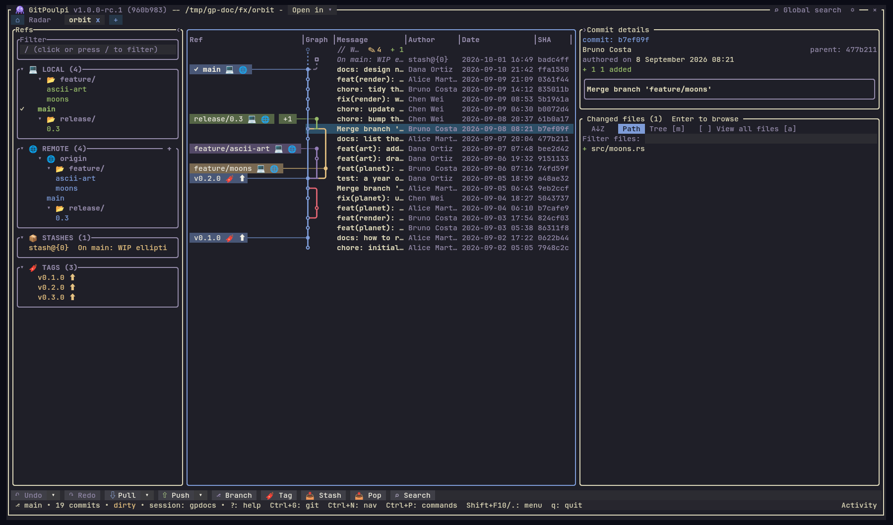
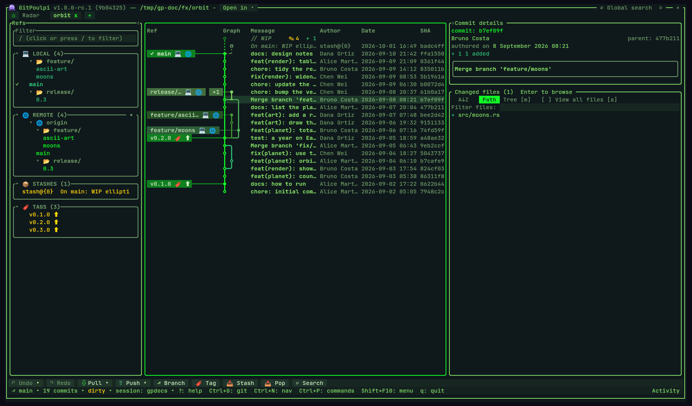
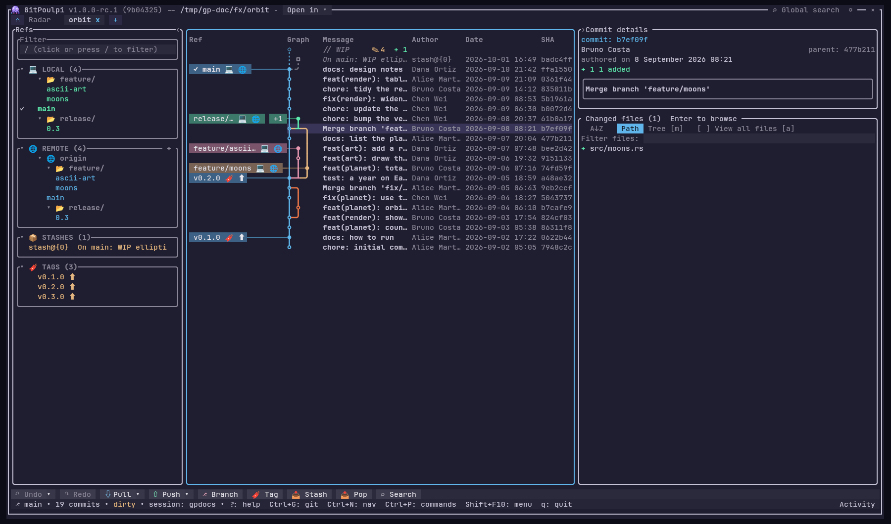
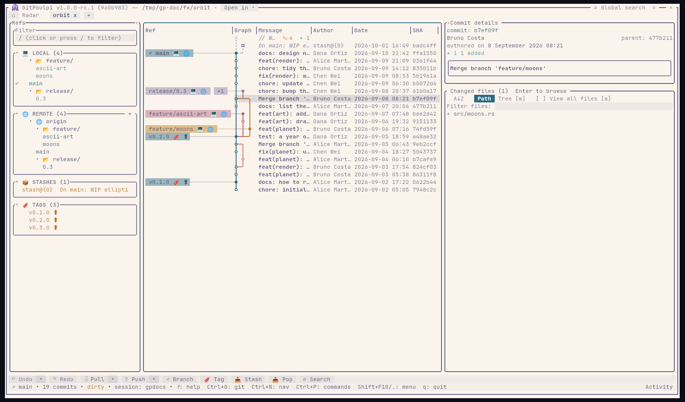
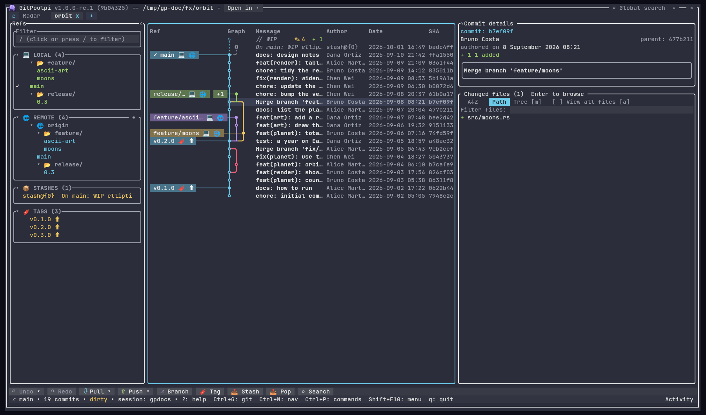
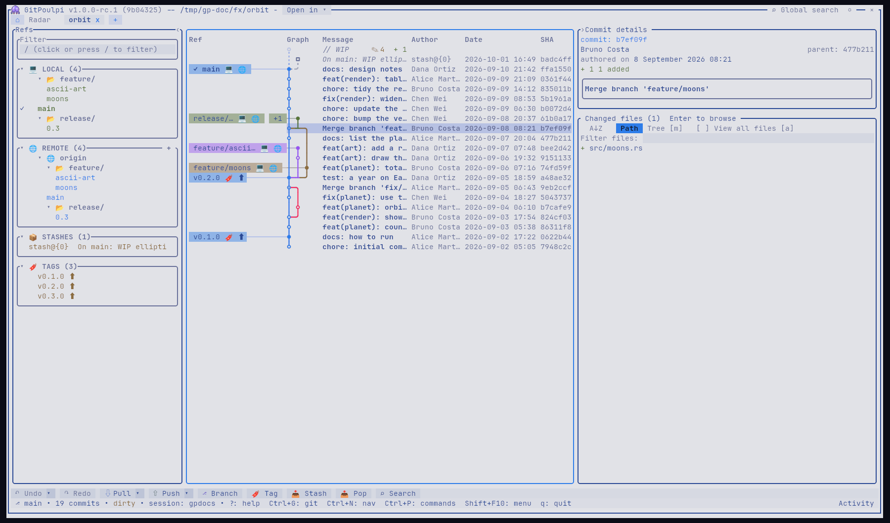
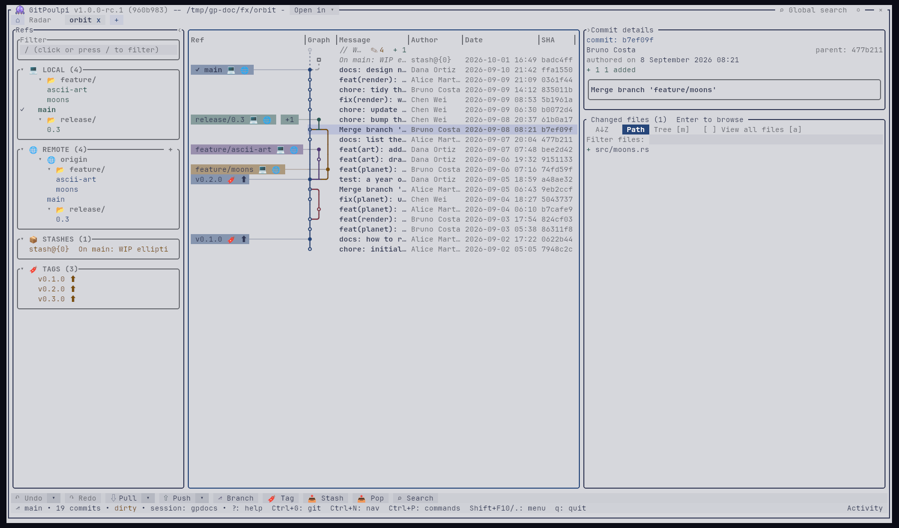
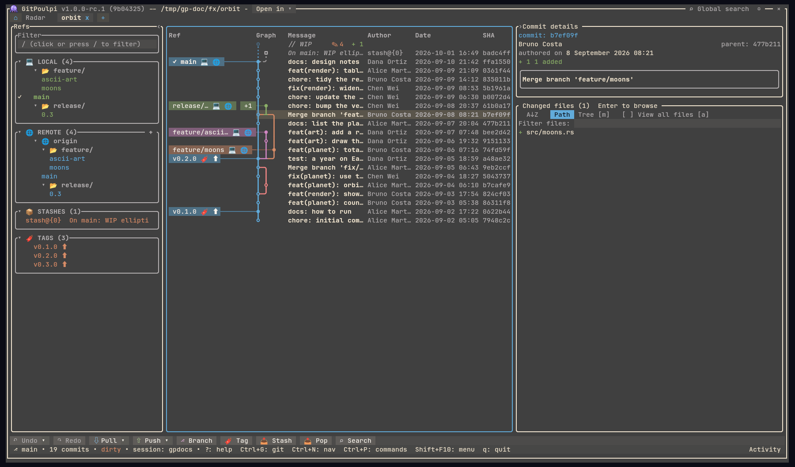
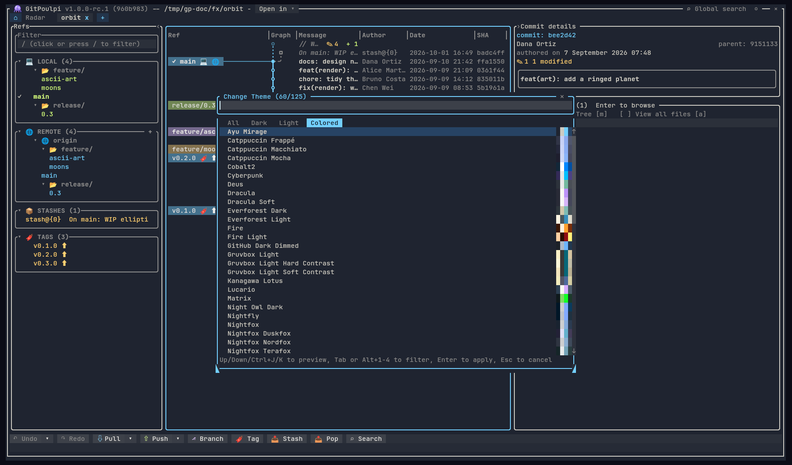

[English](../themes.md) · [Čeština](../cs/themes.md) · [Deutsch](../de/themes.md) · [Español](../es/themes.md) · [Français](../fr/themes.md) · **Italiano** · [日本語](../ja/themes.md) · [한국어](../ko/themes.md) · [Nederlands](../nl/themes.md) · [Polski](../pl/themes.md) · [Português (Brasil)](../pt-BR/themes.md) · [Português (Portugal)](../pt-PT/themes.md) · [Русский](../ru/themes.md) · [Svenska](../sv/themes.md) · [Türkçe](../tr/themes.md) · [Українська](../uk/themes.md) · [简体中文](../zh-CN/themes.md)

# Temi

Un tema definisce ogni colore che GitPoulpi disegna: testo, pannelli, selezione,
pulsanti, le viste diff e merge, l'editor, le icone della barra degli strumenti e
i colori delle corsie del grafo del Log. Cambia tema in **Impostazioni > Aspetto >
Tema**, oppure con `gitpoulpi config set ui.theme <slug>`. Per vedere come appare ciascuno, vai direttamente alla [galleria](#galleria).

## Preset integrati

`gitpoulpi theme list` stampa quelli della tua build, nell'ordine in cui li mostra
il combo di Impostazioni: prima **GitPoulpi Dark** (`dark`, disegnato sopra lo
sfondo del tuo terminale) e **GitPoulpi Light** (`light`), poi tutti gli altri
preset in ordine alfabetico per etichetta. `ui.theme = "system"` (il predefinito)
segue il tuo terminale: Light su uno sfondo chiaro, Dark altrimenti (vedi
"Rilevamento del sistema" più sotto); il vecchio `default` equivale a `system`. Il
combo delle palette delle corsie usa lo stesso ordine.

| Slug | Etichetta | Origine dei colori |
|---|---|---|
| `system` (predefinito) | Sistema | non è una palette: GitPoulpi Light su uno sfondo di terminale chiaro, altrimenti GitPoulpi Dark |
| `dark` | GitPoulpi Dark | tema originale di GitPoulpi, dipinto sopra lo sfondo del tuo terminale |
| `light` | GitPoulpi Light | tema originale di GitPoulpi |
| `catppuccin-latte` / `catppuccin-frappe` / `catppuccin-macchiato` / `catppuccin-mocha` | Catppuccin Latte / Frappé / Macchiato / Mocha | [github.com/catppuccin/palette](https://github.com/catppuccin/palette) |
| `cyberpunk` | Cyberpunk | [iTerm2-Color-Schemes](https://github.com/mbadolato/iTerm2-Color-Schemes) "Cyberpunk" |
| `dracula` | Dracula | [draculatheme.com/contribute](https://draculatheme.com/contribute) |
| `everforest-dark` | Everforest Dark | [github.com/sainnhe/everforest/blob/master/palette.md](https://github.com/sainnhe/everforest/blob/master/palette.md) |
| `fire` / `fire-light` | Fire / Fire Light | temi originali di GitPoulpi: Fire è fatto di braci su uno sfondo arancione bruciato con arancione fiamma; Fire Light è il suo gemello chiaro su uno sfondo davvero arancione |
| `github-dark` / `github-light` | GitHub Dark / GitHub Light | i temi Primer di GitHub, [github.com/primer/github-vscode-theme](https://github.com/primer/github-vscode-theme) con @primer/primitives (`canvas.default`, `canvas.inset` come barra laterale, `fg.*`, `accent.fg`); nessun valore modificato |
| `gruvbox-dark` / `gruvbox-light` | Gruvbox Dark / Light | [github.com/morhetz/gruvbox#palette](https://github.com/morhetz/gruvbox#palette) |
| `kanagawa` / `kanagawa-lotus` | Kanagawa (wave) / Kanagawa Lotus | [github.com/rebelot/kanagawa.nvim](https://github.com/rebelot/kanagawa.nvim) |
| `matrix` | Matrix | [iTerm2-Color-Schemes](https://github.com/mbadolato/iTerm2-Color-Schemes) "Matrix" (nessun rosso nello schema: `danger` è `#ff5555`) |
| `monokai` | Monokai | la palette originale di Monokai ([monokai.nl](https://monokai.nl/)) |
| `nord` | Nord | [www.nordtheme.com](https://www.nordtheme.com) |
| `one-dark` / `one-light` | One Dark / One Light | Atom One Dark / One Light ([One Dark](https://github.com/atom/one-dark-syntax), [One Light](https://github.com/atom/one-light-syntax)) |
| `rose-pine` / `rose-pine-moon` / `rose-pine-dawn` | Rosé Pine / Moon / Dawn | [rosepinetheme.com/palette](https://rosepinetheme.com/palette/) |
| `solarized-dark` / `solarized-light` | Solarized Dark / Light | Solarized di Ethan Schoonover ([ethanschoonover.com/solarized](https://ethanschoonover.com/solarized/)) |
| `sunset` | Sunset | tema originale di GitPoulpi: crepuscolo indaco con corallo e oro |
| `terminal` | Terminal (16 colors) | usa solo i 16 colori del tuo terminale |
| `tokyo-night` / `tokyo-night-day` | Tokyo Night (night) / Tokyo Night Day | [github.com/folke/tokyonight.nvim](https://github.com/folke/tokyonight.nvim) (il primo piano di Day è scurito per rispettare le regole di contrasto) |
| `vesper` | Vesper | [github.com/raunofreiberg/vesper](https://github.com/raunofreiberg/vesper) (nessun blu o viola nella palette: l'accento è pesca) |
| `vscode-dark` / `vscode-light` | VS Code Dark / VS Code Light | Dark Modern / Light Modern predefiniti di VS Code, [github.com/microsoft/vscode/tree/main/extensions/theme-defaults/themes](https://github.com/microsoft/vscode/tree/main/extensions/theme-defaults/themes) (`dark_modern.json`, `light_modern.json`, più i colori predefiniti di VS Code per la selezione nelle liste e gli accenti ANSI/grafico; il grigio attenuato di Light è `616161`) |

### Importati da terminalcolors.com

Importati dalle palette di terminale di terminalcolors.com; ogni schema appartiene ai suoi autori. 90 preset sono costruiti a partire da sfondo, primo piano, selezione e 16 colori ANSI della palette (accent = blu, success = verde, warning = giallo, danger = rosso, AI = magenta, muted = nero brillante), con un'unica derivazione condivisa da tutti; un colore che non rispetta le regole di contrasto di GitPoulpi viene schiarito o scurito finché le rispetta. La tabella è generata da `scripts/gen-terminalcolors.py` in `crates/gitpoulpi-config/src/theme/terminalcolors_data.rs`. Gli slug sono `<famiglia>-<variante>` (`default` omesso); le etichette sono in ordine alfabetico nel combo come le altre.

| Famiglia | Slug |
|---|---|
| [Apprentice](https://terminalcolors.com/themes/apprentice/) | `apprentice` |
| [Ayu](https://terminalcolors.com/themes/ayu/) | `ayu-dark`, `ayu-light`, `ayu-mirage` |
| [Cobalt2](https://terminalcolors.com/themes/cobalt2/) | `cobalt2` |
| [Deus](https://terminalcolors.com/themes/deus/) | `deus` |
| [Dracula](https://terminalcolors.com/themes/dracula/) | `dracula-soft` |
| [Everforest](https://terminalcolors.com/themes/everforest/) | `everforest-light` |
| [GitHub](https://terminalcolors.com/themes/github/) | `github-dark-colorblind`, `github-dark-dimmed`, `github-dark-high-contrast`, `github-dark-legacy`, `github-light-colorblind`, `github-light-high-contrast`, `github-light-legacy` |
| [Gotham](https://terminalcolors.com/themes/gotham/) | `gotham` |
| [Gruvbox](https://terminalcolors.com/themes/gruvbox/) | `gruvbox-dark-hard-contrast`, `gruvbox-dark-soft-contrast`, `gruvbox-light-hard-contrast`, `gruvbox-light-soft-contrast` |
| [Iceberg](https://terminalcolors.com/themes/iceberg/) | `iceberg-dark`, `iceberg-light` |
| [Jellybeans](https://terminalcolors.com/themes/jellybeans/) | `jellybeans` |
| [Kanagawa](https://terminalcolors.com/themes/kanagawa/) | `kanagawa-dragon` |
| [Lucario](https://terminalcolors.com/themes/lucario/) | `lucario` |
| [Miasma](https://terminalcolors.com/themes/miasma/) | `miasma` |
| [Moonfly](https://terminalcolors.com/themes/moonfly/) | `moonfly` |
| [Night](https://terminalcolors.com/themes/night-owl/) | `night-owl-dark`, `night-owl-light` |
| [Nightfly](https://terminalcolors.com/themes/nightfly/) | `nightfly` |
| [Nightfox](https://terminalcolors.com/themes/nightfox/) | `nightfox`, `nightfox-carbonfox`, `nightfox-dawnfox`, `nightfox-dayfox`, `nightfox-duskfox`, `nightfox-nordfox`, `nightfox-terafox` |
| [Noctis](https://terminalcolors.com/themes/noctis/) | `noctis`, `noctis-azureus`, `noctis-bordo`, `noctis-hibernus`, `noctis-lilac`, `noctis-lux`, `noctis-minimus`, `noctis-obscuro`, `noctis-sereno`, `noctis-uva`, `noctis-viola` |
| [Nordic](https://terminalcolors.com/themes/nordic/) | `nordic` |
| [One](https://terminalcolors.com/themes/one-half/) | `one-half-dark`, `one-half-light` |
| [Panda](https://terminalcolors.com/themes/panda/) | `panda` |
| [Posterpole](https://terminalcolors.com/themes/posterpole/) | `posterpole`, `posterpole-gray` |
| [Seoul256](https://terminalcolors.com/themes/seoul256/) | `seoul256-dark`, `seoul256-light` |
| [Shades](https://terminalcolors.com/themes/shades-of-purple/) | `shades-of-purple`, `shades-of-purple-super-dark` |
| [Sonokai](https://terminalcolors.com/themes/sonokai/) | `sonokai`, `sonokai-andromeda`, `sonokai-atlantis`, `sonokai-espresso`, `sonokai-maia`, `sonokai-shusia` |
| [Srcery](https://terminalcolors.com/themes/srcery/) | `srcery` |
| [Tender](https://terminalcolors.com/themes/tender/) | `tender` |
| [Tokyo](https://terminalcolors.com/themes/tokyo-night/) | `tokyo-night-moon`, `tokyo-night-storm` |
| [Tomorrow](https://terminalcolors.com/themes/tomorrow/) | `tomorrow`, `tomorrow-night`, `tomorrow-night-blue`, `tomorrow-night-bright`, `tomorrow-night-eighties` |
| [Zenbones](https://terminalcolors.com/themes/zenbones/) | `zenbones-duckbones`, `zenbones-forestbones-dark`, `zenbones-forestbones-light`, `zenbones-kanagawabones`, `zenbones-neobones-dark`, `zenbones-neobones-light`, `zenbones-nordbones`, `zenbones-rosebones-dark`, `zenbones-rosebones-light`, `zenbones-seoulbones-dark`, `zenbones-seoulbones-light`, `zenbones-tokyobones-dark`, `zenbones-tokyobones-light`, `zenbones-vimbones`, `zenbones-zenburned`, `zenbones-zenwritten-dark`, `zenbones-zenwritten-light` |

`ui.side_bg` è lo sfondo del pannello Refs e del pannello destro (dettaglio del
commit, modifiche in corso, elenchi di file), come GitHub e VS Code
disegnano le loro barre laterali. Catppuccin (il suo
`mantle`), GitHub e VS Code lo impostano; per ogni altro preset vale `default`,
cioè lo stesso di `ui.bg`. Un file di tema può impostare `side_bg` sotto `[ui]`
(`gitpoulpi theme export` lo stampa).

Altri tre ruoli sotto `[ui]` colorano l'interfaccia circostante, come fanno GitHub e VS Code:

| Ruolo | Dove colora |
|---|---|
| `ui.toolbar_bg` | La riga della barra degli strumenti e la **scheda del repository selezionata**, così la scheda appare collegata alla barra. I chip dei pulsanti della barra mantengono il proprio `chrome.toolbar_bg`. |
| `ui.statusbar_bg` | La barra di stato (in basso, a meno che `ui.statusbar_position` non dica in alto). |
| `ui.statusbar_fg` | Il testo della barra di stato. Il testo che non si leggerebbe su quello sfondo viene ridisegnato con questo colore; il testo di avviso ed errore che si legge mantiene il suo colore. |

I preset li impostano in modo coerente con la loro app: VS Code Dark e
Light la barra di stato blu (`#007acc`) con testo bianco e i grigi della barra del
titolo di VS Code per la barra degli strumenti; GitHub i toni della sua
intestazione. Ogni altro preset (comprese le palette di terminale importate)
ricava una barra degli strumenti di un gradino diversa da `bg` e una barra di
stato un po' più distante, con `text` sopra, e le regole di contrasto mantengono
il testo leggibile. `dark` (GitPoulpi Dark) e `terminal` usano lo sfondo del
terminale, quindi tutti e tre valgono `default`: non viene disegnato nulla e la
scheda selezionata mantiene il colore di selezione. Un file di tema che li omette
eredita i valori della sua base; `default` significa nessuna tinta (la barra di
stato segue allora `side_bg`).

Dove il grigio dei commenti o attenuato di uno schema è troppo scuro per essere
letto, viene schiarito finché rispetta le regole di contrasto di GitPoulpi; le
sfumature di pannello e selezione che lo schema non ha vengono ricavate dal suo
sfondo.

### Galleria

Ogni tema integrato, sullo stesso repository con un commit di merge selezionato (`scripts/docs-screenshots.sh` rifà gli screenshot).

| **GitPoulpi Dark** (`dark`) | **GitPoulpi Light** (`light`) | **Apprentice** (`apprentice`) |
|---|---|---|
|  |  |  |
| **Ayu Dark** (`ayu-dark`) | **Ayu Light** (`ayu-light`) | **Ayu Mirage** (`ayu-mirage`) |
|  |  |  |
| **Catppuccin Frappé** (`catppuccin-frappe`) | **Catppuccin Latte** (`catppuccin-latte`) | **Catppuccin Macchiato** (`catppuccin-macchiato`) |
|  |  |  |
| **Catppuccin Mocha** (`catppuccin-mocha`) | **Cobalt2** (`cobalt2`) | **Cyberpunk** (`cyberpunk`) |
|  |  |  |
| **Deus** (`deus`) | **Dracula** (`dracula`) | **Dracula Soft** (`dracula-soft`) |
|  |  |  |
| **Everforest Dark** (`everforest-dark`) | **Everforest Light** (`everforest-light`) | **Fire** (`fire`) |
|  |  |  |
| **Fire Light** (`fire-light`) | **GitHub Dark** (`github-dark`) | **GitHub Dark Colorblind** (`github-dark-colorblind`) |
|  |  |  |
| **GitHub Dark Dimmed** (`github-dark-dimmed`) | **GitHub Dark High Contrast** (`github-dark-high-contrast`) | **GitHub Dark Legacy** (`github-dark-legacy`) |
|  |  |  |
| **GitHub Light** (`github-light`) | **GitHub Light Colorblind** (`github-light-colorblind`) | **GitHub Light High Contrast** (`github-light-high-contrast`) |
|  |  |  |
| **GitHub Light Legacy** (`github-light-legacy`) | **Gotham** (`gotham`) | **Gruvbox Dark** (`gruvbox-dark`) |
|  |  |  |
| **Gruvbox Dark Hard Contrast** (`gruvbox-dark-hard-contrast`) | **Gruvbox Dark Soft Contrast** (`gruvbox-dark-soft-contrast`) | **Gruvbox Light** (`gruvbox-light`) |
|  |  |  |
| **Gruvbox Light Hard Contrast** (`gruvbox-light-hard-contrast`) | **Gruvbox Light Soft Contrast** (`gruvbox-light-soft-contrast`) | **Iceberg Dark** (`iceberg-dark`) |
|  |  |  |
| **Iceberg Light** (`iceberg-light`) | **Jellybeans** (`jellybeans`) | **Kanagawa** (`kanagawa`) |
|  |  |  |
| **Kanagawa Dragon** (`kanagawa-dragon`) | **Kanagawa Lotus** (`kanagawa-lotus`) | **Lucario** (`lucario`) |
|  |  |  |
| **Matrix** (`matrix`) | **Miasma** (`miasma`) | **Monokai** (`monokai`) |
|  |  |  |
| **Moonfly** (`moonfly`) | **Night Owl Dark** (`night-owl-dark`) | **Night Owl Light** (`night-owl-light`) |
|  |  |  |
| **Nightfly** (`nightfly`) | **Nightfox** (`nightfox`) | **Nightfox Carbonfox** (`nightfox-carbonfox`) |
|  |  |  |
| **Nightfox Dawnfox** (`nightfox-dawnfox`) | **Nightfox Dayfox** (`nightfox-dayfox`) | **Nightfox Duskfox** (`nightfox-duskfox`) |
|  |  |  |
| **Nightfox Nordfox** (`nightfox-nordfox`) | **Nightfox Terafox** (`nightfox-terafox`) | **Noctis** (`noctis`) |
|  |  |  |
| **Noctis Azureus** (`noctis-azureus`) | **Noctis Bordo** (`noctis-bordo`) | **Noctis Hibernus** (`noctis-hibernus`) |
|  |  |  |
| **Noctis Lilac** (`noctis-lilac`) | **Noctis Lux** (`noctis-lux`) | **Noctis Minimus** (`noctis-minimus`) |
|  |  |  |
| **Noctis Obscuro** (`noctis-obscuro`) | **Noctis Sereno** (`noctis-sereno`) | **Noctis Uva** (`noctis-uva`) |
|  |  |  |
| **Noctis Viola** (`noctis-viola`) | **Nord** (`nord`) | **Nordic** (`nordic`) |
|  |  |  |
| **One Dark** (`one-dark`) | **One Half Dark** (`one-half-dark`) | **One Half Light** (`one-half-light`) |
|  |  |  |
| **One Light** (`one-light`) | **Panda** (`panda`) | **Posterpole** (`posterpole`) |
|  |  |  |
| **Posterpole Gray** (`posterpole-gray`) | **Rosé Pine** (`rose-pine`) | **Rosé Pine Dawn** (`rose-pine-dawn`) |
|  |  |  |
| **Rosé Pine Moon** (`rose-pine-moon`) | **Seoul256 Dark** (`seoul256-dark`) | **Seoul256 Light** (`seoul256-light`) |
|  |  |  |
| **Shades of Purple** (`shades-of-purple`) | **Shades of Purple Super Dark** (`shades-of-purple-super-dark`) | **Solarized Dark** (`solarized-dark`) |
|  |  |  |
| **Solarized Light** (`solarized-light`) | **Sonokai** (`sonokai`) | **Sonokai Andromeda** (`sonokai-andromeda`) |
|  |  |  |
| **Sonokai Atlantis** (`sonokai-atlantis`) | **Sonokai Espresso** (`sonokai-espresso`) | **Sonokai Maia** (`sonokai-maia`) |
|  |  |  |
| **Sonokai Shusia** (`sonokai-shusia`) | **Srcery** (`srcery`) | **Sunset** (`sunset`) |
|  |  |  |
| **Tender** (`tender`) | **Terminal (16 colors)** (`terminal`) | **Tokyo Night** (`tokyo-night`) |
|  |  |  |
| **Tokyo Night Day** (`tokyo-night-day`) | **Tokyo Night Moon** (`tokyo-night-moon`) | **Tokyo Night Storm** (`tokyo-night-storm`) |
|  |  |  |
| **Tomorrow** (`tomorrow`) | **Tomorrow Night** (`tomorrow-night`) | **Tomorrow Night Blue** (`tomorrow-night-blue`) |
|  |  |  |
| **Tomorrow Night Bright** (`tomorrow-night-bright`) | **Tomorrow Night Eighties** (`tomorrow-night-eighties`) | **Vesper** (`vesper`) |
|  |  |  |
| **VS Code Dark** (`vscode-dark`) | **VS Code Light** (`vscode-light`) | **Zenbones Duckbones** (`zenbones-duckbones`) |
|  |  |  |
| **Zenbones Forestbones Dark** (`zenbones-forestbones-dark`) | **Zenbones Forestbones Light** (`zenbones-forestbones-light`) | **Zenbones Kanagawabones** (`zenbones-kanagawabones`) |
|  |  |  |
| **Zenbones Neobones Dark** (`zenbones-neobones-dark`) | **Zenbones Neobones Light** (`zenbones-neobones-light`) | **Zenbones Nordbones** (`zenbones-nordbones`) |
|  |  |  |
| **Zenbones Rosebones Dark** (`zenbones-rosebones-dark`) | **Zenbones Rosebones Light** (`zenbones-rosebones-light`) | **Zenbones Seoulbones Dark** (`zenbones-seoulbones-dark`) |
|  |  |  |
| **Zenbones Seoulbones Light** (`zenbones-seoulbones-light`) | **Zenbones Tokyobones Dark** (`zenbones-tokyobones-dark`) | **Zenbones Tokyobones Light** (`zenbones-tokyobones-light`) |
|  |  |  |
| **Zenbones Vimbones** (`zenbones-vimbones`) | **Zenbones Zenburned** (`zenbones-zenburned`) | **Zenbones Zenwritten Dark** (`zenbones-zenwritten-dark`) |
|  |  |  |
| **Zenbones Zenwritten Light** (`zenbones-zenwritten-light`) |
|  |

## Qualsiasi tema con qualsiasi palette di corsie

Ogni tema porta i propri colori delle corsie per il grafo del Log, ma puoi
combinare qualsiasi tema con qualsiasi palette: **Impostazioni > Aspetto > Tema
colori del grafo** offre **Segui il tema** (il predefinito) più ogni palette di
corsie di ogni tema (GitPoulpi Dark, GitPoulpi Light, poi Material,
Serie, ... e il `graph_palette` dei tuoi file di tema). 

In `config.toml`:

```toml
[ui]
theme = "nord"
graph_color_theme = "material"   # oppure "theme" per seguire il tema
```

`ui.input_color` è lo stesso tipo di sostituzione per i campi di testo: il
predefinito `theme` segue i colori dei campi del tema; `gray`, `blue`, `slate`,
`dark` e `custom` impongono uno sfondo (sono colori scuri, quindi scegli `theme`
con un tema chiaro).

## I tuoi temi

Metti un file `.toml` nella cartella `themes/` della cartella di configurazione
(`gitpoulpi config path` ne stampa la cartella superiore; la cartella è
`${config}/themes/`). Il nome del file senza `.toml` è lo slug del tema, che è
ciò che accetta `ui.theme`. Un file non può riusare lo slug di un preset (viene
saltato con un avviso).

Parti da un file completo:

```
gitpoulpi theme export nord > "$(dirname "$(gitpoulpi config path)")/themes/mine.toml"
```

Poi tieni solo ciò che cambi. Un file è un insieme di **sostituzioni parziali** su
una `base` (un preset, o un altro tema utente; le catene sono profonde al massimo
4 livelli e i cicli vengono rifiutati; senza `base` vale `dark`):

```toml
name = "My Nord"            # l'etichetta nel combo; predefinito = nome del file
base = "nord"
light = false               # ereditato se assente
syntax = "base16-ocean.dark"
graph_palette = ["#88c0d0", "#a3be8c"]

[ui]
bg = "#2e3440"              # "default" | "#rrggbb" | "ansi:N"
accent = "#88c0d0"
toolbar_bg = "#3b4252"      # riga della barra degli strumenti e scheda selezionata
statusbar_bg = "#5e81ac"    # barra di stato
statusbar_fg = "#eceff4"

[diff]
add_bg = "#2f3b2f"
```

I colori sono `"#rrggbb"`, `"ansi:N"` (la voce N della palette del terminale) o
`"default"` (il colore del terminale stesso). Gruppi e chiavi sono quelli di
`gitpoulpi theme export <slug>`. Nulla è fatale: una chiave sconosciuta o un
colore errato viene ignorato, una `base` sconosciuta ripiega su `dark`, e
`gitpoulpi theme list` segnala ogni problema sotto `warnings` (l'app li mostra
una volta nella barra di stato).

I file vengono riletti quando si apre il combo Tema e quando si chiude
Impostazioni. Una finestra in esecuzione nota anche quando `config.toml` (un
`gitpoulpi config set ui.theme ...` da una shell) o il file del tema attivo
vengono riscritti, e applica i nuovi colori entro circa un secondo, senza
riavvio.

### `ui.border_focused`

La cornice del pannello che ha il focus della tastiera: il Log, la barra laterale
Refs, i pannelli Staged e Unstaged, il dettaglio del commit, i pannelli della
cronologia, della revisione e della riscrittura, le cornici del diff, dei file e
dell'editor. Colora solo i bordi; testo, etichette e icone (l'etichetta
"commit :", l'icona Home, i pulsanti delle schede) continuano a usare
`ui.accent`. Così un tema può incorniciare il pannello attivo con un colore che
come testo sarebbe illeggibile, per esempio un giallo acceso su un tema chiaro.
Quando un tema non lo imposta, segue `ui.accent` (anche in un file utente: un
file che cambia solo `accent` ottiene quell'accento sulle cornici con il focus),
quindi ogni tema integrato appare come prima. Finestre di dialogo e popup
mantengono una cornice con l'accento.

```toml
[ui]
accent = "#1f5fbf"
border_focused = "#e7df00"
```

## Rilevamento del sistema

Con `ui.theme = "system"`, GitPoulpi chiede al terminale il suo colore di sfondo
**una sola volta, all'avvio** (la query OSC 11, a cui rispondono kitty, WezTerm,
Alacritty, foot, iTerm2, Windows Terminal, tmux e la maggior parte degli altri) e
sceglie Light per uno sfondo chiaro, Dark altrimenti. L'attesa è al massimo di
circa 100 ms, e un terminale che non conosce la query non costa nulla: la
risposta viene sempre letta prima che parta l'interfaccia, quindi non viene
stampato nulla e nessun tasto va perso. Senza risposta (e sempre su Windows, che
non invia la query) legge `COLORFGBG`, poi ripiega su Dark. Un terminale il cui
sfondo cambia mentre GitPoulpi è in esecuzione non viene seguito; riavvialo, o
scegli esplicitamente Light o Dark.

## Profondità colore

I temi sono truecolor (`#rrggbb`). `ui.color_depth` (Impostazioni > Aspetto >
Profondità colore, si applica subito) decide come arrivano al terminale:

| Valore | Effetto |
|---|---|
| `auto` (predefinito) | Truecolor, tranne dove è noto che non funziona: Apple Terminal (`TERM_PROGRAM=Apple_Terminal`) usa 256 colori, la console Linux (`TERM=linux`) 16, e un terminale `*-256color` che non imposta `COLORTERM` (e non è WezTerm, kitty o Windows Terminal) 256. `COLORTERM=truecolor` significa sempre truecolor. |
| `truecolor` | Sempre colore a 24 bit. |
| `256` | Ogni colore RGB diventa la voce xterm-256 più vicina. |
| `16` | Il più vicino tra i 16 colori ANSI; la palette del terminale stabilisce la sfumatura esatta. |

Usa `256` o `16` se un tema mostra colori sbagliati via ssh o in un multiplexer
datato. Il preset Terminal non ne ha bisogno. Il truecolor non costa nulla; il
passaggio di conversione scorre lo schermo una volta per frame solo quando è
attivo.

## Anteprima dal vivo

In Impostazioni > Aspetto, il combo Tema elenca **Sistema (segue il terminale)**,
i preset, poi i tuoi file di tema. Spostando l'evidenziazione si applica subito
quel tema, quindi l'intera schermata Impostazioni si ridisegna sotto i tuoi occhi;
**Enter** lo mantiene (viene salvato), **Esc** o un clic fuori ripristina il
precedente e non salva nulla. La voce della palette **App: Tema...** (`Ctrl+P`)
apre Impostazioni su quella riga.

### Cambiare tema dalla palette

**App: Cambia tema...** (`Ctrl+P`, oppure `Ctrl+N t`; il tasto è riassegnabile
come `nav_prefix.change_theme`) apre un elenco degli stessi temi senza passare da
Impostazioni: **Sistema (segue il terminale)**, i preset, poi i tuoi file di tema,
ciascuno con quattro piccoli chip di colore. Il tema corrente è spuntato. Scrivi
per restringere l'elenco; spostando l'evidenziazione si vede subito l'anteprima del
tema, **Enter** lo applica e salva `ui.theme` in `config.toml`, **Esc** (o un clic
fuori dall'elenco) rimette il tema precedente e non salva nulla.

Sotto il campo del filtro un prefiltro a segmenti restringe l'elenco: **Tutti**,
**Scuri**, **Chiari** e **Colorati** (clicca un segmento, `Tab` / `Shift+Tab`, o
`Alt+1`..`Alt+4`). Scuri e Chiari derivano dalla luminosità di `ui.bg` del tema;
**Colorati** mantiene i temi il cui sfondo è chiaramente tinto (blu, viola,
giallo, verde...) ed esclude bianco, bianco sporco, nero e grigi quasi neri, quindi
Solarized Dark, Dracula o Nord sono colorati mentre GitHub Dark e One Light no. Un
tema colorato compare anche sotto Scuri o Chiari. **Sistema** e i temi trasparenti
(senza sfondo proprio) compaiono solo sotto Tutti. Il prefiltro si combina con ciò
che scrivi. I selettori del tema colori del grafo e della lingua mostrano
l'anteprima allo stesso modo: le corsie del Log e l'intera interfaccia cambiano
mentre sposti l'evidenziazione.




Sotto il combo, una fila di chip di colore mostra il tema in uso (sfondo, testo,
attenuato, accento, selezione, danger, diff aggiunto, diff rimosso, poi i primi
sei colori delle corsie), e segue l'anteprima. Il combo **Tema colori del grafo**
in **Aspetto** mostra alcuni colori delle corsie accanto a ogni palette, e le
scelte si applicano alla chiusura di Impostazioni.

Un tema con uno sfondo proprio (Light e gli altri preset dipinti) riempie l'intera
finestra, comprese Impostazioni e le viste a pagina intera, e dà al testo senza
colore proprio il colore di testo del tema; Dark e Terminal lasciano stare i
colori del tuo terminale.

## Dalla riga di comando

| Comando | Output |
|---|---|
| `gitpoulpi theme list` | JSON `{themes: [{slug, label, source, light, lane_palette}], warnings}`; `source` è `preset` o `user`. |
| `gitpoulpi theme export <slug>` | Il file di tema completo come TOML su stdout (JSON: `{slug, toml}`); viene riletto dando lo stesso tema. |
| `gitpoulpi config set ui.theme <slug>` | Convalidato sui preset e sulla tua cartella `themes/`; un nome sconosciuto è un errore che elenca quelli validi. `system` e `default` sono accettati. |
| `gitpoulpi config set ui.graph_color_theme <name>` | `theme` (segue il tema) o il nome di una palette di corsie; un nome sconosciuto elenca quelli validi. |

Il server MCP offre `theme_list` e `theme_export` come strumenti di sola lettura.
