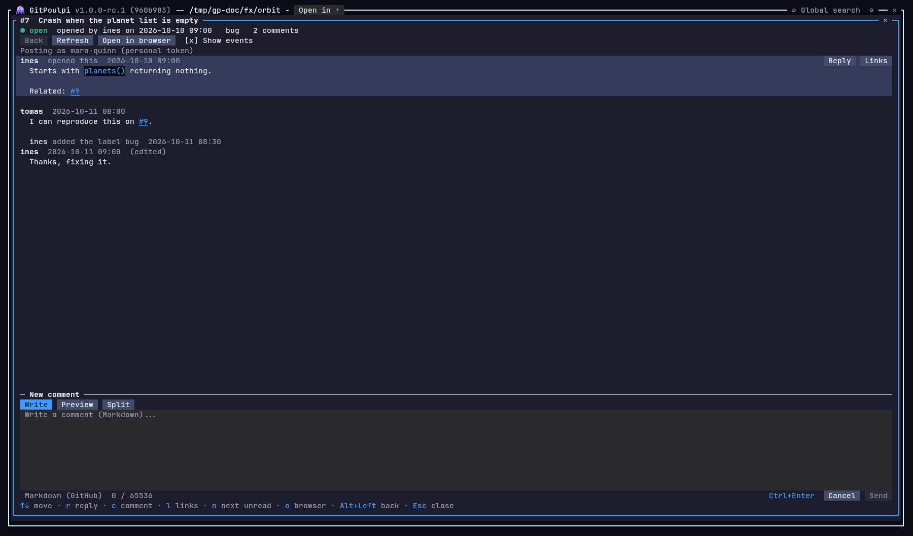

[English](../conversations.md) · [Čeština](../cs/conversations.md) · [Deutsch](../de/conversations.md) · [Español](../es/conversations.md) · [Français](../fr/conversations.md) · [Italiano](../it/conversations.md) · **日本語** · [한국어](../ko/conversations.md) · [Nederlands](../nl/conversations.md) · [Polski](../pl/conversations.md) · [Português (Brasil)](../pt-BR/conversations.md) · [Português (Portugal)](../pt-PT/conversations.md) · [Русский](../ru/conversations.md) · [Svenska](../sv/conversations.md) · [Türkçe](../tr/conversations.md) · [Українська](../uk/conversations.md) · [简体中文](../zh-CN/conversations.md)

# 会話

Issue、ワークアイテム、カード、pull / merge request の会話ビューです。アカウントとリンクされたリポジトリが必要です：[ホスティングと Issue トラッカーの連携](hosting-integration.md)を参照してください。これを開く一覧は [pull request と Issue](pull-requests-and-issues.md)に、コードのレビューは [pull request のレビュー](review.md)にあります。

**会話**とは、1 件の Issue、ワークアイテム、カード、チェンジ、pull / merge request について語られたことのすべてです：説明、コメント、レビュー、コードへのスレッド、イベント（ラベル、割り当て、状態の変更、push）。GitPoulpi はそれをホストから読み取って整形して表示し、ウィンドウを離れずに返答できるようにします。

### 会話を開く

| 開く場所 | 方法 |
|---|---|
| ISSUES の行 | `Enter` またはダブルクリック、行メニューの**会話を開く**、パレットの*ホスティング: Issue の会話を開く...*（画面上の Issue の一覧）。行メニューの**ブラウザーで開く**は従来どおりブラウザーを開きます。 |
| Azure DevOps または Bitbucket の PULL REQUESTS の行 | `Enter` または**会話を開く**。GitHub、GitLab、Gitea、Forgejo、Gerrit では、行は[レビュー](review.md)を開き、その概要ページがこれと同じ会話です（タイムライン、キー、下のコメントボックス）。 |
| [Issue ボード](pull-requests-and-issues.md#issue-ボード)のカード | `Enter` またはダブルクリック。 |
| [Radar](radar.md) | Issue またはリクエストの行で `i`、行メニューの**会話を開く**、または*Radar: Issue の会話を開く*。 |
| 別の会話の中の参照 | クリックする（または `l` で選ぶ）：リンクされた取得元の `#7`、`!12`、`ABC-12` はアプリ内で開き、戻るスタックに積まれます。 |
| エージェント | `gitpoulpi ui show issue <n> --view conversation`（`ui show pr` も同様）。[CLI リファレンス](cli-reference.md)を参照してください。 |

**クローンされていないリポジトリ。** クローンのないリポジトリの Radar の行も、その会話を開きます：ビューに必要なのは連携のプロファイルとプロジェクトだけなので、Radar が自分のウィンドウの上にそれを表示し、`Esc` で Radar に戻ります。クローンが必要なものは省かれます：commit の参照はログではなくホストで開き、*AI にリポジトリを読ませる*は理由つきでグレー表示になります（[AI の章](ai.md#ホストでの作成補助)を参照）。クローン済みリポジトリのリクエストにはレビューがあり（`e`）、Radar の**会話を開く**は、ここで読める会話がないと表示します。クローン済みリポジトリの Issue は、そのリポジトリのタブで開きます。

読める会話のないホストの Issue（Bitbucket と Gerrit には Issue がありません）は従来どおりブラウザーを開き、`conversation` 機能のないビルドはどこでも同じ動作になります（[カスタムビルド](custom-builds.md)）。

### ビュー

ウィンドウ全体のビューです：ヘッダー（状態、作成者と作成日時、ラベル、コメント数、**イベントを表示**、**戻る**、**更新**、**ブラウザーで開く**）、**投稿者**の行、タイムライン、その下のコメントボックス。

- タイムラインは古い順から新しい順に読み、最新のウィンドウ（最大 300 件）から始まります。その上端の**古いものを読み込む**（`m`、パレットの*会話: 古い項目を読み込む*）で、その手前のウィンドウを読み込みます。ホストが教えてくれる場合は、残りの件数も表示されます。
- コメントには、作成者、日付、`編集済み` のチップ、bot には `bot` のチップ、非公開のメモには `内部`、そして選択した項目が許す**返信**、**引用**、**編集**、**削除**、**リンク**のボタンが表示されます。コードへのスレッドには `path:line`、`解決済み` または `未解決`、`古い`、そのコメントが表示されます。レビューには判定が表示されます。
- イベントは 1 件につき目立たない 1 行です（*carol がラベル lfs を追加しました*）。**イベントを表示**（`v`）で隠せます。この選択はリポジトリごとに保持されます。イベント履歴のないホスト（YouTrack、Azure DevOps のワークアイテム、ローカルノート）には、このチェックボックスはありません。
- テキストは Markdown としてレンダリングされます：見出し、入れ子のリストとタスクリスト、引用、GitHub 形式の注意書き、ハイライトされたコード、表、リンク、`[image: alt]` として表示される画像。ホスト独自のマークアップで届いたテキストは、先に変換されます（[マークアップの変換](#マークアップの変換)を参照）。`mermaid` のコードブロックには**図を開く**ボタンが付き、図のソースをスクロールできるビューアーで表示します（`Enter` でコピー）。パレットには*会話: 項目の図を開く*があります。`conversation` と `mermaid` の両方を含むビルドが必要です。
- レビューの概要では、コードのスレッドの `path:line` がコードへのリンクになります（`G`、*会話: スレッドのコードを開く*。[レビュー](review.md)を参照）。単独で開いた会話（Issue や Radar の行）には、移動先のコードのページがありません。
- ビューは 60 秒ごと、および `F5`（**更新**）で読み直します。

**キー。** どのキーにも、ボタン、メニューの行、パレットの行（*会話: ...*）があり、`Ctrl+N` でボタンにバッジが付きます。

| キー | 動作 |
|---|---|
| `Up`、`Down`、`Ctrl+J`、`Ctrl+K`、`j`、`k` | 前 / 次の項目 |
| `PageUp`、`PageDown`、`Home`、`End`、ホイール、スクロールバー | スクロール |
| `Tab`、`Shift+Tab` | タイムライン、コメントボックス、次にヘッダーのボタン |
| `r` | 返信：選択した項目のスレッドへ。スレッドのないホストでは、その本文を引用して |
| `Q` | 選択した項目を引用して新規コメントを書く |
| `c` | 新規コメント |
| `e`、`d` | 自分のコメントを編集、削除する（削除の前には確認があります） |
| `l`、`Enter` | 項目のリンク：リンクが 1 つなら `Enter` でそれをたどり、複数ならそのメニューを開く |
| `y`、`o` | 項目のアドレスをコピー、ブラウザーで開く |
| `n` | 次の新着項目 |
| `v`、`m`、`F5` | イベントの表示／非表示、古いものを読み込む、更新 |
| `Alt+Left`、`Backspace` | 戻るスタックをたどって戻る |
| `q`、`Esc` | 閉じる（ボックスにテキストがあれば先に確認） |

### 書き込み

**新規コメント**（`c`、または `Tab` でボックスへ）、**返信**（`r`）、**引用**（`Q`）、**編集**（`e`）は、1 つの Markdown エディターを使います：**編集**、**プレビュー**、**分割**（`Alt+P` で編集とプレビューを切り替え、`Alt+L` で分割をオンにします。幅 100 桁のウィンドウが必要です）。`Ctrl+Enter`（`Ctrl+S`、`Alt+Enter` も可）または**送信**で投稿し、**キャンセル**でボックスを閉じ、AI がオンなら `Alt+E` で**AI で作成**を開きます（[AI の章](ai.md#ホストでの作成補助)）。プレビューは、タイムラインと同じレンダラーで、同じ参照つきで表示されます。ホストが Markdown を受け付けない場合、フッターにテキストの送信形式が表示されます（*Jira wiki markup として送信*、*Textile として送信*）。

- コメントはすぐにタイムラインへ追加され、ホストが応答すると正式な位置に収まります。ホストが拒否した場合、その項目は消え、ボックスがテキストと理由つきで再び開きます。
- 送信していないテキストは項目ごとに保持され（設定フォルダーの `remote-conversations.toml`）、次にそのボックスを開いたときに残っています。送信または破棄すると消えます。テキストのあるボックスを閉じるときは、先に確認があります。
- スレッド（レビューのスレッド、GitLab のディスカッション、Linear のコメント、Bitbucket や Azure DevOps のスレッド）への**返信**は、そのスレッドに投稿されます。ホストにフラットなリストしかない場合、**返信**は、選択した項目を引用した新規コメント（`> **作成者**`）を始めます。**引用**と同じです。
- **内部メモ**（チェックボックス、`Alt+I`）：GitLab と Redmine では、コメントはプロジェクトのメンバーにだけ見えます。そのようなメモのあるホストでのみ、新規コメントでのみ表示されます。
- 投稿は外部への操作です：何もジャーナルに記録されず、**GitPoulpi から元に戻すことはできません**。接続がない間はボックスが残り、**送信**は理由つきでグレー表示になり、ヘッダーには保存したコピーを表示中と示されます。

**編集や削除できる人。** **編集**と**削除**があるのは自分のコメントだけです。ホスト自身の判断があればそれが優先され（GitHub の `viewerCanUpdate` と `viewerCanDelete`、他では `can_edit`）、次に自分のログイン名とコメントの作成者を、大文字小文字を区別せずに比べます。App bot のコメントは、bot アカウントからのものでなければなりません。GitHub App bot のログイン名が分からない間は、このインストールが投稿したコメントだけが対象です（リポジトリがその ID を保持します）：名前から推測することはありません。スレッド内では、**編集**と**削除**は、そのスレッドの自分の最後のコメントに作用します。編集や削除に対応しないホスト（[表](#ホストごとにできないこと)を参照）では、ボタンが理由つきでグレー表示になります。

### 投稿者名

ヘッダーの下の行が、メッセージがどの名前で投稿されるかを示し、同じ行がどのボックスにもあります：

| 行 | 意味 |
|---|---|
| *ann として投稿（個人トークン）* | プロファイルのトークン：自分のログイン名（`GET /user`）。 |
| *ci-bot として投稿（リポジトリのトークンコマンド）* | リポジトリの[トークンコマンド](hosting-integration.md#8-github-app-の-bot-として動作する)がホスティング API に使われています。 |
| *my-app[bot] として投稿（GitHub App bot）* | インストールトークン。名前は**投稿者名**から、なければホストから取得します。 |
| *GitHub App bot として投稿（名前がまだ分かりません。設定で「投稿者名」を指定してください）* | 名前が未設定で、まだ学習もしていません。 |
| *... として投稿（プロジェクトの bot）* | GitLab のプロジェクトまたはグループのアクセストークン。 |
| *kai として書き込み（ローカルノート）* | Markdown ノートのフォルダー：プロファイルの `local.me`、なければ接続中のユーザー。 |
| *投稿者名がまだ分かりません。設定で「投稿者名」を指定してください。* | 何も取得できませんでした。 |

**投稿者名**は名前です。GitHub App なら `my-app[bot]` です。すべてのリポジトリ共通なら**設定 > 連携 > 投稿者名**（`general.hosting_post_as`）、1 つのリポジトリだけなら**設定 > リポジトリ別の設定 > SSH と認証情報 > ホスティング**で指定でき、後者が優先されます。空欄の場合、GitPoulpi は GitHub に問い合わせ（GraphQL の `viewer { login }`。インストールトークンでは答えられる場合とそうでない場合があります）、それができなければ、最初に投稿したコメントの作成者から名前を学習し、リポジトリごとに保持します。個人トークンでは不要です。[GitHub App の bot として動作する](hosting-integration.md#8-github-app-の-bot-として動作する)も参照してください。

### 相互参照

会話内の参照は下線付きでクリックできます。リポジトリのリンクされた ISSUES と PULL REQUESTS の取得元が先に照合されるので、リンクされた Jira プロジェクトの `ABC-12` は、GitHub のコメントの中でもアプリ内で開きます。ホスト独自の文法で追加されるものは、リンクの確認の後にそのページを開きます。commit ID は、リポジトリがクローン済みで ID が 7 文字以上ならログで、そうでなければホストで開きます。コードスパン、フェンス付きブロック、Markdown リンク、メールアドレス、URL の中は参照になりません。`C#1`、`UTF-8`、`SHA-256`、`ISO-8601` も参照ではありません。

| ホスト | 認識されるもの |
|---|---|
| GitHub | `#7`、`GH-7`、`owner/repo#7`、`owner/repo@sha`、`@login`、commit ID |
| GitLab | `#7`、`!7`、`group/project#7`、`group/project!7`、`project#7`（同じ階層のプロジェクト）、`@user`、チップとしての `~label` と `%milestone`、commit ID |
| Gitea、Forgejo | `#7`、`!7`、`owner/repo#7`、`owner/repo@sha`、`@user`、commit ID |
| Azure DevOps | `#7`、`!7`、`AB#7`、`@user` |
| Bitbucket | `@user`、`{uuid}` のメンション、commit ID |
| Gerrit | `Change-Id` の値（`I` と 40 桁の 16 進数）、commit ID |
| Redmine | `#7`、`r123` リビジョン、`commit:abc1234` |
| Jira、Linear、YouTrack | `ABC-12`。リンクされた取得元のプロジェクトまたはチームのものだけ |
| Trello | カードのアドレス（`trello.com/c/...`） |
| ローカルノート | `[[note]]`、`[[note\|alias]]`、フォルダー内の別のノートへの相対 `.md` リンク |

`gitpoulpi hosting markdown --body T --id I` は、参照を含め、アプリがテキストをどう扱うかを出力します。

### マークアップの変換

Markdown を扱わないホストは両方向に変換されるので、どこでも Markdown で読み書きできます。変換できないものは、読める形のテキストのまま残ります。

- **Jira**（Cloud と Data Center）は、API v2 でコメントを wiki マークアップとして保存します。読むものは Markdown に変換され、書くものは wiki マークアップに変換され、フッターには *Jira wiki markup として送信*と表示されます。
- **Redmine** はテキストを Textile または Markdown で書式設定しますが、API はどちらかを教えてくれません：プロファイルの**サーバーのテキスト形式**の行（設定 > 連携、`markup`、既定は Textile）で GitPoulpi に伝えます。Textile は、読むときに Markdown へ、書くときに Textile へ変換されます。
- **Azure DevOps Server** はワークアイテムのコメントを HTML で返し、HTML で受け付けます：Markdown に変換して表示し、HTML として書き込みます。Azure DevOps Services と pull request のスレッドは Markdown を受け付けます。
- **Gerrit** はプレーンテキストです：Markdown としてはレンダリングされず、書いたものはそのまま送られます。
- どのインポーターも、最初に制御シーケンスとエスケープシーケンスを取り除くので、コメントでターミナルを操作されることはありません。

### 保存されたコピー、古いものの読み込み、未読

- 開いた会話は保存されます（`<state dir>/conversations/<integration>/<project>/<kind>-<n>.json`。ユーザーだけが読め、トークンは含まず、1 ファイル最大 2 MB、最新の 50 ファイルを保持）。項目を開くとすぐに表示され、その裏で更新されます。ホストに接続できないときは、保存したコピーが*オフライン：3 分前に保存したコピーを表示中（理由）*のもとで表示され続け、送信はグレー表示になります。
- **未読：** 最後に見た位置は会話ごとに記憶されます（最新の 200 件を保持）。他の人による新しい項目にはアクセントバーと `新着` のチップが付き、`n` で次の項目へ移動します。初めて開く会話には、新着はありません。

### ホストごとにできないこと

以下の `いいえ` はすべて実際の制限です：コントロールは非表示になるか理由つきでグレー表示になり、CLI は何かを送る前にホスト名を挙げてエラーを返します。

| ホスト | 項目 | スレッドへの返信 | 自分のコメントの編集と削除 | スレッドの解決 | イベント | 内部メモ | 書き込み形式 |
|---|---|---|---|---|---|---|---|
| GitHub | Issue、pull request | pull request | 両方 | pull request | はい | いいえ | GitHub Markdown |
| GitLab | Issue、merge request | はい（ディスカッション） | 両方 | merge request | はい | はい | GitLab Markdown |
| Gitea | Issue、pull request | pull request | 両方 | pull request | はい | いいえ | Markdown |
| Forgejo | Issue、pull request | pull request | 両方 | いいえ（ホストにエンドポイントがありません） | はい | いいえ | Markdown |
| Azure DevOps | ワークアイテム、pull request | pull request | 両方 | いいえ（状態は表示のみで変更不可） | pull request のみ | いいえ | Markdown（Server のワークアイテムは HTML） |
| Bitbucket（Cloud、Data Center） | pull request のみ | はい | 両方 | いいえ（表示のみで変更不可） | はい | いいえ | Markdown |
| Gerrit | チェンジのみ | はい | いいえ（どちらも編集・削除できません） | はい | はい | いいえ | プレーンテキスト |
| Jira | Issue | いいえ（フラットなリスト） | 両方 | いいえ | はい（変更履歴） | いいえ（プロジェクトのロールが必要） | wiki マークアップ |
| Linear | Issue | はい（コメントへの返信） | 両方 | いいえ | はい | いいえ | Markdown |
| YouTrack | Issue | いいえ | 両方 | いいえ | いいえ | いいえ | Markdown |
| Redmine | Issue | いいえ | 編集のみ（Redmine 5 以降）、削除は不可 | いいえ | はい（ジャーナル） | はい（非公開ノート） | Markdown または Textile |
| Trello | カード | いいえ | 両方 | いいえ | はい（移動） | いいえ | Markdown |
| ローカルノート | ノート | いいえ | ローカルの作成者自身のもの | いいえ | いいえ | いいえ | Markdown |

そのほか：会話から、コードの行に新しいスレッドを始められるホストはありません（それはレビューで行ってください）。リアクションが表示されるのは GitHub だけです。ホストが受け付ける長さを超えるテキストは拒否されます（GitHub は 65,536 文字、GitLab は 1,000,000、Azure DevOps は 150,000、Jira は 32,767、Trello は 16,384）：CLI は先に確認し、アプリではホスト自身のメッセージが表示され、テキストは保持されます。ローカルノートはコメントをノートファイル自体の末尾の `## Comments` セクションに、`### 作成者 - 時刻` のエントリーとして 1 件ずつ保存するので、Obsidian やシェルからも見えます。

コマンドラインでは、同じ会話は `gitpoulpi hosting issue comments`、`issue comment`、`comment-edit`、`comment-delete`、そして `hosting review conversation` です（[CLI リファレンス](cli-reference.md)を参照）。エージェントには同名の MCP ツールがあります（[MCP とエージェント](mcp-and-agents.md)を参照）。
