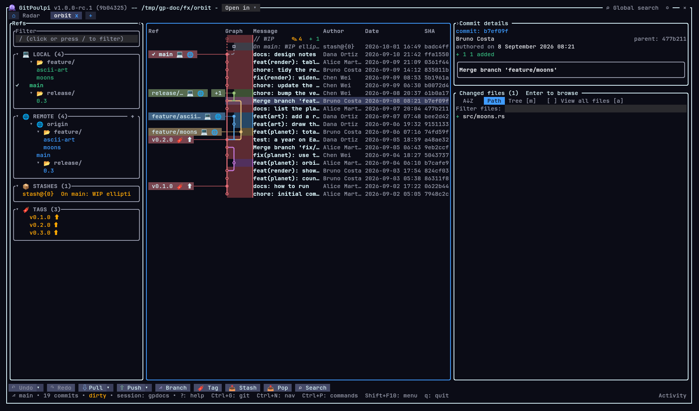

[English](../log-and-history.md) · [Čeština](../cs/log-and-history.md) · [Deutsch](../de/log-and-history.md) · [Español](../es/log-and-history.md) · [Français](../fr/log-and-history.md) · [Italiano](../it/log-and-history.md) · **日本語** · [한국어](../ko/log-and-history.md) · [Nederlands](../nl/log-and-history.md) · [Polski](../pl/log-and-history.md) · [Português (Brasil)](../pt-BR/log-and-history.md) · [Português (Portugal)](../pt-PT/log-and-history.md) · [Русский](../ru/log-and-history.md) · [Svenska](../sv/log-and-history.md) · [Türkçe](../tr/log-and-history.md) · [Українська](../uk/log-and-history.md) · [简体中文](../zh-CN/log-and-history.md)

# ログを使う

ログは GitPoulpi の中心です。すべてのブランチ、tag、stash を載せた履歴全体をグラフとして表示します。このページでは、ログの読み方、その中での検索、commit や参照に対してできるすべての操作を説明します。各エリアの名前は[インターフェースツアー](interface-tour.md)にあり、正確なキーは[キーバインド](keybindings.md)、マウスのジェスチャーは[マウスとジェスチャー](mouse-and-gestures.md)にあります。


## グラフの読み方

各行が 1 つの commit で、新しいものが上です。点は commit のレーン上にあり、線は commit とその親をつなぎます。merge では 2 本の線が合流します。左側のピルは、その commit 上のブランチと tag をレーンの色で示し、点へ細い線でつながっています。ノートパソコンのアイコンはローカルブランチ、地球儀はリモートブランチ、`✓` はチェックアウト中のブランチです。`+N` は、その commit を指す参照がほかにもあることを示します。カーソルを合わせると一覧が出ます。下のメニューからも開けます。

最初の行は**作業中の変更**です（破線の丸。commit していない作業で、その土台の commit につながっています）。stash は、作成した commit の隣のレーン上に小さな四角として表示されます。

### 色、行の色付け、アバター

レーンの色はテーマで決まります。*設定 > 外観 > グラフのカラーテーマ*では、任意のテーマと任意のレーンパレットを組み合わせられます。パレットの *アプリ: グラフのカラーテーマを変更...* ピッカー（`Ctrl+N Shift+Y`）では、各パレットをその場でプレビューできます。[テーマ](themes.md)を参照してください。*グラフのレーン背景*を**行の色付け**にすると、グラフ列の背面にレーンの色の淡い帯と、その端に細いバーが描かれます。*行の色付けの強さ*（**強**、**中**（既定）、**弱**）で、帯の淡さを調整します。

| Serie レーンパレット + 行の色付け | Material レーンパレット + 行の色付け |
|---|---|
|  |  |

*作成者のアバター*（グラフの点の中、または作成者列の中の画像）は、既定ではオフです。オンにすると、各作成者のメールアドレスのハッシュが Gravatar に送られ、ホスティングプロバイダーにも問い合わせます。同じページの*アバターの取得元*と*アバターのフォールバック*で、画像の取得元と、画像がないときに描くものを選びます。

ターミナルが画像を表示できない場合、グラフは文字で描かれます。*グラフの描画方式*と*画像プロトコル*でどちらかを強制できます。[トラブルシューティング](troubleshooting.md)を参照してください。

選択中またはカーソル下の行のハイライトは、commit の丸から始まります。その左のレーンは通常の背景のままです。

### 列

ヘッダーを右クリックして列を選びます：**Ref**、**Graph**、**概要**（常にオン）、**作成者**、**日付**、**変更**、**SHA**。任意の**変更**列には、commit ごとに `n files +追加 -削除` が表示されます。2 つのヘッダーの境界をドラッグすると列幅を変えられます。この選択はターミナルのセル単位で記憶されます。既定の `ui.column_resize = "line"` では、境界は列の終わりにある 1 セル幅の隙間です。ヘッダー行にはそこに小さな目印があり、ポインターが隙間にある間（ヘッダー上でも表のどこでも）、アクセント色の細い線が表の全高にわたって描かれ、線上のどこからでもドラッグしてサイズを変えられます（対応するターミナルでは、ポインターがサイズ変更用の形になります）。`"header"` では目印も線もなく、境界の次のヘッダーセルの最初の文字がホバーで光り、そこからドラッグを始めます（ヘッダー行のみ。設定 > ログとグラフ > 列のサイズ変更）。行の見た目はどちらのモードでも同じです。隙間は左の列の一部なので、選択や行の色づけはそこを通り抜けます。ウィンドウのサイズを変えたり最大化したりしても、Ref、Graph などの列は幅を保ち、**概要**だけが伸び縮みします（ウィンドウが非常に狭いときは、ほかの列が一時的に縮み、Graph が先に縮みます。ウィンドウが広がると、設定した幅に戻ります）。Graph 列を最小の幅（commit の点 1 つ分）まで縮めると、グラフはコンパクトになり、すべての commit が 1 本のレーンに上下に並び、ブランチや merge の線は描かれません。あと 1 セル広げると、ツリーが戻ります。作成者の画像を commit の円の中に表示している場合（設定 > 外観 > 作成者のアバター：graph）、円の幅は 2 セルになるため、列は 1 セル手前（3 セル）で止まり、画像が切れることはありません。

ヘッダーをドラッグすると、名前のゴーストがポインターに付いてきて、列が移る位置にアクセント色のバーが出ます。順序は離したときに変わり、`Esc` でキャンセルできます。右クリックで開く選択ウィンドウはチェックリスト（`[x]` / `[ ]`）で、タイトルに ✕ があります。パレット（`表示: Log: 表示する列を選択`）からも開け、矢印キーで移動し、`Space` / `Enter` で切り替えます。

キーボードでは、`Shift+C`（またはパレットの `表示: Log列: 移動・幅変更する列を選ぶ`）で列を選ぶと、そのヘッダーのセルが点灯します。続けて `Tab` / `Shift+Tab` で別の列を選び、`<` / `>` で表示中の列の中で 1 つ左または右へ移動し（ヘッダーのドラッグと同じ操作）、`]` / `[` で広げたり狭めたりし（境界のドラッグと同じ操作。最後の列は左端が動きます）、`0` ですべての幅を自動に戻し、`Esc` か `Enter` で終了します。その間も、矢印キーで commit の移動はできます。順序と幅はドラッグの場合と同様に記憶され、Log 専用です。diff の横の commit 列は、別に自分の設定を持ちます。

*内容に合わせる。* 列の境界を**ダブルクリック**すると、その左の列が、見えている中で最も幅の広い内容とヘッダーに合わせて調整されます（全角文字や絵文字は占めるセル数で数えます）。「ペインに合わせる」レイアウトではログが常にペインを埋めるため、**概要**が自分の取り分を、ほかの列が最小幅を確保したうえで、ペインに余裕のある幅までで止まります。そのときステータス行には `作成者には 34 セル必要ですが、収まるのは 20 セルです。` のように出ます。キーボードでも同じで、列を選んだ状態（`Shift+C`、`Tab`）で `=` がその列を、`+` が全列を内容に合わせます。パレットには `表示: Log列: 列を内容に合わせる` と `... 全列を内容に合わせる` があり、右クリックの選択ウィンドウには、チェックボックスの下に `<列>を内容に合わせる`（ポインター下の列）、`全列を内容に合わせる`、`列の幅をリセット` が並びます。**概要**は伸縮する列で、合わせるべき自前の幅を持たず、ほかの列が残した幅を使います。

*横スクロール。* 既定ではすべての列がペインに収まります。**横スクロール**レイアウト（選択ウィンドウの `横スクロール（列は幅を保つ）` チェックボックス、設定 > ログとグラフ > 列のレイアウト、パレットの `表示: Log: 列の横スクロールを切り替え`、または列を選んだ状態での `s`）では、**概要**を含め列が幅を保ちます（そこでは概要も自前の幅を持ち、合わせると最も長い要約に合います）。ウィンドウが狭くても何も省かれず、表がペインより広くなることがあります。その場合は下の枠線のバーでスクロールします：つまみをドラッグ、何もない軌道を押すとつまみがポインターの位置に来ます。端の矢印も使えます。キーボードでは `Shift+Left` / `Shift+Right` で 4 セルずつスクロールし（パレットには `表示: Log: 列を左へスクロール` / `列を右へスクロール`）、水平ホイールや表の上での `Shift`+ホイールも同じです。列を選ぶ（`Shift+C`、`Tab`）と、その列が視界に入ります。ペインより狭い表では右側に空白が残り、選択行の帯は枠線まで伸びます。レイアウトごとに幅は別々です（`ui.log_column_widths` と `ui.log_column_widths_scroll`）。横スクロールレイアウトで最初にドラッグ、キー操作、内容合わせを行うと、すべての列が現在の幅で保存されるので、動くのは変更した列だけです。「ペインに合わせる」レイアウトでペインに収まらない場合は、そう表示して、このレイアウトを案内します。

*最後の列のグリップ。* 最後の列にも、その列自身の最後のセルにグリップがあります（ペインの境界ではありません。そちらは引き続きペインの大きさを変えます）：ドラッグするとポインターの移動量だけ動き、差分は**概要**が吸収します。**SHA** は既定で 8 セル幅です（7 桁とそのグリップのセル）。


### 作成者と `.mailmap`

リポジトリに `.mailmap`（複数の名前で commit した人に、1 つの名前とメールアドレスを割り当てる git のファイル）があると、Log の**作成者**列、commit の詳細、Blame、ファイル履歴には、`git log` と同じように**正規の**名義が表示されます。commit 自体は変更されません。設定 `log.use_mailmap`（設定 > ログとグラフ、既定でオン）をオフにすると、保存されている名前が表示されます。作成者での検索は、表示されている名前とメールアドレスに一致するので、正規の名前で検索すると、その人のすべての commit が見つかります。履歴ワークベンチの**名義**タブは、履歴にある名前とメールアドレスを一覧にして、`.mailmap` の行を代わりに書き込みます。詳しくは `history-rewrite.md` を参照してください。ターミナルからは `gitpoulpi mailmap list|check|add` を使います。

## 検索する

- **検索**（`f`、ツールバーの**検索**ボタン、またはパレットの *ナビゲーション: Commitを検索...*）：commit メッセージ全体、作成者の名前とメールアドレス、ハッシュ、参照名に一致させます。一致しないものは暗くなり、グラフの形はそのまま保たれます。`Enter` / `Shift+Enter` で次/前の一致へ移動します。
- **Refs の絞り込み**（サイドバーで `/`）：ブランチ、tag、リモートの一覧を名前で絞り込みます。
- **ソロ表示**（`o` キー、または参照・フォルダー・リモートのメニュー）：ソロ表示にした参照の commit だけを表示します。複数をソロ表示にすると、その和集合が表示されます。`Shift+O` でソロ表示を解除します。
- 参照を**グラフで非表示**にする（そのメニュー）と、グラフから取り除かれます：その pill が消え、その参照だけが到達できる commit も消えます（チェックアウト中の commit は作業ツリーの行とともに常に残ります）。Refs のタイトルの*非表示 n* が件数で、**すべて表示**（`Shift+H`）で元に戻します。ステータス行の総数は見えている履歴を数えます。

## ブランチ、tag、Refs サイドバー

ローカルブランチまたは tag をダブルクリックするとチェックアウトします。参照（サイドバー内、またはログのそのピル）を右クリックするとメニューが開きます。主な項目は次のとおりです。

| 項目 | 動作 |
|---|---|
| グラフで表示 | ログを参照の commit までスクロールし（必要なら先に古い履歴を読み込み）、その行を点滅させます。選択は変わりません。設定で*参照をクリックしてグラフに表示*をオフにしていない限り、参照を 1 回クリックしても同じ動作になります。グラフで非表示の参照（またはソロ表示で除外された参照）の場合は、代わりにステータスバーにその旨が表示されます。 |
| チェックアウト | ブランチに切り替える、または tag で HEAD を切り離します。 |
| Merge、Rebase onto | この参照を、チェックアウト中のブランチに merge する／チェックアウト中のブランチをこの参照に rebase します。 |
| `<ブランチ>` を `<現在>` に早送り / `<現在>` を `<ブランチ>` に早送り | 早送りで済む場合にブランチを前に進めます。そうでない場合はグレーになり、理由が表示されます（`分岐しているため早送りできません`）。 |
| `<名前>` から worktree を作成... | リンクされた worktree を専用のタブで開きます。 |
| Pull、Push、Fetch、<ブランチ名> のリモート... | そのブランチに対するネットワーク操作（<ブランチ名> のリモート...はアップストリームを設定し、リモートごとに Push と Pull も のチェックボックスもあります）。 |
| グラフで非表示 / グラフに表示、ソロ表示 | 表示だけの操作です。リポジトリには手を加えずに、参照を非表示またはソロ表示にします。 |
| 名前を変更、削除 | 削除は先に確認します。リモート側の同名ブランチも一緒に削除できます。 |
| ブランチ名をコピー、リモートのブランチへのリンクをコピー | クリップボードへコピーします。 |

**tag の所在。** tag は、このコンピューターにも、リモートにも、その両方にもあり得ます。サイドバーの TAGS の行（と Log の tag のピル）は、名前の後ろのマーカーでそれを示します。tag にポインターを合わせると、同じ内容が文章で表示されます。

| マーカー | 意味 |
|---|---|
| 上矢印 | ここにだけあります。どのリモートにもありません。メニューに *Push* が出ます |
| 左右の矢印 | ここと、リモートの両方に、同じ commit を指してあります |
| 下矢印（行は薄く表示） | リモートにだけあり、このリポジトリにはありません（一度も fetch していない、またはここで削除した）。メニューに *`<remote>` から `<tag>` を fetch* と *`<remote>` 上の `<tag>` を削除...* が出ます。パレットには `Git: 選択中の tag を fetch` があります |
| 上下の矢印 | リモートにもありますが、別の commit を指しています（push は拒否されます） |

git は tag にリモート追跡 ref を持たないため、GitPoulpi は、各リモートが何を持っているかを、直近の **fetch**（自動のものも含め、あらゆる fetch）と、自身の tag の push と削除から知ります。ブラウズ中にネットワークへ問い合わせることはありません。ほかの人がリモートの tag を変えた場合は、fetch すると見えるようになります。同じ情報は `gitpoulpi tag list`（フィールド `local`、`remote`、`differs_on`、`where`）にもあります。

**tag を削除する。** リモートにもある tag では、赤い**削除**が、番号付きの 3 つの行があるダイアログを開きます（`1`-`9`、または Up/Down と `Enter`。`Esc` でキャンセル）。選択中の行は、下に説明が表示されます。

1. **ローカルのみ削除**：このリポジトリからだけ削除します。すぐに実行され、リモートにまだあることがメッセージに表示されます。リモートでも削除しない限り、**次の fetch で戻ってきます**（git はリモートの tag に追従するためです）。
2. **`<remote>` 上で削除**：そこから全員に対して削除します（`git push <remote> --delete`）。リモートの名前を示す確認が出ます。ローカルの tag は残ります。元に戻せません。
3. **ローカルと `<remote>` の両方で削除**：同じ確認の後で両方を削除するため、fetch しても戻りません。**元に戻すと、復元されるのはローカルの tag だけ**（同じ tag オブジェクト）で、ローカルだけに戻るため、リモートに戻すには *Push* します。


リモートが複数あると、それぞれに行が出ます。ここにだけある tag は、通常の確認だけです。1 つのリモートにだけある tag は、そのリモートの確認へ直接進みます。CLI：`gitpoulpi tag delete <name> [--local | --remote <r> | --both [--remote <r>]]`。

**fetch と tag。** fetch は、各リモートが持つもの（マーカー）も更新し、git 自身の tag の追従も引き続き働きます。ここだけで削除した tag は、再び fetch されます。誰かが**リモートで削除した** tag は、どの fetch の後でも、マーカーのリモート側からは消えますが、ここにはローカルの tag として残ります（*ここにだけ*の状態になります）。git の既定が tag を prune しないためです。**設定 > 同期 > tag の自動プルーン**（既定でオフ。`gitpoulpi fetch --prune-tags`）はそのようなローカルの tag も削除しますが、対象はリモートにあった tag だけで、一度も push していない tag や、動かした tag には触れません。何が prune されたかを知るには、git 2.41 以降が必要です。

**新しいブランチまたは tag。** ツールバーの**ブランチ**と **Tag** ボタン、`Ctrl+G b` と `Ctrl+G t`、または commit の*ここにブランチを作成...*を使うと、対象の commit の行の Ref 列にあるインラインのボックスで名前を尋ねられます。`Enter` で作成し、`Esc` でキャンセルします。git が拒否する名前は、ボックスを閉じずに赤字で報告されます。

ref のない commit では、その行にポインタを乗せると、Ref 列に所属ブランチ（なければリモートブランチ）の名前が淡いピルで表示されます。名前は履歴から推定されます。tag が仮表示されることはありません。merge の後に削除されたブランチも、merge commit の件名にある名前で、取り消し線付きで表示されます（`Merge branch 'x'`、`Merge pull request #N from owner/x` など）。squash merge、rebase、fast-forward ではそのような痕跡は残りません。ピルにホバーすると種類が表示されます。ピルは何も作成しません。ブランチの作成は上のコマンドで行います。設定 > ログとグラフ の **ホバー中のcommitに、ブランチの仮表示を出す** でオフにできます。Ref 列が狭すぎるときは描画されません。

**リモート。** リモートのタイトルの `+` で追加します。リモート名を右クリックすると、fetch、Web リンクのコピー、既定のリモートに設定、グラフで非表示、URL の編集、削除ができます。**リモートを非表示**にする（その行の ⊙、メニューの*リモートをグラフで非表示*、またはパレットの `リモート: リモートをグラフで非表示...`）と、現在のブランチもあとで増えるブランチもすべて非表示になり、それだけが到達できる commit もログから消えます：無関係なアーカイブ用リモートの履歴を除いて、一つの履歴だけを見るための手段です。戻すには*リモートをグラフに表示*を使います。リモートを表示すると、個別に非表示にされていたそのブランチも表示されます。非表示のリモートのブランチは、その ⊙ をクリックすると、先にリモートを表示するようステータス行に出ます。

**Stash。** **Stash** は（未追跡ファイルを含め）すべてを stash します。`Ctrl+G m` は先にメッセージを尋ねます（AI がオンのとき、そのプロンプト内で `Ctrl+G` を押すと提案が出ます）。ログまたは STASHES セクションの stash の行を右クリックすると、**Pop（復元して削除）**、**Apply（stashを残す）**、**Drop** が使えます。

**Worktree。** *`<名前>` から worktree を作成...*（ブランチ、tag、commit で使えます）を選ぶとダイアログが開き、リポジトリの隣のフォルダー、任意の新しいブランチ名、そして「新しい worktree をタブで開く」が提案されます。worktree は WORKTREE セクションに表示されます。ダブルクリックで開き、worktree を削除するとそのタブは自動的に閉じます。機能全体（別のツールで開く、worktree のブランチの merge、削除）は [worktree](worktrees.md) に、同じペインのサブモジュールのセクションは[サブモジュール](submodules.md)にあります。

## 参照を commit にドラッグする

ブランチ（サイドバー内、またはログのそのピル）を押したままドラッグできます。ゴーストのラベルがポインターに付いてきて、有効な対象が点灯します。離すとメニューが開きます。

- ローカルブランチを**別のローカルブランチへ**: Merge、Rebase、インタラクティブ rebase、早送り。
- ローカルブランチを**リモートブランチへ**: そのリモートへ Push。
- リモートブランチを**ローカルブランチへ**: Merge、Rebase、早送り、Pull。

`Esc` でドラッグをキャンセルします。キーボードでの代わりは、パレットコマンド *Refs: 選択中の参照をチェックアウト中のブランチにドロップ...* です。

**Merge か fast-forward か。** ターゲットに独自の commit がない（ドラッグしたブランチが先に進んでいるだけの）場合、merge はターゲットを前に動かすだけで済みます。既定（設定 > Git > **Merge の fast-forward** = *never*、またはリポジトリごとの Merge オプションのページでの選択）では、メニューの行は *x を y に merge（merge commit）* となり、本物の merge commit を作るので、履歴にブランチが残ります。単純に動かしたいときは、別の行 *y を x に fast-forward* を使います（一直線の履歴にしたいなら、代わりに *Rebase* を使います）。*allowed* では Merge の行が *（fast-forward）*、*only* では *（fast-forward のみ）* となり、ブランチが分岐している場合は理由付きでグレー表示されます。同じ行とラベルはブランチ自身のメニューにもあり、`gitpoulpi merge --ff | --no-ff | --ff-only` で merge ごとに選べます。

## commit メニュー

commit を右クリックする（または選択して `.` を押す）と、メニューが開きます。


| 項目 | 動作 |
|---|---|
| **`<ブランチ>` に cherry-pick** | その commit を、チェックアウト中のブランチに再適用します。 |
| **commit をリバート...** | それを打ち消す commit を作成します。マージ commit では、先にドロップダウンでどの親をメインライン（残す側。親 1 はマージが作られたブランチ）にするかを尋ね、そのあといつもの確認が出ます。元に戻すで以前の状態に戻せます。 |
| **`<ブランチ>` をこの commit にリセット** | reset の種類を選ぶサブメニュー。hard reset は確認を求めます。 |
| **commit メッセージを編集...** | 下記を参照。 |
| **修正...** | commit のメッセージ、作成者の名前・メール・日付を 1 つのダイアログで変更します。[commit を修正する](#commit-を修正するメッセージ作成者日付)を参照。 |
| **commit を分割...** | commit を複数に分けます。[commit を分割する](#commit-を分割する)を参照。 |
| **commit を分割（AI）...** | 同じ操作で、グループ分けをモデルが提案します。[AI](ai.md) がオンのときだけ表示されます。 |
| **変更を説明（AI）** | AI による説明のポップアップ。[AI](ai.md) がオンのときだけ表示されます。 |
| **ここからインタラクティブに rebase...** | 下記を参照。 |
| **ここにブランチを作成...**、**ここにtagを作成...**、**ここに注釈付きtagを作成...** | インラインの名前ボックス。 |
| **この commit をチェックアウト**、**ここに worktree を作成...** | HEAD を切り離す、または worktree を作成します。 |
| **この commit からパッチを作成...**、**ここから `<ブランチ>` までパッチを作成...** | `.patch` ファイルを書き出します。*パッチを適用...* は参照のメニューにあります。 |
| **リモートの commit へのリンクをコピー**、**コピー** > | クリップボードへ（ハッシュ、メッセージなど）。 |

## commit メッセージを編集する（reword）

*commit メッセージを編集...*（または `Ctrl+G e`）でメッセージ全体が開きます。カウンター付きの 1 行の概要、その下の説明、**キャンセル**、**メッセージを更新**があります。チェックアウト中のブランチの任意の commit（HEAD またはその祖先）を reword できます。その上に積まれた commit は、それぞれの tree、作成者、日付を保ったまま作り直され、merge は merge のまま残り、ステージ済み/未ステージの変更はそのままです。その commit がすでに push 済みの場合、ポップアップが琥珀色で、強制 push（リース付き）が必要になると警告し、2 回目の確認を求めます。`Ctrl+Z`（ツールバーの元に戻す）で reword を取り消せます。[元に戻す/やり直す](undo-redo.md)を参照してください。ステータスバーには、以前の先端も表示されます。

チェックアウト中のブランチにない commit（別のブランチにある commit）は、今いる場所では reword も修正もできないので、*commit メッセージを編集...* と *修正...* は代わりに**別のブランチの commit を編集**を開きます。選択肢の一覧です（`Up` / `Down` または `Ctrl+J` / `Ctrl+K` で移動、`Enter` またはクリックで選択、`Esc`、✕、または**キャンセル (C)** で閉じます）。

- **`<ブランチ>` をチェックアウトして編集 (1)**：その commit を履歴に含むローカルブランチごとに 1 行です（`1` から `8`、先頭の 8 件で、残りは件数で表示されます）。ブランチはいつもの方法でチェックアウトされ、そのあとそのブランチで編集が開きます。取り消しはこの 2 つの操作それぞれのものです。`Ctrl+Z` は編集を取り消し、チェックアウトはチェックアウトのままです。
- **高度な履歴の書き換えで編集 (R)**：その commit で[履歴の書き換えワークベンチ](history-rewrite.md)を開きます（それを含むビルドの場合）。
- **ここにブランチを作成... (B)**：その commit を含むローカルブランチがない場合（たとえばリモートブランチにしかない場合）だけです。その commit にブランチを作るための名前ボックスが開きます。

## commit を修正する（メッセージ・作成者・日付）

commit メニューの *修正...*（または `Ctrl+G Shift+E`、コマンドパレットの *Commit: 修正...*）を選ぶと、commit のプロパティ（概要、説明、作成者の名前・メール・日付）を 1 つのダイアログで編集できます。各欄には commit の現在の値が入っています。好きな欄を変更して **適用** を押すと、変更した欄だけが送られます。日付は `YYYY-MM-DD HH:MM:SS +HH:MM` の形式で、編集するまでは UTC で表示されます。コミッターは現在のユーザー、コミット日時は現在の日時になります（reword と同じ）。チェックアウト中のブランチのどの commit でも修正でき、ルール・プッシュ済み commit の警告・2 回目の確認は *commit メッセージを編集...* と同じです。上に積まれた commit は、それぞれの作成者と日付のまま作り直され、ステージ済み・未ステージの変更には触れません。`Ctrl+Z`（ツールバーの元に戻す）で取り消せます。履歴書き換えを含むビルドでは、ダイアログの左下にある **履歴をさらに深く変更...**（`Alt+H`）が、何も適用せずにダイアログを閉じ、この commit から最新の commit までを対象にした[履歴書き換えワークベンチ](history-rewrite.md)を開きます。欄を編集していた場合は先に確認します（`Esc` で確定）。`Ctrl+N` を押すとダイアログのすべての欄とボタンにバッジが表示されます。バッジを押すとその欄にカーソルが置かれるか、そのボタンが押されます（[バッジ](keybindings.md#バッジ)を参照）。

どの開き方でも、ダイアログはすべての欄を表示し、すべて編集できる完全な形で開きます。違うのはキャレットの位置だけです。commit の詳細パネル（右側）では、概要・説明・作成者のブロックを右クリックして *概要を修正...*、*説明を修正...*、*作成者を修正...* を選ぶか、概要、説明、作成者、作成日時をダブルクリックすると、その欄にキャレットを置いてダイアログが開きます。キーボードでの操作は Log と詳細パネルのどちらでも使えます：`Ctrl+G Shift+E`（すべての欄）、`Ctrl+G Shift+A`（作成者）、パレットの *Commit: 修正...*、*Commit: 作成者を修正...*、*Commit: 概要を修正...*、*Commit: 説明を修正...*。どちらのキーも割り当て変更できます（`git_prefix.amend`、`git_prefix.edit_author`。[キーバインド](keybindings.md)を参照）。スクリプトやエージェントからは `gitpoulpi amend <commit>` に `--message`（または `--summary` / `--description`）、`--author-name`、`--author-email`、`--author-date` と対応する `--committer-*` を指定します（MCP ツール名は `amend`）。

## commit を分割する

commit のメニューの*commit を分割...*（またはパレットの*Git: 選択中のCommitを分割...*）で、1 つの commit を古い順に 2 つ以上の commit に分けます。チェックアウト中のブランチの merge ではない commit なら、どれでも分割できます（HEAD またはその祖先で、ルート commit も可）。分割エディターは 2 つのペインでできています。左が**新しい commit**（それぞれにメッセージ）、右がその commit の**変更**で、ファイルとハンクごとに 1 行ずつ並び、各行の `[N v]` フィールドが、その変更を受け取る新しい commit を示します。

| キー | マウス | 動作 |
|---|---|---|
| `Up` / `Down`（`k` / `j`） | 行をクリック | 変更の間を移動（`Shift+Up` / `Shift+Down` で選択範囲を広げる） |
| `1`-`9` | 行の `[N v]` フィールド、続けて選択肢 | 選択中の変更をその新しい commit に割り当てる。`0` は未割り当てにする |
| `Enter` / `m` | `[N v]` フィールド | 選択中の変更の割り当て先 commit の一覧を開く |
| `n` | `+ 新しい commit` | 選択中の変更を新しい commit に入れる |
| `v` | | **行単位モード**：ハンクを 1 行ずつ分ける（行をドラッグして範囲を選択） |
| `Tab` | ペインをクリック | commit と変更のペインを切り替える |
| `e` / `Enter`（commit ペインで） | 鉛筆 | その commit のメッセージを編集 |
| `d` / `Delete` | ✕ | 新しい commit を削除（その変更は未割り当てになる） |
| `Alt+Up` / `Alt+Down` | 矢印 | 新しい commit を上または下へ移動 |
| `s` | チェックボックス | 新しい commit に署名する |
| `Shift+R` | `リセット` | 最初の計画に戻す |
| `Ctrl+S` | `N 個に分割` | 分割する |
| `Esc` | ✕、`キャンセル` | 閉じる。編集中のときは、もう一度押すと確定 |

すべての変更を、ちょうど 1 つの commit に割り当てる必要があります。エディターは*未割り当て*のまま残っている数を数え、それが 0 になるまでボタンは受け付けません。バイナリのファイル、モードだけが変わるファイル、その commit で追加または削除されたファイル、サブモジュール、LFS のファイルは、丸ごとでしか割り当てられません。最初の commit には元のメッセージが入った状態で始まるので、新しい commit にはそれぞれメッセージを付けてください。新しい commit は元の作成者と日付を保ち、committer は今のあなたになります。

**変更されるのはブランチだけです。** 最後の新しい commit は元の commit と完全に同じ内容になるため、その上の commit は、同じ tree、作成者、メッセージで作り直され（merge は merge のまま）、ステージ済みと未ステージの変更には触れません。作業ツリーが汚れていても問題なく、競合も起こりません。フックは実行されません。auto-stash が保留中の間は、分割できません。

**署名。** *commit に署名*チェックボックスの初期値は、リポジトリの `commit.gpgSign` です。オフのときは、書き換えられた commit（新しい commit とその上の commit）の署名が外れ、エディターがチェックボックスの下にそのことを表示します。オンのときは、すべてに署名します。署名に失敗した場合は、何も変更されません。

**元に戻す。** `Ctrl+Z`（ツールバーの元に戻す）を 1 回押すと、作業ツリーが汚れていても元の commit が戻ります。[元に戻す / やり直す](undo-redo.md)を参照してください。すでに push 済みの commit は、その後に強制 push（with lease）が必要です。

**インタラクティブ rebase から。** rebase レビューの各行には、小さな**分割...**ボタンがあります（行で `t`）。同じエディターがその commit に対して開き、分割が終わると（またはキャンセルすると）、新しい履歴のまま rebase レビュー画面に戻ります。計画を編集していた場合は、それらの編集が失われることを確認するため、もう一度分割を押してください。

スクリプトやエージェント向け：[CLI リファレンス](cli-reference.md)の `split-source` と `split-commit`。エージェントが、確認用にこのエディターを入力済みで開くこともできます（`ui propose split`、[MCP とエージェント](mcp-and-agents.md)を参照）。

## インタラクティブ rebase

チェックアウト中のブランチの祖先にあたる commit で**ここからインタラクティブに rebase...**を選ぶか、ブランチを別のブランチにドラッグして*インタラクティブ rebase*を選びます。ログが確認用の画面に置き換わります。1 commit が 1 行で、新しいものが上、各行にドラッグハンドルと操作のドロップダウンがあります。


| 操作 | キー | 効果 |
|---|---|---|
| Pick | `p` | commit を残します。 |
| Reword | `r` | 新しいメッセージで残します。 |
| Squash | `s` | 下の commit にまとめ、メッセージを結合します。 |
| Fixup | `f` | 下の commit にまとめ、こちらのメッセージは捨てます。 |
| Drop | `d` | 除外します。 |
| Edit | `e` | そこで止めて、amend できるようにします。 |

行をドラッグする（または `Ctrl+Up` / `Ctrl+Down`）と並べ替えられます。`a` で autosquash をプレビューします（`squash!` と `fixup!` の commit が対象の隣に移動します）。**Rebaseを開始**（`Ctrl+S`）を押すまでは何も起こりません。**リセット**は計画を元に戻し、**Rebaseをキャンセル**（`Esc`）は何も変えずに画面を抜けます。ステップが競合や `edit` で止まると、ログの上のバナーに**続行**、**スキップ**、**中止**が表示されます。merge commit を含む範囲はインタラクティブに rebase できません。メニュー項目にその理由が表示されます。

## 複数の commit を cherry-pick する

`Ctrl+クリック` で commit を切り替え、`Shift+クリック`（または `Alt+クリック`）で範囲を選択し、`Space` で現在の commit を切り替え、`Esc` で選択を解除します。選択した commit を右クリックして **{n} 件の commit を `<ブランチ>` に cherry-pick...** を選ぶと、同じ確認画面が開きます。操作も並べ替えも同じで、**Cherry-pickを開始**で順に再適用されます。

## commit を Mermaid gitGraph としてコピーする


ログで commit を選択し（`Ctrl+クリック`、`Shift+クリック`、`Space`。または 1 つにカーソルを置いたままで）、
**Mermaid gitGraph としてコピー...** を開きます：ログで `Shift+Y`、commit メニューの**コピー**サブメニュー、
またはパレットの `Log: Mermaid gitGraph としてコピー...` です。ポップアップに、生成された
[Mermaid](https://mermaid.js.org/syntax/gitgraph.html) のスクリプトがライブで、スクロール可能な形で表示されます。
`Enter`（または**コピー**ボタン）で、そのテキストそのものがクリップボードに入ります。README、プルリクエストの説明、
[mermaid.live](https://mermaid.live) に貼り付けられます。

ポップアップには 3 つのコンボボックス、チェックボックス 1 つ、プレビューがあります（`Tab` で移動し、各コンボボックスは
`Enter`、`Space`、`Down` で開きます）：

- **Commits**：選択範囲、または、1 つの commit が選択されていて HEAD がその子孫である場合は
  **選択から HEAD まで**、その間の commit の連なりです（ログの読み込み済みの部分から答えます）。
- **詳細度**：**構造**（`structure`。commit、ブランチ、マージ。ID は短い SHA）、**参照**（`refs`。実際のブランチ名を
  Mermaid のブランチとして、tag を `tag:` として、HEAD の commit を `type: HIGHLIGHT` として追加）、
  **件名**（`subjects`。commit の ID が `<sha> <件名>` になり、エスケープされ、`ui.mermaid_subject_width` 文字で切り詰められます）、
  **完全**（`full`。ID に作者と UTC の日付を追加）。
- **方向**：左から右（`gitGraph LR:`）または上から下（`gitGraph TB:`）。
- **```mermaid フェンスを含める**は、スクリプトを Markdown のコードフェンスで囲みます。

詳細度、方向、フェンスは記憶されます（`ui.mermaid_detail`、`ui.mermaid_orientation`、`ui.mermaid_fence`）。
同じ生成器をコマンドラインからも実行できます：
`gitpoulpi log --format mermaid [--detail structure|refs|subjects|full] [--orientation lr|tb] [--fence]
[--range A..B | --limit N]`（[CLI リファレンス](cli-reference.md)を参照）。MCP サーバーは `log` ツールの
`format` 引数として公開しています。

Mermaid の `gitGraph` はグラフの記述ではなく再生用の言語（commit、branch、checkout、merge）なので、生成器は
知っておくと役立ついくつかの選択をします：

- commit は、選択された最初の親のブランチを継続します。ほかの子は、実際のブランチ名にちなんだ新しいブランチを開きます
  （`構造` では `b1`、`b2`...）。最初のブランチは `main`（または `mainBranchName` ヘッダーによる実際の名前）で、
  HEAD の first-parent の連なりをたどります。
- merge は、もう一方の親のブランチに合流します。そのブランチが親より先に進んでいる場合、生成器は親の位置に小さな
  ポインター用のブランチ（`<ブランチ>-<sha>`）を分岐させ、それを merge するので、merge は正しい commit を指します。
- 選択範囲の外にある親は除かれます：選択された親がなくなった commit は独立した線として始まるので、選択に抜けがあると
  切り離された線として表示されます。
- オクトパス merge（親が 3 つ以上）は連続した merge になり、途中のものには ` (octopus 1/2)` が付き、最後のものが
  実際の commit を持ちます。
- cherry-pick は検出されません。件名の二重引用符はアポストロフィになります（Mermaid ではエスケープできないため）。


## commit を比較する

ログの行を 2 つ以上選択します。`Ctrl+クリック` で行を切り替え、`Shift+クリック`（または `Alt+クリック`、`Shift+Up/Down`、`Alt+Up/Down`）で範囲を選択し、`Space` で現在の行を切り替えます。commit、**WIP** 行、**stash** 行のどれでも選択できます。右ペインは **比較** ペインになります。

- ヘッダーに **入れ替え** ボタンがあり、その下に、選択した各行がログの順（新しいものが先）で 2 行の**カード**として並びます。作者のアバター（ログのアバター設定に従い、画像対応のターミナルでは画像、それ以外はイニシャル）、名前、何時間前か、短い ID、概要。**WIP** 行は「作業ツリー / 未 commit の変更」、stash は stash のグリフ、`stash@{n}`、そのメッセージが表示されます。最も古い端には **比較元** のタグ、最も新しい端には **比較先** のタグが付きます（入れ替えるとタグが移ります）。3 行以上では、変更がまとめて比較されるという注記が出ます。カードの一覧はペインの最大 3 分の 1 までで、それを超えるとスクロールします（ホイール、スクロールバー、または下のスプリッターをドラッグして大きさを変更）。
- カードをクリックすると、ログのカーソルがその行に移り、グラフ上で点滅します。選択は変わらないので、その後 `Space` を押すとその行が選択から外れます。
- その下に、いつもの変更ファイルの一覧（パス表示またはツリー表示、フィルター、並べ替え）で、両者の間で異なるファイルが表示されます。ファイルをクリックするか `Enter` を押すと、中央に diff が開きます。レイアウトは同じインライン表示または分割表示で、新しい側の端について Blame、ファイル履歴、ファイルビューが使えます。


何が比較されるかは選択によって決まります。

| 選択 | 比較されるもの |
|---|---|
| 2 つの commit（または stash と commit） | クリックした順にかかわらず、ログの順で古い方を新しい方と比較 |
| WIP 行と commit または stash | その commit と作業ツリー：追跡対象ファイルのステージ済みと未ステージの変更（未追跡ファイルは diff に含まれません） |
| 3 つ以上の commit | それらの変更をまとめたもの：最も古いものの直前から最も新しいものまで（merge は最初の親をたどります） |

名前変更または移動されたファイルは 1 つのファイルとして表示され、その diff の先頭に旧名と類似度が出ます。**入れ替え**（`x`）は 2 行の比較の両端を入れ替えます。常に新しい側である WIP 行がある場合や、3 行以上の範囲では、入れ替えるものがありません。WIP 行との比較は、ファイルを保存するたびに作業ツリーに追従します。

キーボード：`v`（またはコマンドパレットの **Log: 選択を比較**）で、比較のファイル一覧にフォーカスが移ります。`x`（または **Log: 比較の両端を入れ替え**）で入れ替えます。`n`（または **Log: 次の比較対象の行へ移動**）はカードをクリックする操作のキーボード版で、ログのカーソルが次の選択行へ移ります（最後まで行くと先頭に戻ります）。`Esc` か行の単純なクリックで、単一の commit に戻ります。**Cherry-pick** の項目が数えるのは選択中の commit だけで、WIP 行と stash は無視されます。

同じ一覧はスクリプトやエージェントからも使えます：`gitpoulpi diff --from <rev> [--to <rev|worktree>] [--name-only]`（CLI と MCP の `diff` ツール。`--to` の既定は作業ツリー）。

## 競合とその他のバナー

merge、rebase、cherry-pick、revert が競合で停止すると、ログの上にバナーが表示され、競合したファイルにはステータスペインで赤い `!` が付きます。merge エディターで解決し、バナーの**続行**または **Mergeをcommit** を使うか、**中止**で取りやめます。[merge 競合の解決](merge-conflicts.md)を参照してください。

ログの上のそのほかのバナー：

| バナー | ボタン | パレット |
|---|---|---|
| *`<ブランチ>` を `<commit>` に rebase 中 · ステップ/合計 · ... で停止* | **続行**、**スキップ**、**中止** | *Rebase: 続行 / スキップ / 中止* |
| *パッチを適用中（git am）· 個数中 n 個目*（停止した `git am`） | **競合を解決...**（パッチが競合したとき）、**続行**、**スキップ**、**中止**（先に確認します） | *git am: 続行 / このパッチをスキップ / 中止* |
| *残った index.lock（n 秒前）がこのリポジトリへのすべての変更を妨げています*（git コマンドが異常終了して `.git/index.lock` が残った） | **index.lock を削除**（先に確認します。ファイルが作成から 10 秒以上たっている場合のみ表示されます） | *リポジトリ: 古い index.lock を削除* |
| *自動 stash が保留中: ...* | [自動 stash](#自動-stash)を参照 | *バナー: ...* |

## Blame

Blame はファイル全体を行番号と構文の色付きで表示し、コードの**右側**に注釈列を置きます（`ui.blame_side = "left"` で左側になります）。ファイルのバー（`Blame`）、ファイルメニュー、パレット、または履歴の行（`b`）から開きます。作業ツリーから開いた場合、まだ commit されていない行は別に表示されます（「ストリップ」を参照）。

- **ハンク。** 同じ commit が最後に変更した連続する行が 1 つのハンクです。最初の行には作成者のアバター（ターミナルが画像を描ける場合は画像、そうでなければイニシャルのバッジ、*作成者のアバター* がオフなら何も表示しない）、作成者、経過時間、commit の要約が出ます。残りの行には作成者の色バーだけが出ます。ハンクの間は細い線で区切られます。ハンクが画面の上から始まっている場合は、最初に見える行に注釈が繰り返されます。
- **ストリップ。** 注釈の隣に、作成者の色バーと**経過時間のヒートストリップ**があります。新しい行は暖色、古い行は寒色で、ファイル自身の最も古い行と最も新しい行を基準にします（凡例はタイトルにあります）。まだ commit されていない行は点線で、「Not committed yet」と表示されます。
- **カード。** 注釈の上にポインターをしばらく置くか `i` を押すと、ハンクの詳細カードが開きます。commit の完全な ID、作成者とメール、日付、要約、そしてその操作が表示されます。選択中のハンクは色付きになります。

  
- **操作**（カードの行、ハンク上の右クリックメニュー、キー、パレットの `Blame: ...`）：commit をログで表示（`Enter`）、その ID をコピー（`Shift+Y`）、このファイルに対する commit の diff を表示（`d`）、commit の親で Blame（`b`、名前変更を追跡）、ファイル履歴を開く（`Shift+H`）。
- **移動。** `j` / `k`、PageUp/PageDown、Home、`Shift+G`、ホイールは他と同じです。`n` / `p` で次 / 前のハンク、`Shift+N` / `Shift+P` で同じ commit の次 / 前のハンク、`g` で行番号へ移動します。
- **高いハンク。** 要約の下に、3 行以上のハンクは commit の短い ID と完全な日付（薄い色）を表示し、列が空かないようにします。
- **ミニマップ。** `ui.minimap` がオン（`Map` ボタン、`M`）のとき、ファイルのミニマップがコードの横に出て、ストリップと同じ経過時間の色で塗られます。クリックまたはドラッグでスクロールできます。
- **幅。** 注釈列の境界をドラッグするか、`>` / `<` を押します。幅は `ui.blame_width` に保存されます。

## ファイル履歴

diff バーの `ファイル │ すべて` の切り替えの `ファイル` 部分、ファイルメニュー、またはパレット（`ファイル履歴: ...`）から開きます。中央が 2 つに分かれ、左にファイルの commit が新しい順に（名前変更を追跡して）、右に選択した commit でのファイルの diff が Diff ビューのすべてのモード（ハンク / ファイル全体、インライン / 分割、単語 diff、ミニマップ、折り返し）で表示されます。

- **一覧。** commit ごとに 2 行です。1 行目は変更を表す文字（A 追加、M 変更、D 削除、R 名前変更）、要約、色付きの `+追加 -削除`。2 行目は薄い色で、作成者のアバター（*作成者のアバター* の設定に従ってログの作成者列が表示するものと同じ）、作成者、相対日付、commit の短い ID、そしてファイルの名前を変更した commit では `旧 -> 新`。一覧が狭いときは、名前変更、ID、作成者名の末尾の順に省略されますが、作成者と日付は常に残ります。末尾に近づくと 100 件ずつ読み込まれ、その間は `さらに読み込み中...` の行が出ます。
- **移動。** `j` / `k`、矢印、PageUp/PageDown、Home / End、ホイール、クリック。diff はすぐに追随します（diff はバックグラウンドで取得され、行ごとにキャッシュされ、キーを押し続けても要求するのは 1 つだけです）。名前変更より前の行は、そのときのファイル名で比較されます。
- **Diff / ファイル / Blame。** ビューバーの **ファイルビュー**、**Diff**、**Blame** ボタンで、選択した commit について右側が何を表示するかを選びます。その commit の **Diffビュー**、**ファイルビュー**（その commit 時点のファイル）、または **Blame** で、すべて分割の内側で行われ、一覧は左に残り、列の切り替えの `ファイル` 部分は点灯したままです。選んだモードは行を移動しても保持され、右側は選択に追随します。キーは `Alt+1` / `Alt+2` / `Alt+3`（一覧では `d` / `o` / `b` も）で、どちらの半分からでも使え、パレットの `ファイル履歴: ...` も同じ動作です。`Esc` で Diff に戻ります。
- **列。** この一覧は、**ファイル**の一覧を表示している *Commit列* です。表示と非表示、サイズ、`ファイル │ すべて` の切り替えは [Commit列](interface-tour.md#commit列)でまとめて説明しています。`すべて` をクリックすると履歴を離れ、ビューは選択した commit のままになります。

  

  
- **2 つの commit の比較。** `Shift+Up` / `Shift+Down` または `Shift+クリック` で範囲を選ぶと、右側に両端の間のファイルの diff が、それぞれのパスとともに表示されます。`Esc` で範囲を解除します。
- **フォーカス。** `Tab`（またはクリック）でキーボードを diff に渡し、また戻します。diff は独自のキーを保ちます。
- **操作**（右クリックメニュー、キー、パレットの `ファイル履歴: ...`）：ログで表示（`Enter`、ダブルクリック。ログは必要なだけ遡って読み込まれます）、ID(`y`)または要約（`Shift+Y`）をコピー、diff を表示（`d`）、その commit 時点のファイル（`o`）またはその blame(`b`)を右に表示、作業ツリーと比較（`c`、もう一度押すと戻る）、ファイルをその版に復元（`Shift+R`、確認あり）。
- **元に戻す。** 版の復元はジャーナルに記録される 1 ステップです。元に戻す（`Ctrl+Z`）でファイルの元のバイト列が戻ります。
- **仕切り。** 2 つの半分の間の境界をドラッグするか、`Alt+Right` / `Alt+Left`、リセットは `Alt+0`。幅はセッションごとに記憶されます。

## Fetch、pull、push

- **Pull**（`Ctrl+G p`）は、*設定 > Git とエンコード > pull ボタン*の指定どおりに pull します（`git.pull_mode`: merge、早送りのみ、rebase。リポジトリごとの設定です）。`▾` では、*Fetch All*、*Pull（可能なら早送り）*、*Pull（早送りのみ）*、*Pull（rebase）*を、ボタンの設定を変えずに 1 回だけ実行できます。モードは常に git に明示的に渡されるため、git 設定の `pull.rebase` に意図せず左右されることはありません。
- **Push**（`Ctrl+G Shift+P`）は、チェックアウト中のブランチを既定のリモートへ送ります。初回はアップストリームも設定します。`▾` では、選んだ別のリモートへ 1 回だけ push します。リモートに自分にない commit がある場合は、ダイアログに **Pull（merge）してからpush**、**強制push（リース付き）...**（裸の `--force` は決して使いません）、**キャンセル**が表示されます。
- `Ctrl+G f` はすべてのリモートを fetch します。*設定 > 同期*では、*自動プルーン*で fetch 時に prune するかどうかを、*自動 fetch の間隔（分）*でバックグラウンドの fetch を決めます。

これらはすべて、[CLI](cli-reference.md) の `gitpoulpi fetch`、`pull`、`push` としても使えます。

## 自動 stash

未 commit の変更が checkout、pull、merge、rebase の妨げになるとき、GitPoulpi はそれらを一時的に退避できます。stash してから操作を実行し、その後 stash を pop します。*設定 > 同期 > checkout・Pull・Merge・Rebase 前に自動 stash*（`general.auto_stash`）：

- **確認**（既定）：ダイアログに*変更を stash して続行*、*常に自動で stash する*（同じ動作に加えて `general.auto_stash = "always"` を設定するので、以後は尋ねられません。設定 > 同期で元に戻せます）、*キャンセル*が表示されます。CLI と MCP は、尋ねる代わりに失敗し、`--autostash` を案内します。
- **常に**: 確認なしで実行します。**しない**: 操作は拒否されます。

*自動 stash に未追跡ファイルを含める*は、未追跡ファイルも対象にします。クリーンなツリーでは stash は作られません。stash、操作、pop は、それぞれ元に戻せます。

stash を戻せなかった場合（結果と競合した、または merge や rebase が自身の競合で停止した場合）は、stash 一覧に残ります。**ログの上のバナー**に*自動 stash が保留中：checkout の前の変更は stash@{n} にあります*と表示されます。ボタンは次のとおりです。

| ボタン | 動作 |
|---|---|
| **競合を解決...** | merge エディターを開きます（競合した pop の後のみ）。 |
| **結果を保持** | 作業ツリーをそのままにして、stash のコピーを破棄します（競合した pop の後で、競合したファイルが残っていないときのみ）。 |
| **Pop now**（pop に失敗した後は **pop を再試行**） | stash を元に戻します。 |
| **Show stash** | stash の変更を表示します。 |
| **やり直す** | 下記を参照。 |
| **Drop** | stash を破棄します（先に確認します）。 |

各ボタンにパレットコマンドがあります（*バナー: 保留中の自動stashを Pop*、*バナー: やり直す...*、...）。自動で再試行されたり、破棄されたりすることはありません。

**やり直す**は、まず確認します。そのうえで次の処理を行います。

1. stash したファイルの現在の状態のコピーを `refs/gitpoulpi-backup/autostash-start-over-<time>` に保存します。
2. それらのファイルの変更だけを破棄します（失われる可能性のあるローカル変更がほかのファイルにある場合は、そのファイル名を挙げて拒否します）。
3. 元に戻すジャーナルを通じて、自動 stash を行った操作を取り消します（そのため、その操作が直近の操作である必要があります）。
4. stash を元の commit の上に pop し、バナーを消します。

途中のステップが失敗すると、stash を無傷のまま停止し、どこで失敗したかを知らせます。バナーが表示されていて、直近の操作が自動 stash を行ったものであるあいだは、**元に戻す**（`Ctrl+Z`、`gitpoulpi undo`）でも、確認のあとに同じ処理を行えます。スクリプトでは `gitpoulpi autostash start-over [--dry-run] [--yes]` を使います（`--yes` なしの終了コードは 3）。

**自動 stash が保留中のあいだ、履歴を動かす操作は拒否されます。** ブランチまたは commit の checkout、merge、rebase（インタラクティブも）、pull、早送り、cherry-pick、revert、reword、AI による commit の構成、やり直しです。ウィンドウでは、これらのボタンとパレット項目がグレーになり、理由が表示されます。CLI と MCP には `PendingAutoStash` エラーが返ります（終了コード 1）。それ以外はすべて許可されます。読み取り、ステージ、破棄、commit、ブランチ、tag、リモート、fetch、push、rebase の続行/スキップ/中止、競合の解決、`stash push`、`reset`、`stash pop` / `apply` / `drop` です。元に戻すも許可されます。

自動 stash が、競合で停止した merge または rebase を待っている場合は、その操作が終わった時点で自動的に pop されます（GitPoulpi 内で、または素の git で行った後に更新したとき）。
