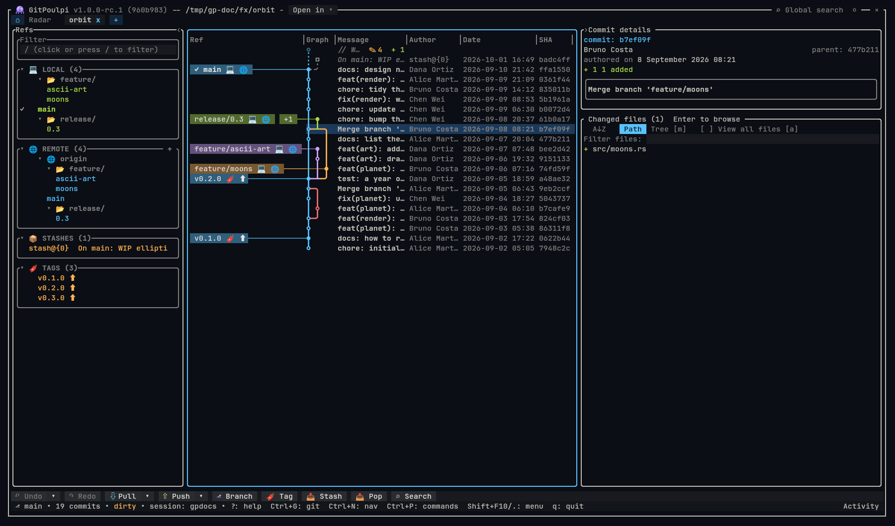
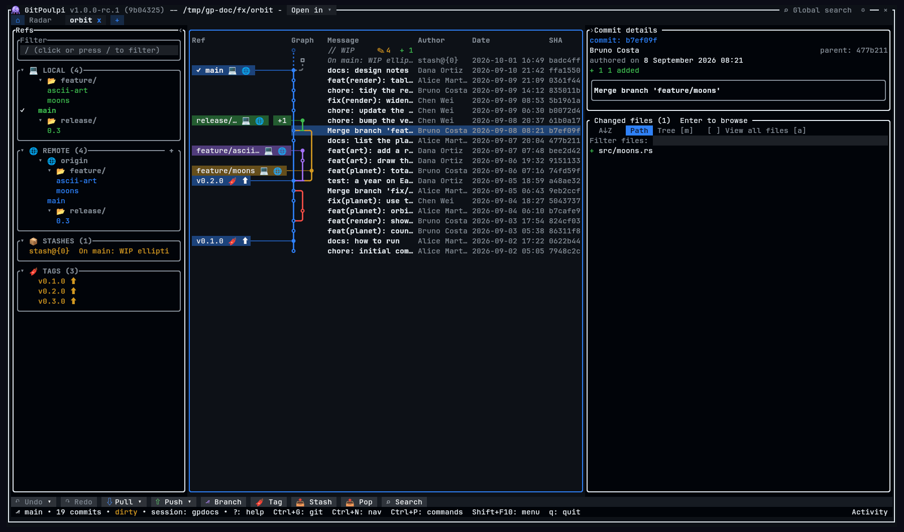
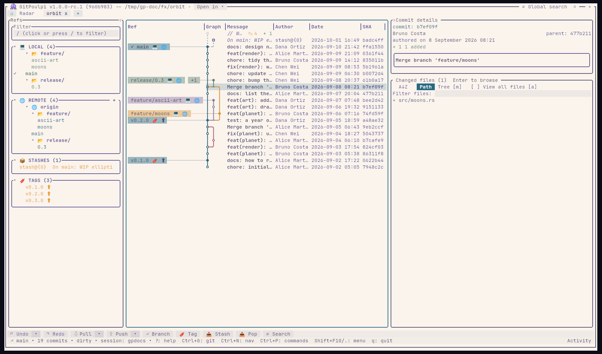
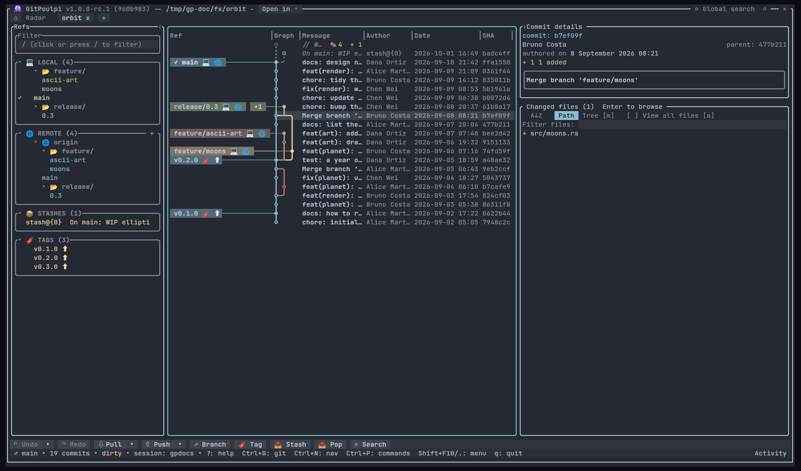
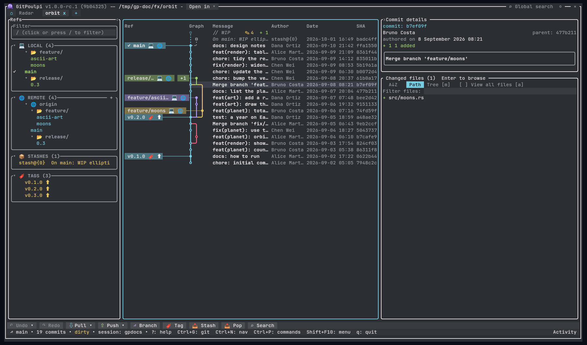
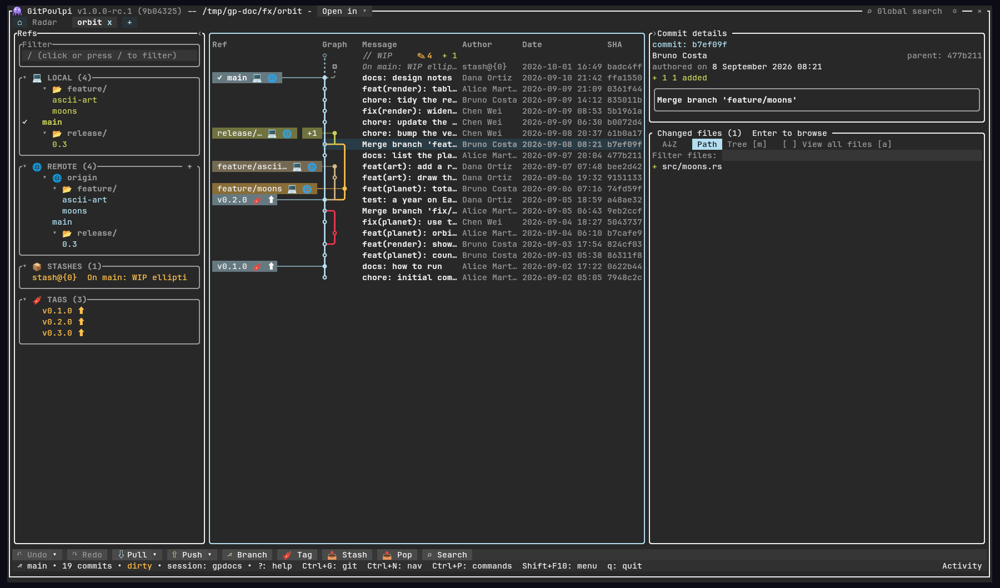
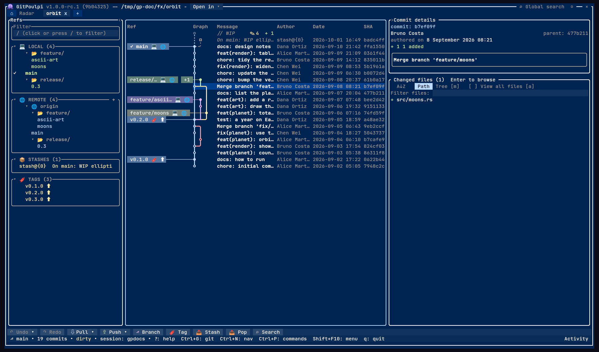
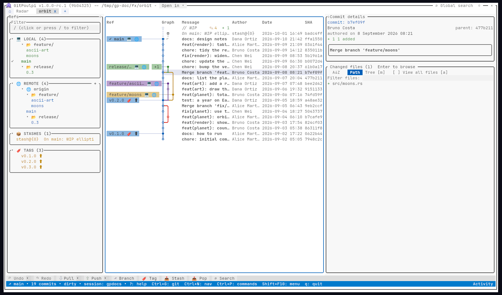

[English](../themes.md) · [Čeština](../cs/themes.md) · [Deutsch](../de/themes.md) · [Español](../es/themes.md) · [Français](../fr/themes.md) · [Italiano](../it/themes.md) · **日本語** · [한국어](../ko/themes.md) · [Nederlands](../nl/themes.md) · [Polski](../pl/themes.md) · [Português (Brasil)](../pt-BR/themes.md) · [Português (Portugal)](../pt-PT/themes.md) · [Русский](../ru/themes.md) · [Svenska](../sv/themes.md) · [Türkçe](../tr/themes.md) · [Українська](../uk/themes.md) · [简体中文](../zh-CN/themes.md)

# テーマ

テーマは、GitPoulpi が描画するすべての色を決めます。テキスト、パネル、選択、ボタン、diff と merge のビュー、エディター、ツールバーのアイコン、ログのグラフのレーン色が対象です。テーマは **設定 > 外観 > テーマ** で切り替えるか、`gitpoulpi config set ui.theme <slug>` で切り替えます。それぞれの見た目は[ギャラリー](#ギャラリー)で確認できます。

## 組み込みプリセット

`gitpoulpi theme list` は、お使いのビルドに含まれるテーマを、設定のコンボと同じ順序で表示します。先頭が **GitPoulpi Dark**（`dark`。ターミナル自身の背景の上に描画されます）と **GitPoulpi Light**（`light`）で、その後に他のすべてのプリセットがラベルのアルファベット順に続きます。`ui.theme = "system"`（既定）はターミナルに従い、ターミナルの背景が明るければ Light、そうでなければ Dark になります（下の「システムの検出」を参照）。旧仕様の `default` は `system` と同じです。レーンパレットのコンボも同じ順序です。

| スラッグ | ラベル | 色の出典 |
|---|---|---|
| `system`（既定） | システム | パレットではありません：明るいターミナル背景では GitPoulpi Light、それ以外では GitPoulpi Dark |
| `dark` | GitPoulpi Dark | GitPoulpi オリジナルのテーマ。ターミナル自身の背景の上に描画されます |
| `light` | GitPoulpi Light | GitPoulpi オリジナルのテーマ |
| `catppuccin-latte` / `catppuccin-frappe` / `catppuccin-macchiato` / `catppuccin-mocha` | Catppuccin Latte / Frappé / Macchiato / Mocha | [github.com/catppuccin/palette](https://github.com/catppuccin/palette) |
| `cyberpunk` | Cyberpunk | [iTerm2-Color-Schemes](https://github.com/mbadolato/iTerm2-Color-Schemes) "Cyberpunk" |
| `dracula` | Dracula | [draculatheme.com/contribute](https://draculatheme.com/contribute) |
| `everforest-dark` | Everforest Dark | [github.com/sainnhe/everforest/blob/master/palette.md](https://github.com/sainnhe/everforest/blob/master/palette.md) |
| `fire` / `fire-light` | Fire / Fire Light | GitPoulpi オリジナルのテーマ：Fire は焦げたオレンジの背景に炎のオレンジを合わせた燠火の配色、Fire Light はその明るい双子で、本物のオレンジの背景です |
| `github-dark` / `github-light` | GitHub Dark / GitHub Light | GitHub の Primer テーマ、[github.com/primer/github-vscode-theme](https://github.com/primer/github-vscode-theme) と @primer/primitives（`canvas.default`, `canvas.inset` はサイドバー、`fg.*`, `accent.fg`）。値は調整していません |
| `gruvbox-dark` / `gruvbox-light` | Gruvbox Dark / Light | [github.com/morhetz/gruvbox#palette](https://github.com/morhetz/gruvbox#palette) |
| `kanagawa` / `kanagawa-lotus` | Kanagawa (wave) / Kanagawa Lotus | [github.com/rebelot/kanagawa.nvim](https://github.com/rebelot/kanagawa.nvim) |
| `matrix` | Matrix | [iTerm2-Color-Schemes](https://github.com/mbadolato/iTerm2-Color-Schemes) "Matrix" （配色に赤がないため、`danger` は `#ff5555`） |
| `monokai` | Monokai | オリジナルの Monokai パレット ([monokai.nl](https://monokai.nl/)) |
| `nord` | Nord | [www.nordtheme.com](https://www.nordtheme.com) |
| `one-dark` / `one-light` | One Dark / One Light | Atom One Dark / One Light ([One Dark](https://github.com/atom/one-dark-syntax), [One Light](https://github.com/atom/one-light-syntax)) |
| `rose-pine` / `rose-pine-moon` / `rose-pine-dawn` | Rosé Pine / Moon / Dawn | [rosepinetheme.com/palette](https://rosepinetheme.com/palette/) |
| `solarized-dark` / `solarized-light` | Solarized Dark / Light | Ethan Schoonover の Solarized ([ethanschoonover.com/solarized](https://ethanschoonover.com/solarized/)) |
| `sunset` | Sunset | GitPoulpi オリジナルのテーマ：コーラルと金色の藍色の夕暮れ |
| `terminal` | Terminal (16 colors) | ターミナル自身の 16 色だけを使用 |
| `tokyo-night` / `tokyo-night-day` | Tokyo Night (night) / Tokyo Night Day | [github.com/folke/tokyonight.nvim](https://github.com/folke/tokyonight.nvim)（Day の前景色は、コントラスト規則を満たすよう暗くしています） |
| `vesper` | Vesper | [github.com/raunofreiberg/vesper](https://github.com/raunofreiberg/vesper)（パレットに青や紫はなく、アクセントはピーチです） |
| `vscode-dark` / `vscode-light` | VS Code Dark / VS Code Light | VS Code 既定の Dark Modern / Light Modern, [github.com/microsoft/vscode/tree/main/extensions/theme-defaults/themes](https://github.com/microsoft/vscode/tree/main/extensions/theme-defaults/themes)（`dark_modern.json`、`light_modern.json`、およびリスト選択と ANSI/チャートのアクセントに対する VS Code の色の既定値。Light のミュートのグレーは `616161`） |

### terminalcolors.com からのインポート

terminalcolors.com のターミナルパレットからインポートしたものです。各配色の権利は作者に帰属します。90 個のプリセットは、パレットの背景、前景、選択、16 個の ANSI カラー（アクセント = 青、成功 = 緑、警告 = 黄、危険 = 赤、AI = マゼンタ、ミュート = 明るい黒）から、すべてに共通の 1 つの導出規則で作られます。GitPoulpi のコントラスト規則を満たさない色は、満たすまで明るく、または暗くされます。この表は `scripts/gen-terminalcolors.py` が `crates/gitpoulpi-config/src/theme/terminalcolors_data.rs` に生成します。スラッグは `<family>-<variant>` です（`default` は省略）。ラベルは他のものと同じく、コンボ内でアルファベット順に並びます。

| ファミリー | スラッグ |
|---|---|
| [Apprentice](https://terminalcolors.com/themes/apprentice/) | `apprentice` |
| [Ayu](https://terminalcolors.com/themes/ayu/) | `ayu-dark`, `ayu-light`, `ayu-mirage` |
| [Cobalt2](https://terminalcolors.com/themes/cobalt2/) | `cobalt2` |
| [Deus](https://terminalcolors.com/themes/deus/) | `deus` |
| [Dracula](https://terminalcolors.com/themes/dracula/) | `dracula-soft` |
| [Everforest](https://terminalcolors.com/themes/everforest/) | `everforest-light` |
| [GitHub](https://terminalcolors.com/themes/github/) | `github-dark-colorblind`, `github-dark-dimmed`, `github-dark-high-contrast`, `github-dark-legacy`, `github-light-colorblind`, `github-light-high-contrast`, `github-light-legacy` |
| [Gotham](https://terminalcolors.com/themes/gotham/) | `gotham` |
| [Gruvbox](https://terminalcolors.com/themes/gruvbox/) | `gruvbox-dark-hard-contrast`, `gruvbox-dark-soft-contrast`, `gruvbox-light-hard-contrast`, `gruvbox-light-soft-contrast` |
| [Iceberg](https://terminalcolors.com/themes/iceberg/) | `iceberg-dark`, `iceberg-light` |
| [Jellybeans](https://terminalcolors.com/themes/jellybeans/) | `jellybeans` |
| [Kanagawa](https://terminalcolors.com/themes/kanagawa/) | `kanagawa-dragon` |
| [Lucario](https://terminalcolors.com/themes/lucario/) | `lucario` |
| [Miasma](https://terminalcolors.com/themes/miasma/) | `miasma` |
| [Moonfly](https://terminalcolors.com/themes/moonfly/) | `moonfly` |
| [Night](https://terminalcolors.com/themes/night-owl/) | `night-owl-dark`, `night-owl-light` |
| [Nightfly](https://terminalcolors.com/themes/nightfly/) | `nightfly` |
| [Nightfox](https://terminalcolors.com/themes/nightfox/) | `nightfox`, `nightfox-carbonfox`, `nightfox-dawnfox`, `nightfox-dayfox`, `nightfox-duskfox`, `nightfox-nordfox`, `nightfox-terafox` |
| [Noctis](https://terminalcolors.com/themes/noctis/) | `noctis`, `noctis-azureus`, `noctis-bordo`, `noctis-hibernus`, `noctis-lilac`, `noctis-lux`, `noctis-minimus`, `noctis-obscuro`, `noctis-sereno`, `noctis-uva`, `noctis-viola` |
| [Nordic](https://terminalcolors.com/themes/nordic/) | `nordic` |
| [One](https://terminalcolors.com/themes/one-half/) | `one-half-dark`, `one-half-light` |
| [Panda](https://terminalcolors.com/themes/panda/) | `panda` |
| [Posterpole](https://terminalcolors.com/themes/posterpole/) | `posterpole`, `posterpole-gray` |
| [Seoul256](https://terminalcolors.com/themes/seoul256/) | `seoul256-dark`, `seoul256-light` |
| [Shades](https://terminalcolors.com/themes/shades-of-purple/) | `shades-of-purple`, `shades-of-purple-super-dark` |
| [Sonokai](https://terminalcolors.com/themes/sonokai/) | `sonokai`, `sonokai-andromeda`, `sonokai-atlantis`, `sonokai-espresso`, `sonokai-maia`, `sonokai-shusia` |
| [Srcery](https://terminalcolors.com/themes/srcery/) | `srcery` |
| [Tender](https://terminalcolors.com/themes/tender/) | `tender` |
| [Tokyo](https://terminalcolors.com/themes/tokyo-night/) | `tokyo-night-moon`, `tokyo-night-storm` |
| [Tomorrow](https://terminalcolors.com/themes/tomorrow/) | `tomorrow`, `tomorrow-night`, `tomorrow-night-blue`, `tomorrow-night-bright`, `tomorrow-night-eighties` |
| [Zenbones](https://terminalcolors.com/themes/zenbones/) | `zenbones-duckbones`, `zenbones-forestbones-dark`, `zenbones-forestbones-light`, `zenbones-kanagawabones`, `zenbones-neobones-dark`, `zenbones-neobones-light`, `zenbones-nordbones`, `zenbones-rosebones-dark`, `zenbones-rosebones-light`, `zenbones-seoulbones-dark`, `zenbones-seoulbones-light`, `zenbones-tokyobones-dark`, `zenbones-tokyobones-light`, `zenbones-vimbones`, `zenbones-zenburned`, `zenbones-zenwritten-dark`, `zenbones-zenwritten-light` |

`ui.side_bg` は、GitHub、VS Code がサイドバーを描くのと同じように、Refs ペインと右側のパネル（commit の詳細、作業中の変更、ファイル一覧）の背景です。Catppuccin（その `mantle`）、GitHub、VS Code が設定しており、それ以外のプリセットでは `default`、つまり `ui.bg` と同じです。テーマファイルでは `[ui]` の下に `side_bg` を設定できます（`gitpoulpi theme export` で表示されます）。

GitHub や VS Code と同じように、`[ui]` の下の次の 3 つのロールがクロームに色を付けます。

| ロール | 描画する場所 |
|---|---|
| `ui.toolbar_bg` | ツールバーの行と**選択中のリポジトリタブ**です。これによりタブがツールバーとつながって見えます。ツールバーのボタンのチップは、自身の `chrome.toolbar_bg` を保ちます。 |
| `ui.statusbar_bg` | ステータスバー（`ui.statusbar_position` で上にしない限り下端）。 |
| `ui.statusbar_fg` | ステータスバーのテキスト。その塗りの上で読めないテキストはこの色で描き直されます。読める警告とエラーのテキストは自身の色を保ちます。 |

プリセットは、元のアプリに合わせてこれらを設定しています。VS Code Dark と Light は、白いテキストの青（`#007acc`）のステータスバーと、ツールバー用の VS Code のタイトルバーのグレーです。GitHub はそのヘッダーの色調です。それ以外のすべてのプリセット（インポートしたターミナルパレットを含む）は、`bg` から 1 段ずらしたツールバーと、そこから少しずらしたステータスバーを導出し、その上に `text` を載せます。コントラスト規則により、テキストは読める状態に保たれます。`dark`（GitPoulpi Dark）と `terminal` はターミナル自身の背景を使うため、この 3 つはどちらも `default` で、何も描画されず、選択中のタブは選択色のままです。これらを省略したテーマファイルは、`base` の値を継承します。`default` は色を付けないことを意味します（その場合ステータスバーは `side_bg` に従います）。

配色のコメントやミュートのグレーが暗すぎて読めない場合は、GitPoulpi のコントラスト規則を満たすまで明るくされます。配色にないパネルや選択の色合いは、その背景から導出されます。

### ギャラリー

組み込みのすべてのテーマを、merge commit を選択した同じリポジトリで表示しています（`scripts/docs-screenshots.sh` で撮り直せます）。

| **GitPoulpi Dark** (`dark`) | **GitPoulpi Light** (`light`) | **Apprentice** (`apprentice`) |
|---|---|---|
|  |  |  |
| **Ayu Dark** (`ayu-dark`) | **Ayu Light** (`ayu-light`) | **Ayu Mirage** (`ayu-mirage`) |
|  |  |  |
| **Catppuccin Frappé** (`catppuccin-frappe`) | **Catppuccin Latte** (`catppuccin-latte`) | **Catppuccin Macchiato** (`catppuccin-macchiato`) |
|  |  |  |
| **Catppuccin Mocha** (`catppuccin-mocha`) | **Cobalt2** (`cobalt2`) | **Cyberpunk** (`cyberpunk`) |
|  |  |  |
| **Deus** (`deus`) | **Dracula** (`dracula`) | **Dracula Soft** (`dracula-soft`) |
|  |  |  |
| **Everforest Dark** (`everforest-dark`) | **Everforest Light** (`everforest-light`) | **Fire** (`fire`) |
|  |  |  |
| **Fire Light** (`fire-light`) | **GitHub Dark** (`github-dark`) | **GitHub Dark Colorblind** (`github-dark-colorblind`) |
|  |  |  |
| **GitHub Dark Dimmed** (`github-dark-dimmed`) | **GitHub Dark High Contrast** (`github-dark-high-contrast`) | **GitHub Dark Legacy** (`github-dark-legacy`) |
|  |  |  |
| **GitHub Light** (`github-light`) | **GitHub Light Colorblind** (`github-light-colorblind`) | **GitHub Light High Contrast** (`github-light-high-contrast`) |
|  |  |  |
| **GitHub Light Legacy** (`github-light-legacy`) | **Gotham** (`gotham`) | **Gruvbox Dark** (`gruvbox-dark`) |
|  |  |  |
| **Gruvbox Dark Hard Contrast** (`gruvbox-dark-hard-contrast`) | **Gruvbox Dark Soft Contrast** (`gruvbox-dark-soft-contrast`) | **Gruvbox Light** (`gruvbox-light`) |
|  |  |  |
| **Gruvbox Light Hard Contrast** (`gruvbox-light-hard-contrast`) | **Gruvbox Light Soft Contrast** (`gruvbox-light-soft-contrast`) | **Iceberg Dark** (`iceberg-dark`) |
|  |  |  |
| **Iceberg Light** (`iceberg-light`) | **Jellybeans** (`jellybeans`) | **Kanagawa** (`kanagawa`) |
|  |  |  |
| **Kanagawa Dragon** (`kanagawa-dragon`) | **Kanagawa Lotus** (`kanagawa-lotus`) | **Lucario** (`lucario`) |
|  |  |  |
| **Matrix** (`matrix`) | **Miasma** (`miasma`) | **Monokai** (`monokai`) |
|  |  |  |
| **Moonfly** (`moonfly`) | **Night Owl Dark** (`night-owl-dark`) | **Night Owl Light** (`night-owl-light`) |
|  |  |  |
| **Nightfly** (`nightfly`) | **Nightfox** (`nightfox`) | **Nightfox Carbonfox** (`nightfox-carbonfox`) |
|  |  |  |
| **Nightfox Dawnfox** (`nightfox-dawnfox`) | **Nightfox Dayfox** (`nightfox-dayfox`) | **Nightfox Duskfox** (`nightfox-duskfox`) |
|  |  |  |
| **Nightfox Nordfox** (`nightfox-nordfox`) | **Nightfox Terafox** (`nightfox-terafox`) | **Noctis** (`noctis`) |
|  |  |  |
| **Noctis Azureus** (`noctis-azureus`) | **Noctis Bordo** (`noctis-bordo`) | **Noctis Hibernus** (`noctis-hibernus`) |
|  |  |  |
| **Noctis Lilac** (`noctis-lilac`) | **Noctis Lux** (`noctis-lux`) | **Noctis Minimus** (`noctis-minimus`) |
|  |  |  |
| **Noctis Obscuro** (`noctis-obscuro`) | **Noctis Sereno** (`noctis-sereno`) | **Noctis Uva** (`noctis-uva`) |
|  |  |  |
| **Noctis Viola** (`noctis-viola`) | **Nord** (`nord`) | **Nordic** (`nordic`) |
|  |  |  |
| **One Dark** (`one-dark`) | **One Half Dark** (`one-half-dark`) | **One Half Light** (`one-half-light`) |
|  |  |  |
| **One Light** (`one-light`) | **Panda** (`panda`) | **Posterpole** (`posterpole`) |
|  |  |  |
| **Posterpole Gray** (`posterpole-gray`) | **Rosé Pine** (`rose-pine`) | **Rosé Pine Dawn** (`rose-pine-dawn`) |
|  |  |  |
| **Rosé Pine Moon** (`rose-pine-moon`) | **Seoul256 Dark** (`seoul256-dark`) | **Seoul256 Light** (`seoul256-light`) |
|  |  |  |
| **Shades of Purple** (`shades-of-purple`) | **Shades of Purple Super Dark** (`shades-of-purple-super-dark`) | **Solarized Dark** (`solarized-dark`) |
|  |  |  |
| **Solarized Light** (`solarized-light`) | **Sonokai** (`sonokai`) | **Sonokai Andromeda** (`sonokai-andromeda`) |
|  |  |  |
| **Sonokai Atlantis** (`sonokai-atlantis`) | **Sonokai Espresso** (`sonokai-espresso`) | **Sonokai Maia** (`sonokai-maia`) |
|  |  |  |
| **Sonokai Shusia** (`sonokai-shusia`) | **Srcery** (`srcery`) | **Sunset** (`sunset`) |
|  |  |  |
| **Tender** (`tender`) | **Terminal (16 colors)** (`terminal`) | **Tokyo Night** (`tokyo-night`) |
|  |  |  |
| **Tokyo Night Day** (`tokyo-night-day`) | **Tokyo Night Moon** (`tokyo-night-moon`) | **Tokyo Night Storm** (`tokyo-night-storm`) |
|  |  |  |
| **Tomorrow** (`tomorrow`) | **Tomorrow Night** (`tomorrow-night`) | **Tomorrow Night Blue** (`tomorrow-night-blue`) |
|  |  |  |
| **Tomorrow Night Bright** (`tomorrow-night-bright`) | **Tomorrow Night Eighties** (`tomorrow-night-eighties`) | **Vesper** (`vesper`) |
|  |  |  |
| **VS Code Dark** (`vscode-dark`) | **VS Code Light** (`vscode-light`) | **Zenbones Duckbones** (`zenbones-duckbones`) |
|  |  |  |
| **Zenbones Forestbones Dark** (`zenbones-forestbones-dark`) | **Zenbones Forestbones Light** (`zenbones-forestbones-light`) | **Zenbones Kanagawabones** (`zenbones-kanagawabones`) |
|  |  |  |
| **Zenbones Neobones Dark** (`zenbones-neobones-dark`) | **Zenbones Neobones Light** (`zenbones-neobones-light`) | **Zenbones Nordbones** (`zenbones-nordbones`) |
|  |  |  |
| **Zenbones Rosebones Dark** (`zenbones-rosebones-dark`) | **Zenbones Rosebones Light** (`zenbones-rosebones-light`) | **Zenbones Seoulbones Dark** (`zenbones-seoulbones-dark`) |
|  |  |  |
| **Zenbones Seoulbones Light** (`zenbones-seoulbones-light`) | **Zenbones Tokyobones Dark** (`zenbones-tokyobones-dark`) | **Zenbones Tokyobones Light** (`zenbones-tokyobones-light`) |
|  |  |  |
| **Zenbones Vimbones** (`zenbones-vimbones`) | **Zenbones Zenburned** (`zenbones-zenburned`) | **Zenbones Zenwritten Dark** (`zenbones-zenwritten-dark`) |
|  |  |  |
| **Zenbones Zenwritten Light** (`zenbones-zenwritten-light`) |
|  |

## 任意のテーマと任意のレーンパレットの組み合わせ

どのテーマもログのグラフ用の独自のレーン色を持っていますが、任意のテーマと任意のパレットを組み合わせることができます。**設定 > 外観 > グラフのカラーテーマ**には、**テーマに従う**（既定）と、すべてのテーマのすべてのレーンパレット（GitPoulpi Dark、GitPoulpi Light、続いて Material、Serie、...、そして独自のテーマファイルの `graph_palette`）が並びます。

`config.toml` では次のようにします。

```toml
[ui]
theme = "nord"
graph_color_theme = "material"   # or "theme" to follow the theme
```

`ui.input_color` は、テキスト入力欄に対する同種の上書きです。既定の `theme` はテーマ自身の入力色に従い、`gray`、`blue`、`slate`、`dark`、`custom` は背景を強制します（暗い色なので、ライトテーマでは `theme` を選んでください）。

## 独自のテーマ

設定ディレクトリの `themes/` フォルダーに `.toml` ファイルを置きます（`gitpoulpi config path` がその親を表示します。フォルダーは `${config}/themes/` です）。`.toml` を除いたファイル名がテーマのスラッグで、`ui.theme` に指定する値です。プリセットのスラッグと同じ名前は使えません（警告とともにスキップされます）。

完全なファイルから始めます。

```
gitpoulpi theme export nord > "$(dirname "$(gitpoulpi config path)")/themes/mine.toml"
```

その後、変更したい部分だけを残します。ファイルは `base`（プリセット、または別のユーザーテーマ。連鎖は最大 4 段まで、循環は拒否され、`base` がなければ `dark`）に対する**部分的な上書き**の集まりです。

```toml
name = "My Nord"            # the label in the combo; default = file name
base = "nord"
light = false               # inherited when absent
syntax = "base16-ocean.dark"
graph_palette = ["#88c0d0", "#a3be8c"]

[ui]
bg = "#2e3440"              # "default" | "#rrggbb" | "ansi:N"
accent = "#88c0d0"
toolbar_bg = "#3b4252"      # toolbar row and selected tab
statusbar_bg = "#5e81ac"    # status line
statusbar_fg = "#eceff4"

[diff]
add_bg = "#2f3b2f"
```

色は `"#rrggbb"`、`"ansi:N"`（ターミナルのパレットの N 番目のエントリ）、または `"default"`（ターミナル自身の色）で指定します。グループとキーは `gitpoulpi theme export <slug>` のものです。致命的なことは何もありません。未知のキーや不正な色は無視され、未知の `base` は `dark` にフォールバックし、`gitpoulpi theme list` は各問題を `warnings` の下に報告します（アプリはそれらをステータスバーに一度だけ表示します）。

ファイルは、テーマのコンボを開いたときと、設定を閉じたときに読み直されます。ファイル監視はありません。CLI から設定したテーマは、他のライブなキーと同様に、実行中のウィンドウが次に設定を閉じたときに適用されます。

## システムの検出

`ui.theme = "system"` のとき、GitPoulpi は**起動時に一度だけ**ターミナルに背景色を問い合わせ（OSC 11 クエリ。kitty、WezTerm、Alacritty、foot、iTerm2、Windows Terminal、tmux をはじめ多くが応答します）、明るい背景なら Light、そうでなければ Dark を選びます。待ち時間は最大でも約 100 ms で、このクエリを知らないターミナルでもコストはありません。応答はインターフェースが始まる前に必ず読み取られるため、何も表示されず、キー入力が失われることもありません。応答がない場合（クエリを送らない Windows では常に）は `COLORFGBG` を読み、それでもだめなら Dark にフォールバックします。GitPoulpi の実行中にターミナルの背景が変わっても追従しません。再起動するか、Light または Dark を明示的に選んでください。

## 色深度

テーマは truecolor（`#rrggbb`）です。`ui.color_depth`（設定 > 外観 > 色深度。すぐに反映されます）が、それをどうターミナルに届けるかを決めます。

| 値 | 効果 |
|---|---|
| `auto`（既定） | 動作しないと分かっている場合を除き truecolor です。Apple Terminal（`TERM_PROGRAM=Apple_Terminal`）は 256 色、Linux コンソール（`TERM=linux`）は 16 色、`COLORTERM` を設定しない `*-256color` ターミナル（WezTerm、kitty、Windows Terminal を除く）は 256 色になります。`COLORTERM=truecolor` は常に truecolor を意味します。 |
| `truecolor` | 常に 24 ビットカラーです。 |
| `256` | すべての RGB 色が、最も近い xterm-256 のエントリになります。 |
| `16` | 最も近い 16 個の ANSI カラーになります。正確な色合いはターミナル自身のパレットで決まります。 |

ssh 経由や古いマルチプレクサ内でテーマの色がおかしく見える場合は、`256` または `16` を使ってください。Terminal プリセットには、これらは不要です。truecolor にコストはありません。変換の処理は、有効なときにだけ、フレームごとに画面全体に対して 1 回実行されます。

## ライブプレビュー

設定 > 外観では、テーマのコンボに **システム（ターミナルに従う）**、プリセット、独自のテーマファイルの順に並びます。ハイライトを動かすとそのテーマがすぐに適用され、設定画面全体が目の前で描き直されます。**Enter** で確定（保存）し、**Esc** またはほかの場所のクリックで前のテーマに戻り、何も保存されません。パレットの項目 **アプリ: テーマ...**（`Ctrl+P`）は、その行を表示した状態で設定を開きます。

### パレットからテーマを変更する

**アプリ: テーマを変更...**（`Ctrl+P`、または `Ctrl+N y`。キーは `nav_prefix.change_theme` として割り当て直せます）は、設定を経由せずに同じテーマの一覧を開きます。**システム（ターミナルに従う）**、プリセット、独自のテーマファイルの順で、それぞれに 4 つの小さな色のチップが付きます。現在のテーマにはチェックが付きます。入力すると一覧が絞り込まれ、ハイライトを動かすとそのテーマがすぐにプレビューされます。**Enter** で適用して `ui.theme` を `config.toml` に保存し、**Esc**（または一覧の外のクリック）で前のテーマに戻し、何も保存されません。

絞り込みフィールドの下には、一覧を絞り込むセグメント式のプリフィルターがあります：**すべて**、**ダーク**、**ライト**、**カラー**（セグメントをクリック、`Tab` / `Shift+Tab`、または `Alt+1`..`Alt+4`）。ダークとライトはテーマの `ui.bg` の明るさで決まります。**カラー**は背景がはっきり色付いている（青、紫、黄、緑...）テーマを残し、白、オフホワイト、黒、ほぼ黒のグレーを除外するため、Solarized Dark、Dracula、Nord はカラーに入り、GitHub Dark と One Light は入りません。カラーのテーマは、ダークまたはライトにも表示されます。**システム**と透明なテーマ（独自の背景を持たないもの）は、すべての下にだけ表示されます。プリフィルターは入力した内容と組み合わせて使えます。グラフのカラーテーマと言語のピッカーも同じようにプレビューされ、ハイライトを動かすとログのレーンや UI 全体が変わります。


コンボの下には、現在有効なテーマ（背景、テキスト、ミュート、アクセント、選択、危険、diff の追加、diff の削除、続いて最初の 6 つのレーン色）を示す色のチップのストリップがあり、プレビューに追従します。**外観**の**グラフのカラーテーマ**コンボには、各パレットの横にレーン色がいくつか表示され、選択は設定を閉じたときに反映されます。

独自の背景を持つテーマ（Light などの描画型プリセット）は、設定とフルページのビューを含むウィンドウ全体を塗りつぶし、独自の色のないテキストにそのテーマのテキスト色を与えます。Dark と Terminal は、ターミナルの色には手を加えません。

## コマンドラインから

| コマンド | 出力 |
|---|---|
| `gitpoulpi theme list` | JSON `{themes: [{slug, label, source, light, lane_palette}], warnings}`。`source` は `preset` または `user` です。 |
| `gitpoulpi theme export <slug>` | 完全なテーマファイルを TOML で標準出力に書き出します（JSON：`{slug, toml}`）。読み込むと同じテーマに戻ります。 |
| `gitpoulpi config set ui.theme <slug>` | プリセットと `themes/` フォルダーに対して検証されます。未知の名前は、有効な名前を挙げたエラーになります。`system` と `default` は受け付けられます。 |
| `gitpoulpi config set ui.graph_color_theme <name>` | `theme`（テーマに従う）または任意のレーンパレット名。未知の名前は、有効な名前を挙げたエラーになります。 |

MCP サーバーは、読み取り専用のツールとして `theme_list` と `theme_export` を提供します。
