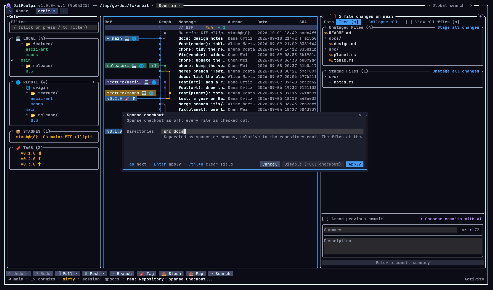

[English](../getting-started.md) · [Čeština](../cs/getting-started.md) · [Deutsch](../de/getting-started.md) · [Español](../es/getting-started.md) · [Français](../fr/getting-started.md) · [Italiano](../it/getting-started.md) · [日本語](../ja/getting-started.md) · **한국어** · [Nederlands](../nl/getting-started.md) · [Polski](../pl/getting-started.md) · [Português (Brasil)](../pt-BR/getting-started.md) · [Português (Portugal)](../pt-PT/getting-started.md) · [Русский](../ru/getting-started.md) · [Svenska](../sv/getting-started.md) · [Türkçe](../tr/getting-started.md) · [Українська](../uk/getting-started.md) · [简体中文](../zh-CN/getting-started.md)

# 시작하기

이 페이지는 새로 설치한 상태에서 첫 commit까지 안내합니다.
[인터페이스 둘러보기](interface-tour.md)는 창의 모든 영역에 이름을 붙여 설명하고,
[설정](settings.md)은 모든 옵션을 나열합니다.

## 1. 설치하고 실행하기

[설치](installation.md)를 따르세요. 그런 다음 Git 저장소에서 터미널을 열고
실행합니다:

```
gitpoulpi
```

GitPoulpi는 현재 폴더가 속한
저장소를 엽니다. 저장소 밖이면 **홈** 탭이 열리며, 여기서 저장소를 찾아보거나
클론하거나 초기화할 수 있습니다([7단계](#7-저장소-열기-클론-초기화) 참고).

아이콘에는 Nerd Font 또는 이모지가 있는 글꼴이 필요합니다. 네모 상자가 보이면
[문제 해결](troubleshooting.md)를 참고하세요.


## 2. 나머지를 모두 배우는 세 가지 키

| 키 | 여는 것 |
|---|---|
| `?` | **도움말**: 모든 키와 마우스 동작. 입력하면 필터링됩니다. `Ctrl+D`는 이 문서를 브라우저에서 엽니다. |
| `Ctrl+P` | **명령 팔레트**: 입력해서 명령을 찾고 `Enter`로 실행합니다. 각 행에 단축키가 표시됩니다. |
| `Ctrl+,` | **설정**. 제목 표시줄에서 × 왼쪽의 톱니바퀴로도 열 수 있습니다. |

모든 것을 키보드나 마우스로 할 수 있습니다. 팔레트는 모든 명령에 닿습니다.
[단축키](keybindings.md)와 [마우스와 제스처](mouse-and-gestures.md)를 참고하세요.


## 3. 기록 살펴보기

창의 가운데는 **Log**입니다: commit당 한 행이며 최신 commit이 맨 위에 옵니다.
브랜치와 tag를 색깔 알약으로, 그리고 그래프, 메시지, 작성자, 날짜, 짧은 해시를
보여 줍니다.

- commit을 클릭하세요. 상세 정보와 변경된 파일이 오른쪽에 나타납니다.
- 변경된 파일을 클릭하세요. 그 diff가 가운데에 열립니다. `Esc`로 닫습니다.
- `j` / `k` 또는 화살표 키로 선택을 이동합니다. `f`는 commit을 검색합니다.
- commit을 오른쪽 클릭하면 메뉴가 나옵니다.


## 4. 변경하고 스테이징하기

편집기에서 파일을 수정하세요. 이제 **Log의 맨 위 행**이 작업 중인 변경 사항을
보여 줍니다: 변경된 파일 수가 적힌 점선 행입니다. 그것을 클릭하세요. 오른쪽 창에
**스테이징 안 된 파일**과 **스테이징된 파일**이 표시됩니다.

- 파일 위에 마우스를 올리고 **파일 스테이징** 버튼을 클릭하세요. 또는 **모두
  스테이징**을 클릭하세요.
- 파일 이름을 클릭하면 그 diff가 열립니다. 거기서 **hunk** 하나(**Hunk
  스테이징**)나 **한 줄**을 스테이징할 수 있습니다.

[스테이징과 commit](staging-and-committing.md)을 참고하세요.


## 5. Commit하기

오른쪽 아래의 commit 양식에 요약을 입력하고, 필요하면 설명도 입력하세요. 그런 다음
초록색 **변경 파일 N개 Commit** 버튼을 클릭하거나 `Ctrl+Enter`(어디에서든 `Ctrl+G Enter`)를 누르세요. **이전
commit 수정 (Amend)**을 선택하면 변경 사항이 새 commit이 아니라 마지막 commit에
추가됩니다.

[AI](ai.md)를 켰다면 요약 옆의 `✦` 버튼이 스테이징된 변경 사항으로 메시지를
작성해 줍니다. GitPoulpi는 **변경 파일 N개 Commit**을 클릭하기 전에는 절대
commit하지 않습니다.

## 6. 작업 공유하기

도구 모음에는 **Pull**과 **Push** 버튼이 있고, 각각 `▾` 목록이 딸려 있습니다. 키보드에서는
`Ctrl+G`를 누른 다음 글자를 누릅니다: `Ctrl+G p`는 pull, `Ctrl+G Shift+P`는
push입니다. `Ctrl+G`를 누르면 상태 표시줄에 글자 목록이 표시됩니다.

GitPoulpi는 사용 중인 `git`이 이미 쓰는 인증(credential helper, ssh-agent)을
사용합니다. 자체 계정은 필요 없습니다. pull request를 보고 만들려면 호스팅 계정을
한 번 연결하세요. [호스팅과 이슈 트래커](hosting-integration.md)를 참고하세요.

## 7. 저장소 열기, 클론, 초기화

탭 표시줄 왼쪽 끝의 집 아이콘을 클릭하거나 `Ctrl+O`를 누르세요. **홈** 탭에는 열려 있는
저장소, 즐겨찾기, 최근 저장소가 나열되며 **찾아보기**, **클론**, **초기화** 버튼이
있습니다. 저장소마다 자기 탭에서 열립니다. `Ctrl+W`는 현재 탭을 닫습니다.


**클론**은 URL과 폴더를 묻거나, 연결된 계정(GitHub, GitLab, Gitea, Forgejo, Azure DevOps, Bitbucket, Gerrit)에서 저장소를 고르게 해 줍니다([연결된 계정에서 클론하기](hosting-integration.md#연결된-계정에서-클론하기) 참고). **초기화**는 폴더를 새 저장소로 만듭니다.
세 대화상자 모두(그리고 이들이 여는 폴더 선택기에서도) `Ctrl+N`이 각 필드와 버튼에 배지를 표시합니다. 해당 글자를 누르면 필드에 커서가 놓이거나 버튼이 눌립니다.

|  |  |
|---|---|

### 스파스 체크아웃

큰 저장소를 통째로 디스크에 둘 필요는 없습니다. 클론 대화상자에서 **스파스 체크아웃(일부 디렉터리만)**을 선택하고 원하는 디렉터리를 공백이나 쉼표로 구분해 입력합니다(`src docs/guide`). 그 디렉터리와 저장소 루트의 파일만 체크아웃되며, 전체 기록은 그래도 내려받으므로 Log, blame, 브랜치는 평소처럼 동작합니다. 상자를 선택한 동안에는 디렉터리가 하나 이상 있어야 합니다.



어떤 저장소든 나중에 바꿀 수 있습니다. 명령 팔레트(`Ctrl+P`)를 열어 **저장소: 스파스 체크아웃...**을 실행하거나, 저장소 탭 메뉴의 **스파스 체크아웃...**을 사용합니다. 대화상자에는 현재 체크아웃된 디렉터리가 한 필드에 나열됩니다. 거기서 이름을 추가하거나 지우고 **적용**(`Enter`)을 누르거나, **끄기(전체 체크아웃)**로 모든 파일을 되돌립니다. 작업 트리가 스파스인 동안 상태 표시줄에 작은 `스파스` 배지가 표시됩니다. 같은 컨트롤이 *설정 > 스파스 체크아웃* 페이지에도 있습니다(한 줄에 경로 하나씩의 목록과 **시작**, **중지**, **새로 고침** 버튼).

참고:

- git의 cone 모드(패턴이 아니라 디렉터리)입니다. `*`, `..`, 절대 경로는 거부됩니다.
- 실행 취소는 이 집합의 변경을 기록하지 않습니다. 잃는 것은 없으며 **끄기**가 모든 파일을 복원합니다. commit하지 않은 변경이 있는 디렉터리를 빼려 하면 git이 거부할 수 있습니다(오류는 상태 표시줄에 표시됩니다). 먼저 commit하거나 stash하세요.
- 스크립트와 에이전트에서도 같은 일을 할 수 있습니다: `gitpoulpi clone <url> --sparse src docs`와 `gitpoulpi sparse-checkout status | set | add | disable`([CLI 참조](cli-reference.md) 참고). MCP 서버에도 같은 도구가 있습니다.

## 다음에 볼 곳

- [인터페이스 둘러보기](interface-tour.md): 보이는 모든 것의 이름.
- [Log 다루기](log-and-history.md)와
  [스테이징과 commit](staging-and-committing.md): 일상 작업.
- [테마](themes.md)와 [설정](settings.md).
- [AI 지원](ai.md)과 [호스팅과 이슈 트래커](hosting-integration.md):
  선택 사항인 두 연동.
- [CLI 참조](cli-reference.md)와 [MCP와 에이전트](mcp-and-agents.md):
  스크립트와 에이전트에서 같은 작업을 하기.
- [문제 해결](troubleshooting.md).
