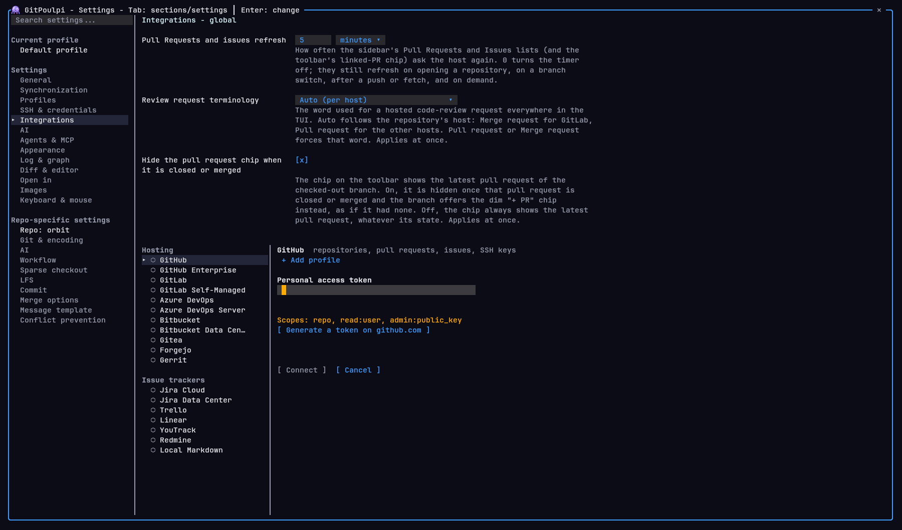

[English](../hosting-integration.md) · [Čeština](../cs/hosting-integration.md) · [Deutsch](../de/hosting-integration.md) · [Español](../es/hosting-integration.md) · [Français](../fr/hosting-integration.md) · [Italiano](../it/hosting-integration.md) · [日本語](../ja/hosting-integration.md) · **한국어** · [Nederlands](../nl/hosting-integration.md) · [Polski](../pl/hosting-integration.md) · [Português (Brasil)](../pt-BR/hosting-integration.md) · [Português (Portugal)](../pt-PT/hosting-integration.md) · [Русский](../ru/hosting-integration.md) · [Svenska](../sv/hosting-integration.md) · [Türkçe](../tr/hosting-integration.md) · [Українська](../uk/hosting-integration.md) · [简体中文](../zh-CN/hosting-integration.md)

# 호스팅 및 이슈 트래커 연동

GitPoulpi는 다음 제품과 연결됩니다.

- **호스팅** (pull request, 이슈, 내 계정에서 clone, SSH 키):
  GitHub, GitHub Enterprise, GitLab, GitLab Self-Managed, Azure DevOps,
  Azure DevOps Server, Bitbucket, Bitbucket Data Center, Gitea, Forgejo
  (Codeberg 포함). **Gerrit Code Review**는 리뷰 전용 호스팅입니다: 그 변경이 곧 pull request이며
  이슈는 없습니다.
- **이슈 트래커** (이슈만): Jira Cloud, Jira Data Center, Trello, Linear,
  YouTrack (Cloud와 Server), Redmine.
- **로컬 Markdown 노트** (이슈만, 토큰 없음, 네트워크 없음): Markdown 노트가 든 폴더, 예를 들어 Obsidian 볼트의 폴더입니다. [로컬 이슈와 Obsidian](local-issues.md)을 참고하세요.

모든 연동은 **개인 토큰**을 사용합니다. GitPoulpi 계정도, OAuth 로그인도
없습니다. 연동은 선택 사항이며 **저장소별로 직접 켭니다**. 저장소를 연결하기
전에는 아무것도 가져오지 않습니다. 토큰은 자격 증명 도우미에 저장되며
`config.toml`에는 절대 기록되지 않습니다. 일반 `git` 작업(fetch, pull, push)에는
연동이 필요 없습니다. 이미 `git`에 설정된 자격 증명을 그대로 사용합니다.

**다음으로 갈 곳.** 이 페이지는 설정을 다룹니다: 토큰, 연결, 저장소 연결, SSH 키. 계정을 연결한 뒤에는 다음을 보세요.

- 사이드바의 PULL REQUESTS와 ISSUES 섹션, 이슈 보드, pull request나 이슈 만들기, 도구 모음 칩, commit 메시지의 참조:
  **[pull request와 이슈](pull-requests-and-issues.md)**
- 이슈나 요청 하나를 앱 안에서 보는 화면, 댓글, 쓰기, 게시 이름:
  **[대화](conversations.md)**
- 댓글 스레드와 대기 중인 리뷰로 요청을 읽고 리뷰하기:
  **[pull 또는 merge request 리뷰](review.md)**
- 워크스페이스 전체의 pull request와 이슈를 한 목록으로:
  **[Radar](radar.md)**

## 1. 호스트에서 토큰 만들기

연결 양식에 *<host>에서 토큰 생성* 링크가 있습니다. 이 링크는 알맞은 범위(scope)가
미리 선택된 호스트의 토큰 페이지를 엽니다. 직접 만들려면 다음을 따르세요.

| 호스트 | 위치 | 범위 |
|---|---|---|
| GitHub, GitHub Enterprise | Settings > Developer settings > Personal access tokens (classic) > Generate new token | `repo` (저장소, pull request, 이슈), `read:user` (본인 확인), `admin:public_key` (SSH 키를 추가하거나 제거할 때만) |
| GitLab, GitLab Self-Managed | User settings > Access tokens > Add new token | `api`, `read_user` |
| Azure DevOps | User settings > Personal access tokens, `dev.azure.com/<organization>/_usersSettings/tokens` | `Code (Read & write)`, `Work Items (Read & write)`. 토큰은 "All accessible organizations"가 아니라 **해당 조직용으로** 만드세요. 전역 토큰은 2026-12-01부터 작동하지 않습니다. |
| Azure DevOps Server | 서버의 같은 페이지 (`https://<server>/<collection>/_usersSettings/tokens`) | 같은 두 범위 |
| Bitbucket | `id.atlassian.com/manage-profile/security/api-tokens` > Create API token with scopes | `read:user:bitbucket`, `read:workspace:bitbucket`, `read:repository:bitbucket`, `write:repository:bitbucket`, `read:pullrequest:bitbucket`, `write:pullrequest:bitbucket`. SSH 키를 쓰려면 `read:ssh-key:bitbucket`, `write:ssh-key:bitbucket`, `delete:ssh-key:bitbucket`도 필요합니다. |
| Bitbucket Data Center | 프로필 사진 > Manage account > HTTP access tokens | `Repository (Read & write)`, `Projects (Read)` |
| Gitea, Forgejo (Codeberg) | Settings > Applications > Generate New Token, `<host>/user/settings/applications` | `user` 읽기, `repository`, `issue`, `user` 읽기와 쓰기(마지막은 SSH 키용). Gitea는 사후에 범위를 보여 주지 않으므로 GitPoulpi가 빠진 범위를 경고할 수 없습니다: 거부된 호출이 그렇게 알려 줍니다. |
| Linear | Settings > Account > Security & access > Personal API keys > New API key (`linear.app/settings/account/security`) | Read, write, create issues. 키는 본인 권한으로 동작합니다. |
| YouTrack (Cloud와 Server) | 프로필 > Account Security > New token, `<host>/users/me?tab=account-security` | `YouTrack` 범위. 영구 토큰은 본인 권한으로 동작합니다. |
| Gerrit | Settings > HTTP Credentials > Generate new token (최신 서버. 이전 서버: Generate new password), `<host>/settings/#HTTPCredentials` | 없음. 토큰은 **HTTP 비밀번호**이며 본인 권한으로 동작하고, 사용자 이름을 함께 입력합니다. |
| Redmine | My account > API access key > Show, `<host>/my/account`. 관리자가 **Administration > Settings > API > Enable REST web service**를 켜 두어야 합니다. | 없음. 키는 본인 권한으로 동작합니다. |
| Jira Cloud | `id.atlassian.com/manage-profile/security/api-tokens` > Create API token (범위 없는 기존 방식) | 없음. 토큰은 본인 권한으로 동작합니다. |
| Jira Data Center | Profile > Personal Access Tokens | 없음. 토큰은 본인 권한으로 동작합니다. |
| Trello | 먼저 `trello.com/apps/admin`에서 **API 키**를 받습니다 (Power-Up을 만든 뒤 API 키 생성). 그다음 `trello.com/1/authorize?...&key=<your key>`에서 **토큰**을 받습니다. | `read`, `write` |

토큰에는 "GitPoulpi" 같은 이름과 만료일을 지정하세요. 토큰을 복사해 두세요.
호스트는 토큰을 한 번만 보여 줍니다.

## 2. 연결하기

1. `Ctrl+,`를 눌러 **연동**을 선택합니다.
2. 왼쪽에서 제품을 선택합니다. 제품은 **호스팅**과 **이슈 트래커** 두 그룹으로
   나뉩니다.
3. **연결**을 누릅니다. 같은 제품의 계정을 하나 더 추가하려면 **+ 프로필 추가**를
   사용하세요.

   

4. 양식을 채우고 토큰을 붙여넣습니다. 토큰은 입력하는 동안 그대로 표시되므로
   주변에 보는 사람이 없는지 확인하세요. 양식에는 필요한 범위가 나열됩니다.

   

5. **연결**을 누릅니다. GitPoulpi가 백그라운드에서 호스트에 토큰을 확인합니다.
   그러면 페이지에 이름과 로그인이 적힌 카드, 녹색의 *연결됨*, SSH 키 섹션이
   표시됩니다. 필요한 범위 중 일부가 없는 토큰도 연결은 되며, 빠진 범위는 빨간색으로
   나열됩니다.

카드에서 **편집**은 양식을 다시 엽니다. **연결 해제**는 토큰을 삭제하고 프로필은
남깁니다. **제거**는 확인 후 둘 다 삭제합니다.

연동 페이지의 키보드: `Tab` / `Shift+Tab`은 제품 목록, 프로필 줄, 양식 사이를
이동합니다. `a`는 프로필 추가, `e`는 편집, `d` 또는 `Delete`는 제거, `o`는 토큰
페이지 열기, `Esc`는 한 단계 뒤로 갑니다.

### 각 양식에서 요구하는 것

*토큰 생성* 링크는 호스트 또는 조직을 입력한 뒤에만 작동합니다.

- **GitHub, GitLab:** 토큰만 필요합니다. **GitHub Enterprise**와
  **GitLab Self-Managed**는 **호스트 도메인**도 요구합니다
  (`gitlab.example.com`, `http://`를 입력하지 않으면 https). 점이 없는 이름(Docker 서비스나 LAN 컴퓨터)에는
  포트나 `http://`가 필요합니다: `gitea:3000`, `http://nas`. 자체 호스팅 서버는 평문 http일 수 있습니다. 예를 들어
  `http://localhost:8080`의 로컬 컨테이너입니다. 평문 http로 보낸 토큰은 암호화되지 않은 채
  전송되므로, http는 로컬 또는 신뢰할 수 있는 네트워크에서만 사용하세요.
- **Azure DevOps:** **조직**, 즉 `dev.azure.com/<organization>`의 이름입니다.
  `https://<org>.visualstudio.com` 주소도 사용할 수 있습니다. 조직이 둘이면
  프로필도 둘이 필요합니다. 저장소는 리모트에 적힌 조직의 프로필을 사용합니다.
  **Azure DevOps Server**는 **컬렉션 URL**을 요구합니다. 예:
  `tfs.corp/tfs/DefaultCollection`. GitPoulpi는 Azure DevOps에 시스템 자격 증명
  도우미를 사용하지 않습니다. Git Credential Manager가 거기에 저장하는 것은
  개인 액세스 토큰이 아니라 로그인 토큰이기 때문입니다.
- **Bitbucket:** **Atlassian 계정 이메일**과 API 토큰입니다. 이메일이 비어
  있으면 토큰이 bearer 토큰으로 전송됩니다. 워크스페이스 또는 저장소 액세스
  토큰에 이 방식을 사용하세요. GitPoulpi는 토큰에서 워크스페이스를 찾습니다.
  **Bitbucket Data Center:** **서버 URL**과 HTTP 액세스 토큰입니다.
- **Gitea, Forgejo:** **호스트 도메인**과 토큰입니다. **Forgejo**는
  `https://codeberg.org`로 시작하며, 자체 호스팅 서버에서는 바꾸세요. Gitea에는 공개 기본값이
  없습니다. 로컬 서버에는 `http://localhost:3000` 주소가 동작합니다. 두 종류는 클라이언트 하나를
  공유하며(Forgejo는 같은 `/api/v1`을 가진 Gitea의 fork입니다), 토큰은 `Authorization: token <token>`으로
  전송됩니다. 시스템 자격 증명 도우미는 이 둘에 쓰이지 않습니다.
- **Jira Cloud:** **사이트 URL**(`acme.atlassian.net`), **Atlassian 계정 이메일**,
  기존 방식의 API 토큰입니다. 범위가 지정된 Jira 토큰은 지원하지 않습니다.
  **Jira Data Center:** **서버 URL**과 개인 액세스 토큰입니다.
- **Trello:** **API 키**와 **토큰**입니다. API 키는 공개 값이므로 `config.toml`에
  (`account`로) 보관됩니다. 토큰은 비밀 값이라 자격 증명 도우미에 들어갑니다.
  양식에는 링크가 둘 있습니다. *Trello에서 API 키 받기*와, 키를 입력한 뒤에 나타나는
  *토큰 생성*입니다. 키와 토큰은 URL이 아니라 헤더로 전송됩니다.
- **Linear:** **API 키**뿐입니다: Linear에는 공개 호스트가 하나뿐이므로 입력할 주소가
  없습니다. 키는 `Authorization` 헤더에 그대로 전송됩니다(Linear은 개인 키에 `Bearer`를
  쓰지 않습니다). commit 메시지의 `ENG-12` 참조가 올바른 페이지를 열게 하려면 프로필 URL을
  워크스페이스와 함께 저장하세요(`https://linear.app/acme`, CLI에서는 `--url`). 이슈 행
  자체에는 항상 정확한 주소가 들어 있습니다.
- **YouTrack:** **사이트 URL**(Cloud는 `acme.youtrack.cloud`, 그 밖에는 직접 운영하는 서버이며
  컨텍스트 경로가 있으면 함께, 예: `host/youtrack`)과 영구 토큰이며, 토큰은
  `Authorization: Bearer`로 전송됩니다. 같은 클라이언트가 Cloud와 Server를 모두 처리합니다(`<url>/api`).
- **Gerrit:** **서버 URL**(컨텍스트 경로가 있으면 함께), **사용자 이름**, 그리고 토큰으로 쓰는 HTTP
  비밀번호입니다. 이들은 HTTP basic 인증으로 전송되며, GitPoulpi는 서버의 `/a/` REST API와
  통신하고 각 응답이 시작하는 `)]}'` 줄은 무시합니다. 사용자 이름은 비밀이 아니므로 `config.toml`에
  (`account`로) 보관되고, 비밀번호는 자격 증명 도우미로 들어갑니다. 저장소는 PULL REQUESTS에서 Gerrit
  *프로젝트*에 연결되며(그 변경이 거기에 나열됩니다), Gerrit에는 이슈가 없고 변경은 push로 만들어집니다
  ([리뷰](review.md#gerrit)의 *리뷰용 push* 참고).
- **Redmine:** Redmine의 **사이트 URL**(하위 경로가 있으면 함께, 예: `host/redmine`)과 API 키이며,
  키는 `X-Redmine-API-Key`로 전송됩니다. Redmine이 403이나 HTML 페이지로 답하면 REST 웹 서비스가
  꺼져 있는 것입니다(관리자에게 요청하거나 **Administration > Settings > API**에서 켜세요).

Jira, Trello, Linear, YouTrack, Redmine은 이슈 트래커일 뿐입니다. pull request도, clone할 저장소도,
SSH 키도 없습니다. Bitbucket에는 이슈가 없습니다(Atlassian이 Bitbucket Issues를
종료했습니다). Bitbucket 저장소의 이슈 섹션은 대신 Jira 프로젝트에 연결하세요.

## 3. 토큰이 저장되는 곳

토큰은 시스템 **자격 증명 도우미**(Windows는 Git Credential Manager, Linux는
libsecret 또는 `pass`, macOS는 Keychain)에 저장됩니다. 실제 호스트의 자격 증명과
혼동될 수 없는 전용 항목을 사용합니다. 토큰은 `config.toml`에 기록되지 않고
출력되지도 않습니다.

자격 증명 도우미가 설정되어 있지 않거나 토큰을 거부하면, GitPoulpi는 토큰을
**이번 세션 동안만 메모리에** 보관하고 그 사실을 알려 줍니다. 재시작한 뒤에는
다시 연결하세요.

GitPoulpi는 프로필의 토큰을 다음 순서로 찾습니다.

1. 환경 변수 `GITPOULPI_TOKEN_<PROFILE ID>`. CI처럼 토큰을 저장하지 않고
   전달할 때 사용합니다.
2. 프로필에 저장된 토큰(`token_ref`).
3. GitHub와 GitLab 프로필에 한해: 같은 호스트를 쓰는 다른 활성 프로필이 없을 때,
   그 호스트의 시스템 자격 증명 도우미.

각 프로필은 `config.toml`의 `[[integrations]]` 항목입니다.
[설정 참조](config-reference.md#integrations-호스팅과-이슈-트래커)를 참고하세요.

## 보안 확인

저장된 토큰은 그것이 전송되는 주소만큼만 안전합니다. 그래서 GitPoulpi는 각 연동에 대해 무엇에 연결되었는지 기억하고, 그것이 바뀌면 멈춥니다.

- **주소.** 연동을 처음 사용할 때(또는 연결할 때) 그 주소가 `config.toml`이 아니라 사용자만 접근할 수 있는 비공개 데이터 폴더(`<data>/private/`)의 `trust.toml`에 기록됩니다. 설정을 편집해도 신뢰하는 범위를 넓힐 수 없습니다. 설정의 주소가 기록된 주소와 다르면 그곳으로는 아무것도 전송되지 않으며 토큰도 읽지 않습니다. 같은 주소의 표기(`HTTPS://Git.Example.com:443/`)는 같은 주소로 보며, 비슷하게 생긴 호스트는 다른 주소입니다.
- **계정.** 토큰을 연결한 뒤, 그리고 대략 하루에 한 번(그리고 `GITPOULPI_TOKEN_*`나 자격 증명 도우미에서 오는 토큰은 실행마다 한 번), GitPoulpi가 호스트에 토큰의 주인을 물어 로그인이 아닌 계정 **id**를 비교합니다. 이제 다른 사람의 것이 된 토큰은 차단됩니다.
- **인증서.** 인증서가 알려진 기관으로 이어지지 않는 서버(사설 CA, 자체 서명 서버)는 사용자가 수락한 정확한 키에 대해서만 수락되며, TLS 핸드셰이크는 서버가 그 키를 가지고 있음을 여전히 증명합니다. 엄격한 고정을 켜면 인증서가 공인 루트로 이어지더라도 키가 일치해야 합니다. 키를 교체할 때마다 다시 묻는 것이 그 대가이므로 선택 사항입니다. 공개 호스트(github.com, gitlab.com, codeberg.org, bitbucket.org, dev.azure.com, `*.atlassian.net` 등)는 인증서 기록을 두지 않습니다.
- **일반 http.** 루프백이 아닌 `http://` 주소는 해당 연동에 대해 허용하지 않는 한 거부됩니다.

모든 요청은 연동 자신의 주소(공개 호스트의 경우 `api.github.com` 같은 API 호스트도)로 제한됩니다. 그 밖의 곳으로 가는 요청은 전송되기 전에 거부되고, 다른 주소로의 리디렉션은 따라가지 않습니다.

**이 검사가 생기기 전에 연결한 연동**은 업그레이드 후 처음 사용할 때 당시의 설정을 기준으로 조용히 기록됩니다. 현재의 신뢰 수준이 유지되며 아무것도 묻지 않습니다.

### 명령줄에서

멈춘 명령은 종료 코드 2로 실패하며 무엇이 바뀌었는지 출력합니다([CLI 참조](cli-reference.md) 참고). `gitpoulpi hosting integrations trust <id>`는 신뢰하는 항목을 보여 줍니다. `--accept-origin <url>`, `--accept-account <id>`, `--accept-certificate <sha256>`, `--strict-tls on|off`, `--allow-insecure-http on|off`는 각각 정확한 값을 지정하여 한 가지씩 수락합니다. 새 주소를 수락한 뒤에는 토큰을 다시 입력하세요. 연결 해제(`hosting logout`)나 연동 제거는 토큰, 신뢰 기록, 그 연동에서 캐시한 것(클론 대화상자의 저장된 저장소 목록, Radar 계정 목록, 해당 호스트의 원격 리뷰 초안)을 삭제합니다.

에이전트(MCP)는 아무것도 수락할 수 없습니다. 보안 확인에는 사용자가 필요하다는 안내를 받습니다.

### 터미널 UI에서

멈춘 요청은 하던 작업 위에 **연동 보안 확인** 대화상자를 엽니다. 무엇이 바뀌었는지(이전 주소와 새 주소, 이전 계정과 새 계정과 그 id, 또는 이전 인증서와 새 인증서를 4자리씩 묶은 SHA-256 지문, 주체, 발급자, 유효 기간이 담긴 작은 표로)와 토큰을 보내지 않았다는 것을 알려 줍니다. 답은 번호가 붙어 있습니다.

1. **연결 해제**는 저장된 토큰, 신뢰 기록, 연동에서 캐시한 것을 삭제합니다.
2. 새 주소, 계정 또는 인증서를 **신뢰**합니다(암호화되지 않은 주소는 **일반 http 허용**).
3. **취소**는 아무것도 바꾸지 않습니다.

화살표 키나 숫자를 누르기 전에는 어떤 답도 강조되지 않으므로 실수로 누른 Enter가 아무것도 수락하지 않습니다. Esc와 닫기 표시는 취소하며, 대화상자 바깥을 클릭해도 아무 일도 일어나지 않습니다. 긴 본문은 휠, Page Up/Page Down 또는 스크롤바로 스크롤합니다. 여러 확인은 대기열에 들어가(연동과 변경 종류마다 하나) 차례로 묻습니다. 취소한 확인은 바뀌지 않는 동안 다시 뜨지 않으며, 명령 팔레트의 **연동: 보안 확인 검토**가 다시 불러옵니다.

새 **주소**를 신뢰하면 연동 양식이 토큰 필드에 포커스를 둔 채 "토큰을 다시 입력하는 것을 권장합니다"라는 힌트와 함께 열립니다. 저장된 토큰은 그곳으로 전송된 적이 없습니다. 양식에서 의도적으로 바꾼 주소는 그에 맞게 입력한 토큰과 함께 수락되며, 토큰이 없으면 양식이 토큰을 요구합니다.

양식에는 스위치도 두 개 있습니다. **엄격한 인증서 고정**(https 주소용)은 연결할 때 서버가 제시하는 인증서 키를 고정합니다. **일반 http 허용 (암호화 안 됨)**은 이 컴퓨터가 아닌 `http://` 주소에만 제공되며, 토큰이 평문으로 전송된다는 빨간 경고가 함께 표시됩니다. 연결된 카드에는 고정된 지문이 표시됩니다.

### 토큰이 할 수 있는 일과 만료 시점

연결하면 호스트에 토큰이 무엇을 할 수 있는지도 묻습니다. GitHub(클래식 토큰), GitLab, Bitbucket(스코프를 보내는 경우)은 스코프를 알려 줍니다. 카드에는 GitPoulpi가 사용하는 것 이상의 스코프를 나열한 노란색 "이 토큰에는 GitPoulpi에 필요한 것보다 많은 권한이 있습니다" 줄이 표시되며, 민감한 스코프(`delete_repo`, `admin:org`, `sudo` 등)는 빨간색으로, 만료일이 있는 세분화된 토큰을 쓰라는 권고가 함께 표시됩니다. 클래식 GitHub 토큰(`ghp_...`)은 스코프가 정확하더라도 그 권고를 받습니다. 세분화된 GitHub 토큰은 권한을 물어볼 수 없으므로 만료일만 표시됩니다. 호스트가 알려 주면 카드에 만료일이 표시됩니다. 만료일이 없는 토큰에는 알림이 없으며, 다른 제품은 스코프를 알려 주지 않고 경고도 띄우지 않습니다. 같은 필드가 `hosting integrations login`과 `test`의 JSON에 있습니다(`excess_scopes`, `token_flavor`, `recommend_fine_grained`, `expires_at`). 연결할 때 읽으므로 카드는 연결한 세션에서만 이를 표시합니다.

## 4. 저장소 연결하기

연결은 명시적이며 저장소별입니다. 프로필이 연결되어 있으면 Refs 사이드바에
TAGS 다음으로 **PULL REQUESTS** 섹션과 **이슈** 섹션이 표시됩니다. 각 섹션에는
드롭다운이 둘 있습니다. 제공자와 프로젝트입니다.

- 제공자 드롭다운은 저장소의 리모트(`origin` 우선)와 일치하는 계정을
  `owner/name · origin · GitHub` 같은 행으로 **제안**합니다. 하나를 고르면 제공자와
  프로젝트가 함께 설정됩니다.
- 자동으로 연결되는 것은 없습니다. Jira, Trello, Linear, YouTrack, Redmine은 이름이 붙은 리모트가 없으므로
  제안되지 않습니다. 직접 선택하세요.
- 드롭다운 맨 위의 **없음 (이 저장소 연결 해제)**는 해당 섹션의 연결을 끊습니다.
  이후 저절로 다시 연결되지 않습니다.
- 연결 정보는 저장소의 `.gitpoulpi/repo-state.toml` 파일에 저장됩니다.

두 섹션은 **따로** 연결됩니다. 예를 들어 pull request는 Azure DevOps에서,
이슈는 Jira에서 가져올 수 있습니다.

| 제공자 | PULL REQUESTS 프로젝트 | 이슈 프로젝트 |
|---|---|---|
| GitHub, GitLab | `owner/name`, `group/sub/proj` | 같음 |
| Azure DevOps | `Project/Repo` (조직은 프로필에서 가져옴) | `Project` (작업 항목) |
| Gitea, Forgejo | `owner/name` | 같음 |
| Bitbucket | `workspace/slug` (Data Center: `PROJ/slug`) | 없음: Jira를 연결 |
| Jira | 없음 | 프로젝트 키. 예: `ABC` |
| Trello | 없음 | 보드 |
| Linear | 없음 | 팀 키. 예: `ENG` (팀이 나열됨) |
| YouTrack | 없음 | 프로젝트 약칭. 예: `ABC` |
| Gerrit | Gerrit 프로젝트 이름. 예: `team/tool` | 없음 |
| Redmine | 없음 | 프로젝트 식별자. 예: `bench` (프로젝트 주소의 마지막 부분) |

이슈 프로젝트 목록은 검색할 수 있습니다. 목록에 없는 프로젝트를 직접 입력할 수도
있습니다.

**추가 쿼리.** 이슈 소스에는 프로젝트 드롭다운 아래에 선택 사항인 필터 행이
있습니다. 이 필터는 프로젝트와 AND로 결합됩니다.

- Jira: **JQL** 조각(`component = UI AND labels = backend`).
- Azure DevOps: **WIQL** 조건(`[System.AssignedTo] = @Me`).
- YouTrack: **YouTrack 쿼리**(`#Unresolved Type: Bug`, `tag: ui or tag: ux`). 괄호로 감싸지므로
  `or`가 프로젝트를 넓힐 수 없습니다. 직접 쓴 `sort by:`는 기본 `sort by: updated desc`를 대체합니다.
- Redmine: 없음(섹션의 상태와 "나에게 할당됨" 필터로 충분합니다).
- Linear: 없음(섹션의 상태와 "나에게 할당됨" 필터로 충분합니다).
- Trello: 표시할 **리스트**를 체크하는 드롭다운. 아무것도 체크하지 않으면 열려 있는
  모든 리스트를 표시합니다.
- GitHub와 GitLab은 이 필터를 무시합니다.

`Enter`는 입력한 쿼리를 유지하고, `Esc`는 버립니다. 팔레트:
*이슈: 쿼리 / 목록 편집...*.

CLI에서는 `gitpoulpi hosting link pulls --id <profile>`(또는 `issues`), 연결 해제는
`--clear`, 추가 쿼리는 `--filter`를 사용합니다.
[CLI 참조](cli-reference.md#명령)를 참고하세요.

### 연결된 계정에서 클론하기

연결된 프로필(GitHub, GitLab, Gitea, Forgejo, Azure DevOps, Bitbucket, Gerrit)은 **클론** 대화상자의 소스이기도 합니다(Home 탭의 **클론** 버튼, 또는 그곳에서 `c`). 각 프로필은 **URL로 클론** 아래에 독립된 소스로 나열됩니다(`GitHub · name`, `GitLab · name`). GitHub와 GitLab은 절대 섞이지 않습니다. 하나를 고르면 그 저장소들이 소유자별로 묶여 불러와집니다. 먼저 내 계정, 그다음 조직이나 그룹마다 섹션 하나(GitLab 하위 그룹은 `quarry/tools`)이며, 각 섹션은 개수가 적힌 머리글 아래에 있습니다. 자물쇠는 비공개 저장소를 표시합니다.


검색창은 모든 섹션에 걸쳐 걸러 냅니다(이름, 전체 경로, 설명). 일치하는 항목이 없는 섹션은 사라집니다. 행에서 `Enter`를 누르면 그 저장소의 HTTPS URL과 폴더 이름이 클론 입력란에 채워집니다.


이전에 연 적이 있는 프로필의 목록은 저장된 사본으로 바로 표시되고, 그동안 호스트에 다시 묻습니다(레이블 옆의 *새로 고치는 중...*). 응답이 도착하면 새 저장소가 나타나고 사라진 저장소는 없어지며, 강조 표시된 저장소와 선택한 저장소는 그대로 유지됩니다. 새로 고침에 실패하면 저장된 목록이 메모와 함께 남고, 이유는 활동 로그에 있습니다.

호스트가 토큰을 거부하면 대화상자는 목록 대신 이유와 함께 *저장소 목록을 가져오지 못했습니다*를 표시합니다(저장된 사본은 삭제됩니다). 다른 소스는 계속 동작합니다.

## 5. SSH 키

### 프로필별 SSH 키

연결된 프로필의 카드 아래에는 **SSH 키** 섹션이 있습니다. 키가 없으면 다음 중에서
선택합니다.

- **기본 키**: ssh-agent 또는 `~/.ssh`. 바뀌는 것은 없습니다.
- **새 키 생성**: 선택 사항인 제목(기본값 `GitPoulpi <host> <date>`).
  **공개 키를 <host>에 추가**를 체크하면 호스트에 아직 없는 경우 GitPoulpi가
  업로드합니다. 키는 암호 문구 없이 `~/.ssh/gitpoulpi_<profile id>_ed25519`와
  `.pub`로 기록됩니다. `ssh-keygen`은 필요 없습니다. 기존 파일을 덮어쓰는 일은
  없습니다.
- **사용자 지정 키**: 경로를 입력하거나 개인 키 파일을 **찾아보기**로 고른 뒤
  **이 키 사용**을 누릅니다.

키가 연결되면 섹션에 `title (SHA256:...)`이 표시되며 다음이 함께 나옵니다.

- **제거**: 키를 분리하고, GitPoulpi가 추가한 것이면 호스트에서도 삭제합니다.
- **삭제**: 위와 같고 키 파일도 삭제합니다. 두 경로를 나열한 확인을 거칩니다.

### 저장소 하나를 위한 SSH 키

저장소 하나가 특정 키를 쓰도록 하려면 탭 메뉴(`Ctrl+T` 또는 탭 오른쪽 클릭)를 열어
**SSH 및 자격 증명...**을 선택하거나, 팔레트 명령 *저장소: SSH 및 자격 증명...*을
실행한 다음, SSH 아래에서 **키 파일**(또는 연동 프로필의 키를 쓰려면 **계정 키**)을
고르세요. 이 선택은 GitPoulpi의 비공개 폴더에 보관되며 저장소나 git 구성에는 아무것도
기록되지 않습니다. [설정](settings.md#저장소별-ssh-및-자격-증명)을 참고하세요.

예전의 "이 저장소의 SSH 키" 고정에서 남은 자체 `core.sshCommand`가 있는 저장소는
그 페이지에 읽기 전용으로 표시되며 **GitPoulpi로 옮기기**가 제공됩니다.

CLI와 MCP: `gitpoulpi repo-auth`(저장소별 선택), 그리고 `core.sshCommand` 고정
자체에는 `gitpoulpi ssh-command show | set --key <file> | clear`.

설정 > SSH 및 자격 증명의 전역 키(*개인 키 경로* 또는 *키 쌍 생성*)는 자체 선택이 없는
모든 저장소에 적용됩니다. 저장소의 키 파일이나 고정이 우선합니다.

## 6. 기록 다시 쓰기를 위한 브랜치 보호

기록을 다시 쓸 때([워크벤치](history-rewrite.md)) GitPoulpi는 호스트에 어떤 브랜치를 보호하는지 물어, 그 브랜치를
기본적으로 다시 쓰기에서 제외합니다. **연결한** 저장소(사이드바의 pull request나 이슈 섹션, 또는 고정한 프로필)에만
묻고, 그 프로필의 토큰을 쓰며, 토큰이 읽지 못하면 그냥 "알 수 없음"이 되고 아무것도 실패하지 않습니다. 공급자별로
무엇을 답하는지와 토큰에 필요한 권한은 다음과 같습니다.

| 호스트 | 읽는 것 | 토큰에 필요한 것 |
|---|---|---|
| GitHub (와 Enterprise Server) | 브랜치의 `protected` 플래그와 활성 브랜치 룰셋(`~DEFAULT_BRANCH`, `~ALL`, `refs/heads/...` 패턴) | `repo`(공개 저장소는 `public_repo`)가 있는 클래식 토큰, 또는 Metadata(읽기)가 있는 세분화된 토큰. 토큰이 읽지 못하는 룰셋은 그렇다고 알려 주며 클래식 규칙은 그대로 적용됩니다 |
| GitLab (gitlab.com과 자체 관리형) | `protected_branches`(이름과 `*` 패턴) | `read_api`, 그리고 저장소 설정을 볼 수 있는 역할 |
| Azure DevOps (Services와 Server) | 저장소의 활성화된 차단 브랜치 정책(`Exact`, `Prefix`, `DefaultBranch` 범위) | Code(읽기). "force push" 권한은 보안 설정이라 읽지 않습니다 |
| Bitbucket Cloud | push를 막는 브랜치 제한(`push`, `force`, `delete`) | `repository:admin`. 브랜칭 모델의 제한은 해석하지 않습니다 |
| Bitbucket Data Center | force push를 막는 브랜치 권한(`fast-forward-only`, `pull-request-only`, `read-only`) | 저장소 관리자 |

보호 설정 페이지(그리고 기본 브랜치와 저장소 삭제 페이지)는 저장소의 리모트 URL로 만들어지며, GitHub, GitLab, Azure
DevOps, Bitbucket에서는 저장소가 연결되어 있지 않아도 만들어져, 호스트가 push를 거부할 때 세 가지 해결책과 함께
표시됩니다.

## 7. Radar의 계정 전체 목록

Radar는 보통 클론한 저장소를 지켜봅니다. 프로필은 클론 여부와 관계없이 호스트 전체에서 나와 관련된 것을 나열할 수도 있으며, `[integrations.radar]` 테이블의 세 스위치로 제어합니다(모두 기본값 꺼짐. [설정 참조](config-reference.md#integrationsradar-계정-전체-목록) 참고).

- **리뷰 요청**: 내 리뷰를 요청한 열린 요청.
- **열린 요청**: 내 네임스페이스와 내가 속한 각 org 또는 그룹, 또는 지정한 네임스페이스의 열린 요청 전부. 호스트 전체는 절대 아닙니다.
  프로필의 **네임스페이스**(설정 > 연동 > Radar에서 한 줄에 하나, 필요하면 정규 표현식)는 세 목록 모두를 제한합니다. 한 줄은 저장소의 전체 경로와 같거나 `/`에서 끝나는 경로 접두사이면 일치하며(`ptm`은 `ptm/produits/x`를 유지하고 `ptmx/y`는 유지하지 않음), 호스트가 돌려준 행에 적용되고 호스트의 검색이 허용하는 곳에서는 서버 쪽에서도 적용됩니다(GitHub의 `user:` / `repo:` 한정자).
- **할당된 이슈**: 나에게 할당된 열린 이슈.

GitHub, GitLab(self-managed 포함), Gitea, Forgejo, Azure DevOps(Services와 Server), Bitbucket Data Center, Gerrit이 응답합니다. 각 호스트에 묻는 방식:

| 호스트 | 요청 | 이슈 |
|---|---|---|
| Azure DevOps | 조직 전체의 활성 pull request(내 리뷰를 기다리는 것은 `searchCriteria.reviewerId`. 이미 투표한 요청은 제외). 서버가 조직 수준 경로를 거부하면 처음 20개 프로젝트를 하나씩 묻습니다. `namespaces`는 프로젝트 이름 | 나에게 할당된 Done, Closed, Removed가 아닌 작업 항목 |
| Bitbucket Data Center | 내 대시보드: 리뷰 요청은 아직 승인하지 않은 `REVIEWER` 역할, 열린 요청은 `AUTHOR`와 `PARTICIPANT`. `namespaces`는 프로젝트 키 | 없음(Data Center에는 이슈 트래커가 없으며 메모가 그렇게 알려 줌) |
| Gerrit | `is:open reviewer:self -owner:self -is:ignored`. 열린 요청은 네임스페이스(프로젝트 경로 접두사)마다 `is:open projects:<prefix>`, 지정하지 않으면 내가 소유하거나 리뷰한 변경. work-in-progress 변경은 초안 | 없음 |

Bitbucket Cloud에는 계정 전체 행이 없습니다. 저장소 전반의 요청을 나열하는 엔드포인트가 없고 저장소마다 묻기에는 호출이 너무 많기 때문입니다. 클론한 저장소는 각자의 목록을 유지하며 `gitpoulpi hosting radar --id <bitbucket>`도 그렇게 알려 줍니다. Gerrit이 반환 한도보다 많은 변경을 가지고 있으면 목록이 잘렸다는 메모가 붙습니다.

초안은 유지하도록 설정하지 않으면 제외됩니다. 각 목록에는 한도가 있어 종류당 300행이며 더 있었던 개수를 알리는 메모가 붙고, GitHub는 검색 API가 분당 30회만 허용하므로 한 번에 몇 번의 검색 호출만 합니다. 토큰이 읽을 수 없는 네임스페이스는 메모가 되고 나머지는 계속 로드되며, 거부된 토큰이나 속도 제한은 해당 프로필만 실패시킵니다. 응답은 5분간 재사용됩니다(설정 폴더의 `radar-account.json`).

설정 > 연동에서 연결된 코드 호스트 프로필에는 SSH 키 아래에 **Radar** 블록이 있습니다. 목록마다 확인란 하나(*내 리뷰를 기다리는 요청*, *열려 있는 모든 요청*, *초안 포함*, *나에게 할당된 이슈*, 마지막은 이슈가 없는 호스트에서는 없음), *네임스페이스* 필드(한 줄에 항목 하나. 이름은 해당 그룹 또는 소유자와 그 아래 모든 것과 일치하며, *정규 표현식*을 체크하면 한 줄에 정규 표현식 하나. 비어 있으면 내 것과 소속된 모든 것), 그리고 선택 항목 *클론하지 않은 저장소의 요청*(*묻기*, *클론하기*, *API로 리뷰*)이 있습니다. 모든 변경은 바꾸는 즉시 저장됩니다. 계정 전체 쿼리가 없는 호스트(Bitbucket Cloud)에는 대신 그렇게 알리는 한 줄이 표시됩니다. 명령 팔레트에서는 *설정: 프로필의 Radar 옵션...*으로 이 블록에 갈 수 있고, 설정 검색은 각 컨트롤을 라벨로 찾습니다.

명령줄에서: `gitpoulpi hosting integrations radar <id> --review-requests on`으로 목록을 켜고, `gitpoulpi hosting radar --json`으로 목록을 출력합니다(`--refresh`는 캐시를 건너뜀). AI 에이전트도 MCP로 같은 두 명령(`hosting_radar`, `hosting_integrations_radar`)을 사용할 수 있습니다.

## 8. GitHub App 봇으로 동작하기

사람의 이름이 보이면 안 되는 프로젝트는 호스트에서 모든 것을 **GitHub App**으로 할 수 있습니다: 그러면 모든 댓글, 리뷰, 닫기나 다시 열기, 레이블 변경이 `<app-slug>[bot]`으로 표시됩니다. 한 번에 저장소 하나에 적용되며, 다른 저장소는 내 토큰을 그대로 씁니다.

1. 조직용 GitHub App을 만들고 **Issues**와 **Pull requests** 권한을 *Read & write*로 설정한 뒤(pull request를 나열하고 리뷰할 수 있도록 *Contents: read*도), 저장소에 설치합니다.
2. 표준 출력에 **설치 토큰**을 출력하는 작은 스크립트를 씁니다 (App의 개인 키로 수명이 짧은 JWT에 서명하고, 이를 한 시간 동안 유효한 토큰으로 교환). GitPoulpi는 키를 보지 않습니다.
3. **설정 > 저장소별 설정 > SSH 및 자격 증명**에서 HTTPS 아래의 **토큰 명령**을 고르고, 스크립트를 **명령**에, 호스트(`github.com`)를 **호스트**에 입력한 뒤 **호스팅 API에 사용 (이슈, pull requests)**를 체크합니다. 저장하고 명령을 확인합니다(항상 사람이 SHA-256과 함께 확인). 명령줄에서는: `gitpoulpi repo-auth set --https token-command --hosts github.com --use-for-hosting --yes --command ./app-token.sh`.

그 저장소에서 달라지는 것:

- 이슈와 pull request 호출(목록, 만들기, 댓글, 리뷰, merge, 닫기, 레이블)이 명령의 토큰을 쓰며, git 자체 로그인과 같은 30초 제한, 메모리 캐시, 가리기가 적용됩니다. 토큰이 만료되어 호스트가 401로 답하면 명령을 한 번 다시 실행합니다. 명령을 실행할 수 없으면 호출은 거부됩니다: 내 개인 토큰은 절대 대체 수단이 아닙니다.
- "나"가 없습니다: 설치 토큰은 자기가 누구인지 물을 수 없습니다. 섹션 헤더가 프로필 이름에 **(앱 봇)**을 붙이고, "나"를 기준으로 한 필터(*나에게 할당됨*, *내 것*, *내 리뷰를 기다리는 것*)는 일치하는 것이 없습니다. 오류로 표시되는 것은 없습니다.
- **게시 이름.** GitPoulpi가 게시하는 모든 메시지는 게시되는 이름과 함께 표시됩니다([대화](conversations.md#게시-이름) 헤더 아래의 *my-app[bot]\(으)로 게시 (GitHub App 봇)*과 그 댓글 상자, CLI 응답의 `posted_as`). 개인 토큰이면 내 로그인(`GET /user`)입니다. App 토큰이면 **게시 이름**의 이름, 예를 들어 `my-app[bot]`입니다: 모든 저장소에 적용하려면 **설정 > 연동**(`general.hosting_post_as`, `gitpoulpi config set general.hosting_post_as my-app[bot]`도 가능)에서, 한 저장소에만 적용하려면 **설정 > 저장소별 설정 > SSH 및 자격 증명 > 호스팅**에서 지정하며 후자가 우선합니다. 비워 두면 GitPoulpi가 GitHub에 묻고(GraphQL `viewer { login }`), 아니면 처음 게시한 댓글의 작성자에서 이름을 알아내 저장소와 함께 보관합니다. 그 이름은 내 댓글을 알아보는 방법이기도 하므로, 편집과 삭제는 그 댓글에만 제공됩니다 (App의 댓글은 봇 계정에서 온 것이어야 함). 이름을 알기 전에는 이 설치가 게시한 댓글만 바꿀 수 있습니다.
- App에는 할당할 수 없습니다. 이 설정을 아래의 할당 차단과 함께 쓰세요.
- **호스팅 API에 사용**을 켜거나 끄려면 새 명령처럼 사람이 해야 합니다.

GitHub 프로필만 저장소의 토큰을 이렇게 쓰며, 다른 호스트는 프로필 자체의 토큰을 유지합니다. (GitLab 프로젝트 또는 그룹 액세스 토큰도 봇입니다: 프로필의 토큰이며 *프로젝트 봇*으로 표시되고 설정할 것이 없습니다.)

### 저장소에서 할당 차단하기

**설정 > 저장소별 설정 > SSH 및 자격 증명**에 **할당** 행이 있습니다(기본값 **허용**, 또는 **차단**. 바로 저장됨). 차단하면 누가 요청하든 그 저장소의 이슈와 pull request에 할당할 수 없습니다.

- 새 이슈와 새 pull request 폼에서 담당자 선택기가 빠지고(이유를 알리는 메모가 붙음), 팔레트의 *호스팅: 담당자 편집...*이 이유와 함께 회색이 되며, 행 메뉴는 열지 않고 그렇게 알립니다.
- 모든 클라이언트가 아무것도 보내기 전에 할당을 거부합니다. 이슈나 pull request를 만들면서 지정한 담당자도 포함입니다: CLI는 `{"refused": {"reason": "assignment_blocked", ...}}`와 종료 코드 2로 답하고, MCP의 에이전트도 같은 거부를 받습니다.
- 이미 있는 담당자는 계속 표시됩니다(읽기 전용).

`gitpoulpi hosting assignment`는 설정을 보여 주고, `--block`이 켜며 `--allow`가 다시 끕니다. 다시 허용하는 것은 사람만 할 수 있습니다(MCP 서버는 할 수 없음).

## 9. 명령줄에서

```
echo $TOKEN | gitpoulpi hosting login --id my-gitlab --token-stdin
gitpoulpi hosting integrations list --json
gitpoulpi hosting prs --mine --json
gitpoulpi hosting edit-url --branch my-branch --open
gitpoulpi hosting open pr 12 --browser
gitpoulpi hosting pr-edit 12 --add-reviewer ann --add-label bug --milestone v1.0
gitpoulpi hosting radar --what review --json
gitpoulpi hosting assignment --block
```

모든 명령은 [CLI 참조](cli-reference.md#명령)를 참고하세요. 토큰은 인자로
받지 않으며(`hosting login`은 OS 자격 증명 저장소가 보관하면 `stored: "os"`를, 저장소가 거부해 토큰이 이번 세션 동안만 메모리에 있으면 `stored: "session"`과 `store_error`를 출력합니다) MCP 서버는 `hosting login`을 제공하지 않으므로, 토큰이 에이전트를
거치는 일은 없습니다.

## 문제 해결

| 증상 | 해결 |
|---|---|
| *연결*이 인증 오류로 실패함 | 토큰이 잘못되었거나, 만료되었거나, 폐기되었습니다. 새로 만드세요. |
| 범위가 빨간색으로 나열됨 | 토큰에 그 범위가 없습니다. 연결은 되지만 해당 기능은 작동하지 않습니다. 호스트에서 범위를 추가한 뒤 **편집**을 눌러 새 토큰을 붙여넣으세요. |
| 사이드바에 PULL REQUESTS 섹션이 없음 | 연결된 활성 프로필이 없습니다. 하나를 연결한 뒤 섹션의 드롭다운에서 저장소를 연결하세요. |
| 목록에 *다시 연결* 행이 있음 | 토큰을 잃었거나(자격 증명 도우미 없이 재시작) 만료되었습니다. 행을 클릭해 프로필을 여세요. |
| 자체 호스팅 인스턴스가 실패함 | **호스트 도메인**에 경로가 없는지, 그리고 컴퓨터가 인스턴스의 인증서를 신뢰하는지 확인하세요. |

## 알려진 제한

- **fork의 pull request:** Azure DevOps와 Bitbucket은 fork에서 온 요청을 체크아웃할
  수 없습니다([행에서 사용하는 동작](pull-requests-and-issues.md#행에서-사용하는-동작) 참고). Azure DevOps는
  fork에서 pull request를 만들 수 없습니다.
- **대화:** 가장 최근 300개 항목이 먼저 불러와집니다(나머지는 **이전 항목 불러오기**). GitPoulpi에서 게시한 댓글, 편집, 삭제는 외부로 나가는 동작이라 GitPoulpi에서 되돌릴 수 없습니다. 호스트별로 할 수 없는 것은 [표](conversations.md#호스트별로-할-수-없는-것)에 있습니다. Gerrit에서는 메시지나 댓글을 편집하거나 삭제할 수 없고 Gerrit 텍스트는 일반 텍스트입니다.
- **Trello**는 보드의 처음 1000장까지만 표시합니다. 리스트 필터로 범위를
  좁히세요. **Jira**, **Linear**, **YouTrack**은 새로 고침마다 최대 500개의 이슈를
  나열합니다. JQL 조각이나 YouTrack 쿼리로 범위를 좁히세요.
- **Linear**는 이슈당 담당자 한 명을 받습니다: 선택기에서 여러 명을 고르면 첫 번째만 전송됩니다.
  그 "마일스톤"은 팀의 **사이클**입니다(프로젝트 마일스톤은 쓰지 않음). **YouTrack**의 것은
  `Fix versions` 필드이며, 버전에는 번호가 없으므로 선택기는 릴리스되지 않은 것을 프로젝트 안의
  위치로 번호를 매깁니다. 두 트래커 모두 pull request가 없습니다.
- **Redmine**은 이슈당 담당자 한 명(선택기의 첫 번째)을 받고, 레이블이 없으며, 새로 고침마다 최대
  500개의 이슈를 나열합니다. 담당자는 프로젝트의 구성원(사람과 그룹)이며 표시 이름으로 구분됩니다.
  칸반 보드의 열은 이슈 상태이고 카드를 옮기면 상태가 바뀝니다. Redmine의 기본 워크플로 규칙이 적용됩니다
  (그 전환을 할 수 없는 역할은 거부를 받고 카드는 제자리로 돌아갑니다). "Resolved"는 Redmine 기본 데이터에서
  닫힘 상태가 아니며, 닫힘 열은 "Closed"와 "Rejected" 상태입니다.
- **Bitbucket Data Center**에는 새 pull request, 브랜치, commit에 대한 브라우저 링크가
  없습니다. pull request 페이지는 정상적으로 열립니다.
- **Azure DevOps**는 작성자 아바타를 표시하지 않습니다. "내 것"과 "리뷰 요청됨" 필터는
  개인 액세스 토큰을 거부할 수 있는 엔드포인트가 필요합니다. 이 경우 프로필은 사용자
  이름 없이 연결되며 이 두 필터는 사용할 수 없습니다. 잘못된 토큰은 오류 대신
  로그인 페이지를 받으며, GitPoulpi는 이를 거부된 토큰으로 보고합니다.
- **Gitea와 Forgejo:** 초안은 제목이 `WIP:`로 시작하는 요청입니다(서버에는 생성 시 초안 플래그가
  없음). 요청은 이미 리뷰한 모든 사람을 리뷰어로 나열하며, 리뷰 요청을 철회해도 대기 중인 것만 제거됩니다.
  fork의 로컬 브랜치에서 온 pull request는 GitHub처럼 `refs/pull/<n>/head`로 체크아웃합니다. 언급은 서버의
  `mentioned_by` 필터로 검색합니다. 서버가 토큰 범위를 보여 주지 않으므로 빠진 범위는 호출이 거부될 때만
  발견됩니다.
- **이슈 보드**는 모든 이슈 소스에서 카드를 옮깁니다. Jira에서는 이동이 그 열로 이어지는 워크플로 전환을 실행하며,
  필드(예: 해결 상태)를 요구하는 전환은 Jira가 거부하고 카드는 그 메시지와 함께 돌아갑니다. Azure DevOps에서는 대상 state가 없는
  작업 항목 유형의 카드가 이유와 함께 돌아갑니다.
- **Bitbucket:** 앱 비밀번호는 더 이상 존재하지 않습니다. API 토큰을 사용하세요.
  저장소는 워크스페이스별로 나열됩니다.
- **Jira Cloud:** 기존 방식의 API 토큰만 작동합니다(범위 지정 토큰도, OAuth도
  없음). 새 Jira 이슈의 설명은 일반 텍스트입니다.
- pull request, 작업 항목, 이슈, 카드를 만드는 일은 호스트에서 이루어지며
  GitPoulpi에서 **실행 취소할 수 없습니다**. 요청 체크아웃은 정상적으로 실행 취소할 수
  있습니다.
