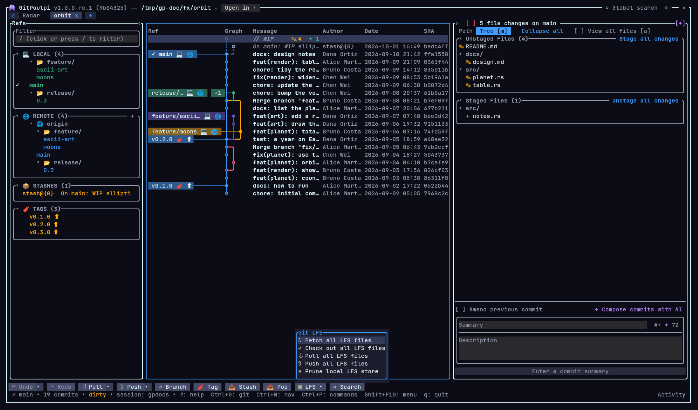

[English](../lfs.md) · [Čeština](../cs/lfs.md) · [Deutsch](../de/lfs.md) · [Español](../es/lfs.md) · [Français](../fr/lfs.md) · [Italiano](../it/lfs.md) · [日本語](../ja/lfs.md) · **한국어** · [Nederlands](../nl/lfs.md) · [Polski](../pl/lfs.md) · [Português (Brasil)](../pt-BR/lfs.md) · [Português (Portugal)](../pt-PT/lfs.md) · [Русский](../ru/lfs.md) · [Svenska](../sv/lfs.md) · [Türkçe](../tr/lfs.md) · [Українська](../uk/lfs.md) · [简体中文](../zh-CN/lfs.md)

# Git LFS

Git LFS("Large File Storage")는 큰 파일(디자인 파일, 동영상, 데이터셋)을 저장소 기록 밖에 둡니다. git은 세 줄짜리 텍스트 *포인터*만 저장하고, 실제 내용은 LFS 서버와 `.git/lfs` 아래의 로컬 캐시에 있습니다.

GitPoulpi는 이 모든 작업에 계정이 필요하지 않습니다. LFS는 리모트가 이미 사용하는 자격 증명(git 자격 증명 도우미 또는 ssh-agent)을 사용합니다.

## `git-lfs` 프로그램이 필요한 작업과 필요 없는 작업

GitPoulpi는 파일을 변환하거나 옮기는 모든 작업(install, track, fetch, pull, push, 잠금)에 표준 `git-lfs` 프로그램을 실행합니다.

LFS *상태*를 읽는 데는 프로그램이 필요 없습니다. 저장소가 LFS를 사용하는지, 어떤 파일이 포인터인지, 크기가 얼마인지, 실제 객체가 이미 로컬에 저장되어 있는지 모두 프로그램 없이 확인합니다.

| | `git-lfs` 필요 |
|---|---|
| `gitpoulpi lfs status` (실패하지 않고 프로그램이 없다고 알려 줍니다) | 아니요 |
| `gitpoulpi lfs files` | 아니요 |
| install / track / untrack / prune | 예 |
| fetch / pull / push | 예 |
| 잠금 | 예 |

## `git-lfs` 설치

- **Windows**: Git for Windows에 포함되어 있습니다. 또는 `winget install GitHub.GitLFS`를 사용합니다.
- **Debian / Ubuntu**: `apt install git-lfs`.
- **macOS**: `brew install git-lfs`.
- 그 밖의 환경: https://git-lfs.com

버전 3.0 이상이 필요합니다. 설치한 뒤 GitPoulpi는 1분 안에(`lfs status`를 실행하면 즉시) 이를 인식합니다.

## `git-lfs`가 없을 때

GitPoulpi는 이 때문에 비정상 종료하거나 중단되지 않습니다.

- `gitpoulpi lfs status`는 성공하며 설치 링크와 함께 `git-lfs: not installed`라고 알려 줍니다.
- 프로그램이 필요한 작업은 설치 링크(`https://git-lfs.com`)로 끝나는 명확한 메시지와 0이 아닌 종료 상태로 실패합니다. MCP에서는 도구가 그 메시지를 반환합니다.
- LFS를 사용하는 저장소도 그대로 열립니다. 프로그램을 설치하기 전까지 큰 파일이 포인터로 표시될 뿐입니다.

## LFS 파일 살펴보기

```
gitpoulpi lfs status            # program, patterns, filters, hook
gitpoulpi lfs files             # pointer files in the index, with size and local/not downloaded
gitpoulpi lfs files --at v1.0   # ... as of a revision
gitpoulpi show big.bin --at HEAD  # reports "Git LFS object, 12.3 MB, sha256:..." instead of pointer text
```

## 저장소 설정: install, track, untrack

```
gitpoulpi lfs install                 # filters + hooks for THIS repository (git lfs install --local)
gitpoulpi lfs install --user          # into your global git config instead (never done silently)
gitpoulpi lfs track '*.psd'           # route *.psd through LFS
gitpoulpi lfs track '*.psd' --lockable   # ... and make them read-only until locked
gitpoulpi lfs track '*.bin' --renormalize  # ... and re-stage already-committed *.bin as pointers
gitpoulpi lfs untrack '*.psd'
gitpoulpi lfs prune                   # delete old, already-pushed objects from the local store
```

- `install`은 기본적으로 저장소 자체의 `.git/config`와 훅에 기록하므로, `--user`를 지정하지 않는 한 전역 git 설정은 건드리지 않습니다.
- `track`과 `untrack`은 `.gitattributes`를 수정하고 **스테이징하지 않은 상태**로 둡니다. 이 파일은 평범한 작업 트리 변경으로 표시되며 직접 commit합니다. 추적을 시작한 *뒤에* 추가한 파일은 다음 commit에서 포인터로 저장됩니다.
- 일반 내용으로 **이미 commit된** 파일은 기록에서 일반 파일로 남습니다. `--renormalize`는 이 파일을 다시 스테이징해서 다음 commit이 포인터로 바꾸도록 합니다. 과거의 모든 commit에서도 옮기려면 기록 다시 쓰기 규칙 *LFS로 마이그레이션*을 쓰세요 ([기록 다시 쓰기](history-rewrite.md#파일을-git-lfs로-옮기거나-되돌리기) 참고). 이것은 GitPoulpi 자체 기능이며 `git lfs migrate`가 아닙니다.
- 셸이 패턴을 확장하지 않도록 따옴표로 묶습니다.
- MCP에서 이 작업은 일반 변경 작업(`lfs_install`, `lfs_track`, `lfs_untrack`, `lfs_prune`)이며 `config.toml`의 `[mcp]` 제한을 따릅니다.

## 객체 옮기기: fetch, pull, push

```
gitpoulpi lfs fetch [--remote origin] [--all]   # download objects into the local store; working tree untouched
gitpoulpi lfs pull  [--remote origin]           # fetch, then replace pointer files with the real content
gitpoulpi lfs push  [--remote origin] [--all]   # upload the current branch's objects (or every ref with --all)
```

- 리모트를 지정하지 않으면 `fetch`, `push`와 마찬가지로 저장소의 기본 리모트를 사용합니다.
- 자격 증명은 리모트에서 평소 쓰는 것(자격 증명 도우미, ssh-agent)입니다. GitPoulpi는 자체 계정을 요구하지 않습니다.
- `pull`은 이 저장소에 LFS 필터가 없으면 설치합니다. 필터가 없으면 git-lfs가 객체는 내려받지만 포인터를 바꾸지 않고, 이후 체크아웃하면 포인터가 다시 들어옵니다.
- MCP는 `lfs push`를 `push`처럼 취급합니다. 리모트를 변경하므로 파괴적 도구입니다.
- 창에서는 전송 진행 상황(파일 수와 바이트)이 상태 표시줄에 표시됩니다. CLI는 결과가 나올 때까지 기다립니다.

### 내용 체크아웃: `lfs checkout`

```
gitpoulpi lfs checkout [<path>...]   # offline: write real content over the pointer files, from the local store
```

이 명령은 내려받지 않습니다(그것은 `lfs pull`입니다). 로컬 저장소에 없는 객체는 포인터로 남습니다. `pull`처럼 설정된 필터가 없으면 먼저 저장소의 LFS 필터를 설치합니다. 모든 LFS 작업과 마찬가지로 실행 취소할 수 없습니다. [실행 취소와 다시 실행](undo-redo.md)을 참고하세요. MCP에서는 `lfs_checkout`입니다(쓰기 작업이며 파괴적이지 않음).

### 도구 모음의 LFS 버튼과 pull / push

도구 모음에는 **Pop** 뒤에 **`LFS ▾`** 버튼이 있습니다(`git.lfs_enabled`가 꺼져 있거나, LFS가 초기화되지도 않았고 `.gitattributes`가 쓰지도 않는 저장소에서는 숨겨집니다. [설정 > LFS](settings.md#저장소별-lfs) 참고). 클릭하면 드롭다운이 열립니다. **모든 LFS 파일 Fetch**(`lfs fetch --all`), **모든 LFS 파일 체크아웃**(`lfs checkout`), **모든 LFS 파일 Pull**(`lfs pull`), **모든 LFS 파일 Push**(`lfs push --all`, 모든 ref의 객체), **로컬 LFS 저장 공간 정리**(`lfs prune`)가 있습니다. 각 행은 팔레트 명령이기도 합니다(`LFS: 모든 객체 Fetch`, `LFS: 모든 파일 체크아웃`, `LFS: 객체 Pull`, `LFS: 모든 객체 Push`, `LFS: 로컬 객체 정리`). `LFS: 메뉴 열기`는 드롭다운을 엽니다. 각각 `Ctrl+G` 코드가 있습니다. 메뉴는 `l`, 각 행은 `Shift+F`, `Shift+K`, `Shift+L`, `Shift+J`, `Shift+V`입니다. *설정 > 키보드 및 마우스*에서 바꿀 수 있습니다. `git-lfs`가 없으면 모든 행이 설치 대화상자로 이어집니다.



**Pull과 push는 LFS를 스스로 처리합니다.** LFS를 사용하는 저장소에서 `git-lfs`가 설치되어 있으면, 일반 `pull`은 먼저 저장소의 LFS 필터가 설치되어 있는지 확인하고, 일반 `push`는 `pre-push` 훅을 확인합니다. 둘 중 하나라도 없으면 GitPoulpi가 전송 전에 `git lfs install --local`(이 저장소에만 적용)을 실행하고, 상태 표시줄에 "LFS 필터를 설치했습니다"라고 표시합니다. 훅이 없으면 push가 LFS 객체를 하나도 업로드하지 않습니다. `git.lfs_autofix_filters = false`로 끌 수 있습니다(*설정 > Git 및 인코딩 > pull·push 전에 LFS 필터 설치*). 일반 `push`는 여전히 push하는 브랜치의 객체만 업로드하며 모든 ref의 객체를 올리지는 않습니다. 정리(prune)는 암묵적으로 실행되지 않습니다.

## 파일 잠금

merge할 수 없는 파일(Photoshop 파일, 레벨, 바이너리 에셋)이 있습니다. Git LFS *잠금*을 사용하면 한 사람이 "내가 편집 중입니다"라고 알릴 수 있습니다. 잠금이 풀리기 전까지 다른 사람은 그 파일을 잠그거나 변경 사항을 push할 수 없습니다.

```
gitpoulpi lfs locks  [--remote origin]              # who holds which file (yours are marked)
gitpoulpi lfs lock   assets/hero.psd [--remote origin]
gitpoulpi lfs unlock assets/hero.psd [--remote origin] [--force]
```

- 잠금은 **LFS 서버**의 기능입니다(GitHub, GitLab, Gitea가 지원합니다). 리모트 자체의 자격 증명으로 접근하며, GitPoulpi에는 자체 계정이 없습니다.
- 잠금을 지원하지 않는 서버에서는 `lock`이 그 사실을 알리는 메시지(형식화된 `LfsLockingUnsupported`)와 함께 실패합니다. 이런 서버에서 `locks`는 아무것도 나열하지 않으며, 이는 git-lfs 자체가 보고하는 결과와 같습니다.
- `--lockable`로 패턴을 추적하면(`lfs track '*.psd' --lockable`) 잠그기 전까지 해당 파일이 읽기 전용이 됩니다.
- 다른 사람의 잠금에 대한 `unlock`은 거부됩니다. `--force`는 이를 강제로 깨며, 그래서 MCP는 `lfs_unlock`을 파괴적 도구로 취급합니다. `lfs_locks`는 읽기 전용입니다.

## LFS 저장소 클론

`gitpoulpi clone <url>`(과 TUI의 클론 대화상자)은 LFS 필터를 실행하지 *않고* 저장소를 체크아웃합니다. 그런 다음 저장소가 LFS를 사용하고 `git-lfs`가 설치되어 있으면 `git lfs pull`로 객체를 내려받고(설정된 필터가 없으면 그 저장소에 필터를 설치합니다), 이를 별도 단계인 *LFS 객체 다운로드 중*으로 표시합니다. `--no-lfs`는 이 단계를 건너뛰고 포인터를 그대로 둡니다.

클론은 **LFS 때문에 실패하지 않습니다**. `git-lfs`가 없거나 다운로드가 실패해도 클론은 성공하고 큰 파일은 포인터로 남습니다. 저장소의 LFS 상태에 이유가 표시되며, 문제를 해결한 뒤 `gitpoulpi lfs pull`로 작업을 마무리합니다.

## 터미널 UI에서

- **`LFS` 태그.** Git LFS로 저장된 파일은 Status 창의 스테이징 안 된 파일 및 스테이징된 파일 목록과 commit의 변경 파일 목록에서 이름 뒤에 작은 `LFS` 태그가 붙습니다. **LFS만**(Status 창이나 Log에 포커스가 있을 때 `o`, 파일 목록 도구 모음의 확인란, 또는 팔레트의 **파일: LFS만 보기 전환**)은 그 목록을 LFS 파일로 좁힙니다. 저장소에 LFS 파일이 있을 때만 표시됩니다. 경로가 인덱스에서 포인터이면 LFS 파일로 간주하며, 태그에 쓰이는 것과 같은 읽기입니다(새로 고침마다 배치된 `git` 호출 한 번이며, `filter=lfs` 속성이 없는 저장소에는 아무것도 하지 않음).
- **diff 카드.** LFS 파일의 diff를 열면 포인터 텍스트 대신 카드가 표시됩니다. `Git LFS 객체`, `1.2 MB -> 1.4 MB`, 이전과 새 짧은 oid, 그리고 새 객체가 로컬에 저장되어 있는지 `다운로드되지 않음`인지가 나옵니다. 원본 포인터 diff를 보려면 `r`을 누르고, 돌아오려면 `r`을 다시 누릅니다. LFS 파일에는 파일 단위 스테이징만 적용됩니다(스테이징할 hunk나 줄이 없습니다). 카드 아래의 **기본 프로그램으로 열기**와 **열기**(`o`, `Shift+O` 또는 팔레트)는 포인터가 아니라 실제 파일을 엽니다. [열기 위치](open-in.md#git-lfs-파일)를 참고하세요.
- LFS 파일의 **파일 보기**에는 `Git LFS 객체, 12.3 MB, sha256:ab12cd34...`와 내용을 가져오는 방법이 표시됩니다.
- **배너.** LFS를 사용하는 저장소인데 `git-lfs`가 없거나 3.0보다 오래된 경우 Status 창의 배너가 이를 알려 줍니다. 배너를 클릭하거나(또는 팔레트 항목 *LFS: 설치 페이지 열기*를 사용하면) https://git-lfs.com이 열립니다. 그 밖에는 아무것도 바뀌지 않습니다. 창이 열리고 diff도 동작하며, 큰 파일이 포인터로 표시될 뿐입니다.
- **파일 메뉴와 팔레트.** Status 창에서 변경된 파일을 마우스 오른쪽 버튼으로 클릭합니다. 일반 파일에는 *LFS로 추적: 이 파일* / *이 확장자*가 나오고, LFS 파일에는 잠금 보유자에 따라 *파일 잠금 (LFS)*, *파일 잠금 해제 (LFS)* 또는 *강제 잠금 해제 (LFS, 다른 사람의 잠금)*가 나옵니다. 잠긴 파일의 행에는 `<소유자>이(가) 잠금`이 표시됩니다. 모든 기능은 팔레트 명령(`Ctrl+P`, `LFS` 입력)으로도 사용할 수 있습니다. 초기화, 패턴 추적 또는 추적 해제, 객체 fetch·pull·push, 정리, 잠금 표시, 설치 페이지 열기가 있습니다.
- **실패한 동작은 스스로 설명합니다.** `git-lfs`가 없어서 LFS 동작이 실패하면, 메시지와 *설치 페이지 열기* 버튼이 있는 대화상자가 표시됩니다.
- **설정.** *설정 > LFS*(저장소별)는 Git LFS가 설정되어 있는지 보여 주고, 추적 중인 패턴을 나열하며, **여기에 LFS 설정**이 있습니다. *Git 및 인코딩*(저장소별)에는 **Git LFS** 스위치, 읽기 전용 **git-lfs 프로그램** 행, **이 저장소에 LFS 초기화** 버튼이 있습니다.
- **Git LFS**를 끄면(`git.lfs_enabled = false`, [설정 참조](config-reference.md) 참고) 위 내용이 모두 숨겨집니다. git 자체의 LFS 필터는 계속 실행됩니다.
- LFS 상태는 저장소를 연 직후, 변경이 있을 때마다, 수동 새로 고침 때, `.gitattributes`가 바뀔 때, 그리고 LFS를 사용하는 저장소에서는 10초마다 읽습니다.

## 알려진 제한

- LFS 패턴이 *중첩된* `.gitattributes`(루트의 것도 아니고 `.git/info/attributes`도 아님)에만 있는 저장소는 LFS 객체 저장소(`.git/lfs`)가 생긴 뒤에야 LFS를 사용하는 것으로 감지되며, 그 전에는 감지되지 않습니다.
- `git lfs migrate` 자체는 쓰지 않습니다. 기록 전체에서 파일을 LFS로 옮기거나 LFS에서 꺼내는 일은 기록 다시 쓰기의 *LFS로 마이그레이션* / *LFS에서 파일 되돌리기* 규칙이 하며, 로컬 클론에서 동작하고 루트 `.gitattributes`만 쓰며, 객체는 나중에 직접 push해야 합니다 (결과 패널의 *LFS 객체 전송* 또는 `lfs push --all`).
