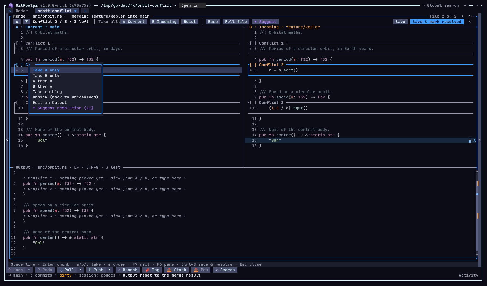
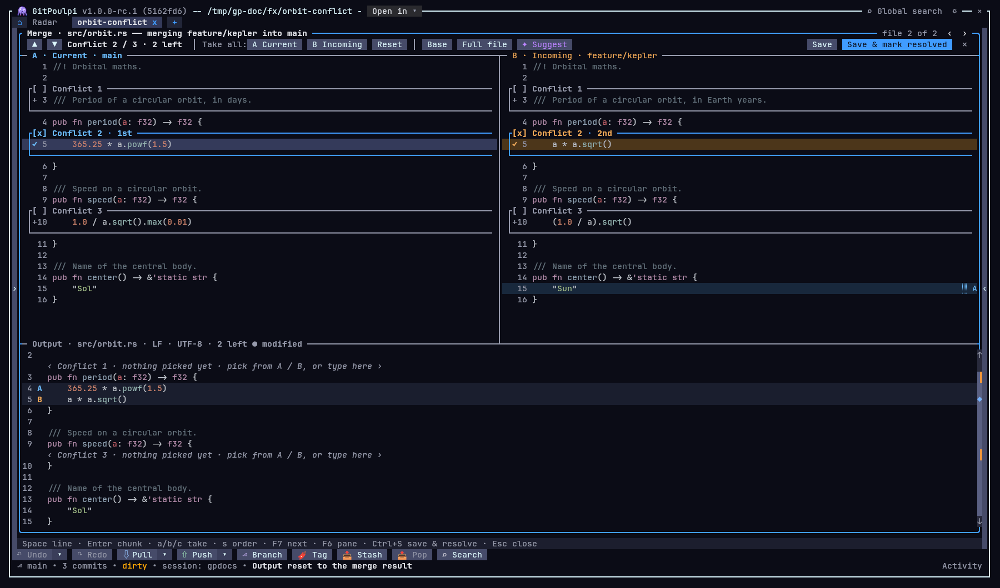
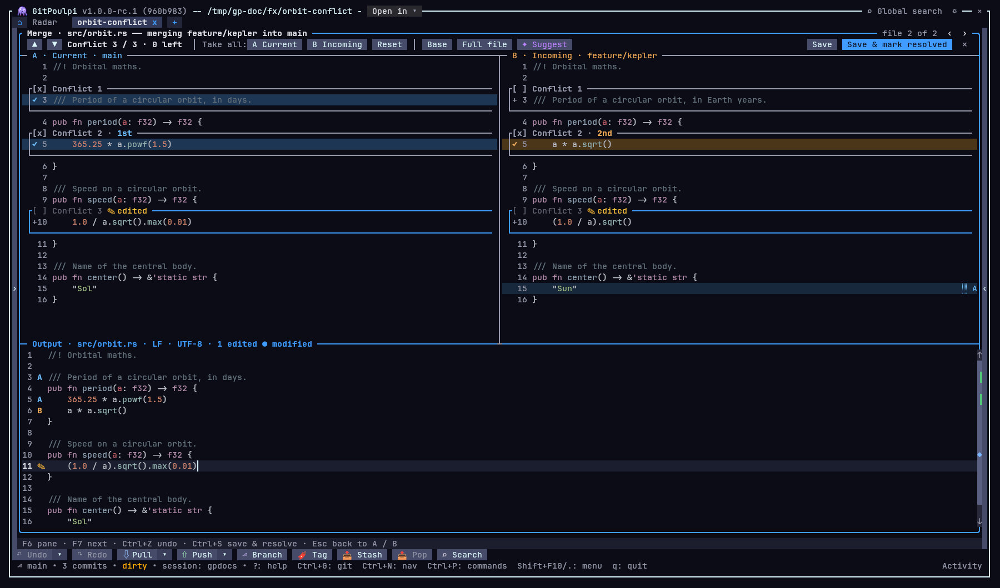
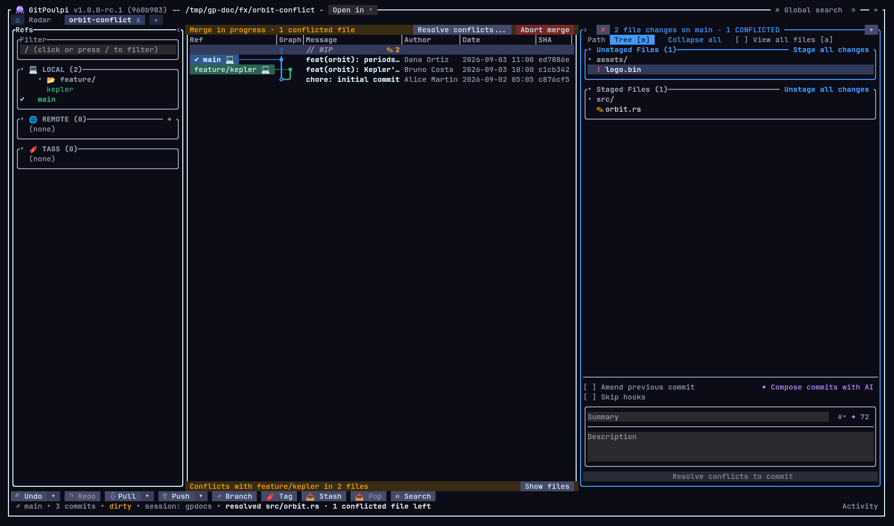
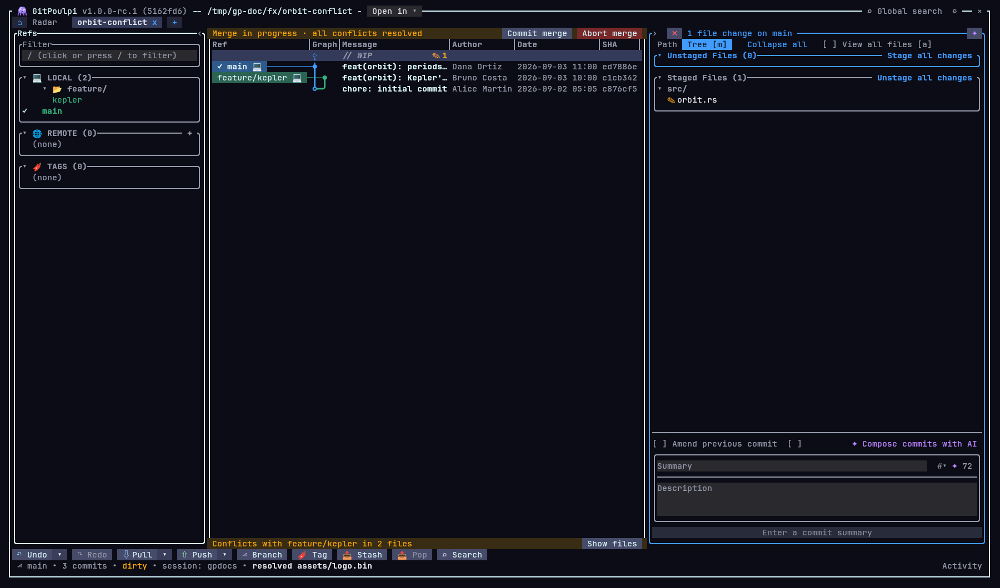
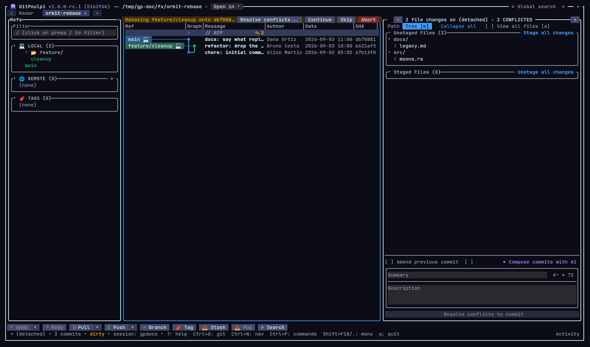
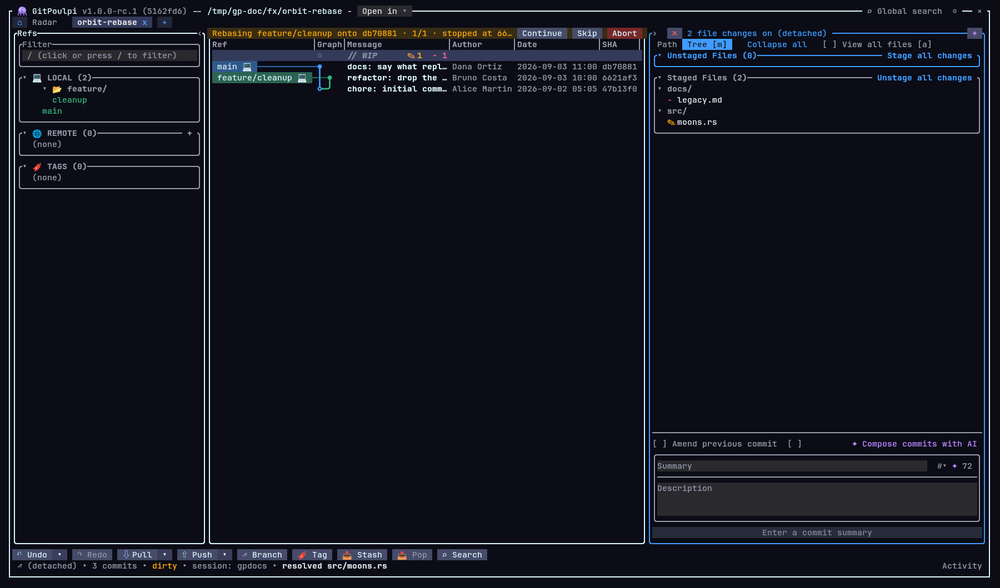
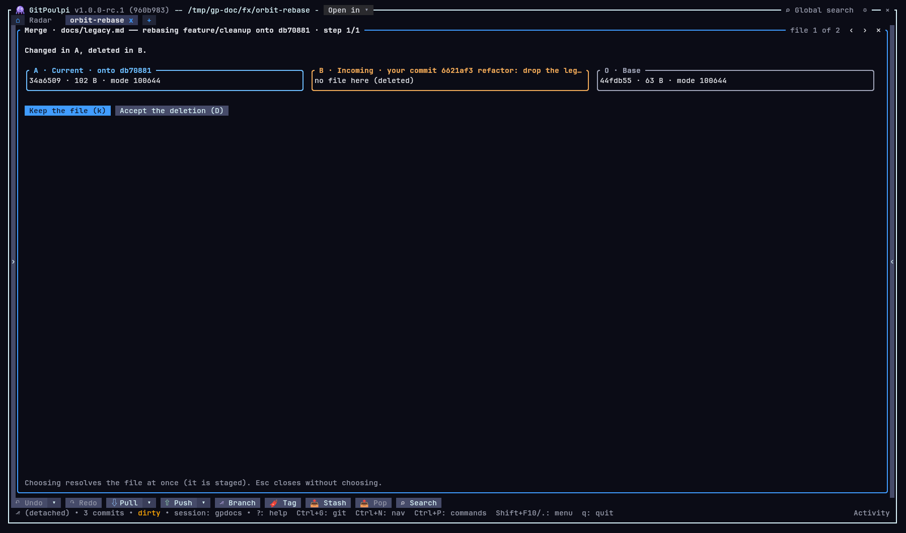

[English](../merge-conflicts.md) · [Čeština](../cs/merge-conflicts.md) · [Deutsch](../de/merge-conflicts.md) · [Español](../es/merge-conflicts.md) · [Français](../fr/merge-conflicts.md) · [Italiano](../it/merge-conflicts.md) · [日本語](../ja/merge-conflicts.md) · **한국어** · [Nederlands](../nl/merge-conflicts.md) · [Polski](../pl/merge-conflicts.md) · [Português (Brasil)](../pt-BR/merge-conflicts.md) · [Português (Portugal)](../pt-PT/merge-conflicts.md) · [Русский](../ru/merge-conflicts.md) · [Svenska](../sv/merge-conflicts.md) · [Türkçe](../tr/merge-conflicts.md) · [Українська](../uk/merge-conflicts.md) · [简体中文](../zh-CN/merge-conflicts.md)

# merge 충돌 해결

merge, cherry-pick, revert, rebase가 충돌 때문에 멈추면 Log에 배너(*Merge 진행 중 · feature → main · 충돌 파일 2개*)가 표시되고, 충돌한 파일은 Status 창에 빨간 `!`와 함께 나타납니다. 그중 하나를 **merge 편집기**에서 여세요. A(현재 쪽)와 B(수신 쪽)가 나란히 놓이고, 그 아래에 작성 중인 파일인 **출력**이 있습니다. 이 페이지는 요약판이며, 전체 키 목록은 [단축키](keybindings.md)에 있습니다.

## 열기

- Status 창의 `!` 행에서 Enter를 누르거나 더블 클릭합니다. 마우스 오른쪽 버튼 메뉴의 첫 항목이 **merge 편집기 열기**입니다.
- 배너의 **충돌 해결...** 버튼(첫 번째 충돌 파일을 엽니다).
- 충돌한 파일의 Diff 보기: **merge 편집기** 버튼(`Shift+E`).
- 팔레트: **충돌: merge 편집기 열기**.

저절로 열리는 것은 없습니다. 멈춘 작업은 배너와 `!` 행만 표시합니다.

편집기는 창 너비 전체를 사용합니다. 편집기가 열려 있는 동안 Refs 사이드바와 오른쪽 패널은 숨겨지고 닫으면 돌아옵니다(그동안 `F9`로 표시하거나 숨길 수 있습니다). 편집기 너비가 `merge.side_by_side_min_width`열 이상이면 A와 B가 나란히 놓입니다(기본값 100, 설정 > Diff 및 편집기, `0`이면 항상). 더 좁으면 탭 뒤에 한 번에 한쪽씩 표시됩니다. 긴 줄은 A와 B가 함께 옆으로 스크롤되며(`Shift+←` / `Shift+→`, Shift+휠 또는 가로 휠), 줄바꿈되지 않습니다.

## 선택

각 충돌은 A와 B에서 테두리가 있는 블록이며, 머리글에 체크박스가 있고 모든 줄 앞에 `+` / `✓`가 있습니다. 덩어리를 마우스 오른쪽 버튼으로 클릭하면 그 충돌에 대한 선택지가 나옵니다.

| 하려는 일 | 키 | 마우스 |
|---|---|---|
| 커서가 있는 줄 가져오기(포커스된 쪽) | `Space` | 줄 클릭 |
| 포커스된 쪽의 덩어리 전체 가져오기 | `Enter` | 머리글의 `[ ]` 클릭 |
| 이 충돌에서 A만 / B만 가져오기 | `a` / `b` | 덩어리를 마우스 오른쪽 버튼으로 클릭 |
| 둘 다 가져오기, A 다음 B / B 다음 A | `c` / `Shift+C` | 덩어리를 마우스 오른쪽 버튼으로 클릭 |
| 아무것도 가져오지 않기 | `x` | 덩어리를 마우스 오른쪽 버튼으로 클릭 |
| 선택한 두 쪽의 순서 바꾸기 | `s` | `1st` / `2nd` 배지 클릭 |
| A 전체 / B 전체 가져오기(모든 충돌) | `Shift+A` / `Shift+B` | 도구 모음 |
| 이 충돌의 선택 해제(미해결로 되돌림) | A / B에서 `u`, 어디서나 `Alt+U` | 덩어리를 마우스 오른쪽 버튼으로 클릭 후 **선택 해제** |
| 파일 전체를 원래 충돌 상태로 초기화(출력에 직접 입력했다면 먼저 확인하며, `Ctrl+Z`로 되돌릴 수 있음) | A / B에서 `Shift+U`, 어디서나 `Alt+R` | 모두 선택 옆의 **초기화** |
| 다음 / 이전 충돌 | `F7` / `Shift+F7`, `Alt+Down` / `Alt+Up` (A / B에서 `n` / `Shift+N`) | `▼` / `▲`, 또는 스크롤바의 표시 클릭 |
| 숫자가 이동을 반복 | `3j`, `2k`, `2n`, `3N` (A / B에서) | |
| 다음 / 이전 충돌 파일 | `Alt+PageDown` / `Alt+PageUp` | 머리글의 `›` / `‹` |
| Base(공통 조상) 창 표시 또는 숨기기 | `Alt+D` (A / B에서 `d`) | `Base` |
| A와 B에 파일 전체 표시(**전체**) | `Alt+F` (A / B에서 `f`) | `전체` |
| A 또는 B에 더 넓은 너비 / 같은 너비로 되돌리기 | `Alt+Right` / `Alt+Left`, `Alt+0` | 구분선 드래그, 구분선 더블 클릭 |
| A / B / Base를 옆으로 스크롤 | `Shift+←` / `Shift+→` (`Shift+H` / `Shift+L`) | Shift+휠, 가로 휠 |
| Refs 및 Status 패널 표시 또는 숨기기 | `F9` | |
| A, B, 출력에 포커스 | `F6` / `Shift+F6` | 클릭 |
| 현재 충돌에서 창으로 이동 | `Alt+1` A, `Alt+2` B, `Alt+3` 출력, `Alt+4` Base, 또는 `Ctrl+N` 다음 `1` / `2` / `3` | |
| 이웃한 창(A, Base, B, 출력)으로 이동, 같은 충돌 | A / B에서 `h` / `l` 또는 `←` / `→` | |
| 출력 높이 순환 | `z` | 제목 드래그 |
| 실행 취소 / 다시 실행(선택과 입력, 하나의 스택) | `Ctrl+Z` / `Ctrl+Y` | |
| 파일을 쓰되 충돌 상태로 유지 | `Alt+S` | **저장** |
| 파일을 쓰고 해결됨으로 표시 | `Ctrl+S` | **저장 및 해결됨으로 표시** |
| 닫기 | `Esc` | `✕` |

모든 스크롤바(A / B / Base 및 출력)에는 충돌마다 표시가 하나씩 있습니다. 아직 선택이 필요하면 주황색, 처리되면 초록색, 현재 충돌은 파란색입니다. 표시를 클릭하면 그 충돌로 이동합니다(스크롤바 썸 아래의 표시는 이미 화면에 있으므로 그곳에서는 클릭이 썸를 끕니다).

둘 다 가져오면(**A 다음 B**) 출력에서 충돌의 표시 아래에 A의 줄 다음 B의 줄이 각각 어느 쪽인지 태그가 붙은 채 쓰이고, 두 덩어리의 `1st` / `2nd` 배지가 순서를 알려 주며, `s`가 순서를 바꿉니다.

**전체**는 충돌뿐 아니라 모든 차이를 색으로 구분해 A와 B에 파일 전체를 보여 줍니다.

출력은 실제 편집기입니다. 클릭해서 입력하고, 선택하고, 잘라내고 붙여넣고, `Ctrl+F`로 찾을 수 있습니다. 직접 편집한 충돌에 선택을 적용하면 편집 내용이 바뀝니다(`Ctrl+Z`로 되돌릴 수 있음). 아무것도 선택하지 않은 충돌이 있거나 아직 충돌 표시처럼 보이는 줄이 있는 상태로 저장하면 먼저 확인합니다.

### ✦ 해결 방법 제안 (AI)

AI를 켜면(설정 > AI, [AI 지원](ai.md) 참고) 도구 모음에 **✦ 제안** 버튼이 있고, 충돌의 마우스 오른쪽 버튼 메뉴에 *해결 방법 제안 (AI)*가 있으며, `Alt+I`와 팔레트(`AI: merge 충돌 해결 방법 제안`)도 같은 일을 합니다. 현재 충돌에만 적용되고 사용자가 요청할 때만 실행됩니다. 답변은 그 충돌의 출력 부분을 하나의 편집으로 바꾸고 편집됨(`✎`)으로 표시하므로 `Ctrl+Z`로 충돌을 원래대로 되돌릴 수 있습니다. 저장이나 스테이징은 대신 해 주지 않습니다. 실행되는 동안 힌트 행에 경과 시간이 표시되고, `Esc`로 취소하며, 실패도 그곳에 표시됩니다. AI를 끄면 이 컨트롤은 모두 없습니다.

**저장 및 해결됨으로 표시** 후에는 파일이 스테이징되고 충돌 파일 목록으로 돌아갑니다. 다음 파일은 직접 여세요. `Ctrl+Z`(또는 실행 취소 버튼)는 마지막 "해결됨으로 표시"를 되돌립니다.

남은 파일이 없으면 배너에 **Merge Commit**(cherry-pick, revert, rebase는 **계속**)과 **Merge 중단**이 나타납니다. 중단은 먼저 확인하며 HEAD, 인덱스, 작업 트리를 원래대로 되돌립니다.

rebase도 단계마다 같은 방식으로 멈춥니다. 그 배너는 브랜치와 rebase 대상을 알려 주며 **충돌 해결...**, **계속**, **건너뛰기**, **중단**이 있습니다.

마지막 파일까지 해결하면 같은 배너에서 **계속**할 수 있습니다.

결과가 HEAD와 같은 merge(모든 곳에서 우리 쪽을 선택한 경우)는 스테이징된 것도 변경된 파일도 없지만 그래도 마무리할 수 있습니다. **Merge Commit**이 merge 메시지가 있는 commit 프롬프트를 열고, 그 commit에는 부모가 둘 있습니다. 마찬가지로 merge가 멈춰 있는 동안에는 스테이징된 것이 없어도 작성기의 Commit 버튼이 활성화됩니다.

빈 cherry-pick이나 revert(변경 사항이 이미 적용됨)는 commit할 수 없습니다. git이 거부하며, **계속**은 그렇게 알리고 **건너뛰기**를 안내합니다. **건너뛰기**(배너 버튼, 팔레트 항목 *Git: Cherry-pick 또는 되돌리기 건너뛰기*, CLI `conflicts skip`)는 먼저 확인한 뒤 아무것도 기록하지 않고 작업을 끝냅니다. HEAD, 인덱스, 작업 트리는 HEAD로 돌아갑니다. 건너뛰기는 실행 취소할 수 없습니다(일부러 포기한 것 외에는 잃는 것이 없습니다). merge에는 건너뛸 것이 없습니다.

## 텍스트가 아닌 충돌

바이너리 파일, Git LFS 포인터, 8 MiB를 넘는 파일, 한쪽에서 삭제된 파일, 이름 변경의 잔여물, 심볼릭 링크, 모드 변경, 서브모듈에는 선택할 줄이 없습니다. 편집기는 양쪽이 가진 내용과 선택지마다 버튼 하나가 있는 **카드**를 표시하며, 선택하면 즉시 해결되고 파일이 스테이징됩니다.

| 카드 | 선택지 |
|---|---|
| 바이너리 파일, LFS 포인터, 너무 큼 | **A 유지**(`a`), **B 선택**(`b`), **Base 선택**(`o`, 있는 경우), **merge 도구로 열기**(`m`) |
| 한쪽에서 삭제되고 다른 쪽에서 변경됨 | **파일 유지**(`k`), **삭제 수락**(`Shift+D`) |
| 이름 변경 잔여물(경로가 한쪽에만 있음) | **파일 유지**(`k`), **파일 삭제**(`Shift+D`) |
| 심볼릭 링크, 서브모듈, 파일 모드 | **A 유지**, **B 선택**, **Base 선택** |

파일이 그림(PNG, JPEG, GIF, WebP, BMP, ICO)이면 상자에 A, B, Base 그림도 맞춤 크기의 읽기 전용으로 표시되며, 그림이 들어갈 만큼 넓은 창이 필요합니다. [그림](image-view.md#merge-편집기에서)을 참고하세요.

`Esc`는 선택하지 않고 카드를 닫습니다. 외부 merge 도구는 설정 > Diff 및 편집기의 `general.external_merge_tool`입니다(`{base}`, `{local}` = A, `{remote}` = B, `{merged}`. 비어 있으면 `git mergetool`). 도구가 성공적으로 종료되면 파일이 스테이징됩니다.

## 충돌 방지

GitPoulpi는 merge하기 *전에* 알려 줄 수 있습니다. 지금 있는 브랜치가 갈라져 나온 브랜치(**기준**)와 충돌하게 되면 Log 맨 위
테두리 행에 **origin/main과 2개 파일에서 충돌**이라는 띠와 **파일 보기** 버튼이 나타납니다. 진행 중인 작업의 배너 다음의 빈 테두리 행을
쓰므로, 그런 배너가 표시되는 동안에는 자리가 날 때까지 기다릴 수 있습니다. 아무것도 merge하지 않습니다. 데몬이 두 commit을
메모리 안에서 merge해 보므로(libgit2, 또는 git 2.38 이상의 `git merge-tree --write-tree`. 더 오래된 git에서는 로그에 한 줄을 남기고
이 기능이 꺼짐) 파일, 인덱스, ref는 건드리지 않습니다.

- **기준**은 GitPoulpi가 이미 알고 있다면 브랜치의 pull request의 대상 브랜치입니다(Pull requests 섹션이 보관하는 캐시이며 이를 위해
  네트워크를 호출하지 않음). 그렇지 않으면 **기준 브랜치** 패턴(설정 > 충돌 방지)에 해당하는 브랜치 중 분기 이후 commit이 가장 적은
  브랜치입니다. 동률이면 끝이 분기점에 가장 가까운 브랜치, 그다음 로컬보다 리모트 추적 브랜치, 그다음 이름 순입니다. 브랜치 자신과
  그 리모트 사본은 기준이 되지 않습니다.
- **팝업**(띠를 클릭하거나 키보드로도 쓸 수 있는 팔레트의 **충돌: 예상 충돌 표시**)은 파일을 나열하고 **merge 미리 보기 열기**와 **기준
  브랜치 위로 Rebase**를 제공합니다. 이 둘은 기준 브랜치 자체의 메뉴 행(*<base>를 <branch>에 merge*, *<branch>를 <base> 위로
  rebase*)을 대신 실행하는 것이며, 실행 취소 기록에 남으므로 `Ctrl+Z`로 되돌릴 수 있고, 실제로 충돌하는 merge는 다른 것처럼 merge
  편집기에서 멈춥니다. 왼쪽과 오른쪽 화살표로 버튼 사이를 이동하고, Enter로 누르고, Esc로 닫습니다.
- **실행 시점**: 백그라운드에서, 저장소가 조용해지고(commit, 체크아웃, 브랜치를 옮긴 fetch, rebase) 약 2초 뒤에 `(HEAD, 기준)` 쌍마다
  한 번 실행됩니다. HEAD가 움직이면 띠는 바로 숨겨졌다가 새 답과 함께 다시 나타나거나 나타나지 않습니다. 분리된 HEAD는 검사하지
  않습니다.
- **기준 브랜치 목록**: 저장소의 기준 브랜치가 어디서 오는지는 그 **충돌 방지** 페이지에서 고릅니다. **기본**은 전역 기본값을 따릅니다(설정 > 충돌 방지에서 다른 목록을 고르기 전까지는 기본 제공 `**`, 즉 모든 브랜치). **목록: <name>**은 이름 붙인 목록 중 하나를 따르고, **자체 목록**은 그 저장소만의 목록입니다. 목록은 공유됩니다. 하나를 편집하면 그것을 따르는 모든 저장소가 다음 검사부터 변경을 사용하며 다시 시작할 필요가 없습니다. **목록으로 저장...**은 저장소 자체의 패턴을 이름 붙인 목록으로 만들고, **기본값으로 되돌리기**는 저장소의 선택을 버립니다. 저장소가 따르는 목록을 삭제하면 그 저장소는 기본값을 사용합니다.
- **끄기**: 설정 > 일반의 **사전 충돌 감지 사용**, 또는 저장소 하나에 대해서는 그 저장소의 **충돌 방지** 페이지. 스크립트에서는
  `gitpoulpi conflicts check`가 같은 답을 JSON으로 출력합니다([CLI 참조](cli-reference.md)).
## 에이전트

에이전트는 충돌을 보여 주거나(`gitpoulpi ui show conflict <path> [--conflict N]`: 편집기가 그 충돌에서 열리고 아무것도 선택되지 않음) 해결 방법을 **제안**할 수 있습니다(`gitpoulpi ui propose resolution <path> --pick 1=a,2=ba` 또는 `--content-file F`, *AI 에이전트가 변경 사항을 제안하고 내가 확인하도록 허용*이 필요함). 제안은 선택(또는 전체 텍스트)이 이미 출력에 들어 있고 보라색 *✦ claude-code의 제안* 배너가 있는 편집기로 열립니다. 검토하고, 원하는 대로 바꾸고, **Ctrl+S**를 누르세요. 그때서야 무언가가 기록되거나 스테이징됩니다. 편집기를 닫으면 제안이 거부됩니다. [MCP와 에이전트](mcp-and-agents.md)를 참고하세요.

스크립트에서는 같은 동작이 `gitpoulpi conflicts list | show | resolve | unresolve | state | abort`입니다([CLI 참조](cli-reference.md)). `conflicts check`는 merge 전에 충돌을 예측합니다.
