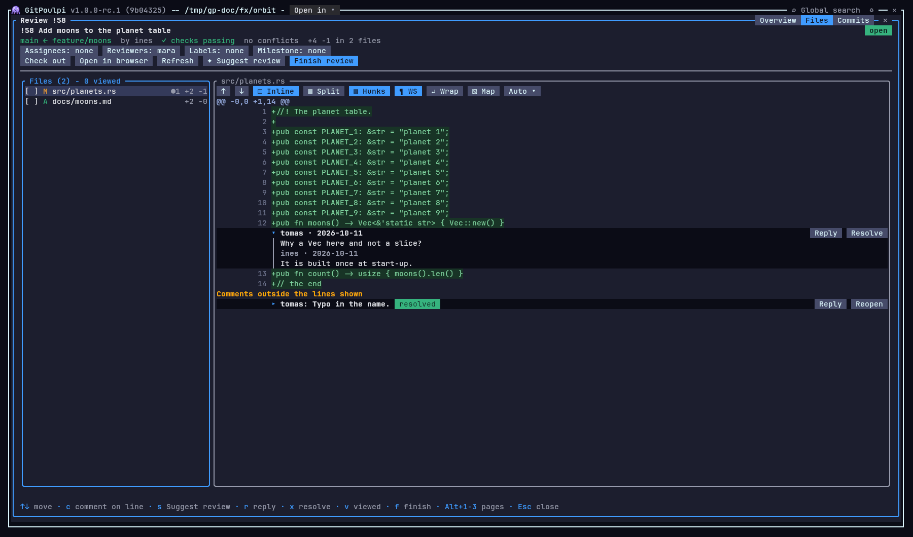
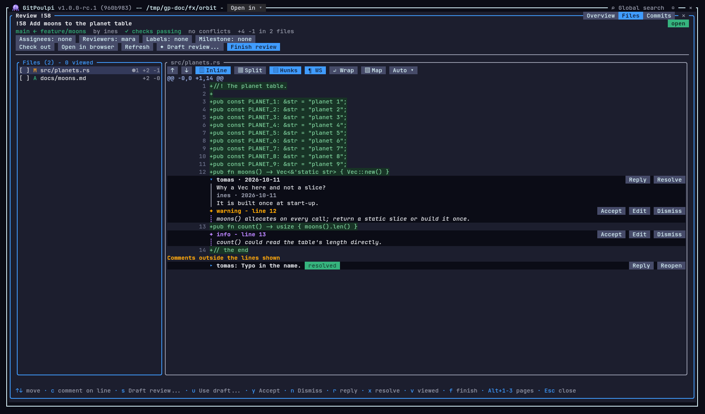

[English](../review.md) · [Čeština](../cs/review.md) · [Deutsch](../de/review.md) · [Español](../es/review.md) · [Français](../fr/review.md) · [Italiano](../it/review.md) · [日本語](../ja/review.md) · **한국어** · [Nederlands](../nl/review.md) · [Polski](../pl/review.md) · [Português (Brasil)](../pt-BR/review.md) · [Português (Portugal)](../pt-PT/review.md) · [Русский](../ru/review.md) · [Svenska](../sv/review.md) · [Türkçe](../tr/review.md) · [Українська](../uk/review.md) · [简体中文](../zh-CN/review.md)

# pull 또는 merge request 리뷰

pull request(GitHub, Gitea, Forgejo), merge request(GitLab) 또는 Gerrit 변경([Gerrit](#gerrit) 참고)을
**저장소의 창을 떠나지 않고** 리뷰합니다. 리뷰 보기는 설명, 대화, 줄 아래에 댓글 스레드가 달린 변경된 파일, 그리고
커밋을 보여 주며, 리뷰를 쓰는 곳이기도 합니다: 댓글, 승인, 변경 요청. 이 호스트 중 하나의 프로필([호스팅과 이슈
트래커](hosting-integration.md) 참고)과 그 프로필에 연결된 저장소가 필요하며, 다른 제공자는 리뷰를 지원하지 않습니다.
호스트의 제한은 그대로 따릅니다: GitLab에는 *변경 요청* 판정이 없고 댓글 하나에 한 줄만 달 수 있습니다.
이 페이지는 이 모두를 *요청*이라고 부릅니다.

## 리뷰 열기

어떤 경로로 들어가도 같은 보기가 열립니다:

- 사이드바의 **PULL REQUESTS** 목록: 행을 선택하고 **Enter**를 누르거나, 오른쪽 클릭하여 **리뷰...**를 선택합니다.
- **Radar**: 행의 메뉴에서 **리뷰...**, 또는 `e` 키(저장소가 열리고 리뷰도 함께 열립니다. 클론하지 않은 저장소의 요청은 클론할지 API로 리뷰할지 묻습니다,
  [클론 없이 리뷰](#클론-없이-리뷰) 참고).
- **워크스페이스 검색**(`Ctrl+Alt+F`): pull 또는 merge request를 강조 표시하고 **`Alt+R`**을 누릅니다.
- 팔레트: **호스팅: 요청 리뷰...**가 선택할 요청의 목록을 보여 줍니다.

보기는 저장소 위의 창 전체를 채웁니다(별도의 창이 아니라 저장소 탭의 한 모드입니다).
**`Esc`** 또는 모서리의 `✕`로 나갑니다. 열리는 동안 요청은 호스트에서 읽고, 코드는 백그라운드에서
git으로 가져옵니다. 잠깐 이상 걸리면 스피너가 나타납니다.

## 머리글

항상 보이는 항목: 번호와 제목, 상태(열림, 초안, 병합됨, 닫힘), 브랜치(`main ← feature/moons`), 작성자, 검사(`✓ 검사 통과`,
`✗ 검사 실패`, `● 검사 실행 중`), 깔끔하게 병합되는지 또는 충돌하는지, 크기, 그리고 작성한 댓글이 있으면
**`대기 중인 댓글 3개`**.

메타데이터 버튼 네 개 - **담당자**, **리뷰어**, **레이블**, **마일스톤** - 은 사이드바와 같은 선택기를 엽니다
([담당자, 리뷰어, 레이블, 마일스톤](hosting-integration.md#담당자-리뷰어-레이블-마일스톤) 참고). 호스트가 받아들이는 즉시
머리글에 결과가 표시됩니다. 동작 버튼: **체크아웃**(요청 브랜치의 일반 체크아웃이며 보기도 닫습니다),
**브라우저에서 열기**, **새로 고침**(**`F5`**), **리뷰 완료**.

## 세 페이지

위쪽 테두리의 분할 컨트롤로 페이지를 전환합니다: **개요**, **파일**, **Commits**
(**`Alt+1`**, **`Alt+2`**, **`Alt+3`**, 또는 클릭).

### 개요

설명(기본 Markdown은 그대로 표시됩니다: 굵게, 기울임, `코드`, 링크는 텍스트로, 글머리 기호 및 번호 목록, 제목, 인용, 코드 블록)과
그 아래 대화가 나옵니다: 코드에 달리지 않은 댓글과 이미 제출된 리뷰가 오래된 것부터 순서대로, 각각 판정(`승인함`, `변경 요청함`,
`댓글 남김`, `기각됨`)과 함께 표시됩니다. GitLab에서 판정은 승인입니다. 그 아래에 답글 상자가 있습니다: 클릭하거나
**`c`**를 눌러 대화에 댓글을 씁니다. **이 댓글은 바로 게시되며**, 상자에도 그렇게 표시됩니다.

댓글 상자(답글, 코드 줄의 댓글, **리뷰 마치기** 요약의 상자도 마찬가지)는 [대화 보기](hosting-integration.md#쓰기)와 공유하는 Markdown 입력창입니다: **쓰기**, **미리보기**(`Alt+P`), **분할**(`Alt+L`, 너비 100열의 창에서), `Ctrl+Enter`(`Ctrl+S`, `Alt+Enter`도 가능)로 보내기, 그리고 AI가 켜져 있으면 `Alt+E`로 **AI로 쓰기**를 엽니다([AI 장](ai.md#호스트에서-쓰기-도움)). 미리보기는 호스트가 표시할 모습 그대로 보여 주며 참조(`#7`, `!12`, `ABC-12`, commit id)도 포함합니다. 보내지 않은 텍스트는 요청별로 보관됩니다. 설명과 대화의 텍스트도 같은 렌더러를 쓰므로 Markdown, 표, 알림, 참조가 여기와 이슈의 대화 보기에서 똑같이 보입니다. 이미 게시한 댓글의 인용, 편집, 삭제와 내부 메모는 이슈와 리뷰가 없는 호스트의 요청에 대한 대화 보기에 속합니다([대화](hosting-integration.md#5c-대화) 참고). 여기서는 대기 중인 댓글만 편집할 수 있습니다.

### 파일

왼쪽에 변경된 파일(상태 문자, `+추가 -제거`, 열린 스레드 수 `●n`, 대기 중인 댓글 수 `✎n`)이, 오른쪽에 선택한 파일의
diff가 있습니다. diff는 git에서 가져옵니다: 요청의 head를 `refs/gitpoulpi/pr/<n>`으로 가져와(브랜치가 아니며 아무것도
체크아웃하지 않습니다) merge base와 비교하므로, 여백의 줄 번호는 댓글이 쓰는 번호와 정확히 같습니다.

- **파일 앞의 `[ ]`**: 파일을 *확인함*으로 표시합니다(클릭하거나 목록에서 **`v`** / `Space`). 제목이 개수를 셉니다.
  확인함 표시는 저장소별로 보관되며 재시작해도 남습니다.
- **스레드**는 해당 줄 바로 아래에 있습니다: 첫 댓글, 답글, 그리고 **답글**과 **해결** / **다시 열기** 버튼. 해결된 스레드는
  한 줄로 접힙니다. **`z`**(또는 그 줄에서 `Enter`, 또는 `▾` 클릭)로 모든 스레드를 접고 펼칩니다.
- **오래된 스레드**와 diff에 표시되지 않는 줄의 스레드는 hunk 뒤에 *표시된 줄 밖의 댓글* 아래에 나열되며, 코드가 바뀌어
  어긋난 경우 `오래됨` 배지가 붙습니다.
- **`c`**는 커서가 있는 줄에 댓글을 답니다(줄 시작의 작은 `+`는 마우스로 같은 일을 합니다). **`Shift+Up` / `Shift+Down`**
  (또는 줄 위로 드래그)으로 먼저 여러 줄을 선택하면 댓글이 그 범위를 포함합니다. GitLab은 댓글 하나에 한 줄만 받으므로
  보기는 선택하는 대신 그렇게 알려 줍니다.
- **`r`**은 커서 아래 스레드에 답글을 쓰고, **`x`**는 해결하거나 다시 엽니다. 둘 다 호스트로 **바로** 전송됩니다.
- 키: `Up` / `Down` / `PgUp` / `PgDn` / `Home` / `End`로 이동합니다. `Tab`, `Right`, `Enter`는 파일 목록에서 diff로,
  `Left`와 `Tab`은 되돌아갑니다. `]`와 `[`는 다음 파일과 이전 파일로 건너뜁니다.

### diff 표시 옵션

**파일**과 **Commits** 페이지의 diff 창은 [Diff 보기](staging-and-committing.md)의 것과 같으며, 첫 줄의 막대와 기억되는 선택도
같습니다(하나의 설정입니다: 여기서 고른 것이 Diff 보기가 열릴 때의 값이고, 반대도 마찬가지입니다):

- **인라인 / 분할**: 한 열, 또는 변경 전후를 나란히. 분할에서는 스레드, 대기 중인 댓글, 제안이 해당하는 쪽 아래에 놓입니다:
  제거된 줄의 댓글은 왼쪽 아래, 추가되거나 변경되지 않은 줄의 댓글은 오른쪽 아래입니다. 제거와 추가를 함께 보여 주는 행에서
  **`c`**를 누르기 전에 원하는 쪽을 클릭하세요. 키보드는 새 쪽에 댓글을 답니다.
- **Hunk**: 변경 부분만 문맥과 함께, 또는 변경 부분이 제자리에 표시된 파일 전체. 파일 전체에서는 변경 밖의 줄에 있는 스레드가
  *표시된 줄 밖의 댓글*이 아니라 그 줄 아래에 놓입니다. 파일 텍스트는 백그라운드에서 읽으며, 도착할 때까지 hunk는
  그 사실을 알리는 줄과 함께 화면에 남습니다(Commits 페이지에서는 커밋당 최대 40개 파일을 이렇게 읽습니다).
- **WS**: 공백만 다른 변경을 표시하거나 무시합니다.
- **줄바꿈**: 긴 줄을 줄바꿈합니다.
- **위 / 아래 화살표**: 이전 hunk와 다음 hunk.
- **Map**(**`M`**): 스크롤 막대 옆의 미니맵이며, Diff 보기와 하나의 설정입니다. 클릭하거나 드래그하여 스크롤합니다.
- **자동**(**`E`**, 또는 *리뷰: 인코딩 선택...*): Diff 보기처럼 파일을 읽는 인코딩입니다. 자동 감지 또는 목록의 인코딩 중 하나를
  창에 보이는 파일에 대해 고릅니다(Commits 페이지에서는 커서 아래의 파일). 파일의 양쪽이 그 인코딩으로 백그라운드에서 다시
  읽히며, 선택은 같은 경로에 대해 Diff 보기와 공유됩니다. 그렇게 읽을 수 없는 파일은 diff 위에 이유를 표시합니다.
- **`⋯`**: 창이 좁아 모든 버튼이 들어가지 않으면, 들어가지 않는 버튼은 막대 끝의 `⋯` 뒤에 있습니다. 그 목록은 각 항목을
  클릭한 것처럼 실행합니다. 키와 팔레트 행은 평소처럼 동작합니다.

스크롤 막대의 눈금은 위치를 보여 줍니다: 변경 부분(Diff 보기처럼 파일 전체일 때만), 스레드, 대기 중인 댓글, 제안마다 점 `●`,
그리고 커서.

긴 줄은 창의 가장자리에서 잘리며(전체를 보려면 **줄바꿈**을 켜세요) 옆으로 스크롤합니다: diff에서 **`Right`**와 **`Left`**
(왼쪽 가장자리에서 `Left`는 파일 목록으로 돌아감), 가로 휠 또는 `Shift`와 휠, 아래쪽 테두리를 따르는 스크롤 막대,
또는 *리뷰: Diff 왼쪽 / 오른쪽으로 스크롤*.

### 텍스트와 줄 선택

드래그가 시작되는 곳이 선택 대상을 정합니다. **코드 안**에서 시작하는 드래그는 Diff 보기처럼 텍스트를 선택합니다(더블 클릭은
단어 선택). **`Ctrl+C`**(또는 *리뷰: 선택한 텍스트 또는 줄 복사*)는 줄 번호나 표시 없이 정확히 그 문자만 복사하며, 텍스트를 선택하지
않았으면 커서 아래의 줄을 복사합니다. **여백**(줄 번호, 표시, `+`)에서 시작하는 드래그는 앞에서처럼 댓글을 달 줄을 선택하며,
여백에서 더블 클릭하면 그 줄에 대한 댓글이 시작됩니다.

Diff 보기의 키 `n`, `p`, `m`, `w`, `s`는 리뷰 자체의 키이므로 리뷰에서 전환 키는 대문자입니다: **`V`** 레이아웃, **`H`** hunk 또는
파일 전체, **`S`** 공백, **`W`** 줄바꿈, **`J`** / **`K`** 다음 / 이전 hunk, **`E`** 인코딩, **`M`** 미니맵. 모두 팔레트 행이 있습니다
(*리뷰: 인라인 / 분할 레이아웃 전환*, ...).

### Commits

요청의 커밋만(그 뒤의 기록은 제외) 최신순으로 보여 주며, 선택한 커밋의 diff(부모와 비교한 변경)에는 모든 파일이 위아래로
나열되고 같은 표시 옵션이 적용됩니다.

## 리뷰 쓰기

코드에 다는 댓글은 **대기 중**입니다: 내 컴퓨터(저장소의 상태 파일이므로 재시작해도 남습니다)에 보관되고 머리글에 집계됩니다.
리뷰를 완료하기 전에는 아무것도 전송되지 않습니다. 대기 중인 댓글은 줄 아래에 `대기 중 - 줄 12` 배지와 버튼 두 개로 표시됩니다:
**`e`**(편집)와 **`d`**(삭제).

**리뷰 완료**(**`f`**, 버튼, 또는 팔레트)는 작은 양식을 엽니다: 요약(선택 사항)과 **판정** 목록: *댓글*, *승인*, *변경 요청*.
호스트가 허용하는 것만 나열됩니다: GitLab에는 *변경 요청*이 없습니다. **리뷰 제출**(`Ctrl+S`)은 요약, 판정, 대기 중인 모든 댓글을 한 번에
보냅니다. **리뷰 폐기...**는 확인 후 대기 중인 댓글을 버립니다.

리뷰를 기다리지 않고 바로 전송되는 것: 답글, 해결과 다시 열기, 대화에 다는 댓글. 댓글 상자가 어느 쪽인지 알려 줍니다
(*이 댓글은 바로 게시됩니다* 또는 *이 댓글은 리뷰를 완료할 때까지 대기 중인 리뷰에 추가됩니다*). 호스트가 답글을 거부하면 상자가 쓴 내용과 함께
다시 열립니다.

대기 중인 댓글을 쓴 뒤에 요청에 새 커밋이 생기면, 보기는 댓글의 줄이 움직였을 수 있다고 경고합니다(GitHub와 GitLab은 읽은 커밋에
댓글을 달며, 이전 head에 대한 리뷰는 거부됩니다).

## Gerrit

Gerrit 서버는 다른 호스트처럼 연결하고([호스팅과 이슈 트래커](hosting-integration.md) 참고: 서버 URL, 사용자 이름, HTTP 비밀번호)
**PULL REQUESTS**에서 *프로젝트*에 연결합니다. 변경은 pull request로 나열되고(`#7`, 칩 `GR`) 같은 보기에서 리뷰하며,
Gerrit만의 차이가 있습니다:

- **패치 세트.** 변경에는 번호가 매겨진 패치 세트가 있습니다(커밋을 업로드할 때마다 하나). 머리글의 위쪽 테두리, 페이지 탭 옆에
  **`패치 세트 N`** 콤보박스가 있습니다(**`P`**, 또는 팔레트 행 *리뷰: 패치 세트 선택...*). 최신 패치 세트로 시작하며, 다른 것을 고르면
  그 패치 세트의 파일과 코드를 읽고, 다른 패치 세트에 쓰인 스레드는 *오래됨*으로 나열됩니다. 완료하는 리뷰는 표시 중인 패치 세트로 전송됩니다.
- **다른 패치 세트와 비교.** 그 왼쪽의 두 번째 콤보박스 **`비교: 베이스`**(**`D`**, 또는 *리뷰: 패치 세트 비교...*)는
  베이스와, 표시 중인 것보다 오래된 모든 패치 세트를 나열합니다. 패치 세트 3을 표시한 상태에서 패치 세트 1을 고르면 파일 페이지는 패치 세트 3이
  패치 세트 1 이후에 바꾼 것만 나열하고 diff로 보여 줍니다(서버 자체의 차이이므로 더 새로운 대상으로의 rebase는 변경으로 나타나지 않습니다).
  커밋 페이지는 그 차이 하나를 보여 줍니다. 두 패치 세트는 각각 `refs/gitpoulpi/pr/<n>`과 `refs/gitpoulpi/pr/<n>-ps<k>`로 가져옵니다.
  표시 중인 것이 아닌 다른 패치 세트에 쓰인 스레드는 *오래됨*입니다. 비교 중인 것보다 오래된 패치 세트를 읽으려고 고르면 비교가 베이스로
  초기화됩니다. CLI 대응 명령은 `review show|fetch --compare-with K`입니다.
- **Submit과 abandon.** 서버가 변경을 submit할 수 있다고 알리면(필요한 투표와 검사가 갖춰짐) 머리글의 버튼에 **Submit** 버튼이 더해지고,
  **Abandon**은 변경을 abandon할 수 있는 동안 있습니다. 둘 다(키 **`U`**와 **`Q`**, 팔레트 *리뷰: 변경 Submit...* / *리뷰: 변경 Abandon...*)
  먼저 묻는 팝업을 띄우며, 그 동작이 서버에서 일어나고 **GitPoulpi에서 실행 취소할 수 없다**고 알립니다(병합된 변경은 병합된 채로 남고,
  abandon한 변경은 Gerrit 웹 인터페이스에서 복원할 수 있습니다). 거절하면 아무것도 보내지 않으며, 성공하면 보기가 변경을 다시 읽습니다.
  CLI 대응 명령은 `gitpoulpi hosting review submit-change <n>`과 `hosting review abandon <n> [--message M]`입니다.
- **판정 대신 투표.** **리뷰 완료**는 투표할 수 있는 레이블마다 콤보박스 하나를 보여 줍니다 - `Code-Review`(-2에서 +2)와, 프로젝트에 있으면
  `Verified` - 서버가 **이 변경과 나에게** 허용하는 값만 나열합니다(권한이 없는 개발자는 +2를 고를 수 없습니다). 현재 투표에서 시작하며,
  바꾼 투표만 전송됩니다. 요약과 대기 중인 댓글은 같은 호출로 갑니다. Gerrit 웹 인터페이스에서 저장한 초안은 리뷰와 함께 게시됩니다.
- **스레드**는 Gerrit의 댓글 체인입니다. 가장 최근 댓글이 `unresolved: false`이면 스레드가 해결된 것이며, **해결**은 그렇게 만드는 답글
  `Done`을, **다시 열기**는 답글 `Reopened`를 게시합니다. 답글과 해결은 다른 호스트처럼 서버로 바로 갑니다.
- **리뷰용 push.** Gerrit은 `refs/for/<branch>`로 push하면 변경을 만듭니다. PULL REQUESTS 섹션이 Gerrit 프로젝트에 연결되어 있으면 섹션의
  **`+`** 버튼과 팔레트 행 **호스팅: 리뷰용 Push...**가 대상 브랜치를 묻고 `HEAD`를 `refs/for/<branch>`로 push합니다(토픽은 명령줄에서 지정할 수
  있습니다). 이 push는 GitPoulpi에서 실행 취소할 수 없으며(Gerrit에서 변경을 abandon하세요) 메시지도 그렇게 알립니다. CLI의 같은 기능은
  `gitpoulpi hosting review push`입니다.
- 메타데이터 버튼은 Gerrit에서 읽기 전용이며(리뷰어가 표시됨), *변경 요청* 판정은 없고(-1 또는 -2 투표가 같은 의미), 검사 칩은 `Verified` 레이블입니다.

## ✦ AI 리뷰 초안

AI를 켜면(*설정 > AI*, [AI](ai.md) 참고) 머리글에 **`✦ 리뷰 초안 작성...`** 버튼이 생깁니다(**`s`**와 팔레트 행 *리뷰: ✦ 리뷰 초안 작성...*도 같습니다).
이 버튼은 [리뷰 옵션](#리뷰-옵션)을 열고 거기서 **`Enter`**를 누르면 모델에 요청합니다. 이것만이 모델에 요청하는 유일한 동작입니다: 리뷰를 여는 것만으로는 절대 요청하지 않습니다. 모델은 요청의 제목과 설명, 이미 있는 댓글(반복하지 않도록),
diff를 읽고 **리뷰 초안**으로 답합니다: 제출할 텍스트, 모델이 권하는 판정(승인, 변경 요청 또는 댓글), 전체 요약, 제안된 댓글 목록입니다. 긴 diff는 모델용으로 잘립니다 - 파일별로, 그리고 전체로 - 개요에는 줄인 파일과 제외한 파일의
수가 표시됩니다. 작업 중에는 잠시 후 상태 표시줄에 스피너가 나타나며 **`Esc`**(또는 같은 버튼)로 취소합니다. [네 단계](ai.md#지침)의 *코드 리뷰* 지침이 적용되므로
팀이나 워크스페이스가 좋은 리뷰의 기준을 정할 수 있습니다.

### 리뷰 옵션

`s`는 저장소의 기본값(저장소에 없는 것은 전역 값)이 채워진 **✦ 리뷰 옵션** 대화상자를 엽니다. `Enter`(또는 **실행** 버튼)는 대화상자에 보이는 값으로 실행을 시작하고, `Esc`, **취소** 또는 십자 표시는 대화상자를 닫으며 아무것도 요청하지 않습니다.

| 컨트롤 | 하는 일 |
|---|---|
| **저장소에서 에이전트 실행** | *프로필 설정*(AI 프로필의 작업 폴더가 결정), *예* 또는 *아니요*. HTTP 프로필(작업 폴더가 없음)이거나 클론 없이 API로 리뷰하는 요청이면 이유가 아래에 표시된 채 비활성화됩니다. |
| **CLAUDE.md**, **AGENTS.md** | 요청이 대상으로 하는 브랜치에서 읽은 저장소의 해당 파일을 모델에 전달합니다. 에이전트가 저장소에서 실행되면 스스로 읽으며, 대화상자가 그렇게 알려 줍니다. |
| **추가 파일** | 파일 하나 더: 저장소 내 경로, 절대 경로 또는 코드 호스트 파일의 링크. **찾아보기...**(`Ctrl+B` 또는 버튼에서 `Enter`)는 저장소 루트(또는 이미 지정한 파일 옆)에서 시작하는 파일 선택기를 엽니다. 저장소 안의 파일은 루트 기준 상대 경로로, 밖의 파일은 절대 경로로 기록됩니다. 필드에 직접 입력하는 방식도 그대로입니다. |
| **추가 파일 없음** | 전역 설정이나 저장소가 파일을 지정하더라도 이번 실행에는 추가 파일이 없습니다. 파일을 입력하거나 **찾아보기...**로 고르면 선택이 해제됩니다. *이 저장소의 기본값으로 저장*과 함께 쓰면 저장소의 *추가 파일 없음* 스위치가 됩니다. 대화상자는 실행이 상속할 값에서 시작하므로 여기서는 빈 필드가 없음으로 취급됩니다. |
| **이 저장소의 기본값으로 저장** | 다음 리뷰를 위해 값을 유지합니다: 저장소의 상태 파일에, 클론되지 않은 저장소는 `remote-reviews.toml`에 보관합니다. 전역 값과 다른 값만 보관되므로 나머지는 계속 *설정 > AI*를 따릅니다. |

모든 것은 `Tab`으로 닿을 수 있고, `Space`는 확인란을 전환하며, 경로 필드는 일반 텍스트 필드입니다. 같은 네 설정은 *설정 > AI*(*코드 리뷰*)와 *저장소별 설정 > AI*에도 있습니다. [리뷰 컨텍스트](ai.md#리뷰-컨텍스트)를 참고하세요. 모델에 전달하지 못한 것(없거나 읽을 수 없는 추가 파일)과 한도에 맞추려고 잘린 파일은 초안 카드에 나열됩니다.

제안은 **댓글이 아닙니다**. 두 곳에 표시됩니다:

- **파일의 해당 줄 아래**에 `✦` 표시와 심각도(`정보`, `경고`, `문제`), 그리고 버튼 세 개 **수락**, **편집**, **무시**가 있는 유령 댓글로 표시됩니다.
  diff에 표시되지 않는 줄에 대한 제안은 버려지지 않고 보관됩니다: hunk 뒤 *파일 전체에 대한 AI 제안* 아래에 나열되며, 수락하면 파일의 첫 번째 변경된
  줄에 *(줄 N 관련)*이라는 말이 앞에 붙은 채 놓입니다.
- **개요**의 설명 아래: 요약, 그리고 같은 버튼과 **모두 수락** / **모두 무시**가 있는 목록.

**수락**(`y`)은 제안을 일반 **대기 중인 댓글**로 바꿉니다(여전히 편집하거나 삭제할 수 있습니다). **편집**(`w`)은 모델의 문장이 먼저 들어 있는 댓글 상자를 열고
남겨 둔 내용을 수락합니다. **무시**(`n`)는 버립니다. **모두 수락**(`A`)도 대기 목록을 채우기만 합니다. 파일 페이지에서 키는 커서 아래의 제안에,
개요에서는 목록의 첫 번째 제안에 동작합니다. **AI 요약 사용**(`i`, 또는 리뷰 완료 양식의 버튼)은 모델의 요약을 리뷰 텍스트에 넣으며, 저절로 들어가는 일은
없습니다. **리뷰를 제출하기 전에는 호스트로 아무것도 전송되지 않습니다.**

개요는 초안을 제안 위의 카드로 보여 줍니다: 판정 칩, 리뷰 텍스트, 그리고 버튼 세 개.

- **✦ 초안 사용...**(`u`)은 열려 있는 모든 제안을 대기 중인 댓글로 수락하고, 초안의 텍스트와 판정이 이미 채워진 *리뷰 완료*를 엽니다. 읽고, 고치고, 제출하는 것은 여전히 내 몫이며, 양식을 취소해도 초안은 유지됩니다. 호스트의 제한은 그대로 지켜집니다: GitLab에는 *변경 요청*이 없으므로 양식이 그렇게 알리고 *댓글*로 대체하며, Gerrit에서는 서버가 내게 그 값을 허용할 때만 판정이 +1 또는 -1의 Code-Review 투표가 됩니다(아니면 투표가 설정되지 않고 양식이 그렇게 알립니다).
- **텍스트 편집...**(`t`)은 사용하기 전에 초안의 리뷰 텍스트를 바꿉니다.
- **초안 폐기**(`N`)는 텍스트, 판정, 남은 제안을 버립니다.

초안은 요청별로 보관되므로 리뷰를 닫았다가 다시 열어도 남아 있습니다. 모델이 초안을 쓴 뒤 요청의 head가 움직였다면 카드에 *이 초안을 작성한 뒤 요청이 변경되었습니다.*라고 표시됩니다. 리뷰를 제출하면 초안은 소비됩니다.

## 모든 동작에는 키와 팔레트 행이 있습니다

| 동작 | 키 | 팔레트 |
|---|---|---|
| 개요 / 파일 / Commits | `Alt+1` / `Alt+2` / `Alt+3` | *리뷰: 개요 표시*, *파일 표시*, *Commits 표시* |
| 줄 또는 범위에 댓글 | `c` | *리뷰: 줄에 댓글 달기...* |
| 대화에 댓글 | 개요에서 `c`, `C` | *리뷰: 대화에 댓글 달기...* |
| 스레드에 답글 | `r` | *리뷰: 스레드에 답글...* |
| 해결 또는 다시 열기 | `x` | *리뷰: 스레드 해결 또는 다시 열기* |
| 스레드 접기 또는 펼치기 | `z` | *리뷰: 스레드 접기 또는 펼치기* |
| 대기 중인 댓글 편집 / 삭제 | `e` / `d` | *리뷰: 대기 중인 댓글 편집...*, *대기 중인 댓글 삭제* |
| 파일을 확인함으로 표시 | `v` | *리뷰: 파일을 확인함으로 표시* |
| 인라인 / 분할 | `V` | *리뷰: 인라인 / 분할 레이아웃 전환* |
| 파일 전체 / hunk만 | `H` | *리뷰: 파일 전체 / 변경 부분만 전환* |
| 공백만 바뀐 변경 | `S` | *리뷰: 공백만 바뀐 변경 전환* |
| 자동 줄바꿈 | `W` | *리뷰: 자동 줄바꿈 전환* |
| 다음 / 이전 hunk | `J` / `K` | *리뷰: 다음 hunk*, *이전 hunk* |
| 다음 / 이전 파일 | `]` / `[` | *리뷰: 다음 파일*, *이전 파일* |
| 리뷰 완료 / 폐기 | `f` | *리뷰: 리뷰 완료...*, *대기 중인 리뷰 폐기...* |
| 새로 고침 | `F5`, `Ctrl+R` | *리뷰: 새로 고침* |
| 브라우저에서 열기 / 체크아웃 | `o` / `b` | *리뷰: 브라우저에서 열기*, *브랜치 체크아웃* |
| 담당자 / 리뷰어 / 레이블 / 마일스톤 | `a` / `p` / `l` / `m` | *리뷰: 담당자 편집...*과 나머지 셋 |
| 패치 세트 선택 (Gerrit) | `P` | *리뷰: 패치 세트 선택...* |
| 이전 패치 세트와 비교 (Gerrit) | `D` | *리뷰: 패치 세트 비교...* |
| 변경 submit / abandon (Gerrit) | `U` / `Q` | *리뷰: 변경 Submit...*, *리뷰: 변경 Abandon...* |
| ✦ 리뷰 초안 작성... (AI 켜짐. 리뷰 옵션이 열림) | `s` | *리뷰: ✦ 리뷰 초안 작성...* |
| 제안 수락 / 편집 후 수락 / 무시 | `y` / `w` / `n` | *리뷰: 제안 수락*, *제안 편집 후 수락...*, *제안 무시* |
| 모든 제안 수락 / 무시 | `A` / `N` | *리뷰: 모든 제안 수락*, *모든 제안 무시* |
| 리뷰 텍스트에 AI 요약 사용 | `i` | *리뷰: 리뷰 텍스트에 AI 요약 사용* |
| ✦ 초안 사용(리뷰 완료가 채워짐) | `u` | *리뷰: ✦ 초안 사용...* |
| 초안의 텍스트 편집 | `t` | *리뷰: ✦ 초안 텍스트 편집...* |
| ✦ 초안 폐기 | `N` | *리뷰: ✦ 초안 폐기* |
| 닫기 | `Esc` | *리뷰: 닫기* |

보기가 열려 있는 동안 팔레트(`Ctrl+P`)를 여세요: 팔레트의 행이 보기에 대해 동작하며, 지금 동작하지 않는 행은 그 이유를 알려 줍니다
("먼저 커서를 코드 줄에 두세요").

## 클론 없이 리뷰

내 컴퓨터에 없는 저장소의 요청도 리뷰할 수 있습니다. Radar에서 그 행의 **리뷰**(`e`)가 방법을 묻고([Radar](radar.md#요청-리뷰) 참고), **API로 리뷰**는 이 같은 보기를 홈 창의 Radar 위에 엽니다. 이 페이지의 모든 것이 똑같이 동작하며, 다음만 다릅니다.

- 코드(변경된 파일, 각 파일의 diff, 요청의 commits, commit의 diff, 파일 전체)를 호스트 API에서 읽으므로 큰 요청은 처음 볼 때 잠깐 걸리며, 호스트가 diff를 보내지 않은 파일(바이너리나 매우 큰 파일)은 diff 대신 그렇게 표시합니다.
- 대기 중인 댓글은 저장소 자체의 상태가 아니라 설정 폴더의 `remote-reviews.toml`에 호스트와 프로젝트(`host/project`)별로 보관됩니다. 리뷰를 닫았다가 다시 열어도 남아 있으며, 리뷰를 보내면 소비됩니다.
- 인코딩 선택이 없고(*클론 없이는 사용할 수 없습니다*) **체크아웃**도 없습니다(먼저 저장소를 클론하라고 알려 줍니다).
- `Esc`나 모서리의 `✕`로 보기를 나가면 Radar가 돌아옵니다. 팔레트(`Ctrl+P`)는 저장소 탭에서처럼 보기의 행에 닿습니다.

클론을 남기려면 **클론한 뒤 리뷰**(또는 팔레트의 *Radar: 클론 후 리뷰...*)를 선택하십시오: 클론 대화상자가 요청의 연결된 계정에서 그 저장소를 선택한 채 열리고, 클론이 끝나면 새 저장소의 탭에서 리뷰가 열립니다.

## 명령줄과 에이전트에서

같은 리뷰를 `gitpoulpi hosting review show|threads|comment|reply|resolve|submit|fetch|suggest`로 사용할 수 있습니다(이 명령들로 만든 MCP 도구도
있습니다): [CLI 참조](cli-reference.md)를 참고하세요. `threads`는 이미 제출된 판정(`reviews`)도 나열합니다. `suggest <n>`은 모델에 요청해(AI 켜짐)
`verdict`, `body`, 요약과 제안을 아무것도 게시하지 않고 JSON으로 출력하므로, 스크립트나 에이전트가 `submit --comment`에 넘길 댓글을 고를 수 있습니다.

이 중 어느 것도 클론이 필요하지 않습니다: `--project owner/name`(연동이 여러 개 설정되어 있으면 `--id`와 함께)은 `show`, `threads`, `comment`, `reply`, `resolve`, `submit`, `suggest`를 현재 디렉터리가 전혀 모르는 프로젝트에 대해 실행합니다. `hosting review diff <n>`은 hunk가 있는 diff를 출력하며(`--api`는 클론 안에서도 호스트에서 읽음), `hosting file <path> --project P [--ref R]`은 특정 리비전의 파일, 예를 들어 프로젝트의 `CLAUDE.md`를 읽습니다. 둘 다 호스트 API를 읽습니다: GitHub, GitLab, Gitea, Forgejo, Gerrit.
