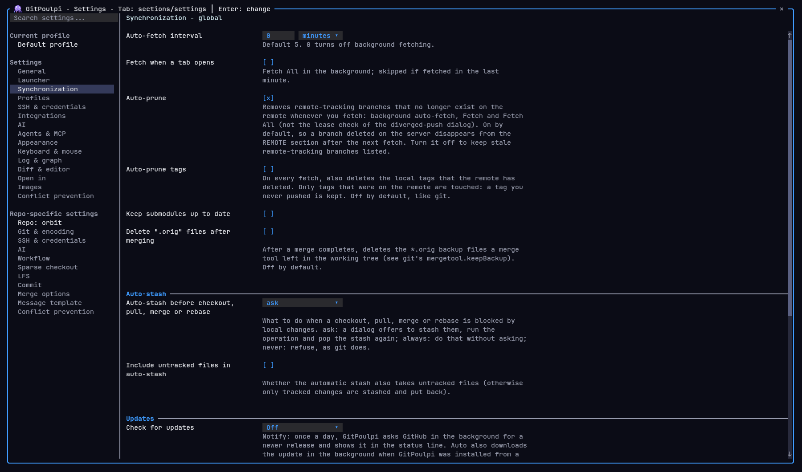

[English](../settings.md) · [Čeština](../cs/settings.md) · [Deutsch](../de/settings.md) · [Español](../es/settings.md) · [Français](../fr/settings.md) · [Italiano](../it/settings.md) · [日本語](../ja/settings.md) · **한국어** · [Nederlands](../nl/settings.md) · [Polski](../pl/settings.md) · [Português (Brasil)](../pt-BR/settings.md) · [Português (Portugal)](../pt-PT/settings.md) · [Русский](../ru/settings.md) · [Svenska](../sv/settings.md) · [Türkçe](../tr/settings.md) · [Українська](../uk/settings.md) · [简体中文](../zh-CN/settings.md)

# 설정

설정은 `Ctrl+,`, `Ctrl+N` 다음 `,`, 제목 표시줄에서 × 왼쪽의 톱니바퀴, 또는 `Ctrl+P` > *설정*으로 엽니다. 설정 화면은 열려 있는 동안 창을 대체합니다. 오른쪽 위의 `✕`, `Esc` 또는 `q`로 닫습니다. 닫으면 잃는 것이 있을 때만 먼저 묻습니다([설정 닫기](#설정-닫기) 참고).

변경 사항은 즉시 `config.toml`에 저장됩니다. [설정 참조](config-reference.md)는 모든 키와 그 기본값, 환경 변수를 설명합니다. 이 페이지는 설정 화면을 설명합니다.

## 설정 화면 사용하기

| 하려는 일 | 방법 |
|---|---|
| 페이지 목록과 옵션 사이 이동 | `Tab` / `Shift+Tab` 또는 클릭. |
| 이동 | `j` / `k` 또는 화살표 키. |
| 옵션 변경 | `Enter` 또는 `Space`, 또는 값을 클릭. 아래를 참고하세요. |
| 닫기 | `✕`를 클릭하거나 `Esc` 또는 `q`를 누릅니다. 필드, 드롭다운 또는 확인이 열려 있는 동안 `Esc`는 그것만 닫습니다. |

`Enter` 또는 `Space`의 동작은 행에 따라 다릅니다.

- 체크박스는 전환됩니다.
- 드롭다운은 열립니다. 화살표 키로 고르고 `Enter`로 수락합니다.
- 텍스트 또는 숫자 필드는 편집을 시작합니다. 화살표 키, `Home`, `End`, `Backspace`, `Delete`가 동작하며 클릭으로 캐럿을 놓을 수 있습니다. `Enter`, `Tab`, `Up`, `Down` 또는 다른 곳 클릭으로 값을 저장합니다. `Esc`는 취소합니다. 거부된 값은 빨간색으로 필드에 남고 상태 표시줄이 이유를 알려 줍니다.
- 버튼 행(**만들기**, **제거**, **테스트**...)은 지금 적용할 수 있는 버튼만 표시합니다. `Left` / `Right`로 고르고 `Enter`로 누르거나, 클릭합니다. 무언가를 삭제하는 버튼은 먼저 확인을 요구합니다.

모든 페이지에서 값은 한 열에서 시작하므로 레이블은 왼쪽에, 필드는 오른쪽에 나란히 정렬됩니다. 텍스트나 숫자는 색이 입혀진 띠, 선택 항목은 `▾`로 끝나는 띠, 체크박스는 `[x]`입니다. 긴 레이블은 잘리지 않고 줄바꿈되며, 좁은 창에서는 값이 레이블 아래로 내려갑니다.

회색으로 표시된 행은 비활성인 이유를 알려 줍니다. 예를 들어 **그래프 레인 배경**이 **끔**이면 **행 색조 강도**는 회색입니다.

### 목록

같은 종류의 항목을 여러 개 편집하는 페이지(프로필, AI, 워크플로, 열기 위치, 이미지)는 **왼쪽에 목록, 오른쪽에 선택한 항목의 필드**를 표시합니다. 좁은 창에서는 목록이 필드 위에 놓입니다. 목록은 어디서나 같은 모양입니다.

- 행의 표시가 상태를 알려 줍니다. `●`는 활성 프로필, `★`는 기본 항목, `⚠`는 아직 완성되지 않은 항목(이메일이 없는 프로필)이며, 세부 정보가 들어갈 자리에 이유가 표시됩니다.
- 목록 아래에는 **+ 추가**, **복제**, **제거**, `↑`, `↓`가 있습니다. 지금 적용할 수 없는 버튼(첫 행의 `↑`)은 흐리게 표시됩니다. 페이지가 프리셋이나 종류를 제공하면 **+ 추가 ▾**가 드롭다운을 엽니다.
- **제거**는 먼저 확인합니다. 방금 추가하고 편집하지 않은 항목은 예외입니다.
- 행을 드래그하면 이동합니다. 막대가 놓일 위치를 보여 주며 `Esc`는 드래그를 취소합니다. 더블 클릭하면 항목의 필드로 이동합니다.

| 키 | 동작 |
|---|---|
| `Up` / `Down`, `Home` / `End`, `PageUp` / `PageDown` | 항목 선택. |
| `Insert` | 항목 추가(드롭다운이 있으면 엽니다). |
| `Ctrl+D` | 항목 복제. |
| `Delete` | 확인 후 항목 제거. |
| `Alt+Up` / `Alt+Down` | 항목을 위나 아래로 이동. |
| `Enter` 또는 `Right` | 항목의 필드로 이동. |
| `Left` | 페이지 목록으로 돌아가기. |
| `Alt+Left` / `Alt+Right` | 일반 탭과 목록 탭 전환(페이지 어디서나). |

이 페이지들에는 각각 제목 아래에 **하위 탭**이 두 개 있어, 페이지 자체의 설정이 선택한 항목의 속성과 헷갈리지 않습니다. **일반**은 페이지 자체의 설정(활성 프로필, 기본 항목, 모든 AI 동작이 받는 지침, 워크플로 템플릿 등)이고, 다른 하나는 항목 이름을 딴 탭(**프로필**, **프로필 (연결)**, **항목**, **편집기**, **규칙**)으로 목록과 선택한 항목의 필드가 들어 있습니다. 페이지는 **일반**에서 열리며, 각 페이지에서 마지막으로 본 탭은 앱을 끝낼 때까지 기억되며, 각 페이지(및 탭)의 스크롤 위치와 선택한 행도 마찬가지입니다. 탭을 클릭하거나 `Alt+Left` / `Alt+Right`를 누릅니다. 검색, 명령 팔레트의 설정 행, "설정에서 지정하세요"라는 링크는 해당 설정이 있는 탭을 엽니다.
[키보드 및 마우스](#키보드-및-마우스)에도 같은 두 탭(**일반**, **단축키**)이 있습니다.

키는 **키보드 및 마우스**에서 다시 지정할 수 있습니다(*preferences* 컨텍스트, [키 바인딩](keybindings.md) 참고).

### 여러 줄 편집기

여러 줄을 담는 설정(스파스 체크아웃 경로, commit 템플릿의 설명, 충돌 예방의 기준 브랜치, 워크플로 훅 등)은 `Enter` 또는 클릭으로 작은 편집기를 엽니다. `Ctrl+S`로 텍스트를 유지하고 `Esc`로 버립니다. 마우스는 여느 텍스트 상자와 똑같이 동작합니다.

- 클릭하면 클릭한 위치에 캐럿이 놓입니다.
- 드래그하면 텍스트가 선택되고, 휠로 스크롤합니다.
- 더블 클릭하면 포인터 아래의 단어가 선택됩니다.
- `Shift` + 클릭은 캐럿부터 포인터까지 선택 범위를 넓힙니다.

키보드로도 같은 일을 할 수 있습니다. `Shift`와 방향키로 선택하고, `Ctrl`과 방향키로 단어 단위로 이동하며, `Ctrl+A`는 전체 선택, `Ctrl+C`와 `Ctrl+X`는 복사와 잘라내기입니다.

### 설정 닫기

`✕`, `Esc`, `q`는 모두 같은 동작을 합니다. 설정은 변경 사항을 즉시 적용하므로 대개 그냥 닫힙니다. 무언가를 잃게 될 때만 **설정을 닫으시겠습니까?**를 묻습니다.

- **워크플로** 페이지에 저장하지 않은 변경 사항이 있을 때.
- commit 메시지 템플릿에 저장하지 않은 변경 사항이 있을 때.
- 프로필에 작성자 이메일이 없을 때(그 프로필로 만드는 commit의 작성자를 알 수 없음).

상자에는 **이동**(해당 페이지를 엽니다), **버리고 닫기** 또는 **그래도 닫기**, 그리고 **취소**가 있습니다. 설정 안의 작은 편집기(AI 지침 텍스트, 워크플로 훅, 스파스 체크아웃 경로)에는 자체 `✕`가 있으며, 텍스트를 편집한 경우에만 **변경 사항을 버리시겠습니까?**를 묻습니다.

### 설정 위에 열리는 팝업

제목 줄에는 메인 창처럼 애플리케이션의 문어와 이름이 표시됩니다. 문어를 클릭하면 정보 창이 열립니다.

창 전체에 걸친 몇몇 팝업은 설정 위에 열리고, 닫으면 설정을 그대로 돌려줍니다(페이지, 스크롤 위치, 저장하지 않은 워크플로나 템플릿 변경 사항이 유지됨).

- 명령 팔레트(`Ctrl+P`),
- 테마 선택기(`Ctrl+N t`, **앱: 테마 변경...**). 설정 화면 자체에서 각 테마를 미리 보여 주며, `Esc`를 누르면 이전 테마로 돌아갑니다.
- 언어 및 그래프 색상 선택기(`Ctrl+N` 다음에 메인 창과 같은 글자),
- 작업 공간 검색(`Ctrl+Alt+F`),
- 정보(`Ctrl+N a`, 문어, 또는 **도움말: GitPoulpi 정보**)와 도움말 오버레이(`?`).

각각 `Esc`, 자체 `✕`, 바깥 클릭으로 닫습니다. 설정이 가리고 있는 것(탭, 브랜치, diff...)에 작용하는 명령은 팔레트에 나열되지만 "먼저 설정을 닫으세요"와 함께 회색으로 표시되고, 그런 명령의 `Ctrl+N` 단축키는 설정 아래쪽 테두리에 같은 안내를 보여 줍니다. 설정을 닫은 뒤 실행하십시오.

`Ctrl+N`을 누르면 페이지의 각 컨트롤에 배지가 표시됩니다. 검색 상자, 페이지 목록(현재 페이지에 하나), 하위 탭, 목록과 그 버튼, 화면에 있는 모든 필드, 닫기 `✕`입니다. 배지의 글자를 누르면 해당 컨트롤을 클릭한 것과 같이 동작합니다. 텍스트 필드는 편집 상태로 열리고, 체크박스는 전환되고, 드롭다운은 열리고, 버튼은 실행됩니다. `Esc`로 취소합니다. 화면 밖으로 스크롤된 필드에는 배지가 없습니다. 필드에 입력하는 동안이나 드롭다운, 편집기, 검색이 열려 있는 동안에는 `Ctrl+N`이 그쪽의 것입니다. [배지](keybindings.md#배지)를 참고하세요.

### 검색 상자

페이지 목록 위의 상자는 모든 페이지의 모든 옵션의 이름과 설명을 검색합니다. 클릭하거나 `/` 또는 `Ctrl+F`를 누른 뒤 입력하세요. 일치 항목 목록이 펼쳐지며 각 항목에는 옵션과 그 페이지가 표시됩니다. `Up` / `Down`으로 고르고 `Enter`로 옵션으로 이동하며 `Esc`로 목록을 닫습니다.

## 명령 팔레트에서 설정하기

대부분의 설정은 이 화면을 열지 않고도 바꿀 수 있습니다. 명령 팔레트(`Ctrl+P`)에 `설정:` 또는 `Settings:`를 입력합니다. 행은 각 페이지의 필드에서 생성되므로 새 설정은 두 곳 모두에 나타납니다.

- 체크박스는 **설정: ... 전환**입니다. 즉시 전환되며 행에 `[x]` 또는 `[ ]`가 표시됩니다.
- 드롭다운은 **설정: ...**입니다. `Enter`를 누르면 팔레트가 그 값들로 좁혀지고 현재 값에는 `현재`가 표시됩니다. 값에서 `Enter`를 누르면 선택됩니다.
- 숫자나 텍스트는 현재 값이 채워진 입력창을 엽니다. 페이지가 거부할 값(숫자가 아님, 범위 밖)은 똑같이 거부되고 입력창은 열린 채로 남습니다.
- 페이지가 필요한 설정(목록, 실행 중에 옵션이 정해지는 콤보)은 해당 위치에서 설정을 엽니다.

값은 `config.toml`에 저장되고 페이지와 똑같이 적용됩니다. 설정 키의 영어 단어(`remember tabs`)로 어느 언어에서든 해당 행을 찾을 수 있습니다.

## 페이지

페이지 목록은 두 그룹으로 나뉩니다.

- **설정**: 전역 설정.
- **저장소별 설정**: 활성 탭의 저장소에 대한 설정. 저장소가 열려 있는 동안에만 표시됩니다.

### 일반

| 옵션 | 동작 |
|---|---|
| **언어** | 인터페이스 언어: **자동**(시스템 언어, 없으면 영어), English, Français, Español, Português (Brasil), Português (Portugal), Italiano, Deutsch, 简体中文, 日本語, 한국어, Русский, Українська, Polski, Čeština, Nederlands, Svenska, Türkçe. 즉시 적용되며 재시작이 필요 없습니다. Log의 월 이름과 날짜도 이 언어를 따릅니다. 환경 변수 `GITPOULPI_LANG`(예: `GITPOULPI_LANG=fr`)는 이 선택을 재정의합니다. CLI와 MCP 출력은 영어로 유지됩니다. |
| **Git 용어 번역** | 기본값은 꺼짐: commit, push, pull, stash, tag 등 git 용어는 모든 언어에서 영어로 유지됩니다. 켜면 해당 언어 고유의 git 어휘를 사용합니다(프랑스어: *Tirer*, *Pousser*, *Remiser*, *Étiquette*). 즉시 적용됩니다. |
| **git 용어를 영어로 표시** | 일본어, 한국어, 중국어 전용: *stage*, *unstage*, *staged*를 음차 대신 영어 단어로 표시합니다. **Git 용어 번역**이 켜져 있으면 효과가 없습니다. |
| **탭 기억** | 시작할 때 지난 세션의 탭을 다시 엽니다. 끄면 저장소 안에서 시작할 때는 그 저장소만 열고, 저장소 밖에서 시작할 때는 저장소 탭 없이 홈에서 시작합니다. 재시작이 필요합니다. |
| **Radar 사용** | 기본값은 켜짐(`general.radar_enabled`). 끄면 Radar 탭, 팔레트 명령, `Alt+R`이 숨겨지고 백그라운드에서 아무것도 가져오지 않습니다. 즉시 적용됩니다. [Radar](radar.md#탭-닫기-또는-radar-끄기) 참고. Radar가 없는 빌드에서는 표시되지 않습니다. |
| **저장소 안에서 시작할 때의 탭** | 시작한 폴더가 저장소 안에 있을 때 처음 여는 탭 (`general.startup_tab_in_repo`): **현재 저장소** (기본값, 그 저장소의 탭, 없으면 새로 엽니다), **마지막 탭** (마지막 종료 때 활성이던 탭), **홈**, **Radar**. `--repo`로 지정한 저장소는 항상 자기 탭을 엽니다. **마지막 탭**: **탭 기억** 설정이 꺼져 있거나 기억된 탭이 없으면 홈으로 열립니다. **Radar**: Radar가 꺼져 있거나 빌드에 없으면 홈으로 열립니다. 시작할 때 한 번 읽으며, 적용하려면 재시작이 필요합니다. |
| **저장소 밖에서 시작할 때의 탭** | 시작한 폴더가 저장소가 아닐 때(예: 사용자 폴더) 처음 여는 탭 (`general.startup_tab_outside_repo`): **홈** (기본값), **마지막 탭**, **Radar**. **마지막 탭**: **탭 기억** 설정이 꺼져 있거나 기억된 탭이 없으면 홈으로 열립니다. **Radar**: Radar가 꺼져 있거나 빌드에 없으면 홈으로 열립니다. 시작할 때 한 번 읽으며, 적용하려면 재시작이 필요합니다. |
| **런처에서 시작할 때의 탭** | GitPoulpi가 만든 바탕 화면 또는 시작 메뉴 바로 가기(`--launcher`를 전달합니다)로 시작할 때, 폴더와 관계없이 처음 여는 탭 (`general.startup_tab_launcher`): **마지막 탭** (기본값), **홈**, **Radar**. 위의 두 설정보다 우선합니다. **마지막 탭**: **탭 기억** 설정이 꺼져 있거나 기억된 탭이 없으면 홈으로 열립니다. **Radar**: Radar가 꺼져 있거나 빌드에 없으면 홈으로 열립니다. 이전 버전이 만든 바로 가기는 다음 시작 때 이 옵션을 받습니다. 시작할 때 한 번 읽으며, 적용하려면 재시작이 필요합니다. Windows에서는 작업 표시줄에 고정한 복사본도 다음 시작 때 다시 작성되며, 셸 없이 시작한 경우(더블 클릭, exe 파일 자체를 고정한 경우)도 런처에서 시작한 것으로 간주됩니다. |
| **worktree 탭 함께 묶기** | 기본값은 켜짐(`general.group_worktree_tabs`). 저장소에 연결된 worktree의 탭은 그 저장소 탭 바로 뒤에 놓이고, 끌어서 떼어 낸 worktree 탭은 다시 그 옆으로 돌아옵니다. 끄면 탭이 놓은 자리에 그대로 있습니다. 켜면 열려 있는 탭이 다시 묶입니다. |
| **기본 클론 폴더** | Clone 대화상자가 시작하는 위치. 비어 있으면 Windows에서는 `%USERPROFILE%\source\repos`, 그 외에는 `~/src`입니다. |
| **클론 대화상자 시작 위치** | 클론 대화상자가 처음 여는 소스(`repos.clone_start_source`): **마지막 사용**(기본값, 클론하거나 취소해서 마지막으로 닫았을 때 보이던 소스), **URL로 클론**, 또는 연결된 연동 중 하나. 더 이상 쓸 수 없는 소스는 URL로 클론으로 돌아갑니다. Radar에서 시작한 클론은 자기 소스를 유지합니다. |
| **기본 찾아보기 폴더** | 찾아보기가 여는 위치. 비어 있으면 마지막으로 사용한 폴더, 없으면 홈 폴더입니다. |
| **저장소 데이터 위치** | GitPoulpi가 저장소별 데이터를 두는 곳(`session.per_repo_state_dir`): **.git 안**(기본값. 작업 트리에 아무것도 나타나지 않고 모든 worktree가 공유), **작업 트리 안**(`.gitpoulpi` 폴더. 팀의 `workflow.toml`을 commit하려면 필요) 또는 **내 사용자 데이터 폴더**(저장소 밖). 이전 버전이 남긴 `.gitpoulpi` 폴더는 처음 필요할 때 새 위치로 옮겨지고 비면 제거됩니다. git이 추적하는 파일(commit된 `workflow.toml`)은 옮기거나 삭제하지 않으며 계속 읽을 수 있습니다. |
| **기본 브랜치 이름** | Init으로 만드는 저장소의 첫 브랜치. 비어 있으면 git이 정합니다. 기존 브랜치의 이름은 바꾸지 않습니다. |
| **로그 수준**, **로그 파일 보관 기간**, **로그 파일 최대 크기** | 활동 로그의 바탕이 되는 애플리케이션 로그: 기록하는 가장 상세한 수준(`log.level`), 파일을 보관하는 기간(숫자와 단위(일, 주, 개월, 년)를 한 줄에 표시: 숫자를 클릭해 입력하고, 위/아래로 한 단계씩 바꾸고, Tab으로 단위로 가서 Enter로 목록을 엽니다. 최대 10년, 기본값 1주, `log.retention_days`와 `log.retention_unit`), 하루치 파일을 회전하는 크기(숫자와 MiB 또는 GiB, 1 MiB에서 1 GiB, `log.max_file_mb`와 `log.max_file_unit`). |
| **작업 소요 시간 표시**, **확장 로깅** | 활동 로그의 "Git 작업" 탭: 각 작업의 소요 시간(`log.timings`, 기본값 켜짐)과 백그라운드 작업인 새로 고침과 자동 fetch(`log.extended`, 기본값 꺼짐). [무언가 실패했을 때](troubleshooting.md#활동-로그)를 참고하세요. |
| **실행 취소 사용**, **실행 취소 기록 깊이**, **GitPoulpi 밖에서 한 변경 기록** | **실행 취소 기록** 그룹. 실행 취소를 켜거나 끄고, 보관할 작업 수를 설정합니다(기본값 100, `0`은 무제한). 실행 취소를 끄면 확인 후 실행 취소 기록이 지워집니다. 마지막 항목은 셸이나 에이전트가 브랜치, tag, stash, HEAD에 한 작업도 기록합니다. [실행 취소와 다시 실행](undo-redo.md)을 참고하세요. |

팔레트 명령 **앱: 언어 변경...**(`Ctrl+N l`)은 같은 언어 목록을 엽니다. 거기서는 강조 표시한 언어가 실시간으로 미리 보기되며, `Enter`로 유지하고 `Esc`로 이전 언어를 복원합니다.

### 런처

**런처** 페이지(`gitpoulpi ui show settings launcher`)는 OS 런처에서 선택한 터미널로 GitPoulpi를 시작하는
바로 가기를 만듭니다.

**이 설치**(페이지의 첫 번째 그룹). 한 컴퓨터의 GitPoulpi(개발 체크아웃, 패키지, 포터블 복사본)는 각각 자기 런처 이름, 색상, 별칭, 폴더 메뉴 항목을 `config.toml`의 자기 `[installation.settings.<id>]` 테이블에 따로 보관하며, 여기서 바꿔도 다른 설치는 영향을 받지 않습니다. 저널에는 기록되지 않습니다(시스템 연동이므로 되돌리려면 **제거**를 쓰세요).

| 행 | 하는 일 |
|---|---|
| **설치** | 읽기 전용: 이 설치의 종류, 폴더, 환경. 폭이 좁으면 폴더가 가운데에서 줄임표로 잘리며, 행 아래 도움말 줄에 전체 텍스트가 있습니다. |
| **런처 이름** | 이 설치의 바로 가기와 폴더 메뉴 항목의 이름. 아직 존재하는 다른 설치가 그 이름을 쓰고 있으면 거부됩니다. 주 설치의 이름은 항상 `GitPoulpi`입니다. |
| **런처 이름에 버전 포함** | 이름에 `<major>.<minor>`를 붙입니다(`GitPoulpi 1.2`). 업데이트할 때마다 바로 가기 이름이 바뀌므로 기본값은 꺼짐입니다. |
| **문어 색상** | 이 설치의 문어와 바로 가기 색상(정보 창과 같은 선택지). |
| **주 설치로 지정** | 주 설치가 기본 이름 `GitPoulpi`, 기존 바로 가기, 이전 버전이 읽는 `ui.*` 키를 소유합니다. 기본적으로 주 설치는 없습니다. 이미 다른 설치가 주 설치이면 먼저 확인을 묻습니다. 이전 주 설치는 자기 이름의 런처를 유지합니다(Windows와 Linux). |
| **환경** | 같은 환경의 설치끼리 창, 데몬, 실행 취소 기록을 공유합니다. 기본값은 설치 자신의 환경입니다. 바꾸면 이 설치의 열린 창을 다시 시작해야 합니다. |
| **폴더 메뉴 하위 메뉴** | 폴더 메뉴 항목을 그 이름의 하위 메뉴로 묶습니다. 같은 이름을 쓰는 설치는 하나를 공유합니다. macOS에서는 사용할 수 없고, Nemo와 Thunar는 항상 항목을 최상위에 표시합니다. |
| **다른 설치: \<name\>** | 이 컴퓨터의 다른 설치. 폴더가 없어진 설치에는 **잊기** 버튼(먼저 확인을 물음)이 있으며, 그 설치의 항목과 남긴 런처, 별칭, 폴더 메뉴 항목을 제거합니다. |
| **기존 런처** | 주 설치가 없는 동안, 이전 버전이 기본 이름으로 만든 런처가 **주 설치로 지정**, **기존 런처 제거**(먼저 확인을 물음)와 함께 표시됩니다. 상태 줄에 이곳을 안내하는 알림이 한 번 나옵니다. |

팔레트에는 **런처: 주 설치로 지정**, **런처: 기존 런처 제거**, **런처: 없어진 설치 잊기**가 있으며, 모든 행이 `Settings:` 항목입니다. 아래의 명령 별칭 행은 이 설치 자신의 것입니다(개발 체크아웃에는 `gpd` / `gpda`를 제안합니다). 다른 설치가 만든 별칭에는 **\<name\>에서 사용 중**이라고 표시되며 여기서 만들 수 없습니다.

| 행 | 하는 일 |
|---|---|
| **바로 가기용 터미널** | `ui.launch_terminal`: **자동**, **OS 기본값** 또는 이 컴퓨터에서 찾은 터미널 중 하나입니다(**열기 위치**와 같은 감지 방식). 자동: Windows에서는 Windows Terminal(없으면 WezTerm, Alacritty, 일반 콘솔), Linux에서는 `xdg-terminal-exec`(Omarchy, 없으면 처음 찾은 터미널), macOS에서는 iTerm2, Ghostty, WezTerm, kitty가 설치되어 있지 않으면 Terminal을 사용합니다. |
| **더블 클릭 시 해당 터미널에서 다시 열기** | Windows 전용(`ui.relaunch_in_terminal`). exe를 더블 클릭하면 기본 콘솔이 열리는데, 이 콘솔은 이미지를 제대로 그리지 못합니다. 그래서 GitPoulpi가 선택한 터미널에서 다시 열리고 첫 창은 닫힙니다. 터미널에서 시작한 경우에는 다시 열지 않습니다. |
| **클릭 시 열려 있는 창 표시** | `ui.reuse_window` (기본값은 켜짐). GitPoulpi 바로 가기(`gitpoulpi launch`)를 클릭하면 새로 시작하지 않고 이미 열려 있는 GitPoulpi의 창을 보여 줍니다. 새 터미널은 열려 있는 것이 없거나, 이 설정이 꺼져 있거나, 창을 앞으로 가져올 수 없을 때만 시작됩니다. 창은 Windows, WezTerm, Hyprland에서 앞으로 나오며, 다른 Linux 데스크톱에서는 이전처럼 클릭하면 새 창이 시작됩니다. macOS에서는 쓰이지 않습니다(Dock이 이미 그렇게 합니다). Hold **Shift** while clicking (Windows) or use the **New Window** launcher action (Linux) to open another window on purpose; `gitpoulpi launch --new-window` does it from a script. |
| **명령 별칭** | `ui.command_alias`: **없음**과 `gp`가 있는 드롭다운이며, 원하는 이름(영문자, 숫자, `-`, `_`, `.`. 공백과 경로 구분자 불가)을 직접 입력할 수도 있습니다. 행 안의 **만들기** 버튼은 그 이름으로 GitPoulpi를 시작하게 합니다(별칭이 생기면 **제거**로 바뀌며, GitPoulpi가 만든 모든 별칭을 제거합니다). 이름이 PATH의 다른 것을 이미 실행하거나, Windows에서 PowerShell에 같은 이름의 내장 별칭이 있으면(`gp`는 그곳에서 `Get-ItemProperty`이며 어떤 파일보다 우선함) 행 아래에 경고가 표시됩니다. 셸 별칭이나 함수는 여기서 볼 수 없습니다. oh-my-zsh는 `gp`를 직접 정의하며 그쪽이 우선합니다. |
| **새 탭 별칭** | `ui.command_alias_add`: 두 번째 명령, 예를 들어 `gpa`. 새 GitPoulpi를 시작하는 대신(`gitpoulpi --add`), 이미 실행 중인 GitPoulpi에 현재 폴더를 새 탭으로 엽니다. 실행 중인 것이 없으면 GitPoulpi를 평소처럼 시작하고, 여러 개면 어느 것에 추가할지 묻습니다. **없음**, `gpa`, 별칭 이름 뒤에 `a`를 붙인 이름이 있는 드롭다운이며, 원하는 이름(위와 같은 규칙)을 직접 입력할 수도 있습니다. **만들기** 버튼 하나가 두 명령을 모두 만들고, **제거**는 GitPoulpi가 만든 모든 명령을 제거하며, 각각 자기 상태 행이 있습니다. Linux와 macOS에서는 두 줄짜리 스크립트, Windows에서는 `.cmd`입니다. [CLI 참조](cli-reference.md#열린-창에-폴더-추가)를 참고하세요. |
| **GitPoulpi를 PATH에 추가** | GitPoulpi가 실행되는 폴더와 별칭 폴더를 새 터미널의 PATH에 넣습니다. 행의 버튼은 **추가** 또는 **제거**로 표시되며, **제거**는 추가한 것만 정확히 제거합니다. 이미 PATH에 있는 폴더는 건드리지 않습니다(그러면 행에 **이미 PATH에 있음**이 표시됨). |
| **앱 런처**(Linux) | `~/.local/share/applications/gitpoulpi.desktop`(`XDG_DATA_HOME`을 따릅니다)와 `~/.local/share/icons/hicolor/256x256/apps`의 아이콘을 씁니다. Omarchy에서는 `omarchy-tui-install`이 만드는 것과 같은 항목(`xdg-terminal-exec --app-id=TUI.tile -e <exe>`)이고, 다른 터미널에서는 그에 맞는 명령(`kitty`, `wezterm start --`, `alacritty -e`, `ghostty -e`, `foot` 등)입니다. |
| **바탕 화면**(Linux) | 같은 항목을 바탕 화면 폴더에 둡니다(폴더가 있는 경우). |
| **시작 메뉴**(Windows) | `%APPDATA%\Microsoft\Windows\Start Menu\Programs`에 `GitPoulpi.lnk`를 만듭니다. 작업 표시줄에 고정한 사본은 아이콘과 색 변경을 스스로 따라갑니다. 아이콘이 그대로 옛 모습이면 고정을 해제했다가 다시 고정하세요(시작 메뉴 항목을 마우스 오른쪽 버튼으로 클릭하고 **작업 표시줄에 고정**). |
| **바탕 화면**(Windows) | 바탕 화면에 `GitPoulpi.lnk`를 만듭니다. |
| **응용 프로그램 폴더**(macOS) | `~/Applications/GitPoulpi.app`를 만듭니다. GitPoulpi를 실행하는 터미널을 여는 작은 번들입니다. |

각 행에는 상태가 표시됩니다. **만들지 않음**, **만듦**, **오래됨**(exe가 이동했거나 다른 터미널을 선택한 경우이며, GitPoulpi가 1초 안에 스스로 다시 쓰므로 거의 볼 일이 없습니다) 또는 **GitPoulpi가 만들지 않은 파일이 있습니다**(같은 이름의 파일이 있지만 GitPoulpi가 만든 것이 아니므로 절대 건드리지 않습니다). **제거**는 GitPoulpi가 만든 파일(`X-GitPoulpi=1` 표시가 있음)만 삭제합니다. 아이콘은 로고 색의 문어입니다(정보 > 색). Linux에서는 색마다 아이콘 이름이 따로 있어서, 아이콘을 캐시하는 런처도 새 색을 보여 줍니다. 한 번 만든 바로 가기는 스스로 최신 상태를 유지합니다. 색을 바꾸거나 터미널 또는 exe가 이동하면, GitPoulpi는 자신이 만든 바로 가기를(만들지 않은 것은 건드리지 않고, 새로 만들지도 않고) 시작할 때와 실행 중에 다시 씁니다. 업데이트 버튼은 없으며, **만들기**(아직 없는 바로 가기용)와 **제거**만 있습니다.

**작업 표시줄과 Dock 그룹화.** GitPoulpi는 터미널 창 안에서 실행되므로 작업 표시줄은 보통 터미널 아이콘 아래에 표시하며, 고정한 GitPoulpi 아이콘 아래에는 '실행 중' 점이 없습니다. Windows: 바로 가기에는 AppUserModelID `GitPoulpi.GitPoulpi`가 들어 있고, 바로 가기로 시작한 GitPoulpi는 자신의 터미널 창에 같은 ID와 자기 아이콘을 지정합니다(창을 찾기 위해 잠시 고유한 제목을 붙였다가 제목을 되돌립니다). 그래서 창이 고정한 GitPoulpi 아이콘 아래에 놓입니다. 탭이 여러 개인 터미널 창은 통째로 움직입니다. GitPoulpi가 실행되는 동안 그 창의 모든 탭이 GitPoulpi 아이콘 아래에 묶입니다. 이전에 만든 바로 가기와 작업 표시줄 고정 항목은 같은 동기화가 다시 씁니다. 고정 항목이 여전히 터미널 아이콘이면 고정을 해제했다가 다시 고정하세요. Linux: kitty, foot, Alacritty, WezTerm, Ghostty는 창 클래스 `gitpoulpi`로 시작하고 `.desktop` 항목이 이를 명시하므로(`StartupWMClass`) Dock이 창을 런처 아이콘 아래에 묶습니다. 다른 터미널은 자체 아이콘을 유지합니다. macOS: 할 일이 없습니다. Dock이 앱 단위로 묶습니다.

#### 시스템별 명령 별칭과 PATH

| 시스템 | 별칭 | PATH |
|---|---|---|
| Linux, macOS | `~/.local/bin/<name>`에서 `gitpoulpi`로 가는 심볼릭 링크. 링크에는 표시를 넣을 수 없으므로 대상이 `gitpoulpi`(또는 이전 대상인 `gitpoulpi-tui`, 자동으로 `gitpoulpi`로 다시 쓰입니다)라는 파일일 때만 GitPoulpi의 것으로 봅니다. 일반 파일이나 다른 것을 가리키는 링크는 **GitPoulpi의 것이 아니며** 교체하거나 제거하지 않습니다. | `~/.bashrc`와 `~/.zshrc`(있는 것. 둘 다 없으면 macOS는 `~/.zshrc`, 그 외에는 `~/.bashrc`)의 `# >>> GitPoulpi PATH (X-GitPoulpi=1) >>>`와 `# <<< GitPoulpi PATH <<<` 사이의 블록, 그리고 fish를 설정했다면 `~/.config/fish/conf.d/gitpoulpi-path.fish`. 제거하면 그 블록(또는 fish 파일)만 삭제합니다. |
| Windows | `%LOCALAPPDATA%\Programs\GitPoulpi\bin\<name>.cmd`. `REM X-GitPoulpi=1`이 든 짧은 shim입니다(주소 표시줄 시작을 알아보는 `GITPOULPI_CMDCMDLINE`도 내보냅니다). | `HKCU\Environment`의 사용자 PATH. PowerShell로 쓰고 `WM_SETTINGCHANGE`를 브로드캐스트해 새 프로그램이 볼 수 있게 합니다. 값 `GitPoulpiPathAdded`가 추가한 것을 기록하며 제거는 그것만 제거합니다. |

새 터미널에는 PATH 변경이 적용되고, 이미 열려 있는 터미널에는 적용되지 않습니다. 두 동작 모두 실행 취소
기록에 들어가지 않습니다. 실행 취소가 없으며 되돌리는 방법은 **제거**입니다.
팔레트에도 같은 동작이 있습니다(**런처: 바로 가기 만들기**, **런처: 바탕 화면 바로 가기 만들기**, **런처: 바로 가기 제거**, **런처: 명령 별칭 만들기**, **런처: 명령 별칭 제거**, **런처: PATH에 추가**, **런처: PATH에서 제거**). 스크립트에서는 `gitpoulpi desktop shortcut
status|install|remove [--where launcher|desktop|startmenu]`로 같은 작업을 합니다.

#### 파일 탐색기 주소 표시줄에 입력하기 (Windows)

파일 탐색기 창의 주소 표시줄에 별칭(`gp`) 또는 `gitpoulpi`를 입력하고 Enter를 누르면, GitPoulpi가 **바로 가기용 터미널**에서 선택한 터미널로 그 창에 표시된 폴더에서 열리며 **마지막 탭**은 열지 않습니다. **클릭 시 열려 있는 창 표시**가 켜져 있고 GitPoulpi가 이미 열려 있으면, 그 폴더가 해당 창의 새 탭이 됩니다.

- **`gp`(명령 별칭).** 별칭이 있으면 별칭을 만들 때 `gp.exe`도 `HKCU\Software\Microsoft\Windows\CurrentVersion\App Paths`에 등록되어 `gitpoulpi-launch.exe`를 가리키며, 제거하면 그 키를 삭제합니다(GitPoulpi가 만든 경우에만). 별칭이 있는 폴더가 PATH에 있으면(**GitPoulpi를 PATH에 추가**) Windows가 `.cmd` shim을 먼저 실행하므로 GitPoulpi가 나타나기 전에 콘솔 창이 잠깐 깜박일 수 있습니다. 이전 버전이 쓴 shim은 설정이 별칭을 읽을 때 자동으로 다시 쓰입니다.
- **`gitpoulpi`.** **파일 관리자 메뉴**를 설치하면 동작합니다. 설치할 때 `gitpoulpi.exe`도 App Paths에 등록됩니다. 설치하지 않으면 GitPoulpi가 있는 폴더가 PATH에 있을 때만 `gitpoulpi`를 찾을 수 있고, 그때도 위처럼 콘솔이 깜박일 수 있습니다.

파일 탐색기는 Windows에 로그인했을 때의 PATH를 그대로 유지합니다. 나중에 PATH에 추가한 폴더는 로그아웃했다가 다시 로그인한 뒤에야 인식됩니다. 그 전에는 App Paths 항목만 찾을 수 있으며, Windows가 찾지 못하는 이름은 브라우저에서 웹 주소로 열립니다.

Linux와 macOS에는 대응하는 기능이 없습니다. 파일 관리자의 위치 표시줄은 프로그램을 실행하지 않기 때문입니다. **파일 관리자 메뉴** 항목이나 터미널의 명령 별칭을 쓰세요.

#### 파일 관리자 메뉴 (GitPoulpi에서 열기)

바로 가기 아래의 **파일 관리자 메뉴** 행은 폴더의 오른쪽 클릭 메뉴에 **GitPoulpi에서 열기**를 추가합니다. 파일 관리자마다 상태 행이 하나씩 있고(Linux에서는 여기서 발견된 파일 관리자와 항목이 남아 있는 파일 관리자마다 하나씩이며, **감지됨** 행에 발견된 것이 나열됩니다), 그 아래에 **설치**와 **제거** 버튼이 있습니다. **설치**는 발견된 모든 파일 관리자에 항목을 쓰고, **제거**는 먼저 묻고 나서 그 파일 관리자가 아직 설치되어 있든 아니든 설치가 쓴 것만 제거합니다.

항목은 `gitpoulpi launch --folder <folder>`를 실행하며(Windows에서는 콘솔 없는 `gitpoulpi-launch.exe --folder`), 클릭했을 때 이 명령이 결정합니다. **클릭 시 열려 있는 창 표시**가 켜져 있고 GitPoulpi 창이 열려 있으면 저장소 안의 폴더가 가장 최근에 사용한 창의 새 탭이 되고 그 창이 앞으로 나옵니다. 그렇지 않으면 **바로 가기용 터미널**에서 선택한 터미널이 그 폴더에서 GitPoulpi를 시작합니다. 그래서 터미널을 바꿔도 항목이 오래된 상태가 되지 않습니다. exe가 이동하거나 로고 색이 바뀌면 오래된 상태가 되며, GitPoulpi는 바로 가기처럼 자신의 항목을 자동으로 다시 씁니다(새로 만들지는 않음). 항목에는 GitPoulpi 옆의 실행 도우미(`gitpoulpi`, Windows에서는 `gitpoulpi-launch.exe`)가 필요합니다. 없으면 행에 그렇게 표시되고 버튼은 꺼집니다.

| 시스템 | 설치가 쓰는 것 |
|---|---|
| Windows | 사용자별 키이며 관리자 권한이 필요 없습니다. `HKCU\Software\Classes\Directory\shell\GitPoulpi`, `Directory\Background\shell\GitPoulpi`, `Drive\shell\GitPoulpi`에 각각 `command` 하위 키가 있어, 폴더, 열린 폴더의 배경, 드라이브에 항목이 표시됩니다. 각 키에는 `X-GitPoulpi` 값이 있으며, 이것이 없는 키는 **GitPoulpi의 것이 아니므로** 절대 건드리지 않습니다. 또한 `gitpoulpi.exe`를 `HKCU\Software\Microsoft\Windows\CurrentVersion\App Paths`에 등록하여 `gitpoulpi-launch.exe`를 가리키게 합니다. Windows 11에서는 항목이 클래식 메뉴에만 있습니다. **추가 옵션 표시**, Shift+F10 또는 Shift+오른쪽 클릭입니다(새 최상위 메뉴에는 패키지 앱만 나열됩니다). 제거는 GitPoulpi의 키를 삭제한 뒤, 설치가 만든 상위 키가 비어 있을 때만 그것도 삭제합니다. |
| Linux | PATH에서 발견된 파일 관리자에 대해서만 씁니다. GNOME Files와 Caja: 항목 이름을 딴 스크립트를 `~/.local/share/nautilus/scripts` 또는 `~/.config/caja/scripts`에 둡니다(**Scripts** 하위 메뉴). Dolphin: 실행 권한이 있는 `~/.local/share/kio/servicemenus/gitpoulpi-open.desktop`(KDE Frameworks 6은 실행 권한이 없는 사용자 서비스 메뉴를 무시하며, 5.85 이전의 KDE Frameworks 5는 지원하지 않습니다). Nemo: `~/.local/share/nemo/actions`의 동작 두 개(선택한 폴더, 배경). Thunar: `~/.config/Thunar/uca.xml`에 병합되는 동작 하나이며, 직접 만든 동작은 그대로 남고 제거하면 파일이 바이트 단위로 원래대로 돌아갑니다(설치가 파일을 만들었다면 삭제). PCManFM과 PCManFM-Qt: `~/.local/share/file-manager/actions/gitpoulpi-open.desktop`. 아이콘은 `~/.local/share/icons/hicolor/256x256/apps/gitpoulpi-folder.png`에 놓이며 마지막 항목과 함께 사라집니다. `XDG_DATA_HOME`과 `XDG_CONFIG_HOME`을 따릅니다. 항목은 선택한 폴더에 표시되고, 파일 관리자가 지원하면 폴더 배경에도 표시됩니다. |
| macOS | 빠른 동작 `~/Library/Services/Open in GitPoulpi.workflow`: Finder에서 폴더를 오른쪽 클릭한 뒤 **빠른 동작**을 선택합니다. 선택한 폴더만 해당합니다(Finder에는 폴더 배경용 메뉴가 없습니다). 처음 클릭하면 macOS가 이 워크플로 서비스가 터미널을 제어해도 되는지 묻습니다(자동화 권한 요청, 예를 들어 "WorkflowServiceRunner.xpc에서 ...을(를) 제어하려고 합니다"). 허용하세요. 항목이 보이지 않으면 시스템 설정 > 키보드 > 키보드 단축키 > 서비스에서 켜세요. |

GitPoulpi가 쓰는 모든 파일과 키에는 `X-GitPoulpi=1` 표시(스크립트에서는 `# X-GitPoulpi=1` 줄)가 있으며, 제거는 표시된 것만 삭제합니다. 이 동작들은 저장소가 아니라 시스템을 바꿉니다. 실행 취소가 적용되지 않으며 되돌리는 방법은 **제거**입니다. Linux와 macOS에서는 파일 관리자의 위치 표시줄이 프로그램을 실행하지 않으므로 거기에 입력할 것은 없고, 터미널에는 명령 별칭이 있습니다.

팔레트에는 **런처: 'GitPoulpi에서 열기' 메뉴 설치**와 **런처: 'GitPoulpi에서 열기' 메뉴 제거**가 있으며, 스크립트에서는 `gitpoulpi desktop folder-menu status|install|remove`로 같은 작업을 합니다.

### 동기화

GitPoulpi가 저장소를 리모트와 맞춰 유지하는 방법과, 그동안 로컬 변경 사항을 어떻게 다루는지입니다.

| 옵션 | 동작 |
|---|---|
| **자동 fetch 간격** | 이 간격으로 백그라운드에서 모든 리모트를 fetch합니다. 숫자와 단위(분 또는 시간)를 한 줄에 표시합니다. 기본값 5분, 최대 60분(1시간), `0`이면 꺼짐. `general.auto_fetch_interval_minutes`는 분 단위로 유지되고, `general.auto_fetch_interval_unit`은 표시 방식만 기록합니다. 재시작이 필요합니다. |
| **탭 열 때 fetch** | 저장소 탭이 열릴 때 백그라운드에서 Fetch All을 실행합니다. 기본값은 켜짐. 최근 60초 안에 fetch한 저장소는 다시 fetch하지 않습니다. |
| **자동 정리** | fetch가 리모트에 더 이상 없는 리모트 추적 브랜치도 제거합니다. 기본값은 켜짐이라서 서버(예: GitLab)에서 삭제된 브랜치는 다음 fetch 뒤 REMOTE 섹션에서 사라집니다. 실행 취소할 수 없습니다. 정리된 브랜치는 리모트에 다시 나타나면 다음 fetch에서 돌아옵니다. |
| **tag 자동 정리** | fetch가 리모트에서 삭제된 로컬 tag도 함께 삭제합니다. 리모트에 있었던 tag만 대상이므로 push한 적 없는 tag는 그대로 남습니다. git과 같이 기본값은 꺼짐. git 2.41 이상이 필요합니다. CLI: `gitpoulpi fetch --prune-tags`, 설정 키는 `general.auto_prune_tags`. 자세한 내용은 [브랜치, tag, Refs 사이드바](log-and-history.md#브랜치-tag-refs-사이드바)를 참고하세요. |
| **서브모듈 최신 상태 유지** | checkout이나 pull 뒤에 서브모듈을 저장소가 기록한 commit으로 업데이트합니다. [서브모듈](submodules.md)을 참고하세요. |
| **merge 후 ".orig" 파일 삭제** | merge가 끝난 뒤 `*.orig` 백업 파일을 삭제합니다. 기본값은 꺼짐. |
| **checkout, pull, merge, rebase 전 자동 stash** | 로컬 변경 사항이 이 작업 중 하나를 막을 때의 동작: **묻기**(대화상자가 변경 사항을 stash하고 작업을 실행한 뒤 stash를 복원하도록 제안), **항상**(묻지 않고 수행) 또는 **안 함**(거부). |
| **자동 stash에 추적되지 않는 파일 포함** | 자동 stash가 추적되지 않는 파일도 가져갑니다. |

같은 페이지의 **업데이트** 아래에는 다음이 있습니다:

| 옵션 | 동작 |
|---|---|
| **업데이트 확인** | 드롭다운(`updates.mode`): **알림**(기본값)은 하루에 한 번 백그라운드에서 확인하고 제목 표시줄에 `vX.Y.Z 사용 가능`을 표시합니다. **자동**은 GitPoulpi를 릴리스 아카이브로 설치한 경우 업데이트를 백그라운드에서 내려받기도 합니다(재시작 시점은 직접 고릅니다). **끔**은 요청을 전혀 보내지 않습니다. 즉시 적용됩니다. [업데이트](updates.md)를 참조하세요. |
| **업데이트 채널** | 드롭다운(`updates.channel`): **안정**(기본값) 또는 **시험판**(릴리스 후보도 포함). 즉시 적용됩니다. |
| **설치 방법** | 읽기 전용. GitPoulpi가 이 컴퓨터에 설치된 방법(릴리스 아카이브, 현재 사용자 또는 모든 사용자용 설치 프로그램, Chocolatey, Scoop, Homebrew, apt, MSI 패키지, Docker 이미지, cargo 또는 개발 빌드). 업데이트를 적용하는 방식이 이에 따라 정해집니다. [업데이트](updates.md)를 참고하세요. |

관리자가 컴퓨터 전체 업데이트 정책에서 설정한 행에는 **관리자가 설정함**이 표시되며 여기서 바꿀 수 없습니다.

같은 페이지의 **기록 다시 쓰기** 아래에는 외부 스크립트의 제한 시간이 있습니다 ([기록 다시 쓰기](history-rewrite.md) 참고).

| 옵션 | 하는 일 |
|---|---|
| **스크립트 응답 제한 시간** | 외부 스크립트가 commit 하나에 답하는 데 주어지는 시간. 숫자와 단위(밀리초 또는 초)를 한 줄에 표시합니다. 기본값 5초, 1밀리초에서 10분까지 (`rewrite.script_timeout_ms`, `rewrite.script_timeout_unit`). 초과하면 프로세스 전체가 중지되고 아무것도 옮기지 않은 채 다시 쓰기가 실패합니다. |
| **스크립트 전체 순회 제한 시간** | 외부 스크립트가 기록 전체를 한 번 훑는 데 걸릴 수 있는 시간. 숫자와 단위(초, 분 또는 시간)를 표시합니다. 기본값 1시간, 최대 24시간 (`rewrite.script_total_timeout_s`, `rewrite.script_total_timeout_unit`). |
### 프로필

Commit 신원 프로필: GitPoulpi에서 만드는 commit에 사용하는 이름과 이메일입니다. **일반** 탭에는 **활성 프로필** 드롭다운이 있고, **프로필** 탭은 [목록](#목록)(추가, 복제, 제거, 순서 변경)과 선택한 프로필의 필드로 이루어집니다. 각 프로필에는 **프로필 ID**, **프로필 이름**, **작성자 이름**, **작성자 이메일**이 있습니다. 이메일이 없는 프로필은 목록에 `⚠`로 표시됩니다. 활성 프로필이 없거나, 이름 또는 이메일이 비어 있는 프로필이면 저장소 자체의 `user.name`과 `user.email`이 적용됩니다.

프로필이 둘 이상이면 도구 모음 오른쪽 끝에 프로필 콤보박스가 나타납니다. 이는 활성 저장소에 대해서만 프로필을 설정합니다. 선택하면 대화상자가 그 신원을 해당 저장소의 구성에도 기록하도록 제안합니다. 팔레트 명령은 **저장소: 프로필 변경...**입니다.

이 프로필은 연동 페이지의 호스팅 프로필이나 AI 페이지의 AI 프로필과는 다릅니다.

### SSH 및 자격 증명

SSH는 시스템의 `ssh`를 사용하므로 ssh-agent와 ssh 구성이 계속 동작합니다. GitPoulpi는 키 자료를 읽지 않습니다.

| 옵션 | 동작 |
|---|---|
| **개인 키 경로** | 설정하면 fetch, pull, push, clone이 `GIT_SSH_COMMAND=ssh -i "<key>" -o IdentitiesOnly=yes`로 git을 실행하므로 ssh는 그 키만 제시합니다. 비어 있으면 agent와 ssh 구성이 그대로 적용됩니다. |
| **공개 키 경로** | 개인 키 경로가 비어 있을 때만 사용됩니다. ssh는 ssh-agent(또는 하드웨어 키)가 가진 일치하는 키를 고릅니다. |
| **키 유형** | **키 쌍 생성**이 만드는 유형: `ed25519`, `rsa`(4096비트) 또는 `ecdsa`(NIST P-256). |
| **HTTPS 자격 증명** | fetch, pull, push, clone이 HTTPS에서 인증하는 방식: **credential_helper**(git 자체의 도우미, 기본값), **prompt**(도우미 무시, git이 터미널에서 물음) 또는 **none**(자격 증명 없음, 공개 리모트 전용). |
| **모든 사용자 이름과 비밀번호 삭제** | GitPoulpi가 자격 증명 도우미에 저장한 모든 토큰을 제거합니다. 먼저 확인을 요구합니다. |
| **키 쌍 생성** | `~/.ssh/gitpoulpi_<type>`에 **키 유형**의 키 쌍을 암호 없이 만들고 두 경로를 기록합니다. 파일을 덮어쓰지 않습니다. |

키 경로는 다음 전송부터 적용됩니다. `~/` 접두사는 홈 폴더를 뜻합니다.

다른 곳에서 한 설정이 항상 이 경로보다 우선합니다. 우선순위는 높은 순서대로 다음과 같습니다.

0. 저장소 하나의 [SSH 및 자격 증명](#저장소별-ssh-및-자격-증명) 페이지(저장소별 그룹)에서 고른 키.
1. GitPoulpi가 실행되는 환경의 `GIT_SSH_COMMAND` 또는 `GIT_SSH`.
2. 저장소의 git 구성 또는 전역 git 구성의 `core.sshCommand`. 이전 버전의 탭 메뉴 *SSH 키...* 항목이 저장소 하나에 대해 이 값을 썼으며, SSH 및 자격 증명이 이를 GitPoulpi로 옮기도록 제안합니다.
3. 이 페이지의 두 키 경로.
4. ssh 자체의 기본값과 agent.

키는 호스팅 계정에 속할 수도 있습니다. [호스팅과 이슈 트래커](hosting-integration.md#프로필별-ssh-키)를 참고하세요.

### 연동

계정을 연결합니다. **호스팅** 그룹에는 GitHub, GitHub Enterprise, GitLab, GitLab Self-Managed, Azure DevOps, Azure DevOps Server, Bitbucket, Bitbucket Data Center, Gitea, Forgejo, Gerrit이 있습니다. **이슈 트래커** 그룹에는 Jira Cloud, Jira Data Center, Trello, Linear, YouTrack, Redmine, Local Markdown이 있습니다. 각 제공자에는 **연결**, 토큰 필드, 토큰에 필요한 스코프, 호스트의 토큰 페이지로 가는 링크가 있습니다. 이 페이지에는 별도의 안내서가 있습니다. [호스팅과 이슈 트래커](hosting-integration.md)를 참고하세요.

제공자 위에 옵션 두 개가 있습니다. 첫 번째 제공자에서 `Up`을 누르면 닿을 수 있습니다.

| 옵션 | 동작 |
|---|---|
| **pull requests 및 이슈 새로 고침** | 사이드바 목록과 도구 모음 칩을 새로 고치는 주기. 숫자와 단위(분 또는 시간)를 표시합니다. 기본값 5분, 최대 2시간, `0`이면 타이머 꺼짐 (`general.hosting_refresh_minutes`, `general.hosting_refresh_unit`). |
| **게시 이름** | 저장소의 토큰이 봇의 것일 때(GitHub App 토큰) 호스트에 보내는 메시지가 게시되는 이름. 예: `my-app[bot]`. 내 댓글을 알아보는 데도 쓰입니다. 비어 있으면 호스트에 물어보고, 그래도 모르면 처음 게시한 메시지에서 알아냅니다. 저장소는 설정 > 저장소별 설정 > SSH 및 자격 증명 > 호스팅에서 이를 덮어쓸 수 있습니다(`general.hosting_post_as`). |
| **리뷰 요청 용어** | 호스팅된 리뷰에 쓰는 용어: **자동 (호스트별)**, **Pull request** 또는 **Merge request**. |
| **닫히거나 merge된 pull request의 칩 숨기기** | 기본값은 켜짐(`ui.hide_finished_pr_chip`. GitLab에서는 "merge request"로 표시). 도구 모음의 칩은 체크아웃한 브랜치의 최신 요청을 보여 줍니다. 그 요청이 닫히거나 merge되면 칩이 숨겨지고, 대신 브랜치에 요청이 없는 것처럼 흐린 **+ PR** 칩(새 요청 시작)이 표시됩니다. 끄면 상태와 관계없이 항상 최신 요청을 칩에 표시합니다. 즉시 적용됩니다. |

### AI

**일반** 탭: AI를 켜는 스위치, 기본 프로필, 모든 동작이 받는 지침, 각 동작의 프로필과 지침. **프로필 (연결)** 탭은 AI 프로필의 [목록](#목록)이며 환경 변수용 인라인 표가 있습니다. 일반 탭의 *코드 리뷰* 블록에는 [리뷰 컨텍스트](ai.md#리뷰-컨텍스트)의 기본값도 있습니다: **저장소에서 에이전트 실행**(*프로필 설정*, *예*, *아니요*), **CLAUDE.md 포함**, **AGENTS.md 포함**, **추가 파일**(경로 또는 링크, 비워 두면 추가하지 않으며, 아래에 파일 선택기를 여는 **찾아보기...** 버튼이 있고 버튼에서 `Enter`가 키보드 방식).  이 페이지에는 별도의 안내서가 있습니다. [AI 지원](ai.md)을 참고하세요.

**호스트의 답글** 블록은 댓글, 답글, 이슈 설명의 초안을 쓰는 것을 담당합니다: 프로필과 지침, **기본 프롬프트**(비어 있으면 내장 프롬프트 사용), **저장소 접근** 그룹(**기본적으로 AI가 저장소를 읽도록 허용**(꺼짐: 각 입력창의 선택은 체크 해제로 시작), **답글 사이에 에이전트 세션 유지**, **저장소 컨텍스트 유지 시간 (분)**). 바이트 한도인 **답글용으로 보낼 최대 대화 크기**, **답글용 저장소 파일의 최대 크기**, **답글용 저장소 맵의 최대 크기**, **답글용 검색어당 최대 검색 결과 수**, **답글용 최대 검색어 수**는 다른 입력 한도와 함께 있습니다. [호스트에서 쓰기 도움](ai.md#호스트에서-쓰기-도움)을 참고하세요.

동작별 블록 아래에 **개인정보** 그룹이 있습니다.

| 옵션 | 동작 |
|---|---|
| **보내기 전에 비밀 정보 가리기** | 켜짐(기본값): 요청에서 발견된 토큰, 개인 키, 비밀번호는 요청이 나가기 전에 `[REDACTED:<rule>]`로 대체됩니다. 꺼짐: 비밀 정보가 그대로 전송된다는 빨간 줄이 표시됩니다. |
| **민감한 파일 제외** | 켜짐(기본값): `.env` 파일, 개인 키, 인증서(`[privacy] sensitive_patterns`)의 변경 내용은 요청에 절대 포함되지 않습니다. 꺼짐: 요청에 포함될 때 전송된다는 빨간 줄이 표시됩니다. |
| **보내기 전에 전송 내용 표시...** | 동작마다 스위치 하나(commit 메시지, 설명, stash 메시지, pull request 설명, commit 작성기, 충돌 해결, 코드 리뷰, commit 분할): 요청이 나가기 전에 **보내는 내용 검토** 대화상자에 요청을 표시합니다. 대화상자의 *다시 표시하지 않기* 체크박스가 하나를 끕니다. 기록 다시 쓰기 동작은 자체 대화상자를 표시합니다. |
| **모두 다시 표시** | 스위치가 하나라도 꺼져 있을 때 나타나며 모두 다시 켭니다. |

[AI > 개인정보](ai.md#개인정보)를 참고하세요.

### 에이전트 및 MCP

AI 에이전트가 이 창에서 할 수 있는 일, MCP 서버의 실행 허용 여부, HTTP 엔드포인트를 보호하는 방법입니다. MCP 행은 서버가 포함된 빌드에서만 표시됩니다. [MCP와 에이전트](mcp-and-agents.md)를 참고하세요.

| 옵션 | 동작 |
|---|---|
| **MCP 서버** | 켜짐(기본값): 에이전트가 서버(`gitpoulpi mcp serve`)를 시작할 수 있습니다. 꺼짐: 시작을 거부합니다. `mcp.enabled`로 저장됩니다. 변경은 에이전트가 다음에 서버를 시작할 때 적용되며, 이미 실행 중인 서버는 기존 설정을 유지합니다. |
| **MCP 서버 포트** | 주소를 지정하지 않았을 때 `--http`가 수신 대기하는 포트, 1~65535(기본값 8808). `mcp.bind`의 포트에 저장되며 호스트 부분은 유지됩니다(비어 있으면 `127.0.0.1`). 에이전트가 다음에 서버를 시작할 때 적용됩니다. |
| **AI 에이전트의 화면 제어 허용** | 에이전트가 이 창에서 commit, 파일 또는 알림을 보여 줄 수 있게 합니다(`ui show`). 꺼짐: 어떤 에이전트도 창에 닿지 않습니다. |
| **AI 에이전트가 변경 사항을 제안하고 내가 확인하도록 허용** | 에이전트가 미리 채워진 Reword, commit, 브랜치 또는 tag 대화상자를 열고 사용자가 확인하게 합니다. 기본값은 꺼짐. [MCP와 에이전트](mcp-and-agents.md#권한)를 참고하세요. |
| **에이전트용 창 열기**, **실행 명령 (custom)** | 열려 있는 창이 없을 때 에이전트가 GitPoulpi 창을 열 수 있는지, 그리고 어떤 터미널이나 멀티플렉서로 여는지. 기본값은 꺼짐. |
| **HTTP 인증** | 켜짐(기본값): MCP HTTP 엔드포인트는 액세스 토큰이 있는 요청에만 응답합니다. 꺼짐은 빨간 경고를 표시합니다: 엔드포인트에 접근할 수 있는 모든 프로그램이 MCP 설정이 허용하는 모든 도구를 실행할 수 있으며 `--allow-remote`는 거부됩니다. `mcp.http_auth`로 저장됩니다. |
| **액세스 토큰** | 가려진 상태의 토큰. 가려진 값은 버튼입니다: `Enter`(또는 클릭)로 아래 행에 전체를 표시하고 다시 숨깁니다. **복사**는 상태 줄에 내용을 보여 주지 않고 클립보드에 넣고, **교체**는 확인 후 새 토큰으로 바꾸며(이전 토큰을 가진 클라이언트는 즉시 거부되고 서버 재시작은 필요 없음), **만들기**는 첫 토큰을 만듭니다. `Left` / `Right`로 버튼 사이를 이동하고 `Enter`로 누릅니다. 같은 토큰이 `gitpoulpi mcp token`입니다. |
| **TLS** | **끔**(기본값), **자체 서명**(서버가 인증서를 한 번 만들고 지문을 표시), **파일**(사용자의 인증서와 키). 서버가 직접 TLS를 종료합니다. `mcp.tls`로 저장되며 서버를 다음에 시작할 때 적용됩니다. |
| **인증서 경로**, **키 경로** | **파일**과 함께 사용하는 PEM 파일(`mcp.tls_cert`, `mcp.tls_key`). |
| **인증서 지문** | 읽기 전용: 클라이언트가 확인할 수 있도록 엔드포인트가 제공하는 인증서의 SHA-256 지문. |
| **터널 또는 리버스 프록시 뒤** | 엔드포인트 앞의 터널이나 프록시가 트래픽을 암호화한다는 사용자의 진술이며, 이로써 `--allow-remote`를 TLS 없이 실행할 수 있습니다. 서버가 확인할 수 없으므로 켜져 있는 동안 빨간 경고를 표시합니다. `mcp.behind_proxy`로 저장됩니다. [MCP와 에이전트](mcp-and-agents.md#다른-컴퓨터에서-엔드포인트에-접근하기)를 참고하세요. |

### 모양

| 옵션 | 동작 |
|---|---|
| **테마** | **시스템(터미널을 따름)**, 기본 제공 테마 또는 사용자 테마 파일. 강조 표시한 테마가 실시간으로 미리 보기됩니다. `Enter`로 유지하고 `Esc`로 이전 테마를 복원합니다. 행 아래의 **색상** 띠는 적용 중인 색상을 보여 줍니다. [테마](themes.md)를 참고하세요. |
| **작성자 아바타** | **끔**(기본값, 네트워크 사용 안 함), **그래프**(commit 점 안) 또는 **작성자**(작성자 열 안). 켜면 각 작성자 이메일의 해시가 Gravatar와 호스팅 제공자에게 전송됩니다. |
| **아바타 출처**, **아바타 대체 이미지** | 사진을 찾는 위치와 순서. 사진이 없는 작성자에게는 **identicon**(생성된 패턴) 또는 **이니셜**. |
| **입력창 색상**, **사용자 지정 입력창 색상** | 텍스트 필드의 배경: **테마 따르기**(기본값), 고정된 어두운 색 또는 직접 지정한 `#rrggbb`. |
| **텍스트 커서** | `ui.text_cursor`: **terminal**(기본값)은 포커스된 텍스트 필드의 캐럿 위치에 터미널 자체의 커서를 막대 모양으로 놓습니다(터미널의 커서 설정이 적용되고 입력기의 후보 창이 캐럿에서 열립니다). **drawn**은 GitPoulpi 자체의 캐럿을 그리고 터미널 커서는 숨깁니다. 즉시 적용됩니다. 팔레트: `설정: 텍스트 커서...`. |
| **색상 깊이** | **auto**(기본값), **truecolor**, **256** 또는 **16**. [테마](themes.md)를 참고하세요. |
| **그래프 색상 테마** | **테마 따르기**(기본값: 테마 자체의 레인 색상) 또는 임의의 레인 팔레트. 각 팔레트는 색상 몇 가지를 보여 줍니다. 설정을 닫을 때 적용됩니다. 팔레트 명령 **앱: 그래프 색상 테마 변경...**(`Ctrl+N Shift+T`)은 각 팔레트를 실시간으로 미리 보기합니다. |
| **그래프 레인 배경** | **끔**(투명) 또는 **행 색조**: 그래프 열 뒤의 레인 색상 옅은 띠와 그 가장자리의 가는 막대. |
| **행 색조 강도** | 행 색조 띠가 얼마나 옅은지: **강하게**, **보통**(기본값) 또는 **약하게**. 가장자리 막대는 원래 색을 유지합니다. |
| **도구 모음 위치** | `ui.toolbar_position`: 도구 모음의 위치: 위, 아래(기본값), 왼쪽, 오른쪽. 왼쪽과 오른쪽은 창 옆에 세로 열을 만들며, 80열 미만의 창에서는 아래에 그립니다. 즉시 적용됩니다. |
| **대화상자 위치와 크기 기억** | `ui.dialog_geometry`: **이 세션 동안**(기본값), **디스크에 저장** 또는 **안 함**: 옮기거나 크기를 바꾼 대화상자가 그 자리를 유지할지 정합니다. 모든 대화상자에 적용되는 하나의 설정이며 각 대화상자가 자신의 위치와 크기를 따로 기억합니다. 즉시 적용됩니다. |
| **도구 모음 버튼 정렬** | `ui.toolbar_align`: 도구 모음에서 버튼이 놓이는 위치: 시작(기본값), 가운데, 끝. 시작은 행에서는 왼쪽, 열에서는 위이며, 끝은 오른쪽과 아래입니다. 즉시 적용됩니다. |
| **pull request 버튼을 끝에 고정** | `ui.toolbar_pr_pinned`: 켜면(기본값) 정렬과 관계없이 pull request 버튼이 도구 모음의 맨 끝(오른쪽, 열에서는 아래)에 놓입니다. 끄면 다른 버튼과 함께 배치되고 같은 정렬을 따릅니다. 즉시 적용됩니다. |
| **상태 표시줄 위치** | `ui.statusbar_position`: 상태 표시줄(브랜치, 개수, 메시지, 키 힌트)의 위치: 위(저장소 탭 위) 또는 아래(기본값). 홈 탭은 아래에 자체 상태 표시줄을 유지합니다. 즉시 적용됩니다. |
| **탭 표시줄 위치** | `ui.tabs_position`: 저장소 탭의 위치: 위(기본값), 아래, 왼쪽. 왼쪽은 창의 왼쪽 가장자리에 한 줄에 탭 하나씩 목록으로 표시합니다. 80열 미만의 창에서는 위에 그립니다. 세로 도구 모음 옆에서도 탭이 가장 바깥에 놓입니다. 즉시 적용됩니다. |
| **날짜/시간 로캘** | **시스템**(기본값): 인터페이스 언어의 월과 요일 이름. **english**: 항상 영어 이름. |
| **날짜 형식**, **날짜/시간 형식**, **날짜 상세 형식** | 파일 기록과 Blame 날짜 열, Log의 날짜 열, commit 상세 정보의 날짜 패턴. 각각 실시간 미리 보기를 보여 줍니다. 토큰은 [설정 참조](config-reference.md#ui)를 참고하세요. |

### 키보드 및 마우스

**설정 > 키보드 및 마우스**에는 탭이 두 개 있습니다(클릭 또는 `Alt+Left` / `Alt+Right`).
**일반**에는 키보드 프로토콜과 마우스 설정이 있고, **단축키**는 모든 단축키를 컨텍스트별로 나열하며 검색 상자(`/`)와 필터가 있습니다. 행에서는 다음과 같습니다.

| 키 | 동작 |
|---|---|
| `Enter` 또는 더블 클릭 | 새 키를 캡처합니다. 키를 누르는 동안 충돌과 터미널 경고가 표시됩니다. |
| `a` | 대체 키를 추가합니다. |
| `u` | 동작의 바인딩을 해제합니다. |
| `r` | 행을 기본값으로 초기화합니다. |
| `R` | 확인 후 모든 단축키를 초기화합니다. |
| `c` 또는 행의 `!` 클릭 | 해당 동작과 키가 충돌하는 모든 동작을 표시합니다. `Esc`로 전체 목록으로 돌아갑니다. 다른 동작과 충돌하는 키는 빨간색, 키 자체에 대한 경고(터미널이 보낼 수 없음)는 주황색입니다. |

tmux, AutoHotkey, herdr 또는 터미널과의 충돌을 해결하는 데 사용하세요. 같은 설정이 `config.toml`의 `[keybindings]` 테이블에 있습니다. [설정 참조](config-reference.md#keybindings)와 [키 바인딩](keybindings.md)을 참고하세요.

옵션 세 개는 **일반** 탭에 있습니다.

| 옵션 | 동작 |
|---|---|
| **Kitty 키보드 프로토콜** | **auto**는 터미널에 kitty 키보드 프로토콜을 요청하므로 `Ctrl+,`, `Ctrl+Enter`, `Ctrl+Shift+N`이 전달됩니다. **off**는 요청하지 않으며, 터미널이 오동작하면 사용하세요. 재시작이 필요합니다. |
| **마우스 사용** | 끄면 마우스와 텍스트 선택을 터미널에 맡깁니다. 재시작이 필요합니다. |
| **마우스 휠 줄 수** | 휠 한 단계가 Log에서 움직이는 행 수. 재시작이 필요합니다. |

### 로그 및 그래프

commit 그래프를 그리는 방법과 Log가 불러오는 commit 수입니다. 그래프 색상은 **모양** 페이지에 있습니다.

| 옵션 | 동작 |
|---|---|
| **그래프 렌더러** | **auto**는 터미널이 지원하면 그림으로, 아니면 문자로 그립니다. **image**는 그림을 강제하고 **text**는 문자를 강제합니다. 재시작이 필요합니다. |
| **이미지 프로토콜** | 그림이 터미널에 전달되는 방식: **auto**, **kitty**, **iterm2**, **sixel** 또는 **none**. 재시작이 필요합니다. |
| **그래프에 stash 표시** | Log에 stash마다 한 행을 표시합니다. 꺼짐: stash는 사이드바에만 표시됩니다. |
| **마우스를 올린 commit에 가상 브랜치 표시** | 기본값은 켜짐(`ui.graph_ghost_ref`). Ref 열에 공간이 있으면, 자체 ref가 없는 마우스를 올린 commit에 기록에서 추론한 소속 브랜치(없으면 원격 브랜치)의 이름을 흐린 알약 모양으로 표시합니다. 병합 뒤 삭제된 브랜치도 merge commit 제목의 이름(`Merge branch 'x'`, `Merge pull request #N from owner/x`...)으로 취소선과 함께 표시되며, squash merge, rebase, fast-forward는 그런 흔적을 남기지 않습니다. tag는 가상으로 표시되지 않습니다. 알약에 마우스를 올리면 종류가 표시됩니다. 클릭해도 특별한 일은 일어나지 않으며, 브랜치는 팔레트 명령 `Git: 선택한 commit에 브랜치 만들기...`로 만듭니다. |
| **Ref-commit 연결선** | ref 레이블에서 해당 commit 점까지의 가는 선. |
| **열 배치** | `ui.log_columns_layout`이며 Log에 즉시 적용됩니다. **창에 맞춤**(기본값): 모든 열이 창에 정확히 맞춰지고 메시지만 늘어납니다. **옆으로 스크롤**: 열이 너비를 유지하고 메시지도 마찬가지이며, 표가 창보다 넓으면 옆으로 스크롤됩니다(`Shift+Left` / `Shift+Right`, 가로 휠, 아래쪽 테두리의 막대). 같은 전환이 Log의 열 선택기와 팔레트에도 있습니다. |
| **열 크기 조절** | `ui.column_resize`이며 Log, Radar, diff·파일·blame 보기의 commit 열에 즉시 적용됩니다. **선**(기본값): 각 열 경계는 머리글에 작은 눈금이 있는 한 칸 틈이고, 포인터가 경계 위에 있는 동안 표 전체에 걸쳐 가는 강조선이 그려지며, 그 선 어디서든 드래그하면 크기가 바뀝니다. **머리글**: 눈금이 없고, 경계 뒤 머리글 셀의 첫 글자가 밝아지며 그곳이 유일하게 드래그를 시작할 수 있는 곳입니다. 크기 조절 키(Log의 `Shift+C`, Radar의 `C`, commit 열의 `Tab`)는 두 모드에서 같습니다. |
| **변경 열이 숨겨졌을 때 메시지에 WIP 변경 수 표시** | WIP 행의 메시지에 변경 수(`✎ 3  + 2  − 1`)를 표시합니다. 변경 열이 표시되면 수는 거기에 표시됩니다. |
| **브랜치 폴더 트리** | 사이드바에서 `/`를 기준으로 브랜치와 tag를 폴더로 묶습니다. Refs 창에서 `y`로 전환합니다. |
| **왼쪽 창 섹션** | 왼쪽 창에서 표시하거나 숨긴 섹션을 누구의 선택으로 적용할지 정합니다. **저장소별**(기본값. 저장소마다 자체 설정을 가지며 전역 설정이 시작점)이거나 **전역**(모든 저장소가 하나의 설정을 씀)입니다. 오가며 전환해도 두 설정이 모두 유지됩니다. [마우스와 제스처](mouse-and-gestures.md)를 참고하세요. (`ui.sidebar_sections_scope`) |
| **Ref를 클릭하면 그래프에 표시** | Refs 창에서 ref를 한 번 클릭하면 Log가 ref가 가리키는 곳으로 스크롤되고 해당 행이 깜박입니다(commit 선택과 오른쪽 패널은 그대로). 꺼짐: 클릭은 사이드바 행만 선택합니다. **그래프에서 보기**는 어느 쪽이든 동작합니다. |
| **작성기 제안** | AI commit 작성기가 각 제안의 파일을 **펼침** 또는 **접힘** 상태로 여는지. |
| **그래프 초기 commit 수** | 저장소를 열 때 Log가 불러오는 commit 수. 기본값 5000, 최소 500. 값이 높으면 큰 저장소가 느려집니다. |
| **그래프 commit 지연 로딩** | 켜짐: 불러온 가장 오래된 commit까지 스크롤하면 백그라운드에서 commit을 더 불러옵니다. 꺼짐: Log는 처음 불러온 commit에서 멈춥니다. |
| **지연 로딩 페이지당 commit 수** | 백그라운드 로드 한 번에 가져오는 commit 수. |
| **그래프 최대 commit 수** | 지연 로딩이 이 수에서 멈춥니다. `0`은 제한 없음. commit 하나당 메모리를 약 300바이트 사용합니다. |
| **전체 commit 수를 세는 방법** | 상태 표시줄의 `불러온 수 / 전체`가 전체 수를 구하는 방법(`log.commit_count`, 드롭다운, 즉시 적용): **시스템 git**은 `git rev-list --count` 프로세스를 하나 실행합니다(기본값, 보통 가장 빠름). **libgit2**는 GitPoulpi 안에서 세며 프로세스를 시작하지 않습니다. 바이러스 백신 소프트웨어가 모든 명령을 검사해 git 호출이 매번 느린 컴퓨터를 위한 것입니다. **끔**은 세지 않고 불러온 commit만 표시합니다. |
| **.mailmap으로 작성자 표시** | Log, blame, 파일 기록이 각 작성자를 저장소의 `.mailmap`에 적힌 이름으로 표시합니다(`log.use_mailmap`, 스위치, 기본값 켜짐, 즉시 적용). 저장된 commit은 바뀌지 않습니다. 끄면 commit된 이름 그대로 표시됩니다. `history-rewrite.md`의 *작성자 정보 탭*을 참고하십시오. |

### Diff 및 편집기

| 옵션 | 동작 |
|---|---|
| **탭 크기** | 탭 정지당 열 수, 1에서 8(기본값 4). |
| **줄 끝** | 편집기가 저장할 때 쓰는 값: **자동 (파일 기준)**, **LF** 또는 **CRLF**. |
| **구문 강조** | 편집기의 언어 색상. |
| **줄 번호** | 편집기와 diff의 줄 번호 열. |
| **Blame 주석**, **Blame 주석 너비** | Blame 보기에서 주석 열(아바타, 작성자, 경과 시간, 요약)이 놓이는 쪽인 **right**(기본값) 또는 **left**와, 그 너비(셀 단위, 24~90). Blame 보기에서 열의 경계를 드래그하거나 `>` / `<` 키를 누르면 너비가 여기에 저장됩니다(`ui.blame_side`, `ui.blame_width`). [Blame](log-and-history.md#blame)을 참고하세요. |
| **편집기에서 선택 따라가기** | 편집기가 열려 있는 동안 오른쪽 창에서 다른 파일을 선택하면 그 파일도 편집기에서 열리며, 저장하지 않은 변경 사항이 있으면 먼저 저장할지 묻습니다. 편집할 수 없는 파일은 기본 보기로 열립니다. 작업 중인 변경에만 해당하며, commit에서 고른 파일은 편집기를 떠나 그 commit의 diff로 열립니다. |
| **자동 줄바꿈** | 긴 diff 줄을 줄바꿈합니다. |
| **기본 레이아웃**, **변경 부분만**, **공백만 바뀐 변경 표시**, **미니맵** | diff 보기의 초기 상태. diff 보기 표시줄이 이를 바꾸고 저장합니다. |
| **merge 편집기: 나란히 보기 기준(열)** | 이 너비부터 merge 편집기가 A와 B를 나란히 보여 줍니다. 기본값 100, 최소 40, `0`은 항상. 그보다 좁으면 A와 B는 탭이 됩니다. [merge 충돌 해결](merge-conflicts.md)을 참고하세요. |
| **외부 편집기** | 파일의 *편집기에서 열기* 항목이 쓰는 명령. `{file}`은 경로입니다. 비어 있으면 설치된 경우 VS Code, 아니면 시스템 기본값. |
| **외부 diff 도구** | *외부 diff 도구로 열기*가 쓰는 명령. `{local}`과 `{remote}`는 두 버전입니다. 비어 있으면 `git difftool`. |
| **외부 merge 도구** | 충돌 카드의 *merge 도구로 열기*가 쓰는 명령. `{base}`, `{local}`, `{remote}`, `{merged}`는 해당 파일들입니다. 비어 있으면 `git mergetool`. |
| **파일 탐색기** | *폴더에서 보기*가 쓰는 명령. `{path}`는 파일, `{dir}`은 그 폴더입니다. |

### 열기 위치

제목 표시줄의 **열기 위치** 버튼 목록을 편집합니다. **일반** 탭에는 **종료 후 cd** 폴더 버튼, **기본 항목**, **감지된 기본값 복원**이 있습니다. **항목** 탭은 [목록](#목록)(각각 레이블과 명령)이며, **+ 추가 ▾**는 프리셋과 **사용자 지정**을 제공하고 기본 항목에는 `★`가 붙습니다. 선택한 항목의 필드에는 **워크트리 열기 가능**(기본적으로 선택됨: 이 항목이 워크트리 행의 열기 위치 메뉴에 표시됩니다. [워크트리](worktrees.md) 참고)과 **테스트** 버튼이 있습니다. [열기 위치](open-in.md)를 참고하세요.

첫 번째 행인 **활성 탭의 폴더 따라가기**에는 값이 두 가지 있습니다.

- **버튼**(기본값): 활성 탭이 GitPoulpi를 시작한 폴더가 아니면 탭 표시줄에 **종료 후 cd**가 표시됩니다.
- **auto**: 버튼이 없습니다. 종료할 때마다 셸의 폴더가 활성 탭으로 바뀌고, 새 탭을 열면 기본 열기 위치 항목이 실행됩니다.

[활성 탭의 폴더 따라가기](following-the-tab-folder.md)를 참고하세요.

### 이미지

이미지 파일을 표시하는 방식과 **편집 프로그램**이 사용하는 프로그램입니다. [그림](image-view.md)을 참고하세요. **일반** 탭에는 아래 뷰어 옵션, **기본 항목**, **감지된 기본값 복원**이 있고, **편집기** 탭은 이미지 편집기 목록입니다. 이미지 미리 보기가 없는 빌드에는 뷰어 옵션이 없습니다.

| 옵션 | 동작 |
|---|---|
| **이미지 미리 보기** | Diff 보기와 파일 보기에서 이미지 파일을 그림으로 표시합니다. 꺼짐: 일반적인 바이너리 안내. 기본값은 켜짐. |
| **이미지 프로토콜이 없을 때** | 인라인 이미지 프로토콜이 없는 터미널에서: **반블록 색상**(기본값) 또는 **정보 카드만**. |
| **미리 보기 최대 크기** | 이보다 큰 이미지는 디코딩하지 않고 정보 카드를 대신 표시합니다. 숫자와 MiB 또는 GiB, 기본값 32 MiB, 최대 1 GiB (`ui.image_view_max_mib`, `ui.image_view_max_unit`). |
| **픽셀 확대 시작 배율** | `1x`, `2x`(기본값) 또는 `never`: 이 배율부터 그림이 부드럽게 처리되지 않고 사각형 픽셀로 표시됩니다. |
| **이전/이후 확대와 스크롤 동기화** | 이미지 diff의 두 창이 확대 배율과 스크롤 위치를 공유합니다. 기본값은 켜짐. |

**편집기** 탭은 [열기 위치](open-in.md)와 같은 [목록](#목록)입니다. 편집기마다 **레이블**, **명령**, 변수 칩 `${file}` `${dir}` `${name}` `${repo}`, **샘플 이미지로 테스트**가 있습니다. **+ 추가 ▾**는 프리셋과 **사용자 지정**을 제공하고, **감지된 기본값 복원**은 목록을 초기화합니다. 편집하기 전까지 목록에는 이 컴퓨터에 설치된 편집기와 시스템 기본 앱이 들어 있습니다. 모든 변경은 즉시 적용됩니다.

### 충돌 방지

사전 충돌 감지의 전역 부분입니다(`gitpoulpi ui show settings conflict-prevention-global`). 저장소 자체의 페이지는 [저장소별: 충돌 방지](#저장소별-충돌-방지)입니다. 팔레트의 **충돌: 기준 브랜치 목록 편집...**이 이 페이지를 엽니다.

| 옵션 | 동작 |
|---|---|
| **사전 충돌 감지 사용** | 기본값은 켜짐(`general.conflict_detection`). 현재 브랜치를 갈라져 나온 브랜치로 merge하면 충돌이 생길 경우 시도하기 전에 Log에 경고합니다. 저장소는 자체 **충돌 방지** 페이지에서 자체적으로 끌 수 있습니다. [merge 충돌 해결](merge-conflicts.md#충돌-방지)을 참조하세요. 설정을 닫을 때 적용됩니다. |
| **기본 기준 브랜치** | 스위치 아래에 있습니다. 자체 목록이 없는 저장소가 사용하는 기준 브랜치 패턴 목록: 모든 브랜치인 **기본 제공 (`**`)**, 또는 이름 붙인 목록 중 하나(`conflict_prevention.default_list`). 설정을 닫을 때 열려 있는 저장소에 적용됩니다. **기본 제공 값으로 되돌리기**는 `**`로 돌아갑니다. |
| **기준 브랜치 목록** | 이 페이지에 있습니다: 이름 붙인 기준 브랜치 패턴 목록(`[conflict_prevention.lists.<name>]`)이며 목록마다 블록 하나입니다. **이름**(이름을 바꿔도 기본 목록이었다면 계속 기본으로 유지됩니다. 이전 이름을 따르던 저장소는 바뀐 목록을 다시 고르기 전까지 기본 목록을 사용합니다), **패턴**(한 줄에 하나, `Enter` 또는 클릭으로 편집기를 열고 `Ctrl+S`로 유지), **기본으로 지정**, **목록 삭제**(먼저 묻고, 그 목록을 따르는 저장소는 대신 기본 목록을 사용한다고 알려 줍니다)가 있습니다. **새 목록**에 이름을 입력하고 `Enter`를 누르면 추가되며 `**`로 시작합니다. 목록을 편집하면 그것을 따르는 모든 저장소가 바뀝니다. |

### 저장소별: Git 및 인코딩

| 옵션 | 동작 |
|---|---|
| **Git 백엔드** | `git2`(libgit2, 기본값) 또는 `system`(설치된 `git`). 전역. 변경 이후에 시작하는 데몬부터 적용됩니다. |
| **Pull 버튼** | Pull 버튼의 동작: merge(가능하면 fast-forward), fast-forward만, 또는 rebase. 전역. `▾` 항목은 이를 바꾸지 않습니다. |
| **Push 버튼** | **바로**는 즉시 push하고, **묻기**는 먼저 리모트 메뉴를 표시합니다. 전역. |
| **push 전에 모든 리모트 확인** | 기본값은 켜짐(`git.push_group_preflight`). 추가 push 대상이 있는 브랜치를 push하기 전에 모든 리모트를 먼저 살펴봅니다(빠른 조회이며, 해당 리모트와 다를 때만 내려받습니다). 그래서 세 번째 리모트의 문제가 첫 push가 시작되기 전에 드러납니다. 끄면 리모트마다 차례로 push하고 결과를 알려 줍니다. 전역. |
| **Merge fast-forward** | 직접 시작하는 merge에서 브랜치를 그저 fast-forward할 수 있을 때의 동작: **never**(기본값)는 항상 merge commit을 만들고, **allowed**는 가능하면 fast-forward하며(git 자체 기본값), **only**는 fast-forward하거나 거부합니다. 전역(`git.merge_fast_forward`)이며 저장소는 [Merge 옵션](#저장소별-merge-옵션) 페이지에서 덮어쓸 수 있습니다. |
| **기본 인코딩** | **유효한 UTF-8이 아닌** 텍스트(파일 내용, blame, diff, commit 메시지)를 표시할 때 쓰는 인코딩. 페이지에는 전역 행과 이 저장소의 행이 있으며 저장소 행이 우선합니다. 유효한 UTF-8은 다시 디코딩하지 않으며, 스테이징은 아무것도 다시 인코딩하지 않습니다. |
| **core.autocrlf**, **core.eol** | 이 저장소 자체의 git 설정. 이 행은 저장소의 git 구성에 `core.autocrlf` 또는 `core.eol`을 씁니다. **(상속됨)**은 저장소 값을 제거하므로 전역 git 구성이 적용됩니다. `Ctrl+Z`는 이전 값을 복원합니다. CLI 대응 명령은 `gitpoulpi repo-config`입니다. |
| **새 브랜치의 추가 push 대상** | 이 저장소에만 적용: 이 제목 아래에 저장소의 리모트마다 체크박스 하나가 있습니다. 체크한 리모트는 브랜치가 처음 업스트림을 갖게 되는 순간(업스트림을 설정하는 첫 push 또는 리모트 브랜치에서 만든 브랜치) 모든 새 브랜치의 업스트림 외 추가 push 대상이 됩니다. 선택은 브랜치 자신의 `gitpoulpi-push-to` 키로 복사되므로 이미 있는 브랜치는 바뀌지 않습니다. 그것들은 Refs 행의 **리모트** 배지(또는 행에서 `u`)로 편집하세요. 저장소의 데이터에 저장됩니다(`repo-state.toml`의 `default_push_targets`). |
| **Git LFS** | 인터페이스에 Git LFS를 표시합니다. [Git LFS](lfs.md)를 참고하세요. |
| **pull·push 전에 LFS 필터 설치** | pull 또는 push 전에, 저장소가 LFS를 쓰는데 필터가 없으면 `git lfs install --local`을 실행합니다. |
| **git-lfs 프로그램** | 감지된 `git-lfs` 프로그램(읽기 전용). |
| **이 저장소에 LFS 초기화** | 지금 `git lfs install --local`을 실행합니다. |

### 저장소별: SSH 및 자격 증명

`gitpoulpi ui show settings ssh-credentials`. *이 저장소*가 로그인하는 방식이며 GitPoulpi의 비공개 폴더에 보관됩니다.
저장소나 git 구성에는 아무것도 기록되지 않으며, (다른 설정처럼) 실행 취소할 수 없습니다. 이 저장소의 fetch, pull,
push, 서브모듈, LFS에만 사용됩니다. CLI 대응 명령은 `gitpoulpi repo-auth`입니다
([CLI 레퍼런스](cli-reference.md) 참고). 명령 팔레트의 **저장소: SSH 및 자격 증명...**으로도 이 페이지에 갈 수 있습니다.
**저장**을 누르기 전에는 아무것도 전송되지 않으며, 페이지가 데몬에 묻기 때문에 멈추지 않습니다.

| 행 | 동작 |
|---|---|
| **HTTPS: 로그인 방법** | **시스템**(git 자체 도우미, 기본값), **GitPoulpi 계정**(연동의 토큰. 호스트가 이 저장소의 리모트 중 하나인 계정이 먼저 나오며, 그 아래 줄에 마지막 토큰 확인 결과인 부족한 범위와 불필요한 범위가 표시됨), **자격 증명 도우미** 또는 **토큰 명령**. |
| **Git 사용자 이름** | HTTPS 리모트의 사용자 이름으로 전송됩니다. **시스템**에서는 자격 증명 관리자가 저장된 여러 계정 중 하나를 고르게 합니다. |
| **이 저장소가 설정한 자격 증명 도우미 무시** | **시스템** 전용. 저장소가 스스로 설정한 도우미(`.git/config`와 그것이 포함하는 파일)가 출처 파일과 함께 아래에 나열되며, 시스템 및 전역 도우미는 계속 작동합니다. |
| **도우미**, **명령**, **호스트**, **캐시(분)** | 저장소가 로그인하려고 실행하는 명령. *도우미*는 git 자격 증명 도우미이고, *토큰 명령*은 토큰을 출력합니다(인수 목록은 공백으로 나뉘며 공백이 든 인수는 따옴표로 묶고, **실행 형태** 아래에 표시됩니다. 셸 없이 저장소 폴더에서 실행됩니다). **호스트**는 해당 호스트로 제한하며(비면 주 리모트의 호스트), **캐시**는 토큰을 재사용하는 시간입니다(기본 50분). **이 저장소의 현재 도우미 사용**은 저장소가 설정한 도우미를 필드에 복사합니다. |
| **호스팅 API에 사용 (이슈, pull requests)** | 토큰 명령과 함께: 같은 명령이 이 저장소의 이슈와 pull request 호출에 쓰는 토큰도 내어 주며, 개인 토큰을 대신합니다(GitHub App 설치 토큰이므로 댓글이 앱의 이름으로 표시됩니다). 켜거나 끌 때 확인을 묻습니다. [호스팅 연동](hosting-integration.md) 안내서의 "GitHub App 봇으로 동작하기"를 참고하세요. |
| **할당** | **허용**(기본값) 또는 **차단**이며 바로 저장됩니다. 차단하면 앱, CLI, 에이전트 어디서든 이 저장소의 이슈와 pull request에 아무도 할당할 수 없으며, 기존 담당자는 계속 표시됩니다. |
| **SSH: 로그인 방법** | **시스템**(ssh 자체 설정, 에이전트와 기본 키), **키 파일** 또는 **계정 키**(연동의 키). |
| **개인 키 파일** | `~/.ssh`에서 찾은 키 중 하나를 고르거나 경로를 입력합니다. 이 키만 저장소의 모든 SSH 리모트(서브모듈 포함)에 제시됩니다. 다른 계정이 키 파일을 읽을 수 있으면(Linux와 macOS에서는 그룹 또는 기타의 권한 비트, Windows에서는 Everyone, Users, Authenticated Users 항목) OpenSSH가 그런 키를 거부한다("bad permissions")는 경고가 나오며, **내 계정으로 제한**이 이를 고칩니다(`chmod 600`, Windows에서는 내 계정과 SYSTEM만의 DACL). |
| **Known hosts 파일**, **엄격한 호스트 키 검사** | 신뢰하는 호스트 키의 선택적 파일, 그리고 거기에 없는 호스트의 거부. |
| **ssh 프로그램** | 실행될 프로그램(읽기 전용). |
| **git 설정에 고정됨** | 이 저장소가 자체 `core.sshCommand`를 설정한 경우에만 나옵니다(GitPoulpi가 예전에 쓰던 "이 저장소의 SSH 키" 고정). 명령은 읽기 전용으로 표시됩니다. **GitPoulpi로 옮기기**는 동등한 **키 파일** 선택을 저장한 다음 git 구성에서 고정을 제거합니다. 명령이 단순한 `ssh -i <key>` 고정일 때만, 그리고 페이지에 저장하지 않은 편집이 없고 SSH 선택이 아직 **시스템**일 때만 제공됩니다. 다른 명령은 대신 안내와 함께 표시됩니다: `git config`로 수정하세요. 이 이동은 여기의 모든 설정처럼 실행 취소할 수 없고, 고정 제거도 실행 취소 스택에 없습니다(키가 프로필에 있으므로 잃는 것은 없습니다). |
| **리모트** | 읽기 전용: 각 리모트의 프로토콜과 사용할 신원. 프로필이 재정의하는 설정(`core.sshCommand`, `credential.helper`)은 출처 파일과 함께 나열되고, 사용할 수 없는 프로필은 이유를 알려 줍니다. |

버튼(각각 단축 키가 있으며, `Tab`/`Left`/`Right`로 이동하고 `Enter`로 누름):

- **연결 테스트**는 저장된 선택으로 모든 리모트를 확인하며 fetch를 먼저, 그다음 push를 확인합니다(데이터는 옮겨지지 않음).
  그리고 결과 패널을 엽니다: 리모트별로 성공 또는 실패, 응답한 신원(서버가 수락한 키, 또는 토큰이 수락된 계정), 걸린 시간,
  실패에 대한 쉬운 설명. 백그라운드에서 실행되며 잠시 뒤 스피너가 나타납니다. 패널은 `Up`/`Down`, `PgUp`/`PgDn`,
  `Home`/`End`, 휠, 스크롤바로 스크롤하고 `Esc` 또는 ✕로 닫습니다. 팔레트 대응 명령은 **저장소: 연결 테스트**입니다.
- **저장**은 선택을 보냅니다. **되돌리기**는 저장하지 않은 선택을 버립니다. 저장하지 않은 선택이 있는 채로 설정을 닫으면 먼저 묻습니다.
- **기본값 사용**은 묻고 나서 프로필을 잊습니다: HTTPS는 git 자체 도우미, SSH는 ssh 자체 설정. 팔레트 대응 명령은
  **저장소: 기본 자격 증명 사용**이며 마찬가지로 묻습니다.

**자격 증명 도우미**나 **토큰 명령**을 저장하면 먼저 **이 명령을 허용할까요?**를 묻습니다. 명령이 글자 그대로
표시되고(제어 문자는 풀어서 표기, 긴 줄은 줄바꿈), SHA-256과 두 가지 답이 함께 나옵니다: `1` **저장하고 허용**,
`2` **취소**. 화살표 키나 숫자를 누르기 전에는 아무 답도 선택되어 있지 않으므로 실수로 누른 `Enter`는 아무 일도 하지 않으며,
`Esc`, **취소**, 패널의 ✕는 모두 취소입니다. `PgUp`/`PgDn`/`Home`/`End`와 스크롤바로 긴 명령을 스크롤합니다.
명령이 이미 저장되어 있고 바뀌지 않았다면, 페이지의 다른 절반을 저장할 때는 다시 묻지 않습니다.

사용할 수 없는 프로필(없는 키 파일, 이 버전이 아직 실행하지 않는 소스)은 이 컴퓨터 자체의 신원으로 대체하지 않고
이유와 함께 전송을 실패시킵니다.

프로필이 완전히 기본값이 아니면 **Push** 메뉴 끝에 push가 어떤 신원으로 로그인하는지 알려 주는 줄(**로그인 계정:
github-corp (토큰)** 또는 **SSH 키: work_ed25519**)이 나오며, 이 줄은 이 페이지를 엽니다. 같은 줄이 fetch, pull,
push의 활동 로그 항목에도 추가됩니다. 이 페이지의 선택이 원인인 실패(실행할 수 없는 자격 증명 도우미, 아직 알 수 없는
SSH 호스트 키, 거부된 로그인, 실패한 토큰 명령, 서버가 계정의 주소가 아니어서 전송하지 않은 토큰)는 활동 로그 항목에
**SSH 및 자격 증명...** 버튼(항목에서 `r`)을 보여 주며, 연동 계정이 원인일 수 있으면 **연동 열기** 옆에 나옵니다.
탭 메뉴의 **SSH 및 자격 증명...** 행도 이 페이지를 열며, 예전의 **SSH 키...** 고정 메뉴와 그 팔레트 항목을 대체합니다.

### 저장소별: 스파스 체크아웃

스파스 체크아웃 대화상자(`저장소: 스파스 체크아웃...`)와 같은 컨트롤을 이 저장소 설정의 한 페이지로 보여
줍니다(`gitpoulpi ui show settings sparse-checkout`).

| 옵션 | 동작 |
|---|---|
| **상태** | 이 작업 트리가 스파스 체크아웃인지 보여 줍니다. |
| **유지할 디렉터리** | 한 줄에 디렉터리 하나씩, 저장소 루트 기준입니다. `Enter`(또는 클릭)로 여러 줄 편집기가 열리며 `Ctrl+S`는 텍스트를 유지하고 `Esc`는 버립니다. 스파스 체크아웃이 켜져 있는 동안 이 필드에는 현재 디렉터리가 표시됩니다. git의 cone 모드는 디렉터리만 다룰 수 있고(패턴도 개별 파일도 안 됨) 루트의 파일은 항상 체크아웃되며 빈 목록은 거부됩니다. |
| **스파스 체크아웃 시작** | 나열한 디렉터리만 체크아웃합니다. 스파스 체크아웃이 켜지면 같은 버튼이 **디렉터리 목록 적용**이 되어 편집한 목록을 적용하며, 목록에서 빠진 디렉터리는 작업 트리에서 제거됩니다. 목록이 비어 있으면 흐리게 표시됩니다. |
| **스파스 체크아웃 중지** | 전체 체크아웃으로 돌아가며 모든 파일이 되돌아옵니다(확인 후). 스파스 체크아웃이 꺼져 있으면 흐리게 표시됩니다. |
| **스파스 체크아웃 새로 고침** | 현재 목록을 다시 적용합니다(예: 스크립트나 다른 도구가 목록 밖의 파일을 체크아웃한 뒤). 필드에서 아직 보내지 않은 텍스트가 아니라 현재 디렉터리를 보냅니다. 스파스 체크아웃이 꺼져 있으면 흐리게 표시됩니다. |

버튼은 일반 백그라운드 동작으로 실행됩니다(실행 중에는 페이지에 "스파스 체크아웃을 적용하는 중..."이
표시됨). 대화상자와 마찬가지로 실행 취소 스택에는 들어가지 않습니다. 잃는 것이 없으며 **중지**로
모든 파일을 되돌릴 수 있습니다.

### 저장소별: LFS

이 저장소의 LFS 상태입니다(`gitpoulpi ui show settings lfs`. LFS가 없는 빌드에는 없음).

- **초기화되지 않음:** "`<repository>`에 Git LFS가 설정되어 있지 않습니다"와 **여기에 LFS 설정**
  버튼이 표시되며, 이 버튼은 `git lfs install --local`을 실행합니다(이 저장소의 필터와 훅만 설치하고
  전역 설정은 건드리지 않음. `git-lfs` 필요). 저장소의 `.gitattributes`가 이미 파일을 LFS로 처리하는데
  훅이 없으면 페이지가 그렇게 알려 줍니다.
- **초기화됨:** "`<repository>`에 Git LFS가 설정되어 있습니다"와 `.gitattributes`에서 추적 중인
  패턴(`filter=lfs`)이 표시됩니다.

이 저장소에 고유한 LFS 훅(`git lfs install --local`이 쓰는 `pre-push` 또는 `post-checkout` 훅)이 있으면
LFS가 **초기화됨**으로 간주됩니다. 필터만으로는 그렇지 않습니다. 사용자 수준의 `git lfs install`이 모든
저장소에 필터를 설정하므로 모든 저장소가 초기화된 것으로 보일 것이기 때문입니다.

도구 모음의 **`LFS ▾`** 버튼도 같은 상태를 따릅니다. LFS가 초기화되었거나 `.gitattributes`가 이미 LFS를
쓰는 저장소에서만 표시되고, 일반 저장소에서는(그리고 저장소의 첫 LFS 읽기가 끝나기 전까지는 숨겨져 있어 저장소를
연 직후 잠시 뒤에 나타날 수 있음) 숨겨집니다. 이 페이지에서 초기화하면 나타납니다. `LFS:` 팔레트 명령은
**LFS: 이 저장소에 초기화**를 포함해 어디서나 사용할 수 있습니다.

### 저장소별: Commit

이 저장소에서 만드는 commit의 동작입니다(`gitpoulpi ui show settings commit`). 두 스위치 모두 기본값은
**꺼짐**이며 이 저장소에만 저장됩니다([`repo-state.toml`](config-reference.md#저장소별-설정-gitpoulpirepo-statetoml)의
`[preferences]`).

| 설정 | 동작 |
|---|---|
| **commit마다 push** | commit에 성공하면 체크아웃한 브랜치를 일반 push처럼 업스트림으로 push합니다(추적되는 전송이며 진행 중 문구는 "commit한 뒤 push 중..."). 업스트림이 없는 브랜치는 commit만 하고 push하지 않으며 알림이 그렇게 알려 줍니다. 새 브랜치의 첫 push는 업스트림을 지정하는 **Push** 버튼의 몫으로 남습니다. push가 거부되면 일반 push 거부 카드가 열리며 commit은 남습니다. |
| **commit마다 기본적으로 git 훅 건너뛰기** | commit 양식의 **훅 건너뛰기** 체크박스(**이전 commit 수정 (Amend)** 옆. Status 창에서 `Shift+H`, 또는 팔레트의 **Commit: 훅 건너뛰기 전환**)가 선택된 채로 시작하므로 `pre-commit`과 `commit-msg` 훅이 실행되지 않습니다(`git commit --no-verify`). commit마다 따로 고르는 선택이어서, commit한 뒤에는 이 기본값으로 돌아갑니다. |

기본값이 없으면 GitPoulpi가 어떤 백엔드를 쓰든 저장소의 commit 훅이 매번 실행됩니다(commit 훅이 있는
저장소는 libgit2가 훅을 실행하지 않으므로 시스템 `git`으로 commit합니다). 실패한 훅의 출력은 활동 로그의 해당 항목에
표시되고(상태 표시줄은 commit이 실패했다고 알립니다) 아무것도 commit되지 않습니다.

### 저장소별: Merge 옵션

설정은 둘입니다. **Fast-forward**는 브랜치를 그저 fast-forward할 수 있을 때 merge가 무엇을 할지 정합니다:

| 선택 | 직접 시작하는 merge는... |
|---|---|
| **(상속됨)** | Git 페이지의 전역 **Merge fast-forward** 설정(기본값 **never**)을 따릅니다. |
| **never** | 브랜치가 그저 앞서 있어도 항상 merge commit을 만듭니다(`git merge --no-ff`). commit의 첫 번째 부모는 이전 끝점, 두 번째는 merge한 브랜치이며 메시지는 git 자체의 것입니다(`Merge branch 'x' into y`). |
| **allowed** | 가능하면 fast-forward하고 아니면 merge commit을 만듭니다(git 기본값). |
| **only** | fast-forward하며, 브랜치가 갈라졌으면 *cannot fast-forward*로 거부합니다(`git merge --ff-only`). |

이 설정은 직접 시작하는 모든 merge에 적용됩니다: 브랜치 메뉴, 드래그 앤 드롭, 팔레트의 `Merge`, `gitpoulpi merge`(그 `--ff`, `--no-ff`, `--ff-only` 플래그는 한 번의 merge에 한해 이 설정을 덮어씁니다). 메뉴는 merge가 무엇을 할지 알려 줍니다: *Merge x → y (merge commit)*, *(fast-forward)* 또는 *(fast-forward만)*이며, 별도의 *y을(를) x(으)로 fast-forward* 항목(과 그 팔레트 명령)은 어느 선택에서도 한 동작으로 쓸 수 있습니다. merge commit은 fast-forward처럼 평범한 실행 취소 항목입니다. Flow 동작은 자체 merge 전략을 고르며 이 설정을 무시합니다.

자신의 선택이 git의 것보다 우선합니다: **never**나 **only**에서 GitPoulpi가 시작한 merge는 플래그를 명시적으로 전달하므로 저장소 git 설정의 `merge.ff`는 덮어써집니다. **allowed**에서만 git의 `merge.ff`가 계속 적용되며, 저장소가 이를 설정했다면 페이지가 행 아래에 보여 줍니다. (그 줄은 저장소 자체의 `.git/config`만 읽고 전역 git 설정은 읽지 않습니다.)

**Squash**(기본값 꺼짐). 켜면 로컬 브랜치를 merge할 때(브랜치 메뉴, 드래그 앤 드롭, 팔레트의
`Merge`) merge commit을 만들지 않고 브랜치의 변경 사항을 스테이징만 합니다(`git merge --squash`). commit은
나머지는 직접 마무리해야 합니다. commit 양식은 squash마다 한 번 git의 squash 메시지(`SQUASH_MSG`, 주석 줄 제거)로
열립니다. 이후에는 진행 중인 것이 없으므로(`MERGE_HEAD` 없음) **중단**은 해당되지 않습니다. 되돌리려면 스테이징된
변경 사항을 버리세요. 충돌로 멈춘 squash는 다른 충돌한 merge처럼 충돌을 Status 창에 남깁니다. 스테이징된 변경
사항은 실행 취소 항목이 아닙니다(ref가 움직이지 않았으므로 복원할 것이 없음). CLI의
`gitpoulpi merge <branch> --squash`는 이 설정과 상관없이 같은 일을 합니다. squash는 **Fast-forward**보다 우선합니다.

### 저장소별: 메시지 템플릿

commit 양식이 시작할 때 채워 두는 메시지입니다(`gitpoulpi ui show settings commit-template`).

- **빈 commit 패널을 템플릿으로 미리 채우기**: *비어 있는* commit 양식을 commit마다 한 번 템플릿으로 미리 채웁니다(직접
  지우면 다음 commit까지 그대로 존중됨).
- **commit을 만들 때 주석 줄 제거**: commit을 만들 때 `#`(또는 저장소의 `core.commentChar`)로 시작하는 줄을
  메시지에서 제거합니다. `git commit --cleanup=strip`과 같습니다. GitPoulpi는 git이 정리하지 않는 `-m`으로
  commit하므로 이 정리를 직접 합니다. 스위치가 꺼져 있으면 `#` 줄이 commit에 남습니다.
- **요약**(레이블이 72열 중 남은 열 수와 초과한 열 수를 셈)과 여러 줄 **설명**(`Enter` 또는 클릭으로 편집기를 열고
  `Ctrl+S`로 유지).
- **템플릿 저장**은 템플릿을 저장소 데이터 폴더(`session.per_repo_state_dir` 참조)의
  `commit-template.txt`에 쓰고 이 저장소의 `commit.template`을 그 파일로 설정하므로, 명령줄의 `git commit`과
  다른 도구도 이를 사용합니다. `commit.template`이 이미 다른 파일을 가리키면 페이지에 그 파일의 경로가 표시되고,
  *그 파일*을 편집하며 설정은 그대로 둡니다.

### 저장소별: 충돌 방지

`gitpoulpi ui show settings conflict-prevention`. 이 저장소의 사전 충돌 감지 페이지입니다
([merge 충돌 해결](merge-conflicts.md#충돌-방지) 참조):

- **기준 브랜치와의 충돌 확인**: 기본값은 켜짐입니다. 끄면 이 저장소에서만 감지를 끄며, 전역 스위치는
  전역 **충돌 방지** 페이지의 **사전 충돌 감지 사용**입니다. 둘 다 켜져 있어야 합니다.
- **기준 브랜치 출처**: 이 저장소의 기준 브랜치가 어디서 오는지입니다. **기본**은 전역 기본값을 따릅니다(기본 제공 `**`, 또는 설정 > 충돌 방지의 **기본 기준 브랜치**에서 고른 목록). **목록: <name>**은 이름 붙인 목록 중 하나를 따르므로 그 목록을 편집하면 이 저장소도 바뀝니다. **자체 목록**은 이 저장소만의 목록입니다(고르면 현재 적용 중인 패턴의 복사본에서 시작). 이 선택이 생기기 전에 쓰였고 자체 패턴을 가진 저장소 파일은 **자체 목록**으로 읽힙니다.
- **기준 브랜치**(한 줄에 패턴 하나): **자체 목록**에서는 `Enter` 또는 클릭으로 편집기를 열고 `Ctrl+S`로 유지합니다. **기본**이나 **목록**에서는 적용 중인 패턴이 읽기 전용으로 표시됩니다. 그 아래의 패턴 표가 참고 자료입니다:

  | 패턴 | 일치 대상 |
  |---|---|
  | `origin/main` | 해당 브랜치만 |
  | `origin/**` | 리모트 `origin`의 모든 브랜치 |
  | `origin/feature/**` | `feature/`로 시작하는 `origin`의 브랜치 |
  | `!origin/abc` | 해당 브랜치 제외 |

  로컬 브랜치는 이름만(`main`), 리모트 추적 브랜치는 앞에 리모트를 붙여(`origin/main`) 씁니다. `*`와 `?`는 경로
  구간 하나 안에서만 일치하고 `**`는 구간을 넘나듭니다. 빈 줄과 `#` 주석은 무시되며, 제외 패턴만 있는 목록은
  "이것들을 뺀 모든 브랜치"를 뜻합니다. 선택은 `repo-state.toml`에 저장되고 설정을 닫을 때 다시 읽습니다.
- **목록으로 저장...**: 이름을 입력하고 `Enter`를 누르세요. 적용 중인 패턴이 이름 붙인 목록(설정 > 충돌 방지가 편집하는 것과 같음)이 되고 이 저장소는 그것을 따릅니다.
- **기본값으로 되돌리기**(먼저 묻습니다): 이 저장소의 선택, 목록, 자체 패턴을 버리고 다시 기본값을 따릅니다.
- **워크플로의 기준 브랜치 사용**(저장소에 기준 브랜치가 있는 [브랜치 워크플로](branching-workflows.md)가 설정되어 있을 때 표시): 그 기준을 **자체 목록**에 채우며, 각각 로컬 브랜치와 모든 리모트의 브랜치로 넣습니다(`main`과 `*/main`). 한 번 복사할 뿐 이후 워크플로 변경은 따르지 않습니다.
### 저장소별: AI

이 저장소의 각 동작에 대한 AI 프로필과 지침, 그리고 이 저장소의 모든 동작에 적용되는 *저장소 지침*입니다. 비어 있는 필드는 전역 AI 설정을 사용합니다. [AI 지원](ai.md#지침)을 참고하세요. *코드 리뷰* 블록은 리뷰 컨텍스트의 네 행을 반복합니다: 각 선택 항목은 전역 값을 보여 주는 *전역 사용 (값)*에서 시작하고, 비어 있는 **추가 파일**은 전역 값을 회색으로 보여 주며(같은 **찾아보기...** 버튼이 있고, 선택기는 저장소 루트에서 시작하며 저장소 안의 파일은 루트 기준 상대 경로로 저장됨), **추가 파일 없음** 스위치는 이 저장소에서 전역 추가 파일을 끄는 반면 빈 필드는 계속 전역 값을 따릅니다. 저장소가 고유 값을 가지면 나타나는 **전역으로 초기화**가 모두 되돌립니다. 값은 이 저장소의 `repo-state.toml`에 보관됩니다.

### 저장소별: 워크플로

`gitpoulpi ui show settings workflow`. 이 저장소의 브랜치 워크플로(템플릿, 감지, 기준 브랜치)에는 전용 가이드가 있습니다: [브랜치 워크플로](branching-workflows.md#설정--워크플로). **일반** 탭에는 규칙이 아닌 것(템플릿, 감지, 훅, 이슈 흐름, 저장 위치)이 있고, **규칙** 탭은 그룹(**베이스 브랜치**, **토픽 유형**, **완료 규칙**)으로 나뉜 [목록](#목록)이며, **+ 추가 ▾**로 종류를 고르고 항목은 자기 그룹 안에서 이동합니다. 다른 페이지와 달리 초안을 유지합니다(막대는 두 탭 모두에 있습니다). 페이지 맨 아래에 고정된 막대가 **● 저장 안 됨**(또는 **변경 사항 없음**)과 함께 **공유 파일에 저장**, **나에게만**, **변경 사항 버리기**를 표시하며, 저장하지 않은 초안이 있을 때 설정을 닫으면 먼저 묻습니다.

## 파일, 환경 변수, CLI

- 설정 파일은 OS 설정 폴더의 `config.toml`입니다. `gitpoulpi config path`가 위치를 출력합니다.
- 저장소별 상태는 저장소 안의 `.gitpoulpi/repo-state.toml`에 있습니다.
- `gitpoulpi config get <key>`와 `gitpoulpi config set <key> <value>`는 모든 설정을 읽고 씁니다.
- 환경 변수와 명령줄 플래그는 파일보다 우선합니다.

자세한 내용은 [설정 참조](config-reference.md)에 있습니다.
