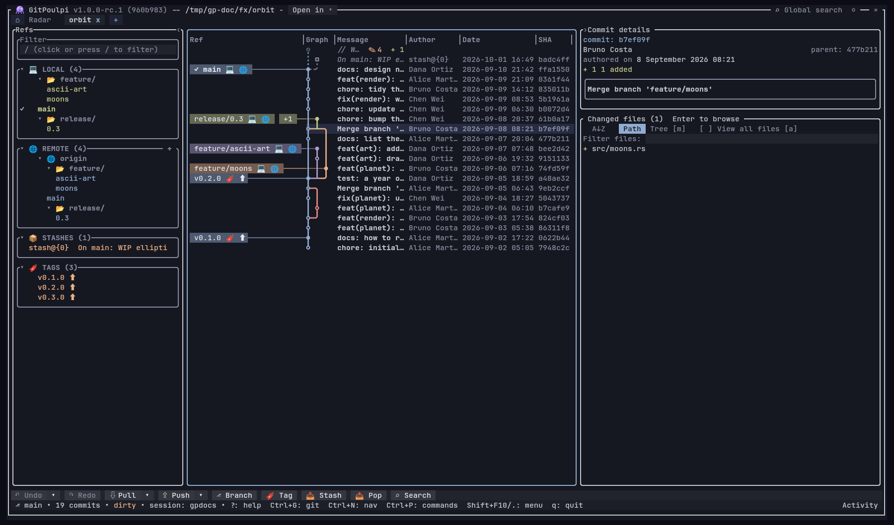
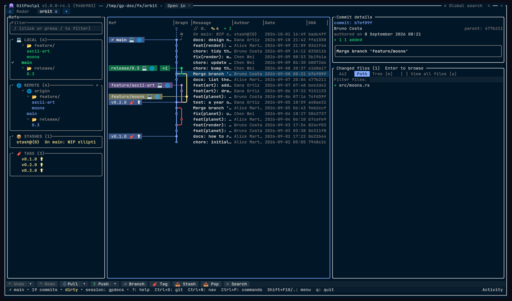
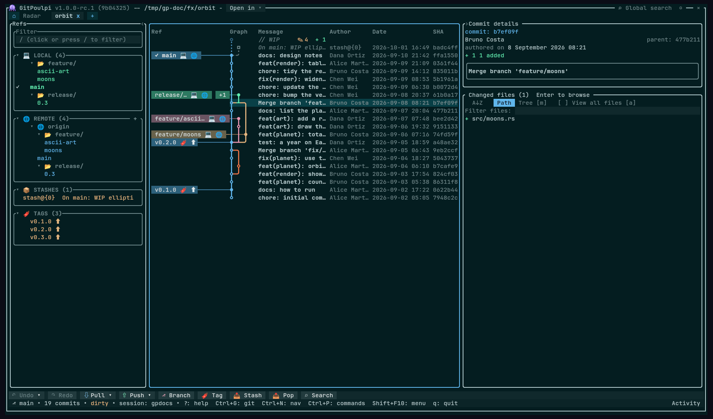
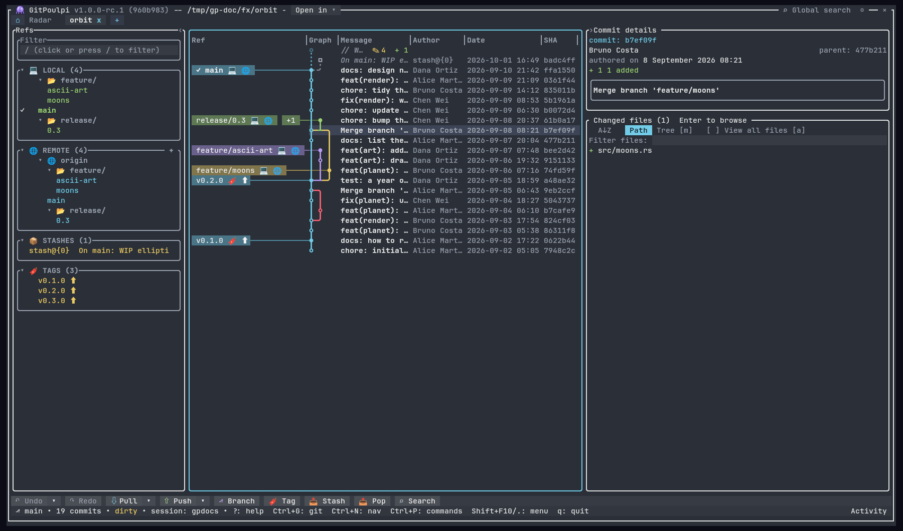
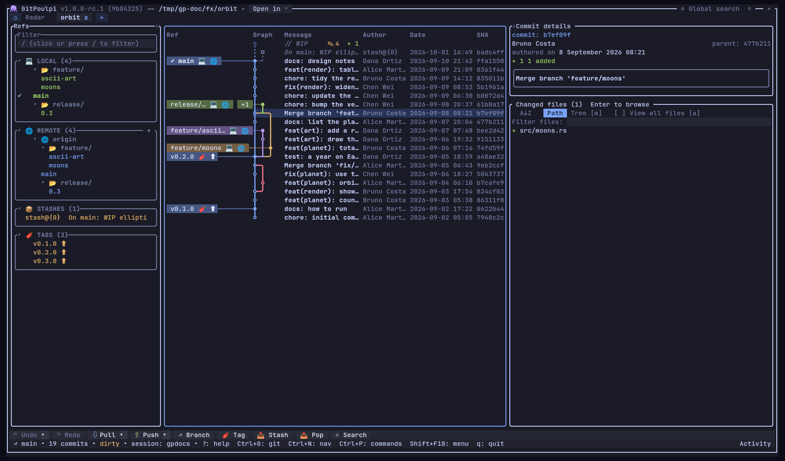

[English](../themes.md) · [Čeština](../cs/themes.md) · [Deutsch](../de/themes.md) · [Español](../es/themes.md) · [Français](../fr/themes.md) · [Italiano](../it/themes.md) · [日本語](../ja/themes.md) · **한국어** · [Nederlands](../nl/themes.md) · [Polski](../pl/themes.md) · [Português (Brasil)](../pt-BR/themes.md) · [Português (Portugal)](../pt-PT/themes.md) · [Русский](../ru/themes.md) · [Svenska](../sv/themes.md) · [Türkçe](../tr/themes.md) · [Українська](../uk/themes.md) · [简体中文](../zh-CN/themes.md)

# 테마

테마는 GitPoulpi가 그리는 모든 색을 정합니다. 텍스트, 패널, 선택 영역, 버튼, diff 및 merge 보기, 편집기, 도구 모음 아이콘, Log 그래프의 레인 색상이 모두 포함됩니다. 테마는 **설정 > 모양 > 테마**에서 바꾸거나 `gitpoulpi config set ui.theme <slug>`로 바꿉니다. 각 테마가 어떻게 보이는지 확인하려면 [갤러리](#갤러리)로 바로 이동하세요.

## 기본 제공 프리셋

`gitpoulpi theme list`는 사용 중인 빌드에 포함된 테마를 설정의 콤보가 보여 주는 순서대로 출력합니다. 먼저 **GitPoulpi Dark**(`dark`, 터미널 자체 배경 위에 그립니다)와 **GitPoulpi Light**(`light`)가 오고, 그다음 나머지 모든 프리셋이 레이블의 알파벳순으로 이어집니다. `ui.theme = "system"`(기본값)은 터미널을 따릅니다. 터미널 배경이 밝으면 Light, 그렇지 않으면 Dark입니다(아래 "시스템 감지" 참조). 예전 값 `default`는 `system`과 같습니다. 레인 팔레트 콤보도 같은 순서를 사용합니다.

| Slug | 레이블 | 색상 출처 |
|---|---|---|
| `system` (기본값) | 시스템 | 팔레트가 아님: 밝은 터미널 배경에서는 GitPoulpi Light, 그 외에는 GitPoulpi Dark |
| `dark` | GitPoulpi Dark | GitPoulpi 오리지널 테마, 터미널 자체의 배경 위에 그려집니다 |
| `light` | GitPoulpi Light | GitPoulpi 오리지널 테마 |
| `catppuccin-latte` / `catppuccin-frappe` / `catppuccin-macchiato` / `catppuccin-mocha` | Catppuccin Latte / Frappé / Macchiato / Mocha | [github.com/catppuccin/palette](https://github.com/catppuccin/palette) |
| `cyberpunk` | Cyberpunk | [iTerm2-Color-Schemes](https://github.com/mbadolato/iTerm2-Color-Schemes) "Cyberpunk" |
| `dracula` | Dracula | [draculatheme.com/contribute](https://draculatheme.com/contribute) |
| `everforest-dark` | Everforest Dark | [github.com/sainnhe/everforest/blob/master/palette.md](https://github.com/sainnhe/everforest/blob/master/palette.md) |
| `fire` / `fire-light` | Fire / Fire Light | GitPoulpi 오리지널 테마: Fire는 탄 주황색 배경에 불꽃 주황을 더한 잉걸불 테마이고, Fire Light는 진짜 주황색 배경 위의 밝은 쌍둥이입니다 |
| `github-dark` / `github-light` | GitHub Dark / GitHub Light | GitHub의 Primer 테마, [github.com/primer/github-vscode-theme](https://github.com/primer/github-vscode-theme) 와 @primer/primitives(`canvas.default`, 사이드바용 `canvas.inset`, `fg.*`, `accent.fg`). 조정한 값 없음 |
| `gruvbox-dark` / `gruvbox-light` | Gruvbox Dark / Light | [github.com/morhetz/gruvbox#palette](https://github.com/morhetz/gruvbox#palette) |
| `kanagawa` / `kanagawa-lotus` | Kanagawa (wave) / Kanagawa Lotus | [github.com/rebelot/kanagawa.nvim](https://github.com/rebelot/kanagawa.nvim) |
| `matrix` | Matrix | [iTerm2-Color-Schemes](https://github.com/mbadolato/iTerm2-Color-Schemes) "Matrix" (스킴에 빨강이 없으므로 `danger`는 `#ff5555`) |
| `monokai` | Monokai | 원래의 Monokai 팔레트 ([monokai.nl](https://monokai.nl/)) |
| `nord` | Nord | [www.nordtheme.com](https://www.nordtheme.com) |
| `one-dark` / `one-light` | One Dark / One Light | Atom One Dark / One Light ([One Dark](https://github.com/atom/one-dark-syntax), [One Light](https://github.com/atom/one-light-syntax)) |
| `rose-pine` / `rose-pine-moon` / `rose-pine-dawn` | Rosé Pine / Moon / Dawn | [rosepinetheme.com/palette](https://rosepinetheme.com/palette/) |
| `solarized-dark` / `solarized-light` | Solarized Dark / Light | Ethan Schoonover의 Solarized ([ethanschoonover.com/solarized](https://ethanschoonover.com/solarized/)) |
| `sunset` | Sunset | GitPoulpi 오리지널 테마: 산호색과 금색이 어우러진 남색 황혼 |
| `terminal` | Terminal (16 colors) | 터미널 자체의 16색만 사용 |
| `tokyo-night` / `tokyo-night-day` | Tokyo Night (night) / Tokyo Night Day | [github.com/folke/tokyonight.nvim](https://github.com/folke/tokyonight.nvim) (Day의 전경색은 대비 규칙을 통과하도록 어둡게 했습니다) |
| `vesper` | Vesper | [github.com/raunofreiberg/vesper](https://github.com/raunofreiberg/vesper) (팔레트에 파랑과 보라가 없으므로 강조색은 복숭아색) |
| `vscode-dark` / `vscode-light` | VS Code Dark / VS Code Light | VS Code 기본 Dark Modern / Light Modern, [github.com/microsoft/vscode/tree/main/extensions/theme-defaults/themes](https://github.com/microsoft/vscode/tree/main/extensions/theme-defaults/themes) (`dark_modern.json`, `light_modern.json`, 그리고 목록 선택과 ANSI/차트 강조색에 쓰는 VS Code의 기본 색상. Light의 흐린 회색은 `616161`) |

### terminalcolors.com에서 가져온 테마

terminalcolors.com의 터미널 팔레트에서 가져왔으며, 각 스킴의 저작권은 제작자에게 있습니다. 프리셋 90개는 팔레트의 배경, 전경, 선택 영역과 ANSI 16색으로 만들어집니다(accent = 파랑, success = 초록, warning = 노랑, danger = 빨강, AI = 마젠타, muted = 밝은 검정). 모든 프리셋이 하나의 공통 도출 규칙을 사용하며, GitPoulpi의 대비 규칙을 통과하지 못하는 색은 통과할 때까지 밝게 또는 어둡게 조정됩니다. 표는 `scripts/gen-terminalcolors.py`가 `crates/gitpoulpi-config/src/theme/terminalcolors_data.rs`로 생성합니다. Slug는 `<family>-<variant>`이며(`default`는 생략), 레이블은 다른 프리셋과 마찬가지로 콤보에서 알파벳순으로 정렬됩니다.


| Family | Slugs |
|---|---|
| [Apprentice](https://terminalcolors.com/themes/apprentice/) | `apprentice` |
| [Ayu](https://terminalcolors.com/themes/ayu/) | `ayu-dark`, `ayu-light`, `ayu-mirage` |
| [Cobalt2](https://terminalcolors.com/themes/cobalt2/) | `cobalt2` |
| [Deus](https://terminalcolors.com/themes/deus/) | `deus` |
| [Dracula](https://terminalcolors.com/themes/dracula/) | `dracula-soft` |
| [Everforest](https://terminalcolors.com/themes/everforest/) | `everforest-light` |
| [GitHub](https://terminalcolors.com/themes/github/) | `github-dark-colorblind`, `github-dark-dimmed`, `github-dark-high-contrast`, `github-dark-legacy`, `github-light-colorblind`, `github-light-high-contrast`, `github-light-legacy` |
| [Gotham](https://terminalcolors.com/themes/gotham/) | `gotham` |
| [Gruvbox](https://terminalcolors.com/themes/gruvbox/) | `gruvbox-dark-hard-contrast`, `gruvbox-dark-soft-contrast`, `gruvbox-light-hard-contrast`, `gruvbox-light-soft-contrast` |
| [Iceberg](https://terminalcolors.com/themes/iceberg/) | `iceberg-dark`, `iceberg-light` |
| [Jellybeans](https://terminalcolors.com/themes/jellybeans/) | `jellybeans` |
| [Kanagawa](https://terminalcolors.com/themes/kanagawa/) | `kanagawa-dragon` |
| [Lucario](https://terminalcolors.com/themes/lucario/) | `lucario` |
| [Miasma](https://terminalcolors.com/themes/miasma/) | `miasma` |
| [Moonfly](https://terminalcolors.com/themes/moonfly/) | `moonfly` |
| [Night](https://terminalcolors.com/themes/night-owl/) | `night-owl-dark`, `night-owl-light` |
| [Nightfly](https://terminalcolors.com/themes/nightfly/) | `nightfly` |
| [Nightfox](https://terminalcolors.com/themes/nightfox/) | `nightfox`, `nightfox-carbonfox`, `nightfox-dawnfox`, `nightfox-dayfox`, `nightfox-duskfox`, `nightfox-nordfox`, `nightfox-terafox` |
| [Noctis](https://terminalcolors.com/themes/noctis/) | `noctis`, `noctis-azureus`, `noctis-bordo`, `noctis-hibernus`, `noctis-lilac`, `noctis-lux`, `noctis-minimus`, `noctis-obscuro`, `noctis-sereno`, `noctis-uva`, `noctis-viola` |
| [Nordic](https://terminalcolors.com/themes/nordic/) | `nordic` |
| [One](https://terminalcolors.com/themes/one-half/) | `one-half-dark`, `one-half-light` |
| [Panda](https://terminalcolors.com/themes/panda/) | `panda` |
| [Posterpole](https://terminalcolors.com/themes/posterpole/) | `posterpole`, `posterpole-gray` |
| [Seoul256](https://terminalcolors.com/themes/seoul256/) | `seoul256-dark`, `seoul256-light` |
| [Shades](https://terminalcolors.com/themes/shades-of-purple/) | `shades-of-purple`, `shades-of-purple-super-dark` |
| [Sonokai](https://terminalcolors.com/themes/sonokai/) | `sonokai`, `sonokai-andromeda`, `sonokai-atlantis`, `sonokai-espresso`, `sonokai-maia`, `sonokai-shusia` |
| [Srcery](https://terminalcolors.com/themes/srcery/) | `srcery` |
| [Tender](https://terminalcolors.com/themes/tender/) | `tender` |
| [Tokyo](https://terminalcolors.com/themes/tokyo-night/) | `tokyo-night-moon`, `tokyo-night-storm` |
| [Tomorrow](https://terminalcolors.com/themes/tomorrow/) | `tomorrow`, `tomorrow-night`, `tomorrow-night-blue`, `tomorrow-night-bright`, `tomorrow-night-eighties` |
| [Zenbones](https://terminalcolors.com/themes/zenbones/) | `zenbones-duckbones`, `zenbones-forestbones-dark`, `zenbones-forestbones-light`, `zenbones-kanagawabones`, `zenbones-neobones-dark`, `zenbones-neobones-light`, `zenbones-nordbones`, `zenbones-rosebones-dark`, `zenbones-rosebones-light`, `zenbones-seoulbones-dark`, `zenbones-seoulbones-light`, `zenbones-tokyobones-dark`, `zenbones-tokyobones-light`, `zenbones-vimbones`, `zenbones-zenburned`, `zenbones-zenwritten-dark`, `zenbones-zenwritten-light` |

`ui.side_bg`는 GitHub, VS Code가 사이드바를 칠하는 방식과 같이 Refs 창과 오른쪽 패널(commit 상세, 작업 중인 변경 사항, 파일 목록)의 배경입니다. Catppuccin(`mantle`), GitHub, VS Code가 이 값을 설정하며, 다른 모든 프리셋에서는 `default`로, `ui.bg`와 같다는 뜻입니다. 테마 파일은 `[ui]` 아래에 `side_bg`를 설정할 수 있습니다(`gitpoulpi theme export`가 출력합니다).

`[ui]` 아래의 역할 세 가지가 더 있어, GitHub과 VS Code처럼 크롬(chrome)에 색을 입힙니다.

| 역할 | 칠하는 위치 |
|---|---|
| `ui.toolbar_bg` | 도구 모음 행과 **선택한 저장소 탭**. 탭이 도구 모음에 붙어 있는 것처럼 보입니다. 도구 모음의 버튼 칩은 자체 `chrome.toolbar_bg`를 유지합니다. |
| `ui.statusbar_bg` | 상태 표시줄(`ui.statusbar_position`이 위로 정하지 않으면 맨 아래). |
| `ui.statusbar_fg` | 상태 표시줄의 텍스트. 그 배경 위에서 읽기 어려운 텍스트는 이 색으로 다시 칠해지며, 읽을 수 있는 경고와 오류 텍스트는 자기 색을 유지합니다. |

프리셋은 해당 앱에 맞춰 이 값을 설정합니다. VS Code Dark와 Light는 흰색 텍스트의 파란색(`#007acc`) 상태 표시줄과 도구 모음용 VS Code 제목 표시줄 회색을, GitHub는 헤더 색조를 사용합니다. 그 밖의 모든 프리셋(가져온 터미널 팔레트 포함)은 도구 모음을 `bg`에서 한 단계 벗어난 색으로, 상태 표시줄을 그보다 조금 더 벗어난 색으로 도출하고 그 위에 `text`를 올리며, 대비 규칙이 텍스트를 읽을 수 있게 유지합니다. `dark`(GitPoulpi Dark)와 `terminal`은 터미널 자체 배경을 사용하므로 이 세 값이 모두 `default`입니다. 아무것도 칠하지 않으며 선택한 탭은 선택 색을 유지합니다. 이 값을 생략한 테마 파일은 base의 값을 상속합니다. `default`는 색조 없음을 뜻합니다(그러면 상태 표시줄은 `side_bg`를 따릅니다).

스킴의 주석이나 흐린 회색이 읽기에 너무 어두우면 GitPoulpi의 대비 규칙을 통과할 때까지 밝게 조정합니다. 스킴에 없는 패널과 선택 영역의 음영은 배경에서 도출합니다.

### 갤러리

모든 기본 제공 테마를, merge commit을 선택한 동일한 저장소에서 찍었습니다(`scripts/docs-screenshots.sh`로 다시 찍습니다).


| **GitPoulpi Dark** (`dark`) | **GitPoulpi Light** (`light`) | **Apprentice** (`apprentice`) |
|---|---|---|
|  |  |  |
| **Ayu Dark** (`ayu-dark`) | **Ayu Light** (`ayu-light`) | **Ayu Mirage** (`ayu-mirage`) |
|  |  |  |
| **Catppuccin Frappé** (`catppuccin-frappe`) | **Catppuccin Latte** (`catppuccin-latte`) | **Catppuccin Macchiato** (`catppuccin-macchiato`) |
|  |  |  |
| **Catppuccin Mocha** (`catppuccin-mocha`) | **Cobalt2** (`cobalt2`) | **Cyberpunk** (`cyberpunk`) |
|  |  |  |
| **Deus** (`deus`) | **Dracula** (`dracula`) | **Dracula Soft** (`dracula-soft`) |
|  |  |  |
| **Everforest Dark** (`everforest-dark`) | **Everforest Light** (`everforest-light`) | **Fire** (`fire`) |
|  |  |  |
| **Fire Light** (`fire-light`) | **GitHub Dark** (`github-dark`) | **GitHub Dark Colorblind** (`github-dark-colorblind`) |
|  |  |  |
| **GitHub Dark Dimmed** (`github-dark-dimmed`) | **GitHub Dark High Contrast** (`github-dark-high-contrast`) | **GitHub Dark Legacy** (`github-dark-legacy`) |
|  |  |  |
| **GitHub Light** (`github-light`) | **GitHub Light Colorblind** (`github-light-colorblind`) | **GitHub Light High Contrast** (`github-light-high-contrast`) |
|  |  |  |
| **GitHub Light Legacy** (`github-light-legacy`) | **Gotham** (`gotham`) | **Gruvbox Dark** (`gruvbox-dark`) |
|  |  |  |
| **Gruvbox Dark Hard Contrast** (`gruvbox-dark-hard-contrast`) | **Gruvbox Dark Soft Contrast** (`gruvbox-dark-soft-contrast`) | **Gruvbox Light** (`gruvbox-light`) |
|  |  |  |
| **Gruvbox Light Hard Contrast** (`gruvbox-light-hard-contrast`) | **Gruvbox Light Soft Contrast** (`gruvbox-light-soft-contrast`) | **Iceberg Dark** (`iceberg-dark`) |
|  |  |  |
| **Iceberg Light** (`iceberg-light`) | **Jellybeans** (`jellybeans`) | **Kanagawa** (`kanagawa`) |
|  |  |  |
| **Kanagawa Dragon** (`kanagawa-dragon`) | **Kanagawa Lotus** (`kanagawa-lotus`) | **Lucario** (`lucario`) |
|  |  |  |
| **Matrix** (`matrix`) | **Miasma** (`miasma`) | **Monokai** (`monokai`) |
|  |  |  |
| **Moonfly** (`moonfly`) | **Night Owl Dark** (`night-owl-dark`) | **Night Owl Light** (`night-owl-light`) |
|  |  |  |
| **Nightfly** (`nightfly`) | **Nightfox** (`nightfox`) | **Nightfox Carbonfox** (`nightfox-carbonfox`) |
|  |  |  |
| **Nightfox Dawnfox** (`nightfox-dawnfox`) | **Nightfox Dayfox** (`nightfox-dayfox`) | **Nightfox Duskfox** (`nightfox-duskfox`) |
|  |  |  |
| **Nightfox Nordfox** (`nightfox-nordfox`) | **Nightfox Terafox** (`nightfox-terafox`) | **Noctis** (`noctis`) |
|  |  |  |
| **Noctis Azureus** (`noctis-azureus`) | **Noctis Bordo** (`noctis-bordo`) | **Noctis Hibernus** (`noctis-hibernus`) |
|  |  |  |
| **Noctis Lilac** (`noctis-lilac`) | **Noctis Lux** (`noctis-lux`) | **Noctis Minimus** (`noctis-minimus`) |
|  |  |  |
| **Noctis Obscuro** (`noctis-obscuro`) | **Noctis Sereno** (`noctis-sereno`) | **Noctis Uva** (`noctis-uva`) |
|  |  |  |
| **Noctis Viola** (`noctis-viola`) | **Nord** (`nord`) | **Nordic** (`nordic`) |
|  |  |  |
| **One Dark** (`one-dark`) | **One Half Dark** (`one-half-dark`) | **One Half Light** (`one-half-light`) |
|  |  |  |
| **One Light** (`one-light`) | **Panda** (`panda`) | **Posterpole** (`posterpole`) |
|  |  |  |
| **Posterpole Gray** (`posterpole-gray`) | **Rosé Pine** (`rose-pine`) | **Rosé Pine Dawn** (`rose-pine-dawn`) |
|  |  |  |
| **Rosé Pine Moon** (`rose-pine-moon`) | **Seoul256 Dark** (`seoul256-dark`) | **Seoul256 Light** (`seoul256-light`) |
|  |  |  |
| **Shades of Purple** (`shades-of-purple`) | **Shades of Purple Super Dark** (`shades-of-purple-super-dark`) | **Solarized Dark** (`solarized-dark`) |
|  |  |  |
| **Solarized Light** (`solarized-light`) | **Sonokai** (`sonokai`) | **Sonokai Andromeda** (`sonokai-andromeda`) |
|  |  |  |
| **Sonokai Atlantis** (`sonokai-atlantis`) | **Sonokai Espresso** (`sonokai-espresso`) | **Sonokai Maia** (`sonokai-maia`) |
|  |  |  |
| **Sonokai Shusia** (`sonokai-shusia`) | **Srcery** (`srcery`) | **Sunset** (`sunset`) |
|  |  |  |
| **Tender** (`tender`) | **Terminal (16 colors)** (`terminal`) | **Tokyo Night** (`tokyo-night`) |
|  |  |  |
| **Tokyo Night Day** (`tokyo-night-day`) | **Tokyo Night Moon** (`tokyo-night-moon`) | **Tokyo Night Storm** (`tokyo-night-storm`) |
|  |  |  |
| **Tomorrow** (`tomorrow`) | **Tomorrow Night** (`tomorrow-night`) | **Tomorrow Night Blue** (`tomorrow-night-blue`) |
|  |  |  |
| **Tomorrow Night Bright** (`tomorrow-night-bright`) | **Tomorrow Night Eighties** (`tomorrow-night-eighties`) | **Vesper** (`vesper`) |
|  |  |  |
| **VS Code Dark** (`vscode-dark`) | **VS Code Light** (`vscode-light`) | **Zenbones Duckbones** (`zenbones-duckbones`) |
|  |  |  |
| **Zenbones Forestbones Dark** (`zenbones-forestbones-dark`) | **Zenbones Forestbones Light** (`zenbones-forestbones-light`) | **Zenbones Kanagawabones** (`zenbones-kanagawabones`) |
|  |  |  |
| **Zenbones Neobones Dark** (`zenbones-neobones-dark`) | **Zenbones Neobones Light** (`zenbones-neobones-light`) | **Zenbones Nordbones** (`zenbones-nordbones`) |
|  |  |  |
| **Zenbones Rosebones Dark** (`zenbones-rosebones-dark`) | **Zenbones Rosebones Light** (`zenbones-rosebones-light`) | **Zenbones Seoulbones Dark** (`zenbones-seoulbones-dark`) |
|  |  |  |
| **Zenbones Seoulbones Light** (`zenbones-seoulbones-light`) | **Zenbones Tokyobones Dark** (`zenbones-tokyobones-dark`) | **Zenbones Tokyobones Light** (`zenbones-tokyobones-light`) |
|  |  |  |
| **Zenbones Vimbones** (`zenbones-vimbones`) | **Zenbones Zenburned** (`zenbones-zenburned`) | **Zenbones Zenwritten Dark** (`zenbones-zenwritten-dark`) |
|  |  |  |
| **Zenbones Zenwritten Light** (`zenbones-zenwritten-light`) |
|  |

## 모든 테마를 모든 레인 팔레트와 함께

모든 테마는 Log 그래프용 자체 레인 색상을 갖고 있지만, 어떤 테마든 원하는 팔레트와 조합할 수 있습니다. **설정 > 모양 > 그래프 색상 테마**에는 **테마 따르기**(기본값)와 모든 테마의 모든 레인 팔레트(GitPoulpi Dark, GitPoulpi Light, 이어서 Material, Serie, ... 그리고 사용자 테마 파일의 `graph_palette`로, 프리셋 뒤에 테마 이름 아래 나열됨)가 표시됩니다. 사용자 지정 테마는
목록을 다음에 열 때 나타나며(그때 파일을 다시 읽음), 하나를 고르면 그 파일 이름이 `ui.graph_color_theme`에 저장됩니다(주
설치는 `[ui]`에, 다른 설치는 테마처럼 자신의 `[installation.settings.<id>]` 항목에). `graph_palette`가 없는 테마 파일은 자신의
`base`(없으면 기본 프리셋)의 레인 색상을 가지며, 이는 파일의 다른 모든 색과 같은 상속입니다. 기본 제공 레인 팔레트와 같은 이름의
사용자 지정 테마(예: `gruvbox`)는 목록에서 그 팔레트를 대체합니다. 설정된 이름이 더 이상 없으면(파일이 삭제되었거나 이름이
바뀜) 그래프는 활성 테마의 레인 색상을 사용하고, 설정에는 다른 것을 고를 때까지 그 이름이 *찾을 수 없음*으로 표시됩니다. 

`config.toml`에서는 다음과 같습니다.

```toml
[ui]
theme = "nord"
graph_color_theme = "material"   # or "theme" to follow the theme
```

`ui.input_color`는 텍스트 입력창에 대한 같은 종류의 재정의입니다. 기본값 `theme`은 테마의 입력창 색상을 따르고, `gray`, `blue`, `slate`, `dark`, `custom`은 배경을 강제로 지정합니다(어두운 색이므로 밝은 테마에서는 `theme`을 선택하세요).

## 나만의 테마

구성 디렉터리의 `themes/` 폴더에 `.toml` 파일을 넣으세요(`gitpoulpi config path`가 그 상위 경로를 출력하며, 폴더는 `${config}/themes/`입니다). `.toml`을 뺀 파일 이름이 테마의 slug이며, `ui.theme`이 받는 값입니다. 프리셋의 slug를 재사용하는 파일은 경고와 함께 건너뜁니다.

완전한 파일에서 시작하세요.

```
gitpoulpi theme export nord > "$(dirname "$(gitpoulpi config path)")/themes/mine.toml"
```

그런 다음 바꾸려는 것만 남기세요. 파일은 `base`(프리셋 또는 다른 사용자 테마, 체인은 최대 4단계이며 순환은 거부되고, `base`가 없으면 `dark`) 위에 놓이는 **부분 재정의**의 집합입니다.

```toml
name = "My Nord"            # the label in the combo; default = file name
base = "nord"
light = false               # inherited when absent
syntax = "base16-ocean.dark"
graph_palette = ["#88c0d0", "#a3be8c"]

[ui]
bg = "#2e3440"              # "default" | "#rrggbb" | "ansi:N"
accent = "#88c0d0"
toolbar_bg = "#3b4252"      # toolbar row and selected tab
statusbar_bg = "#5e81ac"    # status bar
statusbar_fg = "#eceff4"

[diff]
add_bg = "#2f3b2f"
```

### diff의 변경된 단어 (`diff.add_emph_bg`, `diff.del_emph_bg`)

Diff 보기가 변경된 줄 안에서 달라진 단어에 `diff.add_bg`(추가된 줄)와 `diff.del_bg`(삭제된 줄) 위에 칠하는 더 진한 배경입니다.
텍스트는 `diff.add_fg`와 `diff.del_fg`를 유지합니다. 모든 프리셋이 둘 다 설정합니다. `diff.add_bg`나 `diff.del_bg`는
설정하고 해당 강조는 설정하지 않은 테마 파일은 그것에서 파생된 값(그쪽 텍스트 색 방향으로 30%)을 받으므로, 사용자 지정 배경이
기본 테마의 강조를 갖게 되는 일은 없습니다. 값이 `default`(Terminal 프리셋)이거나 색상 깊이 때문에 두 배경이 똑같이 그려지는
터미널에서는 대신 단어를 굵게와 밑줄로 표시합니다. [diff의 변경된 단어](interface-tour.md#diff의-변경된-단어)를 참고하세요.

색상은 `"#rrggbb"`, `"ansi:N"`(터미널 팔레트의 N번째 항목) 또는 `"default"`(터미널 자체의 색)입니다. 그룹과 키는 `gitpoulpi theme export <slug>`의 것과 같습니다. 치명적인 오류는 없습니다. 알 수 없는 키나 잘못된 색은 무시되고, 알 수 없는 `base`는 `dark`로 대체되며, `gitpoulpi theme list`가 각 문제를 `warnings` 아래에 보고합니다(앱은 이를 상태 표시줄에 한 번 표시합니다).

파일은 테마 콤보를 열 때와 설정을 닫을 때 다시 읽습니다. 실행 중인 창은 `config.toml`(셸에서 실행한 `gitpoulpi config set ui.theme ...`)과 활성 테마의 파일이 다시 쓰이는 것도 감지하여, 재시작 없이 약 1초 안에 새 색상을 적용합니다.

### `ui.border_focused`

키보드 포커스가 있는 창의 테두리입니다. 로그, Refs 사이드바, Staged와 Unstaged 창, 커밋 상세, 기록, 리뷰, 다시 쓰기 창, diff, 파일, 편집기 테두리가 해당합니다. 칠하는 것은 테두리뿐이며, 텍스트, 레이블, 아이콘("commit :" 레이블, 홈 아이콘, 탭 버튼)은 계속 `ui.accent`를 씁니다. 그래서 테마는 텍스트로는 읽기 어려운 색, 예를 들어 밝은 테마의 선명한 노란색으로도 활성 창의 테두리를 표시할 수 있습니다. 테마가 이 값을 설정하지 않으면 `ui.accent`를 따르므로(사용자 파일도 마찬가지로, `accent`만 바꾼 파일은 포커스된 테두리에도 그 강조색을 씁니다) 모든 내장 테마는 이전과 똑같이 보입니다. 대화상자와 팝업은 계속 강조색 테두리를 씁니다.

```toml
[ui]
accent = "#1f5fbf"
border_focused = "#ffd700"
```

## 시스템 감지

`ui.theme = "system"`이면 GitPoulpi는 **시작할 때 한 번** 터미널에 배경색을 묻고(OSC 11 질의, kitty, WezTerm, Alacritty, foot, iTerm2, Windows Terminal, tmux 및 대부분의 터미널이 응답합니다) 배경이 밝으면 Light, 그렇지 않으면 Dark를 선택합니다. 대기 시간은 최대 약 100 ms이며, 이 질의를 모르는 터미널에서도 비용은 없습니다. 응답은 인터페이스가 시작되기 전에 항상 읽으므로 아무것도 출력되지 않고 키 입력도 삼켜지지 않습니다. 응답이 없으면(그리고 질의를 보내지 않는 Windows에서는 항상) `COLORFGBG`를 읽고, 그것도 없으면 Dark로 대체합니다. GitPoulpi가 실행되는 동안 터미널의 배경이 바뀌어도 따라가지 않습니다. 재시작하거나 Light 또는 Dark를 직접 선택하세요.

## 색상 깊이

테마는 트루컬러(`#rrggbb`)입니다. `ui.color_depth`(설정 > 모양 > 색상 깊이, 즉시 적용)가 이를 터미널에 전달하는 방식을 정합니다.

| 값 | 효과 |
|---|---|
| `auto` (기본값) | 동작하지 않는 것으로 알려진 곳을 제외하고 트루컬러입니다. Apple Terminal(`TERM_PROGRAM=Apple_Terminal`)은 256색, Linux 콘솔(`TERM=linux`)은 16색, `COLORTERM`을 설정하지 않는 `*-256color` 터미널(WezTerm, kitty, Windows Terminal 제외)은 256색을 사용합니다. `COLORTERM=truecolor`는 항상 트루컬러를 뜻합니다. |
| `truecolor` | 항상 24비트 색상. |
| `256` | 모든 RGB 색을 가장 가까운 xterm-256 항목으로 바꿉니다. |
| `16` | 가장 가까운 ANSI 16색으로 바꾸며, 정확한 색조는 터미널 자체 팔레트가 정합니다. |

ssh나 오래된 멀티플렉서에서 테마의 색이 잘못 보이면 `256` 또는 `16`을 사용하세요. Terminal 프리셋에는 이런 설정이 필요 없습니다. 트루컬러는 비용이 들지 않으며, 변환 과정은 활성화되었을 때만 프레임당 한 번 화면 전체에 실행됩니다.

테마는 설치마다 따로입니다: 하나의 설정을 공유하는 여러 GitPoulpi 설치는 각자 자기 것을 유지하므로, 한 설치에서 고른 테마가 다른 설치의 색을 바꾸지 않습니다.

## 실시간 미리 보기

설정 > 모양에서 테마 콤보에는 **시스템(터미널을 따름)**, 프리셋, 그다음 사용자 테마 파일이 나열됩니다. 강조 표시를 옮기면 해당 테마가 즉시 적용되어 설정 화면 전체가 눈앞에서 다시 그려집니다. **Enter**를 누르면 유지되고(저장됩니다), **Esc**를 누르거나 다른 곳을 클릭하면 이전 테마로 돌아가며 아무것도 저장하지 않습니다. 팔레트 항목 **앱: 테마...**(`Ctrl+P`)는 그 행에서 설정을 엽니다.

### 팔레트에서 테마 변경

**앱: 테마 변경...**(`Ctrl+P` 또는 `Ctrl+N t`, 키는 `nav_prefix.change_theme`로 재할당할 수 있습니다)은 설정을 거치지 않고 같은 테마 목록을 엽니다. **시스템(터미널을 따름)**, 프리셋, 사용자 테마 파일이 나열되며 각각 작은 색상 칩 네 개가 붙어 있습니다. 현재 테마에는 체크 표시가 있습니다. 입력하면 목록이 좁혀지고, 강조 표시를 옮기면 테마가 즉시 미리 보기되며, **Enter**는 적용하고 `ui.theme`을 `config.toml`에 저장하고, **Esc**(또는 목록 바깥 클릭)는 이전 테마를 되돌리고 아무것도 저장하지 않습니다.

필터 필드 아래의 세그먼트형 사전 필터로 목록을 좁힙니다. **전체**, **다크**, **라이트**, **컬러**, 그리고 내 테마 파일이 있으면 **사용자 지정**입니다(세그먼트 클릭, `Tab` / `Shift+Tab`, 또는 `Alt+1`..`Alt+5`). 다크와 라이트는 테마의 `ui.bg` 밝기로 정해지고, **컬러**는 배경에 뚜렷한 색조(파랑, 보라, 노랑, 초록...)가 있는 테마만 남기고 흰색, 오프화이트, 검정, 검정에 가까운 회색은 제외하므로 Solarized Dark, Dracula, Nord는 컬러이지만 GitHub Dark와 One Light는 아닙니다. 컬러 테마는 다크 또는 라이트 아래에도 표시됩니다. **시스템**과 투명 테마(자체 배경이 없는 테마)는 전체에서만 나타납니다. **사용자 지정**은 `themes/` 폴더에 있는 내 테마 파일만 남기며(사용자 지정 테마도 그 버튼들에서는 다크, 라이트, 컬러 중 하나), 그 폴더에 테마가 없으면 버튼은 그려지지 않고 키로도 닿지 않습니다. 사전 필터는 입력한 내용과 함께 적용됩니다. 그래프 색상 테마와 언어 선택기도 같은 방식으로 미리 보기됩니다. 강조 표시를 옮기면 Log의 레인과 UI 전체가 바뀝니다.


콤보 아래의 색상 칩 띠는 적용 중인 테마(배경, 텍스트, 흐림, 강조, 선택, danger, diff 추가, diff 삭제, 그다음 처음 여섯 개의 레인 색상)를 보여 주며 미리 보기를 따라갑니다. **모양**의 **그래프 색상 테마** 콤보는 각 팔레트 옆에 레인 색상 몇 가지를 보여 주며, 선택은 설정을 닫을 때 적용됩니다.

자체 배경이 있는 테마(Light와 그 밖의 칠하는 프리셋)는 설정과 전체 페이지 보기를 포함해 창 전체를 채우고, 자체 색이 없는 텍스트에 테마의 텍스트 색을 입힙니다. Dark와 Terminal은 터미널의 색을 건드리지 않습니다.

## 명령줄에서

| 명령 | 출력 |
|---|---|
| `gitpoulpi theme list` | JSON `{themes: [{slug, label, source, light, lane_palette}], warnings}`. `source`는 `preset` 또는 `user`입니다. |
| `gitpoulpi theme export <slug>` | 완전한 테마 파일을 stdout에 TOML로 출력합니다(JSON: `{slug, toml}`). 다시 파싱하면 같은 테마가 됩니다. |
| `gitpoulpi config set ui.theme <slug>` | 프리셋과 `themes/` 폴더에 대해 검증됩니다. 알 수 없는 이름은 유효한 이름을 나열하는 오류입니다. `system`과 `default`도 허용됩니다. |
| `gitpoulpi config set ui.graph_color_theme <name>` | `theme`(테마 따르기) 또는 임의의 레인 팔레트 이름. 알 수 없는 이름은 유효한 이름을 나열합니다. |

MCP 서버는 읽기 전용 도구로 `theme_list`와 `theme_export`를 제공합니다.
