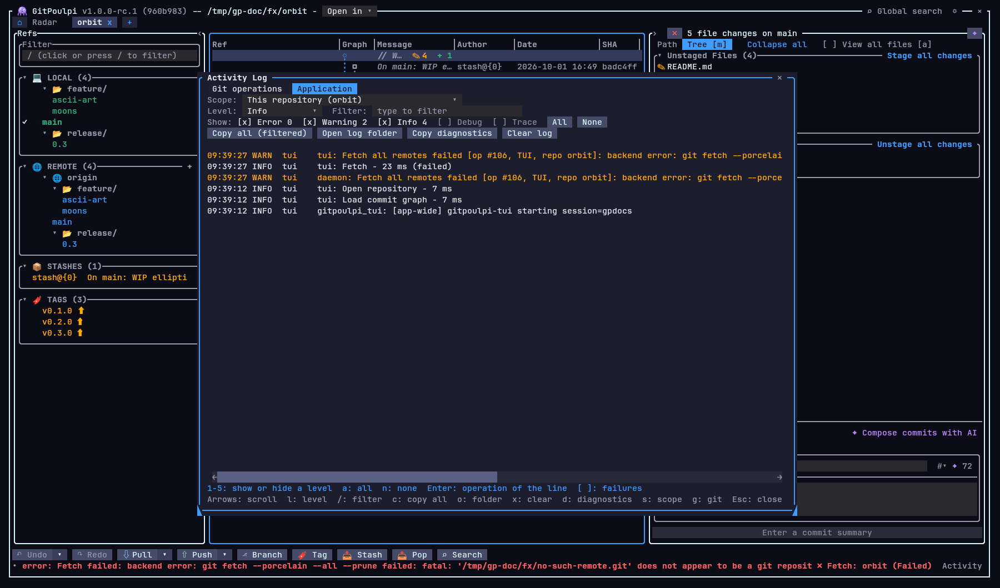

[English](../troubleshooting.md) · [Čeština](../cs/troubleshooting.md) · [Deutsch](../de/troubleshooting.md) · [Español](../es/troubleshooting.md) · [Français](../fr/troubleshooting.md) · [Italiano](../it/troubleshooting.md) · [日本語](../ja/troubleshooting.md) · **한국어** · [Nederlands](../nl/troubleshooting.md) · [Polski](../pl/troubleshooting.md) · [Português (Brasil)](../pt-BR/troubleshooting.md) · [Português (Portugal)](../pt-PT/troubleshooting.md) · [Русский](../ru/troubleshooting.md) · [Svenska](../sv/troubleshooting.md) · [Türkçe](../tr/troubleshooting.md) · [Українська](../uk/troubleshooting.md) · [简体中文](../zh-CN/troubleshooting.md)

# 문제 해결과 FAQ

아래의 빠른 답변부터 확인하세요. 더 긴 섹션에서는 Git LFS와 그래프 렌더링을 다룹니다. 어느 것도 도움이 되지 않으면 GitHub 저장소에 OS, 터미널, `gitpoulpi --version`, 수행한 작업을 적어 이슈를 등록하세요.

## 무언가 실패했을 때

실패한 작업은 팝업도, 테두리 있는 카드도 표시하지 않습니다. **상태 표시줄**이 빨간색으로 제목과 이유를 알려 주며(*오류: Fetch 실패: 리모트에 닿을 수 없습니다.*), 다른 메시지가 대체할 때까지 남아 있습니다. 오른쪽 끝의 활동 버튼은 아직 확인하지 않은 오류의 수를 셉니다. 빨간 메시지를 클릭하거나 팔레트의 `활동 로그: 마지막 오류 열기`를 실행하면 활동 로그가 그 항목에서 열립니다. 직접 일으킨 모든 실패가 이렇게 동작하며, git 작업만 그런 것이 아닙니다:

- **git 작업**: fetch, push, pull, checkout, merge, rebase, commit, stash 등.
- **클론**(그리고 새 저장소 만들기): "클론에 실패했습니다".
- **GitHub 또는 GitLab 호출**: 선택기와 클론 대화상자의 저장소 목록, pull request나 이슈 만들기, 연동 페이지에서 토큰이나 SSH 키 확인: "호스팅 서비스 요청에 실패했습니다".
- **외부 프로그램**: 편집기, diff 또는 merge 도구, 파일 탐색기, 브라우저, 터미널이나 런처, 이미지 편집기, 설정의 *테스트* 버튼: "외부 도구가 실패했습니다".
- **AI 요청**(commit 메시지, 설명, 충돌 제안 등): "AI 요청에 실패했습니다".
- **쓰지 못한 파일**: 내장 편집기의 저장, merge 편집기, 저장하지 못한 설정: "저장에 실패했습니다".

빨간 메시지는 어떤 화면이 앞에 있든 상태 표시줄에 있습니다: 저장소 탭, Home, 레이더, 워크스페이스, 설정(화면의 맨 아래 줄), 활동 로그나 대화상자 아래. 상태 표시줄이 가려진 곳(Home, 레이더, 워크스페이스, 설정)에서는 오류를 확인할 때까지 메시지가 맨 아래 줄에 덮어 쓰입니다. 메시지는 탭을 옮겨도 따라옵니다. 탭을 전환할 때 아직 실행 중인 작업은 따라오지 않습니다. 활동 로그를 열어 어떻게 끝났는지 확인하세요.

새로 고칠 수 없는 PULL REQUESTS와 이슈 섹션의 목록은 대신 섹션 안에 자기만의 줄을 남깁니다(스스로 새로 고쳐지므로 몇 초마다 메시지가 뜨면 소음일 뿐입니다). 아직 열려 있는 대화상자(클론, Pull request 만들기 등)도 자기만의 한 줄 메시지를 남기므로, 입력란을 고치고 다시 시도할 수 있습니다.

활동 로그의 항목에는 예전에 팝업이 보여 주던 모든 것이 있습니다:

- **제목과 이유.** "Fetch 실패", 이어서 이유를 쉬운 말로 설명하는 한 문장, 그다음 할 일. 알아보는 경우: 리모트에 내게 없는 commit이 있음(*먼저 pull*), 자격 증명 거부(*설정 > 연동이나 SSH 키 확인*), 충돌로 멈춤, 덮어써질 로컬 변경(*commit, stash 또는 버리기*), 리모트에 닿을 수 없음, 다른 git 프로세스가 저장소의 잠금을 쥐고 있음. 그 밖의 경우에는 git 자신의 첫 줄이 표시됩니다. 같은 방식으로 실패한 클론이나 호스트 호출(자격 증명 거부, 호스트에 닿을 수 없음)은 같은 문구로 표시됩니다. 그 밖의 실패에는 무엇이 실패했는지 말하는 한 문장("저장소를 클론하지 못했습니다.", "프로그램을 실행하지 못했습니다.")이 붙습니다.
- **세부 정보**는 항목이 열려 있을 때(`Enter`, 또는 항목을 연 클릭) 표시됩니다: 작업, 실행된 git 명령, 종료 코드, 출력의 마지막 줄들(내장 git 라이브러리는 오류 클래스와 코드). 자격 증명, 토큰, `Authorization` 헤더는 표시, 기록, 복사 전에 가려집니다.
- **복사**(버튼 또는 `c`)는 설명해 줄 수 있는 사람이나 AI와의 채팅에 붙여 넣도록 만든 텍스트 블록을 클립보드에 넣습니다: GitPoulpi 버전, 시스템, 터미널, 백엔드, 실패한 작업과 그 세부 정보, git 버전.
- **다음 단계 버튼**은 있을 때 복사 옆에 나타납니다(또는 `r`): *먼저 Pull*(리모트가 거부할 push), *Stash 후 다시 시도*(checkout, merge, rebase, pull을 막는 로컬 변경), *다시 시도*(리모트에 닿을 수 없음), *연동 열기*(자격 증명). 그 단계를 실행하고 창을 닫습니다. 앞에 있는 탭이 아닌 다른 저장소의 실패에는 *연동 열기*만 제공됩니다. 다시 시도하면 엉뚱한 저장소에서 실행되기 때문입니다.
- 마우스 없이는 명령 팔레트에 `활동 로그: 마지막 오류 열기`, `활동 로그: 마지막 오류 복사`, `활동 로그: 제안된 작업 실행`이 있습니다(상태 표시줄이 보여 주는 오류에 대한 항목의 해결 버튼).

리모트가 앞서 나가서 거부된 push는 자체 대화상자(먼저 pull, lease를 쓴 force push, 취소)를 그대로 씁니다. 사실 관계는 활동 로그에도 남습니다.

### 활동 로그

상태 표시줄 오른쪽 끝의 **활동** 버튼(숫자는 아직 확인하지 않은 오류의 수), `Ctrl+N` 다음 `Shift+A`, 팔레트의 `보기: 활동 로그`가 창을 엽니다. `Ctrl+N`을 누르면 창의 각 탭, 상자, 필드, 체크박스, 버튼(그리고 목록의 첫 항목)에 배지가 표시되며, 해당 글자를 누르면 클릭한 것과 같은 일을 합니다. 탭은 둘, **Git 작업**과 **애플리케이션**이며 `Tab`, 클릭, `g`(Git 작업), `p`(애플리케이션)로 전환하고, 그 아래의 **범위** 상자가 두 탭에 모두 적용됩니다(아래 참조).

- **애플리케이션**: 프로그램 자체의 로그 줄로, 창과 백그라운드 데몬의 줄이 최신부터 나옵니다. **수준** 상자(드롭다운: 오류, 경고, 정보, 디버그, 트레이스. `l`로 엽니다)가 얼마나 보여 줄지 정합니다. 기록 중인 것보다 더 상세한 수준을 요청하면 기록 수준도 올라갑니다(`log.level`로 저장). 그 아래 **표시**에는 수준마다 체크박스(오류, 경고, 정보, 디버그, 트레이스. 각각 줄 수 포함)이 있어 그 수준의 줄을 숨기거나 표시할 수 있습니다(예: 오류만 보기). **모두** / **없음**은 모든 체크박스을 선택하거나 해제합니다. `1`~`5` 키는 그 순서대로 수준을 토글하고, `a`는 모두, `n`은 없음입니다. 팔레트에는 `활동 로그: ... 수준 표시/숨기기`, `활동 로그: 모든 수준 표시`, `활동 로그: 수준 표시 안 함`이 있습니다. 수준 상자의 선택보다 높은 수준은 회색으로 표시됩니다(그 수준은 기록되지 않으며, 포인터를 올리면 이유가 나옵니다). 선택 상태는 종료할 때까지 기억되며 애플리케이션 탭에만 있습니다. **필터**(`/`)는 입력한 텍스트가 들어 있는 줄만 남깁니다. **모두 복사 (필터링됨)**는 표시된 내용을 복사합니다(선택 상태와 필터가 모두 적용됩니다). **로그 폴더 열기**는 파일 관리자에서 폴더를 엽니다. 긴 줄은 잘리지 않습니다. `Left`/`Right`, `Shift` + 휠, 가로 스크롤바(썸을 끌거나, 트랙을 눌러 썸를 포인터 밑으로 가져옴)로 옆으로 스크롤하고, `Home`은 처음으로 돌아갑니다.

**로그 지우기**(`x` 또는 팔레트 명령 `활동 로그: 애플리케이션 로그 지우기`)는 **애플리케이션** 탭에 있습니다. 먼저 확인을 묻고, 보관 중인 모든 날의 로그 파일과 화면의 목록을 비웁니다. 되돌릴 수 없으며 실행 취소 기록에도 남지 않습니다.

- **Git 작업**(창이 열리는 탭): 작업이 최신부터 나오며, 각각 실행된 시각과 걸린 시간이 붙습니다(`Push - 123 ms`): 저장소 열기, commit 그래프 불러오기, fetch, pull, push, commit, checkout, merge, rebase, stash, clone. 실패, 상태 메시지, 실패한 클론, 워크스페이스의 Fetch all도 여기에 나열됩니다. `Enter`나 클릭으로 하나를 열고(이유, 다음 단계, 명령, 종료 코드, 출력), `c`나 복사 버튼으로 복사하며, `r`이나 그 버튼은 제안된 단계를 실행합니다. `Tab`(여기서는 `Left`/`Right`도)으로 애플리케이션 탭으로 전환합니다.

- **범위**(탭 아래의 드롭다운. `s`로 열거나 팔레트의 `활동 로그: 범위 선택`): 두 탭이 다루는 대상입니다. 항목은 **이 저장소 (이름)**(로그를 연 탭의 저장소. 저장소가 없는 Home에서는 나오지 않음), **모든 저장소**, 각 **워크스페이스**, 창이 아는 각 저장소입니다. 저장소 탭에서는 *이 저장소*로, Home(활동 버튼, `Ctrl+N` 다음 `Shift+A`)에서는 *모든 저장소*로 열립니다. `Ctrl+N` 다음 `Shift+G`와 팔레트의 `보기: 전체 활동 로그`는 항상 *모든 저장소*로 열리고, 앞에 있는 탭의 저장소가 아닌 실패(예: 실패한 클론)의 빨간 오류를 클릭했을 때도 그렇습니다. 마지막 선택은 세션 동안 기억되며 두 가지 여는 방법마다 따로 기억됩니다. 애플리케이션 탭에서는 프로그램이 어떤 저장소에 대해 쓴 줄(실패한 push, 작업의 소요 시간)이 그 저장소에 속하며, *모든 저장소*에서는 그런 줄마다 누구의 것인지 나옵니다(`[이름]`). 어떤 저장소와도 관계없는 줄(시작, 설정, 데몬 자체)과 어느 저장소에도 속하지 않는 항목(실패한 저장)은 **앱 전체**입니다. 모든 범위에서 표시되며, 범위가 *모든 저장소*보다 좁을 때는 `[앱 전체]`로 표시되므로 필터가 실패를 숨기는 일은 없습니다. 팔레트에는 탭용으로 `활동 로그: Git 작업`과 `활동 로그: 애플리케이션 로그`도 있습니다.

- **진단 정보 복사**(두 탭의 버튼, `d`. 범위와 상관없이 항상 로그 전체이며, 팔레트의 `보기: 진단 정보 복사`)는 버전, 시스템, 터미널, 백엔드, 가장 최근 실패와 그 세부 정보, 선택한 수준의 마지막 200개 로그 줄을 복사합니다. 문제가 생겼을 때 AI에게 줄 블록입니다.

소요 시간은 창이 측정하므로(요청부터 데몬의 응답까지, 왕복 포함) CLI나 MCP가 하는 일은 시간을 재지 않습니다. `log.timings`(기본값 켜짐)로 소요 시간을 끄고, `log.extended`(기본값 꺼짐)는 백그라운드 작업, 즉 주기적 새로 고침과 자동 fetch도 나열합니다. 둘 다 설정 > 일반에서 다른 로그 설정 옆에 있으며, 모든 작업은 어쨌든 애플리케이션 로그에 기록됩니다(요청한 일은 `info`, 백그라운드는 `debug`).

로그 파일은 `gitpoulpi-YYYY-MM-DD.log`이고, 기본적으로 일주일, 최대 10년 보관되며(`log.retention_days`, 1~3650), GitPoulpi가 시작될 때 정리되고, `log.max_file_mb`(5 MiB)에서 회전합니다. 위치: [설정 참조](config-reference.md#log애플리케이션-로그). 스크립트에서는 실패한 명령의 `--json` 오류가 같은 정보를 `detail`에 담습니다. [CLI 참조](cli-reference.md)를 참고하세요.

빨간 메시지를 클릭하면 로그가 *모든 저장소*에서 해당 항목이 열린 채로 열립니다. Git 작업 목록은 세션의 것이고, 애플리케이션 탭은 프로그램의 로그를 재시작 뒤에도 유지합니다.

**백그라운드 작업.** fetch, push, pull, 클론, LFS 전송, 워크스페이스의 Fetch all / Pull all / Clone missing, AI 요청, 전송 중인 풀 리퀘스트나 이슈는 작업입니다. 상태 표시줄 오른쪽 끝에 실행 중인 작업과 취소용 `[x]`가 표시되고, 라벨을 클릭하면(또는 `Ctrl+N` 다음 `Shift+J`, 팔레트의 `작업: 백그라운드 작업 표시`) 작업마다 취소 버튼이 있는 패널이 열립니다(`c`나 `Del`도 가능). 클론은 백그라운드에서 실행되고, AI 요청과 워크스페이스 순회는 탭을 바꿔도 계속됩니다. 안전하게 멈출 수 있는 지점을 지난 작업은 이유와 함께 회색으로 표시되며, 취소된 작업은 저장소를 그대로 둡니다.

## 빠른 답변

**도구 모음과 사이드바에 아이콘 대신 네모나 물음표가 표시됩니다.**
터미널에서 Nerd Font 또는 이모지를 지원하는 글꼴을 사용하세요. 아이콘이 없어도 그래프와 텍스트는 동작합니다.

**commit 그래프가 그림이 아니라 문자로 그려집니다.** 자동 대체 동작입니다. 그림은 kitty 그래픽 프로토콜(kitty, Ghostty, kitty 그래픽을 켠 herdr) 또는 iTerm2 프로토콜(WezTerm, iTerm2, mintty), 또는 sixel(Windows Terminal, foot, Konsole)을 쓰는 터미널이 필요합니다. Windows 콘솔, tmux, zellij에서는 문자로 그려집니다. 어느 쪽이든 강제로 지정하는 방법은 아래 그래프 섹션과 [터미널 고르기](terminals.md)를 참고하세요.

**마우스가 반응하지 않거나 마우스로 텍스트를 선택할 수 없습니다.**
GitPoulpi는 클릭이 전달되도록 마우스를 캡처합니다. 터미널 자체로 텍스트를 선택하려면 드래그하는 동안 `Shift`를 누르고 있으세요(대부분의 터미널). diff 안에서 선택할 수도 있습니다(드래그한 뒤 `y`). 마우스 캡처를 끄려면 *설정 > 키보드 및 마우스 > 마우스 사용*을 사용하세요(재시작 필요). 키보드로 모든 명령에 접근할 수 있습니다.

**단축키가 동작하지 않습니다.** 터미널, tmux, AutoHotkey 스크립트가 GitPoulpi보다 먼저 키를 가져갈 수 있습니다(Linux와 macOS 터미널에서는 `Ctrl+,`가 그냥 `,`로 전달되는 경우가 많고, `Ctrl+Shift+N`은 `Ctrl+N`처럼 보입니다). 대체 방법을 사용하거나(`Ctrl+N` 다음 `,`를 누르면 설정이 열리고, `Ctrl+P`로 모든 명령에 접근할 수 있습니다), 코드를 다시 할당하세요. [설정](settings.md#키보드-및-마우스)을 참고하세요.

**단축키가 기억나지 않습니다.** `Ctrl+P`를 누르고 원하는 것을 입력하세요. 각 결과에 단축키가 표시됩니다. `?`는 전체 목록을 보여 줍니다.

**설정에서 옵션이 회색으로 표시됩니다.** 다른 옵션에 의존하는 옵션입니다. 해당 행에 어느 옵션인지 표시됩니다(예: *행 색조 강도*는 *그래프 레인 배경*을 *행 색조*로 설정해야 합니다).

**Log 위에 "자동 stash 대기 중"이 표시됩니다.** GitPoulpi가 작업을 실행하려고 변경 사항을 stash했는데 되돌리지 못한 경우입니다. 배너의 **Pop now**, **Stash 보기**, **처음부터 다시**(작업을 실행 취소하고 변경 사항을 되돌림), **Drop**을 사용하세요. [자동 stash](log-and-history.md#자동-stash)를 참고하세요.

**에이전트가 `no_viewer` 또는 `deferred`라고 합니다.** `no_viewer`: 해당 저장소에 열려 있는 GitPoulpi 창이 없습니다(또는 *AI 에이전트의 화면 제어 허용*이 꺼져 있습니다). `deferred`: 창에 칩이 표시되어 있으며 `Ctrl+N Enter`로 수락합니다. [MCP와 에이전트](mcp-and-agents.md#사용자에게-보여-주기)를 참고하세요.

**GitPoulpi를 열었더니 빈 창이거나 `log error: backend error`가 표시됩니다.**
Git 저장소 안에서 시작했는지 확인하세요(그렇지 않으면 홈 탭이 열리며, **찾아보기**, **클론**, **초기화**를 사용하세요). 그런 다음 `gitpoulpi daemon status`를 실행하세요. `gitpoulpi daemon restart`는 이 저장소의 백그라운드 프로세스를 다시 시작합니다. `r`을 눌러 새로 고치세요.

**같은 저장소에서 두 창이 이상하게 동작합니다.** 한쪽의 변경이 다른 쪽에 표시되도록 저장소당 하나의 데몬을 일부러 공유합니다. 데몬이 멈춘 것 같으면 `gitpoulpi daemon stop --all`로 모든 세션의 데몬을 중지하세요. 다음 창이 새 데몬을 시작합니다.

**commit, pull, push가 비밀번호를 요구하거나 인증에 실패합니다.**
GitPoulpi는 네트워크 작업에 `git` 자체의 자격 증명 도우미와 ssh-agent를 사용합니다. 먼저 일반 터미널에서 `git fetch`가 동작하는지 확인하세요. pull request용 GitHub/GitLab 토큰은 별개이며 선택 사항입니다. [호스팅과 이슈 트래커](hosting-integration.md)를 참고하세요.

**상태 표시줄에 "Staging..."이 계속 표시됩니다.** 백그라운드 새로 고침이 아직 실행 중이며, 파일 목록이 갱신되면 사라집니다. `r`로 새로 고침을 강제할 수 있습니다.

**매우 큰 저장소가 느립니다.** 설정 > 로그 및 그래프 페이지에서 *그래프 초기 commit 수*를 낮추세요(*그래프 commit 지연 로딩*이 켜져 있으면 스크롤할 때 Log가 더 불러옵니다). Log의 *변경* 열을 숨기고 아바타를 끄세요. 실행 취소가 필요 없다면 *실행 취소 사용*을 끄세요(스테이징과 commit에서 기록 관리가 전혀 없어집니다). `GITPOULPI_TIMING=1`을 지정하면 요청별 소요 시간이 임시 폴더의 `gitpoulpi-timing.log`에 기록되며, 성능 보고서에 첨부하면 좋습니다.

**AI 버튼이 없거나 회색입니다.** AI는 기본적으로 꺼져 있습니다. [AI 지원](ai.md#문제-해결)을 참고하세요.

**GitPoulpi가 저절로 종료되었습니다.** 모든 종료는 기록됩니다. 설정 디렉터리에서 `gitpoulpi-tui-exit.log`(충돌 후에는 `gitpoulpi-tui-panic.txt`도)를 찾아 이슈에 첨부하세요(`gitpoulpi config path`가 출력하는 설정 파일이 그 디렉터리에 있습니다).

**설정은 어디에 있나요?** `gitpoulpi config path`. 저장소별 상태는 저장소 안의 `.gitpoulpi/repo-state.toml`에 있습니다.

**GitPoulpi가 어딘가로 무언가를 보내나요?** 사용자가 요청한 것만 보냅니다. 리모트로의 git 작업, 계정을 연결한 뒤의 호스팅 요청, AI 버튼을 누른 뒤의 AI 요청, 그리고 아바타를 켜면 작성자 이메일의 해시를 Gravatar로 보냅니다. 원격 측정은 없습니다. [AI 지원](ai.md#개인정보)을 참고하세요.

## 모든 쓰기가 실패함: "Unable to create index.lock"

종료된 git 명령(충돌, 강제 종료된 터미널)이 `.git/index.lock`을 남기면 저장소에 대한 모든 변경이 실패합니다. 이 파일이 10초보다 오래되면 GitPoulpi가 Log 위에 띠를 표시합니다: **index.lock 삭제**(팔레트: *저장소: 오래된 index.lock 삭제*, CLI: `gitpoulpi index-lock remove`). 먼저 확인하며 그 파일만 삭제합니다. 다른 git 프로그램이 아직 실행 중인지 GitPoulpi가 확실히 알 수는 없으므로, 확인하기 전에 실행 중인 것이 없는지(IDE, 다른 터미널) 점검하세요. 연결된 워크트리에서는 잠금이 `.git/worktrees/<name>`에 있는 워크트리 자체의 것입니다.

## "git am"이 멈췄는데 Rebase 중단이 아무 일도 하지 않음

`am`(메일함의 패치 적용)은 rebase가 아닙니다. 멈춘 `git am`에는 별도의 띠 **패치 적용 중(git am)**이 있으며 충돌 해결, 계속, 건너뛰기, 중단이 있습니다(팔레트: *git am: 계속 / 이 패치 건너뛰기 / 중단*, CLI: `conflicts am-continue|am-skip|am-abort`). 중단은 먼저 확인하며, 지금까지 적용한 패치를 버리고 브랜치를 원래 위치로 되돌립니다. rebase 버튼과 마찬가지로 실행 취소할 수 없습니다.

## 실행 취소가 회색이고 "실행 취소할 수 없습니다 ..."라고 표시됨(막힌 항목)

가장 최근의 기록 항목이 막혀 있습니다. GitPoulpi 밖에서 저장소가 바뀌었거나 항목이 중단된 경우입니다. 실행 취소에 마우스를 올리면 이유가 표시됩니다. 영구히 막힌 경우 툴팁이 **편집: 막힌 실행 취소 항목 잊기**(팔레트) 또는 `gitpoulpi undo-forget`을 안내합니다. 먼저 확인하며 기록에서 그 항목만 제거하고 저장소는 건드리지 않습니다. [실행 취소와 다시 실행](undo-redo.md)을 참고하세요.

## 큰 파일이 세 줄짜리 텍스트로 표시됨 ("LFS 파일이 포인터로 표시됨")

그림, 모델, 큰 바이너리여야 할 파일에 `version https://git-lfs.github.com/spec/v1`과 `oid sha256:...` 줄이 들어 있다면 Git LFS **포인터**입니다. 실제 내용이 내려받아지지 않았거나 LFS 필터가 설치되지 않은 것입니다.

- Status 창을 보세요. LFS를 사용하는 저장소인데 `git-lfs`가 없으면 주황색 배너가 표시됩니다. 프로그램을 설치한 뒤(https://git-lfs.com, Windows: Git for Windows에 포함되어 있거나 `winget install GitHub.GitLFS`, Debian/Ubuntu: `apt install git-lfs`, macOS: `brew install git-lfs`) 다시 열거나 `r`을 누르세요.
- `gitpoulpi lfs status`는 프로그램이 설치되어 있는지, 필터와 훅이 설정되어 있는지, 어떤 패턴이 추적되는지 알려 주고, `gitpoulpi lfs files`는 포인터 파일과 어느 것이 `local`인지 나열합니다.
- `git-lfs`가 설치되어 있다면 팔레트에서 **`LFS: 객체 Pull`**을 실행하세요(또는 `gitpoulpi lfs pull`). 객체를 내려받아 포인터를 바꿉니다. 이 저장소에 LFS 필터가 없으면 먼저 설치합니다.
- 다운로드가 실패하면 메시지에 이유가 표시됩니다(리모트의 자격 증명, 더 이상 객체를 가지고 있지 않은 서버). GitPoulpi에는 자체 계정이 필요 없습니다. LFS는 리모트의 평소 자격 증명(자격 증명 도우미 또는 ssh-agent)을 사용합니다.
- LFS 저장소의 클론은 LFS 때문에 실패하지 않습니다. 다운로드 단계를 실행하지 못했다면 클론은 포인터 상태로 존재하며, 나중에 `LFS: 객체 Pull`로 마무리합니다. `gitpoulpi clone --no-lfs`는 다운로드를 일부러 건너뜁니다.
- 설정 > Git 및 인코딩 > Git LFS(또는 `[git] lfs_enabled = false`)에서 LFS 관련 기능을 모두 끌 수 있습니다.

## "git-lfs not found" / "Git LFS is not installed"

`Git LFS is not installed. This repository stores large files with Git LFS; ...` 메시지(또는 *설치 페이지 열기* 버튼이 있는 대화상자, 또는 git 자체의 `git-lfs: command not found` / `'lfs' is not a git command`)는 저장소가 LFS를 사용하도록 구성되어 있는데(`.gitattributes`, `.git/config`의 필터, `pre-push` 훅이 `git-lfs`를 호출함) GitPoulpi가 보는 `PATH`에 프로그램이 없다는 뜻입니다. 설치하세요(위 링크). Windows에서는 프로그램이 Git for Windows에 포함되어 있습니다. 터미널에서 `git lfs version`은 동작하는데 GitPoulpi가 여전히 없다고 하면, 같은 `PATH`를 보는 터미널에서 GitPoulpi를 시작하세요. git 자체의 동작은 그대로 두고 GitPoulpi에서만 LFS를 숨기려면 `git.lfs_enabled`를 끄세요.

## 그래프가 그림이 아니라 문자로 그려짐 (herdr, tmux, 기타 터미널)

GitPoulpi는 터미널이 표시할 것이 확실한 경우에만 그래프 열과 작성자 아바타를 픽셀로 그립니다. iTerm2 인라인 이미지는 순수한 WezTerm, iTerm2, mintty에서, Kitty 그래픽 프로토콜은 kitty, Ghostty, 그리고 **herdr 자체 설정에서 `kitty_graphics = true`로 지정하고**(`[terminal]`, 오래된 herdr에서는 `[experimental]`) herdr가 WezTerm, kitty, Ghostty 안에서 실행되는 경우에 사용합니다. sixel 그림은 Windows Terminal, foot, Konsole, mlterm에서 사용됩니다. 그 밖의 모든 곳에서는 문자로 그리며, 이는 항상 올바릅니다.

- Kitty 그래픽을 켠 herdr인데 GitPoulpi가 그 설정을 찾지 못하는 경우(또는 herdr 기본값에 의존하는 경우)에는 `ui.image_protocol = "kitty"`로 설정하고(설정 > 로그 및 그래프 > 이미지 프로토콜) 재시작하세요.
- 그래프 자리에 네모나 깨진 문자가 표시되는 터미널에서는 `ui.image_protocol = "none"` 또는 `ui.graph_renderer = "text"`로 설정하세요.
- `GITPOULPI_TERMINAL_IMAGE=off`는 설정과 관계없이 그림을 끕니다.

**herdr 원격(`herdr --remote <host>`, 또는 `ssh` 후 `herdr`): 텍스트 그래프가 기본값입니다.** SSH에서는 GitPoulpi가 원격 호스트에서 실행되므로 원격의 환경과 herdr `config.toml`만 읽을 수 있습니다. Kitty 그림이 표시되는지는 GitPoulpi가 볼 수 없는 *로컬* herdr 클라이언트(자체 `kitty_graphics` 설정과 자체 터미널)가 결정합니다. 클라이언트가 그림을 그리지 않으면 셀이 빈 채로 남습니다. 그래서 GitPoulpi는 SSH 너머의 herdr를 감지하면(`SSH_CONNECTION` / `SSH_CLIENT` / `SSH_TTY`) 텍스트 그래프를 그립니다. 로컬 herdr에 `kitty_graphics = true`가 있고 Kitty 이미지를 그리는 터미널(kitty, Ghostty)을 쓴다면, 원격에서 `ui.graph_renderer = "image"`(또는 `ui.image_protocol = "kitty"`)로 선택하세요. 그림은 인라인(`t=d`)으로 전송되므로 어떤 바이트 스트림에서도 동작합니다. 열이 비어 있으면 `ui.graph_renderer = "text"`로 설정하세요.

**레인 뒤의 밝은 사각형.** 그림은 아무것도 그려지지 않은 곳이 투명합니다(straight-alpha RGBA PNG). 그래서 터미널의 배경과 선택 띠가 비쳐 보입니다. Kitty 프로토콜 터미널과 **WezTerm**은 그 알파를 합성하며, 이때 GitPoulpi는 그림 아래에 일반 빈 셀을 확보하고 그 뒤에 그림을 보냅니다. 그 밖의 모든 iTerm2 프로토콜 터미널(iTerm2 자체, Rio, mintty)은 PNG 알파를 합성하는지 알려져 있지 않으므로, 그림에 테마 색의 불투명한 배경이 들어 있어 배경색이 다른 터미널에서는 사각형으로 보일 수 있습니다. `ui.graph_renderer = "text"`로 없앨 수 있습니다. `ui.graph_lane_background = "off"`이면 투명 경로에서 레인 뒤에 아무것도 칠하지 않습니다.

[설정 참조](config-reference.md)의 `ui.graph_renderer`와 `ui.image_protocol`을 참고하세요.
