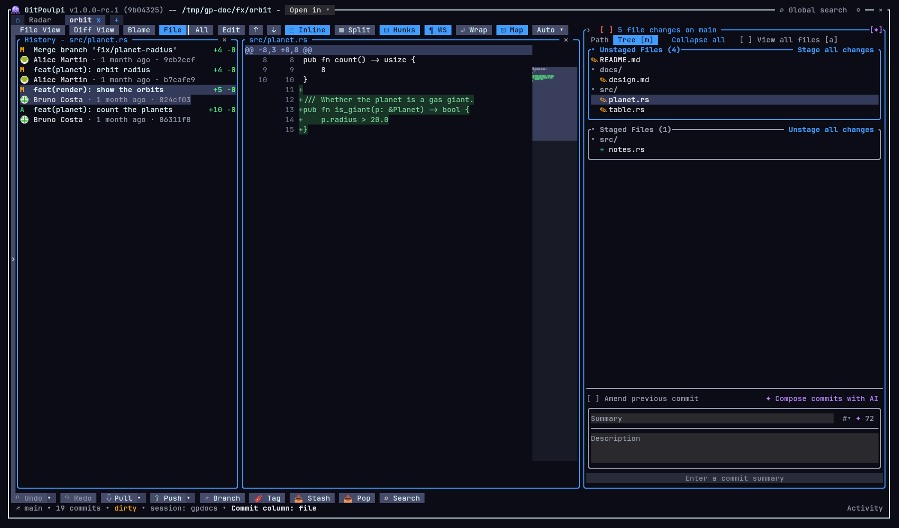

**English** · [Čeština](cs/log-and-history.md) · [Deutsch](de/log-and-history.md) · [Español](es/log-and-history.md) · [Français](fr/log-and-history.md) · [Italiano](it/log-and-history.md) · [日本語](ja/log-and-history.md) · [한국어](ko/log-and-history.md) · [Nederlands](nl/log-and-history.md) · [Polski](pl/log-and-history.md) · [Português (Brasil)](pt-BR/log-and-history.md) · [Português (Portugal)](pt-PT/log-and-history.md) · [Русский](ru/log-and-history.md) · [Svenska](sv/log-and-history.md) · [Türkçe](tr/log-and-history.md) · [Українська](uk/log-and-history.md) · [简体中文](zh-CN/log-and-history.md)

# Working with the Log

The Log is the center of GitPoulpi: the whole history as a graph, with every
branch, tag and stash on it. This page covers reading it, finding things in
it, and everything you can do to commits and refs. The areas are named in the
[interface tour](interface-tour.md); the exact keys are in
[Keybindings](keybindings.md) and the mouse gestures in
[Mouse & gestures](mouse-and-gestures.md).


## Reading the graph

Each row is a commit, newest first. A dot sits on the commit's lane; lines join
a commit to its parents; a merge shows two lines coming together. The pills on
the left name the branches and tags on that commit, in the lane's color, with
a thin line to the dot. A laptop icon marks a local branch, a globe a remote
one, and `✓` the branch you have checked out. `+N` means more refs point at
that commit; hover it to list them, or use the menu below.

The first row is the **working changes** (a dashed circle: your uncommitted
work, joined to the commit it sits on). Stashes appear as small squares on a
lane beside the commit they were made on.

### Colors, row tint and avatars

The lane colors come from the theme. *Settings > Appearance > Graph color
theme* combines any theme with any lane palette, and the palette's
*App: Change Graph Color Theme...* picker (`Ctrl+N Shift+T`) previews each palette live; see
[Themes](themes.md). *Graph lane background* set to **Row tint** paints a faint
band of the lane color behind the graph column and a thin bar at its edge.
*Row tint strength* (**Strong**, **Medium** (default), **Subtle**) sets how
faded the band is.

| Serie lane palette with row tint | Material lane palette with row tint |
|---|---|
|  |  |

*Author avatars* (a picture in the graph dot or in the Author column) are off
by default. Turning them on sends a hash of each author's email address to
Gravatar, and asks your hosting provider. *Avatar sources* and *Avatar
fallback* on the same page choose where pictures come from and what is drawn
when there is none.

If your terminal cannot show pictures, the graph is drawn with characters.
*Graph renderer* and *Image protocol* force either one; see
[Troubleshooting](troubleshooting.md).

The highlight of the selected or hovered row starts at the commit's circle. The
lanes to its left keep the normal background.

### Columns

Right-click the header to choose the columns: **Ref**, **Graph**, **Message**
(always on), **Author**, **Date**, **Changes** and **SHA**. The optional
**Changes** column shows, for every commit, `n files +added -removed`. Drag the
border between two headers to resize a column; the choice is remembered, in terminal cells. With the default `ui.column_resize = "line"` the border is the one-cell gap at the end of a column: a small tick rests in it on the header row, and while the pointer is on the gap (on the header or anywhere down the table) a thin accent line is drawn over the table's full height and a drag from any point of it resizes (the pointer turns into a resize pointer in terminals that support it). With `"header"` there is no tick and no line: the first character of the header cell after the border lights up on hover and the drag starts from it, on the header row only (Settings > Log & graph > Column resizing). The rows look the same in both modes: the gap is part of the column on its left, so the selection and row tints run through it. Ref, Graph and the other columns keep their width when the window is resized or maximized: only **Message** grows or shrinks (on a very narrow window the other columns give way temporarily, Graph first, and return to your widths when the window grows back). Drag the Graph column down to its least width, one commit dot, and the graph turns compact: every commit sits on a single lane, one under the other, with no branch or merge lines. One cell wider and the tree is back. With the authors' pictures in the commit circles (Settings > Appearance > Avatars: Graph) the circle is two cells across, so the column stops one cell earlier (three cells) and never clips a picture.

Dragging a header shows a ghost of its name following the pointer and an accent bar where the column would land; the order changes when you release, and `Esc` cancels. The chooser opened by the right-click is a checklist (`[x]` / `[ ]`) with a ✕ in its title; it is also reached from the palette (`View: Log: Choose the Columns to Show`), moved with the arrows and toggled with `Space` / `Enter`.

From the keyboard, `Shift+C` (or the palette's `View: Log Column: Pick a Column to Move or Size`) picks a column and its header cell lights up. Then `Tab` / `Shift+Tab` pick another column, `<` / `>` move it one place left or right among the shown columns (the keyboard twin of dragging its header), `]` / `[` widen or narrow it (the twin of dragging its boundary; the last column moves its left edge), `0` puts every width back to automatic, and `Esc` or `Enter` leaves. The arrows still move through the commits meanwhile. The order and the widths are remembered like a drag's, and are the Log's own: the commit column beside a diff keeps a list of its own.

*Fit to content.* A **double click** on a column's boundary fits the column on its left to its widest visible content and its header (wide characters and emoji counted by the cells they take). In the fit layout the Log always fills its pane, so a column stops at what the pane has room for once **Message** keeps its share and every other column its least width: the status line then says `Author needs 34 cells, 20 fit.` The same from the keyboard: with a column picked (`Shift+C`, `Tab`), `=` fits it and `+` fits every column; the palette has `View: Log Column: Fit the Column to Its Content` and `... Fit All Columns to Content`; the right-click chooser lists `Fit <column> to content` (the column under the pointer), `Fit all columns to content` and `Reset column widths` below its checkboxes. **Message** is the flexible column and has no width of its own to fit: it takes the room the others leave.

*Scroll sideways.* By default every column fits the pane. In the **scroll** layout (the chooser's `Scroll sideways (columns keep their widths)` checkbox, Settings > Log & graph > Column layout, the palette's `View: Log: Toggle Scroll Sideways for the Columns`, or `s` while a column is picked) the columns keep their widths, **Message** included (it has a width of its own there, and fitting it takes its widest summary), nothing is given up when the window is narrow, and the table can be wider than the pane. A bar on the bottom border then scrolls it: drag the thumb, press the bare track to bring the thumb under the pointer, or use its end arrows. From the keyboard `Shift+Left` / `Shift+Right` scroll by four cells (the palette has `View: Log: Scroll the Columns Left` / `Right`); the horizontal wheel or `Shift`+wheel over the table do the same, and picking a column (`Shift+C`, `Tab`) scrolls it into view. A table narrower than the pane leaves blank space at the right, and a selected row's band runs to the border. Each layout keeps its own widths (`ui.log_column_widths` and `ui.log_column_widths_scroll`); the first drag, key or fit in the scroll layout stores every column at the width it has, so only the one you change moves. In the fit layout a fit that does not fit the pane says so and points at this layout.

*The last column's grip.* The last column has a grip too, on its own last cell (not the pane's border, which still resizes the panes): a drag moves it by how far the pointer travelled, **Message** taking up the difference. **SHA** is 8 cells wide by default (the 7 digits and that grip cell).


### Authors and `.mailmap`

When the repository has a `.mailmap` (git's file that gives one name and email
to a person who committed under several), the Log's **Author** column, the
commit details, Blame and File History show the **canonical** identity, as
`git log` does. The commits themselves are untouched. The setting
`log.use_mailmap` (Settings > Log & graph, on by default) turns it off to show
the stored names. Searching by author matches the name and email as shown, so
a search for the canonical name finds every commit of the person. The
**Identities** tab of the history workbench lists the names and emails of the
history and writes `.mailmap` lines for you, see `history-rewrite.md`; from a
terminal: `gitpoulpi mailmap list|check|add`.

## Finding things

- **Search** (`f`, the **Search** toolbar button, or the palette's
  *Navigation: Search Commits...*): matches the whole commit message, the author name and email, the
  hash and the ref names. It dims what does not match and keeps the
  graph's shape. `Enter` / `Shift+Enter` jump to the next / previous match.
- **Refs filter** (`/` in the sidebar): narrows the branch, tag and remote
  lists by name.
- **Solo** (the `o` key, or the ref's menu, on a ref, folder or remote):
  shows only the commits of the soloed refs; solo several to see their union.
  `Shift+O` stops soloing.
- **Hide** a ref (its menu) to take it out of the graph: its pill goes and so
  do the commits only it reaches (the checked-out commit always stays, with
  the working-tree row). *Hidden n* in the Refs title counts them, **Show
  All** (`Shift+H`) brings them back. The status line's total counts the
  visible history.

## Branches, tags and the Refs sidebar

Double-click a local branch or tag to check it out. Right-click a ref (in the
sidebar, or its pill in the Log) for its menu. The most useful entries:

| Entry | Does |
|---|---|
| Reveal in graph | Scrolls the Log to the ref's commit (loading older history first if needed) and flashes the row; the selection stays. A single click on a ref does the same unless *Click a ref to reveal it in the graph* is off in Settings. A ref hidden from the graph (or by Solo) says so in the status line instead |
| Check out | Switches to the branch or detaches at the tag |
| Merge, Rebase onto | Merge it into, or rebase the checked-out branch onto, this ref |
| Fast-forward `<branch>` to `<current>` / `<current>` to `<branch>` | Moves a branch forward when that is a fast-forward; otherwise grayed with the reason (`diverged, not a fast-forward`) |
| Create worktree from... | Opens a linked worktree in its own tab |
| Pull, Push, Fetch, Remotes of <branch>... | Network operations on that branch (Remotes of <branch>... sets the upstream, plus a Push and a Pull too checkbox per remote) |
| Hide / Show in graph, Solo | Display only; they hide or solo a ref (hiding also drops the commits only that ref reaches) without touching the repository |
| Rename, Delete | Delete asks first; a remote twin can be deleted too |
| Copy branch name, Copy link to branch on remote | To the clipboard |

**Where a tag lives.** A tag can be on this computer, on a remote, or both, and
the sidebar's TAGS rows (and the tag's pill in the Log) say which with a marker
after the name. Hover a tag for the same in words.

| Marker | Meaning |
|---|---|
| up arrow | Only here: no remote has it. Its menu offers *Push* |
| left-right arrow | Here and on a remote, at the same commit |
| down arrow (row dimmed) | Only on a remote: not in this repository (never fetched, or deleted here). Its menu offers *Fetch `<tag>` from `<remote>`* and *Delete `<tag>` on `<remote>`...*; `Git: Fetch Selected Tag` in the palette |
| up-down arrow | On a remote too, but at a different commit (a push would be refused) |

git keeps no remote-tracking refs for tags, so GitPoulpi learns what each remote
has from your last **fetch** (any fetch, including the automatic one) and from
its own tag pushes and deletes. Nothing asks the network while you browse; if
someone else changed a remote's tags, fetch to see it. The same information is
in `gitpoulpi tag list` (fields `local`, `remote`, `differs_on`, `where`).

**Deleting a tag.** When a remote has the tag, the red **Delete** opens a dialog
with three numbered rows (`1`-`9`, or Up/Down and `Enter`; `Esc` cancels), and
the highlighted row explains itself underneath:

1. **Delete locally**: removes it from this repository only. It runs at once, and
   the message says the remote still has it. **The next fetch brings it back**
   (git follows the remote's tags), unless you also delete it on the remote.
2. **Delete on `<remote>`**: removes it there for everyone (`git push <remote>
   --delete`). It asks for a confirmation that names the remote. Your local tag
   stays. This cannot be undone.
3. **Delete locally and on `<remote>`**: both, after the same confirmation, so a
   fetch cannot bring it back. **Undo restores the local tag only** (the same tag
   object); it is then local-only again and *Push* puts it back on the remote.


With several remotes each gets its own rows. A tag only here keeps the plain
confirm; a tag only on one remote goes straight to that remote's confirmation.
CLI: `gitpoulpi tag delete <name> [--local | --remote <r> | --both [--remote <r>]]`.

**Fetch and tags.** A fetch also refreshes what each remote has (the markers) and
git's own tag following still applies: a tag deleted only here is fetched again.
A tag that someone **deleted on the remote** disappears from the remote's side of
the marker after any fetch, but stays here as your local tag (now *only here*),
because git's default is not to prune tags. **Settings > Sync > Auto-prune
tags** (off by default; `gitpoulpi fetch --prune-tags`) also deletes such a local
tag, but only one that had been on the remote: a tag you never pushed, or one you
moved, is never touched. Needs git 2.41 or newer to learn what was pruned.

**New branch or tag.** The **Branch** and **Tag** toolbar buttons, `Ctrl+G b`
and `Ctrl+G t`, or a commit's *Create branch here...* ask for the name in an
inline box in the Ref column, on the target commit's row. `Enter` creates it,
`Esc` cancels, and a name git would refuse is reported in red without closing
the box.
On a commit with no ref, hovering its row also shows a faded pill in the Ref
column with the name of the branch it belongs to (else its remote branch),
deduced from the history; tags are never shown as a ghost. A branch deleted after a
merge still shows, struck through, under the name in the merge commit's subject
(`Merge branch 'x'`, `Merge pull request #N from owner/x`...); squash merges,
rebases and fast-forwards leave no such trace. Hovering the pill names its kind. It
creates nothing: use the create-branch command above (palette: `Git: Create Branch
at Selected Commit...`). **Settings > Log & graph > Show a ghost branch on the
hovered commit** turns it off; nothing is drawn where the Ref column is too narrow.

**Remotes.** The `+` in the REMOTE title adds one; right-click a remote's
name to fetch it, copy its web link, make it the default remote, hide it from
the graph, edit its URLs or remove it. **Hiding a remote** (its row's ⊙, the
menu's *Hide remote from graph*, or `Remote: Hide Remote in Graph...` in the
palette) hides every branch it has now or gets later, and the commits only it
reaches leave the Log: the way to browse one history without the history of an unrelated
archive remote; bring it back with *Show remote in graph*. Showing a
remote also shows the branches of it that were hidden one by one. A branch of a
hidden remote says so on the status line when you click its ⊙: show the remote
first.

**Stashes.** **Stash** stashes everything (untracked files included);
`Ctrl+G m` asks for a message first (with AI on, `Ctrl+G` inside that prompt
suggests one). Right-click a stash row, in the Log or the STASHES section, for
**Pop**, **Apply** (keep the stash) or **Drop**.

**Worktrees.** *Create worktree from...* (on a branch, tag or commit) opens a
dialog proposing a folder next to the repository, an optional new branch name
and "Open the new worktree as a tab". Worktrees appear in the WORKTREES
section; double-click one to open it, and its tab closes by itself when the
worktree is removed. The whole feature (opening in another tool, merging a
worktree's branch, removing) is in [Worktrees](worktrees.md); the SUBMODULES
section of the same pane is in [Submodules](submodules.md).

## Dragging refs onto commits

You can press on a branch (in the sidebar or its pill in the
Log) and drag it. A ghost label follows the pointer and valid targets light
up; release to get a menu:

- a local branch **onto another local branch**: Merge, Rebase, Interactive
  rebase, Fast-forward;
- a local branch **onto a remote branch**: Push to that remote;
- a remote branch **onto a local branch**: Merge, Rebase, Fast-forward, Pull.

`Esc` cancels a drag. The keyboard equivalent is the palette command
*Refs: Drop Selected Ref on Checked-Out Branch...*.

**Merge or fast-forward.** When the target has no commit of its own (the dragged branch is just ahead of it), a
merge could simply move the target forward. By default (Settings > Git > **Merge fast-forward** = *never*, or a
repository's own choice on its Merge options page) the menu row reads *Merge x into y (merge commit)* and makes a real merge commit,
so the history keeps the branch; use the separate row *Fast-forward y to x* when you want the plain move (for a
straight line, use *Rebase* instead). With *allowed* the Merge row reads *(fast-forwards)*, and with *only*
*(fast-forward only)*, grayed out with the reason when the branches have diverged. The same rows and labels are in a
branch's own menu, and `gitpoulpi merge --ff | --no-ff | --ff-only` picks per merge.

## The commit menu

Right-click a commit (or press `.` on it) for its menu:


| Entry | Does |
|---|---|
| **Cherry-pick onto `<branch>`** | Replays the commit on the checked-out branch |
| **Revert commit...** | Creates a commit undoing it. On a merge commit, a dropdown first asks which parent is the mainline (the side that stays; parent 1 is the branch the merge was made on), then the usual confirmation. Undo restores the previous state |
| **Reset `<branch>` to this commit** | A sub-menu for the kind of reset; a hard reset asks for confirmation |
| **Edit commit message...** | See below |
| **Amend...** | Change the commit's message, author name, email and date in one dialog; see [Amending a commit](#amending-a-commit-message-author-dates) |
| **Split commit...** | Break the commit into several; see [Splitting a commit](#splitting-a-commit) |
| **Split commit (AI)...** | The same, with a grouping proposed by the model; only when [AI](ai.md) is on |
| **Explain changes (AI)** | A popup with an AI explanation; only when [AI](ai.md) is on |
| **Interactively rebase from here...** | See below |
| **Create branch here...**, **Create tag here...**, **Create annotated tag here...** | Inline name box |
| **Check out this commit**, **Create worktree here...** | Detached HEAD, or a worktree |
| **Create patch from this commit...**, **from here to `<branch>`...** | Writes `.patch` files; *Apply patch* is on a ref's menu |
| **Copy link to commit on remote**, **Copy** > | To the clipboard (hash, message and more) |

## Editing a commit message (reword)

*Edit commit message...* (or `Ctrl+G e`) opens the full message: a one-line
summary with a counter, a description below it, **Cancel** and **Update
message**. Any commit of the checked-out branch can be reworded (HEAD or an
ancestor); the commits on top of it are re-created with their own trees,
authors and dates, merges stay merges, and your staged and unstaged changes are
left alone. If the commit has already been pushed the popup warns in amber that
you will need a force push (with lease), and asks for a second confirmation.
`Ctrl+Z` (the toolbar's Undo) takes the reword back; see
[Undo and redo](undo-redo.md). The status line also names the previous tip.

A commit that is not on the checked-out branch (it lives on another branch)
cannot be reworded or amended where you are, so *Edit commit message...* and
*Amend...* open **Edit a commit of another branch** instead, a list of choices
(`Up` / `Down` or `Ctrl+J` / `Ctrl+K` move, `Enter` or a click picks, `Esc`, the
cross or **Cancel (C)** closes it):

- **Check out `<branch>` and edit (1)**: one row per local branch whose history
  holds the commit (`1` to `8`, the first eight, the rest are counted). The
  branch is checked out the usual way, then the edit opens on it. The undo story
  is the two actions' own: `Ctrl+Z` takes the edit back, the checkout is a
  checkout.
- **Edit with advanced history rewrite (R)**: opens the
  [history rewrite workbench](history-rewrite.md) on that commit, in builds that
  have it.
- **Create a branch here... (B)**: only when no local branch holds the commit
  (it is on a remote branch only, say); opens the name box for a branch at it.

## Amending a commit (message, author, dates)

*Amend...* in the commit menu (or `Ctrl+G Shift+E`, or the palette's *Commit: Amend...*) opens one dialog for the commit's properties: the summary, the description, the author's name, email and date, each filled in with the commit's own values. Change any of them and press **Apply**; only the fields you changed are sent. A date is written `YYYY-MM-DD HH:MM:SS +HH:MM` and shown in UTC until you edit it. The committer is you, now (as for a reword). Any commit of the checked-out branch can be amended, with the same rules, the same pushed-commit warning and the same second confirmation as *Edit commit message...*; the commits on top are re-created with their own authors and dates, and your staged and unstaged changes are left alone. `Ctrl+Z` (the toolbar's Undo) takes it back. In builds with history rewrite, **Modify History Deeper...** (`Alt+H`) at the bottom left of the dialog closes it without applying anything and opens the [history rewrite workbench](history-rewrite.md) scoped from this commit to the newest one; if you edited a field it asks first (`Esc` confirms). `Ctrl+N` shows a badge on every field and button of the dialog; press it to put the cursor in that field or press that button (see [Badges](keybindings.md#badges)).

Every way into the dialog opens it complete, with every field shown and editable; only the caret differs. In the commit details pane (on the right), right-click the summary, the description or the author block and choose *Amend summary...*, *Amend description...* or *Amend author...*, or double-click the summary, the description, the author or the authored-on date: the dialog opens with the caret in that field. The keyboard twins work from the Log and from the commit details pane: `Ctrl+G Shift+E` (all fields), `Ctrl+G Shift+A` (the author), and the palette's *Commit: Amend...*, *Commit: Amend Author...*, *Commit: Amend Summary...* and *Commit: Amend Description...*. Both chords can be rebound (`git_prefix.amend`, `git_prefix.edit_author`; see [Keybindings](keybindings.md)). From a script or an agent: `gitpoulpi amend <commit>` with `--message` (or `--summary` / `--description`), `--author-name`, `--author-email`, `--author-date` and the matching `--committer-*` options (the MCP tool is `amend`).

## Splitting a commit

*Split commit...* in the commit menu (or the palette: *Git: Split Selected Commit...*)
breaks one commit into two or more, oldest first. Any non-merge commit of the checked-out
branch can be split (HEAD or an ancestor, a root commit too). The split editor has two
panes: **New commits** on the left (a message each) and the commit's **Changes** on the
right, one row per file and hunk, each with a `[N v]` field naming the new commit that
gets it.

| Key | Mouse | Does |
|---|---|---|
| `Up` / `Down` (`k` / `j`) | click a row | move over the changes (`Shift+Up` / `Shift+Down` extends a selection) |
| `1`-`9` | the row's `[N v]` field, then a choice | give the selected change to that new commit; `0` leaves it unassigned |
| `Enter` / `m` | the `[N v]` field | open the list of commits for the selected change |
| `n` | `+ New commit` | put the selected change in a new commit |
| `v` | | **line mode**: split a hunk line by line (drag over lines to select a range) |
| `Tab` | click a pane | switch between the commits and the changes |
| `e` / `Enter` (in the commits pane) | the pencil | edit that commit's message |
| `d` / `Delete` | the cross | remove a new commit (its changes become unassigned) |
| `Alt+Up` / `Alt+Down` | the arrows | move a new commit up or down |
| `s` | the checkbox | sign the new commits |
| `Shift+R` | `Reset` | back to the starting plan |
| `Ctrl+S` | `Split into N` | split |
| `Esc` | the cross, `Cancel` | leave; with edits pending a second press confirms |

Every change must go to exactly one commit; the editor counts what is still *Unassigned*
and the button stays refused until it is zero. A file that is binary, only changes its
mode, is new or deleted in the commit, is a submodule or an LFS file can only be given
whole. The first commit starts with the original message; give each new one a message.
A new commit keeps the original author and date; the committer is you, now.

**Nothing in your repository changes except the branch.** The last new commit has exactly
the original commit's content, so the commits on top of it are re-created with the same
trees, authors and messages (merges stay merges), and your staged and unstaged changes
are left alone: a dirty working tree is fine and no conflict is possible. Hooks do not
run. A split is blocked while an auto-stash is pending.

**Signing.** The *Sign commits* checkbox starts from the repository's `commit.gpgSign`.
Unchecked, the signatures of the rewritten commits (the new ones and those on top of
them) are dropped, and the editor says so under the checkbox. Checked, all of them are
signed; if signing fails nothing is changed.

**Undo.** One `Ctrl+Z` (the toolbar's Undo) puts the original commit back, with a dirty
working tree too; see [Undo and redo](undo-redo.md). A commit that was already pushed
needs a force push (with lease) afterwards.

**From the interactive rebase.** Each row of the rebase review has a small **split...**
button (`t` on the row): it opens the same editor for that commit, and when the split is
done (or you cancel) you are back on the review screen, on the new history. If you had
edited the plan, press split a second time to confirm that those edits are lost.

For scripts and agents: `split-source` and `split-commit` in the
[CLI reference](cli-reference.md); an agent can also open this editor pre-filled for you
to review (`ui propose split`, see [MCP and agents](mcp-and-agents.md)).

## Interactive rebase

Choose **Interactively rebase from here...** on a commit that is an ancestor
of the checked-out branch, or drag a branch onto another and choose *Interactive
rebase*. The Log is replaced by a review screen: one row per commit, newest on
top, each with a drag handle and an action dropdown.


| Action | Key | Effect |
|---|---|---|
| Pick | `p` | Keep the commit |
| Reword | `r` | Keep it with a new message |
| Squash | `s` | Fold it into the commit below, combining the messages |
| Fixup | `f` | Fold it into the commit below, dropping its message |
| Drop | `d` | Leave it out |
| Edit | `e` | Stop there so you can amend it |

Drag a row (or `Ctrl+Up` / `Ctrl+Down`) to reorder. `a` previews autosquash
(`squash!` and `fixup!` commits move next to their targets). Nothing happens
until you press **Start rebase** (`Ctrl+S`); **Reset** puts the plan back and
**Cancel rebase** (`Esc`) leaves with nothing changed. When a step stops on a
conflict or an `edit`, a banner above the Log offers **Continue**, **Skip** and
**Abort**. A range that contains a merge commit cannot be rebased
interactively; the menu entry says why.

## Cherry-picking several commits

`Ctrl+click` toggles a commit, `Shift+click` (or `Alt+click`) selects a range, `Space` toggles
the current one, `Esc` clears. Right-click a selected commit for **Cherry pick
N commits onto `<branch>`...**: the same review screen opens, with the same
actions and reordering, and **Start cherry pick** replays them in order.

## Copying commits as a Mermaid gitGraph


Select commits in the Log (`Ctrl+click`, `Shift+click`, `Space`; or just leave the cursor on one)
and open **Copy as Mermaid gitGraph...**: `Shift+Y` in the Log, the commit menu's **Copy**
submenu, or the palette's `Log: Copy as Mermaid gitGraph...`. A popup shows the generated
[Mermaid](https://mermaid.js.org/syntax/gitgraph.html) script, live and scrollable; `Enter`
(or the **Copy** button) puts exactly that text on the clipboard. Paste it into a README, a pull
request description or [mermaid.live](https://mermaid.live).

The popup has three comboboxes, a checkbox and the preview (`Tab` moves between them; each
combobox opens with `Enter`, `Space` or `Down`):

- **Commits**: the selection, or - when one commit is selected and HEAD descends from it - **From
  the selection to HEAD**, the run of commits between them (answered from the loaded part of the Log).
- **Detail**: `structure` (commits, branches and merges; ids are short SHAs), `refs` (adds the real
  branch names as Mermaid branches, tags as `tag:` and the HEAD commit as `type: HIGHLIGHT`),
  `subjects` (the commit id becomes `<sha> <subject>`, escaped and cut to `ui.mermaid_subject_width`
  characters) and `full` (adds the author and the UTC date to the id).
- **Direction**: left to right (`gitGraph LR:`) or top to bottom (`gitGraph TB:`).
- **Include the ```mermaid fence** wraps the script in a Markdown code fence.

Detail, direction and fence are remembered (`ui.mermaid_detail`, `ui.mermaid_orientation`,
`ui.mermaid_fence`). The same generator runs from the command line:
`gitpoulpi log --format mermaid [--detail structure|refs|subjects|full] [--orientation lr|tb] [--fence]
[--range A..B | --limit N]` (see the [CLI reference](cli-reference.md)); the MCP server exposes it as
the `log` tool's `format` argument.

Mermaid's `gitGraph` is a replay language (commit, branch, checkout, merge), not a graph
description, so the generator makes a few choices worth knowing:

- A commit continues the branch of its first selected parent; the other children open a new
  branch named after a real branch on it (`b1`, `b2`... at `structure`). The first branch is `main`
  (or the real name, through a `mainBranchName` header) and follows HEAD's first-parent chain.
- A merge joins the other parent's branch. When that branch moved on after the parent, the
  generator forks a small pointer branch (`<branch>-<sha>`) at the parent and merges that, so the
  merge still points at the right commit.
- A parent outside the selection is dropped: a commit left with no selected parent starts a line of
  its own, so gaps in a selection show as disconnected lines.
- An octopus merge (three or more parents) becomes sequential merges; the intermediate ones are
  suffixed ` (octopus 1/2)`, the last one carries the real commit.
- Cherry-picks are not detected; double quotes in subjects become apostrophes (Mermaid cannot
  escape them).

## Comparing commits

Select two or more rows of the Log: `Ctrl+click`
toggles a row, `Shift+click` (or `Alt+click`, `Shift+Up/Down`, `Alt+Up/Down`) takes a range, `Space`
toggles the current row. Commits, the **WIP** row and **stash** rows can all be
selected. The right pane turns into a **Compare** pane:

- the header has a **Swap** button, and under it every selected row is listed
  in Log order (newest first) as a two-line **card**: the author's avatar (the Log's avatar settings: a
  picture on image-capable terminals, initials otherwise), name, how long ago,
  short id and summary. The **WIP** row is "Working tree / Uncommitted
  changes", a stash shows the stash glyph, `stash@{n}` and its message. The
  oldest end carries a **From** tag and the newest a **To** tag (Swap moves
  them); with three or more rows a note says the changes are combined. The
  card list takes at most a third of the pane, then scrolls (wheel, scrollbar,
  or drag the splitter under it to resize);
- click a card to move the Log cursor to that row and flash it in the graph;
  the selection is untouched, so `Space` then drops that row from it;
- below it, the usual changed-files list (path or tree view, filter, sort)
  lists the files that differ between them. Click a file, or press `Enter`,
  to open its diff in the center, in the same unified or split layouts,
  with Blame, File History and the file view on the newer end.


What is compared depends on the selection:

| Selection | Compared |
|---|---|
| two commits (or a stash and a commit) | the older against the newer, in Log order, whatever the click order |
| the WIP row and a commit or stash | that commit against the working tree: staged and unstaged changes of tracked files (untracked files are not part of a diff) |
| three or more commits | their changes combined: from just before the oldest to the newest (merges follow their first parent) |

A renamed or moved file shows as one file, with the old name and the similarity on top of its diff. **Swap** (`x`) trades the ends of a
two-row comparison; with the WIP row, which is always the newer end, or a
range of three or more, there is nothing to swap. A comparison with the WIP
row follows the working tree as you save files.

Keyboard: `v` (or **Log: Compare Selection** in the command palette) moves the
focus into the comparison's file list; `x` (or **Log: Swap Comparison Ends**)
swaps; `n` (or **Log: Go to Next Compared Row**) is the keyboard twin of
clicking a card: the Log cursor goes to the next selected row, wrapping. `Esc` or a plain click on a row goes back to the single commit. The
**Cherry pick** entry only counts the commits of the selection; the WIP row
and stashes are ignored there.

The same lists are available to scripts and agents:
`gitpoulpi diff --from <rev> [--to <rev|worktree>] [--name-only]` (the CLI and
the MCP `diff` tool; `--to` defaults to the working tree).

## Conflicts and other banners

When a merge, rebase, cherry-pick or revert stops on a conflict, a banner
appears above the Log and the conflicted files carry a red `!` in the Status
pane. Resolve them in the merge editor, then use the banner's **Continue** or
**Commit merge**, or **Abort** to back out. See
[Resolving merge conflicts](merge-conflicts.md).

Other banners above the Log:

| Banner | Buttons | Palette |
|---|---|---|
| *Rebasing `<branch>` onto `<commit>` · step/total · stopped at ...* | **Continue**, **Skip**, **Abort** | *Rebase: Continue / Skip / Abort* |
| *Applying patches (git am) · patch n of m* (a `git am` that stopped) | **Resolve conflicts...** (when a patch conflicts), **Continue**, **Skip**, **Abort** (asks first) | *git am: Continue / Skip This Patch / Abort* |
| *A leftover index.lock (n s old) blocks every change to this repository* (a git command died and left `.git/index.lock`) | **Remove index.lock** (asks first; only offered when the file is at least 10 seconds old) | *Repository: Remove Stale index.lock* |
| *Auto-stash pending: ...* | See [Auto-stash](#auto-stash) | *Banner: ...* |

## Blame

Blame shows the whole file with line numbers and syntax colors, and an annotation column on the **right** of the code
(`ui.blame_side = "left"` moves it to the left). Open it from a file's bar (`Blame`), the file menu, the palette, or from a history row (`b`). From the working tree,
uncommitted lines are shown apart (see Strips).

- **Hunks.** A run of consecutive lines last changed by one commit is one hunk. Its first line shows the author's
  avatar (a picture where the terminal draws images, the initials badge otherwise, nothing when `ui.avatars` is off),
  the author, how long ago, and the commit summary; the other lines show only the author's color bar. A thin rule
  separates hunks. When a hunk starts above the screen, its annotation is repeated on the first visible row.
- **Strips.** Next to the annotation, the author's color bar and an **age heat strip**: warm for recent lines, cold
  for old ones, relative to the file's own oldest and newest line (the legend is in the title). Lines not committed yet
  are dotted and say "Not committed yet".
- **Card.** Rest the pointer on an annotation for a moment, or press `i`, for the hunk's detail card: full commit id,
  author and email, date, summary and its actions. The selected hunk is tinted.

  
- **Actions** (card rows, right-click menu on a hunk, keys, and `Blame: ...` in the palette): show the commit in the
  Log (`Enter`), copy its id (`Shift+Y`), show the commit's diff of this file (`d`), blame at the commit's parent
  (`b`, following renames), open the file's File History (`Shift+H`).
- **Moving.** `j` / `k`, PageUp/PageDown, Home, `Shift+G` and the wheel as everywhere; `n` / `p` next / previous hunk,
  `Shift+N` / `Shift+P` next / previous hunk of the same commit, `g` go to a line number.
- **Tall hunks.** Under the summary, a hunk of three lines or more shows its short commit id and full date (muted), so
  the column is not left empty.
- **Minimap.** With `ui.minimap` on (the `Map` button, `M`), the file's minimap sits beside the code, colored by the
  same age heat as the strip; click or drag along it to scroll.
- **Width.** Drag the border of the annotation column, or press `>` / `<`; the width is saved as `ui.blame_width`.

## File History

Open it from the `File` segment of the diff bar's `File │ All` selector, a file menu or the palette (`File History: ...`). The center splits in two: on the left the
file's commits, newest first, following renames; on the right the selected commit's diff of that file, with every mode
of the Diff view (hunks / whole file, inline / split, word diff, minimap, wrap).

- **The list.** Two lines per commit. The first: the change letter (A added, M modified, D deleted,
  R renamed), the summary and the colored `+added -removed`. The second, muted: the author's avatar (exactly what the
  Log's author column shows per *Avatars*: a picture where the terminal draws images, the initials badge otherwise,
  nothing when avatars are off), the author, the relative date, the short commit id, and `old -> new` on the commit
  that renamed the file. A narrow list drops the rename, then the id, then the end of the author's name, but never
  the author or the date. Pages of 100 load as you near the end; a `loading more` row shows meanwhile.
- **Moving.** `j` / `k`, arrows, PageUp/PageDown, Home / End, the wheel and a click; the diff follows at once (diffs
  are fetched in the background, cached per row, and a held key asks for one). A row before a rename is diffed under
  the name the file had then.
- **Diff / File / Blame.** The view bar's own **File View**, **Diff View** and **Blame** buttons choose what the right side shows for the selected commit: its
  **Diff View**, the **File View** (the file as it was at that commit) or its **Blame**, all inside the split with the
  list kept on the left, and the `File` segment of the column selector stays lit. The chosen mode is kept while you move between rows and the right side follows the
  selection. Keys `Alt+1` / `Alt+2` / `Alt+3` (also `d` / `o` / `b` in the list), from either half, and the palette's
  `File History: ...` rows do the same; `Esc` goes back to the Diff.
- **The column.** The list is the *commit column* showing its **File** list: hide, show, sizes and the `File │ All` selector are described once in [The commit column](interface-tour.md#the-commit-column). A click on `All` leaves the File History and keeps the view on the selected commit.

  

  
- **Compare two commits.** `Shift+Up` / `Shift+Down` or `Shift+click` select a range; the right side shows the file's
  diff between the two ends, each with its own path. `Esc` drops the range.
- **Focus.** `Tab` (or a click) gives the keyboard to the diff and back; the diff keeps its own keys.
- **Actions** (right-click menu, keys, and `File History: ...` in the palette): show in the Log (`Enter`, double-click;
  the Log loads as far back as needed), copy the id (`y`) or summary (`Shift+Y`), show the diff (`d`), the file at
  that commit (`o`) or its blame (`b`) on the right, compare with the working tree (`c`, again to leave), restore the file to that version
  (`Shift+R`, confirmed, journaled so Undo brings the old bytes back).
- **Undo.** Restoring a version is one journaled step: Undo (`Ctrl+Z`) puts the file's previous bytes back.
- **Splitter.** Drag the border between the halves, or `Alt+Right` / `Alt+Left`, `Alt+0` to reset; the width is
  remembered per session.

## Fetch, pull and push

- **Pull** (`Ctrl+G p`) pulls the way *Settings > Git & encoding > Pull button*
  says (`git.pull_mode`: merge, fast-forward only, rebase; a per-repository
  setting). Its `▾` runs *Fetch
  All*, *Pull (fast-forward if possible)*, *Pull (fast-forward only)* or *Pull
  (rebase)* once, without changing the button. The mode is always passed to git
  explicitly, so your git config's `pull.rebase` cannot surprise you.
- **Push** (`Ctrl+G Shift+P`) sends the checked-out branch to the default
  remote, setting the upstream the first time. Its `▾` pushes once to another
  remote you choose. If the remote has commits you do not, a dialog
  offers **Pull (merge), then push**, **Force push (with lease)...** (never a
  bare `--force`) or **Cancel**.
- `Ctrl+G f` fetches every remote. In *Settings > Synchronization*,
  *Auto-prune* decides whether fetches prune, and *Auto-fetch interval
  (minutes)* fetches in the background.

All of it is also available as `gitpoulpi fetch`, `pull` and `push` in the
[CLI](cli-reference.md).

## Auto-stash

When uncommitted changes block a checkout, pull, merge or rebase, GitPoulpi can
move them aside for you: it stashes them, runs the operation, then pops the
stash. *Settings > Synchronization > Auto-stash before checkout, pull, merge or rebase*
(`general.auto_stash`):

- **ask** (default): a dialog offers *Stash changes and continue*, *Always stash automatically* (the same, and it sets `general.auto_stash = "always"` so you are not asked again; Settings > Synchronization turns it back) or *Cancel*.
  The CLI and MCP fail instead and name `--autostash`.
- **always**: done without asking. **never**: the operation is refused.

*Include untracked files in auto-stash* also takes untracked files. A clean tree
never sees a stash. The stash, the operation and the pop are each undoable.

If the stash cannot be put back (it conflicts with the result, or a merge or
rebase stopped on its own conflict), it stays in the stash list. A **banner
over the Log** says *Auto-stash pending: your changes from before the checkout
are in stash@{n}*. Its buttons:

| Button | Does |
|---|---|
| **Resolve conflicts...** | Opens the merge editor (only after a conflicted pop) |
| **Keep result** | Keeps the working tree as it is and drops the stash copy (only after a conflicted pop, once no file is conflicted) |
| **Pop now** (**Retry pop** after a failed pop) | Puts the stash back |
| **Show stash** | Shows the stash's changes |
| **Start over** | See below |
| **Drop** | Drops the stash (asks first) |

Each button has a palette command (*Banner: Pop Pending Auto-Stash*, *Banner:
Start Over...*, ...). Nothing is retried or dropped for you.

**Start over** asks first. Then it:

1. keeps a copy of the stashed files' current state under
   `refs/gitpoulpi-backup/autostash-start-over-<time>`;
2. discards the changes on those files only (it refuses, and names them, if
   other files have local changes that could be lost);
3. undoes the operation that auto-stashed, through the undo journal (so that
   operation must be the latest one);
4. pops the stash back on the original commit and clears the banner.

If a step fails, it stops with the stash intact and says where. While the
banner shows and the latest operation is the one that auto-stashed, **Undo**
(`Ctrl+Z`, `gitpoulpi undo`) does the same, after a confirmation. Scripts use
`gitpoulpi autostash start-over [--dry-run] [--yes]` (exit code 3 without
`--yes`).

**While an auto-stash is pending, history-moving operations are refused:**
checkout of a branch or commit, merge, rebase (interactive too), pull,
fast-forward, cherry-pick, revert, reword, AI commit composition and redo. The
window grays these buttons and palette entries and gives the reason. The CLI
and MCP get a `PendingAutoStash` error (exit code 1). Everything else stays
allowed: reads, staging, discard, commit, branches, tags, remotes, fetch, push,
rebase continue / skip / abort, conflict resolution, `stash push`, `reset`,
and `stash pop` / `apply` / `drop`. Undo is allowed too.

When the auto-stash waits for a merge or rebase that stopped on conflicts, it
is popped by itself as soon as that operation ends (in GitPoulpi, or with plain
git followed by a refresh).
