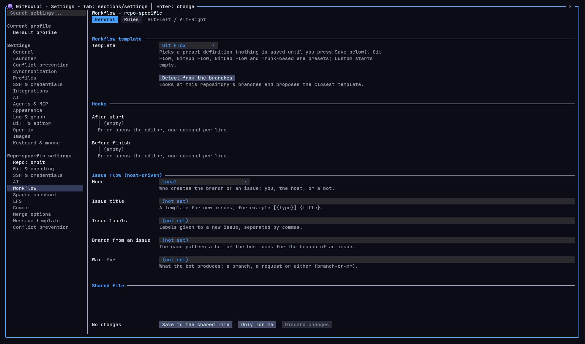

[English](../branching-workflows.md) · [Čeština](../cs/branching-workflows.md) · [Deutsch](../de/branching-workflows.md) · [Español](../es/branching-workflows.md) · [Français](../fr/branching-workflows.md) · [Italiano](../it/branching-workflows.md) · [日本語](../ja/branching-workflows.md) · [한국어](../ko/branching-workflows.md) · **Nederlands** · [Polski](../pl/branching-workflows.md) · [Português (Brasil)](../pt-BR/branching-workflows.md) · [Português (Portugal)](../pt-PT/branching-workflows.md) · [Русский](../ru/branching-workflows.md) · [Svenska](../sv/branching-workflows.md) · [Türkçe](../tr/branching-workflows.md) · [Українська](../uk/branching-workflows.md) · [简体中文](../zh-CN/branching-workflows.md)

# Branchingworkflows

Een branchingworkflow vertelt GitPoulpi hoe je team branches gebruikt: welke eeuwig
leven (`main`, `develop`, `production`), welke kortlevende onderwerpbranches zijn
(`feature/...`, `hotfix/...`), hoe ze heten en waar elk begint en eindigt. Het is
Git Flow, aanpasbaar gemaakt: vaste namen, voor- en achtervoegsels, of patronen met
plaatsaanduidingen, zodat de branches die een bot uit een issue maakt net zo worden
herkend als je eigen.

Deze pagina behandelt het model, het bestand, de voorinstellingen, detectie en import,
de alleen-leescommando's, de acties die branches starten, afronden, synchroniseren en
promoveren (CLI, MCP en app), en de schermen van de app: de instellingeneditor, de
gegroepeerde zijbalk, het `Flow`-menu en zijn dialogen.

## Concepten

- Een **basisbranch** leeft lang. Een basisbranch kan een **bovenliggende branch** hebben
  (`develop` gaat naar `main`); een trunk heeft er geen. Een basisbranch kan meerdere
  kandidaatnamen opsommen (`main` of `master`, `develop` of `dev`): wie bestaat, wordt gebruikt.
- Een **branchtype** (`topic` in het bestand) is een soort kortlevende branch (feature, bugfix,
  release, hotfix, support...). Het heeft een **naampatroon**, een **bovenliggende branch** (waar
  het begint en waarin het wordt afgerond) en een manier om af te ronden.
- Elke branch is **ingedeeld**: een basisbranch (op naam), een onderwerpbranch van een of ander
  type (op patroon), of niet ingedeeld.
- De **bovenliggende branch van een branch** is, in deze volgorde: die welke is vastgelegd toen
  GitPoulpi de branch maakte (`git config branch.<name>.gitpoulpi-parent`), anders
  `git-town-branch.<name>.parent` van Git Town als die er is, anders de bovenliggende branch van zijn type.

## Waar het wordt opgeslagen

| Wat | Waar | Gecommit |
|---|---|---|
| De gedeelde workflow | `.gitpoulpi/workflow.toml` in de repository | Ja, door jou: GitPoulpi schrijft het alleen als je erom vraagt |
| Je eigen aanpassingen | `[workflow]` in `.gitpoulpi/repo-state.toml` | Nee (dat bestand wordt genegeerd) |

De statusmap negeert zichzelf (`.gitpoulpi/.gitignore`), behalve `workflow.toml`, dat bedoeld is om
te worden gecommit. De effectieve workflow is het gedeelde bestand met jouw override erbovenop: een
basisbranch met dezelfde naam, of een branchtype met hetzelfde id, wordt vervangen; nieuwe worden
toegevoegd; `disable_bases` en `disable_topics` verwijderen gedeelde alleen voor jou.

Opslaan over een bestaand bestand behoudt de sleutels die deze versie niet kent (die van een nieuwere
GitPoulpi, of van een teamgenoot), maar geen opmerkingen of sleutelvolgorde.

## Het bestand

```toml
template = "git-flow"          # git-flow | github-flow | gitlab-flow | trunk | custom (informatief)

[[base]]
name = "main"
names = ["master"]             # andere spellingen van dezelfde branch
protected = true               # nooit verwijderd, directe commits zijn verdacht

[[base]]
name = "develop"
names = ["dev"]
parent = "main"
merge = "merge"                # merge | squash | rebase | fast-forward
tag_on_merge = false
# environment = true           # een omgevingsbranch (GitLab Flow): stroomafwaarts gepromoveerd

[[topic]]
id = "feature"
label = "Feature"
pattern = "feature/{slug}"
patterns = ["features/{slug}"] # meer namen die ook passen; nooit gebruikt om aan te maken
# regex = "^feat-(?P<slug>.+)$"  # past ook; benoemde groepen worden velden
parent = "develop"             # waar het begint, en het standaard afrondingsdoel
finish = [{ into = "develop", merge = "squash" }]
finish_mode = "merge-request"  # local-merge | merge-request | ask
delete_after_finish = true

[hooks]                        # shellopdrachten op aanvraag, altijd getoond voordat ze draaien
after_start = []
before_finish = ["cargo test"]

[issue_flow]                   # door de host aangestuurde flows, zie hieronder
mode = "local"                 # local | host-creates-branch | bot
```

`merge`, `finish`, `finish_mode` en `hooks` sturen de [acties](#acties) hieronder aan;
`issue_flow` stuurt de [door de host aangestuurde flows](#door-de-host-aangestuurde-flows) aan.

### Naampatronen

Tekst met `{plaatsaanduidingen}`:

| Plaatsaanduiding | Past op | Gemaakt uit |
|---|---|---|
| `{slug}` | vrije tekst; mag `/` bevatten als hij laatst staat | de tekst, in kleine letters, accenten weggehaald, `-` tussen woorden, hoogstens 50 tekens |
| `{issue}` | cijfers (`123`) | `123` of `#123` |
| `{issue_key}` | een trackersleutel (`PROJ-123`) | zoals opgegeven |
| `{user}` | een naam zonder `/` | tot slug gemaakt |
| `{date}` | `2026-10-16` of `20261016` | zoals opgegeven |
| `{version}` | `1.2.0`, `v1.2`, `1.2.0-rc1` | zoals opgegeven |
| `{n}` | cijfers | zoals opgegeven |

Al het andere is letterlijk, dus voor- en achtervoegsels zijn gewoon tekst:
`feature/{slug}`, `{user}/{issue}-{slug}-wip`, `bot/{issue_key}`. Elke plaatsaanduiding mag één keer
voorkomen, en twee plaatsaanduidingen hebben tekst ertussen nodig. Een patroon moet geldige branchnamen
opleveren (de regels van `git check-ref-format`): geen spaties, geen `~ ^ : ? * [ \`, geen `..`, geen
component dat met `.` begint of op `.lock` eindigt.

Een `regex` is alleen om te herkennen (hij is aan beide kanten verankerd); gebruik hem voor namen die
geen patroon kan uitdrukken. Benoemde groepen worden de velden van de branch.

### Welk type wint

1. Een branch die heet als een basisbranch (een van zijn namen) is die basisbranch.
2. Anders is elk patroon van elk type dat past een kandidaat: `pattern`, dan `patterns`, dan `regex`,
   type voor type in de volgorde van het bestand. Wie de meeste letterlijke tekens vastlegt wint
   (`release/{version}` verslaat `{user}/{slug}`, dat een kale `{slug}` verslaat); een regex telt
   zijn letterlijke voorvoegsel. Bij gelijkspel wint de eerste in het bestand.
3. Anders is de branch niet ingedeeld.

Een kapot patroon of een kapotte regex wordt als waarschuwing gemeld en overgeslagen; de rest blijft
werken.

## Sjablonen

| Sjabloon | Basisbranches | Types |
|---|---|---|
| `git-flow` | `main` of `master`; `develop` of `dev` (bovenliggende main) | `feature/` en `bugfix/` (vanuit develop), `release/` (vanuit develop, naar main en develop, getagd), `hotfix/` (vanuit main, naar main en develop, getagd), `support/` (vanuit main); de meervoudsspellingen (`features/`, `releases/`...) passen ook |
| `github-flow` | `main` | `feature/` of elke naam, vanuit main, merge request naar main, squash, daarna verwijderd |
| `gitlab-flow` | `main`; `pre-production` en `production` (omgevingsbranches, geketend main, pre-production, production) | `feature/` of elke naam vanuit main; `release/{version}` als cherry-pick-doel |
| `trunk` | `main` | kortlevende `{user}/{slug}` vanuit main, gerebased |
| `custom` | geen | geen |

Omgevingsbranches passen ook als `preprod`, `staging` en `prod`. Een sjabloon is een
beginpunt: druk het af met `flow config init`, bewerk het bestand.

## Detectie en import

`gitpoulpi flow detect` rangschikt de sjablonen voor de branches die de repository heeft, met een score
op 100 en de concrete namen die zijn gevonden (`master` voor `main`, `dev` voor `develop`, `features/`
voor `feature/`). Basisbranches tellen voor 60 punten, het aandeel van de overige branches dat de
specifieke patronen van het sjabloon herkennen voor 40, en een langlevende branch van een ander sjabloon
(een `develop` bij een kandidaat GitHub Flow) haalt er 25 af.

`gitpoulpi flow import --from git-flow` leest de klassieke git-flow-instellingen
(`gitflow.branch.master`, `gitflow.branch.develop`,
`gitflow.prefix.feature|bugfix|release|hotfix|support|versiontag`) uit de eigen `.git/config` van de
repository; `--from git-town` leest `git-town.main-branch` en `git-town.perennial-branches` (de
bovenliggende branch van elke branch, `git-town-branch.<name>.parent`, wordt opgepikt als vastgelegde
bovenliggende branch). Er wordt niets stilzwijgend toegepast: het commando drukt de TOML af, en `--write`
maakt `.gitpoulpi/workflow.toml` alleen aan als dat niet bestaat.

## Opdrachten

Alle nemen `--json`; de MCP-server stelt ze beschikbaar als tools (`flow_status`, `flow_templates`,
`flow_detect`, `flow_config_show` lezen; de acties worden hieronder beschreven).

| Opdracht | Wat ze doet |
|---|---|
| `gitpoulpi flow status` | Elke lokale en remote branch: soort (basis, onderwerp, niet ingedeeld), branchtype en velden, bovenliggende branch en waar die vandaan kwam (`recorded`, `git_town`, `type`, `base`), en voor lokale branches hoeveel commits hij `ahead` en `behind` zijn bovenliggende branch loopt. Ook de waarschuwingen die in de definitie zijn gevonden, de gerangschikte detectie en de instellingen van een andere tool die kunnen worden geïmporteerd. |
| `gitpoulpi flow templates` | De voorinstellingen hierboven, met hun volledige definitie. Heeft geen repository nodig. |
| `gitpoulpi flow detect` | De gerangschikte sjablonen met de gevonden basisbranches en types. |
| `gitpoulpi flow config [--show-effective]` | Het gedeelde bestand (zijn pad, of het bestaat, de geparste workflow, onbekende sleutels), of met `--show-effective` de workflow waarmee je branches worden ingedeeld. `flow config show` is hetzelfde. |
| `gitpoulpi flow config init --template <t> [--write]` | Drukt de TOML van een sjabloon af; `--write` maakt `.gitpoulpi/workflow.toml` aan en weigert er een te overschrijven. |
| `gitpoulpi flow import --from git-flow\|git-town [--write]` | Zoals hierboven beschreven. |

Ahead/behind-aantallen worden berekend voor hoogstens 300 lokale branches per aanroep.

Een workflowbestand dat niet kan worden gelezen (kapotte TOML, een waarde van het verkeerde type) is
een fout die het bestand noemt; het wordt nooit stilzwijgend genegeerd.

## Acties

`start`, `finish`, `sync`, `promote` en `set-parent` handelen op de repository. Elk **plant** eerst: het
somt elke git-stap op die het gaat doen, met de git-opdracht waar elke op neerkomt, de waarschuwingen, wat
niet ongedaan kan worden gemaakt en alles wat het blokkeert. Er verandert niets tot je bevestigt. Elke run
is **één item in de undo-geschiedenis** (`gitpoulpi undo` draait de branches, de tag, de verwijderde
branch, de vastgelegde bovenliggende branch en de checkout samen terug).

| Opdracht | Wat ze doet |
|---|---|
| `gitpoulpi flow start <type> [name=value ...] [--from <ref>] [--publish]` | Geeft de branch een naam uit het patroon van het type (`flow start feature "Login form"` maakt `feature/login-form`; `flow start release version=1.2.0` maakt `release/1.2.0`; een kaal woord is de `slug`; `user` en `date` zijn standaard jij en vandaag), maakt hem aan vanuit de bovenliggende branch van het type of `--from` (een branch, een remote branch of een tag), checkt hem uit en legt zijn bovenliggende branch vast. `--publish` pusht hem met `-u` (niet teruggedraaid door `undo`). |
| `gitpoulpi flow finish [<branch>]` | Voor elk `finish`-doel van het type, in volgorde: checkt het doel uit en merge de branch met de strategie van het doel (`merge`: altijd een merge-commit; `squash`: één commit met de titel `--title` of uit de branchnaam; `rebase`: rebaset de branch op het doel en doet dan een fast-forward; `fast-forward`), maakt de tag aan als het doel er een heeft (`tag = "v{version}"`, geannoteerd), checkt dan de bovenliggende branch uit en verwijdert de lokale branch als het type dat zegt (`--delete` / `--keep` overschrijven het; `--delete-remote` verwijdert hem ook op de remote, niet ongedaan te maken). Met `finish_mode = "merge-request"` (of `--mode merge-request`) pusht het alleen de branch en opent het pull of merge request naar de bovenliggende branch, met `--title`, `--draft`, `--assignee`, `--reviewer`, `--label`, `--milestone` en `--integration` (niet ongedaan te maken; lokaal wordt niets samengevoegd of verwijderd). `--mode local-merge` overschrijft een type met `merge-request`, en een type dat `ask` zegt heeft een van de twee nodig. |
| `gitpoulpi flow sync [<branch>] [--stack] [--rebase\|--merge]` | Brengt de commits van de bovenliggende branch in de branch: een merge, of een rebase als de strategie van de branch `rebase` is (of `--rebase`). Met `--stack` ook de branches waarvan deze de bovenliggende branch is (vastgelegd met `set-parent`), recursief, in volgorde. Gaat terug naar de branch waarop je was. |
| `gitpoulpi flow promote <env-branch>` | Omgevingsbranches van GitLab Flow: merge de branch waar hij stroomafwaarts van ligt (`main` in `pre-production`, `pre-production` in `production`) erin, in één stap, en gaat terug. Doet een fast-forward als het kan. |
| `gitpoulpi flow set-parent <branch> <parent>` / `--clear` | Schrijft (of verwijdert) `branch.<name>.gitpoulpi-parent`. Weigert een cyclus. Ongedaan te maken. |

Een branch die ergens anders vandaan is gestart, wordt daar afgerond: als de vastgelegde bovenliggende
branch (uit `--from` of `set-parent`) verschilt van die van het type, is het eerste afrondingsdoel de
vastgelegde bovenliggende branch.

### Bevestigen, plannen, scripten

| Vlag | Betekenis |
|---|---|
| `--dry-run` | Drukt het plan als JSON (`{"plan": ...}`) af en stopt. Afsluitcode 1 als iets het blokkeert. |
| `--yes` | Voert uit zonder te vragen. |
| geen van beide | In een terminal: het plan wordt getoond en er wordt gevraagd. Anders (een script, `--json`, een agent) komt het plan terug als `{"needs_confirmation": {"plan": ...}}` met afsluitcode 3 en er verandert niets. `start` zonder `--publish` of hooks, `set-parent` en `--abort` hebben geen bevestiging nodig. |
| `--run-hooks` / `--no-hooks` | Zie [hooks](#hooks). |
| `--autostash` | Stasht lokale wijzigingen die een checkout of merge blokkeren en zet ze daarna terug, wat `general.auto_stash` ook zegt. |

Een geblokkeerd plan noemt de reden: een basisbranch waar een onderwerpbranch nodig is, een naam die al
bestaat, een ontbrekend veld (`release/{version}` heeft `version=...` nodig), een tag die bestaat, een
doelbranch die achter zijn remote loopt (`--allow-behind` gaat toch door), een merge of rebase die al
bezig is, een workflow die niet is ingesteld.

Met de instelling **auto-stash** (`general.auto_stash`) worden lokale wijzigingen die een checkout of
merge blokkeren rond de actie gestasht en teruggezet, precies zoals bij een gewone checkout; met `never`
stopt de actie voordat er iets verandert.

### Conflicten

Een merge of rebase die op conflicten stopt laat de normale conflictstatus achter (de conflictbanner,
`gitpoulpi conflicts ...`) en de flow wordt onthouden. Afsluitcode 2, `status: "conflicted"`, de paden in
`conflicts`. Los de bestanden op en markeer ze als opgelost, dan:

- `gitpoulpi flow finish --continue` commit de merge (of zet de rebase voort, of commit de squash met zijn
  bericht) en voert de resterende stappen uit;
- `gitpoulpi flow finish --abort` breekt de merge of rebase af, gaat terug naar de branch waarop de flow
  begon en vergeet de rest. Stappen die al klaar waren (het eerste doel van een dubbele afronding, met zijn
  tag) blijven: `undo` draait ze terug.

Een flow die door een falende hook is gestopt, wordt op dezelfde manier hervat (`--continue` voert die
stap opnieuw uit). De run met het conflict en zijn voortzetting zijn twee undo-items.

### Merge requests

De daemon pusht de branch; het verzoek openen heeft je hostingtoken nodig, dus de CLI doet het met
dezelfde code als `gitpoulpi hosting pr` (een integratie die bij de remote past, anders de vooraf
ingevulde webpagina van de host, afgedrukt als URL). Het resultaat bevat `merge_request` (wat is gevraagd)
en `opened` (wat de host antwoordde), of `open_error` als de branch is gepusht maar het verzoek niet kon
worden geopend.

### Hooks

`[hooks]` in het workflowbestand somt shellopdrachten op (`after_start`, `before_finish`). Ze komen uit een
bestand dat je team deelt, dus ze **draaien nooit tenzij je erom vraagt**: `--run-hooks`, of ja op de vraag
die een terminal stelt nadat ze zijn opgesomd. Het plan somt ze altijd op, met `hooks_run: false` als ze
niet gaan draaien. Een hook draait in een shell met de repository als werkmap en `GITPOULPI_FLOW_ACTION` /
`GITPOULPI_FLOW_BRANCH` ingesteld; zijn exacte opdracht, afsluitcode en volledige uitvoer staan in het
resultaat. Een hook die met een niet-nul code eindigt stopt de flow daar (een `before_finish`-hook draait
voordat er iets veranderd is, dus dat is een gewone fout; na een `after_start`-hook bestaat de branch en kan
de flow worden voortgezet of afgebroken). `--no-hooks` slaat ze over zonder te vragen. Een hook kan van
alles doen, dus `undo` draait alleen de git-wijzigingen terug.

### Voor agents (MCP)

De tools zijn `flow_start`, `flow_finish`, `flow_sync`, `flow_promote` en `flow_set_parent` (finish, sync en
promote zijn als destructief aangemerkt, dus `allow_mutations` begrendelt ze). Ze zijn plan-dan-uitvoeren:
roep aan met `dry_run: true` om het plan te krijgen (een normaal resultaat), en dan opnieuw met `yes: true`
om het uit te voeren. Zonder een van beide wordt de aanroep geweigerd en draagt hij het plan, zodat er niets
per ongeluk draait. Hooks draaien alleen met een expliciete `run_hooks: true`; het plan somt ze op (`hooks`,
`hooks_run`) zodat de agent de gebruiker eerst de opdrachten kan tonen. Na een conflict: `continue_: true`
(de vlag is `--continue`) of `abort: true`.

### Ongedaan maken

| Actie | Wat `undo` doet |
|---|---|
| start | Verwijdert de branch, vergeet zijn bovenliggende branch, checkt de vorige branch weer uit. |
| finish | Herstelt elke branch die hij verplaatste, de tag, de verwijderde branch en de checkout, in één stap. Een gepushte branch, een verwijdering op de remote en een geopend merge request blijven (het plan zegt dat). |
| sync | Zet elke bijgewerkte branch terug, bestanden inbegrepen voor de uitgecheckte. |
| promote | Zet de omgevingsbranch terug. |
| set-parent | Herstelt de vorige vastgelegde bovenliggende branch. |

## Door de host aangestuurde flows

Teams waar een issue het werk start: het issue wordt uit een sjabloon geschreven, en de host (GitLab, GitHub,
Gitea, Forgejo) of een bot maakt de branch en het merge request. GitPoulpi maakt het issue, wacht op wat de
host maakt en pakt het op: een lokale branch die de remote volgt, zijn bovenliggende branch vastgelegd (het
doel van het merge request), uitgecheckt. Het heeft de sectie ISSUES gekoppeld aan een tracker nodig
(`gitpoulpi hosting link issues`); de koppeling van PULL REQUESTS zegt waar de branches en verzoeken staan
(het ISSUES-project als die niet is gekoppeld).

```toml
[issue_flow]
mode = "bot"                         # local | host-creates-branch | bot
issue_title = "[{type}] {title}"     # {type} {title} {user} {date}
issue_labels = ["workflow::{type}"]  # een bot start vaak op een label
description_template = ".github/ISSUE_TEMPLATE/feature.md"   # een bestand van de repository
branch_from_issue = "{type}/{issue}-{slug}"   # hoe de host of bot de branch noemt
wait_for = "branch-or-mr"            # branch | mr | branch-or-mr
timeout_secs = 600                   # hoe lang `wait` peilt
merge_request = true                 # host-creates-branch: ook een conceptverzoek
assignees = []
```

`{type}` in `branch_from_issue` is het id van het branchtype; de rest zijn de gebruikelijke tokens van
[naampatronen](#naampatronen) (`{issue}`, `{slug}`, `{issue_key}`...). Een branch hoort bij issue 12 als hij
op dat patroon past met `{issue}` gelijk aan 12 (`feature/12-login` wel, `feature/120-x` niet).

| Modus | Nadat het issue is gemaakt |
|---|---|
| `local` | Niets op de host. Met `--pick-up` een `flow start` van het type met het issuenummer en de titel (ongedaan te maken zoals elke start). |
| `host-creates-branch` | GitPoulpi maakt de branch **op de host** vanuit de bovenliggende branch van het type (GitLab: de branches-API; GitHub: `createLinkedBranch`, zodat het issue hem onder Development toont; Gitea/Forgejo: de branches-API), en een **concept**verzoek dat `Closes #12` zegt. Een host die een leeg verzoek weigert (GitHub: nog geen commits) laat de branch staan en meldt dat als waarschuwing. |
| `bot` | Niets: een bot (een webhookhandler, een CI-job, een GitHub App) maakt de branch en het verzoek. `--wait` peilt tot `wait_for` is vervuld. |

Wat `wait` bekijkt, voor elke provider: de eigen koppelingen van de host (GitLab
`issues/:iid/related_merge_requests` en `closed_by`; GitHub gekoppelde branches en de `connected` /
`cross-referenced` pull requests van de tijdlijn), de branches waarvan de naam bij `branch_from_issue`
past, en de open verzoeken waarvan de bronbranch dat doet. Het peilt met een groeiende pauze (1, 2, 3, 5,
8, dan elke 10 s) tot `wait_for` is vervuld of `timeout_secs` afloopt, en een host die traag of na een
antwoord kort onbereikbaar is wordt opnieuw geprobeerd. Een bron die de host niet biedt (een Gitea heeft
geen issuekoppelingen) wordt overgeslagen; als elke bron faalt, is de eerste fout het antwoord.

| Opdracht | Wat ze doet |
|---|---|
| `gitpoulpi flow issue new --type <t> --title "..." [--body T \| --body-file F] [--label L] [--assignee A] [--milestone M] [--wait] [--pick-up] [--timeout S] [--integration ID] [--dry-run]` | Maakt het issue uit het sjabloon (`issue_title`, `issue_labels`, het beschrijvingsbestand, `--body` in plaats daarvan) en gaat verder zoals de modus zegt. `--dry-run` drukt af wat er zou worden gemaakt (`{"plan": ...}`) en maakt niets. `--pick-up` wacht eerst in de modus `bot`. Afsluitcode 4: het wachten liep af (het issue bestaat; `flow issue wait` blijft wachten). |
| `gitpoulpi flow issue wait <#12> [--type t] [--for branch\|mr\|branch-or-mr] [--timeout S] [--once] [--pick-up]` | Peilt wat de host voor een issue heeft gemaakt, met voortgang op stderr in een terminal; Ctrl+C annuleert. `--once` kijkt één keer. Afsluitcode 4: nog niets. |
| `gitpoulpi flow pick-up <#12 \| !5 \| branch> [--remote R] [--parent B] [--no-fetch] [--dry-run]` | Haalt op, maakt de lokale branch die `origin/<branch>` volgt, legt zijn bovenliggende branch vast en checkt hem uit. `#12` zoekt de branch of het verzoek van het issue op de host op, `!5` een verzoek, al het andere is een branchnaam. De bovenliggende branch is het doel van het verzoek (`--parent` overschrijft het), anders de bovenliggende branch van het type. Heeft geen `--yes` nodig: het is lokaal en ongedaan te maken, zoals `start`. Een `--dry-run` haalt nog steeds op (het verplaatst alleen remote-tracking refs, en het plan moet de branch zien). |

`pick-up` is één item in de undo-geschiedenis: `gitpoulpi undo` verwijdert de branch, vergeet de bovenliggende
branch en checkt de vorige branch weer uit (de fetch blijft, zoals elke fetch). Het wordt gepland zoals de
andere acties: `--dry-run` drukt zijn plan af (`create_branch`, `set_upstream`, `checkout`, `record_parent`)
en de gebruikelijke blokkades gelden (lokale wijzigingen volgen de instelling auto-stash). Het verzoek is
`{"action": "pick_up", "branch": ..., "parent": ...}`.

Issues die door een flow zijn gemaakt worden **in de gaten gehouden** (`watched_issues` in
`.gitpoulpi/repo-state.toml`, nooit gecommit): na elke fetch vergelijkt de app de remote branches met
`branch_from_issue` en meldt het je wanneer er een is verschenen voor een issue dat wordt gevolgd. Een
pick-up handelt het af.

### Voor agents (door de host aangestuurd)

De tools zijn `flow_issue_new`, `flow_issue_wait` en `flow_pick_up` (schrijven, netwerk; `allow_mutations`
begrendelt ze). `flow_issue_new` met `dry_run: true` geeft het plan terug; `flow_issue_wait` blokkeert tot
`timeout` seconden, dus geef een agent een korte en roep opnieuw aan (`once: true` antwoordt direct). Beide
geven JSON terug met `found` (`branches`, `requests`) en `timed_out`.

### Door de host aangestuurde flows in de app

Met een workflow en een gekoppelde tracker krijgt het Flow-menu *Nieuw <Type>-issue...* (een per type; palet
`Flow: Nieuw <Type>-issue...`, en `Flow: Nieuw issue...`) en *Een door de host gemaakte branch oppakken...*
(palet `Flow: Door de host gemaakte branch oppakken...`).

- **Nieuw issue** vraagt om het type (een keuzelijst) en de titel; het toont waar de beschrijving vandaan komt
  en wie de branch maakt. *De branch oppakken zodra hij er is* staat standaard aan. *Issue maken* maakt het,
  en toont dan in de modus `bot` de **wachtkaart**: een spinner, waarop wordt gewacht, de verstreken tijd en
  het moment waarop het opgeeft, en **Niet meer wachten** (`Esc`). Stoppen verliest het issue niet: het blijft
  in de gaten gehouden. Als de branch er is wordt hij opgepakt en zegt de statusbalk dat.
- **Er is een branch verschenen** is een kaart die opent nadat een fetch de branch van een gevolgd issue heeft
  binnengebracht (als er geen andere dialoog open is): *Oppakken* neemt hem over, *Later* sluit hem (hij wordt
  niet opnieuw aangeboden tot de app opnieuw start).
- **Oppakken** neemt `#12`, `!5` of een branchnaam en toont wat het vond voordat het hem oppakt.

Alles draait op de achtergrond; een aanroep die langer dan 150 ms duurt toont een spinner.

### Uitproberen op een testopstelling

`scripts/fake-gitlab-bot.sh` is een stand-in bot voor de Docker-GitLab (`scripts/test-bench.sh`): hij houdt een
project in de gaten voor issues met een label en maakt `<type>/<iid>-<slug>` (met één commit) en een
conceptverzoek dat het issue sluit. `cargo run -p xtask -- mock-host --flow-bare <bare repo>` serveert hetzelfde
offline (een GitLab-achtige API boven een echte bare repository, met de bot).

## In de app




Alles hieronder verschijnt alleen voor een repository die een workflow heeft (een `.gitpoulpi/workflow.toml`,
of een override van jou). Zonder workflow verandert er niets: de zijbalk is de gewone boom en er is geen
knop `Flow`.

### Instellingen > Workflow

*Instellingen > Repositoryspecifieke instellingen > Workflow* bewerkt de definitie. Het werkt op een concept
en slaat niets op tot je op een knop Opslaan drukt.

- **Sjabloon** is een keuzelijst van de voorinstellingen; er een kiezen vervangt de basisbranches en
  branchtypen hieronder door de voorinstelling (je hooks en issueflow blijven).
- **Detecteren uit de branches** leest de branchnamen van deze repository en toont het best passende
  sjabloon met zijn score, de basisnamen die het vond (`master` voor `main`), hoeveel branches elk
  branchtype herkent, met voorbeelden, en de score van elk sjabloon. **De gedetecteerde workflow gebruiken**
  laadt hem in het concept.
- Als de repository de configuratie van een andere tool bevat (`gitflow.*` van Git Flow, `git-town.*` van
  Git Town), wordt **Importeren** aangeboden en laadt de geïmporteerde definitie in het concept. Er wordt
  niets toegepast tot je het indrukt.
- **Basisbranches**, **Branchtypen** en hun **Afrondregels** vormen samen een [lijst](settings.md#lijsten) in groepen op het tabblad **Regels**; het tabblad **Algemeen**
  bevat de rest (sjabloon, detectie, hooks, issueflow). Selecteer een item om het rechts te
  bewerken (naam en andere namen, bovenliggende branch, beschermd, merge-strategie, tag bij merge,
  omgevingsbranch; weergavenaam, naampatroon, andere patronen, reguliere expressie, bovenliggende branch,
  afrondmodus, na het afronden verwijderen). **+ Toevoegen ▾** kiest wat er wordt toegevoegd (een afrondregel
  hoort bij het geselecteerde branchtype); toevoegen, dupliceren, verwijderen en slepen werken zoals in elke
  lijst van de Instellingen, en items verplaatsen binnen hun groep.
  De rij **Naampatroon** somt de tokens op (`{slug} {issue}
  {issue_key} {user} {date} {version} {n}`); eronder toont een live voorbeeld de bestaande branches waarop het
  patroon past en de naam die het zou maken, en een patroon dat niet parset zegt waarom in rood, direct onder
  het veld (niets van wat je typte gaat verloren).
- **Hooks** zijn shellopdrachten, een per regel (`Na het starten`, `Voor het afronden`), bewerkt in een editor
  met meerdere regels (`Ctrl+S` slaat op, `Esc` annuleert). Ze voeren opdrachten uit op je machine: de pagina
  zegt dat, en de dialogen tonen ze voordat ze draaien.
- **Issueflow (door de host aangestuurd)** bevat de velden die de [door de host aangestuurde
  flows](#door-de-host-aangestuurde-flows) gebruiken (modus, issuetitel en -labels, branchpatroon, waarop te
  wachten), opgeslagen in het workflowbestand.
- **Problemen** somt op wat de definitie verkeerd heeft (een bovenliggende branch die niet bestaat, een kapot
  patroon).
- Een balk onderaan de pagina toont **● Niet opgeslagen** (of **Geen wijzigingen**). **Opslaan in het
  gedeelde bestand** schrijft het concept naar `.gitpoulpi/workflow.toml` (commit het), behoudt sleutels die
  deze versie niet kent, en verwerkt je eigen override erin. **Alleen voor mij** bewaart alleen het verschil
  met het gedeelde bestand in je repositorystatus (`.gitpoulpi/repo-state.toml`, niet gecommit).
  **Wijzigingen verwerpen** leest opnieuw wat is opgeslagen. Bij het sluiten van de Instellingen met een
  niet-opgeslagen concept wordt eerst om bevestiging gevraagd.

### De zijbalk

LOKAAL en REMOTE worden gegroepeerd door de workflow: eerst de basisbranches, elk met een badge `[basis]`
(`[basis, beschermd]` als hij beschermd is), dan een map per branchtype met zijn weergavenaam en het aantal
branches (`Feature (3)`), dan de branches die geen type opeist onder `Overig`. Mappen klappen in zoals elke
map; de gewone bomen komen terug met *Branches in gewone lijsten tonen* (de rij van het Flow-menu) of de
paletopdracht `Flow: Gegroepeerde branches omschakelen`. Met de aanwijzer op een branch zie je zijn type, zijn
bovenliggende branch en hoe ver hij achter (en voor) de bovenliggende branch loopt.

### Het Flow-menu en zijn dialogen

De knop **Flow** van de werkbalk (`Ctrl+G Shift+W`, palet `Flow: Menu openen`) toont *<Type> starten...* voor elk
branchtype, *Huidige branch afronden...*, *Synchroniseren met bovenliggende branch...*, *Promoveren...*
(omgevingsbranches van GitLab Flow), *Bovenliggende branch instellen...*, de groeperingsschakelaar en
*Workflowinstellingen...*. Het palet heeft dezelfde opdrachten (`Flow: Feature starten...` wordt voor elk
type gegenereerd).

- **Starten** is een formulier gebouwd uit het naampatroon van het type: een veld per token. `{issue}` en
  `{issue_key}` komen met een keuzelijst van de issues van de gekoppelde tracker, die ook `{slug}` uit de
  titel van het issue invult; `{version}` stelt de versie na je hoogste releasetag voor; `{user}` is je
  actieve profiel; `{date}` is vandaag. Een regel toont de branchnaam die het patroon maakt (of waarom dat niet
  kan: een ongeldige ref, een naam die al bezet is). Starten vanaf is een keuzelijst (de bovenliggende branch
  van het type eerst), en *De branch publiceren* pusht de nieuwe branch.
- **Afronden**, **Synchroniseren**, **Promoveren** en **Bovenliggende branch instellen** vragen om wat ze
  nodig hebben en tonen dan het **voorbeeld** dat de daemon uitwerkt (hetzelfde plan dat `gitpoulpi flow ...
  --dry-run` afdrukt): elke stap op volgorde, waarschuwingen (een doel dat achter zijn remote loopt, branches
  die erop gestapeld zijn) en **blokkades** (een doel dat niet bestaat, een doel dat achter zijn remote
  loopt) die de knop Uitvoeren uitzetten en zeggen waarom. Stappen die niet kunnen worden teruggedraaid (een
  push, het verwijderen van een remote branch, een merge request) zijn gemarkeerd met `!` en gekleurd, met een
  regel "Ongedaan maken herstelt niet: ...". Hooks die zouden draaien staan onder een waarschuwing, met een
  selectievakje *De hooks uitvoeren* (standaard uit). Als de afrondmodus van het type `ask` is, vraagt Afronden
  eerst *Afronden via*: lokaal mergen, of een pull of merge request openen.
- De actie draait dan met een markering per stap (een spinner na 150 ms) en de dialoog toont hoe elke stap
  verliep. De hele actie is **één Ongedaan-item**: `Ctrl+Z` draait het starten, afronden, synchroniseren of
  promoveren in één keer terug (de Geschiedenis van ongedaan maken toont `Workflow finish feature/login`);
  pushes, verwijderingen op de remote en merge requests blijven, zoals het voorbeeld zei.
- Een **conflict** stopt de actie met **Doorgaan** en **Afbreken**. De dialoog kan worden gesloten om het
  conflict met de gebruikelijke conflicttools op te lossen, en daarna opnieuw geopend met de paletopdracht
  `Flow: Gestopte actie voortzetten of afbreken...` (ook een rij van het Flow-menu zolang een actie is
  gestopt); Doorgaan weigert zolang er nog bestanden in conflict zijn en houdt beide knoppen. Afbreken gaat
  terug naar de branch waarop de actie begon; stappen die al klaar waren blijven (undo draait ze terug).
- Een afronding via **merge request** pusht de branch en opent dan het gebruikelijke formulier *Pull request
  maken* (*Merge request maken* op GitLab) vooraf ingevuld: het doel is de
  bovenliggende branch van de branch, de titel komt uit de branch (en het issue). De metadataknoppen
  (toegewezenen, reviewers, labels, mijlpaal) werken zoals in elke pull request. Als geen integratie
  antwoordt voor de remote, wordt in plaats daarvan de vergelijk-URL in de browser geopend (en op de
  statusbalk getoond).
- Stap- en blokkadeteksten zijn Engels, zoals die van de CLI; de eigen tekst van de dialoog is vertaald. Een
  werkmap met wijzigingen volgt de instelling `auto-stash`.

Elk van deze is bereikbaar met het toetsenbord en het palet, en elke keuzelijst is een combobox (Enter
opent hem, typen filtert, Enter kiest).

De door de host aangestuurde rijen (*Nieuw <Type>-issue...*, *Een door de host gemaakte branch oppakken...*)
worden [hierboven](#door-de-host-aangestuurde-flows-in-de-app) beschreven.
