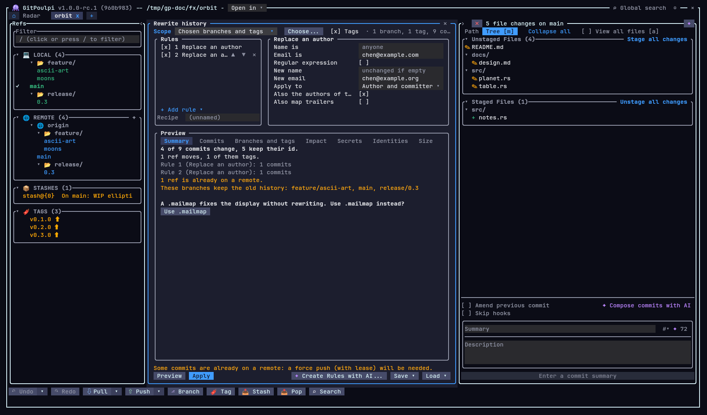

[English](../history-rewrite.md) · [Čeština](../cs/history-rewrite.md) · [Deutsch](../de/history-rewrite.md) · [Español](../es/history-rewrite.md) · [Français](../fr/history-rewrite.md) · [Italiano](../it/history-rewrite.md) · [日本語](../ja/history-rewrite.md) · [한국어](../ko/history-rewrite.md) · **Nederlands** · [Polski](../pl/history-rewrite.md) · [Português (Brasil)](../pt-BR/history-rewrite.md) · [Português (Portugal)](../pt-PT/history-rewrite.md) · [Русский](../ru/history-rewrite.md) · [Svenska](../sv/history-rewrite.md) · [Türkçe](../tr/history-rewrite.md) · [Українська](../uk/history-rewrite.md) · [简体中文](../zh-CN/history-rewrite.md)

# Geschiedenis herschrijven

Geschiedenis herschrijven wijzigt commits die al bestaan: wie ze schreef en
wanneer, hun berichten, de bestanden die ze bevatten, hun handtekeningen.
GitPoulpi doet dat met een **recept** (een bereik en een geordende lijst regels)
en drie stappen, waarvan de middelste nooit wordt overgeslagen:

1. **Voorbeeld** berekent de nieuwe geschiedenis zonder iets aan te raken:
   aantallen, wat elke regel deed, de branches en tags die zouden verschuiven, en
   één rij per gewijzigde commit.
2. **Toepassen** verplaatst je lokale branches en tags ernaartoe. Het is één item
   van de [ongedaanmaakgeschiedenis](undo-redo.md): **Ongedaan maken** zet elke
   verplaatste ref (en de uitgecheckte bestanden) terug.
3. **Pushen** (een force push met lease) en **Opruimen** zijn aparte, bewuste
   stappen, omdat ze niet ongedaan kunnen worden gemaakt: zie
   [Het resultaat pushen](#het-resultaat-pushen) en
   [De oude geschiedenis verwijderen](#de-oude-geschiedenis-verwijderen-opruimen).

De werkbank, het palet, de opdrachten `gitpoulpi rewrite` en de MCP-tools draaien
dezelfde engine, dus een voorbeeld dat in de ene is gemaakt, is wat een andere
toepast. [Via de opdrachtregel](#via-de-opdrachtregel) somt de vlaggen op;
[Regels maken met AI](#regels-maken-met-ai) vult de werkbank vanuit een beschrijving;
[Voorstellen van AI-agents](#voorstellen-van-ai-agents) zegt wat een agent hier
wel en niet mag.

**De regels, per wat ze wijzigen**

| Groep | Regels | Sectie |
|---|---|---|
| Auteurs | Een auteur vervangen, Auteurs anonimiseren, .mailmap toepassen | [Auteurs en de .mailmap](#auteurs-en-de-mailmap) |
| Datums | Datums verschuiven, Tijdzone wijzigen, Binnen bepaalde uren houden, Committerdatum = auteursdatum | [Datums](#datums) |
| Berichten | Zoeken en vervangen, Regels verwijderen, Een trailer toevoegen of verwijderen, Tekencodering van berichten herstellen | [Berichten](#berichten) |
| Bestandsinhoud en paden | Zoeken en vervangen in bestanden, Bestanden verwijderen, Grote bestanden verwijderen, Paden verplaatsen of hernoemen, Regeleindes omzetten, Het uitvoerbaarheidsbit verwijderen, Tekencodering van bestanden omzetten | [Bestanden en paden](#bestanden-en-paden) |
| LFS | Bestanden naar LFS migreren, Bestanden uit LFS terughalen | [Bestanden naar of uit Git LFS verplaatsen](#bestanden-naar-of-uit-git-lfs-verplaatsen) |
| Handtekeningen | Handtekeningen verwijderen (en opnieuw ondertekenen bij Toepassen) | [Handtekeningen](#handtekeningen) |
| Script | Lua, shell, Python | [De Script-regel](#de-script-regel) |

**Voordat je begint**

- Een voorbeeld wijzigt niets. Toepassen wijzigt alleen je lokale refs en pusht
  nooit.
- Herschreven commits krijgen nieuwe id's. Iedereen die de oude geschiedenis
  heeft, moet dat horen: [Het resultaat pushen](#het-resultaat-pushen) schrijft de
  notitie.
- Een geheim dat is gepusht, is gelekt. **Vervang het eerst**, herschrijf dan,
  force-push en ruim op.
- Commits die blijven zoals ze zijn, houden hun id's en handtekeningen.

## De werkbank

`Ctrl+G Shift+H` (of **Herschrijven: Werkbank voor geschiedenis** in het palet)
opent de herschrijfwerkbank boven de Log. Er is geen werkbalkknop: geavanceerde
acties staan in het palet (elke rij `Herschrijven: ...` opent de werkbank met die
regel al toegevoegd), in het submenu **Geschiedenis herschrijven** van het
commitmenu (*Vanaf deze commit tot HEAD...*, *Geselecteerde commits...* als je er
meer selecteert, *Werkbank openen...*) en achter het akkoord.

`Ctrl+N` toont een badge op elk bedieningselement van de werkbank (bereik, regels, velden, tabbladen, knoppen); een badge indrukken doet wat een klik op dat element doet, en `Esc` haalt de badges weg (zie [Badges](keybindings.md#badges)).



- **Bereikbalk:** welke refs verschuiven (huidige branch, alle lokale branches,
  gekozen branches en tags, de geselecteerde commits), het vakje *Tags* en, na
  *Vanaf deze commit tot HEAD...*, een vakje om pas na de parent van die commit te
  beginnen.
- **Regels:** een genummerde lijst, in volgorde toegepast. Het vakje schakelt een
  regel in of uit, de pijlen verplaatsen hem, het kruisje verwijdert hem (*De
  verwijderde regel herstellen* of `Ctrl+Z` haalt hem terug). *Regel toevoegen*
  toont de soorten per groep. Een regel die een programma nodig heeft dat je niet
  hebt, blijft grijs staan met de reden.
- **Instellingen van een regel:** een klik op een tekstveld bewerkt het; een klik
  op een veld met meerdere waarden opent de lijst; vakjes klappen om.
- **Voorbeeld** (`F5`) berekent de nieuwe geschiedenis zonder iets aan te raken en
  toont een voortgangsbalk. De tabbladen: **Samenvatting** (aantallen, wat elke
  regel deed, waarschuwingen), **Commits** (één rij per gewijzigde commit, pagina
  voor pagina uit de daemon; het filter toont gewijzigde, verwijderde of gepushte),
  **Branches en tags** (wat verschuift, en de beschermde branches die al gepusht
  zijn, elk met een vakje), **Gevolgen** (wat het herschrijven van gepushte
  geschiedenis betekent: een force push met lease, medewerkers, handtekeningen),
  **Geheimen**, **Identiteiten** en **Grootte** (zie hieronder).
- **Bestanden van een commit:** `Enter` (of een dubbelklik) op een rij bij Commits
  opent de bestanden die de inhoudsregels erin hebben gewijzigd en ernaast de diff
  van het geselecteerde bestand. Het kruisje, `Esc` of een klik erbuiten sluit het.
  Verwijderde regels van een geheimregel blijven verborgen.
- **Toepassen** (`Ctrl+S` of `Ctrl+Enter`) kan zodra het voorbeeld bij de regels
  past. Vragen zonder standaardantwoord worden elke keer gesteld: wat er met de
  handtekeningen van ondertekende commits gebeurt en hoe een map wordt
  geëxtraheerd. Het resultaatpaneel biedt **Ongedaan maken**, dat elke verplaatste
  ref terugzet.
- **Opslaan / Laden** bewaart een recept in de repository (gedeeld) of alleen voor
  jou; geheime waarden worden nooit opgeslagen.

Elke knop heeft een toets: de lijst staat in Instellingen > Toetsenbord (context
*Werkbank voor geschiedenis herschrijven*) en in de gids `keybindings.md`.

### Auteurs en de .mailmap

- **Een auteur vervangen** herkent een auteur of committer aan naam en/of
  e-mailadres (letterlijk, of als reguliere expressie) en stelt een nieuwe naam
  en/of een nieuw e-mailadres in. *Toepassen op* kiest de auteur, de committer of
  beide; *Ook de auteurs van tags* laat de geannoteerde tags volgen die opnieuw
  worden gemaakt. De oorspronkelijke committer blijft behouden, tenzij de run *ik,
  nu* zegt.
- **Auteurs anonimiseren** vervangt elke identiteit door een genummerde
  plaatshouder (`Contributor 1`, `contributor-1@anonymous.invalid`; beide patronen
  kun je zelf aanpassen, met `{n}` voor het nummer). Dezelfde persoon krijgt in
  één run altijd hetzelfde nummer; identiteiten die je als *behouden* opgeeft,
  blijven zoals ze zijn.
- **Het tabblad Identiteiten** (ook **Herschrijven: Identiteiten mergen
  (.mailmap)...** in het palet) is de manier om iemand die onder meerdere namen en
  e-mailadressen heeft gecommit recht te zetten **zonder iets te herschrijven**.
  Het somt elke naam en elk e-mailadres van het bereik op de bereikbalk op, met
  hoeveel commits elk schreef en committe, en welke de `.mailmap` van de
  repository al toewijst (`toegewezen aan Naam <e-mail>`). Vink de identiteiten
  aan die dezelfde persoon zijn (`Spatie`, of een klik; *Alles aanvinken* / *Alles
  uitvinken*), dan **Mergen in...** (`m`): een dialoogvenster vraagt welke blijft
  (die met de meeste commits staat bovenaan) en **voegt per andere identiteit één
  regel toe aan `.mailmap`** (`Naam <e-mail> Oude Naam <oud@email>`; een regel die
  er al staat, wordt niet herhaald, en het bestand wordt aangemaakt als het
  ontbreekt). Er wordt niets gecommit: commit `.mailmap` zelf om het te delen. De
  Log, blame en de bestandsgeschiedenis tonen de canonieke naam meteen (instelling
  `log.use_mailmap`, standaard aan; de opgeslagen commits veranderen nooit, dus er
  valt niets te force-pushen). De statusbalk zegt wat er is geschreven en biedt
  **Ongedaan maken** (`u`), dat de vorige `.mailmap` terugzet (het is één item van
  de ongedaanmaakgeschiedenis, zoals elke andere actie). `r` leest de lijst
  opnieuw.
- **Een `.mailmap` in plaats van een herschrijving.** Als een auteursregel commits
  wijzigt die al op een remote staan, zegt de Samenvatting *Een .mailmap past de
  weergave aan zonder te herschrijven. In plaats daarvan .mailmap gebruiken?* met
  een knop **Gebruik .mailmap** (`m` op de Samenvatting). Die opent het tabblad
  Identiteiten met de identiteiten waarmee de regel overeenkomt aangevinkt, en de
  identiteit die de regel zou instellen wordt aangeboden als die om te houden, ook
  al draagt nog geen commit haar.
- **De `.mailmap`-regel** (*Herschrijven: .mailmap op de geschiedenis
  toepassen...*, of `rewrite preview --mailmap`) herschrijft wél: auteurs en
  committers (jouw keuze) worden wat de `.mailmap` van de werkmap ze noemt, het
  resultaat dat `git log --use-mailmap` toont. Gebruik hem als de geschiedenis
  zelf de canonieke namen moet dragen, bijvoorbeeld voordat je haar publiceert;
  het is een herschrijving als elke andere (voorbeeld, Toepassen, force push).
- **Identiteitsregels en trailers.** Een identiteitsregel kan ook de mensen
  wijzigen die in trailers worden genoemd: vink **Ook trailers aanpassen** aan
  (`--map-trailers`). Elke trailer waarvan de waarde precies `Naam <e-mail>` is en
  overeenkomt met *E-mailadres is* / *Naam is* van de regel, krijgt de nieuwe naam
  en het nieuwe e-mailadres, wat de regel ook met de auteur en de committer doet.
  Het staat standaard uit: een `Signed-off-by` legt vast wie heeft ondertekend, dus
  die wijzigen is een beslissing op zich.

### Datums

De vier datumregels werken op de auteursdatum, de committerdatum of beide
(*Datums* in het paneel van de regel).

- **Datums verschuiven** verplaatst elke datum met een bedrag (`+2h`, `-1d`,
  `90m`, `1d 2h`). De tijdzone waarin elke commit is geschreven, blijft behouden.
- **Tijdzone wijzigen** schrijft de datums in een ander UTC-verschil. *Behouden*
  zegt wat gelijk blijft: het **tijdstip** (hetzelfde moment, de klok leest anders)
  of de **klok** (dezelfde lokale tijd, het moment verandert).
- **Binnen bepaalde uren houden** verplaatst elke commit die buiten de toegestane
  uren valt (bijvoorbeeld `Mon-Fri 18:00-23:30; Sat,Sun 10:00-20:00`) naar de
  dichtstbijzijnde toegestane tijd, of alleen eerder, of alleen later
  (*Verschuiven naar*). *Nooit vóór de parent* houdt de volgorde van de
  geschiedenis intact; de *Startwaarde* maakt de kleine willekeurige spreiding
  herhaalbaar: dezelfde startwaarde op dezelfde geschiedenis geeft dezelfde
  datums.
- **Committerdatum = auteursdatum** zet de committer (naam, e-mailadres en datum)
  gelijk aan die van de auteur, wat een `git commit --amend` of een rebase ongedaan
  heeft gemaakt.

Datums zijn regels zoals de andere: bekijk het voorbeeld, controleer het tabblad
**Commits** (elke rij toont de oude en de nieuwe datum) en pas dan toe. De id van
een commit hangt van zijn datums af, dus een datumregel wijzigt elke commit na de
eerste die hij raakt.

### Berichten

- **Zoeken en vervangen in berichten** en **Berichtregels verwijderen** nemen een
  letterlijke tekst of een reguliere expressie (*Reguliere expressie*,
  *Hoofdlettergevoelig*); een lege vervanging verwijdert. Een bericht dat geen
  geldig UTF-8 is, wordt er nooit door aangeraakt: voer eerst **Tekencodering van
  berichten herstellen** uit als je het wilt bewerken.
- **Trailers.** *Een trailer toevoegen of verwijderen* (*Herschrijven: Trailers
  toevoegen of verwijderen...* in het palet, of `--trailer-add`,
  `--trailer-remove`, `--trailer-map`) bewerkt de regels `Sleutel: waarde` aan het
  eind van een bericht, die `git interpret-trailers` kent (`Signed-off-by`,
  `Co-authored-by`, `Reviewed-by`...). De keuzelijst **Actie** kiest *Toevoegen*
  (de **Trailer**-sleutel, zijn **Waarde** en **Als hij al bestaat**: *Toevoegen
  (tenzij identiek)*, *De bestaande vervangen* of *De commit met rust laten*),
  *Verwijderen* (elke trailer met die sleutel, of alleen die waarvan de waarde
  **Waarde bevat** bevat) of *De waarde wijzigen* (**Zoeken in waarde** wordt
  **Vervangen door**, bijvoorbeeld een oud e-mailadres door een nieuw in
  `Signed-off-by`). Sleutels worden zonder hoofdlettergevoeligheid vergeleken.
  Alleen de trailerregels veranderen, de rest van het bericht blijft precies zoals
  het was, en een bericht dat nog geen trailers heeft, krijgt een lege regel en
  een eigen blok. Het tabblad Commits toont elke wijziging als `+Signed-off-by:
  ...` / `-Co-authored-by: ...`. De laatste alinea van een bericht is zijn
  trailerblok (nooit de titel), dus een regel als `Note: see the ticket` in de
  tekst is geen trailer, tenzij ze samen met andere trailers alleen in de laatste
  alinea staat.
- **Commit-id's in berichten.** **Commit-id's bijwerken** (`--update-message-hashes`,
  standaard uit; onderaan de panelen van de regels die berichten bewerken) laat
  id's die in berichten staan de herschrijving volgen: een verkorte id van 7 of
  meer hex-tekens (`This reverts commit 1a2b3c4`, `see 1a2b3c4d5e`) die precies één
  commit van de herschreven geschiedenis aanwijst, wordt vervangen door de nieuwe
  id van die commit, op dezelfde lengte afgekapt. Een id die bij meerdere commits
  past, bij geen enkele, of bij een commit die de herschrijving pas later maakt,
  blijft zoals hij is; de Samenvatting zegt hoeveel er zijn vervangen en hoeveel
  zijn blijven staan.
- **Tekencodering van berichten herstellen** (*Herschrijven: Tekencodering van
  berichten herstellen...*, of `--fix-message-encoding [--fix-name-encoding]`)
  zet berichten om naar UTF-8, in twee gevallen:
  - Een commit met een `encoding`-kop (`ISO-8859-1`, `Windows-1252`, `Shift_JIS`,
    alles wat git en de coderingstabellen kennen) wordt gedecodeerd en als UTF-8
    geschreven, en de kop verdwijnt: de tekst leest overal hetzelfde, zonder
    omzetting. De namen van auteur en committer van die commit stonden in dezelfde
    codering en worden mee gedecodeerd, zodat een commit nooit half omgezet
    achterblijft.
  - **Mojibake**, UTF-8 dat ooit als Latin-1 of Windows-1252 is gelezen
    (`Réécriture` voor `Réécriture`), wordt **alleen hersteld als de
    heen-en-terugomzetting exact is**: de tekst moet terug te coderen zijn naar
    bytes die geldig UTF-8 zijn, en het op dezelfde manier verminken van het
    resultaat moet het origineel geven. Een bericht dat alleen `é` naast echte
    letters bevat, of tekens buiten de oude alfabetten, komt er niet door en blijft
    zoals het is.

  *Ook namen herstellen* (`--fix-name-encoding`) repareert verminkte namen van
  auteurs en committers op dezelfde manier. Wat niet te bepalen is (een onbekende
  codering, bytes die niet geldig zijn in de opgegeven codering, een bericht dat
  geen UTF-8 is en niets opgeeft, tekst die verminkt lijkt maar dat niet
  aantoonbaar is) wordt **met rust gelaten en geteld**: de Samenvatting zegt *n
  berichten zijn ongewijzigd gelaten: hun codering is niet te bepalen*, en
  `counts.encoding_left` bevat het aantal. Het tabblad Commits toont elke
  herstelling met het oude en het nieuwe bericht en een rij *codering* (`ISO-8859-1`
  wordt `UTF-8`).

### Bestanden en paden

- **Regels voor bestandsinhoud** (*Zoeken en vervangen in bestanden*, *Bestanden
  uit de geschiedenis verwijderen*, *Grote bestanden verwijderen*): het paneel
  controleert elke waarde terwijl je typt en toont de reden onder het veld (een
  patroon dat niet compileert, een fout padpatroon, een grootte onder één byte).
  Groottes accepteren eenheden (`500 KiB`, `5 MiB`, `1 GiB`). Een padpatroon zonder
  slash komt op elk niveau overeen. *Geheime waarden* typ je in een afgeschermd
  veld; ze gelden alleen voor deze run en worden nooit opgeslagen, en het voorbeeld
  verbergt de regels die ze bevatten. *Lege commits* bepaalt of een commit die de
  regels leeg achterlieten wordt verwijderd (standaard) of blijft. Binaire
  bestanden en bestanden boven de groottelimiet blijven ongemoeid en worden in de
  Samenvatting geteld.
- **Paden verplaatsen.** *Paden verplaatsen of hernoemen* (*Herschrijven: Paden
  verplaatsen of hernoemen...* in het palet) kent drie soorten, te kiezen in de
  keuzelijst **Verplaatsen**:
  - *Een pad hernoemen* (**Van**, **Naar**; `--move-path VAN=NAAR`): dezelfde
    bestanden en mappen verschijnen op het nieuwe pad in elke commit die het oude
    had; verder verandert er niets en elk bestand houdt zijn id. Een commit waarin
    het nieuwe pad al bestaat, wordt nooit overschreven: het voorbeeld wordt
    geweigerd en toont de commits en paden die botsen (kies een vrije naam, of
    verplaats eerst het bestaande pad). Alleen exacte paden, geen jokertekens.
  - *Alles naar een map verplaatsen* (**Map**; `--into-subdir MAP`): elk pad van
    elke commit krijgt het voorvoegsel. Handig om repositories samen te voegen
    zonder naamconflicten.
  - *Een map als root extraheren* (**Map**; `--extract MAP`): de map wordt de root,
    commits die haar niet raken vervallen (een commit die haar aanmaakt, heeft
    geen parent), merges die niets meer samenvoegen worden vereenvoudigd, en
    branches en tags waarin niets van de map zit, worden verwijderd. Je wordt
    **elke keer** gevraagd hoe het eindigt:
    - *In een nieuwe kloon, geopend in een nieuw tabblad* (`--extract-mode clone`):
      van deze repository wordt een kopie gemaakt in een map die je kiest (de nieuwe
      repository krijgt daarin een map met de naam van de geëxtraheerde map), daar
      herschreven en opgeschoond, zodat ze alleen de nieuwe geschiedenis bevat, met
      elke lokale branch en tag die de map heeft. Deze repository blijft
      ongemoeid. De nieuwe repository heeft geen remote (het origineel is niet haar
      upstream).
    - *Ter plekke: de geschiedenis van deze repository wordt herschreven*
      (`--extract-mode in-place`): de gewone herschrijving, met voorbeeld,
      Toepassen en Ongedaan maken. Branches zonder de map worden verwijderd
      (Ongedaan maken brengt ze terug); de uitgecheckte branch moet de map hebben.
    - *Als submodule van deze repository* (`--extract-mode submodule`): de nieuwe
      repository wordt gemaakt zoals bij de kloon, waarna **één nieuwe commit** op
      de huidige branch de map vervangt door een submodule ervan (`.gitmodules` en
      de koppeling); de map blijft staan als uitgecheckte submodule. De
      geschiedenis van deze repository wordt **niet** herschreven: haar oude
      commits houden de bestanden van de map, dus niets wat ernaar verwijst (tags,
      andere klonen) gaat stuk. De URL in `.gitmodules` is het lokale pad van de
      nieuwe repository: wijzig hem (`git config -f .gitmodules
      submodule.<map>.url`) zodra ze op een host staat. Bewerkte of niet-gevolgde
      bestanden in de map weigeren het. Ongedaan maken zet de gewone map terug.

    De Samenvatting zegt dat het voorbeeld de geschiedenis van de nieuwe repository
    toont en naar welke map ze gaat. Regels die na een extractie komen (een
    hernoeming, een verwijdering) werken op de geëxtraheerde boom; bij een kloon of
    een submodule moet de extractie de eerste padregel zijn. Padregels draaien na de
    inhoudsregels, dus een verwijderpatroon noemt de paden zoals ze waren.

#### Regeleindes, het uitvoerbaarheidsbit en bestandscoderingen

Drie regels in de groep **Inhoud** van het menu Toevoegen (of de palet-rijen
*Herschrijven: Regeleindes omzetten...*, *Het uitvoerbaarheidsbit verwijderen...*
en *Herschrijven: Tekencodering van bestanden omzetten...*). Alle drie nemen
**Bestanden** (globs; een patroon zonder slash komt op elk niveau overeen; leeg
betekent elk bestand) en **Behalve bestanden**. Ze wijzigen alleen wat de globs
noemen, in elke commit van het bereik. Binaire bestanden (een NUL-byte in de eerste
8 KiB) worden nooit aangeraakt: de Samenvatting telt ze als *ongewijzigd gelaten*.

- **Regeleindes omzetten** (`--eol lf|crlf|cr --eol-paths GLOB...
  [--eol-exclude GLOB...]`). *Omzetten naar*: LF (Linux, macOS), CRLF (Windows) of
  CR (klassieke Mac). Elk regeleinde van een passend tekstbestand wordt dat ene,
  zodat een bestand met gemengde regeleindes uniform wordt; bestanden die al goed
  zijn, houden hun versie ongemoeid. *.gitattributes volgen* (standaard uit,
  `--eol-follow-attributes`) leest de `.gitattributes` in de root van elke commit:
  bestanden met `-text` of `binary` worden overgeslagen en bestanden met `eol=lf`
  of `eol=crlf` houden dat regeleinde in plaats van het regeleinde dat jij koos.
- **Het uitvoerbaarheidsbit verwijderen** (`--strip-exec GLOB...
  [--strip-exec-exclude GLOB...]`). Passende bestanden gaan van modus 100755 naar
  100644; hun inhoud blijft ongemoeid. Minstens één bestandspatroon is verplicht:
  alle uitvoerbare bestanden strippen zou je scripts kapotmaken.
- **Tekencodering van bestanden omzetten** (`--reencode DOEL [--from BRON]
  [--encoding-fallback COD] --encoding-paths GLOB... [--encoding-exclude
  GLOB...]`). *Omzetten naar*: UTF-8 (de standaard), UTF-8 met BOM, UTF-16 LE of
  BE (met een BOM geschreven), Windows-1252 of ISO-8859-1. *Bestanden zijn in*:
  standaard wordt de codering van elk bestand gedetecteerd (een BOM, anders geldig
  UTF-8, anders de *Terugval*, Windows-1252 tenzij je dat wijzigt); noem de codering
  om haar af te dwingen, maar een verkeerde keuze geeft verkeerde tekst (UTF-8
  gelezen als Latin-1 verdubbelt elk accent). Een bestand dat de broncodering niet
  kan lezen, of dat een teken bevat dat het doel niet kan opslaan (een euroteken in
  ISO-8859-1), blijft precies zoals het is en wordt in de Samenvatting geteld.

De regels draaien in de volgorde van de lijst, op hetzelfde bestand: een bestand
naar UTF-16 omzetten en daarna om regeleindes vragen laat het ongemoeid (het is
geen gewone tekst meer). Toepassen is één item in de ongedaanmaaklijst, zoals elke
herschrijving.

### Geheimen vinden

- **Geheimen vinden:** `gitpoulpi rewrite scan-secrets` (en de MCP-tool
  `rewrite_scan_secrets`) leest de geschiedenis één keer en somt tokenvoorvoegsels
  (GitHub, GitLab, Slack, AWS, Stripe, npm, Google, OpenAI, Anthropic), privésleutels,
  JWT's, wachtwoorden in URL's en willekeurig ogende `password = waarde`-regels op,
  elk met zijn bestand, de eerste en laatste commit en een gemaskeerd voorbeeld zoals
  `ghp_****abcd`. Het is niet uitputtend, en de waarde wordt nooit getoond, gelogd of
  opgeslagen. `--remove-finding ID` maakt van een treffer een regel die hem uit elke
  commit verwijdert. Een geheim dat is gepusht, is gelekt: vervang het eerst, herschrijf
  dan, force-push en ruim op.
- **Het tabblad Geheimen** doet hetzelfde vanuit de werkbank, voor het bereik op de
  bereikbalk: **Scannen op geheimen** (`s`) voert de scan uit als taak (de voortgangsbalk
  heet *Scannen*, **Annuleren** of `Esc` stopt hem). Elke treffer is een rij met zijn
  soort, het gemaskeerde voorbeeld, het bestand en hoeveel andere het bevatten; onder de
  lijst: de eerste en laatste commit waarin hij is gezien en hoeveel commits en
  bestandsversies hem bevatten. Het tabblad zegt hoeveel binaire en te grote bestanden niet
  zijn gelezen, en dat de scan niet uitputtend is. Alle treffers staan eerst aangevinkt;
  **Uit geschiedenis verwijderen** (`r`) maakt van de aangevinkte één regel die ze met hun
  id noemt (nooit met hun waarde), die je bekijkt en toepast zoals elke andere. Treffers
  raken verouderd na een herschrijving of een wijziging van het bereik: het tabblad zegt het,
  scan opnieuw. De werkbank houdt de waarde van een geheim nooit vast, dus hij kan haar niet
  tonen.

### Vinden wat zwaar weegt

- **Vinden wat zwaar weegt:** `gitpoulpi rewrite analyze [--top N]` (en de MCP-tool
  `rewrite_analyze`) is de groottenanalyse, zoals `filter-repo --analyze`: de grootste bestanden
  met hun pad, grootte, eerste en laatste commit en of ze nog in HEAD staan, de grootste mappen,
  de bestanden die uit HEAD zijn verwijderd maar die de geschiedenis nog bewaart, en de totalen.
  Het leest alleen groottes en paden, nooit bestandsinhoud, en wijzigt niets.
- **Het tabblad Grootte** doet hetzelfde vanuit de werkbank (`F7`, of *De groottes in de
  geschiedenis analyseren* in het palet, opent het en start de analyse): **Groottes analyseren**
  (`s`) is een taak (*Analyseren*, **Annuleren** of `Esc` stopt hem). **Tonen** kiest de lijst
  (`v`): *Bestanden* (de grootste unieke bestandsversies, elk gemarkeerd als *in HEAD*, *oude
  versie* van een bestand dat er nog staat, of *verwijderd*), *Mappen* (alles wat ooit onder elk
  is opgeslagen) of *Verwijderd* (paden die uit HEAD zijn verdwenen en die de geschiedenis
  bewaart). **Sorteren** (`o`) gaat op grootte, op pad of verwijderd eerst. Vink rijen aan
  (`Spatie`, `Alt+A` / `Alt+U` voor alles / niets): het tabblad zegt hoeveel ze bevatten, eerlijk
  als "tot ongeveer", want de ruimte komt pas terug na de herschrijving, het opruimen van de oude
  objecten en een `gc`. **Uit geschiedenis verwijderen** (`r`) maakt van de aangevinkte paden een
  padregel (speciale tekens worden ontsnapt, een pad dat al in een regel staat wordt niet twee keer
  toegevoegd); **Elk bestand boven ... verwijderen** (`b`, lijst Bestanden) schrijft een
  groottoregel net onder het kleinste aangevinkte bestand. Bekijk en pas ze toe zoals elke andere
  regel. De lijsten tonen de 200 grootste rijen; de CLI zegt hoeveel er meer zijn en `--top` toont
  ze. Rijen raken verouderd na een herschrijving of een wijziging van het bereik: analyseer opnieuw.

### Handtekeningen

- **Handtekeningen:** een herschreven commit kan zijn handtekening niet houden (die
  ondertekende de oude bytes), dus als ondertekende commits worden herschreven, wordt je
  elke keer gevraagd: *De handtekeningen verwijderen* (het aantal staat er eerst bij), *Alleen
  de ondertekende commits opnieuw ondertekenen* of *Elke herschreven commit opnieuw
  ondertekenen*. Er is geen standaardantwoord. Commits die blijven zoals ze zijn, houden de
  hunne. Opnieuw ondertekenen gebruikt je eigen instellingen, zoals een ondertekende commit
  dat doet: `gpg.format` (`openpgp`, `ssh` of `x509`), `user.signingkey` en `gpg.program` /
  `gpg.ssh.program` / `gpg.x509.program`. De vierde rij van de vraag, **Ondertekening
  controleren** (`4`), ondertekent één keer een dummy-lading en controleert die: ze zegt hoe
  lang één handtekening duurt en schat de run voor het aantal commits waar de vraag over gaat,
  of waarom het niet werkt (sleutel ontbreekt, agent vergrendeld, programma niet
  geïnstalleerd, met hoe je het installeert). Het voorbeeld doet dezelfde test voordat het de
  geschiedenis leest en weigert met die reden, zodat een kapotte configuratie nooit een half
  ondertekende herschrijving achterlaat. De commits worden **tijdens het voorbeeld**
  ondertekend (hun id's bevatten de handtekening), dus een voorbeeld dat opnieuw ondertekent
  kost de ondertekentijd, de Samenvatting zegt *Commits opnieuw ondertekend: n, in 12,5 s*, en
  er kan dan een wachtwoordvraag opengaan: ontgrendel eerst je agent (Ondertekening
  controleren doet precies dat). **Annuleren** stopt tussen twee handtekeningen en laat niets
  achter. Alleen commithandtekeningen worden opnieuw gemaakt; een ondertekende tag verliest
  zijn handtekening nog steeds.
- **De regel *Handtekeningen verwijderen*** (menu Toevoegen, groep *Handtekeningen*;
  *Herschrijven: Handtekeningen verwijderen...* in het palet; `--remove-signatures`) haalt de
  handtekening van elke commit in het bereik weg, ook waar verder niets verandert, en vraagt
  niets over opnieuw ondertekenen. Vanuit de CLI: `rewrite check-signing` en
  `--signatures strip|resign-signed|resign-all`.

### Een herschrijving ongedaan maken

**Ongedaan maken** (de knop van het resultaatpaneel, *Ongedaan* op de werkbalk met `Ctrl+Z`
in de Log, of `gitpoulpi undo`) zet elke verplaatste branch, tag en notitie terug, en de
uitgecheckte bestanden erbij, vanuit de oude commits die de herschrijving vasthoudt. Het
vraagt eerst als een herschreven branch al op zijn upstream staat (lokaal ongedaan maken
maakt een push niet ongedaan) en als je niet-gecommitte wijzigingen hebt: die blijven
behouden, en een bestand dat je hebt gewijzigd en dat de oude geschiedenis zou overschrijven,
stopt het ongedaan maken (bestanden verplaatsen zoals bij `reset --keep`). Ongedaan maken
kan niet meer voor een herschrijving zodra je haar oude geschiedenis
[opruimt](#de-oude-geschiedenis-verwijderen-opruimen); de geschiedenislijst markeert haar dan
als *opgeruimd*.

## Bestanden naar of uit Git LFS verplaatsen

Twee regels in de groep *LFS* van het menu Toevoegen herschrijven de geschiedenis zodat grote
bestanden van meet af aan in [Git LFS](lfs.md) staan (of er juist uit gaan). Ze hebben het
programma `git-lfs` nodig: zonder dat zijn de regels grijs met de installatietip en wordt een
voorbeeld geweigerd. Het is onze eigen engine, niet `git lfs migrate`, dus je krijgt het
voorbeeld, het bereik, het ongedaan maken en de pushbeveiliging van elke andere regel.

- **Bestanden naar LFS migreren** (*Herschrijven: Bestanden naar LFS migreren...*, of
  `--lfs-import PATROON` met `--lfs-min-size BYTES`). Elk bestand dat bij de patronen past
  (`*.psd`, `assets/**`; een patroon zonder slash komt op elk niveau overeen) en minstens
  *Alleen bestanden van minstens* groot is (leeg: elke treffer), wordt in elke commit die het
  bevat een LFS-pointer. De inhoud gaat bij Toepassen naar de lokale LFS-opslag
  (`.git/lfs/objects`, één keer per verschillende inhoud), en de `.gitattributes` in de root
  krijgt `<patroon> filter=lfs diff=lfs merge=lfs -text` in elke herschreven commit die een
  pointer bevat (aangemaakt als er geen is, de andere regels ongemoeid, nooit dubbel). Een
  bestand dat al een pointer is, blijft ongemoeid. De Samenvatting zegt *3 bestanden (12 MiB)
  gaan naar LFS. Te schrijven LFS-objecten: 3.* en het tabblad Commits toont per commit
  *verplaatst big.psd naar LFS*.
- **Bestanden uit LFS terughalen** (*Herschrijven: Bestanden uit LFS terughalen...*, of
  `--lfs-export PATROON`). Pointers die passen worden weer de echte bestanden, en de regels in
  `.gitattributes` voor die patronen verdwijnen. De objecten moeten in de lokale LFS-opslag
  staan: als sommige ontbreken, wordt het voorbeeld geweigerd met de lijst en een knop **LFS-
  objecten downloaden** die ze van `origin` haalt; bekijk daarna het voorbeeld opnieuw. Een
  import gevolgd door een export van dezelfde patronen geeft precies dezelfde commits terug.

Na Toepassen zijn de uitgecheckte bestanden de echte inhoud (geen pointers) en zet
**Ongedaan maken** de oude geschiedenis terug. Het resultaatpaneel heeft **LFS-objecten
versturen** (`l`): hetzelfde als `LFS: Push (alle objecten)`, zodat de nieuwe geschiedenis kan worden
gepusht zonder dat een latere push blijft hangen op ontbrekende objecten (een gewone push van de
herschreven branches uploadt ze ook, via de pre-push-hook die Toepassen installeert). De notitie
voor medewerkers zegt dat ze git-lfs en `git lfs pull` nodig hebben.

Goed om te weten: Toepassen installeert de LFS-filters van de repository (`git lfs install
--local`) als ze ontbreken, omdat git ze nodig heeft om de echte bestanden met de pointers te
vergelijken. Alleen de `.gitattributes` in de root wordt geschreven, nooit een geneste. Een
bestand *onder* de minimumgrootte dat bij een patroon past, blijft een gewoon bestand, maar git
wil het bij zijn volgende add alsnog in een pointer veranderen, dus `git status` toont het als
gewijzigd tot je het commit. De import streamt grote bestanden, de export houdt telkens één
bestand in het geheugen.

## Het resultaat pushen

Toepassen pusht nooit. Herschreven branches en tags die op een remote stonden, hebben een
force push nodig, en die forceert nooit blind: elke ref wordt verstuurd met een lease op de id
die de remote had toen je het voorbeeld bekeek (niet wat je tracking-branch nu zegt), zodat de
push van een collega ertussen voor die ref wordt geweigerd in plaats van overschreven, en de
refs gaan in één alles-of-niets-push (`--atomic`) waar de server dat toestaat. Vanuit de CLI:

```
gitpoulpi rewrite push --dry-run        # vraagt het aan de remote, verstuurt niets
gitpoulpi rewrite push --yes            # verstuurt het
gitpoulpi rewrite note                  # wat de anderen moeten uitvoeren
gitpoulpi rewrite maps --out ./maps     # commit-map en ref-map
```

Beschermde branches (instelling `rewrite.protected_branches`, standaard `main`, `master`,
`develop`, `release/*`) blijven met rust gelaten als ze gepusht zijn, bij de herschrijving en
opnieuw bij de push, tenzij je ze noemt (`--include-protected main`) of ze allemaal meeneemt. De
eigen branchbescherming van de host bepaalt nog steeds of een force push wordt geaccepteerd; de
weigering wordt per ref getoond.

In de werkbank doet het resultaatpaneel na een Toepassen dit allemaal:

- **De herschreven refs naar de remote sturen** somt de refs op die de herschrijving heeft
  verplaatst en die een remote heeft, elk met een vakje (`Spatie`). Beschermde branches staan
  eerst uitgevinkt, met *beschermd* ernaast: vink ze een voor een aan, of gebruik *Alles
  aanvinken* / *Alles uitvinken* (`Alt+A` / `Alt+U`). **Push herschreven branches** (`p`) verstuurt
  de aangevinkte; het antwoord is één rij per ref (*gepusht*, *al up-to-date*, *geweigerd: de
  remote is verschoven sinds het voorbeeld*, *geweigerd: beschermd door de host*, *overgeslagen:
  beschermde branch*, *niet gepusht*). Een geweigerde rij heeft **Fetch en bekijken** (`f`): de
  werkbank sluit en de remotes worden gefetcht, zodat de Log toont wat de anderen hebben gepusht.
  Er wordt niets overschreven: de lease beschermt hun werk, en je bekijkt het voorbeeld opnieuw
  voordat je het nog eens probeert.
- **Notitie kopiëren** (`c`) zet de notitie voor medewerkers op het klembord, in de
  interfacetaal rond de onvertaalde git-opdrachten.
- **De commit-toewijzing openen** (`m`) toont waar de commit-map en de ref-map staan; een klik op
  een pad (of `1` / `2`) kopieert het.

Een push kan niet ongedaan worden gemaakt: als je de herschrijving daarna met `undo` terugdraait,
verandert alleen je eigen repository, en het ongedaan maken zegt dat voordat het om bevestiging
vraagt. Stuur de notitie naar iedereen die de oude geschiedenis heeft: ze noemt de oude en nieuwe
tip van elke branch en tag en de opdrachten (`git fetch`, dan `git reset --hard origin/<branch>`
of `git rebase --onto`). De twee toewijzingen blijven 24 uur bij de run bewaard; kopieer ze weg
als de repositoryopruiming van GitLab of een script ze nodig heeft.

## Als de host een branch beschermt

Je host kan zelf een branch beschermen (branchbescherming en rulesets van GitHub, beschermde
branches van GitLab, branchbeleid van Azure DevOps, branchbeperkingen van Bitbucket) en de
force push weigeren die een herschrijving nodig heeft. Als de repository aan haar host is
**gekoppeld** (het gedeelte met pull requests in de zijbalk, zie
[Hosting-integratie](hosting-integration.md)), vraagt de werkbank de host met je eigen token
welke branches hij beschermt:

- Die branches blijven **standaard buiten de herschrijving**, precies zoals de beschermde
  branches van `rewrite.protected_branches` en van de workflow: het tabblad Branches en tags
  toont ze met elk een vakje en de knoppen *Alles aanvinken* / *Alles uitvinken*, en zegt
  waarom: *beschermd op GitHub*.
- Als het token de bescherming niet kan lezen (het mist de scope, of je bent geen beheerder),
  zegt de werkbank *Bescherming door de host onbekend* en beschouwt ze niets als beschermd op
  het woord van de host. De herschrijving wordt daardoor nooit geblokkeerd. Een repository die
  niet is gekoppeld, wordt nooit bevraagd.

Als een beschermde branch in de weg zit (het voorbeeld werd geweigerd omdat elke branch is
beschermd, of de host weigerde de push: *geweigerd: beschermd door de host*), legt de knop **Hoe
kom je erdoor** (`Alt+H`) de drie uitwegen uit, met de exacte instellingenpagina van je
provider en repository (kies een link en kopieer hem met `c`, of open hem met `o`). GitPoulpi
doet er nooit een voor je:

1. **De bescherming tijdelijk opheffen** in de instellingen van de host, pushen en haar daarna
   terugzetten.
2. **De herschrijving onder een nieuwe branchnaam pushen**, die branch dan de standaardbranch
   maken (of hernoemen) en de oude verwijderen zodra niemand hem meer gebruikt.
3. **Als laatste redmiddel de remote repository verwijderen en opnieuw aanmaken** en alles
   pushen. Daarbij gaan verloren: de pull / merge requests en hun reviews, de issues, de
   koppeling van forks met de oude geschiedenis, sterren en watchers, de CI-instellingen,
   secrets en variabelen, en de webhooks en deploy keys.

Vanuit de CLI komt dezelfde tekst terug als `protected_by_host` in de JSON van `rewrite
preview` / `rewrite run` (als de host een branch van het bereik beschermt), van een geweigerde
`rewrite push` en van `rewrite note`: `provider`, `branches`, `ways` (elk met zijn `steps` en
`links`), `recreate_loses` en de hele uitleg als `text`.

## De oude geschiedenis verwijderen (opruimen)

Na een herschrijving staan de oude commits nog in je repository: het ongedaan maken van de
herschrijving bewaart ze (daardoor kan het ongedaan worden gemaakt), en de reflogs ook. Als je
herschreef om een geheim kwijt te raken, staat dat geheim nog in de `.git`-map. Opruimen
verwijdert de oude geschiedenis voorgoed:

```
gitpoulpi rewrite purge                 # vraagt: toont wat wordt verwijderd en verloren gaat (afsluitcode 3)
gitpoulpi rewrite purge --yes           # doet het
```

Het laat de pins voor ongedaan maken van de herschrijving vallen, laat de reflog-items verlopen
die de oude commits noemen, voert `git gc --prune=now` uit en controleert daarna dat elke oude
commit en bestandsversie echt weg is. De bevestiging zegt vooraf wat je verliest: **ongedaan
maken is niet meer mogelijk** voor de herschrijving (en voor elke eerdere bewerking waarvan het
ongedaan maken ook de oude commits nodig had); ze blijven in de geschiedenislijst staan, gemarkeerd
als opgeruimd. Opruimen kan niet worden gestopt zodra het begint en kan niet ongedaan worden
gemaakt. Het raakt geen remote aan.

Alles wat de oude geschiedenis nog vasthoudt, houdt het opruimen tegen, en dan wordt er niets
gewijzigd. De lijst noemt elk ding met wat te doen: een branch of tag die geen deel van de
herschrijving was, een stash op de oude geschiedenis (verwijder hem, of behoud hem en accepteer dat
de oude geschiedenis blijft), een andere worktree waarvan de HEAD erop staat, en de
remote-tracking-branches die nog naar de oude geschiedenis wijzen (push de herschreven branches en
fetch dan). Je stash-lijst en de reflogs van andere branches worden nooit aangeraakt.

Een geheim dat is gepusht, is gelekt: **vervang het eerst**. Na het opruimen somt het antwoord per
remote op wat de host nog nodig heeft: GitHub houdt oude commits bereikbaar in gecachete weergaven
en pull request-refs (neem contact op met GitHub Support, of verwijder de repository en maak hem
opnieuw), GitLab heeft een repositoryopruiming die de `commit-map` (`gitpoulpi rewrite maps --out
DIR`) plus housekeeping nodig heeft, Azure DevOps en Bitbucket vragen een supportaanvraag of een
nieuwe repository, en iedereen met een kloon of een fork heeft de oude geschiedenis nog.

### Het opruimscherm

In de werkbank heeft het resultaatpaneel van een herschrijving een knop **Oude geschiedenis
opruimen...** (toets `e`), en het palet heeft **Herschrijven: Oude geschiedenis opruimen...** (die
werkt op de nieuwste herschrijving die nog niet is opgeruimd, ook nadat je de werkbank hebt
gesloten). Het scherm toont wat het opruimen verwijdert en wat je verliest (de bewerkingen
waarvan het ongedaan maken meegaat; die met *verliest ook Ongedaan maken* zijn geen herschrijvingen
maar hadden de oude commits nodig), en dan wat de oude geschiedenis nog vasthoudt, elk op een eigen
rij:

- een remote-tracking-branch: **Fetch** werkt ze bij vanaf de remotes;
- een stash: **Verwijderen** vraagt eerst, want een stash is werk dat je nooit hebt gecommit;
- een branch, tag, worktree of andere ref: **Naam kopiëren**, en regel het dan waar het staat
  (de branch herschrijven of verwijderen, in de worktree een herschreven branch uitchecken).

De controle draait opnieuw na elke oplossing, en **Opnieuw controleren** (`r`) voert hem op
verzoek uit. **Opruimen** (`p`) is alleen beschikbaar als er niets meer over is. Het stelt een
laatste vraag, genummerd en zonder standaardantwoord (`1` ruimt voorgoed op, `2` laat alles zoals
het was) en voert dan uit; het scherm toont de stap waarin het zit en zegt dat het niet kan worden
gestopt. De uitkomst zegt dat de oude geschiedenis uit deze kloon is verdwenen, of hoeveel oude
objecten er nog staan. Eronder staan de stappen voor elke remote (een link kan worden gekopieerd).
Het kruisje, `Esc` en een klik erbuiten sluiten het scherm, behalve terwijl het opruimen draait.

Via MCP bestaat de opruimtool niet, tenzij je `allow_history_purge = true` zet in de tabel
`[mcp]` van `config.toml`.

## De Script-regel

*Regel toevoegen > Script* (of **Herschrijven: Een script uitvoeren...** in het palet) voegt een
Lua-scriptregel toe en opent de editor ervan over de werkbank; `Enter` op de regel *Script* van de
regel opent hem opnieuw. De editor begint met een klein sjabloon.

- **Taal** (een rij in het paneel van de regel): *Lua (ingebouwd)*, *Shellscript*, *Python* of
  *Lua (geïnstalleerd)*. Alles behalve de ingebouwde Lua is een
  [extern script](#externe-scripts-shell-python-lua): zonder sandbox, en een taal die in de
  instellingen uit staat of waarvan de interpreter ontbreekt, is grijs in de lijst met de reden
  ernaast (kiezen zegt wat je moet doen). Als je de taal wijzigt van een script dat je nog niet
  hebt geschreven, wordt het sjabloon vervangen.
- **Script** is een teksteditor met regelnummers. Wat je typt is meteen de regel; er is niets te
  bevestigen.
- Eronder zegt de **controle**regel `OK: rewrite_commit gevonden`, of somt de problemen op met hun
  regel (`script:3: ...`; het nummer is rood in de kantlijn). Hij draait even nadat je stopt met
  typen, nooit terwijl een toets wordt ingedrukt.
- **Parameters** heeft één rij per `--! param`-regel van de header van het script, met zijn label
  naast het veld: tekst, een getal, of een vakje voor waar/onwaar. Een waarde die je wist, gaat
  terug naar de standaard van de header; een tekstparameter zonder standaard moet worden ingevuld
  vóór het voorbeeld.
- **Bestand** (een pad binnen de repository, om mee te beginnen `.gitpoulpi/rewrite/script.lua`) met
  **Laden uit bestand...** (vervangt de tekst) en **Opslaan in bestand...**.
- **Testen op selectie** voert het script uit op de commits die je in de Log hebt geselecteerd, of
  op de 20 nieuwste als er geen is geselecteerd, en schrijft niets. De tabel somt elke commit op
  (korte id), elk veld dat hij zou wijzigen als `oud -> nieuw`, en de `log(...)`-regels van het
  script. **Annuleren** stopt het wachten. Als het script mislukt, worden de commit en de reden
  getoond.
- Het kruisje, een klik buiten de editor en `Esc` sluiten hem; `Tab` en `Shift+Tab` gaan tussen de
  editor, de parameters, het bestand, de knoppen en de resultaten; `F5` test.

Het voorbeeld weigert een script dat niet compileert: het voorbeeldpaneel zegt *een script is
mislukt* met de regel (of, bij een fout op een commit, zijn korte id en de reden). In een build
zonder scripts blijft de soort in het menu Toevoegen staan, grijs.

## Een script schrijven met AI

Met AI aan ([AI-ondersteuning](ai.md)) heeft de scripteditor een knop `✦ Schrijven met AI...`, en het
palet heeft `✦ Herschrijven: Een script schrijven met AI...`, dat de werkbank opent op een nieuwe
Script-regel met het dialoogvenster open. Er wordt niets verstuurd voordat je op **Versturen**
drukt: het dialoogvenster toont, terwijl je typt, de exacte tekst die zal worden verstuurd.

- **Wat moet het script doen?** Je eigen woorden: *verplaats elke commit die 's nachts is gemaakt
  naar de volgende ochtend*, *vervang mijn oude e-mailadres door het nieuwe, alleen vóór 2024*.
- **Een steekproef van N commits meesturen** (uit): als dit is aangevinkt, worden de auteur, datum
  en het onderwerp van de commits die "Testen op selectie" zou gebruiken (je selectie in de Log,
  anders de 20 nieuwste) toegevoegd, zodat het model ziet hoe je gegevens eruitzien. Nooit
  bestandsinhoud of de berichttekst van commits. Met het vakje uit verlaat geen enkel commitgegeven
  de machine.
- **Wat wordt verstuurd** toont de instructies (het vaste scriptcontract, dan je AI-instructies) en
  je verzoek, en welk profiel ze ontvangt. `Tab` gaat ernaartoe, de pijltjes scrollen.
- **Versturen** (`Tab` ernaartoe, `Enter`). Terwijl het model werkt, wacht het dialoogvenster, en
  `Esc` annuleert het verzoek. Als het mislukt, blijft het dialoogvenster staan met de reden, zodat
  je het opnieuw kunt proberen.

Het antwoord wordt met dezelfde daemoncontrole gecontroleerd als een getypt script; een
compileerfout gaat één keer terug naar het model. Het script **vervangt dan de tekst in de editor**
(het dialoogvenster zegt het als de editor iets anders bevat dan het beginsjabloon) en de titel van
de editor leest *✦ door AI geschreven: lees het vóór het voorbeeld* tot je de tekst wijzigt. Het
wordt nooit voor je getest, bekeken of toegepast: lees het, druk op **Testen op selectie** en kijk
dan het voorbeeld na zoals bij elk script. Het script draait in dezelfde sandbox als een script dat
je zelf schreef (geen bestanden, geen klok, geen netwerk).

Vanaf de opdrachtregel: `gitpoulpi ai rewrite-script "<instructie>" [--sample N]` drukt het script
en het resultaat van `rewrite script check` erop af als JSON en voert niets uit (afsluitcode 2 als
het nog steeds niet compileert). Het profiel *Script voor geschiedenis herschrijven* van Instellingen
> AI wordt gebruikt.

## Regels maken met AI

Met AI aan ([AI-ondersteuning](ai.md)) heeft de werkbank een knop `✦ Regels maken met AI...`
naast Opslaan en Laden, de toets `Alt+I` (*Herschrijfregels maken met AI* in Instellingen >
Toetsenbord & muis, context *Werkbank voor geschiedenis herschrijven*), en het palet heeft `✦ Herschrijven: Regels maken met AI...`.
Met AI uit, of in een build zonder AI, zijn de knop en de paletrij er niet. Je beschrijft in je
eigen woorden hoe de geschiedenis moet worden herschreven (*mijn oude e-mailadres a@b.org
vervangen door c@d.org*, *secrets.txt uit de hele geschiedenis verwijderen*, *mijn datums twee uur
verschuiven*) en het model stelt de regels en instellingen voor, die **de werkbank vullen**. Er
wordt niets verstuurd voordat je op **Versturen** drukt: het dialoogvenster toont, terwijl je typt,
de exacte tekst die zal worden verstuurd.

- **Hoe moet de geschiedenis worden herschreven?** Een veld met meerdere regels: `Enter` is een
  nieuwe regel, `Ctrl+Enter` of `Ctrl+S` verstuurt, `Esc` en het kruisje annuleren.
- **Het bereik, de namen van branches en tags en de auteurs van de geschiedenis meesturen** (uit):
  als dit is aangevinkt, worden het bereik op de bereikbalk, de namen van branches en tags en de
  verschillende auteurs (naam en e-mailadres) van de nieuwste commits die de Log toont (maximaal 20
  commits) toegevoegd, zodat het model je e-mailadres precies kan noemen (`ai rewrite-rules --context`
  op de opdrachtregel leest in plaats daarvan de nieuwste 200 commits). Nooit bestandsinhoud of
  commitberichten. Met het vakje uit verlaten alleen je beschrijving en de vaste instructies de
  machine.
- **De huidige regels vervangen** (alleen als de werkbank al regels bevat; uit): standaard worden de
  nieuwe regels achter de bestaande toegevoegd; aangevinkt vervangen ze die (het bereik en de
  instellingen die het antwoord noemt, worden hoe dan ook toegepast).
- **Wat wordt verstuurd** toont de instructies (de woordenschat van de regels, dan je
  AI-instructies), je verzoek en het profiel dat ze ontvangt. `Tab` gaat ernaartoe, de pijltjes
  scrollen.

Het model mag elk soort regel van deze pagina gebruiken behalve **Script** (code: *Een script
schrijven met AI* toont het script ter controle) en de vorm met geheime waarden van *Zoeken en
vervangen in bestanden* (geheime waarden worden nooit aan een model gegeven: gebruik het tabblad
Geheimen). Het mag het bereik instellen op de huidige branch, alle lokale branches en tags, of
bestaande branches en tags met naam, en de opties *Tags*, *committer*, *lege commits* en
*verkorte id's in berichten*. Wat de werkbank niet kan uitdrukken (een datumgrens zoals *sinds
maart*, een reeks commits) wordt niet geraden: het model zegt het in een opmerking. Wat er met
handtekeningen gebeurt, beslist het model nooit: dat wordt je bij Toepassen gevraagd.

**De AI bereidt alleen regels en instellingen voor.** Hij maakt nooit een voorbeeld, past niets
toe en voert niets uit: het antwoord wordt in de werkbank gekopieerd zoals een recept dat je laadt,
het voorbeeld op het scherm is dan verouderd, en Voorbeeld en Toepassen (met hun vragen en
bevestigingen) doe je zelf, zoals altijd. Elke regel wordt afzonderlijk ingelezen en gecontroleerd
door dezelfde controle die de editor en de engine gebruiken; een regel die faalt, wordt
weggelaten. Als er iets is weggelaten of het model een opmerking maakte, toont een lijst dat nadat
de regels erin staan (*Weggelaten (de geldige regels zijn behouden)*, elk met zijn positie, naam
en reden) en `Enter` of `Esc` sluit hem. Lees de regels, pas ze aan en kies dan Voorbeeld.

Vanaf de opdrachtregel: `gitpoulpi ai rewrite-rules "<beschrijving>" [--context]` drukt het
voorstel af als JSON (`recipe`, dat `rewrite preview --recipe-json` leest, `problems`, `notes` en
`applied: false`) en voert niets uit (afsluitcode 2 als er iets is weggelaten). De MCP-tool is
`ai_rewrite_rules`. Het profiel *Regels voor geschiedenis herschrijven* van Instellingen > AI wordt
gebruikt.

## Lua-scripts

Een scriptregel voert jouw functie uit op elke commit. Het is gewoon Lua 5.4 in een
sandbox: geen bestanden, geen klok, geen processen, geen modules, geen `pcall`;
hetzelfde script op dezelfde geschiedenis geeft altijd hetzelfde resultaat, en een
aanroep die langer dan 10 miljoen instructies, 64 MiB of 5 seconden duurt, stopt met
een fout die de commit noemt.

```lua
--! name: Replace an email
--! param old_email: text "Email to replace"
--! param new_email: text "New email"
function rewrite_commit(c, ctx)
  if c.author.email == ctx.params.old_email then
    return { author = { email = ctx.params.new_email } }
  end
end
```

`c` bevat `id`, `parents`, `tree`, `author` en `committer` (`name`, `email`,
`time`, `offset_minutes`), `message` en `signed`. `ctx` bevat `index`, `total`,
`params`, `state` (geef `state = {...}` terug om gegevens naar de volgende commit
mee te nemen) en `window.before` / `window.after` (zet `--! window: N`). Geef alleen
terug wat verandert: `author`, `committer`, `message`. Hulpfuncties:
`regex_replace`, `regex_match`, `stable_hash`, `rand`, `weekday`, `hour`, `log`, en
voor berichten `trailers(message)` (een lijst van `{key, value}`),
`set_trailer(message, key, value)` (vervangt de trailers met die sleutel; een vierde
argument `"add"` of `"skip"` wijzigt dat), `remove_trailer(message, key)` en
`at("2024-03-05 18:30", offset_minutes)` (een datum in een UTC-verschil als
Unix-tijd).

Vanaf de opdrachtregel: `gitpoulpi rewrite script check my.lua` compileert het,
`gitpoulpi rewrite script test my.lua --commit HEAD --param old_email=a@b` toont wat
het zou wijzigen zonder iets te schrijven, en
`gitpoulpi rewrite preview --script my.lua --script-param old_email=a@b` plant de
hele herschrijving.

## Externe scripts (shell, Python, Lua)

Hetzelfde contract als een Lua-script, uitgevoerd door een programma op je machine: *Shellscript*
(bash of sh; PowerShell op Windows, of elk `.ps1`), *Python* en *Lua (geïnstalleerd)* (een eigen
`lua` van jou, niet de ingebouwde; die heeft geen JSON-bibliotheek, dus het sjabloon leest de regel
met een patroon). **Ze draaien niet in een sandbox: een extern script werkt met jouw rechten** en
kan alles lezen of wijzigen wat jij kunt. Het paneel van de regel en de titel van de editor zeggen
dat.

Hoe het praat: GitPoulpi start het script één keer per run en stuurt het één JSON-verzoek per regel
op de standaardinvoer (de velden van een commit, `params`, de `state` die het laatste antwoord
teruggaf); het antwoordt met één JSON-regel op de standaarduitvoer, met dezelfde velden als een
Lua-script teruggeeft (`author`, `committer`, `message`, `state`, `log`), of `{"error": "tekst"}`
om op te geven. Print diagnostiek op de standaardfoutuitvoer: die verschijnt als de `log`-regels
van de commit. De headerregels beginnen met `#!` voor shell en Python (`#! name: ...`,
`#! param old: text "Old"`; een shebang-regel blijft een shebang) en met `--!` voor Lua.

```sh
#!/bin/sh
#! name: Uppercase author names
while IFS= read -r line; do
  name=$(printf '%s' "$line" | sed -n 's/.*"author":{[^}]*"name":"\([^"]*\)".*/\1/p' | tr 'a-z' 'A-Z')
  printf '{"author":{"name":"%s"}}\n' "$name"
done
```

**Wat het krijgt.** Een lege omgeving behalve `PATH`, `HOME` / `USERPROFILE`, `SYSTEMROOT`,
`TEMP` / `TMP` en `LANG`; een verse tijdelijke map als werkmap (met een eigen kopie van het
script); niet het pad van de repository. **Tijdslimieten:** `rewrite.script_timeout_ms` (5000)
voor elk antwoord en `rewrite.script_total_timeout_s` (3600) voor de hele doorloop. Als een limiet
wordt overschreden, het script crasht, iets afdrukt dat geen JSON is of de taak wordt geannuleerd,
beëindigt GitPoulpi het script en alles wat het startte, en stopt de herschrijving met de commit en
de reden; er is niets verplaatst.

**Welke talen bestaan.** `rewrite.external_scripts` in `config.toml` somt ze op: standaard
`["shell"]`; voeg `"python"` en `"lua"` zelf toe in `config.toml` (`[rewrite]`,
`external_scripts = ["shell", "python"]`; een lijst kan niet met `gitpoulpi config set` worden
gezet). Een taal die niet in de lijst staat, is grijs in de werkbank en wordt door de CLI en MCP
geweigerd (`scripts_disabled`); een taal in de lijst waarvan de interpreter niet wordt gevonden,
is grijs met de installatietip (`tool_missing`).

**Vertrouwen.** Ook als een taal aan staat, draait een script pas nadat je de exacte tekst hebt
vertrouwd. Een script dat je in de werkbank typt, is van jou en draait meteen; een script dat bij
een gedeeld recept of een bestand van de repository hoort, niet: het voorbeeld en *Testen op
selectie* stoppen en vragen *Dit script vertrouwen?* met twee genummerde antwoorden en geen
voorgeselecteerd (`1` vertrouwen en doorgaan, `2` niet, `Esc` laat het zoals het is). Vertrouwen
onthoudt de SHA-256 van de tekst voor deze repository, dus een gewijzigd script vraagt opnieuw, en
een gekloonde repository kan niet uit zichzelf code op je uitvoeren. Vanaf de opdrachtregel lees je
het bestand, dan `gitpoulpi rewrite script trust FILE` (of `--trust` bij `preview`, `run`,
`script check` en `script test`, dat vertrouwt en doorgaat). Een agent via MCP kan niets
vertrouwen: hij kan alleen een script uitvoeren dat jij eerder hebt vertrouwd.

**Controle.** De controleregel onder de editor zegt *Nog niet vertrouwd* voor een niet-vertrouwd
script (er is niets gestart); een vertrouwd script start GitPoulpi één keer met een verzonnen
commit (`"dry_run": true`) en controleert of het antwoord het contract volgt.
`gitpoulpi rewrite script check FILE` doet hetzelfde en meldt `trust`, `hash` en `interpreter`.

## Via de opdrachtregel

`gitpoulpi rewrite` (en de MCP-tools met dezelfde namen) draait dezelfde engine, voor scripts en
agents. Een **recept** is een TOML- of JSON-bestand, het bestand dat de werkbank opslaat
(`--recipe BESTAND`, of `-` voor standaardinvoer), en vlaggen voegen regels toe na die van het
recept zelf.

```
gitpoulpi rewrite preview --recipe fix.toml --all     # plant, wijzigt niets
gitpoulpi rewrite apply --run ID --digest D           # voert het plan uit dat je hebt bekeken
gitpoulpi rewrite run --fix-message-encoding --signatures strip --yes
gitpoulpi undo                                        # zet alles terug
```

- Regels als vlaggen: `--set-name` / `--set-email` met `--match-email` (identiteit),
  `--mailmap`, `--shift-dates`, `--replace-message ZOEK=VERVANG`, `--trailer-add`,
  `--trailer-remove`, `--trailer-map`, `--fix-message-encoding`
  (`--fix-name-encoding`), `--remove-path`, `--remove-blobs-over`,
  `--replace-content`, `--eol` (`--eol-paths`), `--strip-exec`, `--reencode`
  (`--encoding-paths`), `--move-path`, `--into-subdir`, `--extract`,
  `--lfs-import`, `--lfs-export`, `--script`, `--remove-signatures`,
  `--remove-finding`. Het bereik is de huidige branch, `--all-local`, of
  `--ref R` (herhaalbaar), vanaf `--since REV`.
- **Vragen zonder standaardantwoord** zijn vlaggen: `--signatures
  strip|resign-signed|resign-all` als ondertekende commits veranderen, en
  `--extract-mode` voor een extractie. Zonder die vlaggen is het antwoord een weigering of een
  `needs_choice` (afsluitcode 3), nooit een gok.
- **Afsluitcodes:** 0 gelukt; 1 een fout (onleesbaar recept, foute vlaggen); 2 geweigerd, met de
  reden (`stale`, `signature_choice_needed`, `dirty_paths_touched`, `empty_scope`, ...); 3 een
  vraag om te beantwoorden, of gepushte refs die `--yes` nodig hebben.
- `preview` bewaart het plan in de repository, dus `apply` werkt vanuit een latere opdracht, na een
  herstart van de daemon of vanuit een ander frontend; een plan dat niet meer bij zijn digest past,
  is `stale`.

De [CLI-referentie](cli-reference.md) heeft elke vlag, en [MCP en agents](mcp-and-agents.md) zegt
welke tools een agent krijgt (de opruimtool bestaat niet tenzij je hem aanzet, en een agent kan
geen script vertrouwen).

## Voorstellen van AI-agents

Een agent kan een herschrijving **voorstellen**, nooit uitvoeren. `gitpoulpi ui propose rewrite
--recipe BESTAND|-` (de MCP-tool `ui_propose_rewrite`, uit tot `[mcp] allow_ui_propose = true`)
opent de werkbank in je lopende venster met de regels van het recept al in de lijst en een paarse
banner, *✦ Voorgesteld door <agent>: een herschrijving van de geschiedenis (3 regels) · Ctrl+Enter
accepteert · Esc wijst af*.

- **Er draait niets.** Geen voorbeeld, geen toepassing, geen push, geen opruiming: het voorstel
  vult alleen de regels in. Jij leest ze, bewerkt ze desgewenst, bekijkt het **Voorbeeld** en past
  toe met je eigen toets. De werkbank sluiten wijst het voorstel af.
- **Wat de agent er niet in mag zetten:** een script (het zou draaien bij het voorbeeld), meer
  dan 50 regels, geheime waarden (die worden uit het recept gehaald voordat het wordt verstuurd).
  Zo'n voorstel wordt met de reden geweigerd.
- De agent kan de uitkomst lezen in `ui state` (`accepted` als je de regels toepaste zoals
  voorgesteld, `accepted_edited` als je ze eerst wijzigde, `rejected` als je het sloot). Eén
  voorstel tegelijk; het wordt geweigerd zolang een ander dialoogvenster van jou openstaat.

## Programma's

Het meeste van een herschrijving heeft niets nodig buiten Git: auteurs en
committers wijzigen, een `.mailmap` toepassen, anonimiseren, datums verschuiven of
beperken tot bepaalde uren, berichten en trailers herschrijven, inhoud vervangen,
paden of grote bestanden verwijderen en paden verplaatsen draait allemaal in
GitPoulpi zelf.

**Lua-scripts zijn ingebouwd.** De interpreter zit in GitPoulpi, dus een Lua-script
heeft geen extra programma en geen installatie nodig. Scripts in shell, Python en
geïnstalleerde Lua hebben hun interpreter nodig (zie de tabel hieronder) en worden
beschreven onder [Externe scripts](#externe-scripts-shell-python-lua).

Een paar functies gebruiken een extern programma. GitPoulpi controleert of het er
is (het programma staat op je `PATH`, op Windows ook via `PATHEXT` en de eigen
`usr/bin` van Git voor Windows, en moet binnen 2 seconden op `--version`
antwoorden); het antwoord wordt een minuut bewaard en "Opnieuw controleren" vraagt
het opnieuw. Een regel die een ontbrekend programma nodig heeft, blijft grijs in de
lijst staan, met de reden en hoe je het installeert, en het voorbeeld weigert voordat
er iets draait.

| Functie | Programma | Opmerkingen |
|---|---|---|
| Commits opnieuw ondertekenen | `gpg` (OpenPGP), `ssh-keygen` (`gpg.format = ssh`) of `gpgsm` (`gpg.format = x509`) | Ondertekenen met SSH en X.509 vraagt ook `user.signingkey`. `gpg.program`, `gpg.ssh.program` en `gpg.x509.program` worden gerespecteerd. |
| LFS-migratie (de twee LFS-regels) | `git-lfs` 3.0 of nieuwer | Dezelfde controle als in het LFS-paneel. |
| Python-scripts | `python` 3.8 of nieuwer (`py -3` op Windows) | Standaard uit: voeg `"python"` toe aan `rewrite.external_scripts`. |
| Scripts in geïnstalleerde Lua | `lua5.4`, `lua54`, `lua` of `luajit` | Standaard uit: voeg `"lua"` toe aan `rewrite.external_scripts`. |
| Shellscripts | `bash`, `pwsh` (PowerShell) of `sh` | Standaard aan (`"shell"`). Een PowerShell-script (een `.ps1`-bestand, een `pwsh`-shebang, of elk shellscript op Windows) heeft `pwsh` of `powershell` nodig; een POSIX-script heeft `bash` of `sh` nodig (op Windows levert Git voor Windows ze). |

Installatietips, Windows eerst:

- Windows: Git voor Windows bevat `gpg`, `ssh-keygen`, `bash`, `sh` en Git LFS.
  Anders `winget install GnuPG.GnuPG`, Instellingen > Optionele functies >
  OpenSSH-client, `winget install GitHub.GitLFS`,
  `winget install Python.Python.3.12`, `winget install DEVCOM.Lua`,
  `winget install Microsoft.PowerShell`.
- Linux: de pakketten van de distributie (`gnupg`, `openssh`, `git-lfs`,
  `python3`, `lua5.4`, `bash`, `powershell`).
- macOS: `brew install gnupg git-lfs python lua powershell`; `ssh-keygen` en `sh` zitten
  er standaard in.
