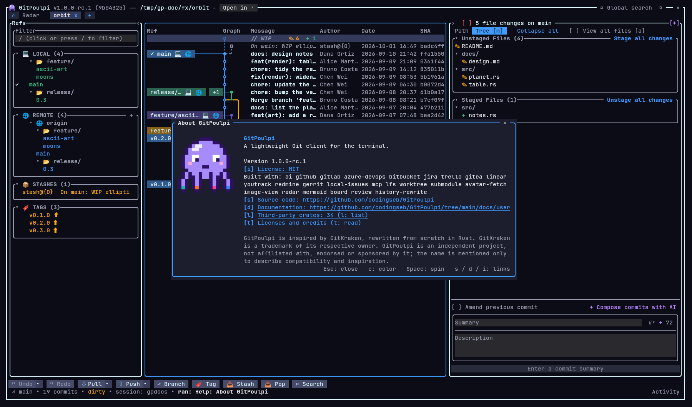
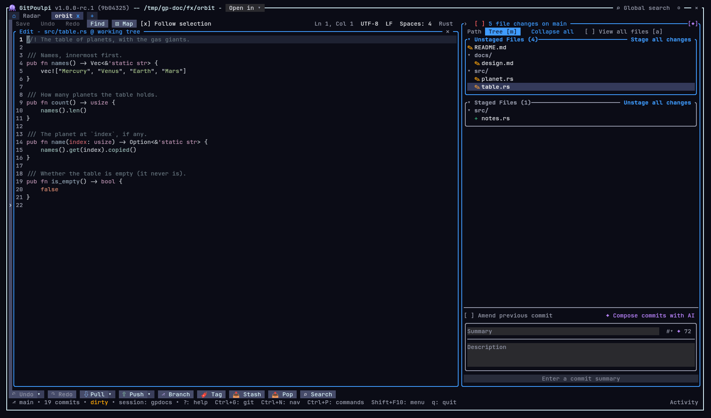
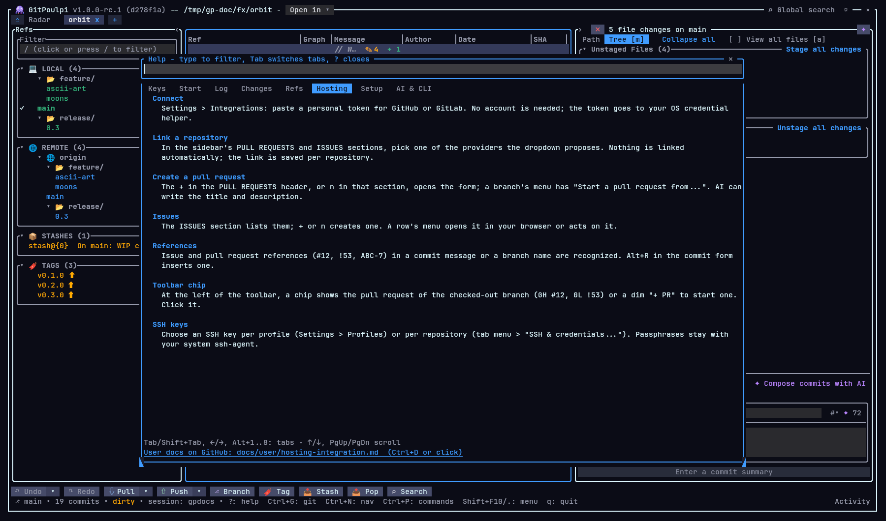
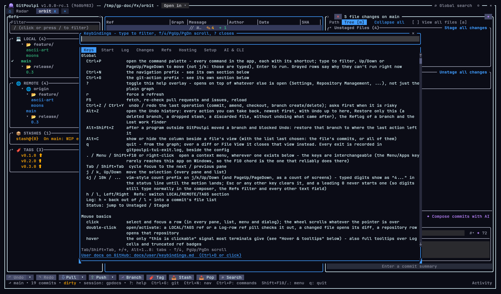

[English](../interface-tour.md) · [Čeština](../cs/interface-tour.md) · [Deutsch](../de/interface-tour.md) · [Español](../es/interface-tour.md) · [Français](../fr/interface-tour.md) · [Italiano](../it/interface-tour.md) · [日本語](../ja/interface-tour.md) · [한국어](../ko/interface-tour.md) · **Nederlands** · [Polski](../pl/interface-tour.md) · [Português (Brasil)](../pt-BR/interface-tour.md) · [Português (Portugal)](../pt-PT/interface-tour.md) · [Русский](../ru/interface-tour.md) · [Svenska](../sv/interface-tour.md) · [Türkçe](../tr/interface-tour.md) · [Українська](../uk/interface-tour.md) · [简体中文](../zh-CN/interface-tour.md)

# Rondleiding door de interface

Deze pagina noemt elk gebied van het GitPoulpi-venster, van boven naar beneden. De andere
pagina's gebruiken dezelfde namen. De afbeeldingen gebruiken een kleine demorepository met
verzonnen auteurs.

## Het kader

### Titelbalk

De bovenrand van het venster toont
 `GitPoulpi vX.Y.Z -- <repositorypad>` (de sessienaam staat in de statusbalk, standaard onderaan).

- **** opent het venster **Over**: versie, buildfuncties, licentie, links, een korte melding dat GitPoulpi een onafhankelijk project is, de crates van derden en de licenties en vermeldingen. Op een terminal die afbeeldingen tekent is de octopus het pixellogo, in je logokleur (elders blijft het de emoji). Palet: `Help: Over GitPoulpi`; toetsen: `Ctrl+N` en dan `A`. In Over volgen de pupillen van de octopus de muisaanwijzer. Klik op het logo (of druk op `Space`) om het naar de volgende kleur te laten draaien. Klik met rechts op het logo (of druk op `c`) voor de lijst met kleuren. GitPoulpi slaat je keuze op in `ui.logo_color`. De links openen met een klik of hun sneltoets (`s` broncode, `d` documentatie, `i` licentie), en `l` toont de crates van derden met hun versies en licenties (een scrollbare lijst; `Esc` of `l` gaat terug, net als een klik op de titel). Elke crate in de lijst heeft een link naar zijn pagina (de repository, anders de pagina op crates.io): klik op de regel, of kies hem met `Up` / `Down` en druk op `Enter`, om hem in de browser te openen. `t` (of het palet-commando `Help: Licenties en vermeldingen`) toont de licentievermeldingen en dankbetuigingen van alles wat in het programma zit, als scrollbare tekst (`Up` / `Down`, `PgUp` / `PgDn`, `Home` / `End`; terug met `Esc` of `t`). In een script drukt `gitpoulpi licenses` dezelfde tekst af.
- De **versie** (`v1.0.0`, of `vX.Y.Z beschikbaar` als er een nieuwere release is)
  staat tussen de naam en het pad: een klik opent het updatepaneel als er een nieuwere release is, anders het tabblad Releasenotes. Zie
  [Updates](updates.md).
- **Openen in ▾**, direct na het pad, opent de map van het tabblad in een terminal, een
  editor, een multiplexer of de bestandsbeheerder (`Alt+O`). Zie [Openen in](open-in.md).
- **⌕ Globaal zoeken** (een vergrootglas met zijn label), direct links van het tandwiel, opent het [globale zoeken](search.md) (`Ctrl+Alt+F`). Het maakt als eerste plaats als de titelbalk te smal is: eerst verdwijnt het label (het vergrootglas blijft), dan de knop.
- Het **tandwiel** (`⚙`), direct links van de **×**, opent de **Instellingen** (`Ctrl+,`).
- **×** aan het rechteruiteinde sluit af, zoals `q`.

### Statusbalk

De statusbalk is standaard de laatste rij van het venster (**Instellingen > Weergave > Positie van de statusbalk** zet hem bovenaan, boven de tabbladen van de repository). Hij toont de huidige branch, de geladen commits (`500 / 48213 commits` zolang er nog oudere geschiedenis te laden is, met `...` in plaats van het totaal terwijl dat wordt geteld; alleen `2500 commits` als de hele geschiedenis geladen is), `gewijzigd` of `schoon`, de sessienaam, een badge `deels` in een sparse checkout, en de nuttigste toetsen: `?` help, `Ctrl+G` git-acties, `Ctrl+N` navigatie, `Ctrl+P` opdrachten, `Shift+F10` menu, `q` afsluiten. In een smal venster vallen de minst nuttige toetsen weg. De statusbalk toont ook statusmeldingen en voortgang. De toetsen die hij toont zijn altijd de toetsen die gelden, ook de toetsen die je hebt gewijzigd (zie [Instellingen](settings.md#toetsenbord--muis)). Hoe het totaal wordt geteld is een instelling (**Totaal aantal commits tellen met**, zie [Instellingen](settings.md#log--grafiek)).

Aan het rechteruiteinde opent de knop **Activiteit** het activiteitenlogboek: een tabblad Git-bewerkingen (de bewerkingen met hun duur, meldingen en fouten), een tabblad Applicatie (het applicatielogboek met een niveauvak en een knop **Log wissen**) en een vak Bereik dat beide beperkt tot deze repository, een werkruimte of alle repositories. Een getal op de knop telt de fouten die je nog niet hebt bekeken. Links ervan toont de taakindicator een lopende achtergrondtaak met een `[x]` om die te annuleren (de takenlijst heeft **Alles annuleren** en het palet heeft *Taken: alles annuleren wat kan*; een taak die niet veilig te stoppen is, zegt waarom). Het tabblad **Start** heeft dezelfde statusbalk, met de knop Activiteit rechtsonder (die opent op Alle repositories). Als een bewerking mislukt, zegt de statusbalk in rood waarom, waar je ook bent; een klik erop (of `Activiteitenlogboek: Laatste fout openen` in het palet) opent de Activiteit-vermelding, met de details, een knop Kopiëren voor een AI en de voorgestelde volgende stap. Beide staan beschreven in [Wanneer er iets mislukt](troubleshooting.md#wanneer-er-iets-mislukt).

### Overlays

Het opdrachtenpalet, de help, contextmenu's, dialoogvensters, pop-ups en de Instellingen openen
boven het venster. Elk heeft rechtsboven in de rand een `✕`; `Esc` of een klik op `✕` sluit het, en een klik buiten sluit een dialoog, pop-up of paneel (zie [Vensters en dialogen sluiten](mouse-and-gestures.md#vensters-en-dialogen-sluiten)).

### Als het venster klein is

Er verdwijnt niets stilzwijgend als het venster smaller wordt. Een knop verliest eerst zijn lange label (afgekapt met `...`),
gaat dan over op een tweede rij of achter het `⋯`-menu van zijn rij, en zijn toets en palet-item blijven de hele tijd werken.
Een dialoog die te groot is voor het venster tekent een klein kader met zijn titel, de `✕` en de regel
**Venster te klein: maak het groter** in plaats van niets; `Esc` en `✕` sluiten hem, en hij komt weer heel terug als je het
venster groter maakt.

## Tabbalk

Het tabblad **Start** (het huispictogram) staat aan het linkeruiteinde, gevolgd door de
[werkruimtechip](workspaces.md) (zodra je een werkruimte hebt), het vastgezette tabblad
**Radar** (het sluit zoals elk tabblad; zie [de Radar](radar.md)) en het tabblad
**Werkruimtes** zodra je het hebt geopend (`Alt+J`; het sluit zoals elk tabblad). Daarna
komt één tabblad per geopende repository. De `x` waarmee je een tabblad sluit, staat alleen
op het actieve tabblad en op het tabblad onder de aanwijzer. De tabbalk bevat alleen
tabbladen (de knop voor het [globale zoeken](search.md) staat in de titelbalk).

Als de tabbladen van de repository niet passen, scrolt de rij in plaats van de tabbladen
te laten krimpen: de tabbladen staan tussen twee pijlknoppen, `‹` links en `›` rechts.
Een pijl is gedimd als er aan die kant geen tabblad verborgen is. Klik op een pijl om
één tabblad meer aan die kant te tonen (houd hem ingedrukt om te blijven scrollen), of
gebruik het wiel boven de rij (omhoog of naar links toont de eerdere tabbladen). Telkens
als het huidige tabblad verandert (je wisselt van tabblad met het toetsenbord, de
tabbladkiezer of het palet, opent of sluit een tabblad, of verandert de venstergrootte),
scrolt de rij precies genoeg om het helemaal te tonen. Is er ruimte voor, dan opent een
knop `…` na de rechterpijl de tabbladkiezer. Een tabblad op een pijl slepen scrolt de
rij zolang je het daar houdt, zodat je het voorbij de zichtbare tabbladen kunt neerzetten.
`Ctrl+N` zet een badge op elke actieve pijl.

**Instellingen > Weergave > Positie van de tabbalk** verplaatst deze rij naar de onderkant van het venster (onder de statusbalk) of maakt er een kolom van aan de linkerrand: een tabblad per rij, eerst Start, dan de werkruimtechip, de Radar, het tabblad Werkruimtes, de tabbladen (een lange naam eindigt op `…`) en de `+`. Zijn er meer tabbladen dan rijen, dan toont een `…`-rij hoeveel er boven (`▲`) en onder (`▼`) verborgen zijn en opent de tabbladenlijst; het wiel scrolt de kolom. Naast een werkbalk als kolom blijven de tabbladen aan de buitenkant. Een venster smaller dan 80 kolommen houdt de tabbladen bovenaan. Klikken, het sluitkruisje, middelklik, het rechtermuisknopmenu, slepen om te herordenen en het toetsenbord werken op elke positie hetzelfde.

- De **+** direct na het laatste tabblad opent een klein menu: **Nieuw tabblad** (`Alt+T`,
  palet **Tabblad: Nieuw tabblad**) en, zolang hun tabbladen gesloten zijn, **Radar** en
  **Werkruimtes** (`Alt+J`), die die tabbladen openen; het palet-item **Tabblad: Nieuw...**
  opent hetzelfde menu. Een **Nieuw tabblad** is de weergave Start met het zoekveld klaar, zodat typen je
  repositories meteen filtert. Kies er een (of Bladeren, Klonen, Init) en zijn tabblad
  verschijnt aan het eind van de balk; een repository die al open is wordt gewoon
  geactiveerd. `Esc` op het lege zoekveld, `Ctrl+W`, zijn `x` of een middenklik sluit het
  Nieuwe tabblad en brengt je terug naar het tabblad waar je was. Het wordt nooit met je
  sessie bewaard.

  
- Klik met rechts op een tabblad, of druk op `Ctrl+T`, voor het tabbladmenu: **Nieuw tabblad**, **Tabblad
  sluiten**, **Andere tabbladen sluiten...**, **Tabbladen rechts sluiten...**, **Aan favorieten
  toevoegen** (of **Uit favorieten verwijderen**), **Aan werkruimte toevoegen** (of **Uit
  werkruimte verwijderen**, als je werkruimtes hebt), **Pad kopiëren**, **Openen in ›**,
  **SSH & inloggegevens...** en **Gedeeltelijke checkout...**.
- `Ctrl+PageUp` en `Ctrl+PageDown` wisselen van tabblad, net als `Ctrl+Shift+Tab` en `Ctrl+Tab` waar je terminal die doorgeeft (kitty-toetsenbordprotocol; sommige terminals en multiplexers houden ze voor zichzelf). `Ctrl+W` sluit het huidige tabblad. Een middenklik op een tabblad sluit het ook (met dezelfde vraag).
- `t` (of `Ctrl+N Tab`) opent de tabbladkiezer, een doorzoekbare lijst van de geopende
  tabbladen.
- **Tabbladen herordenen:** houd een repositorytabblad ingedrukt en sleep het opzij (een
  schim van het tabblad volgt de aanwijzer en een streep toont waar het terechtkomt; `Esc`
  annuleert), of sleep een rij van de tabbladkiezer, druk op `Alt+Up` / `Alt+Down` op de
  gemarkeerde rij van de kiezer, of voer **Tabblad: Naar links verplaatsen** / **Tabblad: Naar
  rechts verplaatsen** uit vanuit het palet. De volgorde wordt met de sessie bewaard. Een
  gewone klik zonder beweging selecteert het tabblad nog steeds. Het huis, de werkruimtechip
  en de `+` verplaatsen nooit.
- **Afsluiten & cd hier** verschijnt rechts van de tabbladen als je GitPoulpi via de
  shell-wrapper `gp` hebt gestart en het tabblad niet de map is waarin je startte. Zie
  [De map van het actieve tabblad volgen](following-the-tab-folder.md).
- De **werkruimte-chip** direct na het huisje (een gekleurde stip en een naam, of
  "Geen werkruimte") wisselt van [werkruimte](workspaces.md): klik erop of druk op `Alt+W`.
  Hij verschijnt zodra je een werkruimte hebt.

Met **Tabbladen onthouden** aan (de standaard) komen je tabbladen bij de volgende start
terug. Een worktree opent in een eigen tabblad. Dat tabblad sluit als de worktree wordt
verwijderd.

Het tabblad van een worktree komt direct na het tabblad van zijn repository, en een weggesleept worktree-tabblad springt daar terug (**Worktree-tabbladen groeperen** onder Instellingen > Algemeen, standaard aan).

### Start

Het tabblad Start is het repositorybeheer. Het heeft vier secties: **GEOPENDE
REPOSITORIES**, **FAVORIETEN**, **RECENTE REPOSITORIES** en **ALLE REPOSITORIES**. Elke rij
toont de branch, het aantal commits voor en achter en het aantal wijzigingen, daarna het pad van de map als er ruimte is:
ingekort met `~` en in het midden afgekapt als het smal is, het duwt nooit de naam, de eigenaar of de branch weg.
Elke rij heeft een ster (favoriet), **Openen** of **Wisselen**, **Sluiten** of **Verwijderen**, en een
`⋮`-menu.

Bovenaan: **Bladeren**, **Klonen**, **Init**, een zoekvak, **Alles inklappen** en **Alles
uitklappen**. Een map die niet meer bestaat verdwijnt uit *Recent* en *Alle* uit zichzelf.
Een ontbrekende favoriet blijft staan, met een knop **Verwijderen**. **Verwijderen** wist
nooit iets op schijf.

Toetsen: `Enter` openen, `f` favoriet, `x` sluiten of verwijderen, `y` het pad kopiëren, `o` in de standaardtool openen (**Openen in** in het `⋮`-menu kiest een andere), `.` menu, `/` zoeken,
`Space` een sectie in- of uitklappen, `Esc` terug naar je tabblad.
`Ctrl+N` toont een badge op het zoekveld, elke sectie en elke knop: druk op het teken van een badge om het te focussen of in te drukken (zie [Badges](keybindings.md#badges)).

Eén zoekveld filtert alles eronder, ook de favorieten: een repository blijft staan als de naam, de branch of het pad de tekst bevat. De werkruimtes hebben een eigen tabblad en zijn geen pagina van Start: open het via het menu van de `+`, met `Alt+J` of via het palet, en sluit het met zijn `x`: zie [Werkruimtes](workspaces.md).

**Klonen** toont, voor elk verbonden profiel (GitHub, GitLab, Gitea, Forgejo, Azure DevOps, Bitbucket, Gerrit), de repositories waartoe je toegang hebt, één sectie per eigenaar: eerst je eigen, dan één per organisatie of groep (alfabetisch), elk onder een kop. Een slotje markeert een privérepository. Het zoekvak filtert over alle secties; een sectie zonder treffer verdwijnt. `Up` en `Down` slaan de koppen over, en `Home`, `End`, `PgUp` en `PgDn` werken in de lijst.

## Werkbalk

Standaard een rij onder de panelen en boven de statusbalk. **Instellingen > Weergave > Positie van de werkbalk** zet hem bovenaan (onder de tabbladen), onderaan, of als kolom links of rechts van de panelen (een venster smaller dan 80 kolommen tekent de kolom als rij onderaan). De knoppen staan aan het begin van de rij of kolom; **Instellingen > Weergave > Uitlijning van de werkbalkknoppen** centreert ze of zet ze aan het einde. Elke knop heeft een eigen iconkleur, die het thema bepaalt (zie [Thema's](themes.md)). Als er niet voor alle plek is, gaan de minst belangrijke knoppen achter een `⋯`. In een kolom heeft elke knop een rij, met zijn `▾` aan het einde van de rij, en zijn menu opent naast de kolom; het menu van een werkbalk onderaan opent naar boven.

| Knop | Wat hij doet |
|---|---|
| **Ongedaan**, **Opnieuw** | Maken de laatste bewerking ongedaan of herstellen die (`Ctrl+Z`, `Ctrl+Y`). Verborgen als Ongedaan maken uit staat. Zie [Ongedaan maken en opnieuw](undo-redo.md). |
| **Pull** `▾` | Doet een pull zoals **Instellingen > Git & codering > Pull-knop** zegt. De lijst `▾` heeft **Fetch All**, **Pull (fast-forward indien mogelijk)**, **Pull (alleen fast-forward)** en **Pull (rebase)**, daarna **Pull alle branches** (`Ctrl+G Ctrl+P`) en hetzelfde met elk van de andere modi voor de uitgecheckte branch. Een item uit de lijst wordt eenmalig uitgevoerd en wijzigt de knop niet. |
| **Push** `▾` | Pusht de uitgecheckte branch. De lijst `▾` doet eenmalig een push naar de remote die je kiest. |
| **Branch** | Maakt een branch op de uitgecheckte commit. |
| **Tag** | Maakt een tag op de uitgecheckte commit. |
| **Stash**, **Pop** | Zet alle wijzigingen in een stash. Haalt de laatste stash terug en verwijdert hem (pop). |
| **LFS** `▾` | Git LFS-acties: fetch, checkout, pull, push, prune (`Ctrl+G l`). Verborgen als Git LFS uit staat. Zie [Git LFS](lfs.md). |
| **Flow** `▾` | Het menu van de branchingworkflow (starten, afronden, synchroniseren, promoveren; `Ctrl+G Shift+W`). Alleen in een repository met een workflow. Zie [Branchingworkflows](branching-workflows.md). |
| **Zoeken** | Opent de zoekbalk voor commits boven de Log (`f`). |

Aan het uiteinde (rechts in een rij, onderaan in een kolom) toont een **chip**, als de repository aan een host is gekoppeld, de pull request van de uitgecheckte branch (bijvoorbeeld `GH #12` of `GL !53`), of een gedimde `+ PR`. **Instellingen > Weergave > Zet de pull request-knop vast aan het einde** (standaard aan) houdt hem daar; uit, dan stroomt hij met de andere knoppen mee en volgt hun uitlijning. In een smalle rij krimpt de chip eerst (`● #12`, daarna alleen het statussymbool) en pas daarna verhuist hij naar het menu `⋯`. Zie [Hosting en issuetrackers](hosting-integration.md). In een kolom neemt de profielkeuzelijst de laatste rij.

Aan het rechteruiteinde kiest de **profielkeuzelijst**, als je twee of meer
[profielen](settings.md#profielen) hebt, de commit-identiteit voor deze repository. De eerste
rij, *Standaard*, volgt **Instellingen > Profielen**. Nadat je een profiel hebt gekozen,
vraagt GitPoulpi of de naam en het e-mailadres ook in de git-configuratie van de repository moeten
worden geschreven (`user.name`, `user.email`). **Naar git-configuratie schrijven** schrijft ze.
`Esc` houdt de keuze alleen in GitPoulpi. Palet: `Repository: Profiel wijzigen...`.

Elke knop heeft een opdracht in het palet en een sneltoets.

## Banners

Een strook boven de Log laat weten wanneer de repository in een bijzondere staat is. Ze heeft
knoppen voor de weg vooruit. Elke knop is ook een opdracht in het palet.

| Banner | Knoppen |
|---|---|
| Een merge, cherry-pick of revert is op conflicten gestopt | **Conflicten oplossen...**, **Commit** of **Doorgaan**, **Afbreken** |
| Een rebase is bezig | **Conflicten oplossen...**, **Doorgaan**, **Overslaan**, **Afbreken** |
| **Patches toepassen (git am)** | **Conflicten oplossen**, **Doorgaan**, **Overslaan**, **Afbreken** |
| Een achtergebleven `index.lock` blokkeert elke wijziging | **index.lock verwijderen** (vraagt eerst) |
| Een auto-stash is niet teruggezet | **Nu poppen**, **Stash tonen**, **Opnieuw beginnen**, **Drop** (de keuzes hangen van de staat af) |

Zie [Merge-conflicten oplossen](merge-conflicts.md) en
[Probleemoplossing](troubleshooting.md).

## Zijbalk Refs (links)

Een boom van alles wat een commit een naam geeft. Elke sectie heeft een aantal in haar titel,
een chevron om haar in te klappen en een eigen scrollpositie. Sleep de rand tussen twee
secties om ze van grootte te veranderen.

- Het vak **Filter** bovenaan (`/`): filtert elke sectie op naam.
- **LOKAAL**: je branches, in mappen gesplitst op `/` (`feature/`, `fix/`). Een vinkje toont
  de uitgecheckte branch. Je kunt de mappen in de Instellingen uitzetten.
- **REMOTE**: elke remote, met zijn branches eronder.
- **WORKTREES**: gekoppelde worktrees, als die er zijn (of als je de sectie hebt getoond). De
  **+** op de kop maakt er een; dubbelklik op een worktree om hem in een eigen tabblad te
  openen, klik met rechts voor Openen in, Merge en Verwijderen. Zie [Worktrees](worktrees.md).
- **STASHES**: je stashes. Klik met rechts op een voor **Pop**, **Apply** en **Drop**.
- **TAGS**: je tags, in mappen gesplitst op `/` zoals branches (`releases/`, `backups/`). Een pijl betekent dat de tag ook op de remote staat.
- **PULL REQUESTS** en **ISSUES**: nadat je een hostingaccount hebt verbonden en de
  repository hebt gekoppeld.
- **SUBMODULES**: de submodules en hun staat, als die er zijn. Zie
  [Submodules](submodules.md).

**Een sectie tonen of verbergen:** klik met rechts op de kop van een sectie, of op het lege deel van het paneel, voor een afvinklijst van de secties (de laatste zichtbare blijft). De keuze blijft per repository bewaard, ook na een herstart; zie [Secties van het linkerpaneel](mouse-and-gestures.md#secties-van-het-linkerpaneel).

Wijs een rij aan om haar knoppen te tonen: de ref in de Log verbergen of tonen, en **Solo**
(alleen de commits van die ref tonen). Dubbelklik op een lokale branch of een tag om hem uit
te checken. Klik met rechts op een rij voor haar menu. De `‹` in de titel van de zijbalk
klapt de zijbalk in (`Ctrl+N Shift+H`).

De twee zijpanelen (de zijbalk Refs, `Ctrl+N Shift+H`, en het rechterpaneel, `Ctrl+N Shift+L`) horen bij de Log: als je er een toont of inklapt terwijl een diff, bestandsweergave of editor open staat, geldt dat alleen voor die weergave. Een diff of bestandsweergave klapt de zijbalk Refs bovendien zelf in om ruimte te maken voor de inhoud. Terug in de Log staan beide panelen zoals je ze daar liet, en dat is de stand die voor de volgende start wordt opgeslagen.

## De Log (midden)

Eén rij per commit, de nieuwste eerst. Klik met rechts op de kop om kolommen te tonen of te
verbergen. Sleep de rand tussen twee koppen om een kolom van grootte te veranderen. Sleep een
kop om de kolom te verplaatsen. De breedtes horen bij de repository: ze worden ermee opgeslagen en komen terug als je hem
opnieuw opent, en een repository die voor het eerst wordt geopend, krijgt elke kolom aangepast aan wat de Log toont
(`Alle kolommen aan inhoud aanpassen` doet dat opnieuw, `Kolombreedtes herstellen` gaat terug naar automatische breedtes,
die blijven staan).

Het paneel heeft geen titel: de kolomkoppen zeggen wat het is. Tags worden getekend waar ze staan, nooit als spook. Bij een commit zonder ref toont de aangewezen rij een vervaagde pil met de naam van de branch waartoe die behoort; was die branch verwijderd, dan toont een doorgestreepte pil de naam uit de merge-commit die hem samenvoegde (uit te zetten met **Spookbranch tonen bij de aangewezen commit** onder Instellingen > Log & grafiek).

| Kolom | Toont |
|---|---|
| **Ref** | Gekleurde pillen voor de branches en tags op de commit: een laptoppictogram voor lokaal, een wereldbol voor remote, een tagpictogram voor tags, `+N` als meer refs daarheen wijzen. |
| **Grafiek** | De branchbanen, merges en vertakkingspunten. Getekend als afbeeldingen in kitty, Ghostty, WezTerm, Rio en iTerm2 (en ook Windows Terminal, foot en Tabby, via sixel), en als tekens in andere terminals. De baankleuren komen uit het thema of een palet dat je kiest (zie [Thema's](themes.md)). Op zijn minimale breedte (één commitpunt) is de kolom compact: elke commit op één baan, zonder branch- of mergelijnen. |
| **Bericht** | De samenvatting van de commit. |
| **Auteur** | De auteur, met een optionele avatar. |
| **Datum** | De datum van de auteur, in het formaat dat je kiest. |
| **Wijzigingen** | Optioneel: gewijzigde bestanden en `+toegevoegd -verwijderd` regels. |
| **SHA** | De korte hash. |

Bijzondere rijen:

- **De rij met lokale wijzigingen** (WIP-rij) bovenaan: een gestippelde cirkel, `// WIP` of je
  conceptbericht, en het aantal gewijzigde en toegevoegde bestanden. Klik erop om in het
  rechterpaneel te stagen en te committen.
- **Stash-rijen**: een klein vierkantje op een baan, naast de commit waarop de stash is
  gemaakt.
- Tijdens een zoekopdracht worden rijen die niet overeenkomen gedimd.

Wijs een cel aan voor een tooltip met de volledige tekst. Klik met rechts op een rij voor het
[commit-menu](log-and-history.md#het-commit-menu).

## Het rechterpaneel

Het rechterpaneel volgt de selectie in de Log.

**Lokale wijzigingen** (de WIP-rij is geselecteerd):

- Een titel als `4 bestandswijzigingen op main`. Tijdens een merge met conflicten komt er het
  aantal conflicterende bestanden bij. Een rode `✗` links verwerpt alle wijzigingen (vraagt
  eerst). Met AI aan legt een `✦` rechts de wijzigingen uit.
- **Pad** of **Boom** (een platte lijst of mappen, `m`), **Alles inklappen** en **Alle
  bestanden tonen** (`a`).
- **Unstaged bestanden** en **Staged bestanden**, elk met een aantal en een knop **Alle
  wijzigingen stagen** of **Alle wijzigingen unstagen**. Wijs een rij aan voor haar knop
  **Bestand stagen** of **Bestand unstagen**.
- Het **commit-formulier** onderaan: **Vorige commit amenden**, **Commits samenstellen met
  AI** (met AI aan), de **Samenvatting** met een tekenteller en de knop `✦`, de
  **Beschrijving** en de knop **Wijzigingen in N bestanden committen**.

**Commit-details** (een commit is geselecteerd), van boven naar beneden: de volledige hash,
de auteur met avatar en datum, de hash van de ouder en de aantallen wijzigingen, en dan het
bericht (samenvatting en beschrijving; sleep de onderrand om het van grootte te veranderen).
Het paneel **Gewijzigde bestanden** eronder begint met zijn eigen bediening: de
sorteerschakelaar, **Pad** / **Boom**, **Alle bestanden tonen** en een vak **Bestanden
filteren** (met een selectievakje **Alleen LFS** aan het rechteruiteinde in een repository met
LFS-bestanden), vast boven de lijst, die als enige scrolt. Klik op een bestand om zijn diff te
openen. In een laag venster krimpt eerst het bericht (tot één rij), dan de lijst. De weergave
van de lokale wijzigingen houdt haar rij **Pad** / **Boom** / **Alle bestanden tonen**
bovenaan de bestandslijsten, boven de lijsten Unstaged en Staged. In de modus Boom
eindigt een ingeklapte map met het aantal bestanden erin, submappen inbegrepen, als
gedempte `(12)`.

**Links in een bericht.** Een webadres in het bericht (`https://...`, of het doel van een
markdown-link `[tekst](https://...)`) is onderstreept, toont de handaanwijzer en vraagt bij een klik
**Deze link openen?** met het hele adres voordat er iets opent: de tekst van een bericht
is niet te vertrouwen. **Openen** (`O`) start de browser, **Annuleren** (`A`, `Esc`, het kruisje) doet niets. Alleen
`http`- en `https`-adressen worden aangeboden. Het toetsenbordequivalent is het palet-commando
`Commitdetails: Link in bericht openen...`, dat naar het eerste adres van het bericht
vraagt en met **Volgende** (`V`) langs de andere gaat.
Sommige terminals tekenen zelf een onderstreping onder een adres onder de aanwijzer en
openen het zelf bij een klik met een toets erbij (vaak Shift+klik); dat is een functie van
de terminal, niet van GitPoulpi.

Elke bestandslijst heeft menu's voor bestanden, mappen en het lege deel, en meerdere bestanden kunnen tegelijk worden geselecteerd (**Ctrl+klik**, **Shift+klik**); zie [Stagen en committen](staging-and-committing.md).

## Het middenpaneel als een bestand open is

Klik op een gewijzigd bestand en zijn weergave vervangt de Log. `Esc` brengt de Log terug.
Bovenaan loopt een balk met knoppen:

| Knop | Wat hij doet |
|---|---|
| **Inhoud**, **Diff**, **Blame** | Kiezen wat het paneel voor het bestand toont: de Bestandsweergave (het hele bestand bij deze revisie), de diff of blame. |
| **Bestand │ Alles** | Kiest de lijst van de [commit-kolom](#de-commit-kolom) naast de weergave en toont de kolom. |
| **Bewerken** | Opent de ingebouwde editor op de werkkopie. |
| `↑` `↓` | Vorige of volgende hunk. |
| **Inline**, **Split** | Eén kolom, of naast elkaar. |
| **Hunks** | Alleen de gewijzigde hunks, of het hele bestand. |
| **WS** | Alleen-witruimtewijzigingen tonen of verbergen. |
| **Afbr.** | Lange regels afbreken. |
| **Kaart** | Een minimap van het hele bestand naast de schuifbalk. |
| **Codering** | De codering waarin het bestand wordt gelezen (**Auto** bovenaan). |

#### Gewijzigde woorden in een diff

Wijzigt een regel maar gedeeltelijk, dan worden de woorden die verschillen geverfd met een
sterkere achtergrond in de eigen kleur van de regel (een sterkere rode op de verwijderde regel,
een sterkere groene op de toegevoegde), en de rest van de regel houdt de egale tint. Binnen een
hunk wordt elke reeks verwijderde regels gepaard met de reeks toegevoegde regels die erop volgt,
de eerste met de eerste, de tweede met de tweede, enzovoort; een paar wordt alleen gemarkeerd
als minstens 40% van zijn niet-lege tekens gelijk is, zodat een regel die van nul is herschreven
egaal blijft in plaats van één blok nadruk te worden. Woorden, reeksen spaties en losse
leestekens worden vergeleken, een enkele spatie tussen twee gewijzigde woorden voegt ze samen
tot één markering, en regels van meer dan 1000 tekens worden niet gemarkeerd. Het werkt in
Inline en Split, met regelafbreking en zijwaarts scrollen, en in het diffpaneel van de review.
Zet het uit in **Instellingen > Diff & editor > Gewijzigde woorden markeren**
(`ui.diff_intraline`) of via het commandopalet (**Diff: Markering van gewijzigde woorden
omschakelen**, zonder eigen toets). Op een terminal die beperkt is tot 16 kleuren, of met een
thema zonder diff-achtergrond, worden de gewijzigde woorden in plaats daarvan vet en
onderstreept getoond.

In een diff van de werkmap heeft elke hunk de knoppen **Hunk stagen** en **Hunk verwerpen**.
Druk op `v` om regels te selecteren en stage of verwerp dan alleen die regels.

Beide weergaven staan beschreven bij [Blame](log-and-history.md#blame) en [Bestandsgeschiedenis](log-and-history.md#bestandsgeschiedenis).

De ingebouwde **editor** heeft syntaxiskleuren, regelnummers, ongedaan maken, zoeken en een
statusbalk met de regel, kolom, het regeleinde, de inspringing en de taal.

Een afbeeldingsbestand wordt als afbeelding getoond: voor en na in de diff, of het bestand
zelf in de Bestandsweergave. Zie [Afbeeldingen](image-view.md).

Een binair bestand dat geen afbeelding is (een PDF, een document, een archief) toont een knop **Openen in** als het systeem toepassingen voor het type kent: zie [Openen in](open-in.md).

## De commit-kolom

Links van de bestandsdiff, de bestandsweergave of de Blame van een commit kan één kolom staan (nooit naast de ingebouwde editor, die de werkkopie bewerkt: de kolom verdwijnt als de editor opent en is terug als hij sluit op de diff). Ze heeft drie standen:

- **Bestand**: de commits van dat ene bestand, op twee regels (de [Bestandsgeschiedenis](log-and-history.md#bestandsgeschiedenis)). Rechts staat de versie van het bestand bij de geselecteerde commit.
- **Alles**: een compacte lijst van de commits van de Log met zijn grafiek, hieronder beschreven.
- **Verborgen**: een smalle strook met een `›` links van de weergave haalt de kolom terug (de tooltip noemt de toets).

De knoppenbalk van de weergave loopt altijd over de hele breedte boven de kolom, zodat geen knop verschuift als de kolom opent, sluit of van lijst wisselt. Daarop kiest de keuze **`Bestand │ Alles`** (twee segmenten van één bedieningselement, altijd even breed) de lijst: een klik op een segment toont die lijst en opent de kolom als die verborgen was; een klik op het segment dat al gekozen is verbergt de kolom als die zichtbaar is. Het segment van de lijst op het scherm licht op; zolang de kolom verborgen is, is het segment waarmee ze terugkomt onderstreept en blijft de lijst bewaard. De tooltip noemt de klik, de tweede klik op het gekozen segment en `Alt+C`. De Bestandsgeschiedenis opent ook vanaf de plekken waar ze altijd al opende (bestandsmenu's, `Bestandsgeschiedenis: ...` in het palet).

- **Tonen of verbergen**: `Alt+C` (palet `Weergave: commit-kolom tonen of verbergen`), een klik op het gekozen segment van de keuze, de ✕ op de kolom of de strook `›`. In het palet kiezen `Weergave: commit-kolom: verbergen`, `... : bestandsgeschiedenis` en `... : alle commits` een stand. De keuze wordt, met de lijst die de kolom had, onthouden met de andere instellingen van de kolom. Zonder keuze beslist de breedte van de terminal voor de lijst Alles: die verschijnt vanaf 140 kolommen breed. De kolom wordt niet getekend als de weergave ernaast minder dan 30 kolommen zou houden, en de grafiek Alles niet voor een diff van de werkmap of een vergelijking (de bestandsgeschiedenis wel: die heeft geen commit nodig).
- **Breedte**: sleep de rechterrand (de gemarkeerde rand volgt de aanwijzer), of gebruik `Weergave: commit-kolom verbreden` en `Weergave: commit-kolom versmallen`. Ze kan tot 70% van de middenkolom innemen (de rest blijft aan de weergave, die nooit onder 30 kolommen komt). Ze wordt onthouden met de andere afmetingen.
- **Een commit kiezen**: klik erop, of geef de kolom het toetsenbord (`Ctrl+N` en haar badge, of `Weergave: Focus op de commit-kolom`) en gebruik `Up` / `Down`, `PageUp` / `PageDown`, `Home` / `End`. `Enter` of `Right` gaat door naar de bestandenlijst van de commit, `Esc` geeft het toetsenbord terug aan de weergave. Het rechterpaneel volgt de keuze: details van de commit en de gewijzigde bestanden, zodat je een ander bestand ervan kunt openen.
- **Wat de weergave doet**: het open bestand blijft open. Heeft de gekozen commit het gewijzigd, dan toont de weergave de diff ervan in die commit. Anders toont ze het bestand zoals het toen was, met "ongewijzigd in deze commit" in de titel. Heeft de commit dat bestand niet, dan zegt de weergave dat en blijft bruikbaar. Een Blame blijft een Blame, zoals bij de gekozen commit.

De lijst Alles staat onder een kopregel (de kolomnamen van de Log zelf). Eén commit per regel: de grafiekbanen, de titel (het bericht), de voornaam van de auteur en een korte datum en, als je ze aanzet, de branch- en taglabels. Het is de lijst van de Log zelf, met dezelfde commits in dezelfde volgorde, en ze laadt oudere bij het scrollen. De banen worden getekend zoals in de kolom Grafiek van de Log: op een terminal die afbeeldingen toont (zie [Een terminal kiezen](terminals.md)) als verbonden banen met ronde markeringen en, als de instelling voor avatars op Grafiek staat, de afbeeldingen van de auteurs in de cirkels; elders als tekens. Standaard nemen de banen de ruimte die ze nodig hebben en houdt de titel altijd een paar woorden: in een smalle kolom wijken eerst de auteur en dan de datum voordat de banen worden afgekapt. Teruggebracht tot zijn minimale breedte, één commitpunt, is het deel Grafiek compact, zoals in de Log: elke commit op één baan, zonder branch- of mergelijnen. Een deel dat door het paneel wordt afgekapt (de rij zijwaarts gescrold, of een deel Grafiek breder dan de ruimte) behoudt zijn afbeeldingen en avatars, bijgesneden aan de rand. Het wiel scrolt de lijst onder de aanwijzer.

- **Aanwijzen en het menu**: als je op een rij blijft staan, toont die de tooltip van de Log voor het deel onder de aanwijzer (het hele bericht op de titel, de naam en het e-mailadres van de auteur, de volledige datum). Een rechtsklik op een rij (of de menutoets, `Shift+F10`, als de kolom het toetsenbord heeft; `Weergave: commit-kolom: menu van de geselecteerde rij` in het palet) opent haar menu: *Tonen in de Log*, de diff van het bestand in die commit, het bestand zoals het bij die commit was, de blame van het bestand bij die commit, en dan het eigen menu van de Log voor die commit (kopiëren, cherry-pick, branch, en onder een streep de rijen die iets herschrijven, zoals revert). Elk van de vier eerste rijen heeft ook een item in het palet (`Weergave: commit-kolom: ... tonen`). In de lijst Bestand hebben de rijen het eigen menu van de Bestandsgeschiedenis en dezelfde tooltips.
- **De delen schalen en zijwaarts scrollen**: sleep een grens in de kopregel om het deel links ervan te schalen: de banen, het bericht, de auteur, de datum, de refs, de wijzigingen of de SHA. Het laatste deel heeft ook een grens: de cel direct erna (de eigen rand van de kolom als de rij de ruimte vult), op dezelfde manier verlicht, die dat laatste deel schaalt. Net als in de Log (`ui.column_resize`) is de grens standaard de scheidingscel tussen twee delen, waar de rijtint van de Grafiek eindigt (de tint loopt erdoorheen, zodat er geen gewone cel tussen haar en het volgende deel zit): in de kop staat een streepje in die cel en zolang de aanwijzer erop staat of hem sleept, wordt een dunne lijn over de kolom getekend, waarbij slepen vanaf elk punt van de lijn de kolom schaalt; met `header` is het de eerste letter van de volgende naam, die oplicht zolang de aanwijzer erop staat (er wordt geen lijn getekend, de kop is de enige plek om vanaf te slepen). Zolang je niets schaalt, krijgt het bericht wat de andere overlaten; de eerste sleep legt elk deel vast op de breedte die het heeft, het bericht inbegrepen, zodat het schalen van één deel de delen erna verschuift en geen andere breedte verandert. Een deel dat je zelf hebt geschaald blijft zoals het is en wordt nooit opgegeven voor ruimte: is de rij dan breder dan de kolom, dan scrolt ze zijwaarts met Shift+wiel, een horizontaal wiel of `Shift+Left` / `Shift+Right` als de kolom het toetsenbord heeft, en een schuifbalk op de onderrand toont waar je bent. Met het toetsenbord: `Tab` kiest het deel (onder de getoonde), `]` verbreedt het, `[` versmalt het, `0` zet alle delen terug op automatisch (het palet heeft `Weergave: commit-kolom: volgend deel kiezen`, `... deel verbreden`, `... deel versmallen`, `... breedtes van de delen herstellen`, `... naar links scrollen` en `... naar rechts scrollen`). De breedtes worden onthouden. Zolang een scroll de banen afkapt, worden ze als tekens getekend, ook op een terminal die afbeeldingen toont.
- **De delen kiezen**: een rechtsklik op de kopregel opent een menu met een selectievakje per deel, elke kolom die de Log biedt: Ref, Grafiek, Bericht, Auteur, Datum, Wijzigingen en SHA. Bericht is altijd zichtbaar. **Ref**, **Wijzigingen** en **SHA** staan standaard uit; getoond draagt Ref de branch- en taglabels van de commit, Wijzigingen zijn bestanden en regels `+toegevoegd -verwijderd` en SHA zijn korte hash, alles zoals de eigen kolommen van de Log. Net als Ref worden Wijzigingen en SHA nooit opgegeven voor ruimte: de rij scrolt dan zijwaarts. Met het toetsenbord opent `Weergave: commit-kolom: kolommen kiezen` hetzelfde menu (pijltjes en `Enter` kiezen een rij) en schakelen `Weergave: commit-kolom: Ref omschakelen`, `... Grafiek omschakelen`, `... Auteur omschakelen`, `... Datum omschakelen`, `... Wijzigingen omschakelen` en `... SHA omschakelen` meteen een deel om. De getoonde delen, hun volgorde en hun breedtes horen bij de kolom alleen: ze worden bewaard in `config.toml` (`ui.commit_column_columns_visible`, `ui.commit_column_columns_order`, `ui.commit_column_columns_widths`), los van de eigen kolommen van de Log, die er nooit door veranderen, noch omgekeerd.
- **De delen verplaatsen**: sleep een naam van de kopregel over een andere om dat deel daarheen te verplaatsen, zoals in de Log (de rij volgt de aanwijzer; met `ui.column_resize = "header"` is de eerste letter van een naam de schaalgrens, druk dan op de rest van de naam). Elk deel kan overal heen, ook de banen en de Ref-labels. Met het toetsenbord kiest `Tab` het deel en verplaatsen `<` / `>` het één plaats naar links of rechts onder de getoonde (het palet heeft `Weergave: commit-kolom: deel naar links verplaatsen` en `... deel naar rechts verplaatsen`). De volgorde wordt onthouden.

  

De muisgebaren staan ook in [Muis en gebaren](mouse-and-gestures.md#de-commit-kolom-lijst-alles).

## Formaten worden onthouden

GitPoulpi onthoudt elke grootte die je sleept, over tabbladwissels en herstarts heen. De
formaten zijn voor elke repository hetzelfde. Dit betreft de scheidingslijnen tussen de
zijbalk Refs, de Log en het rechterpaneel, de hoogte van elke Refs-sectie, het
commit-berichtblok, de kolombreedtes van de Log, de panelen van de merge-editor en de
scheidingslijn van de mapkiezer. Formaten worden opgeslagen als delen van het venster, dus
een indeling gemaakt op een brede terminal past ook op een smalle.

Om alle formaten te resetten voer je de opdracht `Navigatie: Lay-out resetten` uit.
Sommige formaten hebben ook een eigen reset: `Navigatie: Groottes Refs-secties resetten`,
`Commit-details: Berichtgrootte resetten`, en in de merge-editor een dubbelklik op een
scheidingslijn of `Alt+0`.

## Overlays en bijzondere schermen

- **Opdrachtenpalet** (`Ctrl+P`): een filtervak over elke opdracht. Elke rij toont haar
  sneltoets. Een opdracht die nu niet kan worden uitgevoerd is grijs, en de reden staat
  onderaan. Opdrachten hebben een groepsvoorvoegsel zoals `Git:`, `Refs:`, `Navigatie:`,
  `Diff:`, `Lokale wijzigingen:`, `Commit:`, `Weergave:`, `Repository:`, `Tabblad:`, `LFS:`,
  `Pull requests:`, `Issues:` of `AI:`. Typ een voorvoegsel om zijn groep te zien.
- **Kiezers**: sommige opdrachten van het palet openen een tweede lijst, bijvoorbeeld `App: Thema
  wijzigen...`, `App: Taal wijzigen...` en `App: Kleurthema van de grafiek wijzigen...`. Het venster
  toont elke keuze live terwijl je door de lijst beweegt. `Enter` houdt haar. `Esc` zet de
  oude keuze terug. De themalijst heeft de filters **Alle**, **Donker**, **Licht** en
  **Gekleurd**. Zie [Thema's](themes.md).
- **Help** (`?`): tabbladen. **Toetsen** toont elke toets en elk gebaar; de andere
  tabbladen (Start, Log, Wijzigingen, Refs, Hosting, Instellen, AI & CLI) zijn korte
  gidsen voor de acties, met hoe je elke actie bereikt. Wissel van tabblad met `Tab` /
  `Shift+Tab`, `Left` / `Right`, `Alt+1`..`Alt+8` of een klik. Typ om het huidige
  tabblad te filteren. `Ctrl+D`, of een klik op de link onderaan, opent de
  documentatiepagina van het tabblad waarop je staat.

  

  
- **Zoekbalk** (`f`): rechtsboven in de Log. Ze toont `n van N` treffers.
- **Contextmenu's**: klik met rechts, of druk op `.` op de geselecteerde rij. Een rij met
  `›` opent een submenu.
- **Dialoogvensters**: bevestigingen, een naam voor een branch of tag, Klonen, Init, Pull
  request maken, de keuzes na een geweigerde push en andere. `Enter` accepteert, `Esc`
  annuleert.
- **Interactieve rebase** en de **commit-composer** vervangen de Log door een
  beoordelingsscherm. Zie [Werken met de Log](log-and-history.md#interactieve-rebase) en
  [Stagen en committen](staging-and-committing.md#de-commit-composer-verdeel-je-wijzigingen-over-commits).

  

- **Instellingen** (`Ctrl+,` of het tandwiel): links een lijst met pagina's en rechts de
  opties van de pagina. Zie [Instellingen](settings.md).

  

- **Pop-ups** voor lange antwoorden, zoals de AI-pop-up **Wijzigingen uitleggen**
  (`↑` `↓` scrollen, `c` kopiëren, `Esc` sluiten).

  

Alle lijsten in pop-ups werken op dezelfde manier. Zie [Sneltoetsen](keybindings.md) en
[Muis en gebaren](mouse-and-gestures.md).

## Woorden in deze documentatie

| Woord | Betekenis |
|---|---|
| Paneel | Een van de drie kolommen: zijbalk Refs, Log (of het geopende bestand), rechterpaneel. |
| Pil | Een label van een branch of tag in de kolom Ref. |
| WIP-rij | De rij met lokale wijzigingen bovenaan de Log. |
| Hunk | Eén blok gewijzigde regels in een diff. |
| Composer | Het commit-formulier, en de AI-beoordeling die wijzigingen in commits splitst. |
| Toetsenreeks (chord) | Een toets gevolgd door een andere toets, zoals `Ctrl+G` en dan `s`. |
| Voorvoegsel | `Ctrl+G` (git-acties) of `Ctrl+N` (navigatie). |
| Badge | De letter die `Ctrl+N` naast een bedieningselement toont. Druk erop om dat element te focussen. |
