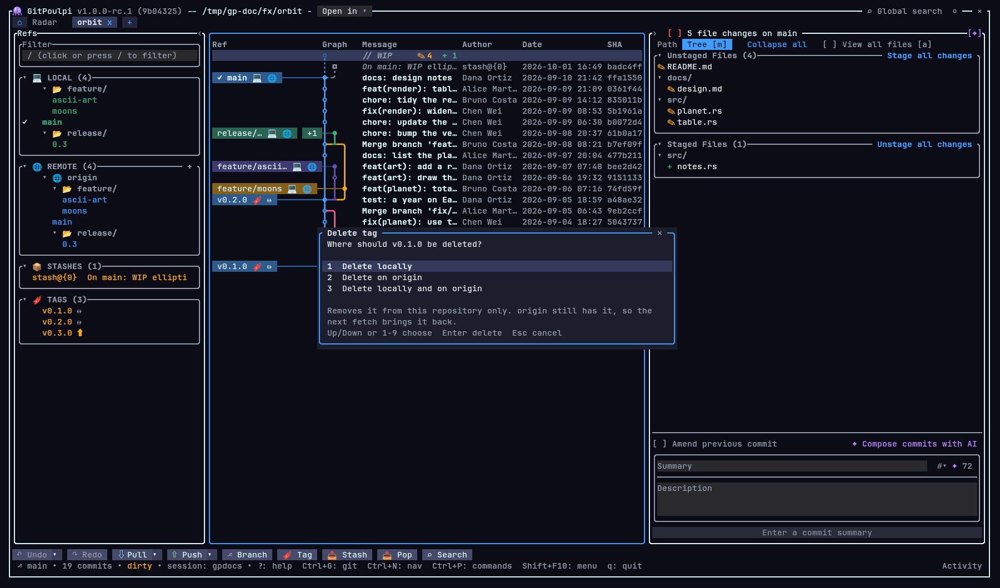
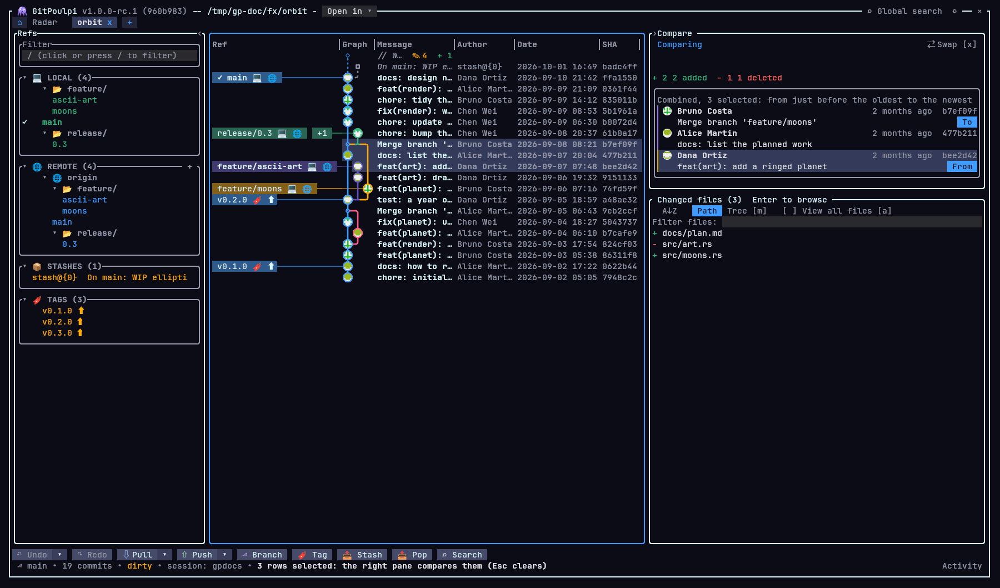
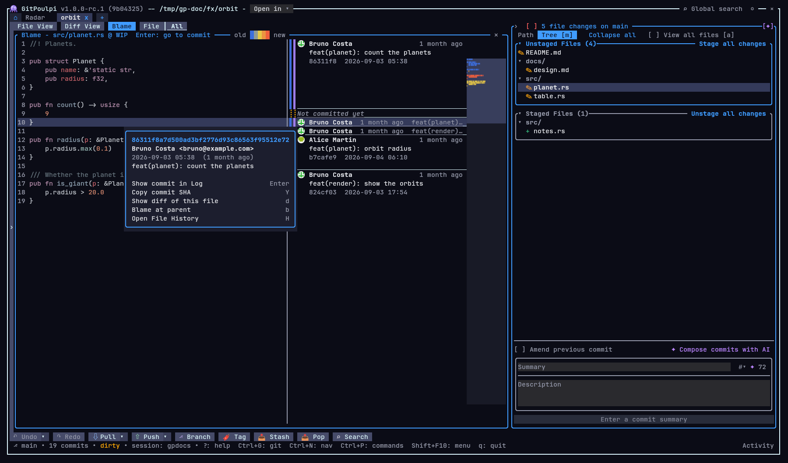

[English](../log-and-history.md) · [Čeština](../cs/log-and-history.md) · [Deutsch](../de/log-and-history.md) · [Español](../es/log-and-history.md) · [Français](../fr/log-and-history.md) · [Italiano](../it/log-and-history.md) · [日本語](../ja/log-and-history.md) · [한국어](../ko/log-and-history.md) · **Nederlands** · [Polski](../pl/log-and-history.md) · [Português (Brasil)](../pt-BR/log-and-history.md) · [Português (Portugal)](../pt-PT/log-and-history.md) · [Русский](../ru/log-and-history.md) · [Svenska](../sv/log-and-history.md) · [Türkçe](../tr/log-and-history.md) · [Українська](../uk/log-and-history.md) · [简体中文](../zh-CN/log-and-history.md)

# Werken met de Log

De Log is het hart van GitPoulpi: de hele geschiedenis als grafiek, met elke branch, tag en
stash erop. Deze pagina behandelt het lezen ervan, het zoeken erin en alles wat je met
commits en refs kunt doen. De gebieden worden benoemd in de
[interfacerondleiding](interface-tour.md); de exacte toetsen staan in
[Sneltoetsen](keybindings.md) en de muisgebaren in
[Muis en gebaren](mouse-and-gestures.md).


## De grafiek lezen

Elke rij is een commit, de nieuwste eerst. Een stip staat op de baan van de commit; lijnen
verbinden een commit met zijn ouders; een merge toont twee lijnen die samenkomen. De pillen
links noemen de branches en tags op die commit, in de kleur van de baan, met een dunne lijn
naar de stip. Een laptoppictogram markeert een lokale branch, een wereldbol een remote branch en
`✓` de branch die je hebt uitgecheckt. `+N` betekent dat meer refs naar die commit wijzen;
houd de muis erboven om ze op te sommen, of gebruik het menu hieronder.

De eerste rij zijn de **lokale wijzigingen** (een gestippelde cirkel: je niet-gecommitte werk,
verbonden met de commit waarop het rust). Stashes verschijnen als kleine vierkantjes op een
baan naast de commit waarop ze zijn gemaakt.

### Kleuren, rijtint en avatars

De baankleuren komen uit het thema. *Instellingen > Weergave > Kleurthema van de grafiek*
combineert elk thema met elk baanpalet, en de kiezer *App: Kleurthema van de grafiek
wijzigen...* van het palet (`Ctrl+N Shift+T`) toont elk palet live vooraf; zie
[Thema's](themes.md). *Achtergrond van grafiekbanen* op **Rijtint** schildert een zwakke band
in de baankleur achter de grafiekkolom en een dunne balk aan de rand ervan. *Sterkte van
rijtint* (**Sterk**, **Gemiddeld** (standaard), **Subtiel**) bepaalt hoe vervaagd de band is.

| Baanpalet Serie met rijtint | Baanpalet Material met rijtint |
|---|---|
|  |  |

*Avatars van auteurs* (een afbeelding in de grafiekstip of in de kolom Auteur) staan
standaard uit. Ze aanzetten stuurt een hash van het e-mailadres van elke auteur naar
Gravatar en vraagt je hostingprovider. *Avatarbronnen* en *Avatar-terugval* op dezelfde
pagina bepalen waar de afbeeldingen vandaan komen en wat er wordt getekend als er geen is.

Kan je terminal geen afbeeldingen tonen, dan wordt de grafiek met tekens getekend.
*Grafiekweergave* en *Afbeeldingsprotocol* forceren het een of het ander; zie
[Probleemoplossing](troubleshooting.md).

De markering van de geselecteerde of aangewezen rij begint bij de cirkel van de commit. De
banen links ervan houden de normale achtergrond.

### Kolommen

Klik met rechts op de kop om de kolommen te kiezen: **Ref**, **Grafiek**, **Bericht** (altijd
aan), **Auteur**, **Datum**, **Wijzigingen** en **SHA**. De optionele kolom **Wijzigingen** toont voor
elke commit `n bestanden +toegevoegd -verwijderd`. Sleep de rand tussen twee koppen om een kolom van
grootte te veranderen; de keuze wordt onthouden, in terminalcellen. Met de standaard `ui.column_resize = "line"` is de rand de tussenruimte van één cel aan het eind van een kolom: op de kopregel staat daar een klein streepje, en zolang de aanwijzer op die ruimte staat (op de kop of overal in de tabel) wordt een dunne accentlijn over de volle hoogte van de tabel getekend en schaalt slepen vanaf elk punt ervan de kolom (de aanwijzer wordt een formaataanwijzer in terminals die dat ondersteunen). Met `"header"` is er geen streepje en geen lijn: het eerste teken van de kopcel na de rand licht op bij het aanwijzen en het slepen begint daar, alleen op de kopregel (Instellingen > Log & grafiek > Kolombreedte aanpassen). De rijen zien er in beide standen hetzelfde uit: de ruimte hoort bij de kolom links ervan, dus de selectie en de rijtinten lopen erdoorheen. Ref, Grafiek en de andere kolommen behouden hun breedte als het venster van grootte verandert of wordt gemaximaliseerd: alleen **Bericht** groeit of krimpt (in een zeer smal venster wijken de andere kolommen tijdelijk, Grafiek eerst, en keren ze terug naar jouw breedtes als het venster weer groter wordt). Sleep de kolom Grafiek terug tot haar minimale breedte, één commitpunt, en de grafiek wordt compact: elke commit staat op één baan, de een onder de ander, zonder branch- of mergelijnen. Eén cel breder en de boom is terug. Met de afbeeldingen van de auteurs in de commitcirkels (Instellingen > Weergave > Avatars van auteurs: grafiek) is de cirkel twee cellen breed, dus de kolom stopt één cel eerder (drie cellen) en knipt nooit een afbeelding af.

Een kop slepen toont een spook van zijn naam dat de aanwijzer volgt en een accentbalk waar de kolom zou landen; de volgorde verandert als je loslaat en `Esc` annuleert. De keuzelijst die de rechtsklik opent is een checklist (`[x]` / `[ ]`) met een ✕ in de titel; ze is ook bereikbaar via het palet (`Weergave: Log: Kolommen kiezen om te tonen`), je beweegt met de pijltoetsen en schakelt met `Spatie` / `Enter`.

Op het toetsenbord kiest `Shift+C` (of in het palet `Weergave: Logkolom: Kolom kiezen om te verplaatsen of de breedte te wijzigen`) een kolom, en de cel in de kop licht op. Daarna kiezen `Tab` / `Shift+Tab` een andere kolom, verplaatsen `<` / `>` haar een plaats naar links of rechts tussen de getoonde kolommen (het toetsenbordequivalent van de kop slepen), maken `]` / `[` haar breder of smaller (het equivalent van de rand slepen; de laatste kolom verschuift haar linkerrand), zet `0` alle breedtes terug op automatisch en verlaat `Esc` of `Enter` de keuze. De pijltoetsen blijven ondertussen door de commits bewegen. De volgorde en de breedtes worden net als bij slepen onthouden en zijn die van de Log zelf: de commitkolom naast een diff houdt een eigen lijst.

*Aan de inhoud aanpassen.* Een **dubbelklik** op de rand van een kolom past de kolom links ervan aan zijn breedste zichtbare inhoud en zijn kop aan (brede tekens en emoji worden geteld naar de cellen die ze innemen). In de indeling Aanpassen vult de Log altijd zijn paneel, dus een kolom stopt bij wat het paneel toelaat zodra **Bericht** zijn deel houdt en elke andere kolom zijn minimale breedte: de statusregel zegt dan `Auteur heeft 34 cellen nodig, er passen er 20.` Hetzelfde via het toetsenbord: met een gekozen kolom (`Shift+C`, `Tab`) past `=` hem aan en `+` elke kolom; het palet heeft `Weergave: Logkolom: Kolom aan inhoud aanpassen` en `... Alle kolommen aan inhoud aanpassen`; de keuzelijst bij rechtsklikken toont onder de selectievakjes `<kolom> aan inhoud aanpassen` (de kolom onder de aanwijzer), `Alle kolommen aan inhoud aanpassen` en `Kolombreedtes herstellen`. **Bericht** is de flexibele kolom en heeft geen eigen breedte om aan te passen: hij neemt de ruimte die de andere overlaten.

*Zijwaarts scrollen.* Standaard past elke kolom in het paneel. In de indeling **scroll** (het selectievakje `Zijwaarts scrollen (kolommen behouden hun breedte)` in de keuzelijst, Instellingen > Log & grafiek > Kolomindeling, in het palet `Weergave: Log: Zijwaarts scrollen van de kolommen aan- of uitzetten`, of `s` terwijl een kolom gekozen is) behouden de kolommen hun breedte, **Bericht** inbegrepen (daar heeft hij een eigen breedte, en aanpassen neemt zijn breedste samenvatting), geeft niets toe als het venster smal is, en mag de tabel breder zijn dan het paneel. Een balk op de onderrand scrolt hem dan: sleep de schuif, druk op het kale spoor om de schuif onder de aanwijzer te brengen, of gebruik de pijlen aan de uiteinden. Met het toetsenbord scrollen `Shift+Links` / `Shift+Rechts` per vier cellen (het palet heeft `Weergave: Log: Kolommen naar links scrollen` / `rechts`); het horizontale wiel of `Shift`+wiel boven de tabel doen hetzelfde, en een kolom kiezen (`Shift+C`, `Tab`) scrolt hem in beeld. Een tabel die smaller is dan het paneel laat rechts lege ruimte, en de balk van een geselecteerde rij loopt door tot de rand. Elke indeling houdt zijn eigen breedtes (`ui.log_column_widths` en `ui.log_column_widths_scroll`); de eerste sleep, toets of aanpassing in de indeling scroll bewaart elke kolom op de breedte die hij heeft, zodat alleen de kolom die je wijzigt verschuift. In de indeling Aanpassen zegt een aanpassing die niet in het paneel past dat, en wijst naar deze indeling.

*De greep van de laatste kolom.* Ook de laatste kolom heeft een greep, op zijn eigen laatste cel (niet de rand van het paneel, die nog steeds de panelen aanpast): slepen verplaatst hem over de afstand die de aanwijzer aflegde, waarbij **Bericht** het verschil opvangt. **SHA** is standaard 8 cellen breed (de 7 cijfers en die grepencel).


### Auteurs en `.mailmap`

Als de repository een `.mailmap` heeft (het bestand van git dat één naam en e-mailadres geeft aan iemand die onder
meerdere heeft gecommit), tonen de kolom **Auteur** van de Log, de commitdetails, Blame en Bestandsgeschiedenis de
**canonieke** identiteit, net als `git log`. De commits zelf blijven ongemoeid. De instelling `log.use_mailmap`
(Instellingen > Log & grafiek, standaard aan) zet dit uit om de opgeslagen namen te tonen. Zoeken op auteur komt
overeen met de naam en het e-mailadres zoals getoond, dus een zoekopdracht op de canonieke naam vindt elke commit van
die persoon. Het tabblad **Identiteiten** van de werkbank voor de geschiedenis somt de namen en e-mailadressen van de
geschiedenis op en schrijft `.mailmap`-regels voor je, zie `history-rewrite.md`; vanuit een terminal:
`gitpoulpi mailmap list|check|add`.

## Dingen vinden

- **Zoeken** (`f`, de werkbalkknop **Zoeken** of de opdracht *Navigatie: Commits
  zoeken...* van het palet): zoekt in het hele commit-bericht, de naam en het e-mailadres van de auteur,
  de hash en de refnamen. Wat niet overeenkomt wordt gedimd en de vorm van de grafiek blijft
  behouden. `Enter` / `Shift+Enter` springen naar de volgende / vorige treffer.
- **Reffilter** (`/` in de zijbalk): beperkt de lijsten van branches, tags en remotes op naam.
- **Solo** (de toets `o`, of het menu van de ref, op een ref, map of remote): toont alleen de
  commits van de gesoloede refs; solo er meerdere om hun vereniging te zien. `Shift+O`
  stopt met soloën.
- **Verberg** een ref (zijn menu) om hem uit de grafiek te halen: zijn pil verdwijnt en
  de commits die alleen hij bereikt ook (de uitgecheckte commit blijft altijd staan, met de
  werkboomrij). *Verborgen n* in de titel van Refs telt ze, **Alles tonen** (`Shift+H`) brengt
  ze terug. Het totaal op de statusregel telt de zichtbare geschiedenis.

## Branches, tags en de zijbalk Refs

Dubbelklik op een lokale branch of tag om hem uit te checken. Klik met rechts op een ref (in
de zijbalk, of zijn pil in de Log) voor zijn menu. De nuttigste items:

| Item | Doet |
|---|---|
| In grafiek tonen | Scrolt de Log naar de commit van de ref (laadt zo nodig eerst oudere geschiedenis) en laat de rij even oplichten; de selectie blijft. Eén klik op een ref doet hetzelfde, tenzij *Klik op een ref om die in de grafiek te tonen* uit staat in de Instellingen. Een ref die in de grafiek verborgen is (of door Solo) meldt dat in plaats daarvan in de statusbalk |
| Uitchecken | Wisselt naar de branch of detacht op de tag |
| Merge, Rebase op | Merge deze ref in de uitgecheckte branch, of rebase de uitgecheckte branch op deze ref |
| Fast-forward `<branch>` naar `<current>` / `<current>` naar `<branch>` | Verplaatst een branch vooruit als dat een fast-forward is; anders grijs met de reden (`uiteengelopen, geen fast-forward`) |
| Worktree maken van... | Opent een gekoppelde worktree in een eigen tabblad |
| Pull, Push, Fetch, Remotes van <branch>... | Netwerkbewerkingen op die branch (Remotes van <branch>... stelt de upstream in, plus per remote een vakje Push en Ook Pull) |
| In grafiek verbergen / tonen, Solo | Alleen weergave; verbergen of soloën van een ref (verbergen laat ook de commits vallen die alleen die ref bereikt) raakt de repository niet aan |
| Hernoemen, Verwijderen | Verwijderen vraagt eerst bevestiging; de bijbehorende remote branch kan ook worden verwijderd |
| Branchnaam kopiëren, Link naar branch op remote kopiëren | Naar het klembord |

**Waar een tag staat.** Een tag kan op deze computer staan, op een remote, of op beide, en de
TAGS-rijen van de zijbalk (en de pil van de tag in de Log) zeggen welke met een markering achter de
naam. Houd de aanwijzer boven een tag voor hetzelfde in woorden.

| Markering | Betekenis |
|---|---|
| pijl omhoog | Alleen hier: geen enkele remote heeft hem. Zijn menu biedt *Push* |
| pijl links-rechts | Hier en op een remote, op dezelfde commit |
| pijl omlaag (rij gedimd) | Alleen op een remote: niet in deze repository (nooit gefetcht, of hier verwijderd). Zijn menu biedt *`<tag>` fetchen van `<remote>`* en *`<tag>` verwijderen op `<remote>`...*; `Git: Geselecteerde tag fetchen` in het palet |
| pijl omhoog-omlaag | Ook op een remote, maar op een andere commit (een push zou worden geweigerd) |

git bewaart geen remote-tracking refs voor tags, dus GitPoulpi leert wat elke remote heeft uit je
laatste **fetch** (elke fetch, ook de automatische) en uit zijn eigen tagpushes en -verwijderingen.
Er wordt het netwerk niets gevraagd terwijl je bladert; als iemand anders de tags van een remote heeft
gewijzigd, fetch dan om het te zien. Dezelfde informatie staat in `gitpoulpi tag list` (velden
`local`, `remote`, `differs_on`, `where`).

**Een tag verwijderen.** Als een remote de tag heeft, opent de rode **Verwijderen** een dialoogvenster
met drie genummerde rijen (`1`-`9`, of Omhoog/omlaag en `Enter`; `Esc` annuleert), en de gemarkeerde
rij legt zichzelf eronder uit:

1. **Lokaal verwijderen**: haalt hem alleen uit deze repository. Het gebeurt meteen, en de melding zegt
   dat de remote hem nog heeft. **De volgende fetch brengt hem terug** (git volgt de tags van de remote),
   tenzij je hem ook op de remote verwijdert.
2. **Verwijderen op `<remote>`**: haalt hem daar weg voor iedereen (`git push <remote> --delete`). Het
   vraagt om een bevestiging die de remote noemt. Je lokale tag blijft staan. Dit kan niet ongedaan
   worden gemaakt.
3. **Lokaal en op `<remote>` verwijderen**: allebei, na dezelfde bevestiging, zodat een fetch hem niet
   kan terugbrengen. **Ongedaan maken herstelt alleen de lokale tag** (hetzelfde tagobject); die is dan
   weer alleen lokaal en *Push* zet hem terug op de remote.



Met meerdere remotes krijgt elke een eigen rijen. Een tag die alleen hier staat, houdt de gewone
bevestiging; een tag die alleen op één remote staat, gaat direct naar de bevestiging van die remote.
CLI: `gitpoulpi tag delete <naam> [--local | --remote <r> | --both [--remote <r>]]`.

**Fetch en tags.** Een fetch ververst ook wat elke remote heeft (de markeringen), en het eigen volgen
van tags door git blijft gelden: een tag die alleen hier is verwijderd, wordt opnieuw gefetcht. Een tag
die iemand **op de remote heeft verwijderd**, verdwijnt na elke fetch van de kant van de remote in de
markering, maar blijft hier staan als je lokale tag (nu *alleen hier*), omdat git standaard geen tags
opschoont. **Instellingen > Synchronisatie > Tags automatisch opschonen** (standaard uit; `gitpoulpi
fetch --prune-tags`) verwijdert zo'n lokale tag ook, maar alleen een tag die op de remote stond: een tag
die je nooit hebt gepusht, of die je hebt verplaatst, wordt nooit aangeraakt. Heeft git 2.41 of nieuwer
nodig om te leren wat is opgeschoond.

**Nieuwe branch of tag.** De werkbalkknoppen **Branch** en **Tag**, `Ctrl+G b` en `Ctrl+G t`,
of *Branch hier maken...* van een commit vragen om de naam in een inline vak in de kolom Ref,
op de rij van de doelcommit. `Enter` maakt hem aan, `Esc` annuleert, en een naam die git zou
weigeren wordt in rood gemeld zonder het vak te sluiten.

Bij een commit zonder ref toont aanwijzen van zijn rij ook een vervaagde pil in de kolom Ref met de naam van de branch waartoe die behoort (anders de remote branch), afgeleid uit de geschiedenis; was die branch verwijderd, dan toont een doorgestreepte pil de naam uit de onderwerpregel van de merge-commit die hem samenvoegde; squash-merges, rebases en fast-forwards laten geen spoor na; tags worden nooit als spook getekend; wijs je de pil aan, dan zie je het soort. Er wordt niets gemaakt: gebruik hierboven de opdracht om een branch te maken. **Spookbranch tonen bij de aangewezen commit** onder Instellingen > Log & grafiek zet het uit; waar de kolom Ref te smal is, wordt niets getekend.

**Remotes.** De `+` in de titel REMOTE voegt er een toe; klik met rechts op de naam van een
remote om hem op te halen, zijn weblink te kopiëren, hem de standaardremote te maken, hem uit
de grafiek te verbergen, zijn URL's te bewerken of hem te verwijderen. **Een remote verbergen**
(de ⊙ op zijn rij, *Remote in grafiek verbergen* in het menu, of `Remote: Remote in grafiek
verbergen...` in het palet) verbergt elke branch die hij nu heeft of later krijgt, en de commits
die alleen hij bereikt verlaten de Log: zo blader je door één geschiedenis zonder de geschiedenis
van een niet-verwante archiefremote; haal hem terug met *Remote in grafiek tonen*. Een remote
tonen toont ook de branches ervan die afzonderlijk verborgen waren. Een branch van een verborgen
remote zegt dat op de statusregel als je op zijn ⊙ klikt: toon eerst de remote.

**Stashes.** **Stash** zet alles in een stash (niet-gevolgde bestanden inbegrepen); `Ctrl+G m` vraagt
eerst om een bericht (met AI aan stelt `Ctrl+G` in die prompt er een voor). Klik met rechts
op een stash-rij, in de Log of de sectie STASHES, voor **Pop**, **Apply** (de stash
behouden) of **Drop**.

**Worktrees.** *Worktree maken van...* (op een branch, tag of commit) opent een dialoogvenster
dat een map naast de repository voorstelt, een optionele nieuwe branchnaam en "De nieuwe
worktree als tabblad openen". Worktrees verschijnen in de sectie WORKTREES; dubbelklik op een
om hem te openen, en zijn tabblad sluit vanzelf als de worktree wordt verwijderd. De hele functie (openen in een
ander hulpmiddel, de branch van een worktree mergen, verwijderen) staat in [Worktrees](worktrees.md); de sectie
SUBMODULES van hetzelfde paneel staat in [Submodules](submodules.md).

## Refs op commits slepen

Je kunt een branch (in de zijbalk of zijn pil in de Log) indrukken en slepen.
Een zwevend label volgt de aanwijzer en geldige doelen lichten op; laat los voor een menu:

- een lokale branch **op een andere lokale branch**: Merge, Rebase, Interactief rebasen,
  Fast-forward;
- een lokale branch **op een remote branch**: Push naar die remote;
- een remote branch **op een lokale branch**: Merge, Rebase, Fast-forward, Pull.

`Esc` annuleert een sleepactie. Het toetsenbordequivalent is de opdracht *Refs:
Geselecteerde ref droppen op uitgecheckte branch...* van het palet.

**Merge of fast-forward.** Heeft het doel geen eigen commit (de gesleepte branch loopt er gewoon op voor), dan kan een
merge het doel simpelweg vooruit verplaatsen. Standaard (Instellingen > Git > **Merge fast-forward** = *never*, of de eigen keuze
van een repository op zijn pagina Merge-opties) luidt de menurij *Merge x in y (merge-commit)* en maakt ze een echte merge-commit,
zodat de geschiedenis de branch bewaart; gebruik de aparte rij *Fast-forward y naar x* voor de gewone verplaatsing (voor een rechte
lijn gebruik je juist *Rebase*). Bij *allowed* luidt de Merge-rij *(fast-forward)* en bij *only* *(alleen fast-forward)*, grijs
met de reden als de branches uiteen zijn gelopen. Dezelfde rijen en labels staan in het eigen menu van een branch, en
`gitpoulpi merge --ff | --no-ff | --ff-only` kiest per merge.

## Het commit-menu

Klik met rechts op een commit (of druk er `.` op) voor zijn menu:


| Item | Doet |
|---|---|
| **Cherry-pick op `<branch>`** | Speelt de commit opnieuw af op de uitgecheckte branch |
| **Commit reverten...** | Maakt een commit die hem ongedaan maakt. Bij een merge-commit vraagt eerst een keuzelijst welke parent de mainline is (de kant die blijft; parent 1 is de branch waarop de merge is gemaakt), daarna de gebruikelijke bevestiging. Ongedaan maken herstelt de vorige toestand |
| **`<branch>` resetten naar deze commit** | Een submenu voor het soort reset; een harde reset vraagt om bevestiging |
| **Commit-bericht bewerken...** | Zie hieronder |
| **Wijzigen...** | Wijzigt het bericht en de naam, het e-mailadres en de datum van de auteur van de commit in één dialoog; zie [Een commit wijzigen](#een-commit-wijzigen-bericht-auteur-datums) |
| **Commit splitsen...** | Splitst de commit in meerdere; zie [Een commit splitsen](#een-commit-splitsen) |
| **Commit splitsen (AI)...** | Hetzelfde, met een indeling die het model voorstelt; alleen als [AI](ai.md) aan staat |
| **Wijzigingen uitleggen (AI)** | Een pop-up met een AI-uitleg; alleen als [AI](ai.md) aan staat |
| **Interactief rebasen vanaf hier...** | Zie hieronder |
| **Branch hier maken...**, **Tag hier maken...**, **Geannoteerde tag hier maken...** | Inline naamvak |
| **Deze commit uitchecken**, **Worktree hier maken...** | Losgekoppelde HEAD, of een worktree |
| **Patch maken van deze commit...**, **van hier tot `<branch>`...** | Schrijft `.patch`-bestanden; *Patch toepassen* staat in het menu van een ref |
| **Link naar commit op remote kopiëren**, **Kopiëren** > | Naar het klembord (hash, bericht en meer) |

## Een commit-bericht bewerken (reword)

*Commit-bericht bewerken...* (of `Ctrl+G e`) opent het volledige bericht: een samenvatting van
één regel met een teller, daaronder een beschrijving, **Annuleren** en **Bericht bijwerken**.
Elke commit van de uitgecheckte branch kan worden herformuleerd (HEAD of een voorouder); de
commits erboven worden opnieuw aangemaakt met hun eigen trees, auteurs en datums, merges
blijven merges, en je staged en unstaged wijzigingen blijven ongemoeid. Is de commit al
gepusht, dan waarschuwt de pop-up in oranje dat je een force push (met lease) nodig hebt en
vraagt om een tweede bevestiging. `Ctrl+Z` (Ongedaan in de werkbalk) draait de reword terug; zie
[Ongedaan maken en opnieuw](undo-redo.md). De statusbalk noemt ook de vorige tip.

Een commit die niet op de uitgecheckte branch staat (hij leeft op een andere branch), kan niet worden herschreven of
gewijzigd waar je nu bent, dus *Commit-bericht bewerken...* en *Wijzigen...* openen in plaats daarvan **Een commit van een
andere branch bewerken**, een lijst met keuzes (`Up` / `Down` of `Ctrl+J` / `Ctrl+K` verplaatsen, `Enter` of een klik kiest,
`Esc`, het kruisje of **Annuleren (A)** sluit het):

- **`<branch>` uitchecken en bewerken (1)**: één rij per lokale branch waarvan de geschiedenis de commit bevat (`1` tot `8`,
  de eerste acht, de rest wordt geteld). De branch wordt op de gebruikelijke manier uitgecheckt, daarna opent de
  bewerking erop. Het ongedaan-maken is dat van de twee acties zelf: `Ctrl+Z` draait de bewerking terug, de checkout is
  een checkout.
- **Bewerken met geavanceerd herschrijven van de geschiedenis (R)**: opent de
  [werkbank voor geschiedenis herschrijven](history-rewrite.md) op die commit, in builds die hem hebben.
- **Hier een branch maken... (B)**: alleen als geen lokale branch de commit bevat (hij staat bijvoorbeeld alleen op een
  remote branch); opent het naamvak voor een branch op die commit.

## Een commit wijzigen (bericht, auteur, datums)

*Wijzigen...* in het commit-menu (of `Ctrl+G Shift+E`, of *Commit: Wijzigen...* in het palet) opent één dialoog met de eigenschappen van de commit: samenvatting, beschrijving en de naam, het e-mailadres en de datum van de auteur, elk ingevuld met de waarden van de commit. Pas aan wat je wilt en druk op **Toepassen**; alleen de gewijzigde velden worden verstuurd. Een datum schrijf je als `YYYY-MM-DD HH:MM:SS +HH:MM`; tot je hem aanpast wordt hij in UTC getoond. De committer ben jij, nu (net als bij een reword). Elke commit van de uitgecheckte branch kan worden gewijzigd, met dezelfde regels, dezelfde waarschuwing voor een al gepushte commit en dezelfde tweede bevestiging als *Commit-bericht bewerken...*; de commits erboven worden opnieuw gemaakt met hun eigen auteurs en datums, en je gestagede en niet-gestagede wijzigingen blijven ongemoeid. `Ctrl+Z` (Ongedaan in de werkbalk) draait het terug. In builds met geschiedenis herschrijven sluit **Geschiedenis dieper wijzigen...** (`Alt+H`) linksonder in de dialoog die zonder iets toe te passen en opent de [werkbank voor geschiedenis herschrijven](history-rewrite.md), met als bereik deze commit tot de nieuwste; als je een veld hebt aangepast, vraagt hij eerst (`Esc` bevestigt). `Ctrl+N` toont een badge op elk veld en elke knop van de dialoog; druk erop om de cursor in dat veld te zetten of die knop in te drukken (zie [Badges](keybindings.md#badges)).

Elke weg naar de dialoog opent hem volledig, met elk veld zichtbaar en bewerkbaar; alleen de cursor verschilt. Klik in het detailpaneel van de commit (rechts) met rechts op de samenvatting, de beschrijving of het auteursblok en kies *Samenvatting wijzigen...*, *Beschrijving wijzigen...* of *Auteur wijzigen...*, of dubbelklik op de samenvatting, de beschrijving, de auteur of de auteursdatum: de dialoog opent met de cursor in dat veld. De toetsenbordequivalenten werken vanuit de Log en vanuit het detailpaneel: `Ctrl+G Shift+E` (alle velden), `Ctrl+G Shift+A` (de auteur) en in het palet *Commit: Wijzigen...*, *Commit: Auteur wijzigen...*, *Commit: Samenvatting wijzigen...* en *Commit: Beschrijving wijzigen...*. Beide sneltoetsen zijn opnieuw toe te wijzen (`git_prefix.amend`, `git_prefix.edit_author`; zie [Sneltoetsen](keybindings.md)). Vanuit een script of agent: `gitpoulpi amend <commit>` met `--message` (of `--summary` / `--description`), `--author-name`, `--author-email`, `--author-date` en de bijbehorende `--committer-*`-opties (de MCP-tool heet `amend`).

## Een commit splitsen

*Commit splitsen...* in het commit-menu (of in het palet: *Git: Geselecteerde commit splitsen...*)
splitst een commit in twee of meer, oudste eerst. Elke commit van de uitgecheckte branch die geen
merge is, kan worden gesplitst (HEAD of een voorouder, ook een root-commit). De splitseditor heeft twee
panelen: links de **Nieuwe commits** (elk met een bericht) en rechts de **Wijzigingen** van de commit,
één rij per bestand en hunk, elk met een veld `[N v]` dat aangeeft welke nieuwe commit de wijziging krijgt.

| Toets | Muis | Doet |
|---|---|---|
| `Up` / `Down` (`k` / `j`) | klik op een rij | over de wijzigingen bewegen (`Shift+Up` / `Shift+Down` breidt een selectie uit) |
| `1`-`9` | het veld `[N v]` van de rij, dan een keuze | de geselecteerde wijziging aan die nieuwe commit geven; `0` laat haar niet toegewezen |
| `Enter` / `m` | het veld `[N v]` | de lijst met commits voor de geselecteerde wijziging openen |
| `n` | `+ Nieuwe commit` | de geselecteerde wijziging in een nieuwe commit zetten |
| `v` | | **regelmodus**: een hunk regel voor regel splitsen (sleep over regels om een bereik te selecteren) |
| `Tab` | klik op een paneel | wisselen tussen de commits en de wijzigingen |
| `e` / `Enter` (in het paneel met commits) | het potlood | het bericht van die commit bewerken |
| `d` / `Delete` | het kruisje | een nieuwe commit verwijderen (zijn wijzigingen worden niet toegewezen) |
| `Alt+Up` / `Alt+Down` | de pijlen | een nieuwe commit omhoog of omlaag verplaatsen |
| `s` | het selectievakje | de nieuwe commits ondertekenen |
| `Shift+R` | `Reset` | terug naar het oorspronkelijke plan |
| `Ctrl+S` | `Splitsen in N` | splitsen |
| `Esc` | het kruisje, `Annuleren` | verlaten; met openstaande wijzigingen bevestigt een tweede druk |

Elke wijziging moet naar precies één commit gaan; de editor telt wat nog *Niet toegewezen* is en de knop
blijft geweigerd tot dat nul is. Een bestand dat binair is, alleen zijn modus wijzigt, in de commit nieuw of
verwijderd is, een submodule is of een LFS-bestand kan alleen als geheel worden gegeven. De eerste commit
begint met het oorspronkelijke bericht; geef elke nieuwe een bericht. Een nieuwe commit behoudt de
oorspronkelijke auteur en datum; de committer ben jij, nu.

**Er verandert niets in je repository behalve de branch.** De laatste nieuwe commit heeft precies de inhoud
van de oorspronkelijke commit, dus de commits erboven worden opnieuw aangemaakt met dezelfde trees, auteurs
en berichten (merges blijven merges), en je staged en unstaged wijzigingen blijven ongemoeid: een vuile
werkmap is geen probleem en een conflict is onmogelijk. Hooks draaien niet. Een splitsing wordt geblokkeerd
zolang er een auto-stash openstaat.

**Ondertekenen.** Het selectievakje *Commits ondertekenen* begint bij de instelling `commit.gpgSign` van de
repository. Uitgevinkt vervallen de handtekeningen van de herschreven commits (de nieuwe en die erboven) en
zegt de editor dat onder het selectievakje. Aangevinkt worden ze allemaal ondertekend; als het ondertekenen
mislukt, verandert er niets.

**Ongedaan maken.** Eén `Ctrl+Z` (Ongedaan in de werkbalk) zet de oorspronkelijke commit terug, ook met een
vuile werkmap; zie [Ongedaan maken en opnieuw](undo-redo.md). Een commit die al was gepusht, heeft daarna een
force push (met lease) nodig.

**Vanuit de interactieve rebase.** Elke rij van het rebase-overzicht heeft een kleine knop **splitsen...**
(`t` op de rij): die opent dezelfde editor voor die commit, en als de splitsing klaar is (of je annuleert)
ben je terug in het overzicht, op de nieuwe geschiedenis. Als je het plan had bewerkt, druk dan een tweede
keer op splitsen om te bevestigen dat die wijzigingen verloren gaan.

Voor scripts en agents: `split-source` en `split-commit` in de [CLI-referentie](cli-reference.md); een agent
kan deze editor ook vooraf ingevuld voor je openen om te bekijken (`ui propose split`, zie
[MCP en agents](mcp-and-agents.md)).

## Interactieve rebase

Kies **Interactief rebasen vanaf hier...** op een commit die een voorouder is van de
uitgecheckte branch, of sleep een branch op een andere en kies *Interactief rebasen*. De Log
wordt vervangen door een beoordelingsscherm: één rij per commit, de nieuwste bovenaan, elk met
een sleepgreep en een actie-keuzelijst.


| Actie | Toets | Effect |
|---|---|---|
| Pick | `p` | De commit behouden |
| Reword | `r` | Behouden met een nieuw bericht |
| Squash | `s` | In de commit eronder opnemen, de berichten combineren |
| Fixup | `f` | In de commit eronder opnemen, zijn bericht laten vallen |
| Drop | `d` | Weglaten |
| Edit | `e` | Daar stoppen zodat je hem kunt amenden |

Sleep een rij (of `Ctrl+Up` / `Ctrl+Down`) om te herordenen. `a` toont een voorbeeld van
autosquash (commits `squash!` en `fixup!` schuiven naast hun doelen). Er gebeurt niets tot je
op **Rebase starten** drukt (`Ctrl+S`); **Reset** zet het plan terug en **Rebase annuleren**
(`Esc`) verlaat het scherm zonder iets te wijzigen. Stopt een stap op een conflict of een
`edit`, dan biedt een banner boven de Log **Doorgaan**, **Overslaan** en **Afbreken**. Een
bereik dat een merge-commit bevat kan niet interactief worden gerebased; het menu-item zegt
waarom.

## Meerdere commits cherry-picken

`Ctrl+klik` schakelt een commit om, `Shift+klik` (of `Alt+klik`) selecteert een bereik, `Space` schakelt de
huidige, `Esc` wist. Klik met rechts op een geselecteerde commit voor **N commits
cherry-picken op `<branch>`...**: hetzelfde beoordelingsscherm opent, met dezelfde acties en
herordening, en **Cherry-pick starten** speelt ze in volgorde af.

## Commits kopiëren als Mermaid gitGraph


Selecteer commits in de Log (`Ctrl+klik`, `Shift+klik`, `Space`; of laat de cursor gewoon op een staan) en open
**Kopiëren als Mermaid gitGraph...**: `Shift+Y` in de Log, het submenu **Kopiëren** van het commit-menu, of
de paletopdracht `Log: Kopiëren als Mermaid gitGraph...`. Een popup toont het gegenereerde
[Mermaid](https://mermaid.js.org/syntax/gitgraph.html)-script, live en scrollbaar; `Enter` (of de knop
**Kopiëren**) zet precies die tekst op het klembord. Plak het in een README, de beschrijving van een pull
request of [mermaid.live](https://mermaid.live).

De popup heeft drie keuzelijsten, een selectievakje en het voorbeeld (`Tab` gaat tussen ze; elke keuzelijst
opent met `Enter`, `Space` of `Down`):

- **Commits**: de selectie, of - als één commit is geselecteerd en HEAD ervan afstamt - **Van de selectie tot
  HEAD**, de reeks commits ertussen (beantwoord uit het geladen deel van de Log).
- **Detail**: `structure` (commits, branches en merges; id's zijn korte SHA's), `refs` (voegt de echte
  branchnamen toe als Mermaid-branches, tags als `tag:` en de HEAD-commit als `type: HIGHLIGHT`),
  `subjects` (de commit-id wordt `<sha> <onderwerp>`, geëscaped en afgekapt op `ui.mermaid_subject_width`
  tekens) en `full` (voegt de auteur en de UTC-datum aan de id toe). In de popup heten de niveaus Structuur,
  Refs, Onderwerpen en Volledig.
- **Richting**: van links naar rechts (`gitGraph LR:`) of van boven naar beneden (`gitGraph TB:`).
- **Het ```mermaid-codeblok meenemen** verpakt het script in een Markdown-codeblok.

Detail, richting en omheining worden onthouden (`ui.mermaid_detail`, `ui.mermaid_orientation`,
`ui.mermaid_fence`). Dezelfde generator draait vanaf de opdrachtregel:
`gitpoulpi log --format mermaid [--detail structure|refs|subjects|full] [--orientation lr|tb] [--fence]
[--range A..B | --limit N]` (zie de [CLI-referentie](cli-reference.md)); de MCP-server stelt hem beschikbaar
als het argument `format` van de tool `log`.

`gitGraph` van Mermaid is een afspeeltaal (commit, branch, checkout, merge), geen grafiekbeschrijving, dus de
generator maakt een paar keuzes die het weten waard zijn:

- Een commit zet de branch van zijn eerste geselecteerde ouder voort; de andere kinderen openen een nieuwe
  branch die naar een echte branch erop is genoemd (`b1`, `b2`... bij `structure`). De eerste branch is
  `main` (of de echte naam, via een `mainBranchName`-kop) en volgt de first-parent-keten van HEAD.
- Een merge voegt de branch van de andere ouder samen. Als die branch na de ouder verder ging, splitst de
  generator een kleine aanwijzerbranch (`<branch>-<sha>`) bij de ouder af en merge die, zodat de merge nog
  naar de juiste commit wijst.
- Een ouder buiten de selectie wordt weggelaten: een commit die zonder geselecteerde ouder achterblijft begint
  een eigen lijn, dus gaten in een selectie tonen als losse lijnen.
- Een octopus-merge (drie of meer ouders) wordt opeenvolgende merges; de tussenliggende krijgen het
  achtervoegsel ` (octopus 1/2)`, de laatste draagt de echte commit.
- Cherry-picks worden niet gedetecteerd; dubbele aanhalingstekens in onderwerpen worden apostrofs (Mermaid kan
  ze niet escapen).

## Commits vergelijken

Selecteer twee of meer rijen van het Log: `Ctrl+klik` schakelt een rij om, `Shift+klik` (of `Alt+klik`, `Shift+Up/Down`, `Alt+Up/Down`) selecteert een bereik, `Space` schakelt de huidige rij om. Commits, de **WIP**-rij en **stash**-rijen kunnen allemaal worden geselecteerd. Het rechterpaneel wordt een paneel **Vergelijken**:

- de kop heeft een knop **Omwisselen**, en eronder staat elke geselecteerde rij in Log-volgorde (nieuwste eerst) als een **kaart** van twee regels: de avatar van de auteur (volgens de avatarinstellingen van het Log: een afbeelding op terminals die afbeeldingen aankunnen, anders initialen), naam, hoe lang geleden, korte id en samenvatting. De **WIP**-rij is "Werkmap / Niet-gecommitte wijzigingen", een stash toont het stash-symbool, `stash@{n}` en zijn bericht. Het oudste uiteinde draagt een label **Van** en het nieuwste een label **Tot** (Omwisselen verwisselt ze); bij drie of meer rijen zegt een opmerking dat de wijzigingen zijn gecombineerd. De kaartenlijst neemt hooguit een derde van het paneel in en scrolt dan (wiel, schuifbalk, of sleep de scheiding eronder om het formaat te wijzigen);
- klik op een kaart om de Log-cursor naar die rij te verplaatsen en hem in de grafiek te laten oplichten; de selectie blijft ongemoeid, dus `Space` haalt die rij daarna uit de selectie;
- daaronder toont de gebruikelijke lijst met gewijzigde bestanden (pad- of boomweergave, filter, sortering) de bestanden die tussen beide verschillen. Klik op een bestand, of druk op `Enter`, om de diff in het midden te openen, in dezelfde unified- of split-indelingen, met Blame, Bestandsgeschiedenis en de bestandsweergave op het nieuwere uiteinde.



Wat wordt vergeleken hangt van de selectie af:

| Selectie | Vergeleken |
|---|---|
| twee commits (of een stash en een commit) | de oudere met de nieuwere, in Log-volgorde, ongeacht de volgorde van het klikken |
| de WIP-rij en een commit of stash | die commit met de werkmap: staged en unstaged wijzigingen van gevolgde bestanden (niet-gevolgde bestanden maken geen deel uit van een diff) |
| drie of meer commits | hun gecombineerde wijzigingen: van vlak vóór de oudste tot de nieuwste (merges volgen hun eerste ouder) |

Een hernoemd of verplaatst bestand verschijnt als één bestand, met de oude naam en de gelijkenis bovenaan zijn diff. **Omwisselen** (`x`) verwisselt de uiteinden van een vergelijking van twee rijen; met de WIP-rij, die altijd het nieuwere uiteinde is, of een bereik van drie of meer rijen valt er niets om te wisselen. Een vergelijking met de WIP-rij volgt de werkmap terwijl je bestanden opslaat.

Toetsenbord: `v` (of **Log: Selectie vergelijken** in het opdrachtenpalet) zet de focus in de bestandslijst van de vergelijking; `x` (of **Log: Uiteinden van de vergelijking omwisselen**) wisselt om; `n` (of **Log: Naar de volgende vergeleken rij**) is de toetsenbordtweeling van het klikken op een kaart: de Log-cursor gaat naar de volgende geselecteerde rij, rond aan het einde. `Esc` of een gewone klik op een rij gaat terug naar de enkele commit. De regel **Cherry-pick** telt alleen de commits van de selectie; de WIP-rij en stashes worden daar genegeerd.

Dezelfde lijsten zijn beschikbaar voor scripts en agents: `gitpoulpi diff --from <rev> [--to <rev|worktree>] [--name-only]` (de CLI en de MCP-tool `diff`; `--to` is standaard de werkmap).

## Conflicten en andere banners

Stopt een merge, rebase, cherry-pick of revert op een conflict, dan verschijnt een banner
boven de Log en dragen de conflicterende bestanden een rode `!` in het paneel Status. Los ze
op in de merge-editor en gebruik dan **Doorgaan** of **Commit merge** van de banner, of
**Afbreken** om terug te trekken. Zie [Merge-conflicten oplossen](merge-conflicts.md).

Andere banners boven de Log:

| Banner | Knoppen | Palet |
|---|---|---|
| *`<branch>` rebasen op `<commit>` · stap/totaal · gestopt bij ...* | **Doorgaan**, **Overslaan**, **Afbreken** | *Rebase: Doorgaan / Overslaan / Afbreken* |
| *Patches toepassen (git am) · patch n van m* (een `git am` die is gestopt) | **Conflicten oplossen...** (als een patch conflicteert), **Doorgaan**, **Overslaan**, **Afbreken** (vraagt eerst) | *git am: Doorgaan / Deze patch overslaan / Afbreken* |
| *Een achtergebleven index.lock (n s oud) blokkeert elke wijziging in deze repository* (een git-opdracht is gestopt en liet `.git/index.lock` achter) | **index.lock verwijderen** (vraagt eerst; alleen aangeboden als het bestand minstens 10 seconden oud is) | *Repository: Verouderde index.lock verwijderen* |
| *Auto-stash openstaand: ...* | Zie [Auto-stash](#auto-stash) | *Banner: ...* |

## Blame

Blame toont het hele bestand met regelnummers en syntaxiskleuren, en rechts van de code een annotatiekolom (`ui.blame_side = "left"` zet haar links). Open het via de balk van een bestand (`Blame`), het bestandsmenu, het palet of vanuit een geschiedenisrij (`b`). Vanuit de werkmap worden nog niet gecommitte regels apart getoond (zie Stroken).

- **Hunks.** Een reeks opeenvolgende regels die voor het laatst door één commit zijn gewijzigd, is een hunk. De eerste regel toont de avatar van de auteur (een afbeelding waar de terminal afbeeldingen tekent, anders de initialenbadge, niets als *Avatars van auteurs* uit staat), de auteur, hoe lang geleden en de samenvatting van de commit; de overige regels tonen alleen de kleurbalk van de auteur. Een dunne lijn scheidt hunks. Begint een hunk boven het scherm, dan wordt zijn annotatie herhaald op de eerste zichtbare rij.
- **Stroken.** Naast de annotatie: de kleurbalk van de auteur en een **leeftijdsstrook**: warm voor recente regels, koud voor oude, ten opzichte van de oudste en nieuwste regel van het bestand zelf (de legenda staat in de titel). Nog niet gecommitte regels zijn gestippeld en zeggen "Nog niet gecommit".
- **Kaart.** Laat de aanwijzer even op een annotatie rusten, of druk op `i`, voor de detailkaart van de hunk: volledige commit-ID, auteur en e-mail, datum, samenvatting en de acties. De geselecteerde hunk is getint.

  
- **Acties** (kaartrijen, rechtsklikmenu op een hunk, toetsen en `Blame: ...` in het palet): de commit tonen in de Log (`Enter`), zijn ID kopiëren (`Shift+Y`), de diff van de commit voor dit bestand tonen (`d`), Blame op de ouder van de commit (`b`, volgt hernoemingen), de Bestandsgeschiedenis van het bestand openen (`Shift+H`).
- **Bewegen.** `j` / `k`, PageUp/PageDown, Home, `Shift+G` en het wiel zoals overal; `n` / `p` volgende / vorige hunk, `Shift+N` / `Shift+P` volgende / vorige hunk van dezelfde commit, `g` naar een regelnummer.
- **Hoge hunks.** Onder de samenvatting toont een hunk van drie of meer regels de korte commit-ID en de volledige datum (gedempt), zodat de kolom niet leeg blijft.
- **Minimap.** Met `ui.minimap` aan (de knop `Map`, `M`) staat de minimap van het bestand naast de code, gekleurd met dezelfde leeftijdswarmte als de strook; klik of sleep erlangs om te scrollen.
- **Breedte.** Sleep de rand van de annotatiekolom, of druk op `>` / `<`; de breedte wordt opgeslagen als `ui.blame_width`.

## Bestandsgeschiedenis

Open haar via het segment `Bestand` van de keuze `Bestand │ Alles` in de diffbalk, een bestandsmenu of het palet (`Bestandsgeschiedenis: ...`). Het midden splitst in tweeën: links de commits van het bestand, nieuwste eerst, met hernoemingen; rechts de diff van het bestand voor de geselecteerde commit, met alle modi van de Diff-weergave (hunks / heel bestand, inline / gesplitst, woorddiff, minimap, regelafbreking).

- **De lijst.** Twee regels per commit. De eerste: de wijzigingsletter (A toegevoegd, M gewijzigd, D verwijderd, R hernoemd), de samenvatting en de gekleurde `+toegevoegd -verwijderd`. De tweede, gedempt: de avatar van de auteur (precies wat de kolom Auteur van de Log toont volgens *Avatars van auteurs*), de auteur, de relatieve datum, de korte commit-ID en `oud -> nieuw` bij de commit die het bestand hernoemde. Een smalle lijst laat eerst de hernoeming vallen, dan de ID, dan het einde van de auteursnaam, maar nooit de auteur of de datum. Pagina's van 100 laden bij het naderen van het einde; ondertussen staat er een rij `meer laden...`.
- **Bewegen.** `j` / `k`, pijlen, PageUp/PageDown, Home / End, het wiel en een klik; de diff volgt meteen (diffs worden op de achtergrond opgehaald, per rij gecachet, en een ingehouden toets vraagt er één). Een rij van vóór een hernoeming wordt vergeleken onder de naam die het bestand toen had.
- **Diff / Inhoud / Blame.** De eigen knoppen **Inhoud**, **Diff** en **Blame** van de weergavebalk kiezen wat de rechterkant toont voor de geselecteerde commit: zijn **Diff-weergave**, de **Bestandsweergave** (het bestand zoals het bij die commit was) of zijn **Blame**, alles binnen de splitsing met de lijst links, en het segment `Bestand` van de kolomkeuze blijft gemarkeerd. De gekozen modus blijft behouden als je van rij wisselt en de rechterkant volgt de selectie. Toetsen `Alt+1` / `Alt+2` / `Alt+3` (in de lijst ook `d` / `o` / `b`), vanuit beide helften, en de `Bestandsgeschiedenis: ...`-rijen van het palet doen hetzelfde; `Esc` gaat terug naar de Diff.
- **De kolom.** De lijst is de *commit-kolom* met haar lijst **Bestand**: verbergen, tonen, afmetingen en de keuze `Bestand │ Alles` staan op één plek beschreven, bij [De commit-kolom](interface-tour.md#de-commit-kolom). Een klik op `Alles` verlaat de Bestandsgeschiedenis en houdt de weergave op de geselecteerde commit.

  

  
- **Twee commits vergelijken.** `Shift+Up` / `Shift+Down` of `Shift+klik` selecteren een bereik; rechts staat de diff van het bestand tussen de twee uiteinden, elk met zijn eigen pad. `Esc` laat het bereik los.
- **Focus.** `Tab` (of een klik) geeft het toetsenbord aan de diff en terug; de diff houdt zijn eigen toetsen.
- **Acties** (rechtsklikmenu, toetsen en `Bestandsgeschiedenis: ...` in het palet): tonen in de Log (`Enter`, dubbelklik; de Log laadt zo ver terug als nodig), de ID (`y`) of samenvatting (`Shift+Y`) kopiëren, de diff tonen (`d`), het bestand bij die commit (`o`) of zijn blame (`b`) rechts tonen, vergelijken met de werkmap (`c`, nogmaals om terug te gaan), het bestand herstellen naar die versie (`Shift+R`, met bevestiging, in het journaal vastgelegd zodat Ongedaan maken de oude bytes terugbrengt).
- **Ongedaan maken.** Een versie herstellen is één stap in het journaal: Ongedaan maken (`Ctrl+Z`) brengt de oude bytes van het bestand terug.
- **Scheiding.** Sleep de rand tussen de helften, of `Alt+Right` / `Alt+Left`, `Alt+0` om te herstellen; de breedte wordt per sessie onthouden.

## Fetch, pull en push

- **Pull** (`Ctrl+G p`) pullt zoals *Instellingen > Git & codering > Pull-knop* zegt
  (`git.pull_mode`: merge, alleen fast-forward, rebase; een instelling per repository). Zijn
  `▾` voert eenmalig *Fetch All*, *Pull (fast-forward indien mogelijk)*, *Pull (alleen
  fast-forward)* of *Pull (rebase)* uit, zonder de knop te veranderen. De modus wordt altijd
  expliciet aan git doorgegeven, zodat de `pull.rebase` uit je git-configuratie je niet kan
  verrassen.
- **Pull alle branches** (`Ctrl+G Ctrl+P`, een rij van de `▾` van Pull) downloadt van de
  remotes die je branches volgen en brengt daarna elke lokale branch in één keer bij met zijn
  upstream. Een branch die niet is uitgecheckt krijgt alleen een fast-forward (er wordt geen
  bestand aangeraakt); een uiteengelopen branch blijft ongemoeid en wordt gemeld. De
  uitgecheckte branch wordt gepulld zoals de knop Pull is ingesteld, en de `▾` heeft ook de
  rij voor elke andere modus (*Pull alle branches (alleen fast-forward)*, *(rebase)*,
  *(fast-forward indien mogelijk)*). Loopt een branch achter en is hij uitgecheckt in een
  andere worktree, dan vraagt een dialoogvenster eerst of die worktrees ook moeten worden
  bijgewerkt, overgeslagen of dat je annuleert. De statusbalk vat de run samen en het
  Activiteitenlogboek heeft één regel per branch; Ongedaan maken zet elke branch in één stap
  terug. `Ctrl+G p` blijft een gewone Pull.
- **Push** (`Ctrl+G Shift+P`) stuurt de uitgecheckte branch naar de standaardremote en stelt
  de eerste keer de upstream in. Zijn `▾` pusht eenmalig naar een andere remote die je kiest.
  Heeft de remote commits die jij niet hebt, dan biedt een dialoogvenster **Pull (merge), dan
  push**, **Force push (met lease)...** (nooit een kale `--force`) of **Annuleren**.
- `Ctrl+G f` haalt elke remote op. In *Instellingen > Synchronisatie* bepaalt *Auto-prune* of
  fetches prunen, en haalt *Auto-fetch-interval (minuten)* op de achtergrond op.

Dit alles is ook beschikbaar als `gitpoulpi fetch`, `pull` en `push` in de
[CLI](cli-reference.md).

## Auto-stash

Blokkeren niet-gecommitte wijzigingen een checkout, pull, merge of rebase, dan kan GitPoulpi
ze voor je opzij zetten: het zet ze in een stash, voert de bewerking uit en doet daarna een pop van de stash.
*Instellingen > Synchronisatie > Auto-stash voor checkout, pull, merge of rebase*
(`general.auto_stash`):

- **ask** (standaard): een dialoogvenster biedt *Wijzigingen stashen en doorgaan*, *Altijd automatisch stashen* (hetzelfde, en het zet `general.auto_stash = "always"` zodat je het niet meer gevraagd wordt; Instellingen > Synchronisatie zet het terug) of *Annuleren*.
  De CLI en MCP falen in plaats daarvan en noemen `--autostash`.
- **always**: zonder vragen uitgevoerd. **never**: de bewerking wordt geweigerd.

*Niet-gevolgde bestanden opnemen in auto-stash* neemt ook niet-gevolgde bestanden mee. Een
schone werkmap krijgt nooit een stash. De stash, de bewerking en de pop zijn elk ongedaan te
maken.

Kan de stash niet worden teruggezet (hij conflicteert met het resultaat, of een merge of
rebase stopte op een eigen conflict), dan blijft hij in de stash-lijst staan. Een **banner
boven de Log** zegt *Auto-stash openstaand: je wijzigingen van vóór de checkout staan in
stash@{n} en zijn nog niet hersteld*. De knoppen:

| Knop | Doet |
|---|---|
| **Conflicten oplossen...** | Opent de merge-editor (alleen na een pop met conflict) |
| **Resultaat behouden** | Laat de werkmap zoals hij is en laat de kopie in de stash vallen (alleen na een pop met conflict, zodra geen bestand meer conflicteert) |
| **Nu poppen** (**Pop opnieuw proberen** na een mislukte pop) | Zet de stash terug |
| **Stash tonen** | Toont de wijzigingen van de stash |
| **Opnieuw beginnen** | Zie hieronder |
| **Drop** | Laat de stash vallen (vraagt eerst) |

Elke knop heeft een opdracht in het palet (*Banner: Openstaande auto-stash poppen*, *Banner:
Opnieuw beginnen...*, ...). Er wordt niets voor je opnieuw geprobeerd of gedropt.

**Opnieuw beginnen** vraagt eerst bevestiging. Daarna:

1. bewaart het een kopie van de huidige staat van de gestashte bestanden onder
   `refs/gitpoulpi-backup/autostash-start-over-<tijd>`;
2. verwerpt het de wijzigingen alleen op die bestanden (het weigert, en noemt ze, als andere
   bestanden lokale wijzigingen hebben die verloren zouden kunnen gaan);
3. maakt het de bewerking die auto-stashte ongedaan, via het ongedaanmaakjournaal (die
   bewerking moet dus de laatste zijn);
4. zet het de stash terug (pop) op de oorspronkelijke commit en wist het de banner.

Mislukt een stap, dan stopt het met de stash intact en zegt waar. Zolang de banner zichtbaar
is en de laatste bewerking die is die auto-stashte, doet **Ongedaan** (`Ctrl+Z`,
`gitpoulpi undo`) hetzelfde, na een bevestiging. Scripts gebruiken
`gitpoulpi autostash start-over [--dry-run] [--yes]` (afsluitcode 3 zonder `--yes`).

**Zolang een auto-stash openstaat, worden bewerkingen die de geschiedenis verplaatsen
geweigerd:** checkout van een branch of commit, merge, rebase (ook interactief), pull,
fast-forward, cherry-pick, revert, reword, het samenstellen van commits met AI en opnieuw uitvoeren. Het venster maakt
deze knoppen en items van het palet grijs en geeft de reden. De CLI en MCP krijgen een fout
`PendingAutoStash` (afsluitcode 1). Al het andere blijft toegestaan: lezen, staging, discard,
commit, branches, tags, remotes, fetch, push, rebase continue / skip / abort, het oplossen van conflicten,
`stash push`, `reset` en `stash pop` / `apply` / `drop`. Ongedaan maken is ook toegestaan.

Wacht de auto-stash op een merge of rebase die op conflicten stopte, dan wordt hij vanzelf
gepopt zodra die bewerking eindigt (in GitPoulpi, of met gewone git gevolgd door een
vernieuwing).
