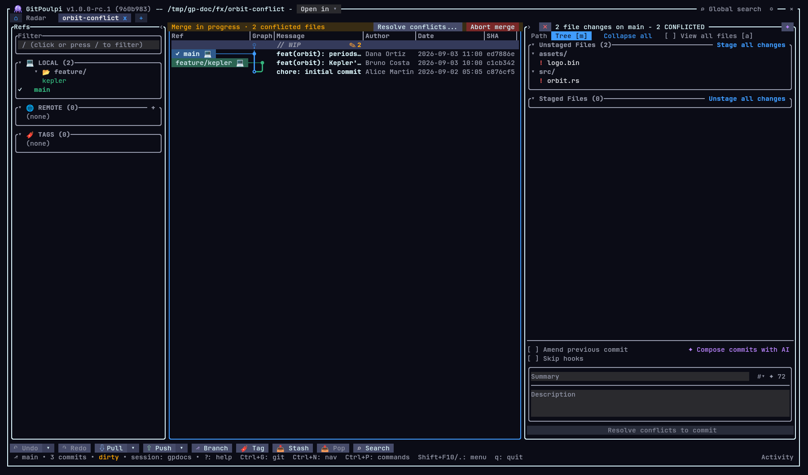

[English](../merge-conflicts.md) · [Čeština](../cs/merge-conflicts.md) · [Deutsch](../de/merge-conflicts.md) · [Español](../es/merge-conflicts.md) · [Français](../fr/merge-conflicts.md) · [Italiano](../it/merge-conflicts.md) · [日本語](../ja/merge-conflicts.md) · [한국어](../ko/merge-conflicts.md) · **Nederlands** · [Polski](../pl/merge-conflicts.md) · [Português (Brasil)](../pt-BR/merge-conflicts.md) · [Português (Portugal)](../pt-PT/merge-conflicts.md) · [Русский](../ru/merge-conflicts.md) · [Svenska](../sv/merge-conflicts.md) · [Türkçe](../tr/merge-conflicts.md) · [Українська](../uk/merge-conflicts.md) · [简体中文](../zh-CN/merge-conflicts.md)

# Merge-conflicten oplossen

Als een merge, cherry-pick, revert of rebase op conflicten blijft steken, toont de Log een
banner (*Merge bezig · feature in main · 2 bestanden met conflict*) en verschijnen de
bestanden met conflict in het paneel Status met een rode `!`. Open er een in de
**merge-editor**: A (de huidige kant) en B (de inkomende kant) naast elkaar, met de
**Uitvoer**, het bestand dat je schrijft, eronder. Deze pagina is de korte versie;
de volledige toetsenlijst staat in [Sneltoetsen](keybindings.md).

## Openen

- Enter, of een dubbelklik, op een `!`-rij van het paneel Status; het rechtsklikmenu
  begint met **Openen in merge-editor**.
- De knop **Conflicten oplossen...** van de banner (opent het eerste bestand met conflict).
- De Diff-weergave van een bestand met conflict: de knop **Merge-editor** (`Shift+E`).
- Het palet: **Conflicten: Merge-editor openen**.

Er opent niets uit zichzelf: een gestopte bewerking toont alleen de banner en de
`!`-rijen.

De editor neemt de volle vensterbreedte: de Refs-zijbalk en het
rechterpaneel zijn verborgen zolang hij open is en komen terug als je hem sluit (`F9`
toont of verbergt ze ondertussen). A en B staan naast elkaar zodra de editor
minstens `merge.side_by_side_min_width` kolommen breed is (standaard 100, Instellingen >
Diff & editor; `0` betekent altijd); smaller krijg je één kant tegelijk achter tabbladen. Lange
regels scrollen zijwaarts, A en B samen (`Shift+←` / `Shift+→`, Shift+wiel of een
zijwaarts wiel); ze worden nooit afgebroken.

## Kiezen

Elk conflict is een omkaderd blok in A en in B, met een selectievakje op de kop en een
`+` / `✓` voor elke regel.

| Om... | Toets | Muis |
|---|---|---|
| de regel onder de cursor over te nemen (kant met focus) | `Space` | klik op de regel |
| het hele blok van de kant met focus over te nemen | `Enter` | klik op de `[ ]` op de kop |
| alleen A / alleen B over te nemen voor dit conflict | `a` / `b` | rechtsklik op het blok |
| beide over te nemen, A dan B / B dan A | `c` / `Shift+C` | rechtsklik op het blok |
| niets over te nemen | `x` | rechtsklik op het blok |
| de volgorde van twee gekozen kanten om te draaien | `s` | klik op het label `1st` / `2nd` |
| alles van A / alles van B over te nemen (elk conflict) | `Shift+A` / `Shift+B` | werkbalk |
| de keuze voor dit conflict ongedaan te maken (terug naar onopgelost) | `u` in A / B, `Alt+U` overal | rechtsklik op het blok, **Keuze ongedaan maken** |
| het hele bestand terug te zetten naar zijn oorspronkelijke conflicten (vraagt eerst als je in de Uitvoer hebt getypt; `Ctrl+Z` haalt het terug) | `Shift+U` in A / B, `Alt+R` overal | **Reset** naast Alles overnemen |
| volgend / vorig conflict | `F7` / `Shift+F7`, `Alt+Down` / `Alt+Up` (`n` / `Shift+N` in A / B) | `▼` / `▲`, of klik op een markering op een schuifbalk |
| een getal herhaalt een beweging | `3j`, `2k`, `2n`, `3N` (in A / B) | |
| volgend / vorig bestand met conflict | `Alt+PageDown` / `Alt+PageUp` | `›` / `‹` in de kop |
| het paneel Basis (gemeenschappelijke voorouder) te tonen of te verbergen | `Alt+D` (`d` in A / B) | `Basis` |
| het hele bestand in A en B te tonen (**Heel bestand**) | `Alt+F` (`f` in A / B) | `Heel bestand` |
| A of B meer breedte te geven / terug naar gelijke breedtes | `Alt+Right` / `Alt+Left`, `Alt+0` | sleep de scheidslijn; dubbelklik erop |
| A / B / Basis zijwaarts te scrollen | `Shift+←` / `Shift+→` (`Shift+H` / `Shift+L`) | Shift+wiel, zijwaarts wiel |
| de panelen Refs en Status te tonen of te verbergen | `F9` | |
| A, B, de Uitvoer te focussen | `F6` / `Shift+F6` | klik |
| naar een paneel te springen, op het conflict waar je bent | `Alt+1` A, `Alt+2` B, `Alt+3` Uitvoer, `Alt+4` Basis; of `Ctrl+N` en dan `1` / `2` / `3` | |
| naar het aangrenzende paneel te gaan (A, Basis, B, Uitvoer), zelfde conflict | `h` / `l` of `←` / `→` in A / B | |
| de hoogte van de Uitvoer te laten rouleren | `z` | sleep zijn titel |
| ongedaan maken / opnieuw (keuzes en typen, één stapel) | `Ctrl+Z` / `Ctrl+Y` | |
| het bestand te schrijven, als conflict te laten staan | `Alt+S` | **Opslaan** |
| het bestand te schrijven en als opgelost te markeren | `Ctrl+S` | **Opslaan & als opgelost markeren** |
| te sluiten | `Esc` | `✕` |

Elke schuifbalk (A / B / Basis, en de Uitvoer) draagt één markering per conflict:
oranje zolang er nog een keuze nodig is, groen zodra het is afgehandeld, blauw voor het huidige.
Een klik op een markering springt naar dat conflict (een markering onder de greep van de schuifbalk staat
al op het scherm, dus daar sleept de klik de greep).

**Heel bestand** toont het hele bestand in A en B met elk verschil gekleurd, niet alleen de conflicten:

De Uitvoer is een echte editor: klik erin en typ, selecteer, knip en plak, zoek met
`Ctrl+F`. Een keuze op een conflict dat je met de hand hebt bewerkt, vervangt je bewerking (`Ctrl+Z`
haalt hem terug). Opslaan met een conflict waarvoor niets is gekozen, of met een regel
die nog op een conflictmarkering lijkt, vraagt eerst om bevestiging.

### ✦ Een oplossing voorstellen (AI)

Met AI ingeschakeld (Instellingen > AI; zie [AI-ondersteuning](ai.md)) heeft de werkbalk een
knop **✦ Voorstel**, heeft het rechtsklikmenu van een conflict *✦ Oplossing voorstellen (AI)*, en
`Alt+I` en het palet (`AI: Oplossing voor merge-conflict voorstellen`) doen hetzelfde. Het
werkt alleen op het huidige conflict en draait alleen als je erom vraagt. Het antwoord vervangt
het deel van dat conflict in de Uitvoer als één bewerking, als bewerkt gemarkeerd (`✎`), zodat `Ctrl+Z`
het conflict terugzet zoals het was. Het wordt nooit voor je opgeslagen of gestaged. Terwijl het
draait, toont de hintrij de bestede tijd; `Esc` annuleert, en een fout wordt daar
ook getoond. Met AI uit bestaat geen van deze bedieningen.

Na **Opslaan & als opgelost markeren** is het bestand gestaged en is de lijst met bestanden met conflict
terug; open het volgende bestand zelf. `Ctrl+Z` (of de knop Ongedaan)
draait de laatste "als opgelost markeren" terug. Als er geen bestand meer over is, biedt de banner
**Commit merge** (of **Doorgaan** voor een cherry-pick, een revert of een rebase) en
**Merge afbreken**, dat eerst vraagt: het zet HEAD, de index en de werkmap
terug zoals ze waren.

Een merge waarvan het resultaat gelijk is aan HEAD (je nam overal onze kant) heeft niets
gestaged en geen gewijzigd bestand, maar kan toch worden afgerond: **Commit merge**
opent de commit-prompt met het merge-bericht, en de commit heeft beide
ouders. Evenzo is de knop Commit van de composer ingeschakeld zonder iets gestaged
terwijl een merge is gestopt.

Een lege cherry-pick of revert (de wijziging is al toegepast) kan niet
worden gecommit: git weigert het, en **Doorgaan** zegt dat en verwijst naar **Overslaan**.
**Overslaan** (knop van de banner, opdracht *Git: Cherry-pick of revert overslaan* in het palet, CLI
`conflicts skip`) vraagt eerst en beëindigt dan de bewerking zonder dat er iets
voor wordt vastgelegd; HEAD, de index en de werkmap staan weer op HEAD. Overslaan is niet
ongedaan te maken (er gaat niets verloren wat niet bewust is opgegeven); een merge heeft
niets om over te slaan.

## Conflicten die geen tekst zijn

Een binair bestand, een Git LFS-pointer, een bestand van meer dan 8 MiB, een bestand dat aan één kant is verwijderd,
een overblijfsel van een hernoeming, een symlink, een modewijziging of een submodule heeft geen regels
om uit te kiezen. De editor toont een **kaart** met wat elke kant bevat en één knop per
keuze; kiezen lost het bestand meteen op en stagt het.

| Kaart | Keuzes |
|---|---|
| Binair bestand, LFS-pointer, te groot | **A behouden** (`a`), **B overnemen** (`b`), **Basis overnemen** (`o`, als die er is), **Openen in merge-tool** (`m`) |
| Aan de ene kant verwijderd, aan de andere gewijzigd | **Bestand behouden** (`k`), **Verwijdering accepteren** (`Shift+D`) |
| Overblijfsel van een hernoeming (het pad bestaat aan één kant) | **Bestand behouden** (`k`), **Bestand verwijderen** (`Shift+D`) |
| Symlink, submodule, bestandsmodus | **A behouden**, **B overnemen**, **Basis overnemen** |

Als het bestand een afbeelding is (PNG, JPEG, GIF, WebP, BMP, ICO), tonen de vakken ook
de afbeeldingen van A, B en Basis, passend gemaakt en alleen-lezen, in een venster dat breed genoeg
voor ze is; zie [Afbeeldingen](image-view.md#in-de-merge-editor).

`Esc` sluit de kaart zonder te kiezen. De externe merge-tool is
`general.external_merge_tool` in Instellingen > Diff & editor (`{base}`, `{local}` = A,
`{remote}` = B, `{merged}`; leeg betekent `git merge-tool`); het bestand wordt gestaged als
de tool succesvol afsluit.

## Conflictpreventie

GitPoulpi kan het je zeggen *voordat* je mergt. Als de branch waarop je zit zou conflicteren met de
branch waarvan hij is gestart (zijn **basis**), verschijnt er een strook op de bovenste randrij van de
Log: **Conflicteert met origin/main in 2 bestanden**, met een knop **Bestanden tonen**. De strook
neemt de eerstvolgende vrije randrij na de banners van lopende bewerkingen, dus zolang een
daarvan zichtbaar is, kan hij op ruimte moeten wachten. Er wordt niets gemerged: de daemon doet
een merge in het geheugen van de twee commits (libgit2, of `git merge-tree --write-tree` met git
2.38 of nieuwer; een oudere git schakelt de functie uit met één regel in het log), dus je bestanden, de
index en de refs blijven onaangeroerd.

- **De basis** is de doelbranch van de pull request van de branch als GitPoulpi die al kent (de
  cache die de sectie Pull requests bijhoudt; hiervoor wordt geen netwerkaanroep gedaan), anders
  de branch uit de patronen van de **Basisbranches** (Instellingen > Conflictpreventie) met de
  minste commits sinds de afsplitsing. Bij gelijke stand wint de branch waarvan de top het dichtst bij
  de afsplitsing ligt, daarna een remote-tracking branch boven een lokale, daarna de naam. De
  branch zelf en zijn eigen remote-kopie zijn nooit de basis.
- **De popup** (klik op de strook, of gebruik **Conflicten: Voorspelde conflicten tonen** in het
  palet, wat vanaf het toetsenbord werkt) toont de bestanden en heeft **Voorbeeld van merge
  openen** en **Rebase op de basis**. Het zijn de eigen menurijen van de basisbranch (*Merge <basis>
  in <branch>*, *Rebase <branch> op <basis>*), voor je uitgevoerd: met journaal, dus `Ctrl+Z` draait ze terug,
  en een merge die wel conflicteert stopt in de merge-editor zoals elke andere. Links en Rechts
  wisselen tussen de knoppen, Enter drukt er een in, Esc sluit.
- **Wanneer het draait**: op de achtergrond, ongeveer 2 seconden nadat de repository tot rust is
  gekomen (een commit, een checkout, een fetch die een branch verplaatste, een rebase), één keer per
  paar `(HEAD, basis)`. De strook verdwijnt zodra HEAD verschuift en komt terug, of niet, met het
  nieuwe antwoord. Een losgekoppelde HEAD wordt niet gecontroleerd.
- **Lijsten met basisbranches**: waar de basisbranches van een repository vandaan komen, is een keuze op zijn pagina
  **Conflictpreventie**. **Standaard** volgt de globale standaard (de ingebouwde `**`, elke branch, tot je in
  Instellingen > Algemeen > Conflictpreventie een andere lijst kiest); **Lijst: <naam>** volgt een van je lijsten met
  een naam; **Eigen lijst** is een lijst van de repository zelf. Lijsten worden gedeeld: bewerk er een en elke repository
  die hem volgt gebruikt de wijziging bij de volgende controle, zonder herstart. **Opslaan als lijst...** maakt van de
  eigen patronen van een repository een lijst met een naam, **Terug naar standaard** laat de keuze van de repository vallen.
  Een lijst verwijderen die een repository volgt, laat hem de standaard gebruiken.
- **Uit**: **Proactieve conflictdetectie inschakelen** in Instellingen > Algemeen, of voor één
  repository op zijn pagina **Conflictpreventie**. Vanuit een script drukt `gitpoulpi conflicts check`
  hetzelfde antwoord af als JSON ([CLI-referentie](cli-reference.md)).

## Agents

Een agent kan je een conflict tonen (`gitpoulpi ui show conflict <path> [--conflict
N]`: de editor opent erop, er wordt niets gekozen) of een oplossing **voorstellen**
(`gitpoulpi ui propose resolution <path> --pick 1=a,2=ba` of `--content-file F`,
daarvoor is *AI-agents wijzigingen laten voorstellen die ik bevestig* nodig). Een voorstel opent de
editor met de keuzes (of de hele tekst) al in de Uitvoer en een paarse banner
*✦ Voorgesteld door claude-code*. Bekijk het, wijzig wat je wilt en druk op
**Ctrl+S**: alleen dat schrijft of stagt iets. De editor sluiten wijst het
voorstel af. Zie [MCP en agents](mcp-and-agents.md).

Vanuit een script zijn dezelfde bewerkingen `gitpoulpi conflicts list | show | resolve |
unresolve | state | abort` ([CLI-referentie](cli-reference.md)); `conflicts check` voorspelt ze vóór een merge.
