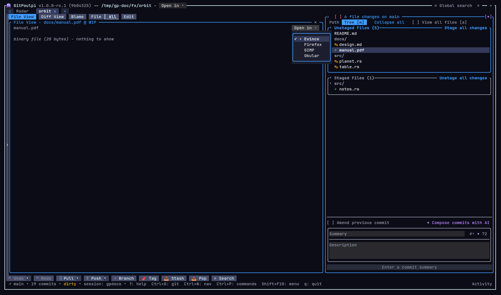

[English](../open-in.md) · [Čeština](../cs/open-in.md) · [Deutsch](../de/open-in.md) · [Español](../es/open-in.md) · [Français](../fr/open-in.md) · [Italiano](../it/open-in.md) · [日本語](../ja/open-in.md) · [한국어](../ko/open-in.md) · **Nederlands** · [Polski](../pl/open-in.md) · [Português (Brasil)](../pt-BR/open-in.md) · [Português (Portugal)](../pt-PT/open-in.md) · [Русский](../ru/open-in.md) · [Svenska](../sv/open-in.md) · [Türkçe](../tr/open-in.md) · [Українська](../uk/open-in.md) · [简体中文](../zh-CN/open-in.md)

# Openen in

De knop **Openen in ▾** in de titelbalk, naast het pad van de repository, opent de map
van het actieve tabblad ergens anders: je terminal, een nieuw tabblad of paneel van een
multiplexer, een editor, het bestandsbeheer. Jij bepaalt wat er in de lijst staat.
Niets is vastgelegd: elk item is een label en een opdracht.

## Gebruik

- **Klik op Openen in ▾**: er klapt een lijst uit. Klik op een item om het uit te
  voeren. Het standaarditem is gemarkeerd met `•`; de laatste rij, **Configureren...**,
  opent de pagina Openen in van de [Instellingen](settings.md#openen-in).

  

- **Toetsenbord**: `Alt+O` opent dezelfde lijst (`Up`/`Down`, `Enter`, `Esc`; bij meer
  dan zeven items typ je om te zoeken). `Ctrl+Alt+O` voert het standaarditem meteen
  uit. Palet (`Ctrl+P`): `Tabblad: Openen in...` en `Tabblad: Openen in standaard`. De
  opdrachten van het palet werken ook als er in de titelbalk geen plek is voor de knop. Beide
  toetsen zijn opnieuw toe te wijzen; zie [Sneltoetsen](keybindings.md).
- **Op label**: een stap `tab_open_in` van een [reeks](config-reference.md#sequences) voert het
  item uit waarvan je het **label** noemt (`label = "VS Code"`), zodat de lijst herordenen nooit
  verandert wat hij uitvoert. Een onbekend label stopt de stap met "geen item van Openen in heet ...".
  `Tabblad: Terminal hier` (palet) opent je terminal in de map, de oude knop "Terminal hier" van de
  tabbalk.
- **Een AI-agent in de map**: `Tabblad: AI-agent hier openen` opent je terminal in de map van het
  tabblad met een lokale AI-agent; zie [AI](ai.md#de-agent-openen-in-de-map-van-een-tabblad).
- **Rechtsklik op een repositorytabblad**: het tabbladmenu heeft een submenu
  **Openen in** met dezelfde items.
- De lijst begint bij het item dat je in deze sessie het laatst gebruikte.
- De statusbalk zegt meteen "openen in ...". Faalt het programma binnen ongeveer 1,5
  seconde (bijvoorbeeld tmux zonder server, of een verkeerde vlag), dan verschijnt de
  eerste regel van de foutuitvoer op de statusbalk. Een programma dat niet is
  geïnstalleerd wordt meteen genoemd.

Zolang je geen eigen lijst hebt opgeslagen, wordt het standaarditem gekozen op basis van wat is gedetecteerd: binnen herdr "Herdr: new tab"; op Omarchy het nieuwe venster van kitty (kitty is daar de terminal); anders de bestandsbeheerder.

De knop staat op elk repositorytabblad, ook op de map waarin GitPoulpi is gestart, en in
de modus `ui.tab_dir_follow = "auto"`. In de modus `auto` wordt het standaarditem ook
vanzelf uitgevoerd als je een nieuw tabblad opent (niet voor de tabbladen die bij het
opstarten worden hersteld). Zie [De map van het actieve tabblad volgen](following-the-tab-folder.md).

## Hoe een item eruitziet

In `config.toml` staat per item één tabel `[[ui.open_in]]`:

```toml
[ui]
open_in_default = "Herdr: new tab"   # een label; leeg betekent het eerste item

[[ui.open_in]]
label = "Herdr: new tab"
command = "herdr tab create --workspace ${env:HERDR_WORKSPACE_ID} --cwd ${cwd} --focus"

[[ui.open_in]]
label = "VS Code"
command = "code ${cwd}"
```

Je schrijft dit zelden met de hand: de pagina in de Instellingen bewerkt het. Elke sleutel
staat in de [configuratiereferentie](config-reference.md).

### Opdrachten en variabelen

De opdracht wordt eerst in argumenten gesplitst (spaties, `'...'` en `"..."` groeperen
woorden), daarna worden de variabelen binnen elk argument vervangen. Een map met een
spatie in de naam blijft dus één argument. **Er komt geen shell aan te pas**, tenzij je
opdracht er een start.

| Variabele | Wordt vervangen door |
|---|---|
| `${cwd}` | De map van het tabblad. |
| `${repo}` | De hoofdmap van de repository (verschilt van `${cwd}` bij een worktree-tabblad). |
| `${name}` | De basisnaam van de map. |
| `${branch}` | De uitgecheckte branch; leeg bij een losgekoppelde HEAD. |
| `${web_url}` | De webpagina van de origin-remote als die GitHub of GitLab is; anders leeg. |
| `${env:NAME}` | De omgevingsvariabele `NAME`; leeg als die niet is ingesteld. |

De oude `{repo}` werkt nog en betekent `${cwd}`. Elke andere `${...}` is een fout die de
variabele noemt.

Het programma wordt gestart met de map van het tabblad als werkmap en krijgt drie
omgevingsvariabelen, handig voor een shellfragment:

| Variabele | Waarde |
|---|---|
| `GITPOULPI_CWD` | De map van het tabblad. |
| `GITPOULPI_REPO` | De hoofdmap van de repository. |
| `GITPOULPI_BRANCH` | De branch, of leeg. |

```toml
[[ui.open_in]]
label = "Terminal hier, daarna status"
command = "sh -c 'cd \"$GITPOULPI_CWD\" && git status; exec $SHELL'"
```

Op Windows wordt het programma opgezocht via `PATH` en `PATHEXT`, dus `code` en `cursor`
(`.cmd`-bestanden) werken, en er flitst geen consolevenster op.

## Voorinstellingen

Instellingen > Openen in > **Voorinstelling toevoegen** toont kant-en-klare items alleen
voor jouw besturingssysteem (Windows-voorinstellingen verschijnen nooit op Linux, enzovoort),
per categorie: de rij begint met de categorie, `Verkenner: ...`, `Multiplexer: ...`,
`Terminal: ...`, `Editor: ...`, `Git-tool: ...`, `AI-agent: ...`, `Web: ...`. Bovenaan staan
de items onder **Gedetecteerd** uit de berekende standaardlijst. Binnen elke categorie komen
eerst de voorinstellingen die je meteen kunt gebruiken (je draait binnen die multiplexer of
terminal, en het programma staat op `PATH`), dan de geïnstalleerde, dan de rest. Typ in de
combobox om te zoeken, bijvoorbeeld `lazygit` of `Git-tool:`. **Testen op huidig
tabblad** probeert een item uit voordat je erop vertrouwt.


Voorinstellingen van het type "een tool in een paneel uitvoeren" (`lazygit in Herdr tab`,
`yazi in tmux window`, `Claude Code in Herdr split`...) worden alleen aangeboden als de
host (herdr, tmux, zellij, WezTerm, kitty, `xdg-terminal-exec`, Windows Terminal) en de
tool zijn geïnstalleerd. `$EDITOR in ...` voert de editor uit die je variabele `EDITOR`
noemt (met `vi` als terugval in herdr) in herdr of tmux.

De tool-voorinstellingen van herdr maken het tabblad of de split en typen de opdracht dan
in de shell ervan, zodat de tool in de map start en het paneel open blijft nadat hij is
afgesloten. De `AI-agent`-voorinstellingen gebruiken `herdr agent start`, zodat herdr de
status van de agent bijhoudt.

| Categorie | Voorinstellingen (`V` = geverifieerd door uitvoeren of tegen de geïnstalleerde help) |
|---|---|
| Verkenner | Windows `explorer.exe` (V), macOS Finder (V), Linux `xdg-open` (V), Nautilus, Dolphin, Thunar, Nemo, PCManFM; yazi, superfile, nnn, lf, ranger in een paneel/tabblad/terminal |
| Multiplexer | herdr-tabblad, workspace, split rechts/omlaag (V); tmux-venster, split rechts/omlaag, losgekoppelde sessie (V); zellij-paneel, tabblad, zwevend; WezTerm-tabblad, split, nieuw venster; kitty-tabblad, split-venster, OS-venster (V: vlaggen uit de help; vereist `allow_remote_control`); screen; cmux; psmux |
| Terminal | `xdg-terminal-exec` (V), kitty (V), foot (V), Alacritty (+ `alacritty msg`), WezTerm, Ghostty (Linux, macOS), GNOME Terminal, Ptyxis, Konsole, Xfce Terminal, Tilix, Terminator, MATE Terminal, iTerm2, Terminal.app, Warp; Windows: Windows Terminal (venster, tabblad, split, en een tabblad voor elk van PowerShell 7, Windows PowerShell, Command Prompt, WSL), vensters van PowerShell 7 / Windows PowerShell / Command Prompt / WSL, Git Bash |
| Editor | VS Code (V), VSCodium, Cursor, Windsurf, Zed, Sublime Text, Emacs, IntelliJ IDEA, RustRover, PyCharm, WebStorm, CLion, GoLand, Rider, PhpStorm, Android Studio, Visual Studio (Windows); Neovim, Vim, Helix, `$EDITOR` in een paneel/tabblad/terminal |
| Git-tool | gitk, `git gui`, gitg, Sublime Merge, GitKraken, GitHub Desktop; lazygit, tig, gitui in een paneel/tabblad/terminal (die van herdr, tmux, kitty en `xdg-terminal-exec` V) |
| AI-agent | Claude Code, Codex, Gemini CLI, opencode in een herdr-tabblad/split (V, met Claude), tmux, zellij, WezTerm, kitty, nieuwe terminal |
| Web | `Repository page on the web` (`${web_url}`), `gh repo view --web` (V), `glab repo view --web` |

WSL op Windows: `wsl.exe --cd ${cwd}` accepteert het Windows-pad zoals het is, en het
`wsl.exe`-tabblad van Windows Terminal start in de map, die WSL onder `/mnt/` afbeeldt.

De verkenner, Windows Terminal, PowerShell, `cmd`, WSL, Warp, psmux, Visual Studio en Zed
(Zed is alleen Unix) verschijnen alleen waar ze bestaan; tmux, zellij, cmux, screen,
kitty remote control en de met `sh` aangestuurde herdr-voorinstellingen zijn alleen Unix;
herdr (gewone voorinstellingen), WezTerm, Alacritty, VS Code, Cursor en de JetBrains-IDE's
worden overal aangeboden.

### Variabele `${web_url}`

De webpagina van de `origin`-remote van de repository, als dat een GitHub- of
GitLab-project is (github.com, gitlab.com of een self-managed host met een item in
`[[integrations]]`); anders leeg, en dan stopt een item dat hem gebruikt met een melding
in plaats van een leeg adres te openen. Hij is optioneel: geen enkele voorinstelling heeft
hem nodig behalve `Repository page on the web`.

## De pagina in de Instellingen

Instellingen > **Openen in** bewerkt de lijst. De items staan als [lijst](settings.md#lijsten) links (het standaarditem is gemarkeerd met `★`); de velden van het geselecteerde item staan rechts. Met `+ Toevoegen`, `Dupliceren`, `Verwijderen`, `↑` / `↓` en het slepen van een rij beheer je de lijst.

| Rij | Wat ze doet |
|---|---|
| **Standaarditem** | Het item dat **Openen in standaard** uitvoert. Het is gemarkeerd met `•` in de lijst Openen in. |
| **Naam** | De naam in de lijst. Uniek, niet leeg. |
| **Opdracht** | De opdracht, met de variabele-chips (`${cwd}`, `${repo}`, `${branch}`, `${name}`, `${web_url}`) om in te voegen. |
| **Testen op huidig tabblad** | Voert het item nu uit op de map van het actieve tabblad. |
| **+ Toevoegen ▾** | Voegt een kant-en-klaar item toe (gedetecteerde eerst), of **Eigen**: een leeg item waarvan je daarna de opdracht bewerkt. |
| **Gedetecteerde standaardwaarden herstellen** | Vervangt de lijst door wat op deze machine is gedetecteerd en wist de standaard. |

Wijzigingen worden opgeslagen terwijl je ze maakt. De eerste wijziging schrijft de hele
array `[[ui.open_in]]` naar `config.toml`; tot dan wordt de lijst berekend (zie
[Verouderde sleutels](#verouderde-sleutels)) en heeft het bestand geen sleutel `open_in`.
Ook de zoekfunctie van de Instellingen vindt de pagina.

## Binaire bestanden: Openen in

Een binair bestand (een PDF, een Word-document, een spreadsheet, een archief...) heeft geen tekst om te tonen in de Diff-weergave of de Bestandsweergave. Kent het besturingssysteem een toepassing voor het type, dan toont de weergave naast de gebruikelijke melding een knop **Openen in**. De lijst bevat eerst de toepassing waarmee het systeem dat type opent (met een bolletje gemarkeerd), daarna alle andere toepassingen die het systeem ervoor registreert (de eigen lijst *Openen met* van het systeem). Onder Linux is dat het MIME-type van de bestandsnaam, `mimeapps.list` voor de standaardtoepassing en de `.desktop`-bestanden voor de rest; onder Windows het register (de keuze van de gebruiker en de programma's die voor de extensie zijn geregistreerd); onder macOS alleen de standaardtoepassing.

`o` start de standaardtoepassing en `Shift+O` opent de lijst. Beide staan in het opdrachtenpalet (*Bestand: Openen in standaardtoepassing*, *Bestand: Openen met...*), en **Openen met...** staat in het contextmenu van een bestand in het paneel Status en in de bestandslijst van een commit. Het zoeken gebeurt op de achtergrond, één keer per extensie: de weergave zegt intussen "apps zoeken...". Een type waarvoor het systeem geen toepassing kent, en gewone tekst, houden de gewone melding en hebben geen knop.



Het bestand uit de werkmap wordt ongewijzigd aan de toepassing doorgegeven. De versie van een commit (of van de index) wordt geschreven naar een **alleen-lezen tijdelijke kopie**, met een melding op de statusbalk, zodat een toepassing de repository niet kan wijzigen. Geen van beide wijzigt de repository: geen journaalregel, Ongedaan maken blijft ongemoeid.

De lijst van het menu opent naast het menu, ter hoogte van de rij **Openen met...**, als een submenu (links als er rechts geen plek is), zowel met de muis als met het toetsenbord. De lijst van beeldeditors (**Bewerken in...**) vanuit een bestandsmenu doet hetzelfde.

### Git LFS-bestanden

De Git LFS-objectkaart (zie [Git LFS](lfs.md)) heeft dezelfde twee acties onder zijn tekst: **Openen in standaardprogramma** en **Openen in**, met dezelfde toetsen (`o`, `Shift+O`) en paletrijen. Ze openen het echte bestand, nooit de pointer: het bestand uit de werkmap zoals het is, of een alleen-lezen tijdelijke kopie van het object uit de lokale LFS-opslag voor de versie van een commit of de index. Een object dat nog niet is gedownload heeft geen knoppen op de kaart, en de statusregel zegt dat de inhoud nog niet is gedownload. Dezelfde weigering geldt voor een bestand in de werkmap dat nog alleen de pointer bevat: **Openen in standaardprogramma**, **Openen in** en **Bewerken in**, vanaf de kaart of een bestandsmenu, zeggen dat de inhoud niet is gedownload in plaats van de pointertekst te openen (download haar met de pull- of checkout-rijen van de LFS-werkbalk en probeer opnieuw). Openen is alleen-lezen: geen journaalregel, niets om ongedaan te maken.

### Browsers onder Windows

Chrome en Edge registreren `--single-argument %1`, waardoor ze alles na de schakelaar als één adres lezen, aanhalingstekens inbegrepen. GitPoulpi geeft het pad aan zo'n programma letterlijk en zonder aanhalingstekens door, zoals Windows doet, zodat een bestand met spaties in het pad opent in plaats van te mislukken met `http://"c/...`. Elk ander programma krijgt het pad als één gewoon argument.

## Verouderde sleutels

De oude sleutels `ui.terminal_launch` en `ui.terminal_launch_command` worden alleen gelezen
zolang `ui.open_in` ontbreekt. De berekende lijst is dan:

1. je oude terminalkeuze, als die niet `auto` is (`custom` wordt "Terminal (custom)" met
   `{repo}` herschreven naar `${cwd}`; een voorinstelling-id wordt die voorinstelling). Een
   waarde `auto` wordt het eerste item, "Default terminal".
2. de bestandsverkenner van het besturingssysteem,
3. de multiplexers en terminals die uit de omgeving zijn gedetecteerd,
4. de editors die op `PATH` staan.

Zodra je de lijst vanuit de Instellingen opslaat, neemt `ui.open_in` het over en worden de
oude sleutels genegeerd. De opdrachten **Tabblad: Openen in terminal** en **Tabblad:
Openen in bestandsbeheer** van het palet gebruiken deze lijst niet.

## Probleemoplossing

- *"program X was not found"*: het programma staat niet op het `PATH` dat GitPoulpi ziet.
  Start GitPoulpi vanuit een shell die het heeft, of schrijf het volledige pad.
- *Een item van tmux/zellij/herdr faalt meteen*: die praten met een draaiende server, dus
  ze werken alleen als GitPoulpi erbinnen draait.
- *Een kitty-tabblad-item faalt*: het vereist `allow_remote_control` in `kitty.conf`.
- *Windows Verkenner*: `explorer.exe` eindigt met code 1, ook bij succes; GitPoulpi
  behandelt dat als succes.
