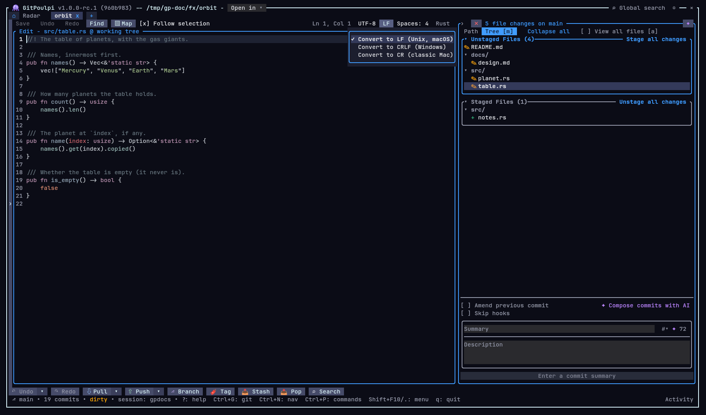

[English](../staging-and-committing.md) · [Čeština](../cs/staging-and-committing.md) · [Deutsch](../de/staging-and-committing.md) · [Español](../es/staging-and-committing.md) · [Français](../fr/staging-and-committing.md) · [Italiano](../it/staging-and-committing.md) · [日本語](../ja/staging-and-committing.md) · [한국어](../ko/staging-and-committing.md) · **Nederlands** · [Polski](../pl/staging-and-committing.md) · [Português (Brasil)](../pt-BR/staging-and-committing.md) · [Português (Portugal)](../pt-PT/staging-and-committing.md) · [Русский](../ru/staging-and-committing.md) · [Svenska](../sv/staging-and-committing.md) · [Türkçe](../tr/staging-and-committing.md) · [Українська](../uk/staging-and-committing.md) · [简体中文](../zh-CN/staging-and-committing.md)

# Stagen en committen

Hoe je ziet wat je hebt gewijzigd, precies kiest wat in een commit komt, de
commit schrijft, en bestanden dieper bekijkt (blame, geschiedenis, de ingebouwde editor).
Termen als *WIP-rij* en *hunk* worden uitgelegd in de
[rondleiding door de interface](interface-tour.md).

## De lokale wijzigingen

Niet-gecommit werk is de **eerste rij van de Log** (gestippelde cirkel, `// WIP`, met
tellers `✎ n` gewijzigd en `+ n` toegevoegd). Selecteer hem en het rechterpaneel toont
de lokale wijzigingen:


- **Unstaged bestanden**: gewijzigde, toegevoegde (untracked) en verwijderde bestanden die nog niet
  in de volgende commit zitten.
- **Staged bestanden**: wat de volgende commit zal bevatten.
- **Pad** of **Boom** (`m`) toont bestanden plat of in mappen. **Alles inklappen**
  (`z`) klapt de mappen in. **Alle bestanden tonen** (`a`) toont de hele boom
  in plaats van alleen de gewijzigde bestanden. Klik met rechts op de lege ruimte
  van de lijst voor **Alles uitklappen** / **Alles inklappen**, op een maprij voor
  **Alle submappen uitklappen** / **Alle submappen inklappen**; toetsen `=`, `-`,
  `*`, `_` (zie [Muis en gebaren](mouse-and-gestures.md)).
- De titel zegt hoeveel bestanden op welke branch zijn gewijzigd.

### Stagen, unstagen, verwerpen

| Wil je | Doe dan |
|---|---|
| Een bestand stagen | Beweeg over zijn rij en klik op **Bestand stagen**, of selecteer het en druk op `Ctrl+Space`, of `Ctrl+G s` |
| Een map stagen | **Map stagen** op de maprij |
| Alles stagen | **Alle wijzigingen stagen** in de sectietitel, of `Ctrl+G a` |
| Unstagen | Dezelfde knoppen en toetsen in de sectie Staged (`Ctrl+G u`) |
| De wijzigingen van een bestand verwerpen | Rechtsklik op het bestand > **Wijzigingen verwerpen...** (vraagt eerst; `Ctrl+Z` haalt de wijzigingen terug) |

### Gevoelige bestanden

Een bestand, een map of alles stagen controleert eerst wat het zou toevoegen. Een bestand waarvan de
naam overeenkomt met `[privacy] sensitive_patterns` (`.env` en `.env.*` behalve de
bestanden `.example`, `.sample` en `.template`, `*.pem`, `*.key`, SSH-privésleutels,
`*.p12`, `*.pfx`, `*.jks`, `*.keystore`, `*.crt`, `*.cer`, `*.der`, `*.kdbx`), of
waarvan de tekst een geheim bevat dat de scanner herkent, wordt niet gestaged. De vraag **Gevoelige
bestanden** somt elk bestand op met zijn reden (een patroon, of de soort geheim
met een gemaskeerd voorbeeld, nooit de waarde) en biedt **Toch stagen** of **Annuleren, niets stagen**.
Geen enkel antwoord is gemarkeerd tot je een pijltoets of een cijfer indrukt,
dus een verdwaalde Enter beantwoordt niets; `Esc`, het sluitkruisje en een klik buiten het venster annuleren.
Het is dezelfde vraag vanaf het toetsenbord, een knop, een menu, het palet of een
drag-and-drop, want ze sturen allemaal hetzelfde verzoek. Annuleren staget niets,
ook niet de gewone bestanden van dezelfde stage.

Tekstbestanden tot 1 MiB elk en 32 MiB in totaal worden gelezen; grotere bestanden en binaire
bestanden worden alleen op naam beoordeeld. `[privacy] staging_guard = false` zet de controle uit.
Eén hunk of enkele regels stagen wordt niet gecontroleerd: je werkt al aan dat bestand.

Rechtsklik op een bestand voor zijn menu: stagen of unstagen, verwerpen, het pad kopiëren, bestandsgeschiedenis
en blame, openen in je externe editor, diff-tool of bestandsbeheer (in te stellen
in [Instellingen > Diff & editor](settings.md#diff--editor)), en meer.

## Bestanden negeren en als binair of als tekst behandelen

Klik met rechts op een bestand > **Negeren** om het of zijn extensie te negeren, of op een maprij > **Alle bestanden in map negeren**. GitPoulpi vraagt eerst in welk bestand de regel komt: de `.gitignore` van de repository (standaard), de `.gitignore` van elke map tot die van het bestand, of `.git/info/exclude` (alleen deze kloon, nooit gecommit). Bestanden die nog niet bestaan zijn als *nieuw* gemarkeerd en worden bij bevestigen aangemaakt. De regel wordt relatief aan het gekozen bestand geschreven: `src/a/b.txt` wordt `/a/b.txt` in `src/.gitignore`. Beweeg met de pijltjestoetsen, typ om de lijst te filteren, `Enter` schrijft, `Esc` annuleert. `Ctrl+Z` maakt een schrijfactie naar een `.gitignore` ongedaan; `.git/info/exclude` staat buiten de werkmap en is niet ongedaan te maken.


Klik met rechts op een bestand > **Als binair behandelen** (of **Als tekst behandelen** als git het al als binair behandelt) schrijft een `.gitattributes`-regel: `binary` of `text diff`. Kies het bestand zelf of alle bestanden met zijn extensie, en dan de `.gitattributes` om naar te schrijven, met dezelfde lijst als hierboven (en `.git/info/attributes` alleen voor deze kloon). Een regel die al voor hetzelfde patroon is geschreven wordt vervangen, nooit tegengesproken. De diff van het bestand wordt meteen bijgewerkt en de statusbalk zegt wat waar is geschreven (en waarschuwt als een andere regel nog voorrang heeft). Een maprij heeft **Bestanden in map behandelen als** > **Binair** of **Tekst**. Hetzelfde staat in het opdrachtenpalet (**Lokale wijzigingen: Geselecteerd bestand als binair behandelen...**) en op de opdrachtregel (`gitpoulpi treat binary|text <paden>`). De Bestandsweergave volgt de regel ook: een bestand dat je als tekst behandelt, toont zijn regels, ook met een NUL-byte, en een bestand dat git als binair diff't toont de binaire melding.

## Menu's, meervoudige selectie en conversie in de bestandslijsten

De bestandslijsten van het rechterpaneel (Unstaged, Staged, de gewijzigde bestanden van een commit en **Alle bestanden tonen**) delen dezelfde menu's en gebaren. Klik met rechts op een bestand, een maprij of het lege deel van een lijst, of druk op `.` (`Shift+F10`, de Menu-toets) op de rij met focus, of voer **Bestanden: menu van de rij of selectie openen** uit vanuit het palet.

- **Een bestand van een commit** (en een bestand in **Alle bestanden tonen**): **Diff openen**, **Bestand openen**, **Bestandsgeschiedenis**, **Bestands-blame**, openen in je editor, in het standaardprogramma of in **Openen met...**, **Tonen in map**, **Bestand bewerken**, **Bestandspad kopiëren**, **Volledig bestandspad kopiëren**, **Negeren**, **Als binair behandelen** of **Als tekst behandelen**, **Converteren**, **Bestand herstellen vanuit deze commit** (vraagt eerst; net als `git checkout <commit> -- <bestand>` wordt het bestand ook gestaged, en `Ctrl+Z` brengt het vorige bestand terug) en **Bestand verwijderen...**. Een rij over de werkkopie is grijs, met de reden, als het bestand niet in de werkmap staat. **Diff met de werkmap** opent de diff van de versie uit de commit met het bestand op schijf. **Patch maken van bestandswijzigingen** schrijft een patch van de wijziging van dat bestand in de commit (een selectie en een maprij hebben het ook; in **Alle bestanden tonen** bij de lokale wijzigingen maakt het een patch van de wijzigingen van het bestand in de werkmap).
- **Een maprij**: **Map openen**, **Bestandspad kopiëren**, **Alle bestanden in map negeren**, **Bestanden in map behandelen als**, **Converteren**, **Een bestand in deze map maken**.
- **Het lege deel van een lijst**: **Bestand maken** en **Repositorymap openen**. De lijst Unstaged voegt **Alle wijzigingen stagen** en **Alle wijzigingen verwerpen...** toe, de lijst Staged **Alle wijzigingen unstagen**.


### Meerdere bestanden selecteren

De gebaren zijn die van de Log. **Ctrl+klik** voegt een rij aan de selectie toe of verwijdert ze. **Shift+klik** (**Alt+klik** in terminals die Shift+klik voor zichzelf houden) selecteert het bereik vanaf het anker. Een gewone klik begint opnieuw en opent de diff zoals voorheen. `Esc` wist de selectie. Met het toetsenbord schakelt `Space` of `Insert` de huidige rij om in elke lijst (in Unstaged en Staged stagt `Ctrl+Space` de selectie, of de huidige rij) en `Shift+Up` / `Shift+Down` breiden het bereik uit. Een maprij selecteert alle bestanden eronder, ingeklapt of niet. Geselecteerde rijen zijn gemarkeerd en de statusbalk telt ze. `Ctrl+A` selecteert alle rijen van de actieve lijst.

Klik met rechts op een geselecteerde rij (of druk op `.`) voor het menu van de hele selectie, met als titel **N bestanden**: stagen of unstagen, verwerpen, negeren, als binair of tekst behandelen, converteren, paden kopiëren, herstellen uit de commit, verwijderen. Stagen, unstagen en herstellen zijn elk één actie; verwerpen en verwijderen vragen eerst en noemen het aantal bestanden. Een rechtsklik op een rij buiten de selectie begint de selectie opnieuw met die rij.


### Codering, regeleinden en inspringing converteren

**Converteren** staat in het menu van een bestand, een map of een selectie. `gitpoulpi convert` doet hetzelfde op de opdrachtregel.

- **Codering**: UTF-8, UTF-8 BOM, UTF-16 LE en BE, Windows-1252, ISO-8859-1, ISO-8859-15, Windows-1250, Windows-1251, KOI8-R, Shift_JIS, EUC-JP, GBK, Big5, EUC-KR.
- **Regeleinden**: LF, CRLF of CR.
- **Inspringing**: voorloopwitruimte als spaties of tabs, met de breedte van een tab.

De bestanden in de werkmap worden op de achtergrond herschreven met dezelfde functies als de statusbalk van de editor. Een bestand dat geen geldige UTF-8 is en geen byte-ordemarkering heeft, wordt zoals in de editor als Windows-1252 gelezen. Binaire bestanden, ontbrekende bestanden en bestanden die de doelcodering niet kan weergeven worden overgeslagen en gemeld (*12 bestanden geconverteerd, 3 overgeslagen (3 binair)*), nooit beschadigd; een bestand dat niet geschreven kan worden geeft een foutmelding. De hele reeks is één item in het ongedaanmaakjournaal: één `Ctrl+Z` zet alle bestanden terug. Een bestand dat in de editor openstaat blokkeert de conversie tot het gesloten is.

## Een diff lezen

Klik op een bestandsnaam (of druk er `d` op) en zijn diff vervangt de Log in het
midden. `Esc` of `q` brengt de Log terug.


De balk erboven wisselt de weergave:

- **Inline** toont de unified diff; **Split** zet voor en na naast
  elkaar (`m` doorloopt de indelingen).
- **Hunks** (`Shift+H`) toont alleen de gewijzigde hunks met een regel context.
  Zet het uit om het hele bestand te zien.
- **WS** (`s`) verbergt wijzigingen die alleen in witruimte verschillen.
- **Afbr.** (`w`) breekt lange regels af in plaats van ze af te kappen.
- **Map** (`Shift+M`) toont een minimap van het hele bestand naast de schuifbalk.
  Klik erop om te springen. Andere voorkomens van een geselecteerd woord zijn getint en gemarkeerd
  op de schuifbalk.
- `n` en `p` (of de pijlen op de balk) springen tussen hunks.
- **Auto** (de laatste knop, `Shift+C`) is de codering waarin het bestand wordt gelezen. Klik erop (of druk op
  `Shift+C`, of voer *Diff: Codering kiezen...* uit via het palet) en kies er een uit de lijst:
  eerst **Automatisch detecteren**, dan UTF-8, UTF-8 BOM, UTF-16 LE en BE, Windows-1252, ISO-8859-1,
  ISO-8859-15, Windows-1250, Windows-1251, KOI8-R, Shift_JIS, EUC-JP, GBK, Big5 en EUC-KR (typ om in de
  lijst te zoeken). De twee kanten van het bestand worden opnieuw gelezen, als exacte bytes, in die codering, zodat een
  Latin-1-bestand zijn accenten toont en een UTF-16-bestand (dat git binair noemt) zijn regels toont. De
  keuze wordt voor het pad van dat bestand onthouden tot je afsluit, in deze weergave en in de
  [review](review.md). Zolang een codering is gekozen, zijn de hunks die van deze weergave zelf, dus stagen en
  verwerpen staan uit (kies **Automatisch detecteren** om weer te stagen). Een trage leesbeurt zegt na een moment
  *lezen als ...* in de titel.


Je kunt tekst met de muis selecteren (slepen, of dubbelklik op een woord) en kopiëren
met `y` of `Ctrl+C`; alleen de bestandstekst wordt gekopieerd, nooit regelnummers of `+`
en `-`-markeringen.

### Een hunk of één regel stagen

In een diff van de werkmap heeft elke hunk-kop **Hunk stagen** en **Hunk
verwerpen** (aan de Staged-kant **Hunk unstagen**).

- `Space` stagt de hunk onder de cursor.
- Om een paar regels te stagen druk je op `v` om een selectie te beginnen, beweeg je met `j`/`k` en
  druk je op `Enter`. Alleen *gewijzigde* regels tellen.
- `x` verwerpt de hunk en `Shift+X` de geselecteerde regels. Beide vragen eerst, en
  `Ctrl+Z` haalt de wijzigingen terug.
- Rechtsklik (of `.`) op een hunk voor zijn menu: stagen, unstagen, verwerpen, bestandsgeschiedenis,
  blame, kopiëren.

De diff van een commit is alleen-lezen. Een gewijzigde afbeelding wordt als afbeelding getoond; zie
[Afbeeldingen](image-view.md).

## De commit schrijven

Het commit-formulier staat onderaan het rechterpaneel, en de **Samenvatting** ervan is ook
het veld in de rij met lokale wijzigingen van de Log: typen in het ene verschijnt in het
andere.


- **Samenvatting** (de teller toont hoeveel van de 72 tekens over zijn) en
  **Beschrijving**. `Enter` in de samenvatting gaat naar de beschrijving, `Enter`
  daar voegt een regel toe.
- **Wijzigingen in N bestanden committen** (de groene knop) of `Ctrl+Enter` commit de gestagede
  wijzigingen. Als er niets is gestaged, zegt de knop dat en doet niets.
- **Vorige commit amenden** (`Shift+A`) voegt de gestagede wijzigingen en het nieuwe bericht samen
  in de laatste commit. Een commit die al is gepusht, heeft daarna een force
  push nodig (met lease).
- **Hooks overslaan** (`Shift+H`, of **Commit: Hooks overslaan omschakelen** in het palet) commit
  zonder de hooks `pre-commit` en `commit-msg` van de repository uit te voeren. Het geldt per commit;
  met **Instellingen > Repositoryspecifieke instellingen > Commit** staat het standaard aangevinkt. Getoond
  als de rij ruimte heeft.
- `Ctrl+G c` of `c` in het paneel Status zet de cursor in het formulier. `Esc`
  verlaat het.
- `Ctrl+G Enter` (**Git: Gestagede wijzigingen nu committen** in het palet) is de
  commit-knop vanaf elke plek: het commit de gestagede wijzigingen met het bericht van het
  formulier, houdt rekening met **Vorige commit amenden** en **Hooks overslaan**, en
  verplaatst de focus niet. Zonder gestagede wijzigingen of zonder samenvatting zegt het
  dat en zet het in plaats daarvan de cursor in de samenvatting. Zolang er nog een
  AI-verzoek loopt, commit het niets en meldt het dat (`Esc` annuleert het verzoek). `Ctrl+Z`
  draait de commit terug zoals elke andere.
- Per repository kan [Instellingen](settings.md#repositoryspecifiek-commit) **pushen na elke
  commit**, het formulier met een **commitsjabloon** laten beginnen (en de `#`-opmerkingen
  eruit halen) en een merge laten **squashen**: het formulier opent dan met het squashbericht
  van git.
- Met een gekoppelde hostingintegratie voegt `Alt+R` in het formulier een issueverwijzing
  in; zie [Hosting en issuetrackers](hosting-integration.md).

Met [AI](ai.md) aan schrijft de knop **`✦`** rechts van de samenvatting een bericht
op basis van de gestagede wijzigingen (`Ctrl+G i`), en **Commits samenstellen met AI** verdeelt
je werk over meerdere commits, hieronder. De tekst komt in het formulier terecht zodat je hem
kunt bewerken; er wordt niets gecommit tot je op de commit-knop drukt.

## De commit-composer: verdeel je wijzigingen over commits

*(Vereist dat AI aan staat: zie [AI-ondersteuning](ai.md).)* Druk op **Commits samenstellen met
AI** (of `Ctrl+G C`, of rechtsklik op de rij met lokale wijzigingen). Het model stelt
meerdere commits voor, elk met zijn bestanden; elk gewijzigd bestand zit in precies één
commit, en een ongeldig plan wordt één keer naar het model teruggestuurd. Het voorstel opent
als een review waarin nog niets is gecommit:


| Wil je | Doe dan |
|---|---|
| Een commit uit- of inklappen | `Left` / `Right`, of klik op het chevron; `*` schakelt alle om |
| Een commit omhoog of omlaag verplaatsen | De `▲` `▼` op zijn rij, of `Alt+Up` / `Alt+Down` (`K` / `J`) |
| Een bestand naar een andere commit verplaatsen | Sleep het op de commit (uit de lijst, of uit de lijst met lokale wijzigingen rechts); of `m` op het bestand en kies de commit in de keuzelijst; of `Alt+Up` / `Alt+Down` op het bestand |
| Een bestand in een eigen commit zetten | `n` op het bestand, of de knop `+ eigen commit` |
| Een commit herformuleren | Het potlood, `e`, `Enter` of een dubbelklik: bewerk het bericht, `Enter` houdt het, `Esc` verwerpt het |
| Een commit weglaten | `drop` (`d` of `Delete`); zijn bestanden blijven ongecommit. `herstellen` haalt hem terug |
| Opnieuw beginnen | **Reset** (`r`) gaat terug naar het plan van het model |
| Ze aanmaken | **N commits maken** (`Ctrl+S`, `Ctrl+Enter` of `a`) |
| Het scherm verlaten | **Annuleren** of `Esc`: niets gedaan |

Bij het aanmaken van de commits wordt alles geünstaged, waarna voor elke commit zijn bestanden worden
gestaged en gecommit, zodat je werkmap nooit wordt aangeraakt. Als een stap mislukt, stopt het
en meldt het hoeveel commits zijn gemaakt. Er worden hele bestanden gestaged: een bestand dat maar
gedeeltelijk was gestaged, wordt als geheel gecommit. Kies in *Instellingen > AI* welk profiel en welke instructies
de composer gebruikt; zie [AI-ondersteuning](ai.md#de-commit-composer).

## Bestandsweergave, Blame en Bestandsgeschiedenis

De weergavebalk heeft **Inhoud** (de Bestandsweergave: de inhoud van het bestand), **Diff**, **Blame** en de keuze
`Bestand │ Alles` van de [commit-kolom](interface-tour.md#de-commit-kolom) (haar lijst `Bestand` is de
Bestandsgeschiedenis); dezelfde staan in het rechtsklikmenu van een bestand. Ze tonen het bestand
zoals het was bij de commit waar je vandaan kwam, of als niet-gecommit (`@ WIP`) als je het opende
vanuit de lokale wijzigingen.

- **Blame** en de **Bestandsgeschiedenis** zijn volwaardige weergaven: zie [Blame](log-and-history.md#blame) en [Bestandsgeschiedenis](log-and-history.md#bestandsgeschiedenis) in *Werken met de Log*. `Enter` op een blame-hunk of een rij van de bestandsgeschiedenis gaat naar die commit in de Log.
- `y` of `Ctrl+C` kopieert de geselecteerde tekst (in Blame alleen de code).
- `Shift+G` springt naar de laatste regel. `q` sluit de weergave.

## De ingebouwde editor

**Bewerken** (`e`) opent de *kopie in de werkmap* van het bestand in een kleine editor
over het middelste paneel: syntaxiskleuren, regelnummers, ongedaan maken en opnieuw, zoeken en een
statusbalk (positie, regeleinde, inspringing, taal). Hij bewerkt altijd de
werkkopie, ook als je hem opende vanuit de diff van een oude commit.


| Toets | Actie |
|---|---|
| `Ctrl+S` | Opslaan (het bestand wordt naar een tijdelijk bestand geschreven en hernoemd, dus het is nooit half geschreven; regeleinden, BOM en het laatste nieuwe regelteken blijven behouden) |
| `Ctrl+Z`, `Ctrl+Y` | Ongedaan maken, opnieuw |
| `Ctrl+F`, `F3` | Zoeken, volgende zoeken |
| `Tab`, `Shift+Tab` | Inspringen, terugspringen (volgens de eigen stijl van het bestand) |
| `Ctrl+A`, `Ctrl+C`, `Ctrl+X`, `Ctrl+V` | Alles selecteren, kopiëren, knippen, plakken |
| `Esc` | Sluiten. Bij niet-opgeslagen wijzigingen vraagt hij **Opslaan** (`s`), **Verwerpen** (`d`) of **Annuleren** (`c`) |

Binaire bestanden worden geweigerd. Tabbreedte,
regeleinden, syntaxiskleuring, regelnummers en regelafbreking staan in *Instellingen >
Diff & editor*; zie [Instellingen](settings.md#diff--editor).

Met **De selectie volgen in de editor** aangevinkt (het vakje op de balk van de editor, ook *Editor: Selectie volgen in- of uitschakelen* in het palet en *Instellingen > Diff & editor*) opent het selecteren van een ander bestand in het rechterpaneel, terwijl de editor open is, de werkkopie van dat bestand in de editor in plaats van zijn diff of Bestandsweergave. Bij niet-opgeslagen wijzigingen vraagt hij eerst **Opslaan**, **Verwerpen** of **Annuleren**; Annuleren houdt je bij het huidige bestand. Een bestand dat niet bewerkt kan worden (binair, te groot, verwijderd) opent in de gebruikelijke weergave en de statusbalk zegt waarom. Als je de editor sluit, kom je op de weergave van het geselecteerde bestand uit. Standaard aan. Dit geldt voor de werkwijzigingen: een bestand van een commit kiezen terwijl je bewerkt verlaat de editor (met eerst de vraag om op te slaan) en toont de diff van dat bestand in die commit, en de commit-kolom, die de editor niet heeft, komt er mee terug.

De statusbalk toont rechts de **codering**, de **regeleinden** en de **inspringing** van het bestand,
daarna de cursorpositie en de syntaxis. De eerste drie zijn knoppen: elk opent een keuzelijst (pijltjes
of wiel, typ om te filteren, `Enter` om te kiezen, `Esc` om te sluiten). Het palet (`Ctrl+P`) opent
dezelfde menu's: *Editor: Codering wijzigen*, *Editor: Opnieuw openen met codering*, *Editor: Converteren naar codering*, *Editor: Regeleinden converteren*, *Editor: Inspringing wijzigen*.




- **Codering.** Een bestand opent in de codering die het zelf aangeeft (een BOM: UTF-8 of UTF-16), anders als
  UTF-8, anders als Windows-1252, en de balk zegt welke het is. **Opnieuw openen met codering** leest de bytes
  van het bestand opnieuw met een andere codering (er wordt eerst gevraagd als er niet-opgeslagen wijzigingen
  zijn): gebruik het als de herkenning fout zat. **Converteren naar codering** behoudt de tekst en wijzigt de
  codering waarin het bestand wordt opgeslagen (UTF-8, UTF-8 BOM, UTF-16 LE en BE, Windows-1252, ISO-8859-1 en
  -15, Windows-1250, Windows-1251, KOI8-R, Shift_JIS, EUC-JP, GBK, Big5, EUC-KR). Er wordt niets geschreven
  voordat je opslaat, en Ongedaan maken draait het terug. Bevat de tekst tekens die de doelcodering niet kan
  bevatten, dan zegt de statusbalk hoeveel er zijn en waar het eerste staat, en wordt er niets
  geconverteerd; opslaan weigert op dezelfde manier, het schrijft nooit `?`.
- **Regeleinden.** Toont `LF`, `CRLF`, `CR`, of `Gemengd` als het bestand er meerdere gebruikt. Het menu
  converteert alle regeleinden van het bestand naar LF, CRLF of CR, in één ongedaanmaakstap. Nieuwe regels
  die je typt gebruiken het eigen regeleinde van het bestand. Jouw keuze gaat voor op de instelling *Regeleinden*.
- **Inspringing.** Toont `Spaties: 4` of `Tabs: 4`. Het menu bepaalt wat `Tab` en automatisch inspringen invoegen
  (spaties of tabs), de grootte (1 tot 8: de inspringstap en de breedte van een tab in dit bestand), en
  converteert de witruimte aan het begin van elke regel naar spaties of tabs, in één ongedaanmaakstap.

## Stash, patches en Git LFS

- **Stash** en **Pop** staan in de werkbalk; zie
  [Werken met de Log](log-and-history.md#branches-tags-en-de-zijbalk-refs).
- **Patch maken** en **Patch toepassen** staan in de menu's van commits en refs; de CLI
  heeft `gitpoulpi patch`.
- Grote bestanden die met Git LFS zijn opgeslagen, verschijnen als kleine pointerbestanden tot je hun
  inhoud pullt; zie [Git LFS](lfs.md).

## Vanaf de opdrachtregel

Alles op deze pagina is te scripten:

```
gitpoulpi --json status
gitpoulpi stage --file src/lib.rs
gitpoulpi stage --all --allow-sensitive   # na de weigering hieronder
gitpoulpi --json diff
gitpoulpi commit -m "feat: add the helper"
gitpoulpi discard --file src/lib.rs --hunk 1
```

`gitpoulpi stage` weigert een gevoelig bestand op dezelfde manier: er wordt niets gestaged, de afsluitcode
is 2 en `--json` drukt `{error: "sensitive_files", files: [{path, reason}]}` af
(een regel en een gemaskeerd voorbeeld, nooit een waarde). `--allow-sensitive` is de nieuwe poging. Een
MCP-agent krijgt hetzelfde antwoord en kan `allow_sensitive` niet meegeven tenzij
`[mcp] allow_sensitive_staging = true`: hem wordt gezegd het jou te vragen.

Zie de [CLI-naslag](cli-reference.md).
