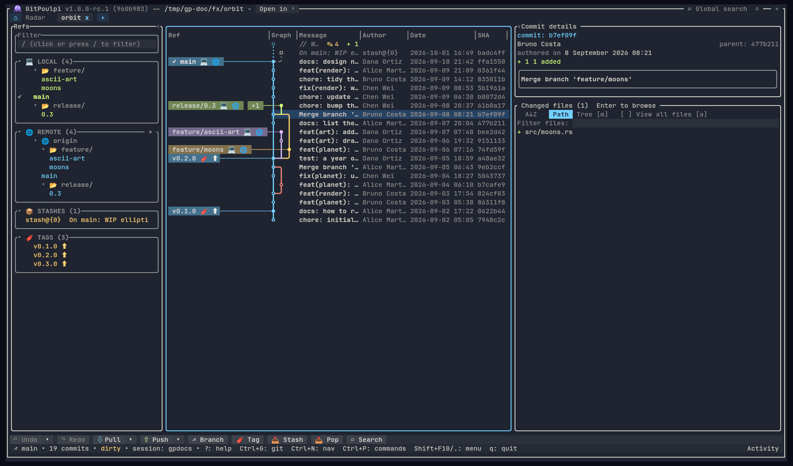
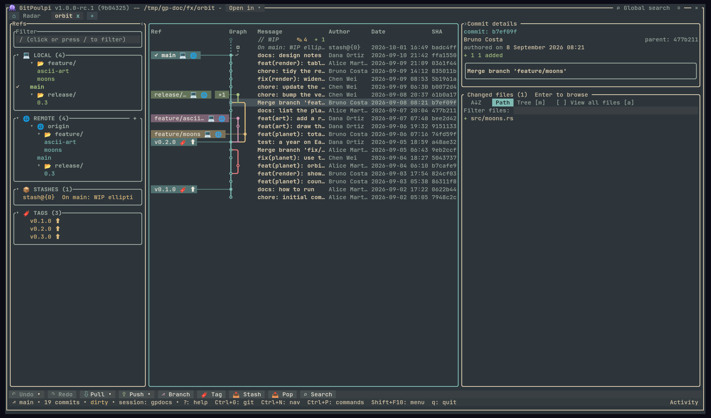
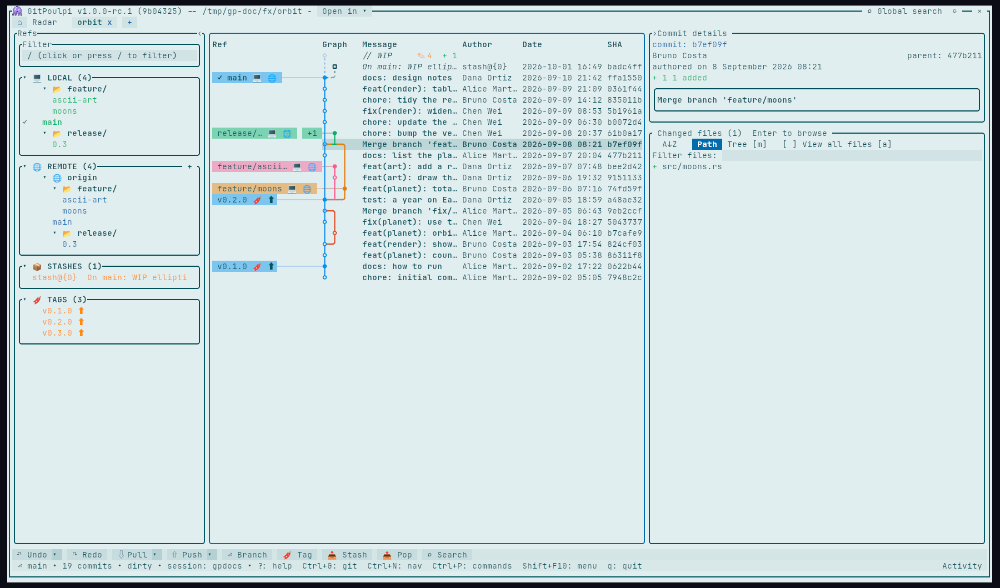
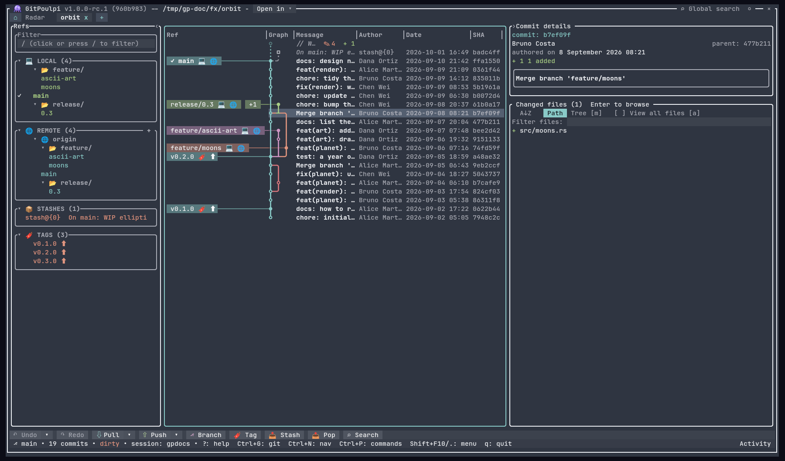

[English](../themes.md) · [Čeština](../cs/themes.md) · [Deutsch](../de/themes.md) · [Español](../es/themes.md) · [Français](../fr/themes.md) · [Italiano](../it/themes.md) · [日本語](../ja/themes.md) · [한국어](../ko/themes.md) · **Nederlands** · [Polski](../pl/themes.md) · [Português (Brasil)](../pt-BR/themes.md) · [Português (Portugal)](../pt-PT/themes.md) · [Русский](../ru/themes.md) · [Svenska](../sv/themes.md) · [Türkçe](../tr/themes.md) · [Українська](../uk/themes.md) · [简体中文](../zh-CN/themes.md)

# Thema's

Een thema bepaalt elke kleur die GitPoulpi tekent: tekst, panelen, selectie,
knoppen, de diff- en merge-weergaven, de editor, de pictogrammen van de
werkbalk en de baankleuren van de grafiek in de Log. Wissel van thema in
**Instellingen > Weergave > Thema**, of met
`gitpoulpi config set ui.theme <slug>`. Om te zien hoe elk thema eruitziet, ga je naar de
[galerij](#galerij).

## Ingebouwde presets

`gitpoulpi theme list` toont de presets in jouw build, in de volgorde waarin het
keuzelijst van de Instellingen ze toont: eerst **GitPoulpi Dark** (`dark`, getekend over de
eigen achtergrond van je terminal) en **GitPoulpi Light** (`light`), daarna alle
andere presets alfabetisch op label. `ui.theme = "system"` (de standaard) volgt
je terminal: Light op een lichte terminalachtergrond, anders Dark (zie
"Systeemdetectie" hieronder); het oude `default` is hetzelfde als `system`. Het
keuzelijst voor het baanpalet gebruikt dezelfde volgorde.

| Slug | Label | Herkomst van de kleuren |
|---|---|---|
| `system` (standaard) | Systeem | geen palet: GitPoulpi Light op een lichte terminalachtergrond, anders GitPoulpi Dark |
| `dark` | GitPoulpi Dark | origineel GitPoulpi-thema, geschilderd over de eigen achtergrond van je terminal |
| `light` | GitPoulpi Light | origineel GitPoulpi-thema |
| `catppuccin-latte` / `catppuccin-frappe` / `catppuccin-macchiato` / `catppuccin-mocha` | Catppuccin Latte / Frappé / Macchiato / Mocha | [github.com/catppuccin/palette](https://github.com/catppuccin/palette) |
| `cyberpunk` | Cyberpunk | [iTerm2-Color-Schemes](https://github.com/mbadolato/iTerm2-Color-Schemes) "Cyberpunk" |
| `dracula` | Dracula | [draculatheme.com/contribute](https://draculatheme.com/contribute) |
| `everforest-dark` | Everforest Dark | [github.com/sainnhe/everforest/blob/master/palette.md](https://github.com/sainnhe/everforest/blob/master/palette.md) |
| `fire` / `fire-light` | Fire / Fire Light | originele GitPoulpi-thema's: Fire is gloeiende kolen op een verbrand-oranje achtergrond met vlamoranje; Fire Light is de lichte tweeling op een echt oranje achtergrond |
| `github-dark` / `github-light` | GitHub Dark / GitHub Light | de Primer-thema's van GitHub, [github.com/primer/github-vscode-theme](https://github.com/primer/github-vscode-theme) met @primer/primitives (`canvas.default`, `canvas.inset` als zijbalk, `fg.*`, `accent.fg`); geen waarde aangepast |
| `gruvbox-dark` / `gruvbox-light` | Gruvbox Dark / Light | [github.com/morhetz/gruvbox#palette](https://github.com/morhetz/gruvbox#palette) |
| `kanagawa` / `kanagawa-lotus` | Kanagawa (wave) / Kanagawa Lotus | [github.com/rebelot/kanagawa.nvim](https://github.com/rebelot/kanagawa.nvim) |
| `matrix` | Matrix | [iTerm2-Color-Schemes](https://github.com/mbadolato/iTerm2-Color-Schemes) "Matrix" (het schema heeft geen rood: `danger` is `#ff5555`) |
| `monokai` | Monokai | het originele Monokai-palet ([monokai.nl](https://monokai.nl/)) |
| `nord` | Nord | [www.nordtheme.com](https://www.nordtheme.com) |
| `one-dark` / `one-light` | One Dark / One Light | Atom One Dark / One Light ([One Dark](https://github.com/atom/one-dark-syntax), [One Light](https://github.com/atom/one-light-syntax)) |
| `rose-pine` / `rose-pine-moon` / `rose-pine-dawn` | Rosé Pine / Moon / Dawn | [rosepinetheme.com/palette](https://rosepinetheme.com/palette/) |
| `solarized-dark` / `solarized-light` | Solarized Dark / Light | Solarized van Ethan Schoonover ([ethanschoonover.com/solarized](https://ethanschoonover.com/solarized/)) |
| `sunset` | Sunset | origineel GitPoulpi-thema: indigoblauwe schemering met koraal en goud |
| `terminal` | Terminal (16 kleuren) | gebruikt alleen de 16 eigen kleuren van je terminal |
| `tokyo-night` / `tokyo-night-day` | Tokyo Night (night) / Tokyo Night Day | [github.com/folke/tokyonight.nvim](https://github.com/folke/tokyonight.nvim) (de voorgrond van Day is donkerder gemaakt om de contrastregels te halen) |
| `vesper` | Vesper | [github.com/raunofreiberg/vesper](https://github.com/raunofreiberg/vesper) (geen blauw of paars in het palet: het accent is perzik) |
| `vscode-dark` / `vscode-light` | VS Code Dark / VS Code Light | de standaard Dark Modern / Light Modern van VS Code, [github.com/microsoft/vscode/tree/main/extensions/theme-defaults/themes](https://github.com/microsoft/vscode/tree/main/extensions/theme-defaults/themes) (`dark_modern.json`, `light_modern.json`, plus de kleurstandaarden van VS Code voor de lijstselectie en de ANSI-/grafiekaccenten; het gedempte grijs van Light is `616161`) |

### Geïmporteerd van terminalcolors.com

Geïmporteerd uit de terminalpaletten van terminalcolors.com; elk schema is van zijn makers. 90 presets zijn opgebouwd uit de achtergrond, voorgrond, selectie en 16 ANSI-kleuren van het palet (accent = blauw, success = groen, warning = geel, danger = rood, AI = magenta, muted = helder zwart), via één afleiding die alle presets delen; een kleur die de contrastregels van GitPoulpi niet haalt, wordt lichter of donkerder gemaakt tot hij ze haalt. De tabel wordt door `scripts/gen-terminalcolors.py` gegenereerd in `crates/gitpoulpi-config/src/theme/terminalcolors_data.rs`. Slugs zijn `<familie>-<variant>` (`default` vervalt); labels staan in het keuzelijst alfabetisch, net als de andere.

| Familie | Slugs |
|---|---|
| [Apprentice](https://terminalcolors.com/themes/apprentice/) | `apprentice` |
| [Ayu](https://terminalcolors.com/themes/ayu/) | `ayu-dark`, `ayu-light`, `ayu-mirage` |
| [Cobalt2](https://terminalcolors.com/themes/cobalt2/) | `cobalt2` |
| [Deus](https://terminalcolors.com/themes/deus/) | `deus` |
| [Dracula](https://terminalcolors.com/themes/dracula/) | `dracula-soft` |
| [Everforest](https://terminalcolors.com/themes/everforest/) | `everforest-light` |
| [GitHub](https://terminalcolors.com/themes/github/) | `github-dark-colorblind`, `github-dark-dimmed`, `github-dark-high-contrast`, `github-dark-legacy`, `github-light-colorblind`, `github-light-high-contrast`, `github-light-legacy` |
| [Gotham](https://terminalcolors.com/themes/gotham/) | `gotham` |
| [Gruvbox](https://terminalcolors.com/themes/gruvbox/) | `gruvbox-dark-hard-contrast`, `gruvbox-dark-soft-contrast`, `gruvbox-light-hard-contrast`, `gruvbox-light-soft-contrast` |
| [Iceberg](https://terminalcolors.com/themes/iceberg/) | `iceberg-dark`, `iceberg-light` |
| [Jellybeans](https://terminalcolors.com/themes/jellybeans/) | `jellybeans` |
| [Kanagawa](https://terminalcolors.com/themes/kanagawa/) | `kanagawa-dragon` |
| [Lucario](https://terminalcolors.com/themes/lucario/) | `lucario` |
| [Miasma](https://terminalcolors.com/themes/miasma/) | `miasma` |
| [Moonfly](https://terminalcolors.com/themes/moonfly/) | `moonfly` |
| [Night](https://terminalcolors.com/themes/night-owl/) | `night-owl-dark`, `night-owl-light` |
| [Nightfly](https://terminalcolors.com/themes/nightfly/) | `nightfly` |
| [Nightfox](https://terminalcolors.com/themes/nightfox/) | `nightfox`, `nightfox-carbonfox`, `nightfox-dawnfox`, `nightfox-dayfox`, `nightfox-duskfox`, `nightfox-nordfox`, `nightfox-terafox` |
| [Noctis](https://terminalcolors.com/themes/noctis/) | `noctis`, `noctis-azureus`, `noctis-bordo`, `noctis-hibernus`, `noctis-lilac`, `noctis-lux`, `noctis-minimus`, `noctis-obscuro`, `noctis-sereno`, `noctis-uva`, `noctis-viola` |
| [Nordic](https://terminalcolors.com/themes/nordic/) | `nordic` |
| [One](https://terminalcolors.com/themes/one-half/) | `one-half-dark`, `one-half-light` |
| [Panda](https://terminalcolors.com/themes/panda/) | `panda` |
| [Posterpole](https://terminalcolors.com/themes/posterpole/) | `posterpole`, `posterpole-gray` |
| [Seoul256](https://terminalcolors.com/themes/seoul256/) | `seoul256-dark`, `seoul256-light` |
| [Shades](https://terminalcolors.com/themes/shades-of-purple/) | `shades-of-purple`, `shades-of-purple-super-dark` |
| [Sonokai](https://terminalcolors.com/themes/sonokai/) | `sonokai`, `sonokai-andromeda`, `sonokai-atlantis`, `sonokai-espresso`, `sonokai-maia`, `sonokai-shusia` |
| [Srcery](https://terminalcolors.com/themes/srcery/) | `srcery` |
| [Tender](https://terminalcolors.com/themes/tender/) | `tender` |
| [Tokyo](https://terminalcolors.com/themes/tokyo-night/) | `tokyo-night-moon`, `tokyo-night-storm` |
| [Tomorrow](https://terminalcolors.com/themes/tomorrow/) | `tomorrow`, `tomorrow-night`, `tomorrow-night-blue`, `tomorrow-night-bright`, `tomorrow-night-eighties` |
| [Zenbones](https://terminalcolors.com/themes/zenbones/) | `zenbones-duckbones`, `zenbones-forestbones-dark`, `zenbones-forestbones-light`, `zenbones-kanagawabones`, `zenbones-neobones-dark`, `zenbones-neobones-light`, `zenbones-nordbones`, `zenbones-rosebones-dark`, `zenbones-rosebones-light`, `zenbones-seoulbones-dark`, `zenbones-seoulbones-light`, `zenbones-tokyobones-dark`, `zenbones-tokyobones-light`, `zenbones-vimbones`, `zenbones-zenburned`, `zenbones-zenwritten-dark`, `zenbones-zenwritten-light` |

`ui.side_bg` is de achtergrond van het Refs-paneel en het rechterpaneel
(commit-details, lokale wijzigingen, bestandslijsten), zoals GitHub en
VS Code hun zijbalken tekenen. Catppuccin (zijn
`mantle`), GitHub en VS Code stellen hem in; bij elke andere preset is het
`default`, wat hetzelfde betekent als `ui.bg`. Een themabestand kan `side_bg`
instellen onder `[ui]` (`gitpoulpi theme export` toont het).

Drie andere rollen onder `[ui]` kleuren de omlijsting, zoals GitHub en VS Code dat doen:

| Rol | Waar hij kleurt |
|---|---|
| `ui.toolbar_bg` | De werkbalkrij en het **geselecteerde repositorytabblad**, zodat het tabblad aan de werkbalk vast lijkt te zitten. De knopchips van de werkbalk houden hun eigen `chrome.toolbar_bg`. |
| `ui.statusbar_bg` | De statusbalk (onderaan, tenzij `ui.statusbar_position` boven zegt). |
| `ui.statusbar_fg` | De tekst van de statusbalk. Tekst die op die vulling niet leesbaar zou zijn, wordt ermee overschilderd; waarschuwings- en foutteksten die wel leesbaar zijn, houden hun kleur. |

Presets stellen ze in passend bij hun app: VS Code Dark en Light de blauwe (`#007acc`) statusbalk met witte
tekst en de grijstinten van de titelbalk van VS Code voor de werkbalk; GitHub
zijn koptinten. Elke andere preset (ook de geïmporteerde terminalpaletten) leidt
een werkbalk af die één stap van `bg` ligt en een statusbalk die iets daarvan
afwijkt, met `text` erop, en de contrastregels houden de tekst leesbaar. `dark`
(GitPoulpi Dark) en `terminal` gebruiken de eigen achtergrond van de terminal,
dus alle drie zijn daar `default`: er wordt niets getekend en het geselecteerde
tabblad houdt de selectiekleur. Een themabestand dat ze weglaat, erft de
waarden van zijn basis; `default` betekent geen tint (de statusbalk volgt dan
`side_bg`).

Waar het commentaar- of gedempte grijs van een schema te zwak is om te lezen,
wordt het lichter gemaakt tot het de contrastregels van GitPoulpi haalt;
paneel- en selectietinten die het schema mist, worden afgeleid van zijn
achtergrond.

### Galerij

Alle ingebouwde thema's, op dezelfde repository met een merge-commit geselecteerd (`scripts/docs-screenshots.sh` maakt ze opnieuw).

| **GitPoulpi Dark** (`dark`) | **GitPoulpi Light** (`light`) | **Apprentice** (`apprentice`) |
|---|---|---|
|  |  |  |
| **Ayu Dark** (`ayu-dark`) | **Ayu Light** (`ayu-light`) | **Ayu Mirage** (`ayu-mirage`) |
|  |  |  |
| **Catppuccin Frappé** (`catppuccin-frappe`) | **Catppuccin Latte** (`catppuccin-latte`) | **Catppuccin Macchiato** (`catppuccin-macchiato`) |
|  |  |  |
| **Catppuccin Mocha** (`catppuccin-mocha`) | **Cobalt2** (`cobalt2`) | **Cyberpunk** (`cyberpunk`) |
|  |  |  |
| **Deus** (`deus`) | **Dracula** (`dracula`) | **Dracula Soft** (`dracula-soft`) |
|  |  |  |
| **Everforest Dark** (`everforest-dark`) | **Everforest Light** (`everforest-light`) | **Fire** (`fire`) |
|  |  |  |
| **Fire Light** (`fire-light`) | **GitHub Dark** (`github-dark`) | **GitHub Dark Colorblind** (`github-dark-colorblind`) |
|  |  |  |
| **GitHub Dark Dimmed** (`github-dark-dimmed`) | **GitHub Dark High Contrast** (`github-dark-high-contrast`) | **GitHub Dark Legacy** (`github-dark-legacy`) |
|  |  |  |
| **GitHub Light** (`github-light`) | **GitHub Light Colorblind** (`github-light-colorblind`) | **GitHub Light High Contrast** (`github-light-high-contrast`) |
|  |  |  |
| **GitHub Light Legacy** (`github-light-legacy`) | **Gotham** (`gotham`) | **Gruvbox Dark** (`gruvbox-dark`) |
|  |  |  |
| **Gruvbox Dark Hard Contrast** (`gruvbox-dark-hard-contrast`) | **Gruvbox Dark Soft Contrast** (`gruvbox-dark-soft-contrast`) | **Gruvbox Light** (`gruvbox-light`) |
|  |  |  |
| **Gruvbox Light Hard Contrast** (`gruvbox-light-hard-contrast`) | **Gruvbox Light Soft Contrast** (`gruvbox-light-soft-contrast`) | **Iceberg Dark** (`iceberg-dark`) |
|  |  |  |
| **Iceberg Light** (`iceberg-light`) | **Jellybeans** (`jellybeans`) | **Kanagawa** (`kanagawa`) |
|  |  |  |
| **Kanagawa Dragon** (`kanagawa-dragon`) | **Kanagawa Lotus** (`kanagawa-lotus`) | **Lucario** (`lucario`) |
|  |  |  |
| **Matrix** (`matrix`) | **Miasma** (`miasma`) | **Monokai** (`monokai`) |
|  |  |  |
| **Moonfly** (`moonfly`) | **Night Owl Dark** (`night-owl-dark`) | **Night Owl Light** (`night-owl-light`) |
|  |  |  |
| **Nightfly** (`nightfly`) | **Nightfox** (`nightfox`) | **Nightfox Carbonfox** (`nightfox-carbonfox`) |
|  |  |  |
| **Nightfox Dawnfox** (`nightfox-dawnfox`) | **Nightfox Dayfox** (`nightfox-dayfox`) | **Nightfox Duskfox** (`nightfox-duskfox`) |
|  |  |  |
| **Nightfox Nordfox** (`nightfox-nordfox`) | **Nightfox Terafox** (`nightfox-terafox`) | **Noctis** (`noctis`) |
|  |  |  |
| **Noctis Azureus** (`noctis-azureus`) | **Noctis Bordo** (`noctis-bordo`) | **Noctis Hibernus** (`noctis-hibernus`) |
|  |  |  |
| **Noctis Lilac** (`noctis-lilac`) | **Noctis Lux** (`noctis-lux`) | **Noctis Minimus** (`noctis-minimus`) |
|  |  |  |
| **Noctis Obscuro** (`noctis-obscuro`) | **Noctis Sereno** (`noctis-sereno`) | **Noctis Uva** (`noctis-uva`) |
|  |  |  |
| **Noctis Viola** (`noctis-viola`) | **Nord** (`nord`) | **Nordic** (`nordic`) |
|  |  |  |
| **One Dark** (`one-dark`) | **One Half Dark** (`one-half-dark`) | **One Half Light** (`one-half-light`) |
|  |  |  |
| **One Light** (`one-light`) | **Panda** (`panda`) | **Posterpole** (`posterpole`) |
|  |  |  |
| **Posterpole Gray** (`posterpole-gray`) | **Rosé Pine** (`rose-pine`) | **Rosé Pine Dawn** (`rose-pine-dawn`) |
|  |  |  |
| **Rosé Pine Moon** (`rose-pine-moon`) | **Seoul256 Dark** (`seoul256-dark`) | **Seoul256 Light** (`seoul256-light`) |
|  |  |  |
| **Shades of Purple** (`shades-of-purple`) | **Shades of Purple Super Dark** (`shades-of-purple-super-dark`) | **Solarized Dark** (`solarized-dark`) |
|  |  |  |
| **Solarized Light** (`solarized-light`) | **Sonokai** (`sonokai`) | **Sonokai Andromeda** (`sonokai-andromeda`) |
|  |  |  |
| **Sonokai Atlantis** (`sonokai-atlantis`) | **Sonokai Espresso** (`sonokai-espresso`) | **Sonokai Maia** (`sonokai-maia`) |
|  |  |  |
| **Sonokai Shusia** (`sonokai-shusia`) | **Srcery** (`srcery`) | **Sunset** (`sunset`) |
|  |  |  |
| **Tender** (`tender`) | **Terminal (16 kleuren)** (`terminal`) | **Tokyo Night** (`tokyo-night`) |
|  |  |  |
| **Tokyo Night Day** (`tokyo-night-day`) | **Tokyo Night Moon** (`tokyo-night-moon`) | **Tokyo Night Storm** (`tokyo-night-storm`) |
|  |  |  |
| **Tomorrow** (`tomorrow`) | **Tomorrow Night** (`tomorrow-night`) | **Tomorrow Night Blue** (`tomorrow-night-blue`) |
|  |  |  |
| **Tomorrow Night Bright** (`tomorrow-night-bright`) | **Tomorrow Night Eighties** (`tomorrow-night-eighties`) | **Vesper** (`vesper`) |
|  |  |  |
| **VS Code Dark** (`vscode-dark`) | **VS Code Light** (`vscode-light`) | **Zenbones Duckbones** (`zenbones-duckbones`) |
|  |  |  |
| **Zenbones Forestbones Dark** (`zenbones-forestbones-dark`) | **Zenbones Forestbones Light** (`zenbones-forestbones-light`) | **Zenbones Kanagawabones** (`zenbones-kanagawabones`) |
|  |  |  |
| **Zenbones Neobones Dark** (`zenbones-neobones-dark`) | **Zenbones Neobones Light** (`zenbones-neobones-light`) | **Zenbones Nordbones** (`zenbones-nordbones`) |
|  |  |  |
| **Zenbones Rosebones Dark** (`zenbones-rosebones-dark`) | **Zenbones Rosebones Light** (`zenbones-rosebones-light`) | **Zenbones Seoulbones Dark** (`zenbones-seoulbones-dark`) |
|  |  |  |
| **Zenbones Seoulbones Light** (`zenbones-seoulbones-light`) | **Zenbones Tokyobones Dark** (`zenbones-tokyobones-dark`) | **Zenbones Tokyobones Light** (`zenbones-tokyobones-light`) |
|  |  |  |
| **Zenbones Vimbones** (`zenbones-vimbones`) | **Zenbones Zenburned** (`zenbones-zenburned`) | **Zenbones Zenwritten Dark** (`zenbones-zenwritten-dark`) |
|  |  |  |
| **Zenbones Zenwritten Light** (`zenbones-zenwritten-light`) |
|  |

## Elk thema met elk baanpalet

Elk thema brengt zijn eigen baankleuren voor de Log-grafiek mee, maar je kunt
elk thema met elk palet combineren: **Instellingen > Weergave > Kleurthema van de
grafiek** biedt **Thema volgen** (de standaard) plus elk baanpalet van elk
thema (GitPoulpi Dark, GitPoulpi Light, daarna Material, Serie, ... en de
`graph_palette` van je eigen themabestanden). 

In `config.toml`:

```toml
[ui]
theme = "nord"
graph_color_theme = "material"   # of "theme" om het thema te volgen
```

`ui.input_color` is dezelfde soort overschrijving voor tekstvelden: de standaard
`theme` volgt de invoerkleuren van het thema; `gray`, `blue`, `slate`, `dark` en
`custom` dwingen een achtergrond af (het zijn donkere kleuren, kies dus `theme`
bij een licht thema).

## Je eigen thema's

Zet een `.toml`-bestand in de map `themes/` van de configuratiemap
(`gitpoulpi config path` toont de bovenliggende map; de map is `${config}/themes/`).
De bestandsnaam zonder `.toml` is de slug van het thema, en die verwacht
`ui.theme`. Een bestand mag de slug van een preset niet hergebruiken (het wordt
met een waarschuwing overgeslagen).

Begin met een volledig bestand:

```
gitpoulpi theme export nord > "$(dirname "$(gitpoulpi config path)")/themes/mine.toml"
```

Houd daarna alleen over wat je wijzigt. Een bestand is een set **gedeeltelijke
overschrijvingen** op een `base` (een preset of een ander gebruikersthema;
ketens zijn maximaal 4 diep en cycli worden geweigerd; zonder `base` is het
`dark`):

```toml
name = "My Nord"            # het label in de keuzelijst; standaard = bestandsnaam
base = "nord"
light = false               # geërfd als hij ontbreekt
syntax = "base16-ocean.dark"
graph_palette = ["#88c0d0", "#a3be8c"]

[ui]
bg = "#2e3440"              # "default" | "#rrggbb" | "ansi:N"
accent = "#88c0d0"
toolbar_bg = "#3b4252"      # werkbalkrij en geselecteerd tabblad
statusbar_bg = "#5e81ac"    # statusbalk
statusbar_fg = "#eceff4"

[diff]
add_bg = "#2f3b2f"
```

Kleuren zijn `"#rrggbb"`, `"ansi:N"` (item N van het palet van de terminal) of
`"default"` (de eigen kleur van de terminal). Groepen en sleutels zijn die van
`gitpoulpi theme export <slug>`. Niets is fataal: een onbekende sleutel of een
ongeldige kleur wordt genegeerd, een onbekende `base` valt terug op `dark`, en
`gitpoulpi theme list` meldt elk probleem onder `warnings` (de app toont ze
één keer in de statusbalk).

Bestanden worden opnieuw gelezen wanneer het keuzelijst Thema opent en wanneer
de Instellingen sluiten. Een draaiend venster merkt ook dat `config.toml` (een
`gitpoulpi config set ui.theme ...` vanuit een shell) of het bestand van het
actieve thema is herschreven, en past de nieuwe kleuren binnen ongeveer een
seconde toe, zonder herstart.

### `ui.border_focused`

De rand van het paneel dat de toetsenbordfocus heeft: het Log, het Refs-paneel,
de panelen Staged en Unstaged, het commitdetail, de panelen voor geschiedenis,
review en herschrijven, en de randen van diff, bestand en editor. Het kleurt
alleen randen; tekst, labels en pictogrammen (het label "commit :", het
Home-pictogram, de tabknoppen) blijven `ui.accent` gebruiken. Zo kan een thema
het actieve paneel omranden in een kleur die als tekst onleesbaar zou zijn, bijvoorbeeld
een felgeel op een licht thema. Stelt een thema het niet in, dan volgt het
`ui.accent` (ook in een gebruikersbestand: een bestand dat alleen `accent`
wijzigt, geeft dat accent aan zijn gefocuste randen), zodat elk ingebouwd thema
er hetzelfde uitziet als voorheen. Dialogen en pop-ups houden een accentrand.

```toml
[ui]
accent = "#1f5fbf"
border_focused = "#ffd700"
```

## Systeemdetectie

Met `ui.theme = "system"` vraagt GitPoulpi de terminal **één keer, bij het
starten** om zijn achtergrondkleur (de OSC 11-query, beantwoord door kitty,
WezTerm, Alacritty, foot, iTerm2, Windows Terminal, tmux en de meeste andere) en
kiest Light bij een lichte achtergrond, anders Dark. De wachttijd is hooguit
ongeveer 100 ms, en een terminal die de query niet kent kost niets: het antwoord
wordt altijd gelezen voordat de interface start, dus er wordt niets afgedrukt en
er worden geen toetsen opgeslokt. Zonder antwoord (en altijd op Windows, dat de
query niet verstuurt) leest het `COLORFGBG` en valt dan terug op Dark. Een
terminal waarvan de achtergrond verandert terwijl GitPoulpi draait, wordt niet
gevolgd; start opnieuw, of kies expliciet Light of Dark.

## Kleurdiepte

Thema's zijn truecolor (`#rrggbb`). `ui.color_depth` (Instellingen > Weergave >
Kleurdiepte, werkt direct) bepaalt hoe dat de terminal bereikt:

| Waarde | Effect |
|---|---|
| `auto` (standaard) | Truecolor, behalve waar het bekend niet werkt: Apple Terminal (`TERM_PROGRAM=Apple_Terminal`) gebruikt 256 kleuren, de Linux-console (`TERM=linux`) 16, en een `*-256color`-terminal die geen `COLORTERM` instelt (en geen WezTerm, kitty of Windows Terminal is) 256. `COLORTERM=truecolor` betekent altijd truecolor. |
| `truecolor` | Altijd 24-bits kleur. |
| `256` | Elke RGB-kleur wordt het dichtstbijzijnde xterm-256-item. |
| `16` | De dichtstbijzijnde van de 16 ANSI-kleuren; het eigen palet van de terminal bepaalt de exacte tint. |

Gebruik `256` of `16` als een thema met verkeerde kleuren verschijnt via ssh of
in een oude multiplexer. De Terminal-preset heeft dit allemaal niet nodig.
Truecolor kost niets; de mappingstap loopt alleen als hij actief is, één keer
per frame over het scherm.

## Live voorbeeld

In Instellingen > Weergave toont het keuzelijst Thema **Systeem (volgt de terminal)**,
de presets en daarna je eigen themabestanden. Als je de markering verplaatst,
wordt dat thema meteen toegepast, dus het hele scherm Instellingen wordt onder je
ogen opnieuw getekend; **Enter** houdt het (het wordt bewaard), **Esc** of een
klik elders herstelt het vorige en bewaart niets. De opdracht
**App: Thema...** (`Ctrl+P`) van het palet opent de Instellingen op die rij.

### Thema wijzigen vanuit het palet

**App: Thema wijzigen...** (`Ctrl+P`, of `Ctrl+N t`; de toets is herbindbaar als
`nav_prefix.change_theme`) opent een lijst met dezelfde thema's zonder via
Instellingen te gaan: **Systeem (volgt de terminal)**, de presets en daarna je
eigen themabestanden, elk met vier kleine kleurchips. Het huidige thema is
aangevinkt. Typ om de lijst te versmallen; de markering verplaatsen toont het
thema meteen, **Enter** past toe en bewaart `ui.theme` in `config.toml`,
**Esc** (of een klik buiten de lijst) zet het vorige thema terug en bewaart niets.

Onder het filterveld versmalt een gesegmenteerd voorfilter de lijst: **Alle**,
**Donker**, **Licht** en **Gekleurd** (klik op een segment, `Tab` / `Shift+Tab`
of `Alt+1`..`Alt+4`). Donker en Licht komen van de helderheid van de `ui.bg` van
het thema; **Gekleurd** houdt de thema's met een duidelijk getinte achtergrond
(blauw, violet, geel, groen...) en laat wit, gebroken wit, zwart en bijna zwarte
grijstinten weg, dus Solarized Dark, Dracula of Nord zijn gekleurd terwijl GitHub
Dark en One Light dat niet zijn. Een gekleurd thema staat ook onder Donker of
Licht. **Systeem** en transparante thema's (zonder eigen achtergrond) staan
alleen onder Alle. Het voorfilter combineert met wat je typt. De keuzelijsten
voor het kleurthema van de grafiek en voor de taal tonen op dezelfde manier een
voorbeeld: de banen van de Log en de hele UI veranderen terwijl de markering
beweegt.


Onder het keuzelijst toont een strook kleurchips het geldende thema (achtergrond,
tekst, gedempt, accent, selectie, danger, diff toegevoegd, diff verwijderd,
daarna de eerste zes baankleuren), en hij volgt het voorbeeld. Het keuzelijst
**Kleurthema van de grafiek** bij **Weergave** toont een paar baankleuren naast
elk palet, en keuzes gelden als de Instellingen sluiten.

Een thema met een eigen achtergrond (Light en de andere getekende presets) vult
het hele venster, inclusief Instellingen en de paginavullende weergaven, en geeft
tekst zonder eigen kleur de tekstkleur van het thema; Dark en Terminal laten de
kleuren van je terminal ongemoeid.

## Vanaf de opdrachtregel

| Opdracht | Uitvoer |
|---|---|
| `gitpoulpi theme list` | JSON `{themes: [{slug, label, source, light, lane_palette}], warnings}`; `source` is `preset` of `user`. |
| `gitpoulpi theme export <slug>` | Het volledige themabestand als TOML op stdout (JSON: `{slug, toml}`); het wordt weer tot hetzelfde thema ingelezen. |
| `gitpoulpi config set ui.theme <slug>` | Gevalideerd tegen de presets en je map `themes/`; een onbekende naam is een fout met de geldige namen. `system` en `default` worden geaccepteerd. |
| `gitpoulpi config set ui.graph_color_theme <naam>` | `theme` (het thema volgen) of een naam van een baanpalet; een onbekende naam toont de geldige. |

De MCP-server biedt `theme_list` en `theme_export` als alleen-lezen tools.
