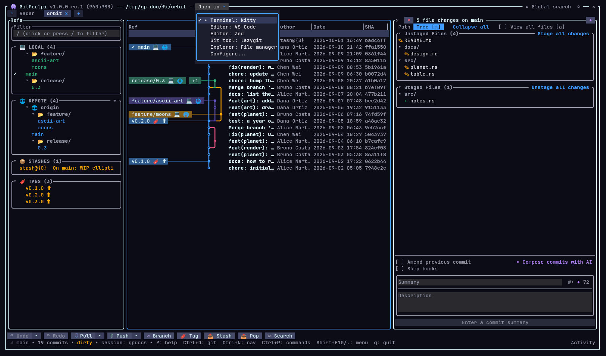

**English** · [Čeština](cs/open-in.md) · [Deutsch](de/open-in.md) · [Español](es/open-in.md) · [Français](fr/open-in.md) · [Italiano](it/open-in.md) · [日本語](ja/open-in.md) · [한국어](ko/open-in.md) · [Nederlands](nl/open-in.md) · [Polski](pl/open-in.md) · [Português (Brasil)](pt-BR/open-in.md) · [Português (Portugal)](pt-PT/open-in.md) · [Русский](ru/open-in.md) · [Svenska](sv/open-in.md) · [Türkçe](tr/open-in.md) · [Українська](uk/open-in.md) · [简体中文](zh-CN/open-in.md)

# Open in

The **Open in ▾** button in the title bar, next to the repository path, opens the active tab's
folder somewhere else: your terminal, a new multiplexer tab or pane, an editor,
the file manager. You choose what is on the list. Nothing is hard-wired: every
entry is a label and a command.

## Using it

- **Click Open in ▾**: a list drops down. Click an entry to run it. The default
  entry is marked with `•`; the last row, **Configure...**, opens
  [Settings](settings.md#open-in) on the Open in page.

  

- **Keyboard**: `Alt+O` opens the same list (`Up`/`Down`, `Enter`, `Esc`; with
  more than seven entries, type to search). `Ctrl+Alt+O` runs the default entry
  at once. Palette (`Ctrl+P`): `Tab: Open in...` and `Tab: Open in default`.
  The palette commands work even when the title bar has no room for the button.
  Both keys are rebindable; see [Keybindings](keybindings.md).
- **By label**: a [sequence](config-reference.md#sequences) step `tab_open_in` runs the entry whose
  **label** you name (`label = "VS Code"`), so reordering the list never changes what it
  runs. An unknown label stops the step with "no Open in entry is labelled ...".
  `Tab: Terminal Here` (palette) opens your terminal in the folder, the tab bar's old
  "Terminal here" button.
- **An AI agent in the folder**: `Tab: Open AI Agent Here` opens your terminal in the
  tab's folder running a local AI agent; see [AI](ai.md#open-the-agent-in-a-tabs-folder).
- **Right-click a repository tab**: the tab menu has an **Open in** submenu with
  the same entries.
- The list starts on the entry you used last in this session.
- The status line says "opening in ..." at once. If the program fails within
  about 1.5 seconds (for example tmux with no server, or a bad flag), the first
  line of its error output appears on the status line. A program that is not
  installed is named at once.

Until you save your own list, the default entry is chosen from what is detected: inside herdr, "Herdr: new tab"; on Omarchy, kitty's new window (kitty is its terminal); otherwise the file manager.

The button shows on every repository tab, including the folder GitPoulpi was
started in, and in `ui.tab_dir_follow = "auto"` mode. In `auto` mode the default
entry also runs by itself when you open a new tab (not for the tabs restored at
start-up). See [Following the active tab's folder](following-the-tab-folder.md).

## What an entry looks like

In `config.toml`, one `[[ui.open_in]]` table per entry:

```toml
[ui]
open_in_default = "Herdr: new tab"   # a label; empty means the first entry

[[ui.open_in]]
label = "Herdr: new tab"
command = "herdr tab create --workspace ${env:HERDR_WORKSPACE_ID} --cwd ${cwd} --focus"

[[ui.open_in]]
label = "VS Code"
command = "code ${cwd}"
```

You rarely write this by hand: the Settings page edits it. Every key is in the
[configuration reference](config-reference.md).

### Commands and variables

The command is split into arguments first (spaces, `'...'` and `"..."` group
words), then the variables are replaced inside each argument. A folder with a
space in its name therefore stays one argument. **No shell is involved** unless
your command starts one.

| Variable | Replaced by |
|---|---|
| `${cwd}` | The tab's folder. |
| `${repo}` | The repository root (differs from `${cwd}` for a worktree tab). |
| `${name}` | The folder's base name. |
| `${branch}` | The checked-out branch; empty when detached. |
| `${web_url}` | The origin remote's web page when it is GitHub or GitLab; empty otherwise. |
| `${env:NAME}` | The environment variable `NAME`; empty when unset. |

The old `{repo}` still works and means `${cwd}`. Any other `${...}` is an error
that names the variable.

The program is started with the tab's folder as its working directory, and gets
three environment variables, handy for a shell snippet:

| Variable | Value |
|---|---|
| `GITPOULPI_CWD` | The tab's folder. |
| `GITPOULPI_REPO` | The repository root. |
| `GITPOULPI_BRANCH` | The branch, or empty. |

```toml
[[ui.open_in]]
label = "Terminal here, then status"
command = "sh -c 'cd \"$GITPOULPI_CWD\" && git status; exec $SHELL'"
```

On Windows the program is looked up through `PATH` and `PATHEXT`, so `code` and
`cursor` (`.cmd` files) work, and no console window flashes up.

## Presets

Settings > Open in > **Add preset** lists ready-made entries for your operating
system only (Windows presets never show on Linux, and so on), by category: the
row starts with the category, `Explorer: ...`, `Multiplexer: ...`, `Terminal: ...`,
`Editor: ...`, `Git tool: ...`, `AI agent: ...`, `Web: ...`. At the top, **Detected** are the
entries of the computed default list. Inside each category the presets you can
use right away come first (you run inside that multiplexer or terminal, and the
program is on `PATH`), then the installed ones, then the rest. Type in the
combobox to search, for example `lazygit` or `Git tool:`. **Test on current tab** tries an entry before you
rely on it.


"Run a tool in a pane" presets (`lazygit in Herdr tab`, `yazi in tmux window`,
`Claude Code in Herdr split`...) are only offered when the host (herdr, tmux,
zellij, WezTerm, kitty, `xdg-terminal-exec`, Windows Terminal) and the tool are
installed. `$EDITOR in ...` runs the editor named by your `EDITOR` variable
(falling back to `vi` in herdr) in herdr or tmux.

Herdr's tool presets create the tab or split, then type the command into its
shell, so the tool starts in the folder and the pane stays open after it exits.
The `AI agent` ones use `herdr agent start`, so herdr tracks the agent's state.

| Category | Presets (`V` = verified by running or against the installed help) |
|---|---|
| Explorer | Windows `explorer.exe` (V), macOS Finder (V), Linux `xdg-open` (V), Nautilus, Dolphin, Thunar, Nemo, PCManFM; yazi, superfile, nnn, lf, ranger in a pane/tab/terminal |
| Multiplexer | herdr tab, workspace, split right/down (V); tmux window, split right/down, detached session (V); zellij pane, tab, floating; WezTerm tab, split, new window; kitty tab, split window, OS window (V: flags from help; needs `allow_remote_control`); screen; cmux; psmux |
| Terminal | `xdg-terminal-exec` (V), kitty (V), foot (V), Alacritty (+ `alacritty msg`), WezTerm, Ghostty (Linux, macOS), GNOME Terminal, Ptyxis, Konsole, Xfce Terminal, Tilix, Terminator, MATE Terminal, iTerm2, Terminal.app, Warp; Windows: Windows Terminal (window, tab, split, and a tab each for PowerShell 7, Windows PowerShell, Command Prompt, WSL), PowerShell 7 / Windows PowerShell / Command Prompt / WSL windows, Git Bash |
| Editor | VS Code (V), VSCodium, Cursor, Windsurf, Zed, Sublime Text, Emacs, IntelliJ IDEA, RustRover, PyCharm, WebStorm, CLion, GoLand, Rider, PhpStorm, Android Studio, Visual Studio (Windows); Neovim, Vim, Helix, `$EDITOR` in a pane/tab/terminal |
| Git tool | gitk, `git gui`, gitg, Sublime Merge, GitKraken, GitHub Desktop; lazygit, tig, gitui in a pane/tab/terminal (herdr, tmux, kitty and `xdg-terminal-exec` ones V) |
| AI agent | Claude Code, Codex, Gemini CLI, opencode in a herdr tab/split (V, with Claude), tmux, zellij, WezTerm, kitty, new terminal |
| Web | `Repository page on the web` (`${web_url}`), `gh repo view --web` (V), `glab repo view --web` |

WSL on Windows: `wsl.exe --cd ${cwd}` accepts the Windows path as is, and
Windows Terminal's `wsl.exe` tab starts in the folder, which WSL maps under
`/mnt/`.

The explorer, Windows Terminal, PowerShell, `cmd`, WSL, Warp, psmux, Visual Studio
and Zed (Zed is Unix-only) appear only where they exist; tmux, zellij, cmux,
screen, kitty remote control and the `sh`-driven herdr presets are Unix-only;
herdr (plain presets), WezTerm, Alacritty, VS Code, Cursor and the JetBrains IDEs are offered
everywhere.

### Variable `${web_url}`

The web page of the repository's `origin` remote, when it is a GitHub or GitLab
project (github.com, gitlab.com, or a self-managed host that has an entry in
`[[integrations]]`); empty otherwise, and then an entry that uses it stops with
a message instead of opening an empty address. It is optional: no preset needs it
except `Repository page on the web`.

## The Settings page

Settings > **Open in** edits the list. The entries are a
[list](settings.md#lists) on the left (the default entry is marked `★`), the fields
of the selected entry are on the right; `+ Add`, `Duplicate`, `Remove`, `↑` / `↓` and
dragging a row manage the list.

| Row | What it does |
|---|---|
| **Default entry** | The entry that **Open in default** runs. It is marked `•` in the Open in list. |
| **Label** | The name shown in the list. Unique, not empty. |
| **Command** | The command, with the variable chips (`${cwd}`, `${repo}`, `${branch}`, `${name}`, `${web_url}`) to insert. |
| **Test on current tab** | Runs the entry now on the active tab's folder. |
| **+ Add ▾** | Appends a ready-made entry (detected ones first), or **Custom**, an empty entry whose Command is edited next. |
| **Restore detected defaults** | Replaces the list with what is detected on this machine and clears the default. |

Edits are saved as you make them. The first edit writes the whole `[[ui.open_in]]`
array to `config.toml`; until then the list is computed (see [Legacy keys](#legacy-keys)) and the file
has no `open_in` key. The Settings search finds the page too.

## Binary files: Open in

A binary file (a PDF, a Word document, a spreadsheet, an archive...) has no text to show in the Diff view or the File View. When the operating system knows an application for its type, the view shows an **Open in** button next to the usual notice. Its list holds the application the system opens that type with, first and marked with a bullet, then every other application the system registers for it (the system's own *Open with* list). On Linux that is the MIME type of the file name, `mimeapps.list` for the default and the `.desktop` files for the others; on Windows the registry (the user's choice and the programs registered for the extension); on macOS the default application only.

`o` runs the default application and `Shift+O` opens the list. Both are in the command palette (*File: Open in default app*, *File: Open with...*), and **Open with...** is in the right-click menu of a file in the Status pane and in a commit's file list. The search runs in the background, once per extension: the view says "looking up apps..." while it runs. A type the system knows no application for, and plain text, keep the plain notice and have no button.


The working-tree file is handed to the application as it is. A commit's (or the index's) version is written to a **read-only temp copy**, with a notice in the status line, so an application cannot change the repository. Neither changes the repository: no journal entry, Undo is unaffected.

The menu's list opens beside the menu, level with the **Open with...** row, like a submenu (on the left when there is no room on the right), from the mouse and from the keyboard alike. The picture editors list (**Edit in...**) opened from a file menu does the same.

### Git LFS files

The Git LFS object card (see [Git LFS](lfs.md)) carries the same two actions under its text: **Open in default program** and **Open in**, with the same keys (`o`, `Shift+O`) and palette rows. They open the real file, never the pointer: the working-tree file as it is, or a read-only temp copy of the object from the local LFS store for a commit's or the index's version. An object that is not downloaded yet has no buttons on the card, and the status line says the content is not downloaded yet. The same refusal applies to a working-tree file that still holds only the pointer: **Open in default program**, **Open in** and **Edit in**, from the card or any file menu, say the content is not downloaded instead of opening the pointer text (download it with the LFS toolbar's pull or checkout rows, then retry). Opening is read-only: no journal entry, nothing to undo.

### Browsers on Windows

Chrome and Edge register `--single-argument %1`, which makes them read everything after the switch as one address, quotes included. GitPoulpi passes the path to such a program verbatim and unquoted, as Windows does, so a file with spaces in its path opens instead of failing with `http://"c/...`. Every other program gets the path as one ordinary argument.

## Legacy keys

The old keys `ui.terminal_launch` and `ui.terminal_launch_command` are read only
while `ui.open_in` is absent. Then the computed list is:

1. your old terminal choice, if it is not `auto` (`custom` becomes
   "Terminal (custom)" with `{repo}` rewritten to `${cwd}`; a preset id becomes
   that preset). An `auto` value becomes the first entry, "Default terminal".
2. the OS file explorer,
3. the multiplexers and terminals detected from the environment,
4. the editors found on `PATH`.

When you save the list from Settings, `ui.open_in` takes over and the old keys
are ignored. The palette commands **Tab: Open in Terminal** and **Tab: Open in
File Manager** do not use this list.

## Troubleshooting

- *"program X was not found"*: the program is not on the `PATH` seen by
  GitPoulpi. Start GitPoulpi from a shell that has it, or write the full path.
- *tmux/zellij/herdr entry fails at once*: these talk to a running server, so
  they only work when GitPoulpi runs inside it.
- *kitty tab entry fails*: it needs `allow_remote_control` in `kitty.conf`.
- *Windows explorer*: `explorer.exe` exits with code 1 even on success; GitPoulpi
  treats that as success.
