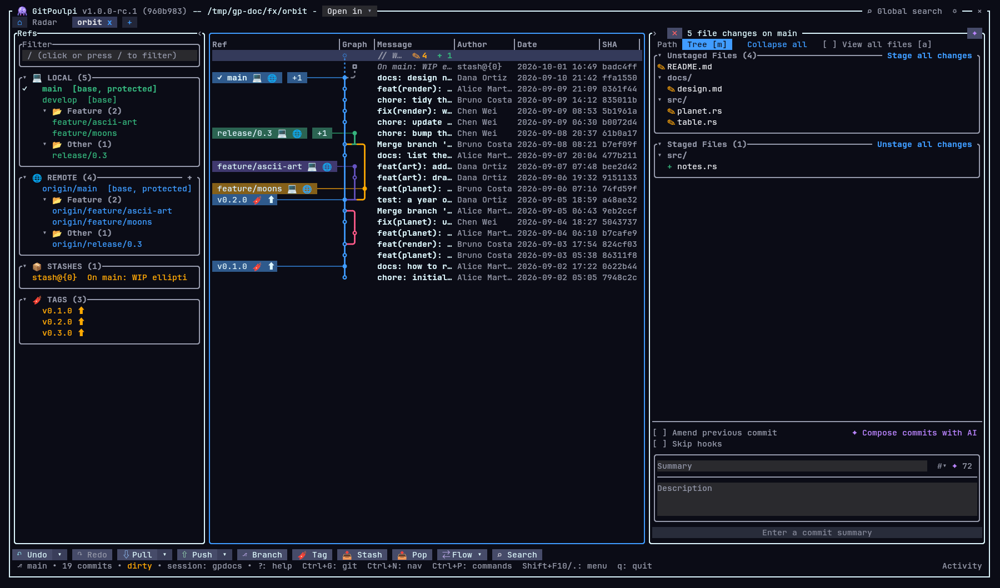

[English](../branching-workflows.md) · [Čeština](../cs/branching-workflows.md) · [Deutsch](../de/branching-workflows.md) · [Español](../es/branching-workflows.md) · [Français](../fr/branching-workflows.md) · [Italiano](../it/branching-workflows.md) · [日本語](../ja/branching-workflows.md) · [한국어](../ko/branching-workflows.md) · [Nederlands](../nl/branching-workflows.md) · **Polski** · [Português (Brasil)](../pt-BR/branching-workflows.md) · [Português (Portugal)](../pt-PT/branching-workflows.md) · [Русский](../ru/branching-workflows.md) · [Svenska](../sv/branching-workflows.md) · [Türkçe](../tr/branching-workflows.md) · [Українська](../uk/branching-workflows.md) · [简体中文](../zh-CN/branching-workflows.md)

# Przepływy pracy z gałęziami

Przepływ pracy z gałęziami mówi GitPoulpi, jak twój zespół używa gałęzi: które
żyją wiecznie (`main`, `develop`, `production`), które są krótkotrwałymi
gałęziami tematycznymi (`feature/...`, `hotfix/...`), jak się nazywają i gdzie
każda z nich się zaczyna i kończy. To Git Flow, który można dostosować: stałe
nazwy, prefiksy i sufiksy albo wzorce z symbolami zastępczymi, dzięki czemu
gałęzie, które bot tworzy ze zgłoszenia, są rozpoznawane tak samo jak twoje.

Ta strona opisuje model, plik, gotowe szablony, wykrywanie i import, polecenia
tylko do odczytu, akcje, które rozpoczynają, kończą, synchronizują i promują
gałęzie (CLI, MCP i aplikacja) oraz ekrany aplikacji: edytor ustawień, grupowany
pasek boczny, menu `Flow` i jego okna.

## Pojęcia

- **Gałąź bazowa** żyje długo. Baza może mieć **gałąź nadrzędną** (`develop`
  trafia do `main`); trunk jej nie ma. Baza może podawać kilka nazw kandydatów
  (`main` lub `master`, `develop` lub `dev`): używana jest ta, która istnieje.
- **Typ gałęzi tematycznych** to rodzaj krótkotrwałej gałęzi (feature, bugfix,
  release, hotfix, support...). Ma **wzorzec nazwy**, **gałąź nadrzędną** (skąd
  się zaczyna i dokąd jest kończona) oraz sposób zakończenia.
- Każda gałąź jest **sklasyfikowana**: jako baza (po nazwie), jako gałąź
  tematyczna jakiegoś typu (po wzorcu) albo jako niesklasyfikowana.
- **Gałąź nadrzędna gałęzi** to, w tej kolejności: ta zapisana, gdy GitPoulpi
  tworzył gałąź (`git config branch.<name>.gitpoulpi-parent`), potem, gdy jest,
  `git-town-branch.<name>.parent` z Git Town, a na końcu gałąź nadrzędna jej
  typu.

## Gdzie to jest przechowywane

| Co | Gdzie | Commitowane |
|---|---|---|
| Wspólny przepływ pracy | `.gitpoulpi/workflow.toml` w repozytorium | Tak, przez ciebie: GitPoulpi zapisuje go tylko na twoją prośbę |
| Twoje własne poprawki | `[workflow]` w `.gitpoulpi/repo-state.toml` | Nie (ten plik jest ignorowany) |

Katalog stanu ignoruje sam siebie (`.gitpoulpi/.gitignore`), z wyjątkiem
`workflow.toml`, który jest przeznaczony do commitowania. Obowiązujący przepływ
pracy to plik wspólny z twoim nadpisaniem na wierzchu: baza o tej samej nazwie
albo typ o tym samym id są zastępowane; nowe są dodawane; `disable_bases`
i `disable_topics` usuwają wspólne wpisy tylko dla ciebie.

Zapis na istniejący plik zachowuje klucze, których ta wersja nie zna (z nowszego
GitPoulpi, od kolegi z zespołu), ale nie komentarze ani kolejność kluczy.

## Plik

```toml
template = "git-flow"          # git-flow | github-flow | gitlab-flow | trunk | custom (informacyjnie)

[[base]]
name = "main"
names = ["master"]             # inne zapisy tej samej gałęzi
protected = true               # nigdy nie jest usuwana, bezpośrednie commity są podejrzane

[[base]]
name = "develop"
names = ["dev"]
parent = "main"
merge = "merge"                # merge | squash | rebase | fast-forward
tag_on_merge = false
# environment = true           # gałąź środowiskowa (GitLab Flow): promowana w dół

[[topic]]
id = "feature"
label = "Feature"
pattern = "feature/{slug}"
patterns = ["features/{slug}"] # więcej nazw, które też pasują; nigdy nie służą do tworzenia
# regex = "^feat-(?P<slug>.+)$"  # też pasuje; nazwane grupy stają się polami
parent = "develop"             # skąd się zaczyna i domyślny cel zakończenia
finish = [{ into = "develop", merge = "squash" }]
finish_mode = "merge-request"  # local-merge | merge-request | ask
delete_after_finish = true

[hooks]                        # polecenia powłoki na zgodę, zawsze pokazywane przed uruchomieniem
after_start = []
before_finish = ["cargo test"]

[issue_flow]                   # przepływy sterowane przez host, zob. niżej
mode = "local"                 # local | host-creates-branch | bot
```

`merge`, `finish`, `finish_mode` i `hooks` sterują [akcjami](#akcje) opisanymi
niżej; `issue_flow` steruje [przepływami sterowanymi przez host](#przepływy-sterowane-przez-host).

### Wzorce nazw

Tekst z `{symbolami zastępczymi}`:

| Symbol | Pasuje do | Tworzony z |
|---|---|---|
| `{slug}` | dowolny tekst; może zawierać `/`, gdy jest ostatni | tekstu, małymi literami, bez akcentów, `-` między słowami, najwyżej 50 znaków |
| `{issue}` | cyfry (`123`) | `123` lub `#123` |
| `{issue_key}` | klucz z trackera (`PROJ-123`) | jak podano |
| `{user}` | nazwa bez `/` | zamieniona na slug |
| `{date}` | `2026-10-16` lub `20261016` | jak podano |
| `{version}` | `1.2.0`, `v1.2`, `1.2.0-rc1` | jak podano |
| `{n}` | cyfry | jak podano |

Wszystko inne jest dosłowne, więc prefiksy i sufiksy to po prostu tekst:
`feature/{slug}`, `{user}/{issue}-{slug}-wip`, `bot/{issue_key}`. Każdy symbol
może wystąpić raz, a dwa symbole potrzebują tekstu między sobą. Wzorzec musi
tworzyć poprawne nazwy gałęzi (reguły `git check-ref-format`): bez spacji, bez
`~ ^ : ? * [ \`, bez `..`, bez składnika zaczynającego się od `.` lub kończącego
się na `.lock`.

`regex` służy tylko do dopasowywania (jest zakotwiczony na obu końcach); użyj go
dla nazw, których żaden wzorzec nie wyrazi. Nazwane grupy stają się polami
gałęzi.

### Który typ wygrywa

1. Gałąź nazwana jak baza (dowolną z jej nazw) jest tą bazą.
2. W przeciwnym razie kandydatem jest każdy wzorzec każdego typu, który pasuje:
   `pattern`, potem `patterns`, potem `regex`, typ po typie w kolejności z pliku.
   Wygrywa ten, który ustala najwięcej dosłownych znaków (`release/{version}`
   bije `{user}/{slug}`, które bije samo `{slug}`); regex liczy swój dosłowny
   prefiks. Remis wygrywa wcześniejszy w pliku.
3. W przeciwnym razie gałąź jest niesklasyfikowana.

Zepsuty wzorzec lub regex jest zgłaszany jako ostrzeżenie i pomijany; reszta
działa dalej.

## Szablony

| Szablon | Bazy | Typy tematyczne |
|---|---|---|
| `git-flow` | `main` lub `master`; `develop` lub `dev` (gałąź nadrzędna main) | `feature/` i `bugfix/` (z develop), `release/` (z develop, do main i develop, z tagiem), `hotfix/` (z main, do main i develop, z tagiem), `support/` (z main); pasują też formy w liczbie mnogiej (`features/`, `releases/`...) |
| `github-flow` | `main` | `feature/` lub dowolna nazwa, z main, merge request do main, squash, potem usunięcie |
| `gitlab-flow` | `main`; `pre-production` i `production` (gałęzie środowiskowe, łańcuch main, pre-production, production) | `feature/` lub dowolna nazwa z main; `release/{version}` jako cel cherry-picka |
| `trunk` | `main` | krótkotrwałe `{user}/{slug}` z main, z rebase |
| `custom` | brak | brak |

Gałęzie środowiskowe pasują też jako `preprod`, `staging` i `prod`. Szablon to
punkt wyjścia: wypisz go przez `flow config init` i edytuj plik.

## Wykrywanie i import

`gitpoulpi flow detect` szereguje szablony dla gałęzi, które ma repozytorium, z
wynikiem na 100 i konkretnymi znalezionymi nazwami (`master` dla `main`, `dev`
dla `develop`, `features/` dla `feature/`). Bazy liczą się za 60 punktów, udział
pozostałych gałęzi rozpoznawanych przez szczegółowe wzorce szablonu za 40, a
długo żyjąca gałąź z innego szablonu (`develop` w kandydacie GitHub Flow)
odejmuje 25.

`gitpoulpi flow import --from git-flow` czyta klasyczne ustawienia git-flow
(`gitflow.branch.master`, `gitflow.branch.develop`,
`gitflow.prefix.feature|bugfix|release|hotfix|support|versiontag`) z własnego
`.git/config` repozytorium; `--from git-town` czyta `git-town.main-branch` i
`git-town.perennial-branches` (gałąź nadrzędna każdej gałęzi,
`git-town-branch.<name>.parent`, jest przejmowana jako zapisana gałąź
nadrzędna). Nic nie jest stosowane po cichu: polecenie wypisuje TOML, a
`--write` tworzy `.gitpoulpi/workflow.toml` tylko wtedy, gdy go jeszcze nie ma.

## Polecenia

Wszystkie przyjmują `--json`; serwer MCP udostępnia je jako narzędzia
(`flow_status`, `flow_templates`, `flow_detect`, `flow_config_show` czytają;
akcje opisano niżej).

| Polecenie | Co robi |
|---|---|
| `gitpoulpi flow status` | Każda gałąź lokalna i zdalna: rodzaj (baza, tematyczna, niesklasyfikowana), typ i pola, gałąź nadrzędna i skąd pochodzi (`recorded`, `git_town`, `type`, `base`), a dla gałęzi lokalnych, o ile commitów jest `ahead` i `behind` swojej gałęzi nadrzędnej. Także ostrzeżenia znalezione w definicji, uszeregowane wykrywanie i ustawienia innych narzędzi, które można zaimportować. |
| `gitpoulpi flow templates` | Powyższe gotowe szablony z pełną definicją. Nie wymaga repozytorium. |
| `gitpoulpi flow detect` | Uszeregowane szablony ze znalezionymi bazami i typami tematycznymi. |
| `gitpoulpi flow config [--show-effective]` | Plik wspólny (jego ścieżka, czy istnieje, sparsowany przepływ pracy, nieznane klucze) albo, z `--show-effective`, przepływ pracy, według którego klasyfikowane są twoje gałęzie. `flow config show` to to samo. |
| `gitpoulpi flow config init --template <t> [--write]` | Wypisuje TOML szablonu; `--write` tworzy `.gitpoulpi/workflow.toml` i odmawia nadpisania istniejącego. |
| `gitpoulpi flow import --from git-flow\|git-town [--write]` | Jak opisano wyżej. |

Liczniki ahead/behind są liczone dla najwyżej 300 gałęzi lokalnych na wywołanie.

Plik przepływu pracy, którego nie da się wczytać (zły TOML, wartość złego
typu), jest błędem wskazującym plik; nigdy nie jest po cichu ignorowany.

## Akcje

`start`, `finish`, `sync`, `promote` i `set-parent` działają na repozytorium.
Każda najpierw **planuje**: wymienia każdy krok git, który wykona, wraz z
poleceniem git, jakie mu odpowiada, ostrzeżeniami, tym, czego nie da się
cofnąć, i wszystkim, co ją blokuje. Nic się nie zmienia, dopóki nie
potwierdzisz. Każde uruchomienie to **jeden wpis w historii cofania**
(`gitpoulpi undo` cofa razem gałęzie, tag, usuniętą gałąź, zapisaną gałąź
nadrzędną i checkout).

| Polecenie | Co robi |
|---|---|
| `gitpoulpi flow start <type> [name=value ...] [--from <ref>] [--publish]` | Nadaje gałęzi nazwę według wzorca typu (`flow start feature "Login form"` tworzy `feature/login-form`; `flow start release version=1.2.0` tworzy `release/1.2.0`; samo słowo to `slug`; `user` i `date` domyślnie to ty i dziś), tworzy ją z gałęzi nadrzędnej typu lub z `--from` (gałąź, gałąź zdalna lub tag), robi checkout i zapisuje jej gałąź nadrzędną. `--publish` wypycha ją z `-u` (`undo` tego nie cofa). |
| `gitpoulpi flow finish [<branch>]` | Dla każdego celu `finish` typu, po kolei: robi checkout celu i merge gałęzi ze strategią celu (`merge`: zawsze merge commit; `squash`: jeden commit z tytułem z `--title` lub z nazwy gałęzi; `rebase`: rebase gałęzi na cel, potem fast-forward; `fast-forward`), tworzy tag, gdy cel go ma (`tag = "v{version}"`, opisany), a potem robi checkout gałęzi nadrzędnej i usuwa gałąź lokalną, gdy typ tak mówi (`--delete` / `--keep` to nadpisują; `--delete-remote` usuwa ją też na zdalnym, nie do cofnięcia). Z `finish_mode = "merge-request"` (lub `--mode merge-request`) tylko wypycha gałąź i otwiera pull lub merge request do gałęzi nadrzędnej, z `--title`, `--draft`, `--assignee`, `--reviewer`, `--label`, `--milestone` i `--integration` (nie do cofnięcia; lokalnie nic nie jest scalane ani usuwane). `--mode local-merge` nadpisuje typ `merge-request`, a typ z `ask` wymaga jednego z dwóch. |
| `gitpoulpi flow sync [<branch>] [--stack] [--rebase\|--merge]` | Wprowadza commity gałęzi nadrzędnej do gałęzi: merge albo rebase, gdy strategią gałęzi jest `rebase` (lub `--rebase`). Z `--stack` także gałęzie, których gałęzią nadrzędną jest ta (zapisane przez `set-parent`), rekurencyjnie, po kolei. Wraca do gałęzi, na której byłeś. |
| `gitpoulpi flow promote <env-branch>` | Gałęzie środowiskowe GitLab Flow: robi w niej merge gałęzi, od której jest w dół (`main` do `pre-production`, `pre-production` do `production`), jednym krokiem i wraca. Robi fast-forward, gdy się da. |
| `gitpoulpi flow set-parent <branch> <parent>` / `--clear` | Zapisuje (lub usuwa) `branch.<name>.gitpoulpi-parent`. Odmawia cyklu. Do cofnięcia. |

Gałąź zaczęta gdzie indziej kończy się tam: gdy zapisana gałąź nadrzędna (z
`--from` lub `set-parent`) różni się od gałęzi nadrzędnej typu, pierwszym celem
zakończenia jest zapisana gałąź nadrzędna.

### Potwierdzanie, planowanie, skrypty

| Flaga | Znaczenie |
|---|---|
| `--dry-run` | Wypisuje plan jako JSON (`{"plan": ...}`) i kończy. Kod wyjścia 1, gdy coś go blokuje. |
| `--yes` | Wykonuje bez pytania. |
| żadna | W terminalu: plan jest pokazywany i jesteś pytany. W innym przypadku (skrypt, `--json`, agent) plan wraca jako `{"needs_confirmation": {"plan": ...}}` z kodem wyjścia 3 i bez żadnej zmiany. `start` bez `--publish` i bez hooków, `set-parent` i `--abort` nie wymagają potwierdzenia. |
| `--run-hooks` / `--no-hooks` | Zob. [hooki](#hooki). |
| `--autostash` | Robi stash lokalnych zmian, które blokują checkout lub merge, i przywraca je potem, niezależnie od `general.auto_stash`. |

Zablokowany plan podaje powód: gałąź bazowa tam, gdzie potrzebna jest
tematyczna, nazwa, która już istnieje, brakujące pole (`release/{version}`
potrzebuje `version=...`), istniejący tag, gałąź docelowa za swoim zdalnym
(`--allow-behind` mimo to idzie dalej), trwający merge lub rebase, nieskonfigurowany
przepływ pracy.

Z ustawieniem **auto-stash** (`general.auto_stash`) zmiany robocze, które
blokują checkout lub merge, są chowane i przywracane wokół akcji dokładnie tak
jak przy zwykłym checkout; z `never` akcja zatrzymuje się, zanim cokolwiek
zmieni.

### Konflikty

Merge lub rebase zatrzymany na konfliktach zostawia zwykły stan konfliktu
(baner konfliktu, `gitpoulpi conflicts ...`), a przepływ jest zapamiętany. Kod
wyjścia 2, `status: "conflicted"`, ścieżki w `conflicts`. Rozwiąż pliki i
oznacz je jako rozwiązane, a potem:

- `gitpoulpi flow finish --continue` zatwierdza merge (albo kontynuuje rebase,
  albo zatwierdza squash z jego opisem) i wykonuje pozostałe kroki;
- `gitpoulpi flow finish --abort` przerywa merge lub rebase, wraca do gałęzi,
  od której przepływ się zaczął, i zapomina resztę. Kroki już wykonane
  (pierwszy cel podwójnego zakończenia, razem z tagiem) zostają: `undo` je
  cofa.

Przepływ zatrzymany przez nieudany hook wznawia się tak samo (`--continue`
uruchamia ten krok ponownie). Uruchomienie z konfliktem i jego kontynuacja to
dwa wpisy cofania.

### Merge requesty

Demon wypycha gałąź; otwarcie żądania wymaga twojego tokenu hostingu, więc CLI
robi to tym samym kodem co `gitpoulpi hosting pr` (integracja pasująca do
zdalnego, w przeciwnym razie wstępnie wypełniona strona WWW hosta, wypisana jako
URL). Wynik zawiera `merge_request` (o co poproszono) i `opened` (co odpowiedział
host) albo `open_error`, gdy gałąź jest wypchnięta, ale żądania nie udało się
otworzyć.

### Hooki

`[hooks]` w pliku przepływu pracy wymienia polecenia powłoki (`after_start`,
`before_finish`). Pochodzą z pliku współdzielonego przez zespół, więc **nigdy nie
są uruchamiane bez twojej prośby**: `--run-hooks` lub odpowiedź „tak” na pytanie,
które terminal zadaje po ich wylistowaniu. Plan zawsze je wymienia, z
`hooks_run: false`, gdy nie zostaną uruchomione. Hook działa w powłoce z
repozytorium jako katalogiem roboczym i ustawionymi `GITPOULPI_FLOW_ACTION` /
`GITPOULPI_FLOW_BRANCH`; jego dokładne polecenie, kod wyjścia i całe wyjście są
w wyniku. Hook, który kończy się niezerowym kodem, zatrzymuje przepływ w tym
miejscu (hook `before_finish` działa, zanim cokolwiek się zmieniło, więc to
zwykły błąd; po hooku `after_start` gałąź istnieje, a przepływ można
kontynuować albo przerwać). `--no-hooks` pomija je bez pytania. Hook może zrobić
wszystko, więc `undo` cofa tylko zmiany w git.

**Zaufanie.** Polecenia zapisanej w repozytorium sekcji `[hooks]` pochodzą od każdego, kto
może pisać do repozytorium, więc wymagają też *twojego* zaufania, raz dla każdej wersji
listy. Zaufanie jest trzymane dla repozytorium według hasha hooków (zmiana
któregokolwiek polecenia, fazy lub kolejności pyta ponownie) i sprawdzane przez demona
przed pierwszym krokiem uruchomienia oraz zanim kontynuowany przepływ pójdzie dalej, więc
odrzucone uruchomienie niczego nie zmieniło. Hooki z twojego własnego nadpisania (`[workflow]`
w stanie repozytorium, strona Ustawień) są twoje i nigdy nie pytają.

- **CLI:** `gitpoulpi flow trust-hooks` wypisuje polecenia, ich `hash` i to, czy są
  `trusted`; `gitpoulpi flow trust-hooks --hash <hash>` im ufa, i to tylko wtedy, gdy plik
  na dysku nadal ma ten hash. `--run-hooks` dla niezaufanych hooków wypisuje odmowę
  (`{"refused": {"reason": "hooks_not_trusted", ...}}`, kod wyjścia 2) z poleceniami
  i tym wierszem poleceń. Terminal pytany „Uruchomić je też?” jest pytany,
  czy im także zaufać.
- **TUI:** podgląd wymienia hooki i mówi, że nie są jeszcze zaufane. Naciśnięcie
  przycisku akcji pyta wtedy „Przepływ pracy tego repozytorium uruchamia na twoim komputerze
  te polecenia. Zaufać im?” z dokładnymi poleceniami w przewijanym panelu
  (kółko myszy, przeciągany pasek przewijania, PgUp/PgDn/Home/End) i dwiema odpowiedziami:
  **1 Zaufaj i uruchom** oraz **2 Uruchom bez hooków**. Nic nie jest podświetlone, dopóki
  nie naciśniesz strzałki lub cyfry; Esc, Anuluj lub krzyżyk zamknięcia wracają bez
  odpowiedzi. Gdy plik zmienił się od czasu, gdy mu zaufano, tytuł mówi „Hooki zmieniły się od czasu,
  gdy im zaufano”, a stara lista jest pokazana pod nową.
- **Agenci:** nie ma narzędzia do zaufania hookom. `run_hooks: true` dla niezaufanych
  hooków jest odrzucane z poleceniami, a człowiek uruchamia `flow trust-hooks`.

### Dla agentów (MCP)

Narzędzia to `flow_start`, `flow_finish`, `flow_sync`, `flow_promote` i
`flow_set_parent` (finish, sync i promote są oznaczone jako destrukcyjne, więc
bramkuje je `allow_mutations`). Działają w trybie najpierw plan, potem
wykonanie: wywołaj z `dry_run: true`, aby dostać plan (zwykły wynik), a potem
ponownie z `yes: true`, aby go wykonać. Bez żadnego z nich wywołanie jest
odrzucane i niesie plan, więc nic nie rusza przez przypadek. Hooki działają
tylko z jawnym `run_hooks: true`; plan je wymienia (`hooks`, `hooks_run`), aby
agent mógł najpierw pokazać użytkownikowi polecenia. Zapisane hooki musi zaufać
człowiek (`flow trust-hooks`, które nie ma narzędzia): `run_hooks: true` dla niezaufanych
hooków zwraca `refused` z poleceniami i niczego nie uruchamia. Po konflikcie
`continue_: true` (flaga to `--continue`) lub `abort: true`.

### Cofanie

| Akcja | Co robi `undo` |
|---|---|
| start | Usuwa gałąź, zapomina jej gałąź nadrzędną, ponownie robi checkout poprzedniej gałęzi. |
| finish | Przywraca każdą przesuniętą gałąź, tag, usuniętą gałąź i checkout, jednym krokiem. Wypchnięta gałąź, usunięcie na zdalnym i otwarty merge request zostają (plan o tym mówi). |
| sync | Przywraca każdą zaktualizowaną gałąź, z plikami w przypadku bieżącej. |
| promote | Przywraca gałąź środowiskową. |
| set-parent | Przywraca poprzednio zapisaną gałąź nadrzędną. |

## Przepływy sterowane przez host

Zespoły, w których zgłoszenie rozpoczyna pracę: zgłoszenie jest pisane z
szablonu, a host (GitLab, GitHub, Gitea, Forgejo) lub bot tworzy gałąź i merge
request. GitPoulpi tworzy zgłoszenie, czeka na to, co zrobi host, i to
przejmuje: lokalna gałąź śledząca zdalną, z zapisaną gałęzią nadrzędną (cel
merge request), po checkout. Wymaga sekcji ZGŁOSZENIA połączonej z trackerem
(`gitpoulpi hosting link issues`); połączenie PULL REQUESTS mówi, gdzie są
gałęzie i żądania (projekt z ZGŁOSZENIA, gdy nie jest połączone).

```toml
[issue_flow]
mode = "bot"                         # local | host-creates-branch | bot
issue_title = "[{type}] {title}"     # {type} {title} {user} {date}
issue_labels = ["workflow::{type}"]  # bot często reaguje na etykietę
description_template = ".github/ISSUE_TEMPLATE/feature.md"   # plik repozytorium
branch_from_issue = "{type}/{issue}-{slug}"   # jak host lub bot nazywa gałąź
wait_for = "branch-or-mr"            # branch | mr | branch-or-mr
timeout_secs = 600                   # jak długo `wait` odpytuje
merge_request = true                 # host-creates-branch: także szkic żądania
assignees = []
```

`{type}` w `branch_from_issue` to id typu gałęzi tematycznych; reszta to zwykłe
tokeny [wzorca nazwy](#wzorce-nazw) (`{issue}`, `{slug}`, `{issue_key}`...).
Gałąź należy do zgłoszenia 12, gdy pasuje do tego wzorca z `{issue}` równym 12
(`feature/12-login` pasuje, `feature/120-x` nie).

| Tryb | Po utworzeniu zgłoszenia |
|---|---|
| `local` | Nic na hoście. Z `--pick-up` `flow start` typu z numerem i tytułem zgłoszenia (do cofnięcia jak każdy start). |
| `host-creates-branch` | GitPoulpi tworzy gałąź **na hoście** z gałęzi nadrzędnej typu (GitLab: API gałęzi; GitHub: `createLinkedBranch`, więc zgłoszenie pokazuje ją w Development; Gitea/Forgejo: API gałęzi) oraz **szkic** żądania z `Closes #12`. Host, który odrzuca puste żądanie (GitHub: brak jeszcze commitów), zostawia gałąź i mówi o tym w ostrzeżeniu. |
| `bot` | Nic: bot (obsługa webhooka, zadanie CI, GitHub App) tworzy gałąź i żądanie. `--wait` odpytuje, aż `wait_for` zostanie spełnione. |

Na co patrzy `wait`, dla każdego dostawcy: własne powiązania hosta (GitLab
`issues/:iid/related_merge_requests` i `closed_by`; GitHub powiązane gałęzie
oraz pull requesty `connected` / `cross-referenced` z osi czasu), gałęzie,
których nazwa pasuje do `branch_from_issue`, i otwarte żądania, których gałąź
źródłowa pasuje. Odpytuje z rosnącą przerwą (1, 2, 3, 5, 8, potem co 10 s), aż
`wait_for` zostanie spełnione lub skończy się `timeout_secs`, a host wolny lub
chwilowo niedostępny po udzielonej odpowiedzi jest ponawiany. Źródło, którego
host nie oferuje (Gitea nie ma powiązań zgłoszeń), jest pomijane; gdy zawiodą
wszystkie źródła, odpowiedzią jest pierwszy błąd.

| Polecenie | Co robi |
|---|---|
| `gitpoulpi flow issue new --type <t> --title "..." [--body T \| --body-file F] [--label L] [--assignee A] [--milestone M] [--wait] [--pick-up] [--timeout S] [--integration ID] [--dry-run]` | Tworzy zgłoszenie z szablonu (`issue_title`, `issue_labels`, plik opisu, `--body` zamiast niego) i idzie dalej według trybu. `--dry-run` wypisuje, co zostałoby utworzone (`{"plan": ...}`), i niczego nie tworzy. `--pick-up` w trybie `bot` najpierw czeka. Kod wyjścia 4: oczekiwanie się skończyło (zgłoszenie istnieje; `flow issue wait` czeka dalej). |
| `gitpoulpi flow issue wait <#12> [--type t] [--for branch\|mr\|branch-or-mr] [--timeout S] [--once] [--pick-up]` | Odpytuje o to, co host zrobił dla zgłoszenia, z postępem na stderr w terminalu; Ctrl+C anuluje. `--once` sprawdza jeden raz. Kod wyjścia 4: jeszcze nic. |
| `gitpoulpi flow pick-up <#12 \| !5 \| branch> [--remote R] [--parent B] [--no-fetch] [--dry-run]` | Robi fetch, tworzy lokalną gałąź śledzącą `origin/<branch>`, zapisuje jej gałąź nadrzędną i robi checkout. `#12` wyszukuje na hoście gałąź lub żądanie zgłoszenia, `!5` żądanie, wszystko inne jest nazwą gałęzi. Gałęzią nadrzędną jest cel żądania (`--parent` to nadpisuje), a w przeciwnym razie gałąź nadrzędna typu. Nie potrzebuje `--yes`: jest lokalne i do cofnięcia, jak `start`. `--dry-run` nadal robi fetch (przesuwa tylko refy śledzenia zdalnego, a plan musi zobaczyć gałąź). |

`pick-up` to jeden wpis w historii cofania: `gitpoulpi undo` usuwa gałąź,
zapomina gałąź nadrzędną i ponownie robi checkout poprzedniej gałęzi (fetch
zostaje, jak każdy fetch). Jest planowany jak pozostałe akcje: `--dry-run`
wypisuje jego plan (`create_branch`, `set_upstream`, `checkout`,
`record_parent`) i obowiązują zwykłe blokady (zmiany robocze podlegają
ustawieniu auto-stash). Żądanie to
`{"action": "pick_up", "branch": ..., "parent": ...}`.

Zgłoszenia utworzone przez przepływ są **obserwowane** (`watched_issues` w
`.gitpoulpi/repo-state.toml`, nigdy nie commitowane): po każdym fetch aplikacja
porównuje gałęzie zdalne z `branch_from_issue` i mówi ci, gdy pojawiła się
gałąź obserwowanego zgłoszenia. Przejęcie to kończy.

### Dla agentów (sterowane przez host)

Narzędzia to `flow_issue_new`, `flow_issue_wait` i `flow_pick_up` (zapis, sieć;
bramkuje je `allow_mutations`). `flow_issue_new` z `dry_run: true` zwraca plan;
`flow_issue_wait` blokuje do `timeout` sekund, więc agentowi daj krótki i
wywołaj go ponownie (`once: true` odpowiada od razu). Oba zwracają JSON z
`found` (`branches`, `requests`) i `timed_out`.

### Przepływy sterowane przez host w aplikacji

Przy przepływie pracy i połączonym trackerze menu Flow dostaje *Nowe zgłoszenie
<Typ>...* (po jednym na typ; paleta `Flow: Nowe zgłoszenie <Typ>...` oraz
`Flow: Nowe zgłoszenie...`) i *Przejmij gałąź utworzoną przez hosta...* (paleta
`Flow: Przejmij gałąź hosta...`).

- **Nowe zgłoszenie** pyta o typ (lista rozwijana) i tytuł; pokazuje, skąd
  pochodzi opis i kto tworzy gałąź. *Przejmij gałąź, gdy się pojawi* jest
  domyślnie włączone. *Utwórz zgłoszenie* je tworzy, a potem w trybie `bot`
  pokazuje **kartę oczekiwania**: wskaźnik, na co czeka, upływający czas i czas
  rezygnacji oraz **Przestań czekać** (`Esc`). Zatrzymanie nie gubi zgłoszenia:
  pozostaje obserwowane. Gdy gałąź się pojawi, jest przejmowana, a pasek
  stanu o tym mówi.
- **Pojawiła się gałąź** to karta, która otwiera się po fetch, który przyniósł
  gałąź obserwowanego zgłoszenia (gdy nie jest otwarte żadne inne okno):
  *Przejmij* przejmuje ją, *Później* ją zamyka (nie jest oferowana ponownie do
  restartu aplikacji).
- **Przejmij** przyjmuje `#12`, `!5` lub nazwę gałęzi i pokazuje, co znalazł,
  zanim ją przejmie.

Wszystko działa w tle; wywołanie trwające dłużej niż 150 ms pokazuje wskaźnik.

### Próba na stanowisku testowym

`scripts/fake-gitlab-bot.sh` to zastępczy bot dla GitLaba w Dockerze
(`scripts/test-bench.sh`): obserwuje projekt pod kątem zgłoszeń z etykietą i
tworzy `<type>/<iid>-<slug>` (z jednym commitem) oraz szkic żądania, który
zamyka zgłoszenie. `cargo run -p xtask -- mock-host --flow-bare <bare repo>`
serwuje to samo offline (API w kształcie GitLaba nad prawdziwym bare
repozytorium, z botem).

## W aplikacji




Wszystko poniżej pojawia się tylko w repozytorium, które ma przepływ pracy
(`.gitpoulpi/workflow.toml` albo twoje nadpisanie). Bez niego nic się nie
zmienia: pasek boczny jest zwykłym drzewem i nie ma przycisku `Flow`.

### Ustawienia > Przepływ pracy

*Ustawienia > Ustawienia repozytorium > Przepływ pracy* edytuje definicję.
Pracuje na wersji roboczej i nic nie zapisuje, dopóki nie naciśniesz przycisku
Zapisz.

- **Szablon** to lista rozwijana gotowych szablonów; wybór jednego zastępuje
  poniższe bazy i typy gałęzi szablonem (twoje hooki i przepływ ze zgłoszeń
  zostają).
- **Wykryj na podstawie gałęzi** czyta nazwy gałęzi tego repozytorium i pokazuje
  najbliższy szablon z wynikiem, znalezione nazwy baz (`master` dla `main`), ile
  gałęzi rozpoznaje każdy typ, z przykładami, oraz wynik każdego szablonu.
  **Użyj wykrytego przepływu pracy** wczytuje go do wersji roboczej.
- Gdy repozytorium zawiera konfigurację innego narzędzia (`gitflow.*` z Git Flow,
  `git-town.*` z Git Town), oferowane jest **Zaimportuj** i wczytuje ono
  zaimportowaną definicję do wersji roboczej. Nic nie jest stosowane, dopóki
  tego nie naciśniesz.
- **Gałęzie bazowe**, **Typy gałęzi** i ich **Reguły zakończenia** tworzą jedną
  [listę](settings.md#listy) w grupach na karcie **Reguły**; karta **Ogólne**
  zawiera resztę (szablon, wykrywanie, hooki, przepływ ze zgłoszeń). Zaznacz element, by edytować go po prawej
  (nazwa i inne nazwy, gałąź nadrzędna, chroniona, strategia merge, tag przy
  merge, gałąź środowiskowa; etykieta, wzorzec nazwy, inne wzorce, wyrażenie
  regularne, gałąź nadrzędna, tryb zakończenia, usuń po zakończeniu). **+ Dodaj ▾**
  wybiera, co dodać (reguła zakończenia należy do zaznaczonego typu gałęzi);
  dodawanie, duplikowanie, usuwanie i przeciąganie działają jak w każdej liście
  Ustawień, a elementy przesuwają się w obrębie swojej grupy. Wiersz
  **wzorca nazwy** wymienia tokeny (`{slug} {issue} {issue_key} {user} {date}
  {version} {n}`); pod nim podgląd na żywo pokazuje istniejące gałęzie, do
  których wzorzec pasuje, i nazwę, którą by utworzył, a wzorzec, który się nie
  parsuje, mówi dlaczego na czerwono, tuż pod polem (nic z wpisanego nie
  ginie).
- **Hooki** to polecenia powłoki, po jednym w wierszu (`Po rozpoczęciu`, `Przed
  zakończeniem`), edytowane w wielowierszowym edytorze (`Ctrl+S` zapisuje,
  `Esc` anuluje). Uruchamiają polecenia na twoim komputerze: strona o tym
  mówi, a okna pokazują je, zanim zostaną uruchomione.
- **Przepływ ze zgłoszeń** zawiera pola używane przez [przepływy sterowane przez
  host](#przepływy-sterowane-przez-host) (tryb, tytuł i etykiety zgłoszenia,
  wzorzec gałęzi, na co czekać), przechowywane w pliku przepływu pracy.
- **Problemy** wymienia, co w definicji jest błędne (nieistniejąca gałąź
  nadrzędna, zepsuty wzorzec).
- Pasek przypięty na dole strony pokazuje **● Niezapisane** (albo **Bez zmian**).
  **Zapisz we wspólnym pliku** zapisuje wersję roboczą w `.gitpoulpi/workflow.toml`
  (zrób jego commit), zachowując klucze, których ta wersja nie zna, i wchłaniając
  twoje własne nadpisanie. **Tylko dla mnie** zachowuje tylko różnicę względem pliku
  wspólnego w stanie twojego repozytorium (`.gitpoulpi/repo-state.toml`,
  niecommitowanym). **Odrzuć zmiany** wczytuje to, co zapisane, ponownie. Zamknięcie
  Ustawień z niezapisaną wersją roboczą najpierw pyta.

### Pasek boczny

LOKALNE i ZDALNE są grupowane według przepływu pracy: najpierw gałęzie bazowe,
każda z plakietką `[baza]` (`[baza, chroniona]`, gdy jest chroniona), potem po
jednym folderze na typ gałęzi tematycznych, nazwanym jego etykietą z liczbą
gałęzi (`Feature (3)`), a na końcu gałęzie, których żaden typ nie przejął, pod
`Inne`. Foldery zwija się jak każdy folder; zwykłe drzewa wracają przez *Flow >
Pokaż gałęzie w zwykłych listach* (wiersz menu Flow) albo polecenie palety
`Flow: Przełącz grupowanie gałęzi`. Najechanie na gałąź pokazuje jej typ, jej
gałąź nadrzędną i o ile jest za gałęzią nadrzędną (i przed nią).

### Menu Flow i jego okna

Przycisk **Flow** na pasku narzędzi (`Ctrl+G Shift+W`, paleta `Flow: Otwórz menu`)
wymienia *Rozpocznij <Typ>...* dla każdego typu gałęzi tematycznych, *Zakończ
bieżącą gałąź...*, *Synchronizuj z gałęzią nadrzędną...*, *Promuj...* (gałęzie
środowiskowe GitLab Flow), *Ustaw gałąź nadrzędną...*, przełącznik grupowania i
*Ustawienia przepływu pracy...*. Paleta ma te same polecenia (`Flow: Rozpocznij
Feature...` jest generowane dla każdego typu).

- **Rozpocznij** to formularz zbudowany z wzorca nazwy typu: pole na każdy token.
  `{issue}` i `{issue_key}` mają listę rozwijaną zgłoszeń połączonego trackera,
  która wypełnia też `{slug}` tytułem zgłoszenia; `{version}` podpowiada wersję
  po twoim najwyższym tagu wydania; `{user}` to twój aktywny profil; `{date}` to
  dziś. Wiersz pokazuje nazwę gałęzi, którą tworzy wzorzec (albo dlaczego nie
  może: nieprawidłowy ref, zajęta nazwa). *Rozpocznij od* to lista rozwijana
  (najpierw gałąź nadrzędna typu), a *Opublikuj* wypycha nową gałąź.
- **Zakończ**, **Synchronizuj**, **Promuj** i **Ustaw nadrzędną** pytają o to, co
  potrzebne, a potem pokazują **podgląd** obliczony przez demona (ten sam plan,
  który wypisuje `gitpoulpi flow ... --dry-run`): każdy krok po kolei,
  ostrzeżenia (cel za swoim zdalnym, gałęzie oparte na tej) i **blokady** (cel,
  który nie istnieje, cel za swoim zdalnym), które wyłączają przycisk
  uruchomienia i mówią dlaczego. Kroki, których nie da się cofnąć (push,
  usunięcie gałęzi na zdalnym, merge request), są oznaczone `!` i kolorem, z
  wierszem „Cofnięcie nie przywróci: ...”. Hooki, które zostałyby uruchomione,
  są wymienione pod ostrzeżeniem, z polem wyboru *Uruchom hooki* (domyślnie
  wyłączonym). Gdy tryb zakończenia typu to `ask`, Zakończ najpierw pyta
  *Zakończ przez*: merge lokalnie albo otwarcie pull lub merge requestu.
- Akcja działa potem ze znakiem przy każdym kroku (wskaźnik po 150 ms), a okno
  pokazuje, jak poszedł każdy krok. Cała akcja to **jeden wpis cofania**:
  `Ctrl+Z` cofa naraz start, zakończenie, synchronizację lub promocję (Historia
  cofania pokazuje `Flow finish feature/login`); pushe, usunięcia na zdalnym i
  merge requesty zostają, jak mówił podgląd.
- **Konflikt** zatrzymuje akcję z przyciskami **Kontynuuj** i **Przerwij**.
  Okno można zamknąć, aby rozwiązać konflikt zwykłymi narzędziami konfliktów,
  a potem otworzyć ponownie poleceniem palety `Flow: Kontynuuj lub przerwij
  zatrzymaną akcję...` (to także wiersz menu Flow, gdy akcja jest zatrzymana);
  Kontynuuj odmawia, dopóki pliki są w konflikcie, i zachowuje oba przyciski.
  Przerwij wraca do gałęzi, od której akcja się zaczęła; kroki już wykonane
  zostają (cofanie je cofa).
- Zakończenie przez **merge request** wypycha gałąź, a potem otwiera zwykły
  formularz *Utwórz pull request* (*Utwórz merge request* w GitLabie),
  wstępnie wypełniony: celem jest gałąź nadrzędna, a tytuł pochodzi z gałęzi
  (i zgłoszenia). Przyciski metadanych (osoby przypisane, recenzenci, etykiety,
  kamień milowy) działają jak w każdym pull requeście. Gdy żadna integracja nie
  odpowiada dla zdalnego, zamiast tego w przeglądarce otwierany jest URL
  porównania (i pokazany na pasku stanu).
- Teksty kroków i blokad są po angielsku, jak w CLI; własny tekst okna jest
  przetłumaczony. Drzewo robocze ze zmianami podlega ustawieniu `auto-stash`.

Każde z nich jest dostępne z klawiatury i z palety, a każda lista rozwijana to
combobox (Enter ją otwiera, pisanie filtruje, Enter wybiera).

Wiersze sterowane przez host (*Nowe zgłoszenie <Typ>...*, *Przejmij gałąź
utworzoną przez hosta...*) opisano [wyżej](#przepływy-sterowane-przez-host-w-aplikacji).
